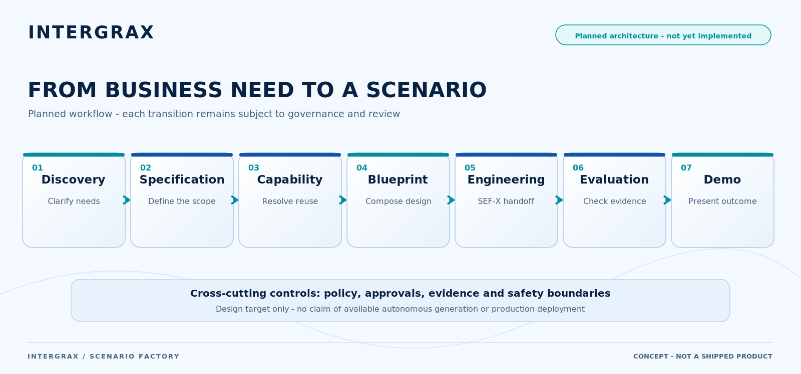

# Scenario Factory journey (planned)

**Planned architecture - not yet implemented.** [Scenario Factory overview](../../../../overview/SCENARIO_FACTORY.md)

<picture>
  <source
    media="(prefers-color-scheme: dark)"
    srcset="../scenario-factory-journey-dark.png"
  >
  <source
    media="(prefers-color-scheme: light)"
    srcset="../scenario-factory-journey-light.png"
  >
  
</picture>

[Open light image](../scenario-factory-journey-light.png) ·
[Open dark image](../scenario-factory-journey-dark.png)
