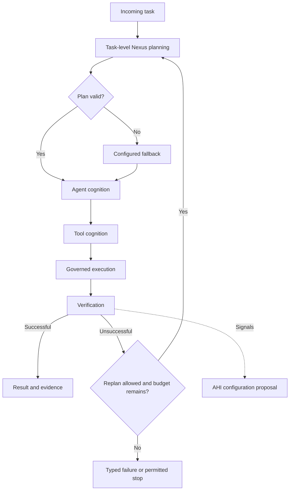
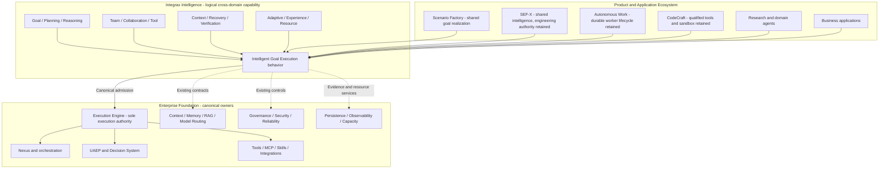
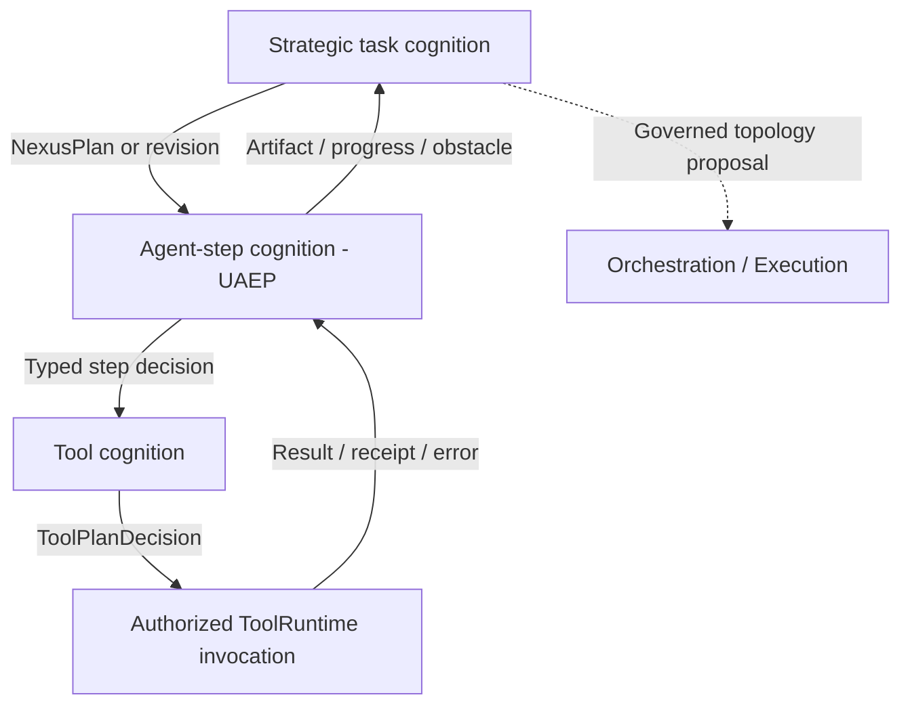
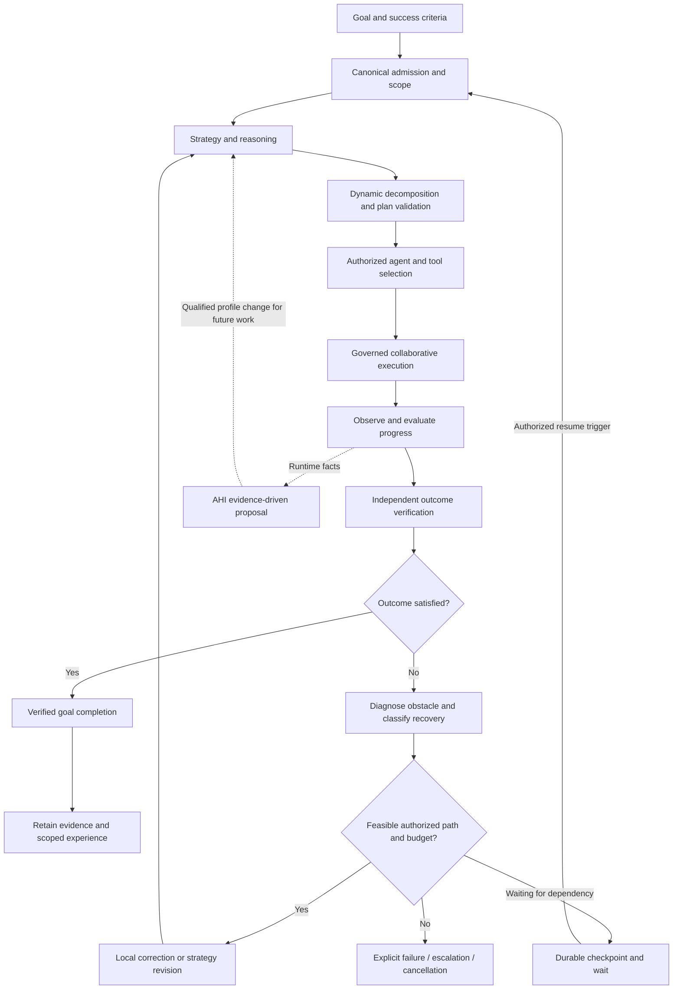
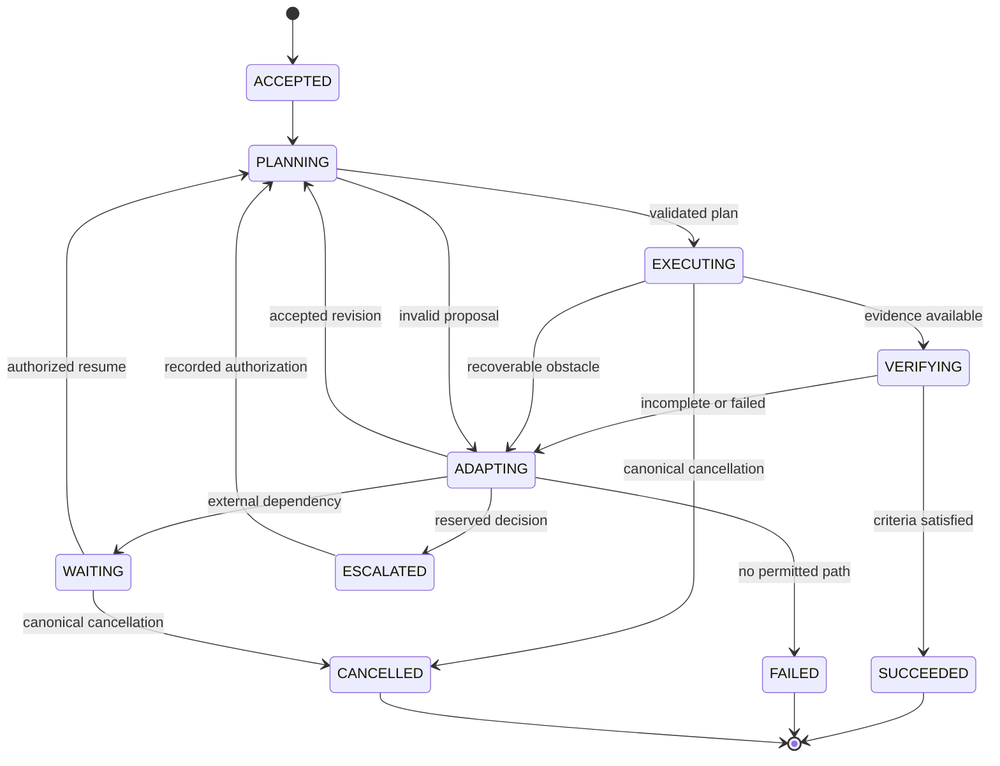
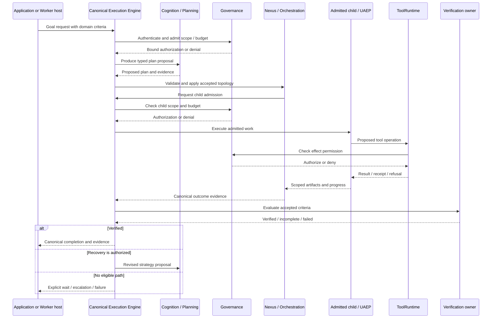
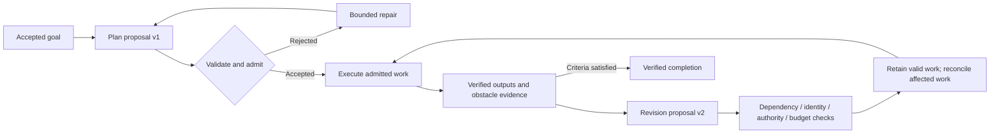
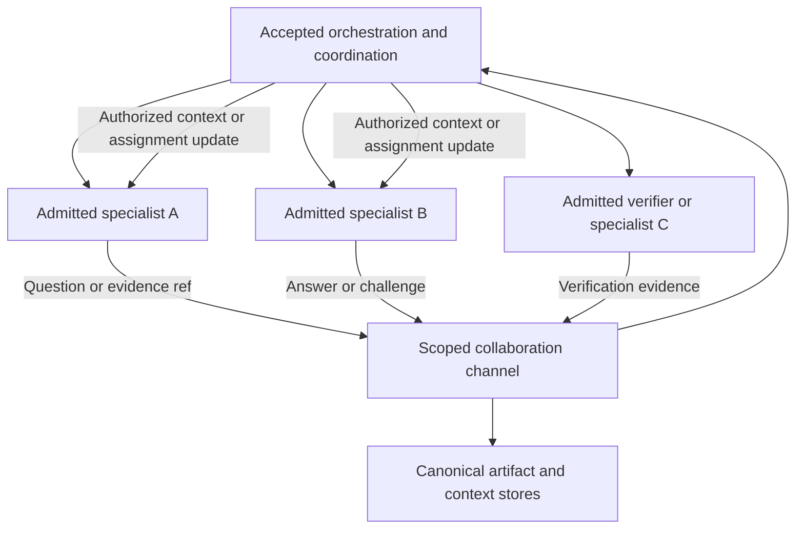
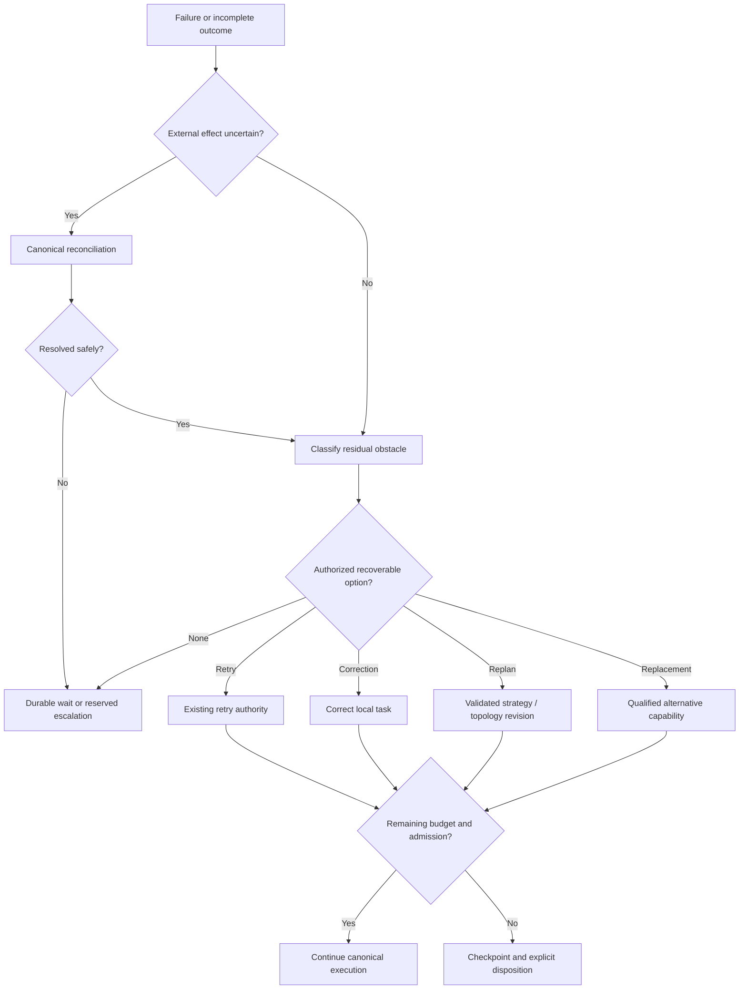
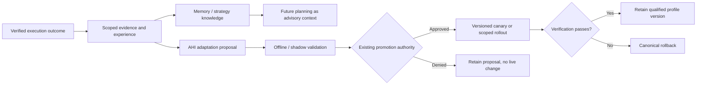

<!--
© Artur Czarnecki. All rights reserved.
Intergrax framework – proprietary and confidential.
Use, modification, or distribution without written permission is prohibited.
-->

# Integrax Intelligence

**Strategic architecture, behavioral contract, ownership, and program-level acceptance. Revision 1.1. The canonical roadmap is not this file.**

| Attribute | Value |
|---|---|
| Capability name | **Integrax Intelligence** |
| Proposed program ID | `INTELLIGENCE-X` |
| Revision | 1.1 — architecture candidate |
| Date | 2026-11-27 |
| Status | **FINAL DRAFT — PENDING INDEPENDENT REVIEW AND FORMAL RATIFICATION** |
| Classification | Cross-domain platform capability; logical intelligence layer, not a physical tier |
| Proposed accountable owner | Intergrax Platform Architecture; canonical domain owners retain their responsibilities |
| Intended repository path | `docs/project/capabilities/architecture/INTEGRAX_INTELLIGENCE.md` |
| Audited development SHA | `aabd3925c48bce40bfa5357f39e81bdc7858f8cc` |
| Observed remote RW Train SHA | `e9bebe0aca6f6e80d4f1aa7d52d51292133e8e4a` |
| Placement | After ARCH-FREEZE and required Enterprise Campaign acceptance; before Scenario Factory implementation |
| Consumers | Scenario Factory, SEF-X, Autonomous Work, CodeCraft, domain agents and future applications |
| Evidence level | Canonical documentation and selected source inspection; no fresh executable qualification |
| R1 preparation baseline | `32005c212ed4debca91f607ee30b3abfab79ce6c` (not an audited qualification SHA) |
| R2 documentation review baseline | `7d2cc3d28640df4823fa04e07abdc8f98451ccc6` (target blobs unchanged; not a qualified Foundation pin) |
| Historical v1.0 blob | `3ffd8de71737a3b606a72e89e439854eabaf9ef2` |
| Canonical roadmap | [`INTELLIGENCE-X-MASTER-PLAN.md`](../../../../governance/tickets/plans/INTELLIGENCE-X-MASTER-PLAN.md) |
| Execution register | [`plan/INTEGRAX_INTELLIGENCE.md`](../plan/INTEGRAX_INTELLIGENCE.md) |

> Existing canonical architecture, approved decisions, frozen contracts and acceptance records remain authoritative until formally amended. This revision is a documentation candidate. It does not ratify the program, does not sign an operator decision, does not add an `Approved:` line, and does not treat II-W0-RATIFICATION-01 as authority. Identifiers, contracts, diagrams, KPIs and gates describe required behavior for a future authorized program, not current implementation or authorization. The historical audit SHA and the RW Train SHA are context, not a claim that this preparation baseline was audited. No code, ticket, FRZ status, gate, or approval is changed by this candidate.

## Contents

1. [Strategic thesis](#1-strategic-thesis)
2. [As-built audit](#2-as-built-audit)
3. [Target platform architecture](#3-target-platform-architecture)
4. [Architectural constitution](#4-architectural-constitution)
5. [Twelve intelligence pillars](#5-twelve-intelligence-pillars)
6. [Intelligent Goal Execution Loop](#6-intelligent-goal-execution-loop)
7. [Semantic ownership and conceptual contracts](#7-semantic-ownership-and-conceptual-contracts)
8. [Detailed implementation design](#8-detailed-implementation-design)
9. [Enterprise safety and operations](#9-enterprise-safety-and-operations)
   - [Cross-cutting operational requirements (II-OPR-01..07)](#ii-opr)
10. [Canonical roadmap pointer](#10-implementation-roadmap-w0w9)
11. [Behavioral benchmark](#11-behavioral-benchmark)
12. [Gates and definition of done](#12-gates-and-definition-of-done)
13. [Program dependencies and product adoption](#13-program-dependencies-and-product-adoption)
14. [Canonical documentation integration](#14-canonical-documentation-integration)
15. [Delivery discipline and risks](#15-delivery-discipline-and-risks)
16. [Proposed operator decision](#16-proposed-operator-decision)
17. [Source register](#17-source-register)

---

## 1. Strategic thesis

Intergrax is being developed as an enterprise AI operating system. ARCH-FREEZE and Enterprise Campaign address the integrity of its reusable foundation: architectural boundaries, contracts, ownership, security, governance, observability, reliability, provider neutrality, state, recovery, scalability and change safety. These qualities are necessary but do not establish that the platform is an effective intelligent harness.

**Integrax Intelligence** is the coherent integration and tuning of the platform's existing cognition, planning, orchestration, execution, context, memory, tools, decision verification, recovery and adaptation mechanisms into a goal-driven system. It enables agents and heterogeneous teams to understand objectives, discover and select authorized capabilities, collaborate, execute, detect errors, reconsider strategy, recover and verify outcomes with minimal routine human intervention.

Products should define business goals, domain semantics, permissions, acceptance criteria and user experience. They should inherit shared intelligent execution instead of constructing private harnesses. Enterprise Foundation continues to provide canonical runtime and safety mechanisms. It must not be bypassed to make an agent appear autonomous.

The strategic sequence remains Enterprise Foundation → Integrax Intelligence → Product & Application Ecosystem. Scenario Factory remains the first strategic product consumer. Existing SFX pre-freeze research, specification, design and proposal-only work are preserved. No additional product code is authorized by this candidate.

### 1.1 Semantic model

Intelligence is logically cross-cutting. It is not a new physical tier. It is not a second Execution Engine, Nexus, or scheduler. It does not compete with identity, state, persistence, memory, governance, or recovery. It is not a competing domain owner. It does not require an `intergrax/intelligence/` monolith. It is not a central process that all workflows must enter. It does not change the Tier-0–Tier-3 dependency direction. It does not require a model where an authorized deterministic path already meets the goal.

The capability is semantically unified, operationally distributed, resource-aware, and independently qualifiable. Single Execution Authority means one semantic authority. It does not mean one operating-system process, one worker, or one queue.

Semantically unified means one consumption contract, one admission authority, and one outcome meaning. Operationally distributed means work runs through existing execution, capacity, and persistence mechanisms, including more than one worker when the declared scope says so. Resource-aware means parent budgets bind children. Independently qualifiable means a result can be judged from evidence without taking product-domain ownership and without a new certificate family.

**Success is verified outcomes per unit of time, cost and human intervention, not architecture size, number of agents, amount of reasoning or test counts.** Recent experience with fragile coding-agent workflows motivates continuous execution, meaningful recovery and low coordination overhead; it is not controlled comparative evidence about competing harnesses.

| Design objectives | Non-goals |
|---|---|
| Goal-directed, evidence-backed execution | A second Execution Engine, Nexus, UAEP, scheduler or tool runtime |
| Dynamic decomposition, strategy repair and heterogeneous teams | Uncontrolled agent-to-agent calls, privilege propagation or arbitrary imports |
| Reliable recovery, checkpointing and continuation | Infinite execution, unauthorized retry or bypass of budget and policy |
| Independent outcome verification | Treating executor self-assessment as proof |
| Governed experience and configuration improvement | Model-weight training, uncontrolled self-modification or silent production changes |
| Stable consumer contracts and enterprise delta qualification | Rebuilding SFX, SEF-X or Virtual Workforce; claiming unrestricted production readiness |

## 2. As-built audit

### 2.1 Method and evidence

The strategic audit consulted the canonical platform roadmap, architecture principles, foundation, UEA, orchestration, cognition, Nexus, AHI, Autonomous Work, context, decision verification, tools, SFX and SEF plans at the pinned development SHA. It also inspected selected implementation modules and enumerated relevant implementation/test paths. Section 17 contains immutable links.

An earlier separately supplied harness-strength audit (26 November 2026) compared eight behavioral dimensions with the archetype of a mature coding harness. It did not execute gates or perform independent exact-SHA certification; its runtime hub was outside its read scope. Its observations are retained as hypotheses, distinct from later selected-code inspection and proposed target design.

Evidence classes: **DOC** = documented at inspected revision (possibly stale); **CODE** = selected implementation inspected, no full-path proof; **TREE** = path/test presence, not evidence of passing execution; **PRIOR AUDIT** = earlier report, requires replay; **TARGET** = proposed behavior. No tests, benchmarks, fault injections or live provider qualification were executed for this document. W1 must re-pin to the accepted post-freeze baseline.

### 2.2 Capability audit matrix

| Capability | Existing mechanism / evidence | Behavioral gap | Pillar |
|---|---|---|---|
| Goal execution | Autonomous Work Goal contracts and evaluation, Execution; CODE/TREE | Common bounded goal semantics without duplicating durable Worker goals | II-01 |
| Decomposition | NexusPlan, PlanStep, TaskPlanner, LLM planner, validation; DOC/CODE | Repair and dynamic decomposition for unseen objectives without manual full graph | II-02 |
| Cognition | Task, UAEP step and tool planes; DOC | Coordinated information flow and adaptive reasoning | II-03 |
| Team selection | Agent registry, capabilities, profiles, delegation; DOC | Automatic heterogeneous selection and authorized replacement | II-04 |
| Collaboration | SharedTaskContext, HandoffCoordinator, artifacts, topology; CODE/TREE | Typed requests, answers, critique, synthesis and durable conflict handling | II-05 |
| Tool use | ToolContract, registry, ToolRuntime, catalog planner, hierarchical selector; DOC/CODE | Selection accuracy, result checking, alternatives, compact context, qualified engineering tools | II-06 |
| Context | Context Engineering, UCL, compilation, budgets; DOC/TREE | Relevant transfer and evidence-preserving compression | II-07 |
| Recovery | ERL, Self-Healing, worker recovery, bounded replan; DOC/CODE | Strategy redesign and continuation of independent work | II-08 |
| Verification | Decision System, Decision Verification, proof receipts; DOC | Goal-level correctness and completeness | II-09 |
| Adaptation | AHI proposal, apply, verification and rollback; DOC/TREE | Run-level adaptation, governed promotion, durable approval | II-10 |
| Experience | Memory, pattern miner, self-healing strategy knowledge; DOC/TREE | Trusted experience retrieval and measured improvement | II-11 |
| Resources | Execution and worker budgets, routing, capacity; CODE/DOC/TREE | Shared budget, workload-aware selection and distributed effectiveness | II-12 |
| Persistent autonomy | Worker services, repositories and recovery paths; CODE/TREE | Full host wiring and durable multi-execution continuity proof | II-01/08/11/12 |
| Scale | Background Tasks, Capacity, Execution; DOC | Multi-agent distribution and recovery qualification | II-05/12 |

### 2.3 Earlier eight-dimensional harness-strength audit

Maturity values below are historical architecture/implementation/production/evidence statements, not newly assigned scores. The coding-harness comparison is conceptual, not a measured ranking.

| Dimension | Earlier audit observation | Target implication |
|---|---|---|
| Cooperation | ORCH phases Done on current harness; A4/I3–I4/P2/E3. Pipeline, fan-out/fan-in, delegation, handoff, evaluator and swarm cataloged. MULTI_AGENT alone is not heterogeneous role composition. | Qualify heterogeneous teams and execution-centric child admission. Retest reported protocol-v2 failures: node identity, fail-fast configuration, delegation-edge provenance, one profile owner, cycle rejection. |
| Decomposition | Typed plan and fallback, I4/P2. Graph seeded by ApplicationGraphSpec, pipeline convention or engine planner. | Unseen objectives, plan repair before fallback, valid revisions and measured quality. |
| Reasoning | NexusPlan, DecisionRecord, ToolPlanDecision, three cognition planes; A4/I4/P2/E3. | Cross-plane coordination without collapsing semantic owners. |
| Communication | Shared context, artifacts, handoff and result merging; direct agent calls forbidden. | First-class governed intra-task collaboration, not uncontrolled direct calls or private graph. |
| Tool interchangeability | Typed tooling; earlier report cited 201 gate catalog IDs. CodeCraft A4/I4/P1/E3, hostile-code qualification open; TOOL-PRODUCT-ROI planned. | Verify actual admitted tools; qualify missing tools through owners. Catalog count is not asserted current. |
| Selection | Profile/skill visibility, policy, modality, selector and planner; result critic L1 open, TOKEN-TOOLS-1B planned. | Measure acceptable-tool selection, result validation, context cost and alternatives. |
| Autonomous loop | UAEP, tool loop, evaluator, bounded replan, COG-REPLAN-EXHAUST; default AHI auto-apply disabled. | Recover within authority and budget; durable wait, meaningful stop, continuation of unrelated work. |
| Redesign after failure | Replan, decision revision and AHI proposal separate; Decision Verification A4/I3/P2/E1. | Strategy-level redesign after design or implementation failure, not self-rewriting frozen architecture. |

Other earlier observations: process-local graph parallelism, deferred FLOW-8, historical FRZ-EXE and FRZ-GOV PASS requiring re-pin, open FRZ-BND/CTR/TYP/OBS, tier enforcement verdict `CONDITIONALLY SOUND - ENFORCEMENT REMEDIATION REQUIRED`. These are historical observations requiring replay, not current closure statements. Collaborative Work (including MP-7 in the earlier report) is distinct from agent team collaboration; its human/principal lifecycle is not replaced.

### 2.4 Findings from selected-source inspection

**Historical as-built evidence, not current qualification.** II-AUD-01..07 record the v1.0 selected-source inspection. They are not a present-tense qualification, not a closure, and not a claim that a mechanism is absent or complete. W1 re-pins them. This candidate does not replay them.

**HISTORICAL — II-AUD-01 — Autonomous Work documentation/code mismatch.** AUTONOMOUS_WORK.md states that the runtime is not implemented. The source tree already includes WorkerExecutionDispatchService, WorkerGoalEvaluationService, WorkerRecoveryOrchestrationService, budget admission, PostgreSQL repositories, capability acquisition/fulfillment, wake-up services, recovery episodes and qualified resume. Selected dispatch, goal evaluation and recovery orchestration modules were inspected. Recovery orchestration accepts a replan port with an unavailable default when not injected. Therefore neither the categorical claim of no runtime nor a claim of complete product runtime is justified. W1 must trace composition, injected ports, reachable paths, durable behavior and reference scenario evidence. Reuse rather than rebuild.

**HISTORICAL — II-AUD-02 — Execution authority.** UEA establishes Execution Engine as the sole legal execution authority; Nexus is private implementation under Execution. ORCHESTRATION documents an existing OrchestrationTopologySubmissionPort with mandatory production policy. Selected submission code requires active execution identity. Preserve these boundaries; verify target child-Execution semantics against actual wiring.

**HISTORICAL — II-AUD-03 — Planning and collaboration carriers.** planning_runner.py requires active execution identity and records fallback. nexus_llm_plan_builder.py receives a TaskPlanner fallback. shared_task_context.py defines shared artifact entries and context conflict handling. Inspect failure causes, revision semantics and budget ownership before extending them.

**HISTORICAL — II-AUD-04 — AHI has narrower authority.** AHI is governed adaptation of versioned harness configuration, not a self-learning agent or model-weight training. It states A4/I3/P2/E2 for core adaptation, default auto-apply disabled and no claimed 30-day deployment evidence. policy_learning_approval.py defines InMemoryPolicyLearningApprovalStore. The tree includes profile stores, routing tuning, evaluation feedback, proposal and verification mechanisms. Qualify durability and approval lifecycle; do not claim autonomous production promotion.

**HISTORICAL — II-AUD-05 — ERI interprets evidence.** Enterprise Runtime Intelligence explains, correlates and scores canonical facts; its architecture excludes retries, lifecycle mutation and governance bypass. It may feed proposals but cannot become control authority.

**HISTORICAL — II-AUD-06 — Self-Healing and Decision System reuse.** Existing R1–R6 self-healing architecture/contracts address strategy, learning, execution lifecycle, adaptation, knowledge and governed autonomy. Decision Verification addresses semantic decision and trajectory verification. W1 must classify reuse vs extension and prevent duplication of recovery, evaluation or strategy engines.

**HISTORICAL — II-AUD-07 — Product dependency amendment.** Existing SFX plan has W3+ entry after ARCH-FREEZE and GATE-SFX-ENTRY, with GATE-SEF-CONSUME for agentic engineering. SEF master plan records OD-SEF-02 Option 3: post-freeze parallelism with SCENARIO-READINESS-X, no automatic closure dependency. The inspected SFX R2 cross-program amendment was labeled PROPOSED. New dependencies require ratification; do not silently override existing decisions.

### 2.5 Illustrative current path

The gap is behavioral integration. A typed stop is correct if no safe authorized path remains. Unnecessary stopping despite a feasible permitted alternative is the behavior to eliminate.

## 3. Target platform architecture

These are strategic capability layers, not package import directions. Enterprise Foundation is the existing architecture and its accepted enterprise scope; ARCH-FREEZE and Enterprise Campaign are qualification/remediation programs, not runtime components. The Intelligence box is coordinated behavior within existing domain owners. Do not create a monolithic `intergrax/intelligence/` package or additional execution root merely to match the diagram.

| Existing tier | Intelligence adoption | Constraint |
|---|---|---|
| Tier-3 application / host | Defines business goal, acceptance, identity, profiles and permitted capabilities; composes runtime | Lower tiers must not import Tier-3; no private infrastructure or scheduler |
| Tier-2 agent / domain | Specialized reasoning and domain behavior | No direct adapter bypass or authority escalation |
| Tier-1 runtime | Canonical admission, lifecycle, scheduling, cognition integration | One Execution authority, neutral ports for host dependencies |
| Tier-0 contracts / integrations | Typed contracts and provider implementations under actual owners | No reverse dependencies or vendor selection in generic core |

Foundation supplies mechanisms. Intelligence determines how those mechanisms are used to realize an accepted goal. Applications determine the business outcome. The exact package mapping follows the existing dependency canon.

Scenario Factory uses Intelligence for goal interpretation, intelligent discovery, decomposition, capability selection, collaboration, dynamic workflow composition, strategy revision, recovery, and outcome verification. Scenario Factory keeps business scenario semantics, business acceptance, scenario specification, blueprint and package semantics, product lifecycle, Studio and UX, engineering handoff, and product-specific evaluation.

SEF-X uses the same Intelligence and keeps engineering-specific authority. CodeCraft keeps qualified engineering tools and sandbox boundaries. Autonomous Work keeps durable responsibility, Worker lifecycle, cadence, dispatch, and wake-up. Product domain semantics do not move into Intelligence. Scenario Factory, SEF-X, and future products do not keep a private general harness. They share goal-realization semantics. Existing legal execution entry points remain the only way to cause effects.

## 4. Architectural constitution

The following proposed invariants complement, never supersede, SYS-INV, UEA-INV, FRZ, ECAP and existing governance.

| ID | Principle | Mandatory behavior |
|---|---|---|
| II-INV-01 | Goal First | Accepted objective and criteria govern execution; plans are revisable means. |
| II-INV-02 | Single Execution Authority | Every effectful operation and child execution passes canonical admission. |
| II-INV-03 | Adaptive Planning | Revisions are typed, validated, versioned and evidence-bound; preserve valid work. |
| II-INV-04 | Governed Autonomy | No inferred authorization, privilege escalation or HITL bypass. |
| II-INV-05 | Dynamic Collaboration | Teams may adapt through canonical topology and communication within scope. |
| II-INV-06 | Evidence-Based Decisions | Record structured decisions, references and reasons; untrusted text is not authority. |
| II-INV-07 | Outcome Verification | Success requires acceptance evidence beyond executor declaration. |
| II-INV-08 | Recovery Before Escalation | Attempt appropriate authorized alternatives; never blindly repeat uncertain effects. |
| II-INV-09 | Bounded Intelligence | Enforce time, token, cost, attempts, depth and resource budgets across children. |
| II-INV-10 | Experience Reuse | Use validated, scoped, versioned experience and measure benefit. |
| II-INV-11 | Provider Neutrality | Profile- and policy-driven, replaceable, qualified model/backend selection. |
| II-INV-12 | Single Semantic Ownership | Extend existing owners; no duplicate contracts, stores, validators or control planes. |

**Complement map.** These rows cite existing invariant families. They do not rename those invariants, do not promote FRZ, and do not open a freeze.

| II invariant | Existing family this requirement complements |
|---|---|
| II-INV-01 | Goal and acceptance ownership in Execution, Cognition, and Autonomous Work. Plans stay means. |
| II-INV-02 | UEA sole legal Execution authority; UEA-INV-005 one canonical execution tree; UEA-INV-007 Nexus is not the lifecycle owner; UEA-INV-022 child admission policy. |
| II-INV-03 | UEA-INV-004 node identity is not execution identity; UEA-INV-006 topology is not the execution tree. |
| II-INV-04 | UEA-INV-009 default authority narrowing; UEA-INV-021 governed execution. Governance remains the permission owner. |
| II-INV-05 | Orchestration topology and existing handoff mechanisms. No second collaboration bus. |
| II-INV-06 | UEA-INV-015 observability records execution truth and does not invent it. Untrusted content is not policy. |
| II-INV-07 | Decision Verification and proof receipts. Formal certification stays a separate authority. |
| II-INV-08 | UEA-INV-012 pause and resume preserve identity; UEA-INV-013 local retry does not mint a new attempt; ERL uncertainty handling. |
| II-INV-09 | UEA-INV-010 child budget does not exceed the parent allowance and there is no second ledger. Elastic capacity remains the capacity owner. |
| II-INV-10 | Memory, AHI, and Self-Healing strategy knowledge, inside their present scopes. |
| II-INV-11 | Profile-based routing. No vendor branch in the generic core. |
| II-INV-12 | Platform single-ownership principles and SYS-INV-01 tier import direction. Intelligence adds no Tier-0–Tier-3 edge. |

**Core behavior:** continue pursuing a goal while a valid, feasible, authorized path remains within its budget. Terminate, wait, escalate or fail explicitly when acceptance is reached or a genuine stop condition applies. A progress report, one failed subtask, a model's uncertainty or a choice between valid implementations is not itself a reason to terminate the entire goal.

A denied action remains denied. An alternative must be independently permitted; it must not launder a prohibited effect through another agent, tool or provider.

## 5. Twelve intelligence pillars

The pillars are behavioral capability vectors, not twelve new code packages. Each implementation concern must retain one canonical owner.

### II-01 — Goal Intelligence

**Purpose:** interpret natural-language objectives into an accepted, inspectable specification of outcomes, constraints and evidence.

**Reuse:** Autonomous Work goal contracts/evaluation, Execution and Cognition contracts, Decision System. Preserve the difference between a bounded goal within one admitted execution and a durable Worker responsibility spanning multiple work items.

**Target:** resolve required inputs, criteria and measurable conditions; detect conflicts and infeasibility; project progress; clarify only material ambiguities. A goal remains immutable for its accepted revision. Strategies may change without changing the objective; changes to business authority or acceptance criteria require the relevant owner.

**Proof:** a carrier-invoice reconciliation task specifies authorized data, reconciliation rules, expected output and completeness, and yields independently verifiable results. A contradictory objective is rejected without relaxing constraints.

### II-02 — Planning Intelligence

**Purpose:** choose strategy, decompose objectives, model dependencies and revise plans in response to evidence.

**Reuse:** NexusPlan, PlanStep, TaskPlanner, NexusPlanningRunner, LLM plan builder, plan validator, orchestration profile. Preserve deterministic fallback as a safe configured option.

**Target:** bounded repair of invalid plans, heterogeneous capability-aware tasks, incremental discovery, acyclic dependency validation, critical-path prioritization, revision lineage, reuse of completed work and stagnation detection. Do not require a complete hand-authored graph for every objective.

**Proof:** an unseen objective contains a hidden erroneous assumption; corrected plan yields verified success without executing invalid proposals. Measure decomposition, revision efficacy and fallback use.

### II-03 — Reasoning Intelligence

**Purpose:** coordinate the existing three cognition planes through typed decisions and evidence.

**Reuse:** Reasoning & Cognition, Nexus, UAEP, Decision System, DecisionRecord, ToolPlanDecision. Strategic cognition owns task-level proposals; agent cognition handles local steps; tool cognition selects invocations. Nexus does not micromanage the tool loop. Record decision summaries, inputs, outputs, evidence and reason codes, not private model chain-of-thought.

**Target:** appropriate model/strategy selection, structured uncertainty, cross-plane feedback, bounded deliberation and structured-output repair. A local agent never directly rewrites global topology.

**Proof:** a child agent challenges a strategic assumption; accepted revision corrects it. A tool refusal cannot become an unauthorized task-level alternative.

### II-04 — Team Intelligence

**Purpose:** construct and adapt authorized teams by capability, role, permissions, quality, cost, availability and dependencies.

**Reuse:** Agent Contracts and Assembly, Capability Catalog and Discovery, Agent Registry, DelegationSpec, OrchestrationProfile, canonical capability acquisition and qualified binding when available.

**Target:** select heterogeneous roles, match capabilities to needs, validate identity and profile, assign responsibility, replace unavailable agents and coordinate workloads. Selection is a proposal, not activation or permission. Avoid arbitrary registration/import of unapproved implementations.

**Proof:** distinct roles solve a multi-domain task; replace a failed agent with a qualified alternative without changing authority.

### II-05 — Collaboration Intelligence

**Purpose:** agents exchange questions, answers, evidence, critiques and handoffs through platform-owned coordination.

**Reuse:** SharedTaskContext, HandoffCoordinator, artifacts, orchestration topology, Decision Deliberation; Collaborative Work for human/principal participation. Agent cooperation is not the human collaboration lifecycle.

**Target:** scoped typed communication, correlation to task and plan revision, evidence sharing, conflict handling, fan-out/fan-in, handoff, isolation of blocked branches and explicit dependencies. Messages neither execute operations nor transfer permissions. No direct agent-to-agent calls.

**Proof:** agents discover conflicting evidence, request clarification and converge on a verified result. An unrelated branch continues while another is blocked. Duplicate/stale messages cannot create duplicate effects or silently change conclusions.

### II-06 — Tool Intelligence

**Purpose:** identify, select, compose and validate the right tools for the current goal and step.

**Reuse:** ToolContract, ToolRuntime, CatalogToolPlanner, HierarchicalToolSelector, Skills, MCP, integration registries, modality constraints and tool lifecycle admission.

**Target:** capability-level selection among authorized candidates, compact context, sequences and parallelism, argument validation, postconditions, result critique, alternatives and cost control. Separate visibility, selection, authorization and execution. Missing engineering/research tools must be qualified by Tools/CodeCraft or other existing owners.

**Proof:** choose acceptable tools from a distractor set; validate results against source evidence; recover using a permitted alternative after failure; refuse unauthorized tools and preserve external effect semantics.

### II-07 — Context Intelligence

**Purpose:** supply relevant context to the correct agent at the correct time while preserving evidence and avoiding leakage or excessive token use.

**Reuse:** Context Engineering, Unified Context Lifecycle (UCL), Memory, RAG, shared task context, assembly/compilation/budget mechanisms.

**Target:** distinguish goal-wide context, task inputs, agent-specific context, source data, verified artifacts and experience. Use scope-aware retrieval and compression with provenance, revision and freshness. No global mutable prompt shared across unrelated tasks or tenants. Summaries cannot replace authoritative sources.

**Proof:** downstream agents recover required evidence after context compaction; unauthorized or stale context is denied; cost and completeness measured on a long task.

### II-08 — Recovery Intelligence

**Purpose:** diagnose failure, choose authorized alternatives, revise strategy and resume without losing valid work.

**Reuse:** Enterprise Reliability Layer (ERL), uncertainty management, reconciliation, recovery/compensation, Self-Healing, Worker Recovery, dynamic replan and existing Execution retry/deadline/continuation authorities.

**Target:** classify recoverability and uncertainty; distinguish transient retry, local correction, plan revision, agent replacement, capability acquisition, reconciliation, compensation, wait, escalation and terminal failure. Maintain budgets, checkpoints and evidence. Preserve side effects and completed outputs across revisions.

**Proof:** injected unavailable tool, failed agent, invalid plan, bad evidence and crash after an uncertain external effect. Safe alternatives succeed where feasible; ambiguous effects are reconciled before retry; independent branches continue.

### II-09 — Verification Intelligence

**Purpose:** establish independently that the accepted outcome is correct, complete and safe.

**Reuse:** Decision System, Decision Verification, Decision Deliberation, evaluation capabilities, Proof Receipts, canonical execution and observability facts.

**Target:** deterministic checks wherever possible; independent verification strategies where judgment is required; domain acceptance remains product-owned. Distinguish evidence quality, step verification, semantic decision verification, goal verification and formal certification. A second LLM alone does not establish independence.

**Proof:** plausible but false answer, incomplete artifact or fabricated receipt rejected; correction invoked within authority; success bound to accepted criteria and verifiable artifacts.

### II-10 — Adaptive Intelligence

**Purpose:** adjust strategy within a run and improve future configuration through governed AHI.

**Reuse:** AdaptationEngine, proposal/store/governance pipeline, AdaptationExecutor, VerificationLoop, profile lifecycle, routing tuning, evaluation feedback.

**Target:** distinguish run-scoped bounded choices from persistent profile or policy changes. Observations generate proposals; independent evidence qualifies them; canonical approval controls rollout and rollback. Default production auto-apply remains disabled unless an explicitly qualified policy permits a defined class of change. Qualify durable approval storage and restart behavior.

**Proof:** inefficient strategy produces a versioned proposal; unauthorized promotion fails; an approved experimental promotion is evaluated and rolled back on regression.

### II-11 — Experience Intelligence

**Purpose:** improve future work through validated strategies and outcomes rather than memorizing arbitrary model output.

**Reuse:** Memory, AHI Process Pattern Miner, self-healing strategy knowledge evolution and existing evidence/retrieval capabilities.

**Target:** record objective class, accepted strategy, conditions, outcome metrics, known failure modes, provenance and limitations. Retrieve relevant scoped experience; prevent poisoning, stale advice, cross-tenant leakage; support retention/deletion. Experience is evidence or recommendation, never permission.

**Proof:** repeated comparable tasks with randomized experience-enabled/disabled arms demonstrate improvement without leakage, safety regression or evaluation-set contamination.

### II-12 — Resource Intelligence

**Purpose:** optimize verified outcomes against cost, time, model capability, context, concurrency and available compute.

**Reuse:** Model Routing, Execution budgets, worker budget admission, token/context budgets, capacity, elastic scaling, background tasks and AHI.

**Target:** allocate bounded child budgets, enforce aggregate limits/deadlines, choose permitted models by complexity, track committed/actual costs, avoid redundant work, detect non-productive loops, qualify distributed admission/backpressure through existing capacity services. No hardcoded production provider selection.

**Proof:** equivalent workloads under fixed budgets and multiple qualified model profiles; measure performance and cost. Concurrent children cannot multiply the parent's allowed spend or start new work after cancellation.

## 6. Intelligent Goal Execution Loop

This is a behavioral contract, not a second Execution Engine or an imperative top-level controller that bypasses it. Canonical admission and lifecycle apply throughout.

### 6.1 Behavioral sequence

1. Accept or reject the goal under the canonical admission contract; bind authenticated principal, tenant, policy, budget and acceptance criteria.
2. Discover eligible capabilities and existing evidence. Propose a strategy and typed plan with dependencies, required outputs and verification conditions.
3. Validate plan shape, identity, topology, permission and capacity through existing owners. Reject invalid proposals before effects.
4. Execute available work through canonical Execution, Nexus/UAEP and ToolRuntime. Parallelize only independent work; preserve causal dependencies.
5. Record results, receipts, progress and obstacles. Distinguish lack of progress from slow but productive work; do not infer success from a green unit test alone.
6. Verify each required outcome and aggregate completeness. If accepted, finalize through the canonical lifecycle and record evidence.
7. On incomplete outcome, classify failure and evaluate alternatives. Correct locally when possible; revise strategy when required; re-admit affected operations. Preserve unaffected verified work.
8. Check remaining authority and budget before each new attempt. Wait durably for external dependencies; escalate material decisions only; stop with explicit reason when continuation is not legitimate.
9. Feed validated outcome evidence to existing memory/adaptation mechanisms subject to retention and governance.

### 6.2 Outcome-state projection

These labels are a proposed semantic projection, not a new lifecycle, persisted state machine or enum. Map them to actual Execution, Task, WorkItem, Decision and Autonomous Work state contracts before implementation. Terminalization, cancellation, retries and resume belong to canonical owners. Waiting must have a durable reason, event or deadline and a validated resume condition. Escalation is not success. Partial outcomes must be explicitly classified.

### 6.3 Failure and continuation matrix

| Condition | Required behavior | Prohibited behavior |
|---|---|---|
| Invalid plan or parse failure | Bounded repair, valid configured fallback or typed stop | Execute invalid graph or weaken validator |
| Agent unavailable | Select a qualified alternative if allowed | Spawn unauthorized agent or duplicate running work |
| Tool unavailable | Choose independently allowed equivalent or defer | Bypass ToolRuntime or access policy |
| Wrong assumption / design defect | Revise strategy and invalidate affected evidence | Rewrite accepted business goal or frozen platform contracts |
| Contradictory agent results | Evidence-based challenge, resolution and verification | Select convenient result without proof |
| Blocked branch | Continue independent work; record dependencies | Stop entire graph unnecessarily |
| Unknown external outcome | Reconcile canonical effect identity; compensate only if allowed | Blind retry or new identity to avoid deduplication |
| Process loss | Restore checkpoint and canonical attempt ownership | Duplicate dispatch or reconstruct competing runtime truth |
| Stagnation | Detect repeated non-progress and vary strategy within budget | Infinite identical retries or endless replanning |
| Permission denied | Permitted alternative, wait or escalation | Launder denied operation through another tool/agent |
| Budget exhausted | Checkpoint and explicit disposition | Self-increase budget or reset counters through delegation |

## 7. Semantic ownership and conceptual contracts

### 7.1 Ownership matrix

| Concern | Canonical owner / reuse direction |
|---|---|
| Admission, execution identity, lifecycle, parent/child hierarchy | Execution Engine / Unified Execution Runtime |
| Single-execution goal semantics | Execution/Cognition; resolve reuse with existing Goal contracts in W1 before adding types |
| Persistent responsibility and long-lived goals | Autonomous Work |
| Plan proposal, validation, revision | Reasoning & Cognition, using NexusPlan; topology authority remains Orchestration |
| Accepted graph and delegation structure | Orchestration |
| Scheduling and interpretation | Nexus, private to Execution |
| Agent-step behavior | UAEP / Agent runtime |
| Agent definition, assembly, discovery | Agent Contracts and Assembly / Capability Catalog / canonical registry |
| Inter-agent coordination | Orchestration/Nexus shared context and handoff; exact owner for message extension resolved in W1 |
| Tool selection and invocation | Existing tool cognition; ToolRuntime owns execution of tools |
| Context assembly, retrieval and retention | Context Engineering, UCL, Memory and RAG under their existing owners |
| Policy, identity, approval and admission | Governance and canonical security boundaries |
| Semantic decisions and deliberation | Decision System / Decision Deliberation |
| Semantic verification | Decision Verification; outcome criteria remain domain/product-owned |
| Retry, recovery, uncertainty and compensation | Execution / ERL / Self-Healing; Worker-level recovery remains Autonomous Work |
| Durable configuration adaptation | AHI |
| Evidence interpretation | ERI / Diagnostics, read-only with respect to authority |
| Experience retention and reuse | Memory / existing AHI and Self-Healing strategy owners, no duplicate truth |
| Model/provider selection and capacity | Existing routing, integration and capacity owners |
| Facts, receipts, evidence | Canonical execution records, proof receipts and governed evidence stores |
| Cross-domain capability acceptance | Proposed Platform Architecture owner; does not take runtime ownership |

### 7.2 Proposed logical data contract inventory

The following names describe required semantic roles, not approved class names or file additions. W1 must map them to existing types and ports, prefer additive extensions and reject competing identifiers or authorities. Never introduce a new general-purpose `IntelligenceRunId` to replace ExecutionId.

| Logical record | Required information | Binding and invariant |
|---|---|---|
| Accepted goal | Objective, input/data refs, criteria IDs, constraints, permitted scope, budget ref, version | Existing goal/execution identity; immutable accepted revision; tenant and principal from canonical admission |
| Plan proposal/revision | Parent revision, task steps, dependencies, capability needs, expected outputs, justification, invalidation map | NexusPlan / existing plan lineage; proposal does not authorize actions; validated graph before admission |
| Work assignment | Stable node/task ref, role, admitted execution ref, input/artifact refs, budget allocation, acceptance | Use canonical Execution identity for runtime attempt; node identity is not execution identity |
| Collaboration envelope | Sender/recipient refs, goal/task/plan version, correlation, message kind, evidence refs, delivery status | Scope checked on send and receive; idempotent and ordered where required; message is data, not permission |
| Progress evidence | Criterion status, verified artifact refs, remaining scope, obstacle refs, source version | Projection from authoritative facts; no parallel source of execution truth |
| Recovery proposal | Failure class, affected work, evidence, uncertainty, candidate strategy, prerequisites, budget | Canonical recovery owner; new effects re-admitted; uncertain effect reconciled |
| Verification result | Criterion ID, evaluator identity/strategy, verdict, evidence refs, limitations, evaluated revision | Independent from executor as required; stale evidence invalidated on material revision |
| Experience record | Task class, strategy/profile revision, validated result, metrics, conditions, provenance, scope and retention | Tenant-bound; no secret replay or grant of permission; promotion belongs to existing owner |
| Resource accounting | Reserved/committed/actual cost, tokens, attempts, capacity, deadline, parent budget | Canonical accounting and admission; no duplicate debit/release across restarts |

Suggested contract properties: explicit versioning, typed discriminated outcomes, bounded payloads, deterministic serialization when hashed, reference validation, tenant/identity consistency, safe defaults, and compatibility tests. Avoid new semantic `Any`, unchecked dict-based authority and vendor-specific core types. Follow existing schema migration and deprecation requirements.

### 7.3 Control and authority flow

This is logical responsibility flow, not a claim about exact current call order or a new API contract. W1 must reconcile it with the existing Execution boundary and meaningful-side-effect policies.

## 8. Detailed implementation design

The following design specifies required integration behavior, not an already approved implementation write-set. Each extension is contingent on W1 evidence, domain-owner review and change classification. Prefer `REUSE` (already functional), `WIRING` (exists but not connected), `EXTEND` (owner-compatible semantic addition), `NEW` (proven gap, no existing owner) in that order. The roadmap disposition names for the same order are `REUSE_VERIFIED`, `WIRING_REQUIRED`, `EXTENSION_REQUIRED`, and `NEW_CAPABILITY_REQUIRED`, plus an explicitly authorized other disposition. W1 assigns the disposition. This architecture does not pre-assign it. Existing deficiencies required for Foundation closure stay with that program; they are not deferred into Intelligence to obtain a false freeze.

### 8.1 Goal admission and progress

The host supplies an objective, domain criteria and permitted scope. Cognition can propose an interpretation, but only the relevant authority accepts it. Where necessary, map goal criteria to explicit evidence obligations and task outputs. Bind the criteria and the allowed effect envelope to the admitted execution and preserve revision lineage. Durable Worker goals retain Autonomous Work's own responsibility, cadence and dispatch semantics.

Progress should be calculated from satisfied criteria and completed verified work, not from the number of agent turns. Separate implementation, local verification, qualification, publication and formal acceptance when these are part of a goal. A plan with 100% scheduled steps complete may still fail its goal. The progress projection must be reconstructable from canonical facts and express remaining work, blockers, current resource use and expected resume conditions.

### 8.2 Planning, dynamic topology and revisions

- Generate capability-oriented steps, inputs, outputs, dependencies, success conditions, risk/effect needs and estimated budgets. Do not select concrete providers before canonical profile resolution.
- Validate plan schema, cycles, missing dependencies, capability admission, resource limits and evidence requirements before any effect. Retry structured-output repair within a bounded policy; deterministic fallback remains a valid choice when suitable for the objective.
- Keep node/task identity separate from ExecutionId and attempt identity. Child work is admitted by the Execution Engine; topology remains a description of accepted work, not the execution tree.
- On revision, compare the proposed dependency graph with accepted state. Identify unaffected verified outputs, invalidated outputs, pending work, active work and side effects requiring reconciliation. Do not silently drop mandatory criteria or overwrite an accepted active node.
- Apply revision through existing owners using a version/conflict check. Reject stale or competing proposals. Settle or safely cancel affected active work through canonical lifecycle mechanisms before replacing it. Revalidate authorization and available budget for new work.
- Keep an append-only or existing versioned evidence trail for proposals, rejections, accepted revisions and reused artifacts. The exact persistence mechanism belongs to the existing owner.

### 8.3 Team formation and collaboration protocol

Select agents from eligible registered definitions using capabilities, modality, skills, tenant, policy, trust level, cost and availability. A role is a work responsibility; it is not a principal or new authority. Use existing assembly/profile resolution and child admission. Where capability acquisition is needed, use canonical qualification and binding; an unqualified discovered capability cannot become live execution merely by being selected.

A minimal communication protocol should support `QUESTION`, `ANSWER`, `PROGRESS`, `EVIDENCE`, `CHALLENGE`, `HANDOFF_PROPOSAL`, `OBSTACLE` and `RESOLUTION` semantics (names illustrative). Messages are scoped and correlated to the accepted goal, task, sender, intended recipient and plan revision. Only admitted participants may read permitted artifacts. The orchestrator routes communication, records causality, resolves conflicts and applies accepted topology changes. Use existing SharedTaskContext, artifact references and handoff mechanisms or their owner-approved extension. Do not build an independent global chat bus by default.

Prevent replay and stale-message races through existing identity, correlation and version checks. Do not use messages to mint authorization, mutate another agent's runtime, or directly invoke its tools. For fan-out/fan-in, retain partial results, merge by explicit criteria, preserve conflicting evidence until resolved and propagate cancellation through canonical hierarchy. Deadlocks, dependency cycles and repeated unproductive dialogue must produce diagnosable bounded outcomes.

### 8.4 Tool, model and context selection

Use the canonical catalog and declared capabilities to narrow candidates by goal relevance; then apply policy, modality, profile, tenant and qualification restrictions. Tool planning chooses among eligible tools; ToolRuntime independently authorizes invocation, validates inputs, applies lifecycle/deadline/idempotency controls and records results. A model's claim that an operation succeeded is not an authoritative receipt.

Apply result verification appropriate to the tool: schema validation, deterministic invariants, source checks, effect receipt reconciliation or a qualified evaluation strategy. Use alternate eligible tools only when semantics and policy permit. Preserve input provenance across transformations. Engineering tools (`code.*`, `git.*`, `patch.apply_safe`, browser automation) and research evidence tools mentioned by the prior audit remain owner-scoped gaps to revalidate. Any missing mandatory minimum for benchmark REF-II-01 is resolved through Tools/CodeCraft or explicit scoped fixture design; do not make Intelligence depend on the complete SEF product.

Use existing Context Engineering/UCL for a goal brief, per-task working context, relevant artifacts and provenance-preserving summaries. Enforce separate context limits and global execution budgets. Retrieved text, agent messages and tool output are untrusted content; never treat embedded instructions as policy or authorization. Model routing must be driven by qualified profiles rather than hardcoded vendor/model names. Capture latency, token usage, tool calls, errors and cost through the canonical observability spine; use these observations to tune selection rather than counting calls as progress.

### 8.5 Recovery, non-progress and continuation

Use existing typed failure families, uncertainty records, retry/recovery controls and worker recovery ports. Map a failure to the narrowest owner: reliability retry for transient transport failure, cognition for malformed proposals, tool owner for invalid result, orchestration for team/topology changes, Decision Verification for contradictory evidence, ERL for uncertain effects, Autonomous Work for durable responsibility across executions, and AHI for persistent profile adaptation.

A recovery proposal contains the original obstacle and evidence, affected scope, feasible alternatives, expected benefit, risk, prerequisites and remaining budget. Choose a safe default when all options are authorized and semantically equivalent. Replan when assumptions or dependencies are invalid, not just because an attempt failed. Avoid repeated identical strategies through bounded attempt/history-based stagnation checks. When no option is permitted, preserve partial progress, record the exact reason and stop or wait. Do not perform background or recurring activity without the authorized scheduling/wake-up mechanism.

Independent branches are evaluated continuously while a local branch is blocked, provided their read/write dependencies and budget allow it. External blockers do not justify unauthorized execution. Escalate only material questions not covered by delegated scope; aggregate them when doing so does not delay a critical safety decision. Recovery must remain distinguishable from infrastructure retry, semantic decision revision and persistent AHI adaptation.

### 8.6 Verification and acceptance evidence

Verification is a structured process: evaluate criterion coverage, artifact integrity, factual accuracy, business/domain correctness, allowed effects, required test results and outstanding blockers. Determine whether each criterion has direct, current, relevant evidence. An outcome evaluator can request additional work, but cannot create new permission or change the accepted objective. When judgments require model evaluation, use calibrated independent strategy/evaluator configuration, fixed rubrics, evidence references, and a deterministic cross-check where feasible. Preserve disagreements and limitations. A goal is not successful while mandatory criteria remain unsupported.

Formal enterprise certification remains separate from runtime outcome evaluation. It requires the existing independent reviewer/certifier process at the exact candidate SHA; neither the implementer nor its own evaluator can grant it. Proof receipts and canonical evidence stores remain authoritative for facts.

### 8.7 Experience and configuration adaptation

Distinguish three timescales: within-step choices under tool policy; within-execution strategy changes under plan and budget authority; between-execution learning or durable profile promotion through AHI. Use validated facts to learn which strategy works under which conditions. Avoid overgeneralization, data poisoning, secret persistence and cross-tenant reuse without explicit policy. Qualification datasets must be segregated from experience learning. Durable approvals, proposal identity, promotion history and rollback must survive interruption when the relevant mode is enabled. Never train model weights or silently expand policy as part of this design.

## 9. Enterprise safety and operations

| Concern | Required design and qualification |
|---|---|
| Tenant and principal isolation | Canonical admission identity at every child, artifact, message, context retrieval, tool and experience boundary. Reject caller-supplied tenant conflicts and unauthorized references. |
| Authorization and HITL | Proposal ≠ permission ≠ execution. Existing approvals are revision/scope-bound. Re-evaluate authority on material revisions. Denials cannot be bypassed by delegation. |
| External effects | Preserve idempotency, deadlines, cancellation, retry and uncertainty semantics. Reconcile before re-execution. Compensation requires its own authorized contract. |
| Persistence and restore | Durable execution checkpoints, accepted plan lineage and evidence references through existing owners. Test restart, stale versions, interrupted claims, lost workers and duplicate delivery. |
| Concurrency and scale | Canonical parent/child scheduling, distributed admission and backpressure where qualified. Use aggregate budgets and existing lease/fencing/claim semantics. Process-local semaphore is not distributed proof. |
| Observability and diagnostics | Reconstruct goal → plan revision → execution → tool effect → evidence. Expose useful functional progress and typed blocker; preserve low-level evidence separately. No diagnostics control authority. |
| Model and provider neutrality | Profile-selected qualified models and integrations; no hidden production fallback, vendor branching or uncontrolled plugin loading. Test replaceability on scoped providers. |
| Untrusted input and generated code | Prompt-injection, poisoned memory, malformed tool output, sandbox escape attempts, unauthorized file/network access and unsafe generated code must be rejected or contained. Use qualified CodeCraft sandbox, never broaden access for a benchmark. |
| Context and secrets | Minimize and redact as required, retain provenance, enforce scoped access and retention/deletion. No cross-tenant summaries or credentials in logs, experiences or prompts. |
| Resource limits | Enforce absolute deadline, tokens, cost, attempts, delegation depth, concurrency and capacity. Reserve child allocations consistently; reconcile actuals and unused reservations without double release. |
| Compatibility and evolution | All changes to frozen contracts, schemas, provider composition or lifecycle require EVOL-X impact classification, versioning/migration and affected qualifications. No weakening of existing controls. |
| Production boundary | Provider-neutral architecture qualification under Path B is not unrestricted live admission. Actual environment/provider credentials and effects require applicable PROD-Q and per-scenario production admission. |

Operational readiness must include monitoring and diagnosable stop dispositions, recovery runbooks, evidence reconstruction, budget exhaustion behavior, rollback, migration compatibility and exact-SHA replay. Use ENT-AUDIT-X and existing independent certification process to prove no regression in affected Foundation criteria. Do not invent a competing audit framework.

## Cross-cutting operational requirements (II-OPR-01..07)

These seven requirements cut across the twelve pillars. They are architecture requirements. They are not new pillars, not new runtimes, not new public APIs, and not a second execution engine. They bind how every consumer uses the same goal-realization behavior. Package acceptance and wave qualification for them live in the [INTELLIGENCE-X master roadmap](../../../../governance/tickets/plans/INTELLIGENCE-X-MASTER-PLAN.md). This chapter states the required behavior.

### II-OPR-01 — Universal Intelligence Consumption Contract

Every product that needs goal realization uses one consumption contract. The contract carries:

- an objective and the accepted goal revision;
- domain acceptance criteria, which remain product-owned;
- tenant and principal from canonical admission;
- input and context references;
- capability restrictions;
- an autonomy envelope;
- cost, time, and resource budgets;
- the canonical execution invocation;
- progress and evidence access;
- wait, cancel, and resume through existing owners;
- a verified outcome;
- an explicit partial, failed, or blocked result when the goal is not verified.

Consumers are Scenario Factory, SEF-X, Autonomous Work, CodeCraft, domain agents, and future applications. Products do not build their own general goal loop. No new public API or class is introduced before W1 reconciles existing types. The contract does not replace Execution admission or Governance permissions.

Owners: Execution, Cognition, Governance, and the existing host contracts. Implementation and qualification mapping: [master roadmap §8](../../../../governance/tickets/plans/INTELLIGENCE-X-MASTER-PLAN.md#8-traceability). Program acceptance: II-AC-01, II-AC-02, II-AC-12.

### II-OPR-02 — Composition and Reuse

Use the simplest realization that meets the accepted goal, the risk, and the required result. Deterministic, assisted, bounded autonomous, collaborative, persistent, and adaptive are properties of a realization. They are not six engines and not a mandatory enumeration a caller must set. Collaboration, persistence, and adaptation may coexist on the same admitted execution. Simple canonical mechanisms stay available. Missing model capacity does not block an authorized deterministic path. Complexity stays proportional to the goal, the risk, and the result.

Owners: Cognition, Execution, Orchestration, ToolRuntime, routing, and Autonomous Work. Implementation and qualification mapping: [master roadmap §8](../../../../governance/tickets/plans/INTELLIGENCE-X-MASTER-PLAN.md#8-traceability). Program acceptance: II-AC-02, II-AC-03, II-AC-04, II-AC-05, II-AC-06, II-AC-11, II-AC-12.

### II-OPR-03 — Performance Engineering

Performance is qualified against verified outcomes. The required metrics are: verified goal throughput; concurrent goal executions; planning latency; orchestration overhead; admission and queue latency; time to first useful result; time to verified goal; end-to-end p50, p95, and p99; token consumption and token amplification; model-call and tool-call amplification; cost per verified goal; duplicate work; resource saturation; recovery latency; and benchmark quality variance.

Cost includes failures, retries, verification, and recovery. Overhead is compared with a baseline matched on model, tools, budget, and, where the workload allows, quality. Throughput that sacrifices correctness is not an improvement. This architecture does not set production SLO numbers. W1 sets the envelope, the methodology, the units, the denominators, the minimum sample size, and the acceptance thresholds. W2 starts real overhead measurement on the vertical slice. Later waves qualify the impact of their own behavior. W8 proves the declared infrastructure scope. W9 performs independent qualification against the locked W1 protocol.

Implementation and qualification mapping: [master roadmap §8](../../../../governance/tickets/plans/INTELLIGENCE-X-MASTER-PLAN.md#8-traceability). Program acceptance: II-AC-10, II-AC-11.

### II-OPR-04 — Scalability and Isolation

The capability must scale and isolate inside existing capacity, scheduling, persistence, and execution mechanisms. Required properties: horizontal scaling; real multi-worker execution; distributed admission; workload-aware allocation; aggregate budgets; tenant isolation; workload isolation; bounded fan-out and fan-in; fairness and starvation prevention; backpressure; overload protection; provider-quota respect; controlled degradation; cancellation propagation; and retry-amplification protection.

There is no global mutable Intelligence state and no central Intelligence queue outside existing mechanisms. Process-local concurrency is not distributed evidence. Qualification profiles are LOAD, STRESS, SPIKE, SOAK, RECOVERY, and MIXED-TENANT. W1 defines the concrete conditions for each profile. W8 shows real concurrent multi-consumer, multi-tenant load on the same consumption contract.

Implementation and qualification mapping: [master roadmap §8](../../../../governance/tickets/plans/INTELLIGENCE-X-MASTER-PLAN.md#8-traceability). Program acceptance: II-AC-09, II-AC-10, II-AC-11, II-AC-12.

### II-OPR-05 — Observability

An authorized reader can reconstruct Goal, Accepted Plan, Plan Revision, Execution, Agent, Tool, Evidence, and Verified Outcome. Required observations: correlation and execution identity; causal lineage; structured decision summaries; strategy and plan-revision evidence; capability-selection evidence; typed obstacles; recovery decisions; latency attribution; queue and resource pressure; model and tool cost; progress against acceptance; verified-outcome traceability; and diagnostic replay where the existing diagnostics owner supports it.

Bottleneck classes are planning, coordination, model, context, tool, storage, queue, worker, verification, and recovery. Use Observability, Diagnostics, Enterprise Runtime Intelligence, and Proof Receipts. Do not create a competing telemetry system. Do not record private chain-of-thought, secrets, or unnecessary tenant data. Account for telemetry overhead, cardinality, access, retention, and redaction. Diagnostics cannot change execution state.

Implementation and qualification mapping: [master roadmap §8](../../../../governance/tickets/plans/INTELLIGENCE-X-MASTER-PLAN.md#8-traceability). Program acceptance: II-AC-07, II-AC-09, II-AC-10, II-AC-11, II-AC-14.

### II-OPR-06 — Resilience

Each failure class below has a detection signal, a canonical owner, a permitted recovery, required evidence, a safe stop, and a forbidden behavior. Recovery does not bypass Governance. A correct stop is not an autonomy failure. Correct results are kept, effects are contained, duplicate effects are not introduced, and independent work continues.

| Failure class | Detection | Canonical owner | Permitted recovery | Evidence | Safe stop | Forbidden behavior |
|---|---|---|---|---|---|---|
| Unavailable model | Profile routing returns no qualified model or the selected model is unreachable | Model routing / AHI | Select another qualified profile or follow the deterministic path when one is authorized | Routing decision, profile identity, error class | Stop or wait when no qualified profile and no deterministic path remain | Hardcode a vendor or bypass the profile policy |
| Invalid plan | Plan validation rejects shape, cycle, dependency, or evidence rules | Cognition, with existing validators | Bounded repair, valid configured fallback, or typed stop | Rejection reason and proposal identity | Stop when repair budget is exhausted | Execute the invalid graph or weaken the validator |
| Stale plan revision | Version or conflict check fails against the accepted revision | Orchestration / Execution | Discard the stale proposal; submit a fresh revision if still authorized | Accepted revision and rejected proposal identity | Keep the accepted revision active | Overwrite an accepted active node |
| Failed agent | Admitted participant is unavailable or fails its local work | Agent assembly / Orchestration | Qualified substitute under the same authority, or typed stop | Failure class, original assignment, substitute identity | Stop that assignment when no qualified substitute exists | Spawn an unauthorized agent or duplicate running work |
| Lost worker | Claim or heartbeat is lost under existing capacity semantics | Execution / capacity / ERL | Reclaim through canonical claim and fencing | Claim identity and fencing result | Stop the attempt if ownership cannot be proved | Mint a competing execution identity to hide the loss |
| Process interruption | Process exit before canonical completion | Persistence / ERL | Restore the checkpoint and resume the same logical work | Checkpoint identity and restored execution identity | Stop if the checkpoint is absent or inconsistent | Reconstruct a second runtime truth |
| Duplicate delivery | The same effect or message is presented again | Execution / ERL | Idempotent acknowledgement after reconciliation | Effect identity and prior receipt | Stop the duplicate path | Apply the external effect twice |
| Malformed tool result | Result fails schema, invariant, or receipt checks | ToolRuntime | Reject the result; use a permitted alternative when semantics and policy allow | Tool call identity and validation failure | Stop the step when no permitted alternative exists | Treat the malformed payload as success |
| Contradictory evidence | Two admissible artifacts disagree on a material fact | Decision Verification / Decision Deliberation | Resolve from evidence or escalate explicitly | Both artifacts and the verdict or escalation | Escalate or stop rather than guess | Choose the convenient result without a recorded reason |
| Uncertain external effect | The platform cannot tell whether an external effect occurred | ERL | Reconcile the canonical effect identity before any retry; compensate only under its own authorized contract | Uncertainty record and reconciliation result | Wait or stop while the effect is unknown | Blind retry or a new identity that avoids deduplication |
| Unavailable permitted capability | An allowed capability cannot be bound | Tool and capability owners | Defer, or use an independently permitted alternative | Capability reference and denial or deferral reason | Stop or wait inside the autonomy envelope | Import or activate an unqualified implementation |
| Exhausted budget | Time, token, cost, attempt, depth, or capacity budget is spent | Execution | Checkpoint and record an explicit disposition | Budget ledger and remaining-zero cause | Stop; do not continue the goal | Raise the budget or reset counters through delegation |
| Stalled workflow | Repeated attempts show no change in verified progress | Execution / diagnostics / Cognition | Bounded strategy change, or stop | Attempt history and progress projection | Stop when the bounded alternatives are exhausted | Infinite identical retries or endless replanning |
| Provider throttling | Provider quota or rate signal | Routing / capacity | Back off through existing quota and backpressure controls | Quota signal and delay decision | Wait until the quota window or stop at the deadline | Unbounded retry that amplifies load |
| Workload overload | Admission or queue pressure exceeds the qualified envelope | Capacity / Execution | Backpressure, controlled degradation, or rejection of new work | Pressure signal and shed or delay decision | Refuse new admission rather than collapse admitted work | Bypass admission to keep throughput |
| Poisoned experience | Retrieved experience fails validation, freshness, or scope checks | Memory / AHI | Quarantine the record and continue without it | Experience identity and quarantine reason | Ignore the record | Let it authorize an action, cross a tenant boundary, or contaminate held-out benchmarks |
| Tenant isolation attempt | A reference, message, retrieval, or tool call names another tenant or a conflicting caller tenant | Security / Governance | Deny the reference | Principal, tenant, and denied reference | Stop that path | Accept a caller-supplied tenant override |

Implementation and qualification mapping: [master roadmap §8](../../../../governance/tickets/plans/INTELLIGENCE-X-MASTER-PLAN.md#8-traceability). Program acceptance: II-AC-03, II-AC-07, II-AC-09, II-AC-10.

### II-OPR-07 — Evolution and Compatibility

Consumer contracts are versioned. Breaking changes are explicit. Required controls: backward compatibility within a declared contract version; a behavioral regression suite; consumer-compatibility qualification; controlled experiments; scoped experience reuse; canary or shadow where the existing experimentation owner already provides it; rollback; a measured quality and performance impact; and recertification of affected domains.

Use EVOL-X, ENT-AUDIT-X, Adaptive Harness Intelligence, COMPAT-X, and independent certification only inside their real scopes. Do not change global qualifications and do not extend certificate authority. Experience or configuration learned for one tenant or product must not affect another tenant or product unless an existing policy explicitly allows that scope. Held-out benchmark tasks are not a training or experience source.

Implementation and qualification mapping: [master roadmap §8](../../../../governance/tickets/plans/INTELLIGENCE-X-MASTER-PLAN.md#8-traceability). Program acceptance: II-AC-08, II-AC-09, II-AC-10, II-AC-11, II-AC-12, II-AC-13, II-AC-14.

## 10. Canonical roadmap pointer

The only canonical work breakdown is [`governance/tickets/plans/INTELLIGENCE-X-MASTER-PLAN.md`](../../../../governance/tickets/plans/INTELLIGENCE-X-MASTER-PLAN.md). This architecture does not keep a second editable catalogue of work packages. Revision 1.0 carried the 69-package catalogue so the decision package stayed in one file. Revision 1.1 keeps every original package identifier and acceptance requirement in the master roadmap and points here.

Program-level acceptance stays in §12. Behavioral benchmark design stays in §11. Detailed wave gates, package dependencies, and qualification procedure stay in the master roadmap. Mutable execution status stays in the [delivery register](../plan/INTEGRAX_INTELLIGENCE.md). This chapter does not record how far implementation has gone, and it does not authorize implementation.

Architecturally, W0 establishes and formally adopts the documentation and dependency obligations under separate authority; this candidate itself closes nothing. W0 acceptance uses documentation evidence and does not depend on W1. W1 inventories what already exists and locks method before judged implementation. W2 is the first vertical slice on the real canonical runtime and does not depend on capabilities that first appear in W3–W8. Later waves add planning, collaboration, tools and resources, recovery and verification, adaptation, enterprise scale, and independent qualification in the order the roadmap specifies.

## 11. Behavioral benchmark

### 11.1 Reference workload families

These are qualification workloads, not six commercial applications. Use existing reference hosts, tools and approved sandbox mechanisms. Avoid making Intelligence qualification depend on the complete SFX or SEF-X product. Actual workload inventories, data fixtures, repetitions and exact test commands are W1 deliverables.

| ID | Family | Required behavior and oracle |
|---|---|---|
| REF-II-01 | Engineering Intelligence | Analyze an unfamiliar defect, design a change, implement in a qualified sandbox, discover a regression, revise strategy and prove correctness with independent tests. Use CodeCraft and its authorized tools; no uncontrolled repository or production publication. |
| REF-II-02 | Research Intelligence | Divide a multi-source research goal, retrieve authorized evidence, reconcile contradictions and produce a cited report. Evaluate factual coverage, source validity and unsupported claims against a sealed reference set. |
| REF-II-03 | Business Intelligence | Reconcile carrier invoices, order records or equivalent synthetic business data, classify discrepancies and uncertain cases, produce a validated result. Compare deterministic amounts, record linkage, completeness and exception classification to an oracle. |
| REF-II-04 | Recovery Intelligence | Inject unavailable tools, malformed output, wrong plan assumptions, failed agents, duplicate delivery and unknown external effects. Verify recoverable outcomes, preserved authorization and no duplicated effects. |
| REF-II-05 | Collaborative Intelligence | Heterogeneous specialist roles cooperate, ask questions, challenge assumptions, hand off artifacts and integrate results. Evaluate final correctness and causal collaboration evidence, not number of messages. |
| REF-II-06 | Persistent Intelligence | A multi-stage goal survives interruption and process loss, resumes with canonical state and uses verified experience on a subsequent task. Test durable checkpoints, identity, budget, freshness and no replayed side effects. |

### 11.2 Measurement protocol

1. Define objective and acceptance oracle for every task. Record expected failure/recovery classification before the trial. Include irrecoverable, unauthorized and ambiguous cases so the system is rewarded for safe stopping when appropriate.
2. Separate development tasks, tuning tasks and sealed held-out qualification tasks. Do not feed held-out outcomes into planning experience or evaluator training before certification.
3. Capture the W1 baseline with the exact implementation SHA, model versions/profiles, tools, datasets, seeds where supported, authority envelope, concurrency, budgets and environment. Save reproducible commands, raw outputs and per-run receipts.
4. Use matched conditions for baseline-versus-target comparison. For external harness comparisons, match task, accessible tools, model profile where possible, permission and budget; report differences and inability to isolate the harness effect. Do not claim parity with Claude Code, Antigravity or another product without controlled evidence.
5. Measure multiple independent trials for non-deterministic workloads; report sample counts, observed proportions and uncertainty intervals. Determine sample sizes and acceptance rules in W1 before target trials. Do not claim statistical confidence from one successful demonstration.
6. Track actual verified success, not tool-call count, generated code volume, task labels or evaluator fluency. Count failed attempts, repeated planning, human interventions, total cost and wall-clock elapsed time. Report the conditions under which safe abstention or escalation is correct.
7. Use deterministic oracles where available, blind independent evaluation for judgment tasks, and evidence adjudication for disagreements. Separate benchmark verification from formal enterprise certification.
8. Re-run affected workloads after each wave. Lock final thresholds before W9 and never adjust them to hide failed outcomes. Report per-family and aggregate results so easy workloads cannot conceal weak critical capabilities.

### 11.3 Proposed initial KPI thresholds

The numeric targets below preserve the original strategic proposal. They are **not measured results, not approved acceptance thresholds, and not production SLO numbers**. II-OPR-03 leaves envelope, units, denominators, minimum sample size, and acceptance thresholds to W1. Thresholds are locked before judged implementation and are not retuned after a failure without a formal contract change and requalification. Calibrate them against W1 evidence, define denominators and lock the resulting acceptance protocol before final qualification. Safety and authorization gates are hard pass/fail requirements on the specified qualification suite, not a claim of zero risk in all possible production use.

| KPI | Definition / denominator | Proposed initial target |
|---|---|---:|
| Goal Completion Rate | Verified completed goals / admitted feasible goals in the declared benchmark | ≥ 90% |
| Autonomous Recovery Rate | Recoverable injected obstacles resolved without routine human action / known feasible recoverable obstacles | ≥ 85% |
| Replan Success Rate | Invalidated strategies corrected to verified outcome / feasible replan-required trials | ≥ 85% |
| Task Decomposition Correctness | Accepted plans meeting dependency, required-work and capability rubric / assessed plans | ≥ 90% |
| Tool Selection Accuracy | Appropriate permitted choice or valid abstention / adjudicated selection opportunities | ≥ 90% |
| Unjustified Stops | Premature stops despite a feasible authorized path and remaining budget / applicable trials | ≤ 5% |
| Routine operator interventions | Human actions needed for ordinary technical continuation or choices; separate required HITL | 0 in deterministic reference workloads |
| Unauthorized actions | Actual unauthorized side effects / mandatory negative suite | 0 |
| Tenant isolation violations | Unauthorized cross-tenant access or disclosure / mandatory negative suite | 0 |
| False completion claims | Goals declared successful without mandatory acceptance evidence / mandatory negative suite | 0 |
| Cost per Verified Goal | Total incurred cost of all relevant trials, including failures, / verified completed goals | Improve vs W1 baseline |
| Time to Verified Goal | Wall-clock time from admission to verified completion, with failures/timeouts separately reported | Improve vs W1 baseline |

Additional tracked indicators: collaboration efficiency, context token usage, tool-call waste, duplicate work, model/strategy fallback rate, correct escalation, experience reuse benefit, quality variance, throughput and p50/p95 latency for declared workloads, recovery time, and budget consumption. Measure aggregate cost/time against comparable verified quality. W1 must define quantitative SLOs for the claimed scale, failure rates and recovery windows; no arbitrary infrastructure performance targets are asserted here.

### 11.4 Minimum qualification coverage

| Test category | Coverage |
|---|---|
| Unit / contract | Typed record validation, identity, serialization/versioning, budget limits, eligibility and disposition rules |
| Component integration | Planner validation, topology admission, agent context, tool policy, outcome evidence, AHI and AW ports |
| E2E behavior | Six reference families through canonical runtime; actual assertions on outputs and effects |
| Adversarial | Prompt injection, poisoned experience, forged receipts, malicious tool output, unsafe imports/code, cross-tenant and privilege attempts |
| Recovery | Fault injection, duplicate delivery, uncertain effect, stale plan, lost process, cancellation, deadline and durable resume |
| Performance / distributed | Declared real infrastructure and concurrency; aggregate admission, resource accounting, throughput and latency |
| Compatibility / regression | Existing domain tests and change-impact-selected suite; conservative full qualification on unknown impact |
| Independent audit | Exact-SHA architecture, owner traceability, evidence review, independent execution where required |

## 12. Gates and definition of done

Six program gates are named here. They are distinct from ARCH-FREEZE, G2, FCS, M3, IIAC activation, and existing scenario admission. None of them is open. Existing governance must approve registration, ownership, and status vocabulary before any gate is used. GATE-II-ENTRY is a predecessor of executable implementation. It is not a new requirement to close the original ARCH-FREEZE baseline, and this candidate does not claim that baseline is closed. Operational entry checks, qualification evidence, and the closure order that keeps II-W9-08 from depending on itself are normative in the master roadmap.

| Gate | Architectural purpose (operational conditions: master roadmap §5) |
|---|---|
| `GATE-II-ENTRY` | Eligibility for executable Intelligence baseline work within approved authority, not a freeze predecessor. |
| `GATE-II-ARCH` | Architecture and implementation eligibility, not capability certification. |
| `GATE-II-CORE` | Integrated goal execution, cognition and team collaboration. |
| `GATE-II-ADAPTIVE` | Qualified tool/context/resource, recovery, verification and experience behaviors. |
| `GATE-II-ENTERPRISE` | Declared scale, durability, tenant isolation, security and consumer boundary. |
| `GATE-INTELLIGENCE-CONSUME` | Scoped consumer readiness, not unrestricted production admission. The master roadmap §5.1 defines the decision/record/closure sequence; the gate record is an output, not its own prerequisite. |

### 12.1 Fourteen final acceptance criteria

| ID | Criterion | Required evidence |
|---|---|---|
| II-AC-01 | Architecture | One Execution Engine; original tiers and canonical owners preserved; approved boundary audit |
| II-AC-02 | Goal | Accepted objectives achieved autonomously and verified in declared workloads |
| II-AC-03 | Planning | Dynamic decomposition, valid revisions and plan repair demonstrated |
| II-AC-04 | Collaboration | Real heterogeneous cooperation, handoff and result integration |
| II-AC-05 | Tools | Qualified selection, invocation and result verification; denied operations remain denied |
| II-AC-06 | Context | Scoped information transfer, provenance and resource-aware compaction |
| II-AC-07 | Recovery | Feasible authorized recovery, independent branch continuation and correct stops |
| II-AC-08 | Adaptation | Validated experience reuse, governed promotion and rollback |
| II-AC-09 | Enterprise | No unresolved mandatory safety, durability, security or isolation regression |
| II-AC-10 | Scale | Declared operating scope, capacity, budget and recovery proven on required infrastructure |
| II-AC-11 | Benchmark | Locked behavioral and quality/cost targets met with raw reproducible evidence |
| II-AC-12 | Adoption | Stable SFX/SEF consumer contract and reference adoption proof |
| II-AC-13 | Documentation | Main canonical documents, dependency records, architecture and plans consistent |
| II-AC-14 | Certification | Independent scoped exact-SHA certification and approved consumer gate record. The master roadmap §5.1 defines their order; the gate record is not a precondition of itself. |

### 12.2 Evidence and closure rules

Each acceptance row must map to existing requirements, owners, tickets, baseline and candidate SHA, exact test commands, execution results, exit codes, artifacts/receipts, audit verdict, publication SHA and remaining limitations. Separate implemented, tested, qualified, integrated, published and formally closed. Preserve the independence of certifier versus implementer. No claim may be closed solely because a document, class, test name or local commit exists.

Close the program against a finite approved consumer-readiness contract. Do not wait for hypothetical general intelligence or unrestricted autonomous behavior. Exclusions must be explicit, evidence-backed and authorized; they may not hide a mandatory failure. Path B live provider/environment qualification remains separately owned by PROD-Q and production admission. Required frozen Foundation regressions or changed contracts must be resolved through existing EVOL-X and ENT-AUDIT-X rules before consumer certification.

## 13. Program dependencies and product adoption

### 13.1 Proposed strategic dependency graph

The strategic dependency diagram from revision 1.0 is preserved in the master roadmap. It is a roadmap diagram, so it is not repeated here. The prose below remains the architectural reading of product adoption.

This is a proposed strategic graph, not the current approved DAG. Existing detailed conditions remain mandatory unless formally amended. SEF-X non-conflicting preparatory or engineering-specific tasks may proceed under their existing authorization and technical dependencies; the full SEF product must not become a prerequisite of Intelligence qualification. The graph deliberately separates SEF-specific engineering work from adoption of Intelligence to avoid cycles.

The current SFX roadmap places SFX-P5+ after ARCH-FREEZE and `GATE-SFX-ENTRY`. The agreed strategic direction requires a later authorized amendment to add scoped `GATE-INTELLIGENCE-CONSUME` after formal adoption of that dependency. This candidate does not edit the SFX plan. Preserve existing SFX-P0..P4 documentation, design and proposal-only exceptions. Do not delete previous approvals or reclassify already valid research. Existing `GATE-SEF-CONSUME` and `GATE-SFX-FULL` remain separate. Existing SFX product closure does not admit generated scenarios to production.

**Important roadmap consistency rule:** INTELLIGENCE-X is proposed as a mandatory *post-freeze* stage. The canonical roadmap's general language about all mandatory stages preceding ARCH-FREEZE and SCENARIO-GATE must be amended explicitly to avoid a dependency cycle. Preserve the current ARCH-FREEZE baseline scope and historical certificates. The strategic direction accepted in chat is scoped consumer adoption, not expansion of general SCENARIO-READINESS-X/SCENARIO-GATE. Formal repository ratification remains pending; W0-06 must explicitly exclude INTELLIGENCE-X from both general mandatory-stage predecessor quantifiers and reconcile all consumer entry references. Preserve OD-SEF-02 Option 3 except for explicitly approved technical dependency changes; analyze the current R2 SFX/SEF amendment records before editing approved plans or digests.

### 13.2 Consumer responsibilities

| Consumer | Uses shared Intelligence for | Keeps |
|---|---|---|
| Scenario Factory | Goal interpretation, intelligent discovery, decomposition, capability selection, collaboration, dynamic workflow composition, strategy revision, recovery, and outcome verification | Business scenario semantics, business acceptance, scenario specification, blueprint and package semantics, product lifecycle, Studio and UX, engineering handoff, and product-specific evaluation |
| SEF-X | Shared goal execution, team formation, planning, recovery and evidence-based verification | Engineering-specific authority, engineering workspace, code-change lifecycle, engineering-specific testing, evidence, integration/publication controls; HO-2 and CON-N-01 remain binding until authorized amendment |
| CodeCraft | Shared planning and selection where the engineering goal needs them | Generated code synthesis/execution, qualified engineering tools and sandbox boundaries, artifact lifecycle |
| Autonomous Work | Shared cognition, recovery, and verification inside admitted work | Durable responsibility, Worker goal/cadence, wake-up, dispatch, recovery episode and continuity lifecycle |
| Domain agents and future applications | Shared execution intelligence, tools, context and collaboration | Domain logic, business policies, permissions, UX, acceptance and deployment choices |

Product domain semantics stay in the product. No private general harness is added in Scenario Factory, SEF-X, or a future product. Shared goal-realization semantics do not replace the legal execution entry point.

Use a reference adopter (not a full product build) to prove the shared consumer contract in W2 and W8. The adoption interface should expose accepted goal and domain criteria, profile/capability bindings, canonical execution invocation, progress/evidence access, and authorized cancellation/resume where applicable. Exact public interfaces must be derived from existing contracts; no parallel Intelligence API may bypass the legal Execution boundary.

## 14. Canonical documentation integration

**Future authorized W0 obligation.** This chapter records the documentation integration that a later authorized batch must perform. This candidate does not perform it, does not edit the documents listed below, and does not start the historical chapter-14 adoption. II-W0-RATIFICATION-01 is not authority for that adoption. T-IGX-079-A remains the ticket context and is not executed by this candidate.

The architecture documentation work is mandatory, not a final cosmetic exercise. The new capability must become discoverable from the platform architecture and from relevant domain documents without repeating its semantic definitions in multiple locations.

### 14.1 Proposed document structure

| Path | Role |
|---|---|
| `docs/project/capabilities/architecture/INTEGRAX_INTELLIGENCE.md` | This architecture hub: thesis, ownership, behavioral contract and source-derived audit rationale |
| `docs/project/capabilities/plan/INTEGRAX_INTELLIGENCE.md` | Mutable execution register for implementation, qualification, publication, and formal closure. It does not own the work breakdown. |
| `governance/tickets/plans/INTELLIGENCE-X-MASTER-PLAN.md` | Only canonical work breakdown. It is normative after ratification. This candidate does not ratify it. |
| `docs/project/maintainers/qualification/intelligence_x/INTELLIGENCE_X_INDEX.md` | Proposed evidence/dossier index |
| `docs/project/maintainers/qualification/intelligence_x/INTELLIGENCE_X_ACCEPTANCE_MATRIX.md` | Proposed canonical acceptance/evidence mapping |
| `docs/project/maintainers/qualification/intelligence_x/INTELLIGENCE_X_OWNERSHIP_MATRIX.md` | Proposed concern-level ownership and reuse mapping |

Revision 1.0 contained architecture, audit, the work breakdown, and qualification design together. Revision 1.1 keeps this file as the architecture hub and places the only canonical work breakdown in the master roadmap, including every original package identifier and acceptance requirement. There is no second editable work breakdown in this file. Keep audit history pinned and distinguish it from mutable current status. The new paths are proposals; verify the current repository convention and governance before creating files.

### 14.2 Main architecture documents — required disposition

Under `docs/project/architecture/` unless explicitly indicated otherwise:

| Existing document | Required integration |
|---|---|
| `INTERGRAX_ARCHITECTURE_PRINCIPLES.md` | Ratify the cross-domain capability classification and invariants; preserve one-owner and architectural hierarchy rules. |
| `intergrax_runtime_architecture.md` | Add strategic capability cross-section and a precise relationship to existing runtime topology; no new physical tier. |
| `ARCHITECTURE_OVERVIEW.md` | Explain Foundation → Intelligence → product adoption; mark proposed vs qualified behavior. |
| `PLATFORM_FOUNDATION.md` | Clarify reusable foundation vs intelligent composition; keep all tier/import boundaries. |
| `UNIFIED_EXECUTION_ARCHITECTURE.md` | Cross-link to Intelligence and explicitly retain sole Execution authority. No frozen semantic edit without approved evolution process. |
| `UNIFIED_EXECUTION_RUNTIME.md` | Describe adoption via existing lifecycle, admission and child execution contracts. |
| `docs/project/technical/guides/IDEAL_HARNESS_AI_ARCHITECTURE.md` | Connect ideal-harness reference vision to the proposed program and proof criteria. |
| `docs/project/technical/DOCUMENTATION_MAP.md` | Register capability navigation, architecture/plan and evidence links. |
| `docs/project/maintainers/plans/PLATFORM_ENTERPRISE_COMPLETION_ROADMAP.md` | Approved post-freeze stage registration, predecessor/successor definitions and gate consistency (section 13). Do not alter active roadmap without authority. |

### 14.3 Domain documents — mandatory ownership/link audit

The following documents reside in `docs/project/architecture/`. For each, determine whether a concise cross-link is sufficient or an owner-approved semantic amendment is required. Do not duplicate the whole Intelligence design. Use reciprocal links where meaningful and ensure they resolve.

| Document (filename without .md) | Intelligence relationship |
|---|---|
| ORCHESTRATION | Accepted topology, dynamic collaboration and revision |
| NEXUS_EXECUTION_FLOW | Private goal execution interpretation, no peer runtime |
| REASONING_AND_COGNITION | Strategic/agent/tool cognition, plan repair and replan |
| AGENT_CONTRACTS_AND_ASSEMBLY | Authorized dynamic teams and role selection |
| CAPABILITY_CATALOG_AND_DISCOVERY | Capability eligibility, discovery and qualified binding |
| TOOLS | Tool intelligence, selection and invocation separation |
| SKILLS | Competence selection under canonical contracts |
| CONTEXT_ENGINEERING | Relevant context assembly and distribution |
| UNIFIED_CONTEXT_LIFECYCLE | Canonical context lifecycle and identity |
| MEMORY | Scoped validated experience retention and retrieval |
| RAG | Evidence-backed knowledge retrieval |
| LLM_ADAPTERS | Qualified profile-based model selection |
| DECISION_SYSTEM | Semantic decision authority and strategy |
| DECISION_VERIFICATION | Evidence-based decision and outcome verification |
| DECISION_DELIBERATION | Disagreement, challenge and synthesis |
| ADAPTIVE_HARNESS_INTELLIGENCE | Governed adaptation of configuration; distinct from cross-domain Intelligence |
| ENTERPRISE_RUNTIME_INTELLIGENCE | Runtime fact interpretation; no execution control |
| AUTONOMOUS_WORK | Durable goals, worker lifecycle and evidence-based maturity correction |
| COLLABORATIVE_WORK | Human/principal participation distinct from agent team protocol |
| RECOVERY_AND_COMPENSATION | Authorized recovery and compensation |
| ENTERPRISE_RELIABILITY_LAYER | Uncertainty, retry, effect safety and reconciliation |
| GOVERNED_EXECUTION | Autonomy boundaries, permission and escalation |
| ELASTIC_CAPACITY_AND_SCALING | Distributed resource admission and concurrency |
| CODE_CRAFT | Adoption in engineering/sandbox workloads |
| OBSERVABILITY | Behavioral evidence, metrics, lineage and progress |
| DIAGNOSTICS | Obstacle classification and investigation without new authority |

Also review corresponding maintainer plans and relevant domain satellites, existing self-healing architecture R1–R6, qualification index, PDC inventory and capability index. Update only where semantic ownership or dependency references require it. Inventory any additional affected documents mechanically in W0; record `LINK_ONLY`, `SEMANTIC_AMENDMENT`, `NO_CHANGE_WITH_REASON` or `DEFERRED_PENDING_AUTHORITY`.

### 14.4 Product and program documentation

| Existing path | Required disposition |
|---|---|
| `governance/tickets/plans/SFX-MASTER-PLAN.md` | Approved amendment for Intelligence predecessor and consumer responsibilities |
| `governance/tickets/plans/ASF-SEF-MASTER-PLAN.md` | Explicit shared-intelligence reuse, preserving engineering ownership and avoiding dependency cycles |
| `docs/project/capabilities/architecture/SCENARIO_FACTORY.md` | Add consumer cross-link and new proposed/approved gate semantics as appropriate |
| `docs/project/capabilities/plan/SCENARIO_FACTORY.md` | Reflect ratified gate dependencies; preserve SFX-P0..P4 and SEF-specific prerequisites |
| `docs/project/maintainers/plans/satellites/ASF_SEF_SEMANTIC_OWNERSHIP_AND_REUSE_MATRIX.md` | Map common intelligence to existing owners rather than SEF duplicate implementation |
| `docs/project/maintainers/plans/AUTONOMOUS_ORGANIZATION_ROADMAP.md` | Adoption sequence and dependency on qualified shared intelligence where applicable |
| `docs/project/maintainers/plans/AUTONOMOUS_ORGANIZATION_CAPABILITY_MODEL.md` | Capability reuse and owner mapping |
| `README.md`, `docs/project/overview/WHY_INTERGRAX.md`, public documentation map and relevant overview pages | Accurate strategic positioning, clearly labeled planned/proposed until evidence supports stronger claims |

Reconcile the current SFX R2/SEF amendment, canonical plans, approved digests and decision records before editing. Do not rewrite an approved plan while retaining its old digest. No documentation-only change grants implementation, production or certification authority. Preserve the scope of current ARCH-FREEZE and Enterprise Campaign. Where their pin or impact analysis is affected, stage the proposed document changes separately and obtain required approval rather than forcing immediate integration.

### 14.5 Documentation validation and publication

- Use the repository's existing document naming, copyright/license headers, relative link and diagram conventions. Verify Mermaid syntax or use the existing diagram asset conventions where required.
- Resolve cross-links from actual target locations. Preserve historical evidence and references to exact SHAs. No invented current maturity or certificate claims.
- Maintain a single canonical semantic owner and operational WBS. Do not copy entire architecture sections into domain documents. Add short relationship statements and links.
- Run applicable existing documentation/link checks, governance ticket validation, architecture impact classification and necessary documentation consistency checks. Report commands and actual outcomes. Do not invent a successful validation if the tools are unavailable.
- Integrate through authorized documentation-only ticket/plan scope, with exact write-set and independent review as required. Keep active implementation branches and foreign commits untouched. Publication must use the authorized repository mechanism; do not bypass hooks or branch protection.

## 15. Delivery discipline and risks

The program must avoid repeating prolonged architecture-only campaigns. Adopt Reuse First, Vertical Slice First, continuous behavioral benchmarking, evidence-driven correction and a finite consumer-readiness contract. W1 resolves genuine implementation unknowns; it must not become an indefinite pre-implementation planning loop. W2 delivers a real working slice. Every subsequent wave improves its behavior and preserves verified results.

| Risk | Mitigation / acceptance |
|---|---|
| New central intelligence runtime duplicates Execution/Nexus | Owner matrix and architecture gates; reject second execution identity, lifecycle or scheduler |
| Documentation lag produces unnecessary implementation | Re-pin and trace actual host composition, contracts and tests in W1; verify reuse first |
| SFX/SEF circular dependency | Separate shared platform capability from engineering specialization; use reference adopter, not full product prerequisite |
| Existing Foundation gaps deferred to obtain false freeze | Keep mandatory Foundation defects with existing owners and closure scope; no silent reclassification |
| Unlimited autonomous loops consume cost | Aggregate budgets, progress evidence, bounded alternatives, deadlines and genuine stop rules |
| Local recovery bypasses governance | Re-admit new effects, preserve denial, reconcile uncertain external outcomes |
| Goal/plan changes invalidate prior evidence | Version lineage, explicit invalidation, preserve unaffected outputs, reverify changed criteria |
| Unreliable LLM evaluator claims success | Deterministic oracles, independent evaluation and exact evidence references |
| Memory poisoning or tenant leakage | Scope, provenance, freshness, validation, retention and adversarial tests |
| Adaptation changes production configuration silently | AHI proposal/approval/version/canary/rollback; default deny |
| Process-local behavior misrepresented as scale | Real declared multi-worker qualification, aggregate budget and failure recovery proof |
| Publication/reporting masks incomplete delivery | Distinguish local implementation, qualified, integrated, published and closed; exact-SHA evidence |
| New open-ended program delays products indefinitely | Lock mandatory finite scope and measurable gates after baseline; defer optional enhancements explicitly |

Delivery should use existing DevOS/governance, independent reviews and authorized publication. Implementers own their scoped tasks; the program orchestrator resolves routine technical choices and continues independent work when one item is blocked. Operator-only authority remains reserved. Use safe parallelism and avoid duplicate work with ARCH-FREEZE/EQO, SFX and SEF. Report functional results, accepted criteria, outstanding blockers, qualification, publication and cost rather than streaming every debug attempt. This is a delivery principle, not a new Cursor-only setup or instruction to another environment.

### 15.1 Required W1 execution-ready handoff

For W0, use its independent documentation acceptance contract. W1 itself uses the entry and evidence contract in the master roadmap, not its own future outputs. For each of the 69 work packages, record canonical requirement IDs, primary owner, dependencies, exact baseline and affected mechanisms, reuse disposition, concrete scope, proposed write-set, existing test/qualification commands, new negative tests where required, acceptance evidence, risk/impact class, approval route, integration branch and rollback plan. Batch tightly related work under valid governance rather than creating unnecessary tickets. Preserve the existing enterprise roadmap and approved authority records. No estimates of elapsed implementation time or total token cost are asserted until W1 establishes actual gaps and baseline performance.

## 16. Proposed operator decision

**Decision ID:** `OD-INTELLIGENCE-01` (proposed, not signed)

**Status:** PROPOSED — awaiting Operator ratification and canonical registration. Revision 1.1 does not sign this decision, does not add an `Approved:` line, and does not treat II-W0-RATIFICATION-01 as authority.

Integrax Intelligence is established, subject to ratification, as a strategic horizontal platform capability integrating the existing Enterprise Foundation mechanisms into intelligent, autonomous, collaborative, adaptive and evidence-verified goal execution. The strategic architecture consists of Enterprise Foundation, Integrax Intelligence, and Product & Application Ecosystem.

Integrax Intelligence is not a business application, second Execution Engine, competing Nexus, alternative runtime, policy engine or new physical tier. It preserves canonical semantic ownership and reuses existing contracts and implementations. The proposed `INTELLIGENCE-X` program is positioned after ARCH-FREEZE and required Enterprise Campaign acceptance, before productive Scenario Factory implementation. Existing valid SFX preparatory work remains preserved. SEF-X consumes shared intelligence while retaining engineering-specific ownership; explicit dependencies must be approved without introducing cycles.

The program shall inventory existing capabilities, resolve documentation/code drift, qualify a behavioral baseline, deliver an end-to-end vertical slice, extend and tune planning, reasoning, team collaboration, tool/context/resource selection, recovery, verification, adaptation and experience reuse, demonstrate enterprise-safe operation and complete independent qualification. It shall update the main architecture documents, domain cross-links and canonical roadmap through the existing governance process.

Successful completion of the mandatory scoped program and `GATE-INTELLIGENCE-CONSUME` is proposed as an additional entry condition for SFX-P5+; preserve all other required gates and product-specific production admission. The general scenario gate predecessor set is to remain unchanged; SEF shared-intelligence dependency and the global roadmap exceptions require explicit reconciliation and ratification.

This decision defines a proposed strategic direction only. It does not authorize implementation, modify frozen contracts, promote FRZ, grant IIAC activation, close ARCH-FREEZE/Enterprise Campaign or establish any new certificate. Register approved tickets, plans and digests before implementation. Apply existing EVOL-X/ENT-AUDIT-X change controls and independent certification.

**Final strategic verdict:** the Enterprise Foundation provides trusted execution; Integrax Intelligence turns those mechanisms into effective goal achievement; Scenario Factory and subsequent products apply that shared intelligence to business value. The next strategic investment should therefore be a bounded, evidence-qualified Intelligence program, not another uncoordinated runtime or product-specific harness.

## 17. Source register

The links below point to the immutable development revision inspected in the preceding strategic audit. The original source documents remain authoritative for their own concerns; this document does not reproduce or replace them. Selected implementation observations are listed in section 2.4. The earlier supplied harness-strength audit is a separate operator-provided text dated 2026-11-26, not a repository certification record.

### 17.1 Canonical architecture and plans

| Source | Relevance |
|---|---|
| [Architecture Principles](https://github.com/jakbuczarnecki/intergrax/blob/aabd3925c48bce40bfa5357f39e81bdc7858f8cc/docs/project/architecture/INTERGRAX_ARCHITECTURE_PRINCIPLES.md) | Architectural hierarchy, one owner, feature documentation and application adoption |
| [Architecture Overview](https://github.com/jakbuczarnecki/intergrax/blob/aabd3925c48bce40bfa5357f39e81bdc7858f8cc/docs/project/architecture/ARCHITECTURE_OVERVIEW.md) | Execution authority and public responsibility model |
| [Platform Foundation](https://github.com/jakbuczarnecki/intergrax/blob/aabd3925c48bce40bfa5357f39e81bdc7858f8cc/docs/project/architecture/PLATFORM_FOUNDATION.md) | Tiers, import restrictions and maturity boundaries |
| [Unified Execution Architecture](https://github.com/jakbuczarnecki/intergrax/blob/aabd3925c48bce40bfa5357f39e81bdc7858f8cc/docs/project/architecture/UNIFIED_EXECUTION_ARCHITECTURE.md) | Sole legal Execution authority; topology vs runtime identity |
| [Unified Execution Runtime](https://github.com/jakbuczarnecki/intergrax/blob/aabd3925c48bce40bfa5357f39e81bdc7858f8cc/docs/project/architecture/UNIFIED_EXECUTION_RUNTIME.md) | Existing lifecycle and execution mechanisms |
| [Orchestration](https://github.com/jakbuczarnecki/intergrax/blob/aabd3925c48bce40bfa5357f39e81bdc7858f8cc/docs/project/architecture/ORCHESTRATION.md) | Accepted topology, strategy catalog, delegation and submission port |
| [Reasoning and Cognition](https://github.com/jakbuczarnecki/intergrax/blob/aabd3925c48bce40bfa5357f39e81bdc7858f8cc/docs/project/architecture/REASONING_AND_COGNITION.md) | Three cognition planes, NexusPlan and bounded replan |
| [Nexus Execution Flow](https://github.com/jakbuczarnecki/intergrax/blob/aabd3925c48bce40bfa5357f39e81bdc7858f8cc/docs/project/architecture/NEXUS_EXECUTION_FLOW.md) | Private orchestration implementation and execution identity |
| [Tools](https://github.com/jakbuczarnecki/intergrax/blob/aabd3925c48bce40bfa5357f39e81bdc7858f8cc/docs/project/architecture/TOOLS.md) | Tool contract and execution boundaries |
| [Context Engineering](https://github.com/jakbuczarnecki/intergrax/blob/aabd3925c48bce40bfa5357f39e81bdc7858f8cc/docs/project/architecture/CONTEXT_ENGINEERING.md) | Context assembly and reuse |
| [Decision Verification](https://github.com/jakbuczarnecki/intergrax/blob/aabd3925c48bce40bfa5357f39e81bdc7858f8cc/docs/project/architecture/DECISION_VERIFICATION.md) | Semantic and trajectory evaluation |
| [Adaptive Harness Intelligence](https://github.com/jakbuczarnecki/intergrax/blob/aabd3925c48bce40bfa5357f39e81bdc7858f8cc/docs/project/architecture/ADAPTIVE_HARNESS_INTELLIGENCE.md) | Governed adaptation and limitations |
| [Enterprise Runtime Intelligence](https://github.com/jakbuczarnecki/intergrax/blob/aabd3925c48bce40bfa5357f39e81bdc7858f8cc/docs/project/architecture/ENTERPRISE_RUNTIME_INTELLIGENCE.md) | Read-only interpretation of runtime facts |
| [Autonomous Work](https://github.com/jakbuczarnecki/intergrax/blob/aabd3925c48bce40bfa5357f39e81bdc7858f8cc/docs/project/architecture/AUTONOMOUS_WORK.md) | Durable Worker/goal semantics and documented maturity mismatch |
| [Self-Healing Strategy R1](https://github.com/jakbuczarnecki/intergrax/blob/aabd3925c48bce40bfa5357f39e81bdc7858f8cc/docs/project/maintainers/architecture/AUTONOMOUS_ENTERPRISE_SELF_HEALING_STRATEGY_ARCHITECTURE_R1.md) | Existing recovery strategy ownership |
| [Self-Healing Orchestration and Learning R2](https://github.com/jakbuczarnecki/intergrax/blob/aabd3925c48bce40bfa5357f39e81bdc7858f8cc/docs/project/maintainers/architecture/SELF_HEALING_ORCHESTRATION_AND_LEARNING_ARCHITECTURE_R2.md) | Existing learning and orchestration architecture |
| [Ideal Harness AI Architecture](https://github.com/jakbuczarnecki/intergrax/blob/aabd3925c48bce40bfa5357f39e81bdc7858f8cc/docs/project/technical/guides/IDEAL_HARNESS_AI_ARCHITECTURE.md) | Reference target vision |
| [Ideal Harness L3 Plan](https://github.com/jakbuczarnecki/intergrax/blob/aabd3925c48bce40bfa5357f39e81bdc7858f8cc/docs/project/maintainers/plans/IDEAL_HARNESS_L3.md) | Historical harness-depth scope; not proof of current behavioral parity |
| [Enterprise Completion Roadmap](https://github.com/jakbuczarnecki/intergrax/blob/aabd3925c48bce40bfa5357f39e81bdc7858f8cc/docs/project/maintainers/plans/PLATFORM_ENTERPRISE_COMPLETION_ROADMAP.md) | Enterprise invariants, Path B and stage dependencies |
| [Scenario Factory Architecture](https://github.com/jakbuczarnecki/intergrax/blob/aabd3925c48bce40bfa5357f39e81bdc7858f8cc/docs/project/capabilities/architecture/SCENARIO_FACTORY.md) | Product scope and engineering modes |
| [Scenario Factory Plan](https://github.com/jakbuczarnecki/intergrax/blob/aabd3925c48bce40bfa5357f39e81bdc7858f8cc/docs/project/capabilities/plan/SCENARIO_FACTORY.md) | Entry, SEF consumer and full qualification gates |
| [ASF-SEF Master Plan](https://github.com/jakbuczarnecki/intergrax/blob/aabd3925c48bce40bfa5357f39e81bdc7858f8cc/governance/tickets/plans/ASF-SEF-MASTER-PLAN.md) | OD-SEF-02 Option 3 and engineering program dependencies |
| [ASF-SEF Ownership and Reuse Matrix](https://github.com/jakbuczarnecki/intergrax/blob/aabd3925c48bce40bfa5357f39e81bdc7858f8cc/docs/project/maintainers/plans/satellites/ASF_SEF_SEMANTIC_OWNERSHIP_AND_REUSE_MATRIX.md) | Reuse and single ownership |
| [SFX R2 / SEF cross-program amendment](https://github.com/jakbuczarnecki/intergrax/blob/aabd3925c48bce40bfa5357f39e81bdc7858f8cc/docs/project/maintainers/qualification/scenario_factory_x/r2/SFX_R2_SEF_CROSS_PROGRAM_AMENDMENT.md) | Proposed amendment at inspected SHA; revalidate current status |
| [PDC Index](https://github.com/jakbuczarnecki/intergrax/blob/aabd3925c48bce40bfa5357f39e81bdc7858f8cc/docs/project/maintainers/qualification/platform_domain_completeness/PDC_INDEX.md) | Inventory and source-of-truth alignment |

### 17.2 Selected implementation evidence

| Source | Observation |
|---|---|
| [planning_runner.py](https://github.com/jakbuczarnecki/intergrax/blob/aabd3925c48bce40bfa5357f39e81bdc7858f8cc/intergrax/runtime/nexus/orchestration/planning_runner.py) | Active execution identity and planner fallback recording |
| [nexus_llm_plan_builder.py](https://github.com/jakbuczarnecki/intergrax/blob/aabd3925c48bce40bfa5357f39e81bdc7858f8cc/intergrax/runtime/nexus/planning/nexus_llm_plan_builder.py) | Typed plan builder with fallback |
| [graph_runner.py](https://github.com/jakbuczarnecki/intergrax/blob/aabd3925c48bce40bfa5357f39e81bdc7858f8cc/intergrax/runtime/nexus/orchestration/graph_runner.py) | Selected execution identity, attempt and budget references |
| [orchestration_topology_submission.py](https://github.com/jakbuczarnecki/intergrax/blob/aabd3925c48bce40bfa5357f39e81bdc7858f8cc/intergrax/runtime/execution/orchestration_topology_submission.py) | Canonical submission and active execution identity check |
| [shared_task_context.py](https://github.com/jakbuczarnecki/intergrax/blob/aabd3925c48bce40bfa5357f39e81bdc7858f8cc/intergrax/runtime/nexus/context/shared_task_context.py) | Shared artifacts, context and conflict handling |
| [catalog_tool_planner.py](https://github.com/jakbuczarnecki/intergrax/blob/aabd3925c48bce40bfa5357f39e81bdc7858f8cc/intergrax/runtime/nexus/tools/catalog_tool_planner.py) | Existing catalog tool planning interface |
| [worker_execution_dispatch.py](https://github.com/jakbuczarnecki/intergrax/blob/aabd3925c48bce40bfa5357f39e81bdc7858f8cc/intergrax/autonomous_work/worker_execution_dispatch.py) | Worker execution dispatch and budget admission integration |
| [goal_evaluation_service.py](https://github.com/jakbuczarnecki/intergrax/blob/aabd3925c48bce40bfa5357f39e81bdc7858f8cc/intergrax/autonomous_work/goal_evaluation_service.py) | Existing Worker goal evaluation service |
| [worker_recovery_orchestration_service.py](https://github.com/jakbuczarnecki/intergrax/blob/aabd3925c48bce40bfa5357f39e81bdc7858f8cc/intergrax/autonomous_work/worker_recovery_orchestration_service.py) | Recovery strategy routing and optional replan port |
| [Autonomous Work source tree](https://github.com/jakbuczarnecki/intergrax/tree/aabd3925c48bce40bfa5357f39e81bdc7858f8cc/intergrax/autonomous_work) | Repositories, wake-up, recovery and capability services; presence only |
| [policy_learning_approval.py](https://github.com/jakbuczarnecki/intergrax/blob/aabd3925c48bce40bfa5357f39e81bdc7858f8cc/intergrax/runtime/adaptive/policy_learning_approval.py) | In-memory policy-learning approval store definition |
| [Adaptive runtime tree](https://github.com/jakbuczarnecki/intergrax/tree/aabd3925c48bce40bfa5357f39e81bdc7858f8cc/intergrax/runtime/adaptive) | Proposals, profile lifecycle, tuning, signal and verification modules; presence only |

Candidate tests identified by tree inspection for W1 replay include `tests/acceptance/agent_os/test_cog_maint_replan.py`, `tests/integration/runtime/nexus/test_agent_handoff_graph.py`, `tests/integration/runtime/nexus/test_shared_task_context_graph.py`, `tests/integration/runtime/test_graph_executor_handoff_retry.py`, `tests/unit/runtime/nexus/context/test_shared_task_context.py`, `tests/unit/runtime/nexus/handoff/test_handoff_coordinator.py`, `tests/unit/runtime/tools/test_catalog_tool_planner.py`, `tests/unit/runtime/adaptive/test_adaptation_engine_wave2.py`, `tests/unit/runtime/adaptive/test_adaptation_executor_promotion_authority.py`, `tests/unit/autonomous_work/test_goal_evaluation_service.py`, and `tests/integration/autonomous_work/test_postgresql_goal_evaluation_cadence.py`. These paths are discovery anchors, not test results or a complete required test suite.

---

**End of architecture candidate — Integrax Intelligence revision 1.1.**

**Status of this file:** FINAL DRAFT — PENDING INDEPENDENT REVIEW AND FORMAL RATIFICATION.

This candidate is ready for architecture review. It does not ratify the program, does not qualify behavior, and does not authorize implementation. The next eligible action is independent review of this candidate together with the master roadmap and the execution register. Executable W1 still requires GATE-II-ENTRY. Do not restart or expand active Enterprise Campaign implementation on the basis of this document.
