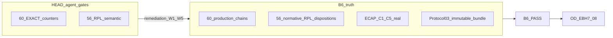
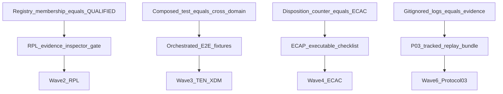

# EBH-7 — Final Independent Audit Remediation Master Plan

**Audited HEAD:** `11b724dd18ba1a7ed5f53a3999dc18af1068391d` · **Branch:** `development`  
**Program authority:** [`PLATFORM_ENTERPRISE_COMPLETION_ROADMAP.md`](docs/project/maintainers/plans/PLATFORM_ENTERPRISE_COMPLETION_ROADMAP.md) (EBH-7 row + §5 ledger only after B6 + OD-08)  
**Chain:** `ROADMAP-REPLAY-X → EBH-7 → EVOL-X → ENT-AUDIT-X → ARCH-FREEZE`  
**Canonical Protocol 03:** [`ENTERPRISE_CONTINUOUS_ARCHITECTURE_ASSURANCE_PROTOCOL.md`](docs/project/maintainers/qualification/ENTERPRISE_CONTINUOUS_ARCHITECTURE_ASSURANCE_PROTOCOL.md) B1–B6; EBH-6 reference pattern: `TEST_EXECUTION_SHA` + `EVIDENCE_PUBLICATION_SHA` + independent acceptance records.

---

## 1. Independent current-HEAD findings (mandatory audit inputs)

**Agent-side mechanical status @ HEAD:** pytest `tests/qualification/ebh_7/` green; 60/60 `EXACT_PROOF` in [`_semantic_disposition_registry.py`](tests/qualification/ebh_7/_semantic_disposition_registry.py); RPL semantic `{56,0,0}` via [`_rpl_h_semantic_evidence.py`](tests/qualification/ebh_7/_rpl_h_semantic_evidence.py); B6 readiness gates in [`test_ebh_7_w5_vbn_gates.py`](tests/qualification/ebh_7/test_ebh_7_w5_vbn_gates.py) / [`test_ebh_7_semantic_proof_binding_gates.py`](tests/qualification/ebh_7/test_ebh_7_semantic_proof_binding_gates.py) **pass without xfail**.

**Independent architectural verdict @ HEAD (would fail B6 if audited today):**

| Finding | Severity | Evidence |
|--------|----------|----------|
| **AUD-01** Auto RPL QUALIFIED | **BLOCKER** | `_package_c_sanctioned_factory_qualified()` sets `QUALIFIED` when `concern_id ∈ QUALIFIED_CONCERN_BEHAVIORAL_PROOF_NODE` only; **17 factory_node** + **6 blocked_promoted** concerns; `positive_test == negative_test` for factory path; B6 gate [`assert_ebh7_rpl_h_semantic_qualification_for_b6`](tests/qualification/ebh_7/_rpl_h_disposition.py) counts registry verdict only — **no RPL-A..G execution proof**. |
| **AUD-02** Dual-slug ≠ replaceability | **HIGH** | 28 concerns via `_integration_dual_slug_evidence` → [`test_ebh_5_behavioral_package_c_v2.py`](tests/qualification/ebh_5/test_ebh_5_behavioral_package_c_v2.py) parametrized `run_package_c_v2_dual_slug_for_entry` — proves **registry resolve + unregistered fail-closed**, not operational equivalence, lifecycle, tenant/gov, or production reachability per [`VENDOR_BACKEND_NEUTRALITY_AND_REPLACEABILITY_EVIDENCE.md`](docs/project/maintainers/qualification/VENDOR_BACKEND_NEUTRALITY_AND_REPLACEABILITY_EVIDENCE.md). |
| **AUD-03** XDM composed false positives | **BLOCKER** | [`_ebh7_cross_domain_integrated_assertions.py`](tests/qualification/ebh_7/cross_domain_e2e/_ebh7_cross_domain_integrated_assertions.py) imports and **calls unrelated test functions** (e.g. XDM-007: tenant_x + skill + dup_x import gate; XDM-012: single UCA6C unit test — **not** Trace×Replay cross-domain chain). Disposition marks all **34/34 EXACT** without verifying combo invariant. |
| **AUD-04** TEN proof depth | **HIGH** | TEN-03: [`assert_gov_exec_cross_tenant_projection_denied`](tests/qualification/ebh_7/tenant_platform_e2e/_ebh7_integrated_tenant_boundary_assertions.py) — **projection validator only**, not Governance→Execution admission. TEN-04: mixed — `probe_tool_runtime_invoke_chain` + direct `RuntimeToolInvoker` (partial path). TEN-05: config/provider helpers — verify against normative `production_path` in [`_tenant_e2e_scenarios.py`](tests/qualification/ebh_7/_tenant_e2e_scenarios.py). TEN-13: host invoke added — **credibility OK if** proof uses production `ContinuationAwareCatalogToolHost` (audit in Wave 3). |
| **AUD-05** Disposition integrity gaps | **BLOCKER** | [`assert_ebh7_semantic_proof_binding_audit`](tests/qualification/ebh_7/_semantic_proof_binding_audit.py) checks registry↔disposition string match and EXACT counts — **no** AST/source execution binding, **no** mutation/demotion tests, **no** proof that integrated wrapper executes claimed entrypoint. |
| **AUD-06** ECAP counter illusion | **HIGH** | [`EBH_7_ECAP_CURRENT_HEAD_AUDIT_REPORT.md`](docs/project/maintainers/qualification/EBH_7_ECAP_CURRENT_HEAD_AUDIT_REPORT.md) reports 26/26, 34/34, 56 RPL from SSOT counters — **C4/C5 not independently re-proven**; C2 dup subset ≠ full enterprise bypass inventory; C3 global NPSC allowlist still **Path B non-claim** per roadmap. |
| **AUD-07** CLOSURE_SHA misuse | **MEDIUM (process)** | [`EBH_7_SHA_LADDER.md`](docs/project/maintainers/qualification/EBH_7_SHA_LADDER.md) labels implementation commit `8bbda35dd…` as `CLOSURE_SHA` while **B6 + OD-EBH7-08 OPEN** — contradicts EBH-6/DUP-X naming (`IMPLEMENTATION_SHA` vs `FORMAL_CLOSURE_PUBLICATION_SHA`). |
| **AUD-08** Evidence durability | **BLOCKER for B6** | Dossier cites [`.tmp/session/ebh-7-gap-closure/`](.tmp/session/ebh-7-gap-closure/) — **gitignored, not reproducible by external auditor**; no `MANIFEST.json` + hash bundle like [`ebh_6_p03_independent_replay/MANIFEST.json`](docs/project/maintainers/qualification/ebh_6_p03_independent_replay/MANIFEST.json). |
| **AUD-09** Production regression scope | **HIGH** | **35** integration `bundle.py` files changed `ad3e24a20..11b724dd1` (INT2E cutover) — mechanical matrix PASS does **not** map each bundle to behavioral regression + RPL dual-slug where claimed. |
| **AUD-10** Stage completeness | **OPEN until Wave 4–7** | Roadmap EBH-7 requires whole-platform families, zero unresolved PROHIBITED in scope, tenant isolation **across boundaries** — requires reconciliation with EBH-6 family catalog, W4 gov/dup gates, freeze checklist `FRZ-*` (non-global PASS). |

**Promotion audit (56/0/0):** not one technical change — **three mechanisms**: (1) matrix `_qualified_override` for all Package C nodes @ [`_replaceability_matrix.py`](tests/qualification/ebh_5/_replaceability_matrix.py); (2) dual-slug catalog @ 28 integration concerns; (3) **semantic layer override** in `_rpl_h_semantic_evidence` (blocked→factory qualified, factory-only→qualified). **Independent acceptability:** only **5 legacy** + subset of **dual-slug** with real alternates (e.g. sqlite/duckdb) meet intent; **23+ concerns** require OD-RPL-G2, fixed-substrate ADR, or scoped residual (**OD-EBH7-SCOPE-RESIDUAL**).



---

## 2. Deliverable artifacts (implementation Wave 0 — single SSOT pack)

Create **one** tracked qualification hub (do not edit Cursor plan files):

- [`docs/project/maintainers/qualification/EBH_7_FINAL_INDEPENDENT_AUDIT_REMEDIATION_MASTER_PLAN.md`](docs/project/maintainers/qualification/EBH_7_FINAL_INDEPENDENT_AUDIT_REMEDIATION_MASTER_PLAN.md) — this program + handoff §22.
- [`docs/project/maintainers/qualification/EBH_7_FINAL_AUDIT_MATRICES_APPENDIX.md`](docs/project/maintainers/qualification/EBH_7_FINAL_AUDIT_MATRICES_APPENDIX.md) — **full 56 + 26 + 34 row matrices** (generated, not hand-maintained).
- Generator: `scripts/qualification/render_ebh7_final_audit_matrices.py` reading SSOT: `CROSS_LAYER_REPLACEABILITY_MATRIX`, `_tenant_e2e_scenarios`, `_cross_domain_scenarios`, `rpl_concern_semantic_evidence`, disposition registry, git `ad3e24a20..HEAD` production diff.

**Matrix column schemas (appendix rows):**

- **RPL (56):** `CONCERN_ID | CLAIMED_EXTENSIBILITY | CANONICAL_OWNER | PORT | IMPLEMENTATION | ALTERNATIVE | CONFIG_SELECTION | RPL_A..G | CURRENT_PROOF | VERIFIED_STATUS | DEFECT | TASK | ACCEPTANCE`
- **TEN (26):** `ID | NORMATIVE_INVARIANT | ENTRYPOINT | EXECUTED_CHAIN | ADVERSARIAL_INPUT | ASSERTIONS | TEST_NODE | VERIFIED_SHA | CURRENT_STATUS | REMEDIATION | EXIT`
- **XDM (34):** same as TEN with `COMBO_INVARIANT` instead of single invariant.

**Verified_STATUS taxonomy:** `DEMONSTRATED` | `FACTORY_ONLY` | `DUAL_SLUG_REGISTRY_ONLY` | `COMPOSED_PROXY` | `FIXED_SUBSTRATE_PENDING_OD` | `PRODUCTION_GAP` | `STALE_SHA`.

---

## 3. RPL-H 56-row matrix — bucket summary + per-bucket remediation (full rows in appendix)

**Bucket A — legacy (5):** `integration.key_value_cache`, `persistence.relational_sqlite_lab`, `int_config.configure_existing`, `observability.otlp_transport`, `tokenizer.selection` — **keep** with enhanced negative/mutation gates; map RPL-F where applicable.

**Bucket B — dual_slug (28):** all `INTEGRATION_DUAL_SLUG_CATALOG` entries — **TASK-RPL-DUAL-*** per concern: extend proof to RPL-C/D/E (equivalent behavior contract test or documented sandbox scope) OR reclassify matrix row to `REPLACEABLE_NOT_YET` / fixed substrate via [`EBH_5_ALLOWED_FIXED_SUBSTRATE_DECISIONS.md`](docs/project/maintainers/qualification/EBH_5_ALLOWED_FIXED_SUBSTRATE_DECISIONS.md) + **OD-RPL-G2**.

**Bucket C — blocked_promoted (6):** `integration.external_work`, `billing_meter`, `managed_retrieval`, `ml_inference_host`, `model_serving_runtime`, `vision_serving` — **illegal independent state** (notes still say single-vendor/blocker while verdict QUALIFIED). **Exit:** OD decision per concern OR demote to BLOCKED/PARTIAL with honest B6 scope.

**Bucket D — factory_node (17):** includes `llm.*`, `plugin.*`, `tool.*`, `agent.*`, `execution.*`, `application.composition_root`, etc. — **TASK-RPL-FACT-***: dedicated behavioral proof with **distinct** positive/negative tests proving alternate backend or fixed-substrate authorization; remove `_package_c_sanctioned_factory_qualified` auto-promotion.

**Mechanical gate hardening (Wave 2):** Replace [`assert_ebh7_rpl_h_semantic_qualification_for_b6`](tests/qualification/ebh_7/_rpl_h_disposition.py) with evidence inspector that asserts: (a) `negative_test != positive_test` OR fixed-substrate record; (b) matrix `rpl_e == PASS` backed by executed node id; (c) dual-slug concerns run **both** slugs + equivalence checklist from VBN spec.

---

## 4. TEN 26 + XDM 34 — scenario-level remediation map (full rows in appendix)

**Cross-cutting root cause:** EXACT promoted via **thin wrappers** and **disposition text** without [`_semantic_proof_binding_audit`](tests/qualification/ebh_7/_semantic_proof_binding_audit.py) verifying production entrypoints.

**Priority TEN rewrites (Wave 3):**

- **TEN-03:** Replace projection-only proof with governed execution admission path (Governance identity → Execution materialization) + cross-tenant denial **before** side effects — align with roadmap EBH-7 tenant narrative; may require minimal product hook only if integrated test fails after Wave 1.
- **TEN-04:** Single canonical chain: `ToolRuntime` → policy → invoker → denial; retire duplicate partial invoker-only path or mark disposition as dual-node with both executed.
- **TEN-05:** Config profile load → provider resolve → tenant-scoped access denial (not merely exception type in helper).
- **TEN-12:** Skill compose → Governance → Execution (existing platform test — **bind** as sole proof node, remove proxy duplication).
- **TEN-14:** Backend switch with **tenant binding preserved** — extend from sqlite lab to sanctioned profile switch test.
- **TEN-17..23:** Each must invoke **observability / HITL / child exec / control plane / scheduler / replay** subsystem named in scenario SSOT — audit all 26 in appendix.

**Priority XDM rewrites (Wave 3):**

- **XDM-007 Tool×Skill×Plugin:** One orchestrated scenario (single run_id) not three test imports.
- **XDM-012 Trace×Replay:** Replace UCA6C-only call with trace store + replay gate under mismatched tenant.
- **XDM-019 Recovery×Governance:** Same process boundary — checkpoint restore without grant.
- **XDM-025 HITL×Trace:** Single HITL resume attempt cross-tenant with trace correlation asserted.
- **XDM-031 Scale×Backpressure:** Prove tenant-scoped backpressure not generic unit gate.
- **All 34:** Demote disposition to `PARTIAL_PROOF` or `STRUCTURAL_ONLY` until rewrite lands; **fail-closed** registry prevents re-EXACT without proof node change + SHA pin.

**Shared fixtures:** [`tenant_platform_e2e/`](tests/qualification/ebh_7/tenant_platform_e2e/) + new `cross_domain_e2e/_ebh7_*_orchestrated.py` modules — **no** `from other_test import test_foo; test_foo()` pattern in EXACT paths (allow only in L2 reuse with explicit `REUSE` label non-EXACT).

---

## 5. Enterprise architecture + PROHIBITED + production regression

**Family coverage matrix (Wave 4):** Reuse EBH-6 [`_family_catalog.py`](tests/qualification/ebh_6/_family_catalog.py) IDs; extend EBH-7 W4 [`test_ebh_7_w4_gov_dup_gates.py`](tests/qualification/ebh_7/test_ebh_7_w4_gov_dup_gates.py) + mechanism registry — one row per family: `FAMILY | OWNER_TIER | HEAD_GATE | GAP | TASK | EVIDENCE`.

**PROHIBITED @ HEAD:** Mechanical zero via [`test_ebh6_prohibited_unresolved_zero`](tests/qualification/ebh_6/test_ebh_6_hardcoding_register_integrity.py) — Wave 4 adds **EBH-7 delta scan** on `ad3e24a20..ACCEPTANCE_SHA` for new hardcoding in integration bundles.

**Production change regression matrix (35 bundles):** For each path under `intergrax/integrations/providers/**/bundle.py` changed in range:

- Contract registration smoke + category resolve test
- If extensibility YES: link to RPL concern row + dual-slug or OD fixed-substrate
- Import side-effect scan (no shadow registry)

**Tier boundaries:** Preserve AGENTS.md rules; no new getattr/setattr harness bypass ([`check_harness_no_getattr.py`](scripts/maintenance/check_harness_no_getattr.py)).

---

## 6. SHA and evidence publication contract (AUD-07 + AUD-08)

Rename / populate [`EBH_7_SHA_LADDER.md`](docs/project/maintainers/qualification/EBH_7_SHA_LADDER.md) mirroring EBH-6:

| Role | Purpose | When set |
|------|---------|----------|
| `EBH7_IMPLEMENTATION_SHA` | Last product+qual commit of a wave | Each wave end |
| `EBH7_SEMANTIC_DISPOSITION_SHA` | SSOT pin for disposition rows | After disposition change commit |
| `TEST_EXECUTION_SHA` | Commit whose tree was pytest-replayed for B5 | Post Wave 5 L3 |
| `EVIDENCE_PUBLICATION_SHA` | Commit adding tracked dossier + MANIFEST | Wave 6 |
| `INDEPENDENT_ACCEPTANCE_BASELINE_SHA` | Tree independent auditor reviewed | B6 PASS record |
| `FORMAL_CLOSURE_PUBLICATION_SHA` | OD-EBH7-08 signed publication | Wave 8 only |

**Retire misleading `CLOSURE_SHA`** alias to implementation — migrate docs to `READY_FOR_B6_SHA` if needed for agent readiness language.

**Published bundle (tracked):** `docs/project/maintainers/qualification/ebh_7_p03_independent_replay/` with `MANIFEST.json` (file hashes, pytest command, env profile `ci`, log excerpts), not `.tmp/` alone.

---

## 7. Deduplicated root-cause graph (canonical mechanisms)



**Single owners (no parallel registries):**

- Semantic disposition: [`_semantic_disposition_registry.py`](tests/qualification/ebh_7/_semantic_disposition_registry.py)
- RPL matrix: [`_replaceability_matrix.py`](tests/qualification/ebh_5/_replaceability_matrix.py)
- RPL semantic verdicts: [`_rpl_h_semantic_evidence.py`](tests/qualification/ebh_7/_rpl_h_semantic_evidence.py) — **refactor** to evidence-derived only
- TEN/XDM scenario SSOT: `_tenant_e2e_scenarios` / `_cross_domain_scenarios`

---

## 8. Execution program — Waves 0–8 (dependency-ordered)

### Wave 0 — Baseline and operator prep

- **EBH7-R0-01:** Run matrix generator; publish appendix + findings snapshot @ HEAD.
- **EBH7-R0-02:** Fix SHA ladder terminology; mark `8bbda35dd` as `EBH7_GAP_CLOSURE_IMPLEMENTATION_SHA` not formal closure.
- **EBH7-R0-03:** Refresh [`EBH_7_GAP_CLOSURE_EXECUTION_RECORD.md`](docs/project/maintainers/qualification/EBH_7_GAP_CLOSURE_EXECUTION_RECORD.md) — separate agent readiness vs parent closure.
- **EBH7-R0-04:** Operator worksheets status: **OD-RPL-G2**, **OD-RPL-VECTOR**, **OD-RPL-LLM**, **OD-EBH7-SCOPE-RESIDUAL**, **OD-EBH7-08**, **B6** — decisions recorded before Wave 2 promotions.
- **Parallel group:** R0-01 + R0-02 after operator scope confirm.
- **Exit:** Appendix committed; operator decision matrix updated (no invented APPROVED).

### Wave 1 — Shared architecture corrections

- **EBH7-W1-01:** INT2E bundle regression suite for 35 files (contract + resolve + no fallback).
- **EBH7-W1-02:** TEN-04 invoker reconciliation per **W1-PROD-DELTA** / **OD-EBH7-INVOKER-RECON** (minimal canonical path).
- **EBH7-W1-03:** Plugin host — confirm TEN-13/XDM-018 use sanctioned host only; document in disposition assertions.
- **Dependencies:** R0 operator authorizations for product delta.
- **Exit:** No new PROHIBITED; targeted unit/integration tests green.

### Wave 2 — RPL-H convergence

- **EBH7-W2-01:** Remove auto-QUALIFIED paths in `_rpl_h_semantic_evidence` (factory + blocked override).
- **EBH7-W2-02:** Implement `assert_rpl_concern_evidence_meets_norm()` + wire into B6 gate and batch C review.
- **EBH7-W2-03:** Per-bucket tasks RPL-DUAL / RPL-FACT / RPL-BLOCKED (56 appendix rows).
- **EBH7-W2-04:** Sync mechanical matrix `rpl_h` with semantic truth (demote `REPLACEABLE_QUALIFIED` where evidence insufficient).
- **Exit:** Honest counts OR **OD-EBH7-SCOPE-RESIDUAL** documented non-PROHIBITED residuals; B6 gate requires normative disposition per concern.

### Wave 3 — TEN/XDM integrated qualification

- **EBH7-W3-01:** Rewrite integrated assertion modules — orchestrated scenarios only.
- **EBH7-W3-02:** Per-scenario disposition demotion/promotion with integrated proof nodes (26+34 appendix).
- **EBH7-W3-03:** Disposition SHA pin + audit MD regen ([`_semantic_audit_markdown_sync.py`](tests/qualification/ebh_7/_semantic_audit_markdown_sync.py)).
- **EBH7-W3-04:** Add mutation tests: `tests/qualification/ebh_7/test_ebh_7_semantic_disposition_mutation_gates.py` (tamper EXACT → gate fails).
- **Exit:** `assert_ebh7_semantic_mandatory_exact_coverage` pass **only** if independent checklist signed in appendix.

### Wave 4 — Whole-platform ECAP C1–C5

- **EBH7-W4-01:** C1 — executable inventory reconciliation vs 685 mechanisms (not count-only).
- **EBH7-W4-02:** C2 — dup + cross-tier dependency gates + NPSC scoped/global split documented.
- **EBH7-W4-03:** C3 — PROHIBITED register + EBH-7 delta hardcoding scan.
- **EBH7-W4-04:** C4/C5 — map each TEN/XDM row to executed proof (cross-check appendix).
- **EBH7-W4-05:** Update [`EBH_7_ECAP_CURRENT_HEAD_AUDIT_REPORT.md`](docs/project/maintainers/qualification/EBH_7_ECAP_CURRENT_HEAD_AUDIT_REPORT.md) with **checklist PASS/FAIL**, not counters alone.
- **Exit:** ECAP worksheet complete @ `TEST_EXECUTION_SHA` candidate.

### Wave 5 — Consolidated L1/L2/L3 qualification

**Deterministic command set (profile `ci`, single invocation):**

```text
uv run pytest \
  tests/qualification/ebh_6/test_ebh_6_hardcoding_register_integrity.py::test_ebh6_prohibited_unresolved_zero \
  tests/qualification/ebh_5/test_ebh_5_behavioral_package_c_v2.py \
  tests/qualification/ebh_5/test_ebh_5_rpl_regression_gates.py \
  tests/qualification/ebh_7/ \
  -q --tb=line
```

- **EBH7-W5-01:** L1/L2 risk-selected subsets per appendix risk tier.
- **EBH7-W5-02:** L3 full EBH-7 + mandatory EBH-5 regression; capture log into **tracked** replay dir copy.
- **EBH7-W5-03:** Negative tests: skip detector, xfail detector, stale SHA detector.
- **Exit:** `TEST_EXECUTION_SHA` pinned; 0 failed; documented skips only with SSOT equivalence.

### Wave 6 — Protocol 03 B1–B5

- **EBH7-W6-01:** B1 bundle assembly → `ebh_7_p03_independent_replay/`.
- **EBH7-W6-02:** B2 independent worksheet → [`EBH_7_PRE_CERT_INDEPENDENT_AUDIT_WORKSHEET.md`](docs/project/maintainers/qualification/) (new, EBH-7 scoped).
- **EBH7-W6-03:** B3 exact findings reconciliation doc (map AUD-01..10 to PASS/FAIL/ACCEPT).
- **EBH7-W6-04:** B4 remediation loop record (this program execution).
- **EBH7-W6-05:** B5 re-audit @ `TEST_EXECUTION_SHA`.
- **Exit:** `EVIDENCE_PUBLICATION_SHA`; [`EBH_7_PROTOCOL_03_EXECUTION_PACKAGE.md`](docs/project/maintainers/qualification/EBH_7_PROTOCOL_03_EXECUTION_PACKAGE.md) honest (B6 still OPEN).

### Wave 7 — Independent B6

- External auditor executes B2 worksheet against `INDEPENDENT_ACCEPTANCE_BASELINE_SHA`.
- PASS requires: honest RPL dispositions, genuine TEN/XDM chains, ECAP checklist, immutable manifest replay.
- FAIL → corrective tasks logged in [`_gate_findings_register.py`](tests/qualification/ebh_7/_gate_findings_register.py) → return Wave 1–5.

### Wave 8 — Operator closure

- **OD-EBH7-08** signature record (mirror [`EBH_6_OD_EBH6_08_CLOSURE_SIGNATURE_RECORD.md`](docs/project/maintainers/qualification/EBH_6_OD_EBH6_08_CLOSURE_SIGNATURE_RECORD.md)).
- Roadmap §5 EBH-7 ledger → **CLOSED SCOPED** only after B6 PASS.
- [`EBH_7_EVOL_X_HANDOFF_RECORD.md`](docs/project/maintainers/qualification/EBH_7_EVOL_X_HANDOFF_RECORD.md) prerequisites — **no EVOL-X start** before OD-08.
- Set `FORMAL_CLOSURE_PUBLICATION_SHA`.

**Each wave end:** commit + push `development`; verify remote HEAD; exclude untracked `exports/`, `platform_proofs/test_*`, `.cursor/plans/`.

---

## 9. Operator decision inventory (remaining)

- **OD-RPL-G2** — Fixed substrate vs second provider for 6+ singles: **Required** before claiming replaceability on blocked_promoted concerns.
- **OD-RPL-VECTOR** — chromadb operational qual: **Required** if vector_store remains extensible YES.
- **OD-RPL-LLM** — External LLM sandboxes: **Required** for llm.* factory concerns beyond registry proof.
- **OD-PLUGINHOST** — **Partially executed** (harness live) — operator **confirm** Accept vs N/A for audit record.
- **OD-EBH7-INVOKER-RECON** — Optional before final L3 if TEN-04 consolidated.
- **OD-EBH7-SCOPE-RESIDUAL** — **Required** if any concern remains PARTIAL/BLOCKED non-PROHIBITED at B6.
- **B6** — Independent Protocol 03: **OPEN**.
- **OD-EBH7-08** — **OPEN** until post-B6 signature.

---

## 10. Acceptance gates (mechanical + independent)

Parent **EBH-7 CLOSED SCOPED** iff all hold:

- RPL: 56 normative dispositions with evidence class matching extensibility claim (not necessarily 56× full dual-vendor).
- TEN 26 + XDM 34: EXACT only with orchestrated production-effective proofs.
- PROHIBITED unresolved = 0 in EBH-7 scope @ `TEST_EXECUTION_SHA`.
- ECAP C1–C5 checklist PASS (not counter-only).
- Protocol 03 B1–B5 @ `EVIDENCE_PUBLICATION_SHA`; B6 PASS @ acceptance baseline.
- OD-EBH7-08 APPROVED; `FORMAL_CLOSURE_PUBLICATION_SHA` published.
- PROD-Q parent remains Path B non-blocking; global FRZ not claimed.

---

## 11. Adversarial completeness (detection → remediation)

- Fake RPL QUALIFIED from node membership → **W2 inspector** + demote matrix; mutation test.
- Dual-slug without equivalence → **W2 RPL-DUAL** contract tests or fixed-substrate OD.
- XDM composed unrelated tests → **W3** ban import-call pattern; disposition demotion until fixed.
- TEN denial at wrong layer → **W3** scenario entrypoint audit column in appendix.
- Provider regression from INT2E → **W1** per-bundle regression matrix.
- Missing vendor dep → env profile doc in MANIFEST; fail-closed at resolve.
- Silent pytest skip → **W5** skip budget gate + explicit SSOT skip registry.
- Stale SHA → `assert_disposition_sha_current` + ladder reconciliation test.
- Shadow factory → dup_x + integration registry uniqueness gate.
- Prohibited hardcoding → EBH-6 register + delta scan.
- Weak negatives → require distinct negative_test node per RPL row.
- Invalid fixed-substrate → must appear in ALLOWED_FIXED with OD id.
- Missing operator decision → block Wave 2 promotions (gate in `test_ebh_7_w11_closure_gates.py`).
- Missing enterprise family → Wave 4 family matrix gap tasks.
- B6 rejects dossier → Wave 7 corrective loop to W1–W5.
- Doc publication changes baseline → `EVIDENCE_PUBLICATION_SHA` separate from `TEST_EXECUTION_SHA`.

---

## 12. Implementation-agent handoff

1. Read this plan + generated appendix @ Wave 0 commit.
2. Do **not** treat current green pytest as B6 PASS.
3. Execute waves sequentially; max **one** consolidated `uv run pytest` per verification step ([intergrax-test-process-budget.mdc](.cursor/rules/intergrax-test-process-budget.mdc)).
4. Session logs under `.tmp/session/ebh-7-audit-remediation/<wave>/` **and** copy summaries into tracked replay bundle.
5. Never approve OD-08 or B6; never mark roadmap EBH-7 CLOSED.
6. Preflight each wave: read scope / edit scope / tests in commit message body.

---

## Required verdict

**EBH-7 — FINAL COMPREHENSIVE REMEDIATION PLAN READY FOR INDEPENDENT AUDIT**

All mandatory work, operator gates, evidence artifacts, matrices (via Wave 0 generator), waves, and adversarial cases are mapped. **Current HEAD is not parent-closed**; independent B6 would reject agent readiness claims until Waves 1–7 complete.
