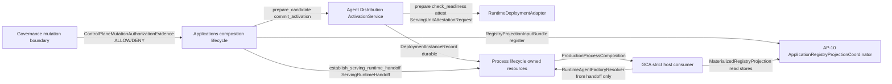

# PROD-Q-R1-R7-ADR-01 — Production Deployment Authority, Topology & Process Ownership

| Field | Value |
|-------|-------|
| **Status** | **ARCHITECTURE RATIFIED BY OPERATOR — IMPLEMENTATION NOT QUALIFIED** · **READY FOR AUDIT** (decision provenance only). **Next implementation:** **PROD-Q-R1-R7-D1** (handoff dependency **D1b** per §14.2). |
| **Revision** | **R5** — operator ratification **DEC-01–DEC-08** (docs @ ratification commit on `development`; **START_HEAD** `c6eb303e2234262e8acad7b09b5eb789dea891cf`). Prior **R4** @ `c6eb303…` / code **D0** evidence @ `2b44cee94fc654136d68353a04dedc5973eb6a8b`; **R3** (**B06–B07**); **R2** partial (**B04**); **R1 rejected**. |
| **Date** | 2026-10-13 |
| **Ratification START_HEAD** | `c6eb303e2234262e8acad7b09b5eb789dea891cf` |
| **Code evidence lock (D0 / §4.5A)** | `2b44cee94fc654136d68353a04dedc5973eb6a8b` (unchanged by R5 docs-only ratification) |
| **Prior ADR baseline** | `bc1f6926babf0b5fa499b1deebcda48c93cd4258` (**R3** text) |
| **Branch** | `development` |
| **Parent** | **PROD-Q-R1** — **BLOCKED** |
| **Proposed child (implementation)** | **PROD-Q-R1-R7** — **NOT CLOSED**; **D1** next mandatory slice after this ratification |
| **Slice** | **PROD-Q-R1-R7-ADR-01** (architecture ratification; **no production implementation** in ratification commit) |
| **Related evidence** | **PROD-Q-R1-R4** [`PROD_Q_R1_R4_PRODUCTION_STARTUP_PATH.md`](PROD_Q_R1_R4_PRODUCTION_STARTUP_PATH.md) · **R5** [`PROD_Q_R1_R5_STRICT_STARTUP_LIFECYCLE.md`](PROD_Q_R1_R5_STRICT_STARTUP_LIFECYCLE.md) · **R6** [`PROD_Q_R1_R6_STRICT_STARTUP_LIFECYCLE.md`](PROD_Q_R1_R6_STRICT_STARTUP_LIFECYCLE.md) · **ADR-01/02/03** (continuation / invocation) · **PIS-02** (`open_reference_production_process_lifecycle`) |
| **Does not close** | **PROD-Q-R1** · **PROD-Q-R7** · **FRZ-PRD-04** · **FRZ-PRD-05** · any global FRZ PASS |

### Ratification record (DEC-01–DEC-08)

| Item | Disposition |
|------|-------------|
| **Decision status** | **ARCHITECTURE RATIFIED BY OPERATOR — IMPLEMENTATION NOT QUALIFIED** |
| **DEC-01 … DEC-08** | **RATIFIED** (target architecture; production proofs **not** presumed — see §21) |
| **Operator authorization** | Explicitly provided in the **controlling ChatGPT conversation** following independent review of **ADR-01-R4**. **Not fabricated:** no operator signature, no Git SHA for the external conversation, no unverified approval timestamp, no CI pass claimed for production behavior. |
| **This Git commit** | Records ADR ratification provenance only; **does not** prove production functionality or close implementation gates. |

**Roadmap alignment:** Canonical [`PLATFORM_ENTERPRISE_COMPLETION_ROADMAP.md`](../plans/PLATFORM_ENTERPRISE_COMPLETION_ROADMAP.md) lists **PROD-Q** as **CURRENT / BLOCKED ON** `PROD-Q-R1`, `PROD-Q-P1..P3`. **PROD-Q-R1-R7-ADR-01** ratification does **not** independently promote **PROD-Q-R1-R7** to a closed roadmap row or close **PROD-Q-R1**.

### 1.0 Current HEAD disposition (verified code — does not ratify ADR)

| Layer | Verified @ `2b44cee…` | Not implied |
|-------|----------------------|-------------|
| **§4.5A** | `ServingUnitAttestationRequest` / `ServingUnitAttestation` / `ServingUnitAttestationError`; `RuntimeDeploymentAdapter.attest_serving_unit`; `FakeInMemoryRuntimeDeploymentAdapter.attest_serving_unit` (`deployment.py`) | Production VENV unit lifecycle |
| **Activation guards** | `_attest_ready_deployment_instance` on READY reuse (`prepare_candidate` L191–197), idempotent commit/rollback, `_require_ready_instance`, `_ensure_prior_instance_ready` (`activation.py`) | Complete post-crash reconciliation (D3) |
| **§4.5B** | **Not implemented** — no `serving_runtime_handoff.py`, no `ProductionProcessComposition.serving_runtime_handoff`, no `establish_serving_runtime_handoff` | GCA identity continuity (**B04** open) |
| **D1 adapter** | **Not implemented** — sole adapter impl remains `FakeInMemoryRuntimeDeploymentAdapter` | FRZ-PRD-04/05 closure |
| **Ratification** | **DEC-01–DEC-08 RATIFIED** (operator @ ChatGPT controlling conversation); implementation **NOT QUALIFIED** | D0/D0-R2 acceptance ≠ production qualification |

**Historical acceptance (scoped):** **PROD-Q-R1-R7-D0** / **D0-R2** attestation + activation evidence is **accepted within inspected Agent Distribution scope**; it does **not** close **PROD-Q-R1-R7**, **PROD-Q-R1**, or satisfy the full ADR.

---

## 1. Baseline SHA and canonical scope

| Item | Value |
|------|-------|
| **Ratification START_HEAD** | `c6eb303e2234262e8acad7b09b5eb789dea891cf` |
| **D0 code evidence** | `2b44cee94fc654136d68353a04dedc5973eb6a8b` |
| **Mandatory stage** | **PROD-Q** — **CURRENT / BLOCKED** (freeze checklist) |
| **Parent program** | **PROD-Q-R1** — Production Startup / Dependency Materialization Corrective — **BLOCKED** |
| **This slice** | **ADR-01 ratification** (architecture recorded; **no** D1 code in ratification task) |
| **Next mandatory implementation** | **PROD-Q-R1-R7-D1** (+ **D1b** per §14.2 identity-continuity gate) unless operator reorders |

Applicable freeze rows (unchanged **OPEN**): **FRZ-PRD-01**, **FRZ-PRD-03**, **FRZ-PRD-04**, **FRZ-PRD-05**, **FRZ-PRD-07**, **FRZ-PRD-08**; supporting **FRZ-TYP-***, **FRZ-PLG-***, **FRZ-RPL-***, **FRZ-CTR-***, **FRZ-TEN-*** where implicated below.

---

## 2. Root cause (code-supported)

Production strict serving for GCA is intentionally **fail-closed** until an **activated** `ProductionProcessComposition` exists (`applications/governed_contractor_application/host/main.py`: `create_app` / `run()` reject unactivated entry). **Deployment and activation semantics** are owned by **Agent Distribution** (`ActivationService` + durable stores). Today every sanctioned lifecycle wiring path injects **`FakeInMemoryRuntimeDeploymentAdapter`** (`intergrax/applications/_shared/reference_production_lifecycle.py`), which the module header explicitly excludes from **production deployment/readiness authority**.

There is **no** non-fake `RuntimeDeploymentAdapter` implementation in the repository. Physical readiness therefore cannot be evidenced on a production path: activation orchestration is structurally correct but **deployment truth is simulated**. Registry projection for production is constrained to **`MaterializationTopology.VENV_BUNDLE`** with **immutable on-disk artifacts** (`production_registry_projection_input_bundle.py`), while default in-tree **VENV_BUNDLE materialization** remains **unsupported** (`UnsupportedVenvBundleMaterializationAdapter` in `materialization_adapters.py`) — production assumes **externally produced** bundle directories referenced by `file://` (or qualification `test://`) locators.

Process ownership for strict GCA startup is partially qualified (**R5/R6**) via `open_reference_production_process_lifecycle`, but **deploy/activate** still uses fake deployment, and **GCA `main.run()`** is not a sanctioned production entry.

### 2.1 Independent-audit blockers (disposition)

| ID | Root cause (prior draft) | Corrective disposition (R1) |
|----|--------------------------|-----------------------------|
| **R7-ADR-B01 — Readiness conflation** | Prior text tied “physical readiness” to **artifact directory + digest + import-scope warmup** without a distinct **serving-unit** identity; `FakeInMemoryRuntimeDeploymentAdapter.check_readiness` can succeed from a dict key alone — indistinguishable from “artifact exists”. | **Decision A** defines `PreparedDeployment.serving_unit_ref` as an **adapter-issued opaque unit handle**, not `artifact_locator`, not filesystem path, not digest. **Artifact immutability** is proven upstream (`RuntimeRevision.materialization_artifact_digest`, `resolve_production_artifact_root`); **unit readiness** is proven only by `prepare` + `check_readiness` on that handle. Durable `DeploymentInstanceState.READY` **never** implies traffic eligibility. |
| **R7-ADR-B02 — Reference authority promotion** | Prior draft named `open_reference_production_process_lifecycle` / `ReferenceProductionLifecycleLauncher` as the **sanctioned production composition root** without classifying every non-adapter dependency; implied injection of a production adapter **qualifies** the reference graph. | **Decision B** separates **composition authority** (`wire_production_process_lifecycle` — proposed name) from **reference lab wiring**. Reference modules stay **REFERENCE-ONLY** or **REUSABLE CONTRACT / NOT YET QUALIFIED** until each dependency is explicitly sourced. Injecting `RuntimeDeploymentAdapter` **does not** production-qualify `ReferenceProductionLifecycleLauncher` or reference governance wiring. |
| **R7-ADR-B03 — In-process lifecycle ambiguity** | “Co-located single-process serving unit” was undefined for prepare/readiness vs **SERVING** vs crash/restart; risk of treating process boot as deployment truth. | **Decision A (A1)** + **Decision C** bind lifecycle to `DeploymentInstanceState` transitions (`PREPARING` → `READY` → `SERVING` via activation store commit), adapter drain/stop, and **post-crash reconciliation** (durable READY ≠ live unit). Process opener owns continuation/invocation only — **not** serving-unit identity. |
| **R7-ADR-B04 — No proven serving-unit handoff** | R1 assumed an in-process adapter “slot” prepared before activation is the unit that serves traffic after `create_governed_contractor_process_app`, but **no typed contract** transports `serving_unit_ref` (or equivalent runtime binding) from adapter → composition → strict host factory. Opaque string handle alone does not establish continuity. | **Decision A (R2/R3):** ratify **A1 co-located** only with mandatory **`ServingRuntimeHandoff`** on `ProductionProcessComposition` (identity + Applications-owned `RuntimeAgentFactoryResolver`) established by composition after **`attest_serving_unit`** (§4.5). **Reject** “prepare dict + independent `build_production_runtime_agent_factory_resolver`” without attestation-linked handoff. |
| **R7-ADR-B05 — Durable READY reused without liveness** | `ActivationService.prepare_candidate()` returns existing `READY` when `serving_unit_ref` and `readiness_evidence_ref` are non-null **without** adapter re-attestation (`activation.py` L174–177). After process crash, SQLite can retain READY while adapter state (and in-process import scopes) are gone. | **Decision B (R2, retained R3):** semantic owner **`ActivationService`** must call adapter **`attest_serving_unit`** before any READY reuse; stale/wrong digest → FAILED or controlled re-prepare under environment lock + `record_revision` CAS (§4.6). **No** independent recovery in GCA or SQLite store. |
| **R7-ADR-B06 — Cross-layer contract inversion** | R2 proposed `RuntimeDeploymentAdapter.materialize_serving_runtime` returning Applications `RuntimeAgentFactoryResolver`, making the Agent Distribution deployment port responsible for an application runtime factory — **violates** `intergrax/` MUST NOT depend on `applications/` at semantic boundaries (`AGENTS.md`). | **R3 rejected:** remove `materialize_serving_runtime` from `RuntimeDeploymentAdapter`. Physical attestation stays topology-neutral (§4.5A). **Applications** composition binds attested unit identity → `RuntimeAgentFactoryResolver` via `ServingRuntimeHandoff` (§4.5B). VENV in-process binding uses a **composition-injected** `ColocatedServingUnitRuntimeAccessor` (Applications Protocol), implemented by the production adapter at wiring time — **not** a method on the topology-neutral port. |
| **R7-ADR-B07 — Inconsistent runtime handoff owner** | R2 simultaneously forbade GCA from calling the deployment adapter **and** directed the GCA strict factory to call `materialize_serving_runtime` on that adapter — two owners for one handoff. | **R3 resolved:** **exactly one** composition-owned handoff during `deploy_and_activate` (launcher / production lifecycle): after `attest_serving_unit`, **`establish_serving_runtime_handoff`** writes `ProductionProcessComposition.serving_runtime_handoff`. GCA **only reads** the handoff; **never** imports or invokes `RuntimeDeploymentAdapter`. |

### 2.2 Code evidence (B04 / B05 — exact HEAD)

| Blocker | Evidence (file · lines · behavior) |
|---------|-------------------------------------|
| **B04** | `applications/governed_contractor_application/host/main.py` · `create_governed_contractor_process_app` accepts only `ProductionProcessComposition` — **no** `serving_unit_ref` / binding field (`production_process_composition.py` has AP runtime + continuation/PIS only). |
| **B04** | `reference_production_lifecycle.py` · `deploy_and_activate` calls `prepare_candidate` then `commit_activation` then launcher returns; GCA host built later via `create_governed_contractor_process_app` — **no** pass-through of prepared unit handle. |
| **B04** | `factory.py` · strict path calls `build_harness_host_runtime(...)` with registry projection from stores — constructs execution surface **without** reading `DeploymentInstanceRecord.serving_unit_ref`. |
| **B04** | `venv_bundle_runtime_agent_factory_resolver.py` · `_ArtifactScopeRegistry` / `_FactoryCache` are **process-global**; readiness in a future A1 adapter could warm scopes keyed by digest while `serving_unit_ref` remains an unrelated opaque string unless explicitly bound (dual authority risk). |
| **B05** | **Resolved in code (D0-R2 @ `2b44cee…`)** — `prepare_candidate` L191–197: READY reuse calls `_attest_ready_deployment_instance` → `attest_serving_unit` before return. |
| **B05** | **Resolved in code** — `_require_ready_instance`, `_idempotent_active_commit`, rollback/resume paths call `_attest_ready_deployment_instance` (`activation.py` L597+, L637+, L691+). |
| **B05** | **Limitation** — attestation truth is only as strong as the injected adapter; fake in-memory units do **not** prove production VENV unit liveness (**D1** still required). |

---

## 3. Closed-world inventory (contract → owner → implementation → caller → persistence)

### A. Deployment

| Mechanism | Contract | Semantic owner | Implementation / composition | Production caller (today) | Persistence / evidence |
|-----------|----------|----------------|------------------------------|---------------------------|-------------------------|
| Deployment port | `RuntimeDeploymentAdapter` (`intergrax/agent_distribution/deployment.py`) | **Agent Distribution** (§20) | **Protocol only**; sole impl: `FakeInMemoryRuntimeDeploymentAdapter` | `ActivationService.prepare_candidate` / drain / stop via `ReferenceProductionLifecycleLauncher.deploy_and_activate` | Adapter-internal dict (fake); **not durable** |
| Prepared unit | `PreparedDeployment`, `DrainStatus` | Agent Distribution | Pydantic models in `deployment.py` | `ActivationService` after `prepare` / `check_readiness` | `DeploymentInstanceRecord.readiness_evidence_ref`, `serving_unit_ref` |
| Instance state | `DeploymentInstanceState`, `DeploymentInstanceRecord` | Agent Distribution | `deployment.py` | `ActivationService`, rollback/drain paths | `DeploymentInstanceStore` |
| Instance store (protocol) | `DeploymentInstanceStore` (`stores.py`) | Agent Distribution | `InMemoryDeploymentInstanceStore`; durable: `SqliteDeploymentInstanceStore` (`sqlite_stores.py`) | Reference wiring uses **in-memory** per composition state; durable bundle exists for SQLite AP stores | SQLite when `SqliteAgentDistributionStoreBundle` used (`wire_durable_reference_production_lifecycle_services`) |
| Materialization topology enum | `MaterializationTopology` (`runtime_revision.py`) | Agent Distribution | `OCI_IMAGE`, `VENV_BUNDLE`, `SANDBOX_SIDECAR` | Revision admission + projection descriptor | On `RuntimeRevision` |
| In-tree materialization | `RuntimeMaterializationAdapter` (`materialization_adapters.py`) | Agent Distribution build coordinator | OCI adapter (Docker); VENV = **explicit unsupported** | Control-plane materialize flows (not production GCA path) | `materialization_store` on `ProductionAgentPlatformRuntime.stores` |
| Production artifact semantics | `resolve_production_artifact_root`, `assemble_production_registry_projection_input_bundle` (`production_registry_projection_input_bundle.py`) | Applications shared (AC-3) | **VENV_BUNDLE only**; `file://` / `test://` schemes; forbids `reference://` | `ReferenceProductionLifecycleLauncher.deploy_and_activate` (after external bundle assembly) | Immutable directory + digest on revision / projection input |
| Runtime factory for bundle | `build_production_runtime_agent_factory_resolver` (`venv_bundle_runtime_agent_factory_resolver.py`) | Applications shared | **VENV_BUNDLE: implemented**; OCI/sidecar: **deferred** (`PRODUCTION_RUNTIME_FACTORY_TOPOLOGY_STATUS`) | Projection input bundle assembly | Import-scope cache keyed by artifact digest (process memory; not deployment truth) |

### B. Activation

| Mechanism | Contract | Semantic owner | Implementation | Caller | Persistence |
|-----------|----------|----------------|----------------|--------|-------------|
| Activation orchestration | `ActivationService` (`activation.py`) | **Agent Distribution** | Class in `activation.py` | `ReferenceProductionLifecycleLauncher.deploy_and_activate` | `ApplicationEnvironmentActivationStore`, `ApplicationEnvironmentServingStore`, `DeploymentInstanceStore`, `RuntimeRevisionStore` |
| Prepare → ready | `prepare_candidate` | Agent Distribution | Calls `deployment_adapter.prepare` + `check_readiness`; persists `PREPARING` → `READY` | Launcher after governance admission + `mark_validated` | `Sqlite*` or in-memory stores |
| Traffic commit | `commit_activation` | Agent Distribution | `atomic_commit_activation` + projection `prepare_projection`; begins drain on prior unit | Launcher after `authorize_activation` | Serving pointer + revision state |
| Rollback / drain | `rollback_*`, `complete_drain` | Agent Distribution | Adapter drain/stop/resume_serving | Admin / rollback callers (tests, future ops) | Instance record transitions |
| Revision admission | `RuntimeRevisionService` | Agent Distribution | `runtime_revision_service.py` | Launcher: `persist_candidate_revision`, `mark_validated` | `RuntimeRevisionStore` |
| Projection coordination | `RuntimeServingProjectionCoordinator` | AP-10 boundary | `ApplicationRegistryProjectionCoordinator` (production); `FakeRuntimeServingProjectionCoordinator` (tests) | `ActivationService.commit_activation` | `RegistryProjectionInputStore`, `registry_projection_store` |
| Production projection inputs | `RegistryProjectionInputBundle` | Applications shared | `production_registry_projection_input_bundle.py` + authority resolver | Launcher registers input then commits | In reference path: `InMemoryRegistryProjectionInputStore` (qualification debt for durable inputs) |

### C. Governance

| Mechanism | Contract | Semantic owner | Implementation | Caller | Evidence |
|-----------|----------|----------------|----------------|--------|----------|
| Control-plane mutation auth | `ControlPlaneMutationAuthorizationBoundary` | **Governance** (runtime) | `build_reference_production_control_plane_mutation_boundary` via `reference_production_governance_wiring.py` | `authorize_scoped_control_plane_mutation` in launcher (`control_plane_governance.py`) | `ControlPlaneMutationAuthorizationEvidence` on denial |
| Tenant binding | `ApplicationEnvironmentTenantResolver` | Agent Distribution + Governance | `StaticApplicationEnvironmentTenantResolver` in reference wiring | Admission + activation authorization | Environment → tenant map |
| Principal | `RequestIdentity` | Contracts | Service principal from host profile | `deploy_and_activate(..., principal=...)` | Not deployment persistence |
| Reference-only policy | Harness mutation boundary builders | Reference / lab | `harness_control_plane_policy_wiring.py` | Reference production only | **Not** production-qualified without operator-approved production policy profile (**B02**) |

### D. Runtime / process

| Mechanism | Contract | Semantic owner | Implementation | Caller | Persistence |
|-----------|----------|----------------|----------------|--------|-------------|
| Composition root | `ProductionProcessComposition` (`production_process_composition.py`) | Applications shared | Dataclass: AP runtime + optional invocation + continuation stores | `open_reference_production_process_lifecycle`, GCA factories | Process-lifetime fields on composition |
| Process lifecycle opener | `open_reference_production_process_lifecycle` (`reference_production_process_lifecycle.py`) | Applications shared — **REFERENCE-ONLY** (lab/tests); **not** production authority | Opens continuation SQLite + optional invocation SQLite; builds launcher | **R6** tests, qualification harnesses | Files: continuation state file, invocation DB |
| Deploy / activate orchestration | `ReferenceProductionLifecycleLauncher` | Applications shared (**orchestration glue** — not semantic owner of activation) | `reference_production_lifecycle.py` | External operator / launcher CLI / tests before `create_governed_contractor_process_app` | AP stores on composition |
| GCA strict ASGI | `create_governed_contractor_process_app` (`governed_contractor_application/host/main.py`) | GCA application | `create_governed_contractor_backend_app` + `bootstrap_production_registry_projection` | After activation | Consumes **activated** serving revision from stores |
| GCA direct run | `run()` / module `app` | GCA | `StrictProductionAsgiPlaceholder` / `SystemExit(1)` | **Forbidden** unactivated | N/A |
| Execution continuation | `ExecutionContinuationStateStore` | Execution contracts | `open_production_execution_continuation_state_store` (ADR-02) | Factory via composition | Durable file |
| Provider invocation | `ProviderInvocationStore` | Execution / enterprise reliability | `SQLiteProviderInvocationStore` (PIS-ADR-03) | Composition + strict factory | SQLite |

### E. Portability matrix (closed-world — HEAD)

| Contract | Owning layer | Semantic owner | Composition owner | Primary callers | VENV_BUNDLE | OCI_IMAGE | SANDBOX_SIDECAR |
|----------|--------------|----------------|-------------------|-----------------|-------------|-----------|-----------------|
| `RuntimeDeploymentAdapter` | Tier-1 AD | Agent Distribution | Lifecycle wiring | `ActivationService` | A1 colocated | Container ops | Sidecar ops |
| `PreparedDeployment` / `DeploymentInstanceRecord` | Tier-1 AD | Agent Distribution | — | `ActivationService`, stores | Portable | Portable | Portable |
| `ActivationService` | Tier-1 AD | Agent Distribution | Launcher orchestration | `ReferenceProductionLifecycleLauncher` | Portable | Portable | Portable |
| `ServingUnitAttestation` (**§4.5A implemented**) | Tier-1 AD | Adapter observe / Activation orchestrate | — | `ActivationService` only | In-process liveness (fake adapter today) | Container health | Sidecar health |
| `RegistryProjectionInputBundle` | Tier-3 Apps | AP-10 inputs | Launcher register | `deploy_and_activate`, coordinator | **Required** (factory_resolver) | Assembly rejected today | Assembly rejected today |
| `RuntimeAgentFactoryResolver` | Tier-3 Apps | Applications shared | `establish_serving_runtime_handoff` | AP-10 projection, GCA strict | **Implemented** | Deferred | Deferred |
| `build_production_runtime_agent_factory_resolver` | Tier-3 Apps | VENV bundle module | Bundle assembly / accessor | `production_registry_projection_input_bundle` | **Implemented** | N/A | N/A |
| `ApplicationRegistryProjectionCoordinator` | Tier-1/3 seam | AP-10 | Wired on composition | `commit_activation` | Portable contract | Deferred inputs | Deferred inputs |
| `ProductionProcessComposition` | Tier-3 Apps | Process root | `open_*_production_process_lifecycle` | GCA, launcher | Portable | Portable | Portable |
| `ServingRuntimeHandoff` (**RATIFIED** · not implemented) | Tier-3 Apps | Applications | `establish_serving_runtime_handoff` | GCA strict factory | Colocated accessor | Remote resolver binder | Sidecar binder |
| `create_governed_contractor_process_app` | Tier-3 GCA | GCA consumer | External launcher | Post-activate | Portable consumer | Portable consumer | Portable consumer |
| `build_harness_host_runtime` | Tier-3 Apps | Harness spine | GCA factory | Strict/lab hosts | Portable | Portable | Portable |
| `open_reference_production_process_lifecycle` | Tier-3 Apps | Reference only | Reference opener | Tests, qual | Reference | Reference | Reference |

### F. Supported topologies (evidence-bound)

| Topology | Artifact materialization (in-tree) | Production registry projection | Runtime agent factory | Deployment adapter expectation |
|----------|-----------------------------------|------------------------------|----------------------|--------------------------------|
| **VENV_BUNDLE** | **Unsupported** in `default_materialization_adapters()` | **Required** (`production_registry_projection_input_bundle.py`) | **Implemented** | **First production target** — pre-built directory + digest |
| **OCI_IMAGE** | Docker build adapter present | **Rejected** at projection assembly | **Deferred** | Not first production topology |
| **SANDBOX_SIDECAR** | No default adapter | **Rejected** at projection assembly | **Deferred** | Not first production topology |

---

## 4. Decision A — Serving-unit identity and readiness (B01, B03, B04, B05)

### 4.1 Physical meaning of `PreparedDeployment.serving_unit_ref`

`serving_unit_ref` is an **opaque, adapter-allocated handle** naming one **runtime serving unit** (one revision binding in one environment context). It **must not** be:

- the `artifact_locator` string;
- a filesystem path or digest used as a stand-in for a unit;
- a fabricated token returned without adapter-side unit state.

The handle is created in `RuntimeDeploymentAdapter.prepare` and carried on `DeploymentInstanceRecord.serving_unit_ref`. **Artifact immutability** is established separately (`RuntimeRevision.materialization_artifact_digest`, `resolve_production_artifact_root`, `PreparedDeployment.materialization_artifact_digest` equality check in `ActivationService.prepare_candidate`). **Unit readiness** is established only by `check_readiness(revision, serving_unit_ref=…)` and stored as `readiness_evidence_ref`.

**Traffic eligibility** requires, in order: validated revision → READY instance (with evidence) → Governance-permitted `commit_activation` → serving pointer CAS → instance `SERVING` (activation store) → GCA strict factory admission. **READY without SERVING** explicitly means: *physical unit may exist and be validated, but production traffic is forbidden*.

### 4.2 Topology options (legitimate; not conflated with artifact checks)

| Option | Summary | When chosen |
|--------|---------|-------------|
| **A1 — Co-located, non-serving in-process unit** | Adapter allocates an **isolated in-process slot** (typed config + internal registry) bound to digest; slot is warmed/validated without admitting ASGI traffic; composition **must** bind attested unit → resolver via `ServingRuntimeHandoff` (§4.5B). | **RATIFIED (DEC-01)** — first production topology for VENV_BUNDLE (§5); **genuine unit lifecycle + trustworthy artifact provenance still NOT QUALIFIED** until **D1/D1b** evidence. |
| **A2 — Externally managed serving unit** | Adapter delegates to another OS process or supervisor; `prepare`/`check_readiness` observe that unit’s health boundary. | **Valid future** `RuntimeDeploymentAdapter` implementation; requires explicit supervisor contract in D1 follow-on, not reference launcher subprocess ambiguity. |

**Rejected for Decision A:** treating “immutable artifact directory exists” or “factory resolver import succeeded” as `serving_unit_ref` or as sufficient `check_readiness` — that is **artifact readiness**, not **serving-unit readiness** (B01).

### 4.3 Identity flow (closed-world — HEAD `2b44cee…`)

```text
revision (VALIDATED, digest)
  → artifact_locator (materialization store)
  → deployment_adapter.prepare → PreparedDeployment.serving_unit_ref
  → check_readiness → readiness_evidence_ref
  → DeploymentInstanceStore: PREPARING → READY  [durable]
  → commit_activation → serving pointer CAS + instance SERVING  [durable]
  → bootstrap_production_registry_projection(stores)  [activated revision id]
  → establish_serving_runtime_handoff on ProductionProcessComposition  [GAP: not implemented]
  → create_governed_contractor_process_app(process_composition)  [GAP: factory ignores handoff today]
  → build_harness_host_runtime(registry_projection + composition.serving_runtime_handoff.resolver)
```

| Transition | Typed contract | Semantic owner | Caller | Authoritative evidence |
|------------|----------------|----------------|--------|------------------------|
| Revision admission | `RuntimeRevision`, `RuntimeRevisionState` | Agent Distribution | Launcher / `RuntimeRevisionService` | Validated row + digests |
| Artifact immutability | `materialization_artifact_digest`, `resolve_production_artifact_root` | Agent Distribution + AC-3 bundle | Projection assembly | Digest match on revision |
| Unit allocation | `PreparedDeployment` | Agent Distribution (port) | `ActivationService.prepare_candidate` → `RuntimeDeploymentAdapter.prepare` | `serving_unit_ref` issued by adapter |
| Unit readiness | `check_readiness` → `str` evidence ref | Adapter (physical) / Activation (orchestration) | `ActivationService` | `readiness_evidence_ref` on instance record |
| Traffic gate | `atomic_commit_activation` | Agent Distribution | `ActivationService.commit_activation` | Serving store pointer + revision ACTIVE |
| Registry serve path | `RegistryProjection` / resolver | AP-10 + GCA consumer | `bootstrap_production_registry_projection` | Activated `runtime_revision_id` |
| **Execution surface (B04)** | *missing* `ServingRuntimeHandoff` | *unowned today* | GCA `build_harness_host_runtime` | **None** linking attested unit to resolver instance |

### 4.4 Architecture decision A — topology (A1 vs A2)

| Option | Verdict (R2) | Rationale on current code |
|--------|--------------|---------------------------|
| **A1 — Co-located in-process** | **Selected for first production VENV_BUNDLE** — **conditional** on typed handoff (§4.5) | Matches single launcher process + `open_reference_production_process_lifecycle`; production factory resolver already in-process (`venv_bundle_runtime_agent_factory_resolver.py`). **Insufficient alone:** opaque `serving_unit_ref` without binding to host factory. |
| **A2 — External supervised runtime** | **Deferred** (valid future adapter) | No canonical supervisor/route contract in repo; would require new process handle + traffic router + health boundary — **out of narrow R7-D1** unless operator expands scope. |

**Rejected alternatives:** token-only `serving_unit_ref`; global `_ArtifactScopeRegistry` as deployment authority; independent `build_harness_host_runtime` as proof of same unit without `ServingRuntimeHandoff`; **`materialize_serving_runtime` on `RuntimeDeploymentAdapter`** (B06 — cross-layer inversion).

**Mandatory acceptance (R3):** attested unit identity and activated execution share one **`ServingRuntimeHandoff`** on `ProductionProcessComposition`, established **once** by Applications composition after activation-path attestation — GCA **reads only**.

### 4.5 Typed contract delta (architecture **RATIFIED**; implementation split)

Two **separate** boundaries (A deployment liveness · B runtime handoff). No Applications types on Agent Distribution semantic ports.

**Disposition:** **§4.5A** — **IMPLEMENTED @ `2b44cee…`** (D0 / D0-R2 evidence); architecture **RATIFIED** as part of DEC-02/DEC-08. **§4.5B** — architecture **RATIFIED** (DEC-02, DEC-07); **NOT IMPLEMENTED @ HEAD** — **R7-D1b** (or coordinated D1+D1b wave per §14.2). Landed §4.5A code is **implementation evidence**, not production qualification. **No empty handoff stub** on the production path.

#### 4.5A — Deployment state and liveness (topology-neutral) — **IMPLEMENTED @ HEAD**

**Semantic owner:** Agent Distribution (`deployment.py`, `activation.py`). **Port:** `RuntimeDeploymentAdapter` only.

| Addition | Module | Purpose |
|----------|--------|---------|
| `ServingUnitAttestationRequest` (frozen Pydantic) | `deployment.py` | Input to attestation |
| `ServingUnitAttestation` (frozen Pydantic) | `deployment.py` | Output evidence; **does not** authorize traffic |
| `RuntimeDeploymentAdapter.attest_serving_unit` | `deployment.py` | Liveness + identity binding |
| `ServingUnitAttestationError` | `deployment.py` | Fail-closed attestation failures |

**`ServingUnitAttestationRequest` fields (required):**

- `serving_unit_ref: str` — opaque adapter-issued handle (same as on `DeploymentInstanceRecord`);
- `runtime_revision_id: str` — revision identity under test;
- `materialization_artifact_digest: str` — must match `RuntimeRevision.materialization_artifact_digest`;
- `artifact_locator: str` — canonical locator from materialization store (not a substitute for `serving_unit_ref`).

**`ServingUnitAttestation` fields (required on success):**

- `serving_unit_ref`, `runtime_revision_id`, `materialization_artifact_digest` — **bound triple** (must match request);
- `physical_unit_live: bool` — adapter observes the unit responsive at attestation time;
- `evidence_ref: str` — opaque provenance handle (adapter-internal or structured ref string);
- `attested_at: datetime` — UTC timestamp of observation.

**Semantics:** attestation proves **physical unit liveness + artifact/revision binding** for one handle. It **does not** grant execution admission, serving pointer authority, or traffic. **`ActivationService`** is the sole consumer for READY reuse, `commit_activation` pre-checks, rollback `resume_serving`, and post-restart reconciliation — **not** GCA.

**`attest_serving_unit` signature (implemented on `RuntimeDeploymentAdapter`):**

```python
def attest_serving_unit(
    self,
    revision: RuntimeRevision,
    *,
    request: ServingUnitAttestationRequest,
) -> ServingUnitAttestation:
    """Observe unit liveness and digest binding; pure read + evidence — no traffic."""
```

**Errors:** `ServingUnitAttestationError` when handle unknown, digest mismatch, revision scope mismatch, or unit not live. **ActivationService** maps to `FAILED` instance, controlled re-prepare, or `RuntimeActivationError` per §4.6 — never silent READY reuse.

**Failure impact:**

| Failure context | READY reuse | SERVING reconciliation | Rollback / resume | Recovery |
|-----------------|-------------|------------------------|-------------------|----------|
| Attest fail (stale unit) | Deny early return; re-prepare or FAILED | Block traffic until launcher reconciles | `resume_serving` → re-prepare prior unit | Operator + `ActivationService`; **no** GCA recovery |
| Wrong digest / revision | FAILED | No pointer widen | Deny resume | New prepare cycle |
| Concurrent attest + prepare | Env lock serializes | — | — | Single winner under `record_revision` CAS |
| Activation commit fail after attest | READY may remain | Pointer unchanged | — | No traffic |
| GCA startup fail after commit | Durable SERVING | Process exit | — | Restart attest path |

**Portability:** `attest_serving_unit` is **portable** across `VENV_BUNDLE`, `OCI_IMAGE`, `SANDBOX_SIDECAR` — each adapter interprets “live” for its topology (in-process slot, container health, sidecar RPC). No `RuntimeAgentFactoryResolver` in this boundary.

#### 4.5B — Runtime handoff to GCA (Applications-owned) — **NOT IMPLEMENTED @ HEAD**

**Semantic owner:** Applications shared — `ServingRuntimeHandoff`. **Composition owner:** `establish_serving_runtime_handoff` in production lifecycle module (successor to reference launcher orchestration). **Consumer:** GCA strict factory (`factory.py` / `build_harness_host_runtime` wiring).

**Preserved ownership:** `RuntimeAgentFactoryResolver` remains defined in `intergrax/applications/_shared/runtime_agent_factory_resolver.py`. **No** move to Agent Distribution.

| Addition | Module | Purpose |
|----------|--------|---------|
| `ServingUnitIdentity` (frozen Pydantic) | `serving_runtime_handoff.py` | Attested identity triple + topology enum |
| `ServingRuntimeHandoff` (frozen dataclass) | `serving_runtime_handoff.py` | `identity` + `runtime_agent_factory_resolver` |
| `establish_serving_runtime_handoff(...)` | production lifecycle | **Single** write after attest + prepare success |
| `ColocatedServingUnitRuntimeAccessor` (Protocol) | `serving_runtime_handoff.py` | **VENV A1 only** — maps `serving_unit_ref` → resolver at composition boundary |
| `ProductionProcessComposition.serving_runtime_handoff` | `production_process_composition.py` | Process-lifetime carrier to GCA |

**Chain (mandatory):** `ServingUnitAttestation` (live + digest) + activated `DeploymentInstanceRecord` + canonical `RuntimeRevision` → `ServingUnitIdentity` → **same** `RuntimeAgentFactoryResolver` instance used for AP-10 projection materialization for that activation → GCA strict host.

**Existing carrier (HEAD):** `RegistryProjectionInputBundle.factory_resolver` already holds a `RuntimeAgentFactoryResolver` for projection (`registry_projection.py` L123–134). **R3 rule:** handoff must reference the **exact resolver instance** registered with projection inputs for the activated revision, or a resolver provably equivalent per attestation-linked binder — **no** second `build_production_runtime_agent_factory_resolver` call on the strict path without identity proof.

**`establish_serving_runtime_handoff` signature (proposed):**

```python
def establish_serving_runtime_handoff(
    *,
    composition: ProductionProcessComposition,
    attestation: ServingUnitAttestation,
    deployment_instance: DeploymentInstanceRecord,
    projection_input: RegistryProjectionInputBundle,
    colocated_accessor: ColocatedServingUnitRuntimeAccessor | None = None,
) -> ServingRuntimeHandoff:
    """Composition mutation: bind attested unit identity to resolver for this process."""
```

**VENV_BUNDLE (A1):** `colocated_accessor` is **required**. Production wiring passes the concrete adapter (or dedicated accessor object) **only** into lifecycle wiring — `intergrax/agent_distribution/deployment.py` Protocol **unchanged** beyond `attest_serving_unit`. Accessor method:

```python
def runtime_agent_factory_resolver_for_unit(
    self,
    *,
    serving_unit_ref: str,
    revision: RuntimeRevision,
) -> RuntimeAgentFactoryResolver:
    """Return resolver for warmed colocated slot; resource lifetime = process."""
```

**OCI_IMAGE / SANDBOX_SIDECAR (future):** `colocated_accessor` is `None`; `establish_serving_runtime_handoff` uses a topology-specific **Applications** binder (remote factory resolver) that still satisfies `RuntimeAgentFactoryResolver` without in-process Python import — **no** adapter return type leak. **No empty handoff stub** on the production path in this reconciliation slice.

**GCA consumption (D1b):** `create_governed_contractor_backend_app` / strict path validates `composition.serving_runtime_handoff.identity` matches `bootstrap_production_registry_projection` activated revision + digest, then passes `handoff.runtime_agent_factory_resolver` into registry projection / harness wiring — **forbidden:** GCA imports `RuntimeDeploymentAdapter`, calls `build_production_runtime_agent_factory_resolver` independently, string-keyed lookup, or dynamic type probing.

**R2 withdrawal:** `RuntimeDeploymentAdapter.materialize_serving_runtime` and `ServingUnitRuntimeBinding`-only handoff **superseded** by §4.5A/B.

**§4.5A** landed under **PROD-Q-R1-R7-D0** / **D0-R2** (@ `2b44cee…`). **§4.5B** belongs to **PROD-Q-R1-R7-D1b** (or operator-agreed **D0b**) before strict GCA can prove identity continuity. **R7-D1** production adapter must not ship with a dummy runtime that defers the handoff identity problem.

#### 4.5C — API dependency graph (D0 — no cycles)

```text
intergrax/agent_distribution/deployment.py
  └─ attest models + RuntimeDeploymentAdapter (+ existing prepare/readiness/drain/stop/resume)
intergrax/agent_distribution/activation.py
  └─ imports deployment.py only (no applications/)
intergrax/applications/_shared/serving_runtime_handoff.py
  └─ imports runtime_agent_factory_resolver.py, deployment attestation types (read-only models)
intergrax/applications/_shared/production_process_composition.py
  └─ optional ServingRuntimeHandoff field
intergrax/applications/_shared/reference_production_lifecycle.py (or production successor)
  └─ establish_serving_runtime_handoff; imports handoff + composition
applications/governed_contractor_application/host/factory.py
  └─ reads composition.serving_runtime_handoff only
```

**Forbidden edges:** `deployment.py` → `applications/`; GCA → `RuntimeDeploymentAdapter`; cyclic handoff (GCA establishing handoff).

**D0 scope (closed):** §4.5A types + Protocol + `ActivationService` attest gates + `FakeInMemory` attest — **done @ `2b44cee…`**. **Remaining before D1b:** §4.5B types, composition field, `establish_serving_runtime_handoff` (immutable composition transition), strict GCA consumption — **not done**. **D0 must not** be reinterpreted as production adapter or GCA traffic qualification.

### 4.6 Architecture decision B — stale READY recovery

**Semantic owner:** `ActivationService`. **@ `2b44cee…`:** READY reuse and commit/rollback guards call `_attest_ready_deployment_instance` (Decision B **implemented in activation orchestration**; production unit truth still **blocked on R7-D1**).

| Condition | Rule | Traffic |
|-----------|------|---------|
| READY + live attest + digest match | Allow idempotent return after attest | No until commit |
| READY + stale/absent unit | FAILED or re-prepare under env lock + `record_revision` CAS | **No** |
| READY + wrong digest/revision/env | FAILED | **No** |
| READY + unverifiable attest | FAILED (fail-closed) | **No** |
| SERVING after process restart | Reconcile via attest before ASGI; no infer from durable row | **No** until reconciled |
| Concurrent recovery | `_environment_lock`; no duplicate physical `prepare` without CAS | **No** |

Stale handle on rollback: failed `resume_serving` attest → `_prepare_prior_serving_unit` (new prepare), not dead ref reuse.

### 4.7 Identity / dependency graphs (before vs after)

**Current (`2b44cee…` — partial D0):**

```text
RuntimeDeploymentAdapter ──prepare/check_readiness/attest──► serving_unit_ref (opaque; fake adapter today)
        ▲ attest_serving_unit ◄── ActivationService (READY reuse / commit / rollback guards)
        │
ActivationService ──► DeploymentInstanceStore (READY; SQLite available, reference path often in-memory)
        │
        ▼
commit_activation ──► serving pointer
        │
        ▼
ProductionProcessComposition (no ServingRuntimeHandoff) ──► GCA ──► independent factory / projection path  [B04]
```

**After (target, post-ratification + D1/D1b/D2 — R3/R4):**

```text
RuntimeDeploymentAdapter ──prepare/check_readiness/attest──► unit table (AD types only)
        ▲ attest_serving_unit ◄── ActivationService (READY reuse / commit guards)
        │
ReferenceProductionLifecycleLauncher.deploy_and_activate
        │ establish_serving_runtime_handoff (Applications)
        │   ├─ ServingUnitAttestation + DeploymentInstanceRecord
        │   ├─ RegistryProjectionInputBundle.factory_resolver (same instance)
        │   └─ ColocatedServingUnitRuntimeAccessor (VENV A1 wiring only)
        ▼
ProductionProcessComposition.serving_runtime_handoff
        │
        ▼
create_governed_contractor_process_app (read handoff — no adapter import)
```

---

## 5. Decision D1 — First supported production topology (implements Decision A1)

**Decision (RATIFIED — DEC-01):** **`MaterializationTopology.VENV_BUNDLE`** with **externally materialized immutable artifact directory** (`file://` locator), **co-located in-process serving unit (A1)** in the **same OS process** that will host strict GCA after activation.

**Evidence:**

| Criterion | VENV_BUNDLE (chosen) | OCI_IMAGE | SANDBOX_SIDECAR |
|-----------|----------------------|-----------|-----------------|
| Production registry projection | **Enforced** (`_validate_revision_roster_lock_authority` requires VENV_BUNDLE) | Fails assembly | Fails assembly |
| Runtime factory resolver | `implemented` | `deferred` | `deferred` |
| Artifact already materialized | **Yes** — operator/CI produces directory; locator in materialization store | Would require image registry + runtime — not projection-qualified | Not evidenced |
| Physical serving unit | **A1 in-process slot** (`serving_unit_ref` ≠ path); digest binding + resolver warmup are **inputs to** `check_readiness`, not substitutes for unit handle | Container/scheduling — no production resolver | Sidecar provider — deferred |
| Readiness without live cloud | **Yes** — filesystem + resolver + revision digest match | Needs Docker/registry infra | Needs sandbox provider |
| Deployment state across restart | **Durable** via `SqliteDeploymentInstanceStore` + serving stores (when wired); adapter state must not be sole truth | Same contract, more moving parts | Not evidenced |
| In-tree materialization | **Explicitly unsupported** — does **not** block first topology if artifact is pre-built | Supported for lab builds | Unsupported |

**Rejected for first production:**

- **OCI_IMAGE** — production projection path forbids it; factory deferred.
- **SANDBOX_SIDECAR** — deferred factory; no closed-world production caller.
- **Subprocess-per-revision VENV worker** — valid future extension of `RuntimeDeploymentAdapter`, but **not** narrowest: no canonical subprocess launcher contract exists; would duplicate process ownership with `open_reference_production_process_lifecycle` without ADR extension.
- **FakeInMemoryRuntimeDeploymentAdapter** — explicit non-production.

**Operator note:** External CI must produce digest-stable VENV bundle directories; in-tree `UnsupportedVenvBundleMaterializationAdapter` remains correct until a separate materialization qualification slice is opened.

---

## 6. Decision B — Production composition authority (B02)

### 6.1 Semantic owners (exactly one per concern)

| Concern | Semantic owner | Notes |
|---------|----------------|-------|
| Deployment orchestration | **Agent Distribution** — `ActivationService` + `RuntimeDeploymentAdapter` | GCA must not call adapter; composition must not expose adapter to GCA |
| Runtime resolver handoff | **Applications** — `establish_serving_runtime_handoff` + `ServingRuntimeHandoff` | **Not** `RuntimeDeploymentAdapter`; not GCA-local factory rebuild |
| Activation / serving pointer commit | **Agent Distribution** — `ActivationService.commit_activation` | Governance does not mutate pointer |
| Governance mutation authorization | **Governance** — `ControlPlaneMutationAuthorizationBoundary` | Proposal ≠ permission |
| Deployment / serving durable facts | **Agent Distribution** — `DeploymentInstanceStore`, serving + activation stores | READY ≠ live unit |
| Registry projection | **AP-10** — `ApplicationRegistryProjectionCoordinator` + production input bundle | Non-authoritative for deployment instance |
| Runtime / process resources (OS) | **External launcher** + adapter-managed unit | Not GCA `run()` |
| Registry projection input assembly | **Applications shared** — `production_registry_projection_input_bundle.py` | AC-3 semantics |
| GCA | **Application consumer** — strict ASGI after activation | No deploy authority |

**Composition owner (sanctioned wiring only):** one **production composition function** (proposed: `wire_production_process_lifecycle` / `open_production_process_lifecycle` in `reference_production_process_lifecycle.py` or successor module) that **only** binds already-qualified ports. It **must not** introduce deployment or activation semantics beyond calling existing `ActivationService` / launcher methods.

**Not production-qualified by adapter injection:** `ReferenceProductionLifecycleLauncher`, `wire_reference_production_lifecycle_services`, `wire_governed_reference_production_launcher`, `build_reference_production_control_plane_mutation_boundary` remain **reference-named** until production wiring slice (**R7-D2**) proves reachability with **zero** fake adapter and **operator-approved** governance profile.

### 6.2 Minimum authorized production composition path (target)

```text
External launcher
  → open_production_process_lifecycle(...)          # NEW: composition owner; no FakeInMemory adapter default
       → ProductionProcessComposition
       → SqliteAgentDistributionStoreBundle (durable deployment + serving + revision)
       → wire_production_lifecycle_services(
            deployment_adapter=<PRODUCTION RuntimeDeploymentAdapter>,
            governance_boundary=<PRODUCTION ControlPlaneMutationAuthorizationBoundary>,
            projection stores = durable,
          )
       → ReferenceProductionLifecycleLauncher (or production-renamed type) — orchestration only
            → deploy_and_activate → ActivationService (unchanged semantics)
  → create_governed_contractor_process_app(process_composition=...)
  → ASGI server (external) — traffic only after activation + strict admission
```

**Before (current HEAD):** `open_reference_production_process_lifecycle` → `FakeInMemoryRuntimeDeploymentAdapter` + in-memory projection inputs + reference governance boundary.

**After (target):** production composition function with **explicit required** `deployment_adapter` and **no** fake default; reference entry points remain for lab/tests.

### 6.3 Dependency classification matrix (production path)

| Dependency | Classification | Valid production source |
|------------|----------------|-------------------------|
| `ActivationService` | **PRODUCTION-QUALIFIED** (orchestration contract) | `intergrax/agent_distribution/activation.py` — unchanged semantics |
| `RuntimeDeploymentAdapter` (production impl) | **MISSING** → **R7-D1** | New `VenvBundleColocated…` (illustrative); not fake |
| `FakeInMemoryRuntimeDeploymentAdapter` | **TEST-ONLY** | Unit/orchestration tests; forbidden on strict production graph |
| `SqliteAgentDistributionStoreBundle` / `SqliteDeploymentInstanceStore` | **PRODUCTION-QUALIFIED** (contract) | `sqlite_stores.py` — **R7-D2** must wire on production path |
| `InMemoryDeploymentInstanceStore` (reference wiring) | **REFERENCE-ONLY** | Lab single-process proofs only |
| `assemble_production_registry_projection_input_bundle` | **PRODUCTION-QUALIFIED** (contract) | `production_registry_projection_input_bundle.py` |
| `RegistryProjectionInputStore` (in-memory on reference path) | **REUSABLE CONTRACT / NOT YET QUALIFIED** | **R7-D3** — durable inputs required for restart |
| `build_production_runtime_agent_factory_resolver` | **PRODUCTION-QUALIFIED** (VENV_BUNDLE) | `venv_bundle_runtime_agent_factory_resolver.py` — used inside D1 readiness, not as deployment owner |
| Governance principal + policy | **REUSABLE CONTRACT / NOT YET QUALIFIED** | Operator production mutation profile — **not** `build_reference_production_control_plane_mutation_boundary` alone |
| `ControlPlaneMutationAuthorizationBoundary` | **PRODUCTION-QUALIFIED** (interface) | Implementation must be production profile |
| Serving pointer stores | **PRODUCTION-QUALIFIED** (contract) | SQLite bundle on production path |
| Continuation store (`open_production_execution_continuation_state_store`) | **PRODUCTION-QUALIFIED** | ADR-02 path — **R5/R6** |
| `SQLiteProviderInvocationStore` | **PRODUCTION-QUALIFIED** (contract) | PIS-ADR-03 — **R6** |
| `ReferenceProductionLifecycleLauncher.deploy_and_activate` | **REUSABLE CONTRACT / NOT YET QUALIFIED** | Callable orchestration; qualified only when **full** dependency column satisfied |
| `open_reference_production_process_lifecycle` | **REFERENCE-ONLY** | Must not be named production entry without `open_production_process_lifecycle` |
| `UnsupportedVenvBundleMaterializationAdapter` | **REFERENCE-ONLY** (explicit fail) | External CI produces bundles |
| GCA `create_governed_contractor_process_app` | **PRODUCTION-QUALIFIED** (consumer) | Requires activated composition |
| GCA `main.run()` | **REFERENCE-ONLY** / forbidden unactivated | **R7-D4** launcher documentation |
| Application process owner | **External launcher** | Owns `open_production_process_lifecycle` context + ASGI |

`applications/governed_contractor_application/host/main.py` **must remain** a consumer — **not** deployment root. **`run()`** must **not** become deploy authority.

### 6.4 Exactly-one ownership graph (R3 — typed edges)



| Edge | Typed contract | Layer leak check |
|------|----------------|------------------|
| Launcher → Composition | `open_production_process_lifecycle` → `ProductionProcessComposition` | Applications only |
| Composition → Activation | `ActivationService.prepare_candidate` / `commit_activation` | AD semantics; no GCA |
| Activation → Adapter | `RuntimeDeploymentAdapter` + `ServingUnitAttestation` | **No** Applications types on port |
| Composition → Handoff | `establish_serving_runtime_handoff` | **No** AD import of `RuntimeAgentFactoryResolver` |
| Handoff → GCA | `ServingRuntimeHandoff` | GCA reads composition; **no** adapter |
| AP-10 → Stores | `RegistryProjectionInputBundle` / `MaterializedRegistryProjection` | Non-authoritative for deployment instance |
| Governance → Launcher | `authorize_scoped_control_plane_mutation` | Governance ≠ execution |

**Negative proof (qualification):** static import graph must show **zero** `applications/` → `RuntimeDeploymentAdapter` from GCA modules; **zero** `intergrax/agent_distribution/deployment.py` imports from `intergrax/applications/`.

---

## 7. Decision D3 — Provider replaceability & injection

**Decision (proposed):**

- Keep **`RuntimeDeploymentAdapter`** provider-neutral; **no** vendor conditionals in `ActivationService` or GCA.
- Inject concrete adapter at **lifecycle service wiring** — extend `wire_reference_production_lifecycle_services` / `wire_durable_reference_production_lifecycle_services` (or production-named successors) with a **required** `deployment_adapter: RuntimeDeploymentAdapter` parameter; **forbid default** to fake in production mode.
- Configure adapter with **typed** config (e.g. artifact root policy, readiness timeouts) via constructor — **not** `dict`/`Any` registries.
- **No new global deployment registry** — composition parameter + existing `SqliteAgentDistributionStoreBundle` suffice.

Production qualification must prove **structural replaceability**: second test double implementing the same Protocol without changing `ActivationService`.

---

## 8. Decision D4 — Physical readiness vs execution readiness

| Layer | What can be proven | Owner of truth | Must not substitute |
|-------|-------------------|----------------|---------------------|
| **Artifact immutability** (pre-unit) | Directory exists; digest matches revision; locator allowed by `resolve_production_artifact_root` | Revision store + projection assembly | Equating path existence with `serving_unit_ref` |
| **Physical serving unit** | Adapter-allocated unit handle; slot checks + digest binding; factory resolver as **readiness input** only | **`RuntimeDeploymentAdapter.prepare` + `check_readiness`** → `serving_unit_ref` + `readiness_evidence_ref` | Manual registry seeding; diagnostics HTTP 200 alone |
| **Activation gate** | Validated revision; READY instance; governance ALLOW | **`ActivationService.commit_activation`** | Skipping `prepare_candidate` |
| **Serving pointer** | Atomic pointer CAS | **`ApplicationEnvironmentActivationStore`** | In-memory test doubles on production path |
| **Registry projection** | Inputs match activated revision + digest | **`ApplicationRegistryProjectionCoordinator`** + `production_registry_projection_input_bundle` | Manifest defaults at host startup |
| **Application readiness** | Harness host built; strict admission satisfied | **GCA factory** (`build_harness_host_runtime`) after composition bound | Unactivated `create_app()` |
| **Execution admission** | Continuation durable; tool boundary materialized | **Execution** validation in factory | Lab profile in strict mode |

Deployment adapter **does not** prove business-level health endpoints; GCA readiness probes remain **downstream** and **non-authoritative** for deployment instance state.

---

## 9. Decision D5 — Process ownership

| Question | Decision (proposed) |
|----------|---------------------|
| Who owns OS process lifetime? | **External launcher** using `open_reference_production_process_lifecycle` context manager |
| Who owns deploy/activate? | **`ReferenceProductionLifecycleLauncher`** on the same composition (before ASGI serve) |
| Who owns ASGI app? | **GCA** `create_governed_contractor_process_app` after activation |
| Who owns continuation/invocation close? | **`ReferenceProductionProcessLifecycle.close_process_resources`** (R6) — **not** FastAPI shutdown alone |
| Circular ownership | **Forbidden:** GCA `run()` cannot deploy itself. Deploy/activate runs in launcher process **before** binding serving traffic to the strict host factory. Co-located adapter manages **in-process serving slot**, not a second GCA instance. |

Implementing **`main.run()`** as mandatory production entry: **rejected**. Production entry = **launcher + uvicorn factory** with explicit composition.

---

## 10. Decision D — Recovery and operational invariants (negative matrix)

**Invariant:** A durable `DeploymentInstanceState.READY` or `SERVING` record **never** alone implies a currently alive serving unit after crash or adapter loss.

| # | Condition | Authoritative durable fact | Recovery action owner | Traffic permitted? | Evidence required | Regression proof (indicative) |
|---|-----------|---------------------------|----------------------|-------------------|-------------------|------------------------------|
| 1 | Artifact missing, corrupt, wrong digest | Revision / materialization record unchanged or FAILED instance | Projection assembly + adapter `prepare` fail-closed | **No** | Digest mismatch evidence on instance | Wrong digest → FAILED, no commit |
| 2 | Runtime factory construction failure | Instance → FAILED after readiness attempt | D1 adapter + `ActivationService` | **No** | `failure_evidence_ref` / readiness error | Factory throws → no READY |
| 3 | Serving unit not ready | PREPARING or FAILED instance | Adapter `check_readiness` | **No** | Absent/invalid `readiness_evidence_ref` | Readiness fail → no commit |
| 4 | Governance denial | No pointer change | Launcher / operator | **No** | `ControlPlaneMutationAuthorizationEvidence` | DENY → no activation |
| 5 | Activation failure after readiness | READY instance may exist; pointer unchanged | `ActivationService` / operator | **No** | Serving store revision unchanged | Commit error → pointer stable |
| 6 | Startup failure after activation | Pointer may be committed; instance SERVING in store | Launcher + process lifecycle close (R6) | **No** (process exit) | Serving record + failed host bootstrap | Strict factory fail-closed |
| 7 | Process crash after serving pointer commit | Durable pointer + SERVING/READY records | Restart reconciliation: adapter attest or re-prepare | **No** until reconciled | Live unit attestation or new prepare cycle | Restart test: no traffic on stale handle |
| 8 | Durable READY, physical unit absent | READY record with stale `serving_unit_ref` | Operator/launcher: mark failed or re-prepare | **No** | Adapter cannot attest handle | READY ≠ traffic gate alone |
| 9 | Restart with stale `serving_unit_ref` | Instance record vs adapter state mismatch | D1 adapter + `prepare_candidate` idempotency rules | **No** until new readiness | New evidence ref after re-prepare | Stale ref rejection |
| 10 | Drain timeout | DRAINING + policy snapshot | `complete_drain` + `DrainPolicy.action_on_timeout` | **No** new on drained unit | Drain `evidence_ref` | Timeout → STOP/MARK_FAILED |
| 11 | Failure during `stop` | DRAINING/FAILED instance | Adapter retry + operator | **Policy-bound** | `failure_evidence_ref` on stop | Stop error surfaced |
| 12 | Wrong tenant/environment/revision | Revision scope mismatch | Governance + `ActivationService` guards | **No** | Scope denial evidence | Cross-tenant activation denied |
| 13 | Concurrent activation | Serving store CAS | `atomic_commit_activation` conflict | **No** on loser | `RuntimeActivationConflict` | Concurrent commit test |
| 14 | Previous revision rollback/resume | Prior instance STOPPED/DRAINING | `resume_serving` + rollback paths | **Only** after rollback commit | New readiness ref on resume | Rollback qualification |
| 15 | Unresolved external `ProviderInvocation` | PIS durable ambiguity | Execution recovery (PIS) — not deployment | Deployment does not widen authority | PIS store state | No duplicate deploy side effect |
| 16 | Unsupported topology (OCI/sidecar) | Revision rejected at assembly | `production_registry_projection_input_bundle` | **No** | Assembly error | OCI revision rejected |
| 17 | Missing production Governance configuration | No ALLOW for mutations | Fail-closed at boundary | **No** | Deny evidence | Unconfigured policy → deny |

**No exactly-once** for adapter `prepare` across crashes — idempotency via `DeploymentInstanceRecord` states and digest-keyed unit discipline.

### Architectural STOP conditions (recovery)

- Inferring liveness from `readiness_evidence_ref` or artifact path without adapter attestation → **STOP**.
- Promoting reference governance boundary as production without operator profile → **STOP** (B02).
- GCA or ASGI factory performing `prepare_candidate` → **STOP** (authority widening).

---

## 11. Decision C — Lifecycle completeness (state transitions)

| Phase | Durable state | Physical unit | Permitted op | Owner | CAS / concurrency | Evidence | Traffic admission |
|-------|---------------|---------------|--------------|-------|-------------------|----------|-------------------|
| prepare | PREPARING → READY | slot warming | `prepare` + `check_readiness` | ActivationService + adapter | env `RLock`; instance `record_revision` | `serving_unit_ref`, `readiness_evidence_ref` | **Deny** |
| readiness reuse | READY | must be live | `prepare_candidate` idempotent path | ActivationService | attest before return | `ServingUnitLivenessAttestation` | **Deny** |
| activation | SERVING + pointer | same bound unit | `commit_activation` | ActivationService | `atomic_commit_activation` CAS | pointer revision bump | **Deny** until GCA strict admission |
| serving | SERVING | live + binding on composition | ASGI listen | External ASGI + GCA | — | binding + activated projection | **Allow** after strict factory |
| drain | DRAINING | draining | `begin_drain`, `check_drain`, `complete_drain` | ActivationService + adapter | instance state CAS | drain `evidence_ref` | **Deny** new work on drained unit |
| stop | STOPPED | terminated | `stop` after drain policy | Adapter | — | stop completion | **Deny** |
| rollback/resume | READY/SERVING swap | attest or re-prepare prior | `rollback`, `resume_serving` | ActivationService | rollback atomic CAS | new readiness ref if re-prepared | **Policy-bound** after rollback commit |
| crash/restart | READY/SERVING rows may persist | **absent** | launcher reconciliation attest | ActivationService + launcher | no traffic until attest | failed attest → FAILED | **Deny** |
| ASGI startup failure post-commit | pointer committed | partial host | lifecycle `close_process_resources` (R6) | Launcher | — | serving record + failed bootstrap | **Deny** (process exit) |
| drain timeout | DRAINING | policy action | `DrainPolicy.action_on_timeout` | ActivationService | — | timeout evidence | **Deny** on timed-out unit |
| abrupt termination | unknown cleanup | lost | **no assumption** of `stop` | Operator recovery | — | durable rows only | **Deny** until §4.6 reconcile |

### 11.1 State / restart matrix (R3 — testable invariants)

| Scenario | Durable truth | Liveness truth | Owner | Permissible traffic | Testable invariant |
|----------|---------------|----------------|-------|---------------------|-------------------|
| Fresh PREPARING → READY | Instance `PREPARING`→`READY`; evidence refs set | Adapter unit live after `check_readiness` | `ActivationService` + adapter | **Deny** | No `commit_activation` without READY |
| Valid READY reuse | READY row unchanged if attest passes | `attest_serving_unit.physical_unit_live` | `ActivationService` | **Deny** | Early return only after attest |
| Stale READY after restart | READY row persists | Attest **fail** | `ActivationService` | **Deny** | FAILED or re-prepare; no GCA bypass |
| Lost SERVING unit | SERVING + pointer | Attest fail / drain unknown | Launcher + `ActivationService` | **Deny** | Reconcile before ASGI |
| Wrong revision or digest | Revision or instance FAILED | N/A | `ActivationService` | **Deny** | Attest request mismatch → error |
| Concurrent attest / re-prepare | Single CAS winner | Serialized by env lock | `ActivationService` | **Deny** | No duplicate live units |
| Activation commit failure | READY; pointer unchanged | Unit may be live | `ActivationService` | **Deny** | Serving store revision stable |
| GCA startup failure post-commit | SERVING committed | Partial host | Launcher `close_process_resources` | **Deny** (exit) | No auto-deploy in GCA |
| Rollback / resume | Prior instance row | `resume_serving` + attest | `ActivationService` | Policy after rollback CAS | Failed attest → `_prepare_prior_serving_unit` |
| Drain / stop | DRAINING→STOPPED | Adapter drain complete | `ActivationService` + adapter | **Deny** new on drained unit | Evidence refs required |
| Graceful shutdown | STOPPED or DRAINING complete | Unit stopped | Adapter + lifecycle close | **Deny** | R6 close ordering |
| Crash without cleanup | READY/SERVING rows | Unknown | Operator + attest path | **Deny** | No infer liveness from SQLite |

**`prepare_candidate` READY reuse @ `2b44cee…`:** `_attest_ready_deployment_instance` before early return (B05 **closed in activation code**); on failure → `RuntimeActivationError` / FAILED transitions per §4.6 — **no** GCA recovery authority.

## 12. Decision C — Process lifecycle sequence (no circular dependencies)

**Separation (mandatory):** **Physical preparation ≠ Governance permission ≠ activation ≠ execution admission ≠ serving traffic.**

| Phase | Allowed before activation? | Owner | Restrictions |
|-------|---------------------------|-------|--------------|
| Immutable artifact preparation (out of band) | Yes | External CI / operator | No platform traffic |
| Revision admission + `mark_validated` | Yes (control plane) | Agent Distribution + Governance admission | No serving pointer |
| Governance permission for activation mutations | Required before commit | Governance | Not execution |
| `prepare_candidate` (physical unit) | Yes | `ActivationService` + adapter | **No** serving pointer; instance READY only |
| Projection input registration + `prepare_projection` | Only inside `commit_activation` after ready | Coordinator | Fail-closed on mismatch |
| `commit_activation` (pointer CAS) | N/A — defines activation | `ActivationService` | Promotes instance SERVING in store |
| `open_production_process_lifecycle` / composition open | Yes, but strict GCA **not** serving until activated | Launcher | May open continuation/invocation stores |
| `create_governed_contractor_process_app` | After composition bound to **activated** stores | GCA | Fail-closed if unactivated |
| ASGI listen / traffic | After activation + strict admission | External ASGI | Diagnostics non-authoritative |

```text
1. External materialization → immutable VENV bundle + digest (out of band)
2. Governance: admit revision → VALIDATED in RuntimeRevisionStore
3. Register materialization record (artifact_locator)
4. Register projection input (production bundle assembly)
5. open_production_process_lifecycle (durable Sqlite bundle + production adapter + production governance)
6. Launcher.deploy_and_activate:
     a. Governance: activation-scoped mutations (ALLOW)
     b. ActivationService.prepare_candidate → adapter prepare + check_readiness → READY (no traffic); attest on reuse
     c. establish_serving_runtime_handoff → ProductionProcessComposition.serving_runtime_handoff
     d. ActivationService.commit_activation → prepare_projection + serving pointer CAS → SERVING instance
     e. begin_drain prior unit (if any)
7. create_governed_contractor_process_app(process_composition) — consumes serving_runtime_handoff
8. ASGI server serve (external) — traffic enablement
9. Serving lifetime — execution admission via strict factory (downstream)
10. Shutdown: complete_drain (ops) → lifecycle.close_process_resources (R6) → adapter stop
11. Restart: reconcile pointer vs adapter attestation (Decision D §7–9) before traffic
```

**Forbidden:** deployment authority inside GCA; `run()` deploy; opening ASGI before step 6c completes.

---

## 13. Mandatory architecture invariants (disposition)

| Invariant | Ratified architecture direction (qualification separate)? |
|-----------|----------------------------------|
| Contracts over implementations | **Yes** — Protocol port retained |
| Layer boundaries | **Yes (R3)** — no GCA → adapter; no Applications types on `RuntimeDeploymentAdapter` |
| Exactly-one semantic owner per concern | **Yes** — §6.1 |
| Exactly-one sanctioned composition owner | **Yes** — `open_production_process_lifecycle` (proposed) |
| Strong typing | **Yes** — Pydantic + Protocol; adapter config must stay typed |
| Pluginability / replaceability | **Yes** — injection at wiring |
| No fake on production path | **Pending R7-D1/D2** — **IN-SCOPE BLOCKER** today |
| No Governance bypass | **Yes** — launcher path preserved |
| Fail-closed activation | **Yes** — existing `ActivationService` |
| READY ≠ live serving unit | **Partial @ HEAD** — Decision B + `attest_serving_unit` in `ActivationService` (**B05 closed**); production unit liveness **not** qualified until **R7-D1** |
| Serving-unit handoff to GCA | **Pending §4.5B** — **not satisfied on HEAD** (B04); **B06/B07** resolved in ADR + import graph (GCA has no `RuntimeDeploymentAdapter` import) |
| Diagnostics non-authoritative | **Yes** — §8 |

**Contract changes (R3/R4/R5):** §4.5A + activation READY reuse fix **landed** @ `2b44cee…` (evidence only). §4.5B (`ServingRuntimeHandoff`, `establish_serving_runtime_handoff`, composition field) **RATIFIED** — **implementation NOT QUALIFIED** (**R7-D1b** or coordinated D1+D1b). **Explicitly excluded:** `materialize_serving_runtime` on deployment port.

If co-located adapter needs `materialization_output` on `prepare`: optional parameter already exists — use typed `MaterializationOutput` from store, not ad-hoc dicts.

---

## 14. Minimal implementation slices (dependency order)

| Child | Owner | Scope | STOP condition |
|-------|-------|-------|----------------|
| **PROD-Q-R1-R7-D0** | Agent Distribution | §4.5A + activation attest gates + `FakeInMemory` attest — **ACCEPTED @ `2b44cee…` (scoped)** | Re-open if READY reuse bypass reappears |
| **PROD-Q-R1-R7-D0-R2** | Agent Distribution | Idempotent commit/rollback attestation guards — **ACCEPTED @ `2b44cee…` (scoped)** | — |
| **PROD-Q-R1-R7-D1** | Agent Distribution (+ **D1b** coupling per §14.2 if inseparable) | Production `RuntimeDeploymentAdapter` (A1): real unit lifecycle, full Protocol, `attest_serving_unit` on live unit; `ColocatedServingUnitRuntimeAccessor` at wiring only — **next mandatory implementation** (architecture **RATIFIED**) | Readiness = path only; dummy runtime; resolver via deployment port; fake readiness to split D1 from D1b |
| **PROD-Q-R1-R7-D1b** | Applications shared + GCA | `ServingRuntimeHandoff` + `establish_serving_runtime_handoff`; immutable composition; strict factory reads handoff — identity continuity | Independent factory path; adapter import in GCA; empty stub |
| **PROD-Q-R1-R7-D2** | Applications shared lifecycle | `open_production_process_lifecycle` + required production adapter; durable `SqliteAgentDistributionStoreBundle`; **no** fake default | Duplicate activation wiring in GCA |
| **PROD-Q-R1-R7-D3** | Applications + Agent Distribution | Production projection input store durability + post-restart reconciliation of serving pointer vs READY instance | Manual in-memory projection seeding required |
| **PROD-Q-R1-R7-D4** | GCA + lifecycle | Documented launcher → uvicorn factory; optional thin CLI — **no** `run()` deploy logic | GCA required to deploy itself |
| **PROD-Q-R1-R7-Q** | Qualification | End-to-end + adversarial proof matrix §15; Decision D rows 1–17 | Any fake adapter reachable from strict production graph |

Consolidation: if **D1** cannot prove meaningful readiness without **D1b**, implement the **minimal inseparable slice** (adapter unit identity + typed handoff binding) in one bounded child before claiming D1 exit.

### 14.1 PROD-Q-R1-R7-D1 — mandatory exit criteria (specification)

1. Full `RuntimeDeploymentAdapter` Protocol implementation.
2. Genuine immutable VENV artifact bound to canonical revision/digest/locator identity.
3. Real non-serving runtime unit from `prepare()` (not dict token / opaque fake).
4. Meaningful `check_readiness()` (not directory existence alone).
5. Live-unit `attest_serving_unit()` (stale/missing/mismatch).
6. Unknown and stale handle rejection.
7. Restart invalidates dead in-process handles.
8. `begin_drain()` blocks new work admission.
9. `check_drain()` reflects actual in-flight completion.
10. `stop()` terminates/invalidates the unit.
11. `resume_serving()` cannot resurrect stopped/absent runtime.
12. No duplicate allocation on uncertain retry.
13. No parallel deployment state authority / global shadow registry.
14. No hardcoded vendor branches in `ActivationService`.
15. Identity continuity into Applications/GCA (typed handoff — **D1b** or coordinated wave).
16. Structural replaceability via platform contract.
17. No fake/default test adapter on production path.
18. Missing/corrupt/wrong artifacts fail closed.
19. Explicit process resource ownership and cleanup.
20. Regression protection for D0, activation, rollback, concurrency.

**Evidence rule (all rows):** every criterion requires future qualification row: `contract/code location → expected behavioral proof → owner → exact-SHA evidence`. **No criterion marked PASS** in ADR ratification (docs-only).

### 14.2 D1 / D1b — binding implementation sequence

| Slice | Owner | Scope |
|-------|-------|-------|
| **D1** | Agent Distribution | Physical deployment semantics: `prepare`, readiness, attestation, drain, drain completion, `stop`, `resume_serving` — full `RuntimeDeploymentAdapter` + real A1 unit table |
| **D1b** | Applications (+ GCA consumer) | `ServingUnitIdentity`, `ServingRuntimeHandoff`, `ColocatedServingUnitRuntimeAccessor`, `establish_serving_runtime_handoff`, immutable composition transition, strict GCA read of handoff, binding to authoritative projection resolver instance |

**Hard dependency:** D1 **cannot** be independently declared **production-complete** if unit identity cannot be transferred into the runtime eventually used for serving.

| Rule | Disposition |
|------|-------------|
| Separate code slices | Allowed **only** if the typed boundary between D1 and D1b is **completely specified and tested** |
| Coordinated wave | If meaningful D1 readiness cannot be proven without D1b, implement **one mandatory wave** with a single **cross-slice identity-continuity gate** |
| Forbidden | Faking readiness to keep D1 and D1b artificially separate |

**Acceptance gate ownership:**

| Gate | Local to D1 only | Requires combined D1 + D1b evidence |
|------|------------------|-------------------------------------|
| Protocol lifecycle (prepare → stop/drain) | **Yes** (criteria 1–14, 16–20) | Partial — criterion **15** always needs D1b or coordinated proof |
| `attest_serving_unit` on **production** unit | **Yes** (with real adapter) | Traffic/serving continuity — **No** |
| Identity continuity to GCA strict factory | **No** | **Yes** (criterion **15**, **B04** closure) |
| FRZ-PRD-04 startup lifecycle (end-to-end) | **No** | **Yes** (needs **D2+** as well) |

**Ratification task:** does **not** start D1 or D1b implementation.

### 14.3 D1 acceptance / evidence matrix (OPEN — no PASS in ratification)

| # | Criterion | Contract / code location | Expected behavioral proof | Owner | Evidence status |
|---|-----------|--------------------------|---------------------------|-------|-----------------|
| 1 | Full Protocol | `intergrax/agent_distribution/deployment.py` | All port methods on production adapter impl | AD | **NOT YET QUALIFIED** |
| 2 | Immutable VENV artifact | `runtime_revision.py`, `runtime_materialization_record.py`, materialization store | `file://` locator + digest match revision; no `test://` as production authority (**DEC-06**) | AD + operator CI | **NOT YET QUALIFIED** |
| 3 | Genuine `prepare` unit | Production adapter module (D1) | Non-dict unit state; handle survives readiness | AD | **NOT YET QUALIFIED** |
| 4 | Meaningful readiness | `check_readiness` impl | Fails on path-only / digest mismatch | AD | **NOT YET QUALIFIED** |
| 5 | Live attestation | `attest_serving_unit` on production unit | Stale/missing/mismatch → `ServingUnitAttestationError` | AD | **NOT YET QUALIFIED** (D0 proves orchestration with fake adapter only) |
| 6 | Unknown/stale handles | Adapter + `ActivationService` | Fail-closed; no silent READY | AD | **PARTIAL @ D0** — production adapter **NOT YET QUALIFIED** |
| 7 | Restart handle invalidation | A1 in-process table | Dead handles not revived post-restart | AD | **NOT YET QUALIFIED** |
| 8 | `begin_drain` admission block | `deployment.py` drain port | New work rejected on drained unit | AD | **NOT YET QUALIFIED** |
| 9 | `check_drain` truth | Adapter drain state | Matches in-flight completion | AD | **NOT YET QUALIFIED** |
| 10 | `stop` invalidates | `stop` impl | Unit absent after stop | AD | **NOT YET QUALIFIED** |
| 11 | `resume_serving` bounds | `resume_serving` + activation | No resurrect of STOPPED/absent | AD | **NOT YET QUALIFIED** |
| 12 | Retry idempotency | `prepare_candidate` + adapter | No duplicate physical unit on uncertain retry | AD | **NOT YET QUALIFIED** |
| 13 | No shadow authority | Wiring + adapter | No global registry as deployment truth | AD / Apps wiring | **NOT YET QUALIFIED** |
| 14 | `ActivationService` neutrality | `activation.py` | No vendor branches | AD | **IMPLEMENTED @ D0** — regression required in D1 |
| 15 | Identity continuity | §4.5B, `production_process_composition.py`, GCA factory | Same attested unit → resolver used by strict GCA | Apps **D1b** | **BLOCKED (B04)** |
| 16 | Replaceability | Second adapter test double | Same `ActivationService` graph | AD | **NOT YET QUALIFIED** |
| 17 | No fake on prod path | D2 composition wiring | Zero `FakeInMemory` on strict graph | Apps D2 | **BLOCKED** |
| 18 | Artifact negatives | Qualification tests | Missing/corrupt digest fail closed | AD | **NOT YET QUALIFIED** |
| 19 | Resource cleanup | Adapter + lifecycle | Explicit ownership; FRZ-PRD-05 contribution | AD + launcher | **NOT YET QUALIFIED** |
| 20 | D0 regression | `tests/unit/agent_distribution/` | READY reuse, rollback, concurrency guards | AD | **IMPLEMENTED @ `2b44cee…`** — must not regress in D1 |

### 14.4 Mandatory follow-on children (not informal debt)

| Child | Scope summary |
|-------|----------------|
| **D2 — Production composition** | Required production adapter injection; production Governance policy; durable canonical stores; single `open_production_process_lifecycle`; no reference fallback |
| **D3 — Recovery and projection** | Durable projection inputs; serving-pointer reconciliation; physical-unit attestation after restart; no readiness inferred from SQLite alone |
| **D4 — Strict GCA serving** | Launch only via authorized production composition; no deployment authority in GCA; ASGI admission; shutdown/resource ownership |
| **R7-Q — Full qualification** | Positive E2E; denied/unsupported config; cross-tenant negatives; crash/drain/stop/rollback; stale unit; replaceability; fake bypass = 0; restart recovery; exact-SHA evidence |

Discovered blockers violating **PROD-Q-R1** invariants remain **IN-SCOPE BLOCKER** — not reclassified because they belong to D2/D3/D4.

---

## 15. Future proof matrix (implementation — not executed in this ADR)

Qualification must include **behavioral** tests (indicative paths):

- `tests/unit/agent_distribution/` — adapter + activation integration with real adapter (not class-name asserts)
- `tests/unit/applications/governed_contractor/` — lifecycle + strict factory fail-closed negatives
- `tests/qualification/prod_q/` — production reachability: **fake deployment adapter count = 0** on strict GCA graph

| Gate | Intent |
|------|--------|
| Physical prepare/readiness | Wrong digest → FAILED; readiness cannot pass on path-as-ref alone |
| Serving unit identity | `serving_unit_ref` ≠ `artifact_locator`; adapter attestation after crash |
| Provider-neutral injection | Alternate stub adapter, same `ActivationService` |
| Authorized activation | Governance ALLOW → pointer bump |
| Denied / stale / cross-tenant | Governance DENY; CAS conflict |
| Failed readiness → zero serving | No `atomic_commit_activation` success |
| Activated revision → registry projection | Resolver sees activated revision id + digest |
| No manual test seeding | Forbidden `reference://` / harness registry shortcuts on strict path |
| Startup failure cleanup | R6-style lease release + deployment FAILED semantics |
| Restart / stale pointer | Durable stores + reconciliation tests |
| Stale READY after crash | SQLite READY + empty adapter → attest fails → FAILED or re-prepare (**B05**) |
| Identity continuity | Same attested `serving_unit_ref` → `ServingRuntimeHandoff.resolver` used by strict GCA (**B04**) |
| Cross-layer inversion | `intergrax/agent_distribution/deployment.py` has **no** import from `applications/` (**B06**) |
| GCA bypass | GCA modules do not reference `RuntimeDeploymentAdapter` (**B07**) |
| Drain/shutdown | `complete_drain` + `stop` evidence |
| Missing credentials/config | Fail-closed at governance or adapter |
| Unsupported topology | OCI revision → projection assembly error |
| No fake on production path | Static/AST reachability from `create_governed_contractor_process_app` strict graph |
| No silent fallback | Strict mode rejects missing adapter |
| Unresolved invocation | PIS store ambiguity — no duplicate external deploy effect |
| Replaceability | Second adapter implementation |
| Exact-SHA evidence | Qualification docs pin commit |

---

## 16. Applicable FRZ requirements (evidence contribution only — no PASS)

| ID | Relevance |
|----|-----------|
| **FRZ-PRD-04** | Startup lifecycle — blocked until D1–D4 + R1 admission gaps closed |
| **FRZ-PRD-05** | Shutdown/drain — adapter `stop` + R6 lifecycle close |
| **FRZ-PRD-01** | Separates reference fake adapter from production adapter |
| **FRZ-PRD-03** | Unsupported topology / missing adapter fail-closed |
| **FRZ-PRD-07** | Strict vs lab — fake adapter lab-only |
| **FRZ-PRD-08** | No production bypass of activation |
| **FRZ-TYP-*** | Typed Protocol/Pydantic boundaries |
| **FRZ-PLG-*** / **FRZ-RPL-*** | Adapter injection |
| **FRZ-CTR-*** | Deployment/activation contracts |
| **FRZ-TEN-*** | Governance tenant resolver on activation |
| **FRZ-SEC-04** | No unactivated GCA serve |

---

## 17. Enterprise audit matrix

Legend: **RATIFIED DESIGN** · **IMPLEMENTED AT HEAD** · **NOT YET QUALIFIED** · **BLOCKED**

| Area | RATIFIED DESIGN | IMPLEMENTED AT HEAD | NOT YET QUALIFIED | BLOCKED |
|------|-----------------|---------------------|-------------------|---------|
| Contracts over implementations | `RuntimeDeploymentAdapter` Protocol retained | §4.5A types + fake adapter | Production adapter impl | D1 |
| Layer boundaries | No GCA→adapter; no AD→Apps resolver on port | Import graph @ HEAD | E2E strict production graph | D2/D4 |
| Exactly-one semantic owner | §6.1 table | Activation + stores | Production governance profile | D2 |
| Exactly-one composition owner | `open_production_process_lifecycle` (**DEC-03**) | Reference opener only | Production opener + wiring | D2 |
| Strong typing | Pydantic + Protocol | D0 models | Production adapter config | D1 |
| Abstraction / modularity | Adapter isolates topology | Fake in-memory | VENV A1 unit table | D1 |
| Pluginability / FRZ-RPL | Inject at wiring | Reference injection | Production injection required | D2 |
| Replaceability | Second adapter same `ActivationService` | Test doubles only | Qualification proof | D1/R7-Q |
| No Any/reflection/shadow registry | DEC-07; no `__setattr__` on composition | No handoff field yet | Colocated accessor wiring | D1b |
| No bypass / fake on prod path | DEC-03, DEC-17 matrix | Fake on reference path | Strict graph audit | D2/R7-Q |
| Fail-closed | DEC-05, §4.6 | Activation + attest gates | Missing prod policy | D2 |
| Governance ≠ Execution | Launcher authz preserved | Reference boundary | Production mutation profile | D2 |
| Proposal ≠ permission ≠ execution | Unchanged | Governance on launcher | — | — |
| Diagnostics non-authoritative | §8 | — | — | — |
| Persistence / recovery | DEC-04, DEC-08 | SQLite contracts exist | Durable prod wiring + restart reconcile | D3 |
| Traceability / evidence | §14.3 matrix | D0 @ `2b44cee…` | Exact-SHA prod proofs | R7-Q |
| B01–B07 | R3/R5 text | B05 activation; B06/B07 design | B04 handoff | **B04 IN-SCOPE** |
| FRZ-PRD-04 / 05 | Startup/shutdown criteria | Partial R5/R6 lifecycle | Adapter stop + E2E | **OPEN** |

---

## 18. Unresolved findings (classification)

| Finding | Classification | Child / action |
|---------|----------------|----------------|
| B04 — no GCA handoff contract | **IN-SCOPE BLOCKER** | **R7-D1b** (ADR **RATIFIED**; implementation pending) |
| B05 — READY reuse without attest | **CLOSED @ `2b44cee…` (activation scope)** | Protect via regression tests; production adapter still **R7-D1** |
| B06 — cross-layer `materialize_serving_runtime` | **RESOLVED (ADR R3)** — implement guard in D0 | AST: no Applications imports in `deployment.py` |
| B07 — GCA vs composition handoff contradiction | **RESOLVED (ADR R3)** — implement in D1b | Import graph gate GCA ↔ adapter |
| No production `RuntimeDeploymentAdapter` | **IN-SCOPE BLOCKER** | **R7-D1** |
| Fake adapter on lifecycle wiring | **IN-SCOPE BLOCKER** | **R7-D2** |
| In-memory deployment/projection input stores on reference path | **TRACKED FREEZE DEBT** | **R7-D3** |
| Full strict tool admission on all materialization paths | **IN-SCOPE BLOCKER** (existing **PROD-Q-R1**) | R1-R1 / follow-on |
| `UnsupportedVenvBundleMaterializationAdapter` vs external bundles | **TRACKED FREEZE DEBT** | Separate materialization qualification (not R7-D1) |
| Production governance policy vs reference harness boundary | **ENVIRONMENT/TEST ISSUE — EVIDENCE REQUIRED** | Operator-approved production mutation policy profile |
| GCA `run()` not production launcher | **TRACKED FREEZE DEBT** (documented) | **R7-D4** |
| **FRZ-PRD-04/05** global OPEN | **TRACKED FREEZE DEBT** | Post-implementation qualification |

---

## 19. Operator questions — disposition after ratification (R5)

Historical **R4** questions below are **answered by ratification** (DEC-01–DEC-08). Implementation detail remains **NOT YET QUALIFIED** where noted.

| # | Question (R4) | Ratified disposition |
|---|---------------|----------------------|
| 1 | §4.5A/B + reject `materialize_serving_runtime` + stale-READY rules | **RATIFIED** — §4.5A **implemented**; §4.5B **RATIFIED, not implemented** |
| 2 | A1 vs defer to A2 | **DEC-01 RATIFIED** — A1 first; A2 deferred valid future adapter |
| 3 | `SqliteAgentDistributionStoreBundle` mandate | **DEC-04 RATIFIED** — first production AD persistence; projection input durability = **D3** |
| 4 | Production control-plane mutation profile | **DEC-05 RATIFIED** — fail-closed; reference profile **not** production authority; concrete profile = **D2** evidence |
| 5 | External materialization pipeline ownership | **DEC-06 RATIFIED** — externally prepared immutable `file://` bundle + trusted materialization record; operator/CI authority explicit |
| 6 | `open_production_process_lifecycle` / `wire_production_lifecycle_services` names | **DEC-03 RATIFIED** — target API names; **D2** implements without renaming reference entry to production |

---

## 20. Exit recommendation

**ARCHITECTURE RATIFIED BY OPERATOR — IMPLEMENTATION NOT QUALIFIED** · **READY FOR AUDIT** (decision provenance @ ratification commit). **§4.5A + activation attestation (D0/D0-R2)** verified @ `2b44cee…` — **does not** close production qualification. **Next implementation:** **PROD-Q-R1-R7-D1** with **D1b** per §14.2. Then **D2** / **D3** / **D4** / **R7-Q**. **PROD-Q-R1** remains **BLOCKED**; **FRZ-PRD-04** / **FRZ-PRD-05** remain **OPEN**. **Maximum outcome of R5 ratification task:** recorded DEC-01–DEC-08 + reconciled ADR — **no** production adapter in ratification commit, **no** FRZ PASS, **no** closure of **PROD-Q-R1** or **PROD-Q-R7**.

## 21. Operator decision matrix (DEC-01–DEC-08)

| ID | Ratified option | Code evidence @ `2b44cee…` / HEAD | Rejected / deferred | Ownership impact | Implementation consequence | Architecture status | Qualification status |
|----|-----------------|-----------------------------------|---------------------|------------------|---------------------------|---------------------|----------------------|
| **DEC-01** | **A1** `VENV_BUNDLE` co-located in-process unit with **genuine** lifecycle (§5) | VENV projection enforced; factory resolver implemented; **no** production adapter | OCI/sidecar first; path-as-unit; simulated slot | AD owns unit; Apps owns resolver | **D1** — real unit table; **not** directory/digest/token alone | **RATIFIED** | **NOT YET QUALIFIED** |
| **DEC-02** | AD deployment port vs Apps `ServingRuntimeHandoff`; **no** `materialize_serving_runtime`; GCA does not call adapter | `deployment.py`; attestation AD-only | Resolver on deployment port; GCA adapter calls | Tier boundaries preserved | **D1** in `intergrax/`; **D1b** handoff | **RATIFIED** | §4.5A **IMPLEMENTED**; §4.5B **NOT YET QUALIFIED** |
| **DEC-03** | Exactly one sanctioned composition: `open_production_process_lifecycle` | Reference + fake adapter today | Duplicate lifecycle orchestration | Apps composition; AD activate | **D2** after D1/D1b | **RATIFIED** | **NOT YET QUALIFIED** |
| **DEC-04** | Canonical AD stores; `SqliteAgentDistributionStoreBundle` first prod backend | `sqlite_stores.py`; no business SQLite semantics in Apps | Direct SQLite semantics in business logic | AD owns durable facts | **D2** wiring; **D3** projection durability | **RATIFIED** | **NOT YET QUALIFIED** |
| **DEC-05** | `Production ControlPlaneMutationAuthorizationBoundary`; missing/invalid policy **fail closed** | Reference boundary only | Harness as production authority | Governance owns authz | **D2** + negative DENY evidence | **RATIFIED** | **NOT YET QUALIFIED** |
| **DEC-06** | External immutable `file://` VENV_BUNDLE + trusted materialization record + digest/revision/env binding | Materialization store contracts | `test://` / synthetic `artifact://` as production authority | Operator/CI artifact authority | **D1** binding; proofs before prod-ready | **RATIFIED** | **NOT YET QUALIFIED** |
| **DEC-07** | Applications `ServingRuntimeHandoff`; runtime bound to attested unit + activated revision; frozen composition semantics | **No handoff @ HEAD** (**B04**) | Reflection; parallel resolver; global shadow registry | Apps owns handoff | **D1b** or coordinated D1+D1b | **RATIFIED** | **BLOCKED** until D1b |
| **DEC-08** | Attest live unit before relying on READY/SERVING; recovery with semantic owners; no uncertain external replay | D0 attest gates; full restart reconcile **not** qualified | SQLite-inferred liveness | `ActivationService` + launcher | **D3**; **D1** must not fake recovery | **RATIFIED** | **PARTIAL** (orchestration only) |

**Wprowadzone zmiany muszą zostać niezależnie zaudytowane na podstawie kodu z commitu znajdującego się na GitHubie. Raport Cursor AI nie jest podstawą do finalnego zamknięcia zadania.**
