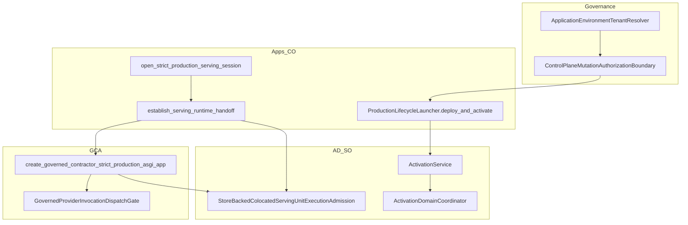

# PROD-Q-R1-R7-Q-P3-P0 — Adversarial qualification inventory & gate lock

| Field | Value |
|-------|-------|
| **Status** | **READY FOR AUDIT** — inventory and gate plan only; **does not** enter **PROD-Q-R1-R7-Q-P3** execution; **does not** claim **R7-Q PASS**; **does not** close **PROD-Q-R1-R7-Q** / **R7-Q** / **PROD-Q**; **does not** promote any **FRZ-*** global PASS |
| **Bounded child** | **PROD-Q-R1-R7-Q-P3-P0** |
| **Parent** | **PROD-Q-R1-R7-Q** — **IN PROGRESS** / **NOT QUALIFIED** |
| **Wave** | **P3** (gate plan §E.2 wave 3) — adversarial matrix |
| **Branch** | `development` |
| **START_HEAD / inventory baseline** | `b020a77559f79ae08f0b5747e08333ad5aa75885` |
| **Method** | Static source inspection + Git lineage; **no pytest** in P3-P0 |

## Canonical sources (read scope)

| Source | Role |
|--------|------|
| [`PROD_Q_R1_R7_Q_QUALIFICATION_INVENTORY_AND_GATE_PLAN.md`](PROD_Q_R1_R7_Q_QUALIFICATION_INVENTORY_AND_GATE_PLAN.md) | §E.2 wave 3 scope; dimensions 7–9, 14, 16, 20, 8 |
| [`PROD_Q_R1_R7_Q_P1_STRICT_PRODUCTION_REACHABILITY.md`](PROD_Q_R1_R7_Q_P1_STRICT_PRODUCTION_REACHABILITY.md) | P1 disposition (prerequisite reconciliation) |
| [`PROD_Q_R1_R7_Q_P2_STRICT_PRODUCTION_INTEGRATED_E2E.md`](PROD_Q_R1_R7_Q_P2_STRICT_PRODUCTION_INTEGRATED_E2E.md) | P2 closure + **P2-N01** (dim 9 overlap) |
| [`PROD_Q_R1_R7_Q_P2_C_ADR_01_CANONICAL_PACKAGE_CLOSURE_CONTRACT_AUTHORITY.md`](PROD_Q_R1_R7_Q_P2_C_ADR_01_CANONICAL_PACKAGE_CLOSURE_CONTRACT_AUTHORITY.md) | Package-closure authority (no P3 execution) |
| [`PLATFORM_ENTERPRISE_FREEZE_ACCEPTANCE_CHECKLIST.md`](PLATFORM_ENTERPRISE_FREEZE_ACCEPTANCE_CHECKLIST.md) | **FRZ-*** contribution intent (remain **OPEN**) |

---

## A. Preflight & prerequisite reconciliation

| Check | Result @ `b020a775…` |
|-------|----------------------|
| Branch | `development` |
| **EXPECTED_START_HEAD** | `b020a77559f79ae08f0b5747e08333ad5aa75885` — **match** |
| Working tree | **clean** |
| **PROD-Q-R1-R7-Q-P2** | **CLOSED — operator exact-SHA acceptance** @ impl `8e43b160447ca43de6631fe2a1b7f99948b64f2f` |
| **PROD-Q-R1-R7-Q-P1** | **READY FOR AUDIT** (not operator-closed) |
| **PROD-Q-R1-R7-Q** | **NOT QUALIFIED** / execution children in progress |

### DOC-01 (corrected in this task)

**PROD-Q-R1-R7-Q-P2-C-ADR-01** stated parent **P2** **CLOSED** while **Does not close** still listed **PROD-Q-R1-R7-Q-P2**. Documentation-only fix: removed **P2** from **Does not close** (parent closure record unchanged).

### DOC-02 — P1 prerequisite disposition

| Question | Determination |
|----------|----------------|
| Is independent **P1 CLOSED** mandatory before **P3** qualification? | **No** — gate plan §E.2 names **P3** as next mandatory wave after **P2** closure; **P1** is recorded **READY FOR AUDIT** alongside **P3** entry (§E.2 line 216). §I entry criteria apply to **P1** only (D2/D3 may proceed without independent audit). |
| Does accepted **P1** evidence suffice to enter **P3-P0** inventory? | **Yes** — static reachability (P1-G01–G06), D4 fake rejection reuse, and strict-graph guards are **background** for P3; P3-P0 does not require P1 operator closure. |
| Any **P1** finding blocking a P3 invariant? | **No IN-SCOPE BLOCKER** per P1 findings table; P1 explicitly defers cross-tenant pack and integrated adversarial work to later waves (**P3**). |
| Tracking | **P1** independent audit still **pending** — recommend closure before **P3** wave **CLOSED** for evidence continuity; **not** a gate for P3-P0 or P3 execution scheduling. |

**Mandatory wave-3 execution prerequisite:** **P2 CLOSED** (satisfied). **E.1** full D0–D4 replay remains **operator-scheduled** and separate from P3.

---

## B. Closed-world inventory — P3-A through P3-F

Legend: **SO** semantic owner · **CO** composition owner · **PC** production caller · **RA** revision/tenant authority

### P3-A — Cross-tenant isolation (gate dim **8**)

| Field | Record |
|-------|--------|
| **Invariant** | Tenant A principal/environment cannot activate, reconcile, hand off, or execute under tenant B's authorized serving environment/revision. |
| **SO** | **Governance** — `ControlPlaneMutationAuthorizationBoundary`; **AD** — tenant binding on activation evidence |
| **CO** | **Apps** — `open_production_process_lifecycle` / `ProductionLifecycleLauncher`; **Apps** — `open_strict_production_serving_session` |
| **Sanctioned contract/port** | `ApplicationEnvironmentTenantResolver`; `authorize_scoped_control_plane_mutation` via `ProductionControlPlaneMutationAuthorizationBoundary` (`production_control_plane_governance_wiring.py`) |
| **RA** | Environment → tenant via resolver; revision ids scoped in AD stores + governance mutation scope |
| **Implementation** | `production_process_lifecycle.py`, `production_lifecycle.py` (`deploy_and_activate`), `strict_production_serving_launcher.py`, `colocated_serving_runtime_composition.py`, `StoreBackedColocatedServingUnitExecutionAdmission` |
| **Entrypoints** | `open_production_process_lifecycle`; `open_strict_production_serving_session` → activate → `establish_serving_runtime_handoff` → GCA strict ASGI |
| **Tenant identity sources** | Principal on mutation; `ApplicationEnvironmentTenantResolver` injected on `ProductionControlPlaneGovernance`; serving store records |
| **Accepted negatives (slice)** | `test_d2_wrong_tenant_resolver_blocks`, `test_d2_governance_deny_is_fail_closed` (`test_prod_q_r1_r7_d2_production_process_lifecycle.py`); D4 `test_d4_governance_deny_blocks_activation` |
| **Uncovered adversarial invariant** | Cross-tenant **strict-path** E2E: activate/serve under env B with resolver/principal A; HTTP admission under wrong tenant; handoff bind with mismatched tenant on durable stores |
| **Bypass risks** | Direct store mutation without governance (out of production opener path); reference lifecycle (`open_reference_*`) — excluded by P1/P2 strict graph |
| **FRZ** | **FRZ-SEC-01**, applicable **FRZ-TEN-*** (R7-Q contribution only — **no global TENANT-X re-pass**) |

### P3-B — DENY / CAS / authority safety (gate dim **7**)

| Field | Record |
|-------|--------|
| **Invariant** | Rejected governance, invalid CAS / linearization failure, stale revision, or missing authorization cannot produce successful **physical prepare**, **traffic READY**, **execution admission**, or **provider dispatch**. |
| **SO** | **Governance** — mutation decision; **AD** — `ActivationService`, `ActivationDomainCoordinator`, store `atomic_commit_*` |
| **CO** | **Apps** launcher/orchestration; **Apps** GCA admission bridge |
| **Sanctioned contract/port** | `ControlPlaneMutationAuthorizationBoundary`; coordinator gates; `ServingExecutionEligibilityEvidence`; `StoreBackedColocatedServingUnitExecutionAdmission` |
| **RA** | Revision CAS on activation/serving stores; coordinator-scoped physical gate |
| **Implementation** | `activation.py`, `activation_domain_coordinator.py`, `colocated_serving_unit_task_execution.py`, governance wiring |
| **Entrypoints** | `deploy_and_activate` (governance before prepare); GCA task path after handoff |
| **Distinction** | **Governance decision** (control-plane mutation) ≠ **Execution admission** (serving unit gate) ≠ **Provider invocation** (PIS + dispatch gate — P3-F) |
| **Accepted negatives** | D2 governance deny; D1-R6 `r4`–`r8`, `r5_serving_admission_linearization`, `r3_coordinator_scoped_gate_closure`; D1b `test_stale_activation_pointer_denied`; D4 governance deny |
| **Uncovered** | Integrated strict session: DENY/CAS failure → no handoff + no ASGI; concurrent CAS under strict launcher wiring |
| **Bypass risks** | Skipping `principal=` on paths that require it; forged eligibility without store backing — mitigated in slice, not R7-Q @ HEAD |
| **FRZ** | **FRZ-PRD-08**, **FRZ-SEC-04**, **FRZ-STA-*** (state/CAS) |

### P3-C — Stale READY / physical unit loss (gate dim **14**)

| Field | Record |
|-------|--------|
| **Invariant** | A revision previously **READY** cannot continue serving after required physical serving unit is lost, empty adapter, or failed attestation/reconcile. |
| **SO** | **AD** — attestation + `reconcile_traffic_serving_physical_unit_after_process_restart` |
| **CO** | **Apps** — `reconcile_production_serving_environment_on_process_open` (`production_process_serving_reconciliation.py`) |
| **Sanctioned contract/port** | D3 reconciliation pipeline; `RuntimeDeploymentAdapter` attest/check; serving durable store |
| **RA** | Traffic-serving revision id from durable store → mandatory reconcile targets |
| **Implementation** | `production_process_serving_reconciliation.py`, `activation.py`, D3 harness patterns |
| **Entrypoints** | `open_production_process_lifecycle` process open; strict session re-open |
| **Accepted negatives** | D3 `test_d3_stale_physical_unit_fails_reconciliation`, `test_d3_open_fails_reconciliation_on_empty_adapter_*`, `test_d3_r1_open_fails_stale_physical_without_caller_targets`; D4 `test_d4_stale_physical_unit_after_serving`; D0/D1 stale adapter rows |
| **Uncovered** | Strict integrated: READY in DB + unit table cleared → **open_strict_production_serving_session** fails before traffic-ready ASGI |
| **Reuse** | **D3/D4 reconciliation contracts** — no new reconcile owner |
| **FRZ** | **FRZ-PRD-09**, **FRZ-PRD-12**, **FRZ-SEC-04** |

### P3-D — Drain / stop (gate dim **16**)

| Field | Record |
|-------|--------|
| **Invariant** | Drain/stop prevents new admissions, preserves in-flight accounting, reaches correct terminal lifecycle state without silent re-admit. |
| **SO** | **AD** — adapter `begin_drain` / `check_drain` / stop; admission gate on serving unit |
| **CO** | **Apps** launcher + handoff bind paths |
| **Sanctioned contract/port** | `RuntimeDeploymentAdapter` drain ports; unit admission controller |
| **RA** | Per `serving_unit_ref` + revision |
| **Implementation** | `venv_bundle_colocated_runtime_deployment_adapter.py`; D1-R6 coordination with drain |
| **Entrypoints** | Ops on active unit during/after strict session |
| **Accepted negatives** | D1 `test_begin_drain_blocks_admission`, `test_drain_completion_reflects_in_flight`, `test_drain_timeout_evidence`; D1-R6 drain/clear staged open; admission linearization under drain |
| **Uncovered** | Drain/stop during **active strict serving** session (gate plan dim 16); rollback evidence tied to launcher |
| **FRZ** | **FRZ-PRD-05**, **FRZ-PRD-04** |

### P3-E — Pre-readiness failure (gate dim **9**)

| Field | Record |
|-------|--------|
| **Invariant** | Failed prepare, validation, or readiness checks cannot publish traffic-ready state or expose serving endpoint. |
| **SO** | **AD** — `prepare_candidate` / readiness; **Apps** — strict GCA guard |
| **CO** | `ProductionLifecycleLauncher`, `create_governed_contractor_strict_production_asgi_app` |
| **Sanctioned contract/port** | Activation fail-closed; `session.readiness.ready_for_traffic` guard |
| **RA** | No READY commit without successful prepare/attest chain |
| **Implementation** | `activation.py`, `strict_production_serving.py`, adapter prepare negatives |
| **Entrypoints** | `deploy_and_activate`; strict ASGI factory |
| **P2-N01 (accepted — do not duplicate)** | Unready session → `ValueError` before `create_governed_contractor_process_app` @ P2 evidence `8e43b1604` / `test_p2_n01` — **FRZ-SEC-04**, **FRZ-PRD-09** |
| **Accepted negatives (slice)** | D1 readiness/attest failures; D0 `test_d0_10_no_automatic_prepare_after_failed_attestation`; D4 `test_d4_asgi_startup_only_after_preconditions` |
| **Uncovered for R7-Q** | Strict session: failed **prepare** on real A1 adapter never establishes handoff (distinct from P2-N01 unready struct) |
| **FRZ** | **FRZ-PRD-03**, **FRZ-PRD-09**, **FRZ-SEC-04** |

### P3-F — Strict PIS / dispatch ambiguity (gate dim **20**)

| Field | Record |
|-------|--------|
| **Invariant** | No ambiguous PIS keys, unsafe repeat dispatch, or recovery re-entry that executes external provider work without dispatch admission on **strict production** external-work path. |
| **SO (PIS)** | **Execution / ER** — `ProviderInvocationStore` (`intergrax/contracts/provider_invocation_store.py`); SQLite impl **PROD-Q-R1-PIS-01** |
| **SO (dispatch)** | **GCA host** — `GovernedProviderInvocationDispatchGate` (`provider_invocation_lifecycle.py`) |
| **CO** | **GCA** — `production_external_work_composition.py`; D2 opener wires `SQLiteProviderInvocationStore` |
| **Sanctioned contract/port** | PIS contract + dispatch gate; GR-7 recovery semantics (parent **PROD-Q-R1-ADR-03**) |
| **RA** | `invocation_id` durability; dispatch admission state in store |
| **Implementation** | `SQLiteProviderInvocationStore`; strict composition builder in governed_contractor tests |
| **Entrypoints** | Strict factory external-work path (post-handoff) |
| **Accepted evidence** | `test_prod_q_r1_pis_01_*` (store contract); `test_prod_q_r1_pis_02_provider_invocation_lifecycle_binding.py` (lifecycle binding, `dispatch_not_admitted` negative) |
| **Parent dependency** | **PROD-Q-R1** — **NOT CLOSED** / **BLOCKED**; **PROD-Q-R1-PIS-01** = **READY FOR AUDIT** per ADR-03 — dispatch/repeat policy not globally qualified |
| **Classification** | **IN-SCOPE P3 BLOCKER** for dim **20** closure — bounded mandatory child **`PROD-Q-R1-R7-Q-P3-F`** (strict-path PIS negatives) **blocked until** parent dispatch qualification satisfies gate plan §D.1 (**when parent unblocks**). Parallel track: **PROD-Q-R1** PIS/dispatch children (not R7-Q redesign). |
| **Honesty rule** | Store contract existence **≠** proof of no duplicate external effects on strict path |
| **FRZ** | **FRZ-PRD-08**, **FRZ-REL-03/05** (idempotency / external termination — contribution only) |

---

## C. Reuse map (D1b / D2 / D3 / D4 / P2)

| P3 slice | Primary reuse modules | P2 integrated reuse |
|----------|----------------------|---------------------|
| **P3-A** | D2 tenant + governance deny; D4 governance deny | P2-C admission DENY patterns (tenant orthogonal) |
| **P3-B** | D1-R6 CAS/admission; D2 deny; D1b stale pointer | `_prod_q_r1_r7_q_p2_strict_integrated_e2e.py` roster subset |
| **P3-C** | D3 + D3-R1 reconcile; D4 stale physical | D4 stale test in P2 reuse list |
| **P3-D** | D1 adapter drain; D1-R6 drain coordination | — |
| **P3-E** | D1/D0 prepare failures; D4 ASGI precondition | **P2-N01** static + historical — **no new duplicate N01 test** |
| **P3-F** | PIS-01/02 unit modules | Strict composition from D4 launcher tests — **new** strict E2E dispatch negatives only when parent unblocks |

---

## D. Minimal missing-test matrix

| ID | P3 | New qualification intent | Reuse vs new | Canonical path required |
|----|-----|--------------------------|--------------|-------------------------|
| **P3-T-01** | A | Tenant B env + tenant A resolver → activate denied | Extend D2 pattern on **strict session** | `open_strict_production_serving_session` + real governance |
| **P3-T-02** | A | Wrong-tenant HTTP admission after handoff attempt blocked | New if no strict HTTP case | GCA strict ASGI + store-backed admission |
| **P3-T-03** | B | Governance DENY → zero `prepare` side effects | D2 + strict launcher glue | `deploy_and_activate` |
| **P3-T-04** | B | CAS conflict → no READY / no handoff | D1-R6 replay @ HEAD | Coordinator + production opener |
| **P3-T-05** | C | Durable READY + empty adapter → strict open fails | D3 tests + strict launcher | D3 reconcile on `open_production_process_lifecycle` |
| **P3-T-06** | D | Drain blocks new admission under strict session | D1 drain + session fixture | Real adapter drain ports |
| **P3-T-07** | E | Prepare failure → no handoff (not P2-N01) | D1 negatives + strict session | A1 adapter fail prepare |
| **P3-T-08** | F | Repeat dispatch / recovery re-entry strict negative | **Blocked** — parent PROD-Q-R1 | `GovernedProviderInvocationDispatchGate` + production composition |

**Stub honesty:** Protocol conforming adapters allowed only where gate plan Claim A applies; **strict GCA** path remains **VenvBundleColocatedRuntimeDeploymentAdapter** only. Mocks must not remove governance, admission, or physical lifecycle under test.

---

## E. Dependency graph & authority boundaries

**Rules:** Governance decision precedes activation mutation; execution admission is store-backed post-handoff; PIS dispatch is separate from activation admission.

---

## F. Deterministic fixtures & local prerequisites

| Fixture | Used by | Notes |
|---------|---------|-------|
| `tmp_path` SQLite AD bundle | P3-A–E | Same pattern as D2/D4 tests |
| Two tenant ids + `StaticApplicationEnvironmentTenantResolver` | P3-A | Align with D2 test style |
| Deny-all / scoped-deny governance boundary | P3-A/B | Production wiring alias, not lab bypass |
| Venv bundle artifact digest lock | P3-E/C | D1 helper patterns |
| Durable serving row seed + adapter empty | P3-C | D3 harness |
| In-flight task counter under drain | P3-D | D1 drain tests |

**Local:** `uv` env; **no** HTTP qualification replay in P3-P0; logs under `.tmp/proof/<run-id>/` when execution children run.

---

## G. Negative cases & failure expectations (execution children)

| Case | Trigger | Expected failure (representative) |
|------|---------|----------------------------------|
| Cross-tenant activate | Resolver tenant ≠ env tenant | Governance / activation error; no READY |
| Governance DENY | Boundary returns deny | No prepare; no instance READY |
| CAS conflict | Concurrent commit | Coordinator/store error; stable state |
| Stale READY | Missing physical unit | Reconcile / open `ValueError` or typed reconcile failure |
| Drain active | `begin_drain` | Admission rejected; in-flight completes per policy |
| Prepare fail | Bad digest / readiness | Activation error; no handoff |
| Unready GCA | `ready_for_traffic=False` | **P2-N01** — `ValueError` before process app |
| PIS no dispatch | Execute without admission | `ProviderInvocationPersistenceError` / `dispatch_not_admitted` |

---

## H. Sequencing — bounded P3 children

| Order | Child ID | Scope | Budget (per task) | Depends on |
|-------|----------|-------|-------------------|------------|
| 1 | **PROD-Q-R1-R7-Q-P3-A** | Cross-tenant strict negatives (P3-A) | ≤5 min pytest; one module | P2 closed |
| 2 | **PROD-Q-R1-R7-Q-P3-B** | DENY/CAS integrated (P3-B) | ≤5 min | P3-A optional parallel if fixtures disjoint |
| 3 | **PROD-Q-R1-R7-Q-P3-C** | Stale READY strict (P3-C) | ≤5 min | D3 reuse |
| 4 | **PROD-Q-R1-R7-Q-P3-D** | Drain/stop strict session (P3-D) | ≤5 min | Active session fixture |
| 5 | **PROD-Q-R1-R7-Q-P3-E** | Pre-readiness strict prepare (P3-E) | ≤5 min | Exclude P2-N01 duplication |
| 6 | **PROD-Q-R1-R7-Q-P3-F** | Strict PIS negatives (P3-F) | ≤5 min | **PROD-Q-R1** dispatch qualification **unblocks** |

**Next mandatory execution child after P3-P0 audit:** **PROD-Q-R1-R7-Q-P3-A** (cross-tenant), per gate plan wave-3 priority.

---

## I. Architecture STOP conditions

| Condition | Action |
|-----------|--------|
| Second resolver / registry / admission port / lifecycle manager | **STOP — ARCHITECTURE DECISION REQUIRED** |
| Reference or fake adapter on strict GCA path | Reject — use existing D4 negatives |
| Governance merged with execution admission | **STOP** |
| PIS negatives prove store only without dispatch gate on strict path | Insufficient — do not close P3-F |
| Mock removes validator, governance, admission, or physical lifecycle under certification | Forbidden |

---

## J. Parent-level unresolved dependencies

| Dependency | Impact on P3 |
|------------|------------|
| **PROD-Q-R1** (PIS/dispatch) | Blocks **P3-F** / dim **20** closure |
| **E.1** R7-Q FULL-D0-D4-REPLAY | Blocks **R7-Q PASS**; not P3-P0 |
| **P1** audit pending | Evidence continuity; not P3 entry |
| Operator production governance profile (dim 6) | **ENVIRONMENT/TEST** — parallel to P3-B |

---

## K. FRZ mapping — P3 evidence intent (all remain **OPEN** globally)

| FRZ ID | P3 slices | P3 must contribute |
|--------|-----------|-------------------|
| **FRZ-PRD-03** | E | Fail-closed prepare/validation on strict path |
| **FRZ-PRD-04** | D, E | Lifecycle/drain ordering |
| **FRZ-PRD-05** | D | Drain/stop semantics |
| **FRZ-PRD-07** | (guard) | No reference bypass in adversarial tests |
| **FRZ-PRD-08** | B, F | Admission/bypass/PIS |
| **FRZ-PRD-09** | C, E | Readiness/stale READY |
| **FRZ-PRD-12** | C | Reconcile after unit loss |
| **FRZ-SEC-01** | A | Cross-tenant negatives @ exact SHA |
| **FRZ-SEC-04** | A, B, C, E | Unactivated / denied paths |
| **FRZ-TEN-*** | A | R7-Q scoped negatives (not global re-cert) |
| **FRZ-REG-02/03/09** | all | Regression modules + negative proofs @ HEAD |
| **FRZ-REL-03/05** | F | Dispatch/idempotency (when unblocked) |
| **FRZ-CTR/OWN/TYP** | all | No new shadow owners; typed contracts |

**No global FRZ PASS promotion from P3-P0.**

---

## L. Enterprise audit matrix (P3-P0 scope)

| Check | Verdict |
|-------|---------|
| Contracts over implementations | Reuse existing Protocols/ports from gate plan §B |
| Layer boundaries | No new cross-tier imports proposed |
| Exactly-one SO/CO | Matches §B tables; P3-F dispatch SO = GCA |
| Fail-closed | Negatives catalogued per slice |
| Governance ≠ Execution | Explicit in P3-B |
| No alternate production path | P1/P2 strict graph preserved |
| **ARCHITECTURE DECISION REQUIRED** | **None** for inventory |

---

## M. Exit criteria — **PROD-Q-R1-R7-Q-P3** (wave 3 — not P3-P0)

P3 wave may be accepted only when:

1. P3-A–E have exact-SHA execution evidence on canonical paths.
2. P3-F executed when parent dependency satisfied, or dim **20** remains explicitly **BLOCKED** with recorded child.
3. No regression vs P2 guarantees (including **P2-N01**).
4. Mandatory findings resolved or explicitly block closure.
5. **E.1** replay still separate if operator mandates before **R7-Q PASS**.

**P3-P0 exit:** this document **READY FOR AUDIT**; **P3** remains **NOT CLOSED**.

---

## N. Stage status (unchanged)

| Stage | Status |
|-------|--------|
| **PROD-Q-R1-R7-Q-P3-P0** | **READY FOR AUDIT** (this document) |
| **PROD-Q-R1-R7-Q-P3** | **NOT ENTERED** (execution) |
| **PROD-Q-R1-R7-Q** | **NOT QUALIFIED** |
| **PROD-Q-R1-R7** | **BLOCKED** / **NOT CLOSED** |
| **FRZ-PRD-*** / **FRZ-SEC-*** (global) | **OPEN** |

---

*Wprowadzone zmiany muszą zostać niezależnie zaudytowane na podstawie kodu z commitu znajdującego się na GitHubie. Raport Cursor AI nie jest podstawą do finalnego zamknięcia zadania.*
