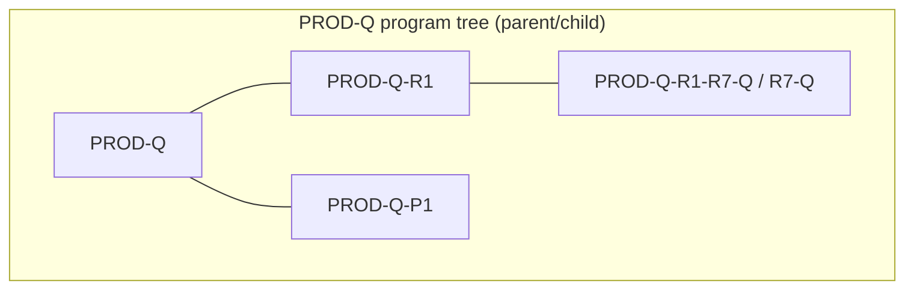
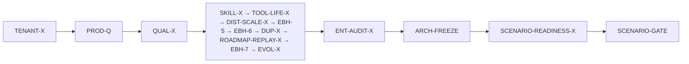
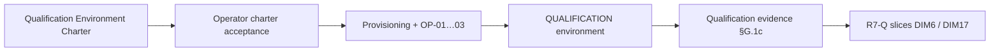

# PROD-Q-R1-R7-Q — Qualification Environment Charter

**READY FOR OPERATOR ACCEPTANCE — NOT PROVISIONED — NOT QUALIFIED**

| Field | Value |
|-------|-------|
| **Status** | **READY FOR OPERATOR ACCEPTANCE** — completed charter **awaiting** separate operator acceptance of this document; **`OPERATOR APPROVED — PROD-Q QUALIFICATION STRATEGY A+B`** (**unchanged** — strategy only, **not** charter acceptance); charter acceptance **would not** authorize infrastructure provisioning, spend, live activation, or closure of **DIM6**, **DIM17**, **R7-Q**, **PROD-Q**, or any global **FRZ-*** row |
| **Task** | `PROD-Q-R1-R7-Q-CHARTER-AUTHORIZATION-EVIDENCE-CORRECTIVE` (authorization metadata + §H.2 dependency corrective; preflight **§O** unchanged) |
| **Parent** | **PROD-Q → PROD-Q-R1 → PROD-Q-R1-R7 → PROD-Q-R1-R7-Q** — **IN PROGRESS** / **NOT QUALIFIED** |
| **Program** | **PROD-Q** — **OPEN** / **BLOCKED** (children) |
| **Branch** | `development` |
| **START_HEAD** | `6484d8c4f9950c31ec41169b0eeaeb537d81babd` |
| **Production code delta** | **0** (documentation-only) |
| **Disposition** | Charter **proposal** (preflight-complete); defines **minimal conditions** and **preflight** for a **future** isolated **QUALIFICATION** environment; environment **does not exist** and was **not** activated; **no** operator acceptance of this charter recorded |

**Canonical sources (read @ charter authoring; statuses unchanged by this document):**

- [`PLATFORM_ENTERPRISE_COMPLETION_ROADMAP.md`](../plans/PLATFORM_ENTERPRISE_COMPLETION_ROADMAP.md)
- [`PLATFORM_ENTERPRISE_FREEZE_ACCEPTANCE_CHECKLIST.md`](PLATFORM_ENTERPRISE_FREEZE_ACCEPTANCE_CHECKLIST.md)
- [`ENTERPRISE_CONTINUOUS_ARCHITECTURE_ASSURANCE_PROTOCOL.md`](ENTERPRISE_CONTINUOUS_ARCHITECTURE_ASSURANCE_PROTOCOL.md)
- [`PROD_Q_R1_R7_Q_QUALIFICATION_INVENTORY_AND_GATE_PLAN.md`](PROD_Q_R1_R7_Q_QUALIFICATION_INVENTORY_AND_GATE_PLAN.md)
- [`PROD_Q_R1_R7_Q_C_PACKAGE_B_OPERATOR_PRODUCTION_PROFILES_QUALIFICATION_EVIDENCE.md`](PROD_Q_R1_R7_Q_C_PACKAGE_B_OPERATOR_PRODUCTION_PROFILES_QUALIFICATION_EVIDENCE.md)
- [`PROD_Q_R1_R7_Q_SECTION_C_REMAINING_GATES_RECONCILIATION.md`](PROD_Q_R1_R7_Q_SECTION_C_REMAINING_GATES_RECONCILIATION.md)

**Historical evidence rule:** P0/P2/P3, D1–D4, Package B/C/P records @ cited SHAs are **background only** @ current HEAD — **not** promoted to qualification-environment existence or global PASS.

---

## 0. Executive boundary statement

Integrax is developed **locally**; Docker is used primarily for **tests** and **local qualification overlays** (e.g. GCA `docker-compose-local-qualification`). There is **no** operator-accepted **PRODUCTION** deployment and **no** provisioned **QUALIFICATION** environment at charter time. **OP-01…OP-03** operator inputs are **undelivered**; **OP-04** is **audit evidence captured during** an authorized qualification activation — it is **not** a pre-execution delivery prerequisite. This charter is a **proposal** for how such an environment **shall** be created, isolated, configured, and evidenced **later** — under separate operator tasks with explicit infrastructure authorization.

---

## 1. Closed-world inventory (@ `START_HEAD`)

Legend: **SO** = semantic owner · **CO** = composition owner · **PC** = production / strict-path caller.

### 1.1 `ControlPlaneMutationAuthorizationBoundary`

| Role | Location |
|------|----------|
| **SO** | **Governance** (runtime) |
| **Contract** | `intergrax/runtime/governance/control_plane_mutation_authorization.py` — `ControlPlaneMutationAuthorizationBoundary.authorize(...)` |
| **Type alias (production wiring)** | `ProductionControlPlaneMutationAuthorizationBoundary` in `intergrax/applications/_shared/production_control_plane_governance_wiring.py` |
| **CO** | `ProductionControlPlaneGovernance` dataclass (Apps shared) injected into D2/D4 production openers |
| **PC** | `authorize_scoped_control_plane_mutation` (`intergrax/agent_distribution/control_plane_governance.py`) from `intergrax/applications/_shared/deploy_activate_pipeline.py` → `ProductionLifecycleLauncher.deploy_and_activate`; reference path in `reference_production_lifecycle.py` (**LAB**, not strict production) |
| **Qualification tests** | D2/D4 unit negatives; Package B `tests/qualification/prod_q/test_prod_q_r1_r7_q_c_package_b_operator_production_profiles_gate.py` (B6-*) |

### 1.2 `production_control_plane_governance_wiring`

| Role | Location |
|------|----------|
| **SO** | **Applications shared** (wiring record only; mutation semantics remain Governance) |
| **Contract** | `ProductionControlPlaneGovernance` — `principal`, `mutation_authorization_boundary`, `environment_tenant_resolver` |
| **File** | `intergrax/applications/_shared/production_control_plane_governance_wiring.py` |
| **CO** | `open_production_process_lifecycle`, `open_strict_production_serving_session` (require non-null governance) |
| **PC** | Strict GCA command `applications/governed_contractor_application/host/package_b_strict_production_serving_command.py` |

### 1.3 `load_package_b_operator_production_control_plane_governance_from_env`

| Role | Location |
|------|----------|
| **SO** | **Applications shared** (Package B — **sole in-repo owner** for operator production governance configuration, PB-S01) |
| **Contract** | `load_package_b_operator_production_control_plane_governance_from_env` → `ProductionControlPlaneGovernance` |
| **File** | `intergrax/applications/_shared/package_b_operator_production_governance_configuration.py` |
| **Env prefix** | `INTERGRAX_OPERATOR_PRODUCTION_*` (`MUTATION_POLICY_BUNDLE_ID`, `MUTATION_POLICY_BUNDLE_PATH`, `GOVERNANCE_TENANT_ID`, `GOVERNANCE_SERVICE_ID`) |
| **Fail-closed** | Missing path/ID, in-repo forbidden bundle IDs (`reference_production.control_plane`, harness host bundle), digest/ID mismatch |
| **CO / PC** | `package_b_strict_production_serving_command.py` (strict serve entry); qualification `test_prod_q_r1_r7_q_package_b_strict_serving_wiring_gate.py` |

### 1.4 `validate_colocated_serving_admission_topology`

| Role | Location |
|------|----------|
| **SO** | **Applications shared** (topology guard) |
| **Contract** | `validate_colocated_serving_admission_topology` |
| **File** | `intergrax/applications/_shared/colocated_serving_runtime_composition.py` |
| **CO** | `bind_colocated_serving_runtime_after_activation` |
| **PC** | `production_lifecycle.py` (`open_production_process_lifecycle` path); colocated handoff before GCA strict factory |
| **Tests** | D1b; Package B B17-01; §C dim modules |

### 1.5 `GovernedContractorBackendSettings.from_env`

| Role | Location |
|------|----------|
| **SO** | **GCA host** (Tier-3 application settings) |
| **Contract** | `GovernedContractorBackendSettings` + `from_env` / `_load_app_env` |
| **File** | `applications/governed_contractor_application/host/settings.py` |
| **Env prefix** | `GOVERNED_CONTRACTOR_BACKEND_*` / `GOVERNED_CONTRACTOR_*` (via `ApplicationSettingsEnvHost`) |
| **Fail-closed (PROD)** | `BACKEND_ENV=prod` requires `context_only` identity; API keys mandatory unless explicit `BACKEND_ALLOW_UNAUTHENTICATED=true` (debug only) |
| **CO** | `build_governed_contractor_manifest`, `strict_production_serving.py`, `factory.py` |
| **PC** | `create_governed_contractor_strict_production_asgi_app` after handoff |
| **Tests** | Package B B17-02; D4 strict launcher module |

### 1.6 Trusted artifact roots (adapter + projection)

| Role | Location |
|------|----------|
| **SO** | **Agent Distribution** (artifact trust on prepare) · **Apps shared** (locator resolution / bundle assembly) |
| **Adapter parameters** | `VenvBundleColocatedRuntimeDeploymentAdapter(..., trusted_artifact_parent_roots, allow_qualification_locators=False)` — `intergrax/agent_distribution/venv_bundle_colocated_runtime_deployment_adapter.py` |
| **Locator resolution** | `resolve_production_artifact_root`, `assemble_production_registry_projection_input_bundle` — `intergrax/applications/_shared/production_registry_projection_input_bundle.py` |
| **CO** | `wire_production_lifecycle_services`, strict launcher materialization path |
| **PC** | `ProductionLifecycleLauncher.deploy_and_activate`, `open_strict_production_serving_session` |
| **Qualification** | D1 digest/locator negatives; Package B B17-04; §C dim2 — **lab** uses `allow_qualification_locators=True` in fixtures (**not** production policy) |

### 1.7 Strict production serving composition

| Surface | SO | CO | PC |
|---------|----|----|-----|
| `open_strict_production_serving_session` | Apps shared | `strict_production_serving_launcher.py` | Package B command, Docker qual overlay |
| `open_production_process_lifecycle` | Apps shared | `production_process_lifecycle.py` | D2/D4 chain |
| `load_strict_production_serving_environment_from_env` | Apps shared (PB-S02) | `package_b_strict_production_serving_environment.py` | `INTERGRAX_STRICT_PRODUCTION_SERVING_*` |
| `create_governed_contractor_strict_production_asgi_app` | GCA | `strict_production_serving.py` | uvicorn factory after handoff |
| Legacy `main.run()` | GCA | — | **Rejected** on production path (D4-03) |

### 1.8 Docker / local deployment (current repo artifacts)

| Artifact | Class | Notes |
|----------|-------|-------|
| `applications/governed_contractor_application/deploy/docker-compose-local-qualification/` | **LAB / local qualification overlay** | States: `CONFIGURED` → `REPO-TESTED` → `DOCKER-LOCAL-VERIFIED` only; **not** `TARGET-VERIFIED` / operator production |
| `RUNBOOK.md` (same tree) | Documentation | Strict serve **BLOCKED** without Package B operator governance; ext4/VM guarantees out of scope |
| `deploy/linux/single-node-production-profile-v1/` | **Target profile v1 (design)** | Referenced by Package B command; **not** charter acceptance of live VM |
| Local dev | **LAB** | Default developer workflow; no OP-01…04 |

### 1.9 Package B evidence contracts (existing)

| Document | Role |
|----------|------|
| [`PROD_Q_R1_R7_Q_C_PACKAGE_B_OPERATOR_PRODUCTION_PROFILES_QUALIFICATION_EVIDENCE.md`](PROD_Q_R1_R7_Q_C_PACKAGE_B_OPERATOR_PRODUCTION_PROFILES_QUALIFICATION_EVIDENCE.md) | B6-01…04, B17-01…05 lab gates; **DIM6/DIM17 NOT QUALIFIED** (operator profile) |
| `tests/qualification/prod_q/test_prod_q_r1_r7_q_c_package_b_operator_production_profiles_gate.py` | 11/11 **lab** @ historical EXECUTION_SHA — **not** replay claim @ charter HEAD unless re-run |
| `tests/qualification/prod_q/test_prod_q_r1_r7_q_package_b_strict_serving_wiring_gate.py` | Static/wiring closure for Package B loader |

**Shadow authority (explicit):** `build_reference_production_lifecycle_policy_bundle()` / `reference_production.control_plane` — **LAB ONLY**; forbidden as `INTERGRAX_OPERATOR_PRODUCTION_MUTATION_POLICY_BUNDLE_ID` when loaded via Package B loader.

---

## A. Environment classification

| Class | Purpose | Evidence allowed | Forbidden / out of scope |
|-------|---------|------------------|---------------------------|
| **LAB** | Developer machines, pytest, harness/reference policy bundles, `allow_qualification_locators=True`, in-repo Docker qual overlay without operator profiles | Slice tests @ cited SHAs; static gates; **labeled LAB** in evidence ledgers | Claiming **PRODUCTION** or **QUALIFICATION-environment acceptance**; using reference policy as production authority; promoting lab pytest to **FRZ-*** PASS |
| **QUALIFICATION** | **Future** isolated environment for operator-authorized bounded activation under **OP-01…OP-03**, **capture of OP-04** from that run, and re-run of **B6-01…04**, **B17-01…05** against **real** profile inputs (still **not** customer production traffic) | **QUALIFICATION-class** evidence: targeted pytest replay @ exact SHA; redacted audit exports (**OP-04**); configuration **references** (not secret values); negative evidence (deny before prepare); may support **scoped** operational-contract proof when criterion + operator execution requirements are met | Live production mutation of customer data; undeclared network exposure; secrets in Git/logs; auto-promotion to **PRODUCTION**; global **FRZ-*** PASS by label alone |
| **PRODUCTION** | Operator-accepted traffic-serving deployment per ratified profile (e.g. single-node v1 **when separately accepted**) | **Actual production operational** evidence per freeze checklist (DR/ops, continuous controls, live traffic acceptance where required) | **Does not exist** at charter time; **QUALIFICATION ≠ PRODUCTION** |

**Evidence-class rules (charter):**

| Rule | Detail |
|------|--------|
| **LAB ≠ acceptance** | **LAB** evidence does **not** establish qualification-environment acceptance or global **FRZ-*** PASS. |
| **QUALIFICATION scope** | **QUALIFICATION** evidence **may** establish **specific scoped** operational contracts (e.g. Package B B6/B17 operator replay, DIM6/DIM17 slices) when the exact **FRZ** criterion, operator-approved execution plan, and captured **OP-04** chain are satisfied. |
| **No production inheritance** | **QUALIFICATION** does **not** automatically establish real **PRODUCTION** deployment acceptance; **PROD-Q-P1** reachability, vendor live execution, and customer-traffic proof remain **separate** — **no inherited PASS**. |
| **Naming ≠ proof** | Environment class name **QUALIFICATION** does **not** imply **FRZ-PRD-01/03/08** or **FRZ-SEC-04** global PASS; checklist rows stay **OPEN** until independently satisfied. |

**Charter rule:** No document or runbook may describe the qualification environment as **already provisioned**. States progress only via explicit operator records (`PROPOSED` → `PROVISIONED` → `QUALIFIED` slice → …).

---

## B. Security and isolation (qualification target — design requirements)

Requirements apply to the **future** QUALIFICATION environment proposal; **no new security authority** is introduced.

| Concern | Requirement |
|---------|-------------|
| **Tenant / environment isolation** | Single declared `GOVERNANCE_TENANT_ID` + `INTERGRAX_STRICT_PRODUCTION_SERVING_APPLICATION_ENVIRONMENT_ID` per qualification instance; no shared credential maps across tenants; GCA API keys scoped to qualification tenant only |
| **Network exposure** | Bind ASGI/listeners to qualification VLAN/host only; no public ingress without operator waiver; documented egress allowlist for any external-work provider sandboxes |
| **Secrets** | **References only** — secret store / env injection at runtime; **never** in Git, qualification bundles committed to repo, or pytest logs (redact per session-artifacts rule under `.tmp/`) |
| **Storage / volumes** | Durable SQLite + artifact roots on qualification-dedicated volumes; `trusted_artifact_parent_roots` ⊆ operator-approved filesystem roots; **`allow_qualification_locators=false`** on qualification runs |
| **Process / container lifecycle** | Strict session open → activate → serve → **documented** close (DIM16/F02 ordering: admission close before drain); teardown destroys ephemeral credentials where applicable |
| **Cleanup** | Post-run: volume snapshot policy or wipe; no qualification secrets in persistent logs |
| **Failure containment** | DENY governance → **no** `adapter.prepare`; failed prepare → **no** handoff/ASGI (P3/§C lineage); qualification locator bypass **disabled** |
| **Diagnostics & audit provenance** | Observability **≠** execution truth; audit chain per §F; diagnostics files under `.tmp/session/<task-id>/` only |

---

## C. OP-01 — Governance policy (provisioning model)

| Item | Requirement |
|------|-------------|
| **Immutable policy bundle** | Out-of-repo JSON artifact loaded only via `load_package_b_operator_production_control_plane_governance_from_env` |
| **Bundle ID / revision** | `INTERGRAX_OPERATOR_PRODUCTION_MUTATION_POLICY_BUNDLE_ID` must match artifact `bundle_id`; canonical digest via `ImmutableRuntimePolicyBundle.with_canonical_digest()` |
| **Tenant / environment scope** | Bundle content + `GOVERNANCE_TENANT_ID` + strict serving `APPLICATION_ENVIRONMENT_ID` aligned to qualification tenant |
| **Approval provenance** | Operator record: who approved bundle, date, scope (qualification), SHA256 of file — **stored outside repo** |
| **Sanctioned loader** | Package B loader only; env-only bundle ID without file path **rejected** (Package B A01) |
| **Fail-closed** | Missing/invalid path, forbidden in-repo bundle IDs, parse errors → `PackageBOperatorProductionGovernanceConfigurationError`; no fallback to harness/reference |
| **LAB ONLY** | `reference_production.control_plane` — **cannot** satisfy OP-01 for qualification |

**Future evidence:** B6-01 **operator** ALLOW path under approved bundle; negative rows B6-02…04 re-run @ qualification SHA.

---

## D. OP-02 — Trusted artifact roots

| Item | Requirement |
|------|-------------|
| **Approved roots** | Finite tuple of absolute paths passed to `VenvBundleColocatedRuntimeDeploymentAdapter` / storage fixtures mirroring production wiring |
| **Digest / trust** | `file://` locators only on qualification path; `verify_venv_bundle_*` + `resolve_production_artifact_root` reject `reference://` and out-of-root paths |
| **Qualification-locator bypass** | **`allow_qualification_locators=false`** in qualification environment (contrast with lab pytest fixtures) |
| **Identity / provenance** | Materialization records + revision IDs captured in evidence ledger; locator → resolved path logged **without** secret material |
| **Negative evidence** | B17-04 lab negatives replayed with **operator** root tuple — untrusted path, wrong digest, `test://` if enabled must **fail** |

**Future evidence:** Operator attestation of root list + one successful strict activate using operator-built immutable bundle under those roots.

---

## E. OP-03 — Credential profile

Typed contract (unchanged): `GovernedContractorBackendSettings.from_env` @ `applications/governed_contractor_application/host/settings.py`.

| Item | Requirement |
|------|-------------|
| **GCA production profile** | `GOVERNED_CONTRACTOR_BACKEND_ENV=prod` + non-empty API key map via **approved** `GOVERNED_CONTRACTOR_BACKEND_API_KEYS_JSON` (or equivalent operator secret-store injection mapping to that contract) — **never** from repo or CI |
| **Positive-path constraints (mandatory)** | `BACKEND_ALLOW_UNAUTHENTICATED=false` (default; qualification **forbids** `GOVERNED_CONTRACTOR_BACKEND_ALLOW_UNAUTHENTICATED=true`); `GOVERNED_CONTRACTOR_IDENTITY_SOURCE=context_only` (prod default); credentials **tenant/environment-scoped** to qualification `GOVERNANCE_TENANT_ID` / strict serving `APPLICATION_ENVIRONMENT_ID` |
| **No LAB fallback** | Qualification **must not** use developer **bootstrap triplet** (`GOVERNED_CONTRACTOR_BACKEND_BOOTSTRAP_*`) or LAB-only keys; bootstrap path is for local dev only |
| **Secret-store references** | Document **names** of env vars / vault paths only in operator runbook |
| **Fail-closed** | Missing/invalid keys or mixed bootstrap + JSON → `ValueError` @ settings load (B17-02); missing mandatory env on strict serving loader → Package B / strict env errors — **no** silent unauthenticated serve on qualification positive path |
| **Separation** | Qualification credentials **disjoint** from production (when production exists) and from developer LAB bootstrap keys |
| **Prohibition** | No real credentials in repo, charter, or CI artifacts |

**Implementation note:** `from_env` permits `BACKEND_ALLOW_UNAUTHENTICATED=true` only for explicit operator break-glass (disaster debugging). Qualification **positive profile** treats that flag as **forbidden**; if canonical freeze requirements cannot be met without break-glass, classify **IN-SCOPE BLOCKER** and **STOP** — do not weaken the charter.

**Future evidence:** B17-02 **operator** profile smoke (settings load success **without** logging key material); B17-03…05 replay @ qualification SHA.

---

## F. OP-04 — Operator audit trace

Required chain (all links must appear in **exported** evidence):

```text
Approved policy (OP-01 provenance)
  → Governance admission (mutation ALLOW record)
  → authorize_scoped_control_plane_mutation (scoped activation)
  → deploy_and_activate / strict launcher (ALLOW only)
  → trusted artifact prepare + readiness
  → open_strict_production_serving_session (session id / environment id)
  → audit export correlating policy bundle ID + tenant + principal + activation id
```

| Rule | Detail |
|------|--------|
| **Not sufficient** | Config file existence, env var **presence** in shell, or Docker **start** without ALLOW + activation commit |
| **Must show** | Effective use of **operator** policy bundle (not reference), matching **OP-03** tenant in auth context, timestamped governance decision |
| **Correlation** | Bundle ID, `GOVERNANCE_SERVICE_ID`, `application_environment_id`, activation/revision identifiers |

**Lifecycle (OP-04):**

| Phase | OP-04 obligation |
|-------|------------------|
| **Pre-execution** | Audit **capture mechanism** configured; correlation fields (policy bundle ID, principal, tenant, activation, environment) **verified** on a dry run or test export — **no** completed activation audit required |
| **During authorized qualification** | **Capture OP-04** as **actual** evidence from bounded governance admission + activation under approved scope |
| **Post-execution** | Redact, preserve, verify completeness/provenance; independent exact-SHA audit — **then** DIM6/DIM17 acceptance may be **recommended** (not auto-closed) |

**Future evidence:** Operator observability export + redacted qualification run log under `.tmp/session/...`.

---

## G. Qualification execution plan (future task — **not executed** by this charter)

### G.1 Pre-execution entry conditions

| # | Condition |
|---|-----------|
| E1 | Operator **approves** qualification environment class + **infrastructure authorization** (separate from strategy A+B) to provision QUALIFICATION host/VM |
| E2 | **OP-01** policy bundle exists, operator-approved, stored outside repo (path/ID for `load_package_b_operator_production_control_plane_governance_from_env`) |
| E3 | **OP-02** trusted artifact roots operator-approved |
| E4 | **OP-03** credentials securely provisioned (secret store → env injection per §E) |
| E5 | **OP-04** audit capture + correlation requirements **configured and verified** (export path, redaction, field mapping per §F) |
| E6 | Explicit operator **authorization to activate** (bounded scope: tenant, environment, time window) |
| E7 | `HEAD` pinned; `git merge-base --is-ancestor <QUAL_BASELINE> HEAD` verified |
| E8 | **DIM6** and **DIM17** remain **NOT QUALIFIED** until post-execution evidence review completes |
| E9 | No change to canonical roadmap / FRZ / ECAP without separate operator action |

**Not a pre-execution gate:** a completed **OP-04** from an activation that has **not yet occurred**.

### G.1b During authorized qualification execution

| Step | Action |
|------|--------|
| 1 | Load **OP-01** via `load_package_b_operator_production_control_plane_governance_from_env` only |
| 2 | Execute **bounded** governance admission + activation under E6 scope (`ControlPlaneMutationAuthorizationBoundary` → `deploy_and_activate` / strict launcher) |
| 3 | **Capture OP-04** (exported audit chain per §F) correlated with policy, principal, tenant, activation id, environment |
| 4 | Run Package B gate matrix (§G.2) @ **EXECUTION_SHA** on qualification host |

### G.1c Post-execution exit (before DIM6/DIM17 recommendation)

| # | Condition |
|---|-----------|
| X1 | **OP-04** export present, redacted, correlates with run (not config-only) |
| X2 | B6/B17 operator replay **pass** @ pinned SHA |
| X3 | Evidence ledger update with **EXECUTION_SHA**, pytest log hash, OP-04 provenance |
| X4 | Independent exact-SHA audit (§G.7) **PASS** |
| X5 | **Then** operator may consider DIM6/DIM17 acceptance — charter does **not** auto-close |

### G.2 Gate matrix (Package B — operator replay)

| Gate | Requirement | Primary test module |
|------|-------------|---------------------|
| **B6-01** | Authorized production mutation → strict activation | `test_c_pkg_b_b6_01_*` + **operator** bundle |
| **B6-02** | DENY before physical prepare | `test_c_pkg_b_b6_02_*` |
| **B6-03** | Missing/invalid policy fail-closed | `test_c_pkg_b_b6_03_*` |
| **B6-04** | Tenant/environment isolation | `test_c_pkg_b_b6_04_*` |
| **B17-01** | Unsupported topology denied | `test_c_pkg_b_b17_01_*` |
| **B17-02** | Missing credentials denied (**operator** positive profile separate) | `test_c_pkg_b_b17_02_*` |
| **B17-03** | Invalid production configuration denied | `test_c_pkg_b_b17_03_*` |
| **B17-04** | Trusted roots + no qual-locator bypass | `test_c_pkg_b_b17_04_*` |
| **B17-05** | Settings/wiring replaceability | `test_c_pkg_b_b17_05_*` |

**Command (single bounded invocation when scheduled):**

```text
uv run pytest -p no:xdist tests/qualification/prod_q/test_prod_q_r1_r7_q_c_package_b_operator_production_profiles_gate.py
```

Optional strict wiring gate:

```text
uv run pytest -p no:xdist tests/qualification/prod_q/test_prod_q_r1_r7_q_package_b_strict_serving_wiring_gate.py
```

### G.3 Minimal targeted tests (qualification environment only)

- Package B gate module (above) @ **EXECUTION_SHA**
- Optional: one integrated strict session smoke with operator env (no live customer endpoints) — only after B6-01 passes
- **Do not** batch full D0–D4 or full §C 83-test module without operator E.1 budget gate

### G.4 Operator approvals

| Approval | Purpose |
|----------|---------|
| Infrastructure provision | QUALIFICATION host/network/storage |
| OP-01 bundle | Governance policy file + provenance |
| OP-02 roots | Filesystem trust boundary |
| OP-03 credentials | GCA qualification API profile |
| Activation window | Bounded governance activation under E6 |
| Evidence sign-off (**post-execution**) | OP-04 audit export + pytest log SHA + independent audit |

### G.5 Evidence capture

| Artifact | Location |
|----------|----------|
| Pytest log | `.tmp/session/<task-id>/pytest.log` |
| Redacted env manifest | Operator store + hash list in evidence doc |
| Audit export | Operator observability system |
| EXECUTION_SHA / FINAL_COMMIT | Qualification evidence ledger update (separate doc task) |

### G.6 Failure / STOP conditions

| Condition | Action |
|-----------|--------|
| Any B6/B17 failure on operator profile | **STOP** — no DIM6/DIM17 closure |
| Reference policy used | **STOP** — charter violation |
| `allow_qualification_locators=true` in qualification run | **STOP** |
| Secret leaked to log/Git | **STOP** — rotate credentials |
| Requires new semantic owner / alternate authority | **STOP — ARCHITECTURE DECISION REQUIRED** |

### G.7 Independent exact-SHA audit

Third-party or operator auditor verifies GitHub commit contains cited contracts; replays pytest @ **same SHA** on qualification host; compares OP-04 export to run.

### G.8 Entry to R7-Q parent rollup

| Prerequisite | Status @ charter |
|--------------|------------------|
| Pre-execution §G.1 complete | **OPEN** (no provisioned env) |
| Post-execution §G.1c complete (incl. **OP-04**) | **OPEN** |
| DIM6 **QUALIFIED** (operator B6-01 + evidence class) | **OPEN** |
| DIM17 **QUALIFIED** (operator profiles) | **OPEN** |
| DIM16 independent acceptance | **READY FOR AUDIT** (not closed) |
| §C parent rollup | **BLOCKED** on above + independent audit |
| **PROD-Q-R1-R7-Q** | **NOT QUALIFIED** |
| **PROD-Q** | **BLOCKED** (mandatory **PROD-Q-R1** + **PROD-Q-P1** among children) |

---

## H. Dependencies (canonical program direction — design view)

**Not implemented** — graphs for program planning only; **does not** modify the roadmap.

### H.1 Program parent/child (roadmap decomposition only)

**Convention:** nested containment — **not** execution order. Mandatory **PROD-Q** children include **PROD-Q-R1** and **PROD-Q-P1** in parallel; **PROD-Q-R1-R7-Q** (**R7-Q**) is a **child of R1**, not of **P1**.



### H.2 Dependencies — canonical prerequisites vs proposed qualification path

**Convention:** `A --> B` means **B** depends on **A** reaching an acceptable state before **B** proceeds (prerequisite chain). Graphs **do not** restate parent/child edges from §H.1.

#### H.2a Canonical roadmap prerequisites (program freeze path — unchanged)



| Node | Relationship to charter |
|------|------------------------|
| **PROD-Q** | Prerequisite: **TENANT-X**; **BLOCKED** until mandatory children (**PROD-Q-R1**, **PROD-Q-P1**, …) per roadmap (see §H.1 tree) |
| **PROD-Q-R1** | **PROD-Q** child (§H.1); **R7-Q** lives under **R1** |
| **PROD-Q-P1** | **PROD-Q** child (§H.1); reachability sibling — **no** inherited PASS from qualification env |
| **PROD-Q-R1-R7-Q** | **R1** child (§H.1); **not** a prerequisite to charter authoring; **DIM6/DIM17** remain **OPEN** until operator qualification evidence (strategy **B**) |
| **QUAL-X** | Prerequisite after **PROD-Q**; regression infrastructure must classify qualification failures correctly |
| **ENT-AUDIT-X → … → SCENARIO-GATE** | Canonical freeze path; **ARCH-FREEZE** precedes **SCENARIO-GATE** |

#### H.2b Proposed qualification-environment sequence (charter → R7-Q evidence slices)

**Purpose:** charter and future **QUALIFICATION** environment are **inputs** to closing **scoped** **DIM6/DIM17** evidence under **R7-Q** — **not** downstream of full **R7-Q** qualification.



| Node | Relationship |
|------|----------------|
| **Qualification Environment Charter** | **READY FOR OPERATOR ACCEPTANCE**; **not** provisioned; defines §A–§O + §G execution plan |
| **Operator charter acceptance** | **Separate** from strategy **A+B**; **not** recorded @ corrective **START_HEAD** |
| **Provisioning + OP-01…03** | Requires **A1** + **OP** deliveries (§O.6); **not** granted by strategy **A+B** alone |
| **QUALIFICATION environment** | Isolated host/overlay per §A–§B |
| **Qualification evidence §G.1c** | Captured **OP-04**, B6/B17 replay @ **EXECUTION_SHA**, independent audit **G.7** |
| **R7-Q slices DIM6 / DIM17** | May be **recommended** for operator review **after** evidence path — charter **does not** auto-close **R7-Q** |


---

## I. Enterprise assurance review (charter self-audit)

| Invariant | Owner / contract | Evidence | Status | Gap |
|-----------|------------------|----------|--------|-----|
| Contracts over implementations | Package B loaders, governance boundary, settings | §1 inventory | **PASS** (static) | Qualification run not executed |
| Hard layer boundaries | T0/T1/T2/T3 rules | No charter code change | **PASS** | — |
| Exactly-one semantic owner | §1 tables | Gate plan §B alignment | **PASS** | — |
| Exactly-one sanctioned composition owner | `open_strict_production_serving_session`, Package B command | Wiring gates | **PASS** | — |
| Strong typing | Settings, governance records, bundles | pyright @ HEAD (unchanged) | **PASS** | — |
| Modularity / replaceability | `RuntimeDeploymentAdapter` vs A1 pin | ADR DEC-01 lineage | **PASS** (design) | Second physical adapter on strict path **out of scope** |
| No `Any` on cited boundaries | Governance + settings | Static @ HEAD | **PASS** | — |
| No bypass / alternate authority | Reference policy forbidden in Package B loader | B6-03, A01 tests | **PASS** (lab) | Operator path unproven |
| Governance ≠ Execution | DENY before prepare | B6-02 | **PASS** (lab) | B6-01 operator OPEN |
| Proposal ≠ permission ≠ execution | Charter **ready for acceptance** ≠ accepted ≠ provision ≠ activation | Header status | **PASS** | Infrastructure **OPEN**; charter acceptance **OPEN** |
| Fail-closed | Loaders + settings | B17-*, B6-03 | **PASS** (lab) | Live profile OPEN |
| Tenant / secret isolation | §B requirements | — | **NOT PROVEN** | No qualification env |
| Observability ≠ execution truth | §F | — | **PASS** (design) | OP-04 captured only post-activation |
| Evidence continuity | EXECUTION_SHA discipline | §G.5 | **PARTIAL** | Charter only |
| Regression protection | Package B pytest module | Historical 11/11 | **PARTIAL** | Not replay @ START_HEAD in this task |

---

## J. Applicable FRZ (future evidence — **no new global PASS**)

**Disposition:** Checklist global rows remain **OPEN** @ charter time. This table maps **required evidence class** per primary **FRZ** — distinguishing **software mechanism proof** (LAB/HEAD-static), **qualification-environment proof**, and **actual production operational proof** (mostly **OPEN** / **NOT PROVEN** here).

### J.1 Primary

| FRZ | Requirement (summary) | Software / LAB (mechanism) | QUALIFICATION environment | Actual PRODUCTION ops | Charter disposition |
|-----|----------------------|----------------------------|---------------------------|------------------------|---------------------|
| **FRZ-PRD-01** | Production qualification independent of lab/harness | Package B loader forbids reference bundle; D2/D4 negatives @ cited SHAs | Operator **OP-01…03** + captured **OP-04**; B6/B17 replay @ SHA; no harness authority | Live deployment acceptance, continuous prod controls | **OPEN** — qual env may contribute **scoped** proof only after §G.1c |
| **FRZ-PRD-03** | Unsupported production configuration fails closed | B17-01…03 **lab**; D1b topology tests | Same gates on qualification host with operator profile | Unsupported config in **real** prod fleet | **OPEN** — LAB ≠ global PASS |
| **FRZ-PRD-08** | Production bypass count = 0 | B6-02 lab; static strict graph gates | Operator wiring + `allow_qualification_locators=false` on qual runs | Fleet-wide bypass census / EBH-5..DUP-X obligations | **OPEN** — stronger than isolated qual env alone |
| **FRZ-SEC-04** | Production auth bypass = 0 | B17-02 negatives; D4 legacy block; P3 scoped slices | §E positive profile + B17-02 operator smoke + HTTP admission on qual ASGI | Production traffic auth audit | **OPEN** — P3 AUTH-08 **PARTIAL** preserved; qual ≠ prod PASS |

### J.2 Supporting (representative)

| Family | Evidence class | Hook |
|--------|----------------|------|
| **FRZ-GOV-*** | QUALIFICATION + mechanism | OP-01 bundle + B6-* + **OP-04** chain |
| **FRZ-TEN-*** | QUALIFICATION (scoped) | B6-04 + OP-03 tenant-scoped keys — **does not** replace **TENANT-X** global PASS |
| **FRZ-BND-*** | Documentation | Tier boundaries unchanged |
| **FRZ-CTR-*** | Mechanism + QUALIFICATION | Sanctioned loaders (Package B, strict launcher) |
| **FRZ-TYP-*** | LAB / QUALIFICATION | Settings/governance typed load failures in pytest |
| **FRZ-REG-*** | QUALIFICATION | Evidence ledger @ EXECUTION_SHA |
| **FRZ-REL-*** | LAB / scoped qual | DIM20 strict HTTP — **not** re-closed by charter alone |

**Explicit non-rules:** **PROD-Q-P1** reachability, vendor **live** execution, and **PROD-Q-P3** operability closures **do not** inherit into this charter or into global **FRZ-PRD-01/03/08** / **FRZ-SEC-04** PASS.

---

## K. Unresolved decisions / findings

| ID | Finding | Disposition |
|----|---------|-------------|
| U1 | Qualification host topology (single-node VM vs dedicated qual cluster) | **Unresolved** — operator infrastructure task; charter does not ratify VM profile |
| U2 | Secret store technology (vault vendor) | **Unresolved** — must use env injection contract only |
| U3 | Whether qualification re-runs full §C 83-test module | **Deferred** — operator E.1 budget gate |
| U4 | DIM16 formal independent acceptance | **OPEN** — Package D READY FOR AUDIT |
| U5 | F02-09 S2b in-process strict reopen | **TRACKED FREEZE DEBT** — not qualification-environment blocker for DIM6/17 |
| U6 | Cross-process SQLite operational trust | **TRACKED FREEZE DEBT** (D1-D1b ARC-03) |

**No `STOP — ARCHITECTURE DECISION REQUIRED`** identified for charter scope — existing Package B / D2 / D4 composition suffices **if** operator supplies **OP-01…OP-03** and post-activation **OP-04** without new owners.

---

## L. Conditions for next task

1. Operator **infrastructure authorization** to provision **QUALIFICATION** class environment per §A–§B.
2. Delivery of **OP-01…OP-03** to secure operator store; **OP-04** capture mechanism per §F verified **before** activation.
3. Execute §G.1b → §G.1c; update qualification evidence with **EXECUTION_SHA**, pytest log, **post-run OP-04** export — **without** closing **DIM6/DIM17** until B6-01, operator B17 profile, and independent audit pass.
4. Independent GitHub audit of implementation commit before any **R7-Q** rollup language.

---

## M. Roadmap status recommendation

| Item | Recommended status |
|------|-------------------|
| **PROD-Q-R1-R7-Q** | **IN PROGRESS** / **NOT QUALIFIED** |
| **DIM6 / DIM17** | **NOT QUALIFIED** |
| **R7-Q** | **BLOCKED** (operator profiles + rollup) |
| **PROD-Q** | **OPEN** / **BLOCKED** |
| **This charter** | **READY FOR OPERATOR ACCEPTANCE — NOT PROVISIONED — NOT QUALIFIED** (separate charter acceptance + infrastructure + activation per §G / §O) |
| **Evidence classes** | **LAB** ≠ qual-env acceptance; **QUALIFICATION** ≠ **PRODUCTION**; global **FRZ** **OPEN** until checklist closure |
| **Canonical roadmap / FRZ / ECAP** | **Unchanged** (strategy A) |

---

## O. Qualification environment preflight (@ `START_HEAD`)

**Scope:** static inventory @ `bdb6fe7c231a3fead637b77197fb1943049b7add`; **no** `docker compose up`, **no** pytest, **no** credential generation.

### O.1 Sanctioned strict-serving composition (verified static)

| Surface | Finding |
|---------|---------|
| `package_b_strict_production_serving_command.py` | Sole sanctioned strict serve module for profile v1 + D4 uvicorn factory; loads **OP-01** via `load_package_b_operator_production_control_plane_governance_from_env`, strict env via `load_strict_production_serving_environment_from_env`, profile v1 via `load_single_node_production_profile_v1_from_env` |
| `open_strict_production_serving_session` / `StrictProductionServingSession` | Composition owner in `strict_production_serving_launcher.py`; **exactly-one** strict session path for Package B |
| Legacy `main.run()` | Rejected on production path (D4-03) — not a qualification substitute |
| Reference policy `reference_production.control_plane` | **LAB ONLY**; Package B loader forbids as operator bundle ID |

### O.2 Docker / local qualification assets

| Asset | Preflight |
|-------|-----------|
| `applications/governed_contractor_application/deploy/docker-compose-local-qualification/` | **CONFIGURED** in repo: `docker-compose.yml`, `Dockerfile`, entrypoint, `RUNBOOK.md`, `.env.example` |
| Compose project | `-p intergrax-gca-docker-local-qualification`; named volume `intergrax_gca_strict_local_qualification_data` |
| Default strict exec | `INTERGRAX_GCA_STRICT_SERVE_EXEC` → `package_b_strict_production_serving_command` (matches §1.7) |
| `--configured-verify` | Admission gate without cross-process writer — usable for layout proof **without** OP-01…03 |
| Strict serve in Compose | **BLOCKED** until OP-01…03 injected via operator `intergrax-gca-docker-local-qualification.env` (never commit) |
| `deploy/linux/single-node-production-profile-v1/` | Design target for VM/systemd; **not** ratified as live qualification host in this task |
| `infra/docker/*`, `infra/integration/docker-compose.yml` | General dev/integration stacks — **out of scope** for Package B strict qualification unless operator explicitly maps a subset |

**Classification:** Docker overlay = **LAB / local qualification adjunct** — may support **future QUALIFICATION** runs when operator binds OP profiles; **Docker ≠ PRODUCTION** and **≠** global qualification acceptance by itself.

### O.3 Minimal QUALIFICATION environment variant (existing mechanisms only)

| Layer | Minimal variant |
|-------|-----------------|
| **Host** | Single dedicated host or VM (operator choice **U1**); one active writer; Linux preferred for profile v1 parity |
| **Runtime** | Same sanctioned chain as §O.1 — either VM `single-node-production-profile-v1` entrypoint **or** Docker qual overlay **with** operator env files |
| **Governance** | Package B loader + out-of-repo mutation policy bundle (**OP-01**) |
| **Artifacts** | Operator filesystem roots (**OP-02**); `allow_qualification_locators=false` |
| **GCA** | `GovernedContractorBackendSettings.from_env` prod profile (**OP-03**) |
| **Evidence** | Package B pytest module @ **EXECUTION_SHA** + captured **OP-04** export |
| **Session capture** | Agent/diagnostic artifacts under `.tmp/session/<task-id>/` only (repo rule) |

### O.4 OP-01 / OP-02 / OP-03 — exact provisioning requirements

| OP | Deliverable (operator → secure store) | Binds to (in-repo contract) |
|----|--------------------------------------|-------------------------------|
| **OP-01** | Immutable JSON policy file; `bundle_id` + SHA256 provenance record; scoped `GOVERNANCE_TENANT_ID` / `GOVERNANCE_SERVICE_ID` | `INTERGRAX_OPERATOR_PRODUCTION_MUTATION_POLICY_BUNDLE_ID`, `INTERGRAX_OPERATOR_PRODUCTION_MUTATION_POLICY_BUNDLE_PATH`, tenant/service env vars |
| **OP-02** | Written list of absolute `trusted_artifact_parent_roots`; operator-built immutable venv bundles under those roots | Profile v1 / adapter env: `INTERGRAX_SINGLE_NODE_PRODUCTION_V1_TRUSTED_ARTIFACT_PARENT_ROOTS` (and adapter wiring per §1.6) |
| **OP-03** | Secret-store injection mapping to `GOVERNED_CONTRACTOR_BACKEND_API_KEYS_JSON` (or approved equivalent); qualification-only keys; `BACKEND_ALLOW_UNAUTHENTICATED` **absent/false**; `context_only` identity | `GOVERNED_CONTRACTOR_BACKEND_*` via `GovernedContractorBackendSettings.from_env` |
| **OP-04** | **Not pre-delivered** — configure export/correlation **before** activation; capture **during** authorized run per §F chain | Observability / audit system (vendor TBD **U2**) |

### O.5 Out-of-Git data, isolation, cleanup, provenance

| Class | Location | Isolation | Cleanup | Provenance |
|-------|----------|-----------|---------|------------|
| OP-01 policy bundle | Operator secret store / secured filesystem path | Per qualification tenant; single bundle ID revision | Retain per operator records policy; destroy on qual instance teardown if policy allows | SHA256 + approval record (who/when/scope) |
| OP-02 artifacts | Operator volumes under approved roots only | No shared roots across tenants | Wipe qual volumes after evidence capture; Docker: `down -v` only on isolated project `-p` per RUNBOOK | Materialization revision IDs in evidence ledger |
| OP-03 credentials | Vault / env injection at runtime | Disjoint from prod and LAB bootstrap triplet | Rotate on leak **STOP**; revoke at teardown | Env manifest **hash list** only in evidence doc |
| OP-04 audit export | Operator observability backend | Tenant-scoped correlation fields | Redact secrets; retention per operator policy | Linked to **EXECUTION_SHA**, activation id, bundle ID |
| Pytest / diag logs | `.tmp/session/<task-id>/` (gitignored) | Session-scoped | Operator may delete after audit | Log file hash in evidence ledger |
| Docker qual volume | `intergrax_gca_strict_local_qualification_data` | Single Compose project name | RUNBOOK: destructive wipe only with operator OK | Not production durable store |

### O.6 Actions requiring separate operator approval

| # | Approval | Not granted by strategy A+B or by charter draft alone |
|---|----------|-----------------------------------|
| A1 | **Infrastructure provisioning** (host, network, storage, spend) | **Yes — separate** |
| A2 | **OP-01** bundle publication + provenance | **Yes — separate** |
| A3 | **OP-02** trusted roots attestation | **Yes — separate** |
| A4 | **OP-03** credential issuance | **Yes — separate** |
| A5 | **Bounded activation window** (governance ALLOW + strict activate) | **Yes — separate** |
| A6 | Docker `up` / strict serve / cloud sandbox (D03-A) | **Yes — separate** |
| A7 | Full §C **83-test** replay or broad diagnostic pytest | **Yes — separate** (budget gate **U3**) |
| A8 | **DIM6 / DIM17 / R7-Q / PROD-Q** closure or global **FRZ** promotion | **Yes — separate** |
| A9 | D03-A cloud pair provisioning | **Yes — separate** (existing D03-A gates) |

### O.7 Collective execution plan (post-infrastructure authorization)

Execute **only** after **A1** and **OP-01…03** delivery; **single** bounded documentation reference: **§G** (entry **G.1** → during **G.1b** → exit **G.1c** → audit **G.7**). Preflight **O.1–O.5** must be re-read @ pinned **EXECUTION_SHA** immediately before **G.1b** step 1.

| Phase | Owner | Outcome |
|-------|-------|---------|
| **Preflight** | Operator + auditor | §O checklist + `merge-base --is-ancestor <QUAL_BASELINE> HEAD` |
| **Provision** | Operator | Qual host + secret store + audit export config |
| **Configure** | Operator | Inject OP-01…03; verify OP-04 mechanism (dry export) |
| **Activate** | Operator-authorized window | **G.1b** steps 1–3 |
| **Verify** | Operator + CI host | **G.1b** step 4 + **G.2** pytest @ SHA |
| **Close slice** | Independent auditor | **G.1c** + **G.7** — may **recommend** DIM6/DIM17 only; **no** auto-close |

---

## N. Validation record (charter + preflight task)

| Check | Result |
|-------|--------|
| Production code delta | **0** |
| `pytest` execution | **0** (docs-only task) |
| `pyright` | **0** (no Python changes) |
| Docker execution | **0** |
| `git diff --check` | Run @ commit time |
| Document internal consistency | §I; OP-04 §F/§G; evidence class §A/§J; graphs §H.1/§H.2a/§H.2b; preflight §O; Package B / §C reconciliation unchanged |

**Cursor disposition:** **READY FOR AUDIT** (charter **ready for operator acceptance** + preflight **§O**; **not** provisioned; **no** charter acceptance claimed).

---

*Wprowadzone zmiany muszą zostać niezależnie zaudytowane na podstawie kodu z commitu znajdującego się na GitHubie. Raport Cursor AI nie jest podstawą do finalnego zamknięcia zadania.*
