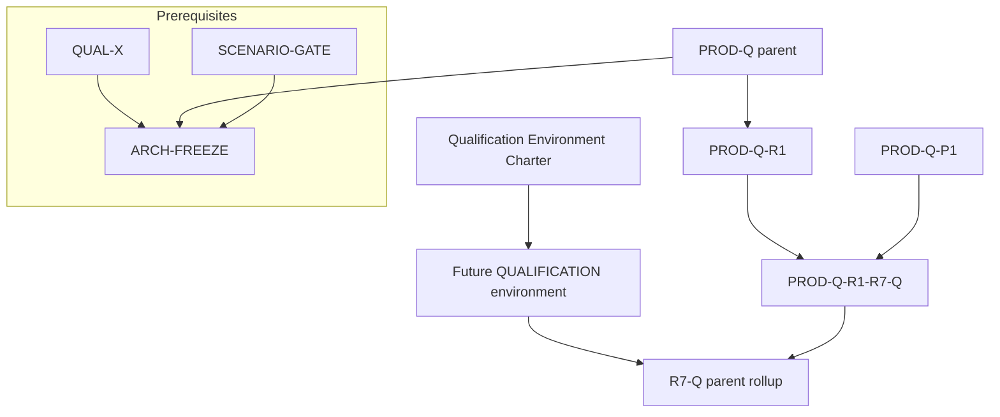

# PROD-Q-R1-R7-Q — Qualification Environment Charter

**PROPOSED — NOT QUALIFIED — NOT OPERATOR ACCEPTED**

| Field | Value |
|-------|-------|
| **Status** | **PROPOSED** — strategy **A+B** operator authorization **2026-10-22** (`OPERATOR APPROVED — PROD-Q QUALIFICATION STRATEGY A+B`); **does not** create infrastructure, **does not** close **DIM6**, **DIM17**, **R7-Q**, **PROD-Q**, or any **FRZ-*** row |
| **Task** | `PROD-Q-R1-R7-Q-QUALIFICATION-ENVIRONMENT-CHARTER` |
| **Parent** | **PROD-Q-R1-R7-Q** — **IN PROGRESS** / **NOT QUALIFIED** |
| **Program** | **PROD-Q** — **OPEN** / **BLOCKED** (children) |
| **Branch** | `development` |
| **START_HEAD** | `236866bd842232c2216f2b5b38b428a9f4addccd` |
| **Production code delta** | **0** (documentation-only proposal) |
| **Disposition** | Defines **minimal conditions** for a **future** isolated, operator-authorized **QUALIFICATION** environment; environment **does not exist** at charter authoring time |

**Canonical sources (read @ charter authoring; statuses unchanged by this document):**

- [`PLATFORM_ENTERPRISE_COMPLETION_ROADMAP.md`](../plans/PLATFORM_ENTERPRISE_COMPLETION_ROADMAP.md)
- [`PLATFORM_ENTERPRISE_FREEZE_ACCEPTANCE_CHECKLIST.md`](PLATFORM_ENTERPRISE_FREEZE_ACCEPTANCE_CHECKLIST.md)
- [`ENTERPRISE_CONTINUOUS_ARCHITECTURE_ASSURANCE_PROTOCOL.md`](ENTERPRISE_CONTINUOUS_ARCHITECTURE_ASSURANCE_PROTOCOL.md)
- [`PROD_Q_R1_R7_Q_QUALIFICATION_INVENTORY_AND_GATE_PLAN.md`](PROD_Q_R1_R7_Q_QUALIFICATION_INVENTORY_AND_GATE_PLAN.md)
- [`PROD_Q_R1_R7_Q_C_PACKAGE_B_OPERATOR_PRODUCTION_PROFILES_QUALIFICATION_EVIDENCE.md`](PROD_Q_R1_R7_Q_C_PACKAGE_B_OPERATOR_PRODUCTION_PROFILES_QUALIFICATION_EVIDENCE.md)
- [`PROD_Q_R1_R7_Q_SECTION_C_REMAINING_GATES_RECONCILIATION.md`](PROD_Q_R1_R7_Q_SECTION_C_REMAINING_GATES_RECONCILIATION.md)

**Historical evidence rule:** P0/P2/P3, D1–D4, Package B/C/P records @ cited SHAs are **background only** @ current HEAD — **not** promoted to qualification-environment existence or global PASS.

---

## 0. Executive boundary statement

Integrax is developed **locally**; Docker is used primarily for **tests** and **local qualification overlays** (e.g. GCA `docker-compose-local-qualification`). There is **no** operator-accepted **PRODUCTION** deployment and **no** provisioned **QUALIFICATION** environment at charter time. **OP-01…OP-04** inputs are **undelivered**. This charter is a **proposal** for how such an environment **shall** be created, isolated, configured, and evidenced **later** — under separate operator tasks with explicit infrastructure authorization.

---

## 1. Closed-world inventory (@ `START_HEAD`)

Legend: **SO** = semantic owner · **CO** = composition owner · **PC** = production / strict-path caller.

### 1.1 `ControlPlaneMutationAuthorizationBoundary`

| Role | Location |
|------|----------|
| **SO** | **Governance** (runtime) |
| **Contract** | `intergrax/runtime/governance/control_plane_mutation_authorization.py` — `ControlPlaneMutationAuthorizationBoundary.authorize(...)` |
| **Type alias (production wiring)** | `ProductionControlPlaneMutationAuthorizationBoundary` in `intergrax/applications/_shared/production_control_plane_governance_wiring.py` |
| **CO** | `ProductionControlPlaneGovernance` dataclass (Apps shared) injected into D2/D4 production openers |
| **PC** | `authorize_scoped_control_plane_mutation` (`intergrax/agent_distribution/control_plane_governance.py`) from `intergrax/applications/_shared/deploy_activate_pipeline.py` → `ProductionLifecycleLauncher.deploy_and_activate`; reference path in `reference_production_lifecycle.py` (**LAB**, not strict production) |
| **Qualification tests** | D2/D4 unit negatives; Package B `tests/qualification/prod_q/test_prod_q_r1_r7_q_c_package_b_operator_production_profiles_gate.py` (B6-*) |

### 1.2 `production_control_plane_governance_wiring`

| Role | Location |
|------|----------|
| **SO** | **Applications shared** (wiring record only; mutation semantics remain Governance) |
| **Contract** | `ProductionControlPlaneGovernance` — `principal`, `mutation_authorization_boundary`, `environment_tenant_resolver` |
| **File** | `intergrax/applications/_shared/production_control_plane_governance_wiring.py` |
| **CO** | `open_production_process_lifecycle`, `open_strict_production_serving_session` (require non-null governance) |
| **PC** | Strict GCA command `applications/governed_contractor_application/host/package_b_strict_production_serving_command.py` |

### 1.3 `load_package_b_operator_production_control_plane_governance_from_env`

| Role | Location |
|------|----------|
| **SO** | **Applications shared** (Package B — **sole in-repo owner** for operator production governance configuration, PB-S01) |
| **Contract** | `load_package_b_operator_production_control_plane_governance_from_env` → `ProductionControlPlaneGovernance` |
| **File** | `intergrax/applications/_shared/package_b_operator_production_governance_configuration.py` |
| **Env prefix** | `INTERGRAX_OPERATOR_PRODUCTION_*` (`MUTATION_POLICY_BUNDLE_ID`, `MUTATION_POLICY_BUNDLE_PATH`, `GOVERNANCE_TENANT_ID`, `GOVERNANCE_SERVICE_ID`) |
| **Fail-closed** | Missing path/ID, in-repo forbidden bundle IDs (`reference_production.control_plane`, harness host bundle), digest/ID mismatch |
| **CO / PC** | `package_b_strict_production_serving_command.py` (strict serve entry); qualification `test_prod_q_r1_r7_q_package_b_strict_serving_wiring_gate.py` |

### 1.4 `validate_colocated_serving_admission_topology`

| Role | Location |
|------|----------|
| **SO** | **Applications shared** (topology guard) |
| **Contract** | `validate_colocated_serving_admission_topology` |
| **File** | `intergrax/applications/_shared/colocated_serving_runtime_composition.py` |
| **CO** | `bind_colocated_serving_runtime_after_activation` |
| **PC** | `production_lifecycle.py` (`open_production_process_lifecycle` path); colocated handoff before GCA strict factory |
| **Tests** | D1b; Package B B17-01; §C dim modules |

### 1.5 `GovernedContractorBackendSettings.from_env`

| Role | Location |
|------|----------|
| **SO** | **GCA host** (Tier-3 application settings) |
| **Contract** | `GovernedContractorBackendSettings` + `from_env` / `_load_app_env` |
| **File** | `applications/governed_contractor_application/host/settings.py` |
| **Env prefix** | `GOVERNED_CONTRACTOR_BACKEND_*` / `GOVERNED_CONTRACTOR_*` (via `ApplicationSettingsEnvHost`) |
| **Fail-closed (PROD)** | `BACKEND_ENV=prod` requires `context_only` identity; API keys mandatory unless explicit `BACKEND_ALLOW_UNAUTHENTICATED=true` (debug only) |
| **CO** | `build_governed_contractor_manifest`, `strict_production_serving.py`, `factory.py` |
| **PC** | `create_governed_contractor_strict_production_asgi_app` after handoff |
| **Tests** | Package B B17-02; D4 strict launcher module |

### 1.6 Trusted artifact roots (adapter + projection)

| Role | Location |
|------|----------|
| **SO** | **Agent Distribution** (artifact trust on prepare) · **Apps shared** (locator resolution / bundle assembly) |
| **Adapter parameters** | `VenvBundleColocatedRuntimeDeploymentAdapter(..., trusted_artifact_parent_roots, allow_qualification_locators=False)` — `intergrax/agent_distribution/venv_bundle_colocated_runtime_deployment_adapter.py` |
| **Locator resolution** | `resolve_production_artifact_root`, `assemble_production_registry_projection_input_bundle` — `intergrax/applications/_shared/production_registry_projection_input_bundle.py` |
| **CO** | `wire_production_lifecycle_services`, strict launcher materialization path |
| **PC** | `ProductionLifecycleLauncher.deploy_and_activate`, `open_strict_production_serving_session` |
| **Qualification** | D1 digest/locator negatives; Package B B17-04; §C dim2 — **lab** uses `allow_qualification_locators=True` in fixtures (**not** production policy) |

### 1.7 Strict production serving composition

| Surface | SO | CO | PC |
|---------|----|----|-----|
| `open_strict_production_serving_session` | Apps shared | `strict_production_serving_launcher.py` | Package B command, Docker qual overlay |
| `open_production_process_lifecycle` | Apps shared | `production_process_lifecycle.py` | D2/D4 chain |
| `load_strict_production_serving_environment_from_env` | Apps shared (PB-S02) | `package_b_strict_production_serving_environment.py` | `INTERGRAX_STRICT_PRODUCTION_SERVING_*` |
| `create_governed_contractor_strict_production_asgi_app` | GCA | `strict_production_serving.py` | uvicorn factory after handoff |
| Legacy `main.run()` | GCA | — | **Rejected** on production path (D4-03) |

### 1.8 Docker / local deployment (current repo artifacts)

| Artifact | Class | Notes |
|----------|-------|-------|
| `applications/governed_contractor_application/deploy/docker-compose-local-qualification/` | **LAB / local qualification overlay** | States: `CONFIGURED` → `REPO-TESTED` → `DOCKER-LOCAL-VERIFIED` only; **not** `TARGET-VERIFIED` / operator production |
| `RUNBOOK.md` (same tree) | Documentation | Strict serve **BLOCKED** without Package B operator governance; ext4/VM guarantees out of scope |
| `deploy/linux/single-node-production-profile-v1/` | **Target profile v1 (design)** | Referenced by Package B command; **not** charter acceptance of live VM |
| Local dev | **LAB** | Default developer workflow; no OP-01…04 |

### 1.9 Package B evidence contracts (existing)

| Document | Role |
|----------|------|
| [`PROD_Q_R1_R7_Q_C_PACKAGE_B_OPERATOR_PRODUCTION_PROFILES_QUALIFICATION_EVIDENCE.md`](PROD_Q_R1_R7_Q_C_PACKAGE_B_OPERATOR_PRODUCTION_PROFILES_QUALIFICATION_EVIDENCE.md) | B6-01…04, B17-01…05 lab gates; **DIM6/DIM17 NOT QUALIFIED** (operator profile) |
| `tests/qualification/prod_q/test_prod_q_r1_r7_q_c_package_b_operator_production_profiles_gate.py` | 11/11 **lab** @ historical EXECUTION_SHA — **not** replay claim @ charter HEAD unless re-run |
| `tests/qualification/prod_q/test_prod_q_r1_r7_q_package_b_strict_serving_wiring_gate.py` | Static/wiring closure for Package B loader |

**Shadow authority (explicit):** `build_reference_production_lifecycle_policy_bundle()` / `reference_production.control_plane` — **LAB ONLY**; forbidden as `INTERGRAX_OPERATOR_PRODUCTION_MUTATION_POLICY_BUNDLE_ID` when loaded via Package B loader.

---

## A. Environment classification

| Class | Purpose | Evidence allowed | Forbidden / out of scope |
|-------|---------|------------------|---------------------------|
| **LAB** | Developer machines, pytest, harness/reference policy bundles, `allow_qualification_locators=True`, in-repo Docker qual overlay without operator profiles | Slice tests @ cited SHAs; static gates; **labeled LAB** in evidence ledgers | Claiming **PRODUCTION** or **QUALIFICATION** PASS; using reference policy as production authority; promoting lab pytest to **FRZ-*** PASS |
| **QUALIFICATION** | **Future** isolated environment for operator-authorized capture of **OP-01…OP-04** and re-run of **B6-01…04**, **B17-01…05** against **real** profile inputs (still **not** customer production traffic) | Targeted pytest replay @ exact SHA; audit exports; configuration **references** (not secret values); negative evidence (deny before prepare) | Live production mutation of customer data; undeclared network exposure; secrets in Git/logs; auto-promotion to **PRODUCTION** |
| **PRODUCTION** | Operator-accepted traffic-serving deployment per ratified profile (e.g. single-node v1 **when separately accepted**) | Independent operator acceptance, DR/ops evidence, continuous controls | **Does not exist** at charter time; **QUALIFICATION ≠ PRODUCTION** |

**Charter rule:** No document or runbook may describe the qualification environment as **already provisioned**. States progress only via explicit operator records (`PROPOSED` → `PROVISIONED` → `QUALIFIED` slice → …).

---

## B. Security and isolation (qualification target — design requirements)

Requirements apply to the **future** QUALIFICATION environment proposal; **no new security authority** is introduced.

| Concern | Requirement |
|---------|-------------|
| **Tenant / environment isolation** | Single declared `GOVERNANCE_TENANT_ID` + `INTERGRAX_STRICT_PRODUCTION_SERVING_APPLICATION_ENVIRONMENT_ID` per qualification instance; no shared credential maps across tenants; GCA API keys scoped to qualification tenant only |
| **Network exposure** | Bind ASGI/listeners to qualification VLAN/host only; no public ingress without operator waiver; documented egress allowlist for any external-work provider sandboxes |
| **Secrets** | **References only** — secret store / env injection at runtime; **never** in Git, qualification bundles committed to repo, or pytest logs (redact per session-artifacts rule under `.tmp/`) |
| **Storage / volumes** | Durable SQLite + artifact roots on qualification-dedicated volumes; `trusted_artifact_parent_roots` ⊆ operator-approved filesystem roots; **`allow_qualification_locators=false`** on qualification runs |
| **Process / container lifecycle** | Strict session open → activate → serve → **documented** close (DIM16/F02 ordering: admission close before drain); teardown destroys ephemeral credentials where applicable |
| **Cleanup** | Post-run: volume snapshot policy or wipe; no qualification secrets in persistent logs |
| **Failure containment** | DENY governance → **no** `adapter.prepare`; failed prepare → **no** handoff/ASGI (P3/§C lineage); qualification locator bypass **disabled** |
| **Diagnostics & audit provenance** | Observability **≠** execution truth; audit chain per §F; diagnostics files under `.tmp/session/<task-id>/` only |

---

## C. OP-01 — Governance policy (provisioning model)

| Item | Requirement |
|------|-------------|
| **Immutable policy bundle** | Out-of-repo JSON artifact loaded only via `load_package_b_operator_production_control_plane_governance_from_env` |
| **Bundle ID / revision** | `INTERGRAX_OPERATOR_PRODUCTION_MUTATION_POLICY_BUNDLE_ID` must match artifact `bundle_id`; canonical digest via `ImmutableRuntimePolicyBundle.with_canonical_digest()` |
| **Tenant / environment scope** | Bundle content + `GOVERNANCE_TENANT_ID` + strict serving `APPLICATION_ENVIRONMENT_ID` aligned to qualification tenant |
| **Approval provenance** | Operator record: who approved bundle, date, scope (qualification), SHA256 of file — **stored outside repo** |
| **Sanctioned loader** | Package B loader only; env-only bundle ID without file path **rejected** (Package B A01) |
| **Fail-closed** | Missing/invalid path, forbidden in-repo bundle IDs, parse errors → `PackageBOperatorProductionGovernanceConfigurationError`; no fallback to harness/reference |
| **LAB ONLY** | `reference_production.control_plane` — **cannot** satisfy OP-01 for qualification |

**Future evidence:** B6-01 **operator** ALLOW path under approved bundle; negative rows B6-02…04 re-run @ qualification SHA.

---

## D. OP-02 — Trusted artifact roots

| Item | Requirement |
|------|-------------|
| **Approved roots** | Finite tuple of absolute paths passed to `VenvBundleColocatedRuntimeDeploymentAdapter` / storage fixtures mirroring production wiring |
| **Digest / trust** | `file://` locators only on qualification path; `verify_venv_bundle_*` + `resolve_production_artifact_root` reject `reference://` and out-of-root paths |
| **Qualification-locator bypass** | **`allow_qualification_locators=false`** in qualification environment (contrast with lab pytest fixtures) |
| **Identity / provenance** | Materialization records + revision IDs captured in evidence ledger; locator → resolved path logged **without** secret material |
| **Negative evidence** | B17-04 lab negatives replayed with **operator** root tuple — untrusted path, wrong digest, `test://` if enabled must **fail** |

**Future evidence:** Operator attestation of root list + one successful strict activate using operator-built immutable bundle under those roots.

---

## E. OP-03 — Credential profile

| Item | Requirement |
|------|-------------|
| **GCA production profile** | `GOVERNED_CONTRACTOR_BACKEND_ENV=prod` + API keys via `BACKEND_API_KEYS_JSON` or bootstrap triplet — **from secret store** |
| **Secret-store references** | Document **names** of env vars / vault paths only in operator runbook |
| **Fail-closed** | Missing keys on PROD → `ValueError` @ settings load (B17-02 contract); no `BACKEND_ALLOW_UNAUTHENTICATED` in qualification |
| **Separation** | Qualification credentials **disjoint** from production (when production exists) and from developer LAB bootstrap keys |
| **Prohibition** | No real credentials in repo, charter, or CI artifacts |

**Future evidence:** B17-02 **operator** profile smoke (settings load success **without** logging key material); B17-03…05 replay @ qualification SHA.

---

## F. OP-04 — Operator audit trace

Required chain (all links must appear in **exported** evidence):

```text
Approved policy (OP-01 provenance)
  → Governance admission (mutation ALLOW record)
  → authorize_scoped_control_plane_mutation (scoped activation)
  → deploy_and_activate / strict launcher (ALLOW only)
  → trusted artifact prepare + readiness
  → open_strict_production_serving_session (session id / environment id)
  → audit export correlating policy bundle ID + tenant + principal + activation id
```

| Rule | Detail |
|------|--------|
| **Not sufficient** | Config file existence, env var **presence** in shell, or Docker **start** without ALLOW + activation commit |
| **Must show** | Effective use of **operator** policy bundle (not reference), matching **OP-03** tenant in auth context, timestamped governance decision |
| **Correlation** | Bundle ID, `GOVERNANCE_SERVICE_ID`, `application_environment_id`, activation/revision identifiers |

**Future evidence:** Operator observability export + redacted qualification run log under `.tmp/session/...`.

---

## G. Qualification execution plan (future task — **not executed** by this charter)

### G.1 Entry conditions

| # | Condition |
|---|-----------|
| E1 | Operator **infrastructure authorization** (separate from strategy A+B) to provision QUALIFICATION class host/VM |
| E2 | OP-01…OP-04 **delivered** to secure operator store (not in repo) |
| E3 | `HEAD` pinned; `git merge-base --is-ancestor <QUAL_BASELINE> HEAD` verified |
| E4 | **DIM6** and **DIM17** remain **NOT QUALIFIED** until this plan completes successfully |
| E5 | No change to canonical roadmap / FRZ / ECAP without separate operator action |

### G.2 Gate matrix (Package B — operator replay)

| Gate | Requirement | Primary test module |
|------|-------------|---------------------|
| **B6-01** | Authorized production mutation → strict activation | `test_c_pkg_b_b6_01_*` + **operator** bundle |
| **B6-02** | DENY before physical prepare | `test_c_pkg_b_b6_02_*` |
| **B6-03** | Missing/invalid policy fail-closed | `test_c_pkg_b_b6_03_*` |
| **B6-04** | Tenant/environment isolation | `test_c_pkg_b_b6_04_*` |
| **B17-01** | Unsupported topology denied | `test_c_pkg_b_b17_01_*` |
| **B17-02** | Missing credentials denied (**operator** positive profile separate) | `test_c_pkg_b_b17_02_*` |
| **B17-03** | Invalid production configuration denied | `test_c_pkg_b_b17_03_*` |
| **B17-04** | Trusted roots + no qual-locator bypass | `test_c_pkg_b_b17_04_*` |
| **B17-05** | Settings/wiring replaceability | `test_c_pkg_b_b17_05_*` |

**Command (single bounded invocation when scheduled):**

```text
uv run pytest -p no:xdist tests/qualification/prod_q/test_prod_q_r1_r7_q_c_package_b_operator_production_profiles_gate.py
```

Optional strict wiring gate:

```text
uv run pytest -p no:xdist tests/qualification/prod_q/test_prod_q_r1_r7_q_package_b_strict_serving_wiring_gate.py
```

### G.3 Minimal targeted tests (qualification environment only)

- Package B gate module (above) @ **EXECUTION_SHA**
- Optional: one integrated strict session smoke with operator env (no live customer endpoints) — only after B6-01 passes
- **Do not** batch full D0–D4 or full §C 83-test module without operator E.1 budget gate

### G.4 Operator approvals

| Approval | Purpose |
|----------|---------|
| Infrastructure provision | QUALIFICATION host/network/storage |
| OP-01 bundle | Governance policy file + provenance |
| OP-02 roots | Filesystem trust boundary |
| OP-03 credentials | GCA qualification API profile |
| Evidence sign-off | OP-04 audit export + pytest log SHA |

### G.5 Evidence capture

| Artifact | Location |
|----------|----------|
| Pytest log | `.tmp/session/<task-id>/pytest.log` |
| Redacted env manifest | Operator store + hash list in evidence doc |
| Audit export | Operator observability system |
| EXECUTION_SHA / FINAL_COMMIT | Qualification evidence ledger update (separate doc task) |

### G.6 Failure / STOP conditions

| Condition | Action |
|-----------|--------|
| Any B6/B17 failure on operator profile | **STOP** — no DIM6/DIM17 closure |
| Reference policy used | **STOP** — charter violation |
| `allow_qualification_locators=true` in qualification run | **STOP** |
| Secret leaked to log/Git | **STOP** — rotate credentials |
| Requires new semantic owner / alternate authority | **STOP — ARCHITECTURE DECISION REQUIRED** |

### G.7 Independent exact-SHA audit

Third-party or operator auditor verifies GitHub commit contains cited contracts; replays pytest @ **same SHA** on qualification host; compares OP-04 export to run.

### G.8 Entry to R7-Q parent rollup

| Prerequisite | Status @ charter |
|--------------|------------------|
| DIM6 **QUALIFIED** (operator B6-01) | **OPEN** |
| DIM17 **QUALIFIED** (operator profiles) | **OPEN** |
| DIM16 independent acceptance | **READY FOR AUDIT** (not closed) |
| §C parent rollup | **BLOCKED** on above + independent audit |
| **PROD-Q-R1-R7-Q** | **NOT QUALIFIED** |
| **PROD-Q** | **BLOCKED** |

---

## H. Dependencies (order preserved — design view)

**Not implemented** — dependency graph for program planning only.



| Node | Relationship to charter |
|------|------------------------|
| **PROD-Q-R1-R7-Q** | Parent stage; charter is **child proposal** (strategy B) |
| **PROD-Q-R1** | DIM20 Package P scoped closure — **does not** replace DIM6/17 |
| **PROD-Q-P1** | Reachability evidence — background @ cited SHAs |
| **PROD-Q parent** | Remains **OPEN/BLOCKED** |
| **QUAL-X** | Regression infrastructure — must classify qualification env failures correctly |
| **ARCH-FREEZE** | Not gated by this charter |
| **SCENARIO-GATE** | After enterprise freeze path per roadmap |

---

## I. Enterprise assurance review (charter self-audit)

| Invariant | Owner / contract | Evidence | Status | Gap |
|-----------|------------------|----------|--------|-----|
| Contracts over implementations | Package B loaders, governance boundary, settings | §1 inventory | **PASS** (static) | Qualification run not executed |
| Hard layer boundaries | T0/T1/T2/T3 rules | No charter code change | **PASS** | — |
| Exactly-one semantic owner | §1 tables | Gate plan §B alignment | **PASS** | — |
| Exactly-one sanctioned composition owner | `open_strict_production_serving_session`, Package B command | Wiring gates | **PASS** | — |
| Strong typing | Settings, governance records, bundles | pyright @ HEAD (unchanged) | **PASS** | — |
| Modularity / replaceability | `RuntimeDeploymentAdapter` vs A1 pin | ADR DEC-01 lineage | **PASS** (design) | Second physical adapter on strict path **out of scope** |
| No `Any` on cited boundaries | Governance + settings | Static @ HEAD | **PASS** | — |
| No bypass / alternate authority | Reference policy forbidden in Package B loader | B6-03, A01 tests | **PASS** (lab) | Operator path unproven |
| Governance ≠ Execution | DENY before prepare | B6-02 | **PASS** (lab) | B6-01 operator OPEN |
| Proposal ≠ permission ≠ execution | This charter = **PROPOSED** | Header status | **PASS** | — |
| Fail-closed | Loaders + settings | B17-*, B6-03 | **PASS** (lab) | Live profile OPEN |
| Tenant / secret isolation | §B requirements | — | **NOT PROVEN** | No qualification env |
| Observability ≠ execution truth | §F | — | **PASS** (design) | OP-04 missing |
| Evidence continuity | EXECUTION_SHA discipline | §G.5 | **PARTIAL** | Charter only |
| Regression protection | Package B pytest module | Historical 11/11 | **PARTIAL** | Not replay @ START_HEAD in this task |

---

## J. Applicable FRZ (future evidence — **no new global PASS**)

### J.1 Primary

| FRZ | Requirement (summary) | Future qualification evidence |
|-----|----------------------|--------------------------------|
| **FRZ-PRD-01** | Production qualification independent of lab/harness | QUALIFICATION class runs with OP-01…04; lab reference policy **excluded**; independent audit @ SHA |
| **FRZ-PRD-03** | Unsupported production configuration fails closed | B17-01…03 on qualification host; `validate_colocated_serving_admission_topology`; GCA PROD settings negatives |
| **FRZ-PRD-08** | Production bypass count = 0 | Strict graph with operator wiring only; B6-02 DENY-before-prepare; no `allow_qualification_locators` |
| **FRZ-SEC-04** | Production auth bypass = 0 | OP-03 profile; B17-02; HTTP admission negatives (§C dim15 lineage) on qualification ASGI |

### J.2 Supporting (representative)

| Family | Future evidence hook |
|--------|---------------------|
| **FRZ-GOV-*** | OP-01 bundle + B6-* governance chain |
| **FRZ-TEN-*** | B6-04 + OP-03 tenant-scoped keys |
| **FRZ-BND-*** | Tier boundaries unchanged; qualification docs only |
| **FRZ-CTR-*** | Sanctioned loaders (Package B, strict launcher) |
| **FRZ-TYP-*** | Settings/governance typed load failures captured in pytest |
| **FRZ-REG-*** | Evidence ledger @ EXECUTION_SHA; `git diff --check` clean |
| **FRZ-REL-*** | DIM20 strict HTTP lineage — **not** re-closed by environment charter |

---

## K. Unresolved decisions / findings

| ID | Finding | Disposition |
|----|---------|-------------|
| U1 | Qualification host topology (single-node VM vs dedicated qual cluster) | **Unresolved** — operator infrastructure task; charter does not ratify VM profile |
| U2 | Secret store technology (vault vendor) | **Unresolved** — must use env injection contract only |
| U3 | Whether qualification re-runs full §C 83-test module | **Deferred** — operator E.1 budget gate |
| U4 | DIM16 formal independent acceptance | **OPEN** — Package D READY FOR AUDIT |
| U5 | F02-09 S2b in-process strict reopen | **TRACKED FREEZE DEBT** — not qualification-environment blocker for DIM6/17 |
| U6 | Cross-process SQLite operational trust | **TRACKED FREEZE DEBT** (D1-D1b ARC-03) |

**No `STOP — ARCHITECTURE DECISION REQUIRED`** identified for charter scope — existing Package B / D2 / D4 composition suffices **if** operator supplies OP-01…04 without new owners.

---

## L. Conditions for next task

1. Operator **infrastructure authorization** to provision **QUALIFICATION** class environment per §A–§B.
2. Delivery of **OP-01…OP-04** artifacts to secure operator store.
3. Update or append qualification evidence doc with **EXECUTION_SHA**, pytest log, OP-04 export — **without** closing **DIM6/DIM17** until B6-01 and operator B17 profile pass.
4. Independent GitHub audit of implementation commit before any **R7-Q** rollup language.

---

## M. Roadmap status recommendation

| Item | Recommended status |
|------|-------------------|
| **PROD-Q-R1-R7-Q** | **IN PROGRESS** / **NOT QUALIFIED** |
| **DIM6 / DIM17** | **NOT QUALIFIED** |
| **R7-Q** | **BLOCKED** (operator profiles + rollup) |
| **PROD-Q** | **OPEN** / **BLOCKED** |
| **This charter** | **PROPOSED — NOT QUALIFIED — NOT OPERATOR ACCEPTED** (await operator acceptance of charter + separate provision task) |
| **Canonical roadmap / FRZ / ECAP** | **Unchanged** (strategy A) |

---

## N. Validation record (charter task)

| Check | Result |
|-------|--------|
| Production code delta | **0** |
| `pytest` execution | **0** (docs-only task) |
| `pyright` | **0** (no Python changes) |
| `git diff --check` | Run @ commit time |
| Document internal consistency | Self-review §I |

**Cursor disposition:** **READY FOR AUDIT** (charter proposal only).

---

*Wprowadzone zmiany muszą zostać niezależnie zaudytowane na podstawie kodu z commitu znajdującego się na GitHubie. Raport Cursor AI nie jest podstawą do finalnego zamknięcia zadania.*
