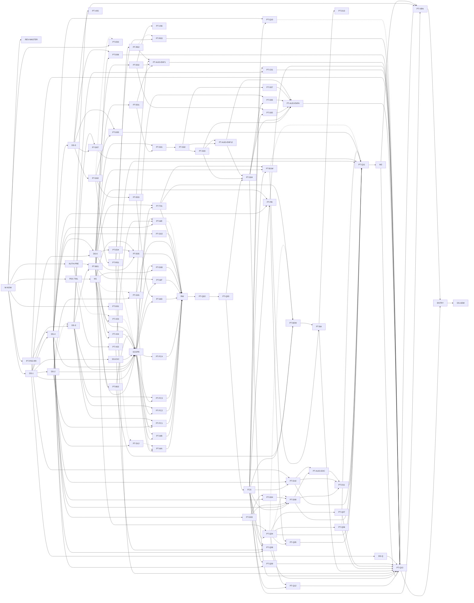

# Dependency DAG of phase-2 work items (generated by build_plan.py from plan_data.py)

Hard edge `A -> B` = B cannot start before A is done (decision answered, merged, audited). Soft edge = should precede, otherwise rework or re-audit.
Node kinds: DEC decision, MILE milestone, PDC external PDC-X work, DOC docs-only, TEST non-product tests/scripts/workflows, PROD product path (ACT-N11), MAT IIAC material path, SET GitHub setting, RUN bounded run, AUD/REQ independent audit or requalification, CAMP Campaign B, REV review.

## Validation

| check | result |
|---|---|
| nodes | 90 (37 tickets) |
| hard edges / soft edges | 193 / 20 |
| hard edges acyclic | True |
| hard+soft acyclic | True |
| hard edges consistent with wave order | True |
| soft edges against wave order (allowed, listed) | [('PT-D02', 'PT-E00'), ('PT-Q08', 'PT-D09')] |
| unknown references | none |
| ENTRY gate: nodes required by BLOCKS / worst-case-BLOCKS / HIGH findings and by the stage re-audits | 50 required; not hard ancestors of ENTRY: none |
| required but optional by decision (soft edge, reason on the node) | none |

## Longest path by node count (not a duration-weighted critical path)

20 nodes; 64 distinct longest paths exist (ties). The DAG has no durations. One of them: `M-NOW -> DS-1 -> DS-4 -> DS-6 -> PT-V04 -> SCOPE -> PT-WA -> RW -> PT-Q02 -> PT-Q03 -> FCS -> PT-D09 -> PT-AUD-DOC -> PT-D11 -> PT-Q11 -> M3 -> PT-Q13 -> PT-VBN -> ENTRY -> DS-ADM`

## Nodes that are not hard ancestors of ENTRY (informational)

DS-ADM, PT-D12, PT-D13, PT-E00, PT-Q10, PT-V03, PT-V05, PT-V06, PT-WE, REV-MASTER

## Nodes by wave

### W0 Decision intake

| node | kind | title | hard prerequisites | soft | sens | audit node | AR | DP | status |
|---|---|---|---|---|---|---|---|---|---|
| M-NOW | MILE | Phase 1 planning complete; dossier published (PR #589) | - | - | - | - | - | - | - |
| REV-MASTER | REV | Independent review of MASTER_PLAN by a session that did not write it (phase check 7) | M-NOW | - | - | - | - | - | - |
| DS-1 | DEC | Decision session DS-1: ground rules, impact definition, labels, delegation, ONE wave, exact-SHA meaning (DP-01..DP-12) | M-NOW | - | - | - | - | DP-01..12 | - |
| DS-2 | DEC | Decision session DS-2: seams and layer boundaries (DP-13..DP-23) | DS-1 | - | - | - | - | DP-13..23 | - |
| DS-3 | DEC | Decision session DS-3: fail-closed design and reachability-first checks (DP-24..DP-33) | DS-1 | DS-2 | - | - | - | DP-24..33 | - |
| DS-4 | DEC | Decision session DS-4: FRZ rows, Path B, L499 and stage evidence (DP-34..DP-45); answered after the independent re-read PT-FRZ-RR | DS-1, PT-FRZ-RR | - | - | - | - | DP-34..45 | - |
| DS-5 | DEC | Decision session DS-5: register, ownership, domains (DP-46..DP-57) | DS-4 | - | - | - | - | DP-46..57 | - |
| DS-6 | DEC | Decision session DS-6: requalification schedule, pins, enforcement activation (DP-58..DP-68) | DS-1, DS-4 | - | - | - | - | DP-58..68 | - |
| AUTH-PRE | DEC | Intake of PRE authorizations: read scope AR-62, read-only/static probes AR-01..03, AR-11..13 | M-NOW | - | - | - | AR-62, AR-01, AR-02, AR-03, AR-11, AR-12, AR-13 | - | - |
| DS-EXC | DEC | Operator decision per PDC-X declared exception (EX-G-*, EX-L-01..14, EX-D*): in RW / deferred with an ARCH-FREEZE class / accepted as limitation; input of SCOPE (RV-05) | DS-1 | - | - | - | - | new: WP12-Q11 | - |
| DS-Q | DEC | Queued ARCH-FREEZE decisions that can and must be answered BEFORE the entry check: EVOL auditor (EDER-D-0167), EVOL closure publication (0168), EVOL dependency for ENT (0169), branch protection (0171) | DS-1 | - | - | - | - | - | - |
| PT-FRZ-RR | AUD | Independent re-read of WP-4's 14 LOW-confidence OPEN classifications and the 28 would-be-hidden-obligation rows (one WP, three shards, never re-read); runs BEFORE the Path-B decisions DP-34..DP-40 so the Operator decides on re-read classifications (DR-05) | M-NOW | - | SESSION | - | AR-12-04 | - | - |

### W1 In PDC window (non-product only; the window is now closed, see PDC-TAIL)

| node | kind | title | hard prerequisites | soft | sens | audit node | AR | DP | status |
|---|---|---|---|---|---|---|---|---|---|
| PDC-TAIL | PDC | PDC tail (external, PDC-owned): P9 closure - DONE 2026-11-16: RB-1 merged (PR #601), closure package PR #602, Operator confirmation OD-PDC-X-CLOSE, closure PR #603 (feaa2a87d), final SHA PR #604 (7960ae7f6); PDC-X closed as SCOPED Variant A with exit criteria not met literally, global audit PASS_... | M-NOW | - | - | PT-Q13 | - | - | DONE 2026-11-16 (read via git show; not independent verification of A2-017: C1) |
| PT-V02 | RUN | TOOL-LIFE-X correctives verification run (PW-0): C-1/C-2/C-3 tests at current development tip | AUTH-PRE | - | RUN | - | AR-05 | - | - |
| PT-V05 | RUN | ENT-AUDIT/IIAC small bounded checks, impact-map baseline loop, measured semantic-wrapper run | AUTH-PRE | - | RUN | - | AR-11, AR-12, AR-13 | - | - |
| PT-D01 | DOC | DB-F1 domain docs, decision-free (15 files; 19 hunks) - owner-doc patches that need no ruling | M-NOW | - | DOCS | - | AR-21, AR-38 | - | - |
| PT-E00 | DOC | T-ENF-0 docs: A2-006 supersession entry, A0-006 ECAP index entry, FRZ-AUD-10 amendment DRAFT (not merged as LIVE) | M-NOW | PT-D02 | DOCS | PT-AUD-ENF1 | - | - | - |
| PT-E01 | TEST | T-ENF-1 workflow prerequisites: pin ubuntu-24.04 + uv python in enterprise-audit*.yml; governance-policy-pin decision | DS-6 | - | NONPRODUCT | PT-AUD-ENF1 | AR-30 | - | - |
| PT-E02 | TEST | T-ENF-2 ticket-approval validators, legacy-exceptions file, ticket-governance job, Ref gate CI mode | DS-6 | - | NONPRODUCT | PT-AUD-ENF1 | AR-31 | - | - |
| PT-S01 | SET | Enforcement trial: disposable ruleset on refs/heads/enforcement-trial/**, negative trials N1..N10 (no change to development) | PT-E01, DS-6 | - | SETTINGS | PT-AUD-ENF12 | AR-45, AR-50 | - | - |
| PT-S02 | SET | Stage 1: required ent-audit-fast + ent-audit-pr-gate on development (new ruleset; rollback = disable) | PT-S01 | - | SETTINGS | PT-AUD-ENF12 | AR-46 | - | - |
| PT-S07 | SET | Optional: enable repository auto-merge (separate authorization; not part of Stage 1) | PT-S02 | - | SETTINGS | PT-AUD-ENFA | AR-51 | - | OPTIONAL: optional by decision (DP-67); if not enabled the node is void and PT-AUD-ENFA ignores it |

### W2 After P9, before the wave

| node | kind | title | hard prerequisites | soft | sens | audit node | AR | DP | status |
|---|---|---|---|---|---|---|---|---|---|
| PT-S03 | SET | Stage 2: add ci-smoke and evol-x-b4-preflight as required checks | PT-S02 | - | SETTINGS | PT-AUD-ENF12 | AR-47 | - | - |
| M1 | MILE | M1: PDC P9 closed (REACHED 2026-11-16, closure publication feaa2a87d); remediation product-path work still needs the Operator's separate authorization (AR-39..AR-44) and DP-11 | PDC-TAIL | - | - | - | - | - | DONE 2026-11-16 |
| PT-V03 | RUN | Domain evidence gate runs (WP-5 set; harness_01, ebh_5 etc.) | M1 | AUTH-PRE | RUN | - | AR-06 | - | - |
| PT-V04 | RUN | S1 diagnostic baseline at M1 (non-certifying): ROADMAP-REPLAY-X counters, STATE-X/TRACE-X 7 nodes, tenant_x, F10 --check | M1, DS-6 | - | RUN | - | AR-07 | - | - |
| PT-D02 | DOC | DB-G EDER + qualification index + DOCUMENTATION_MAP row (EDER batch A) | DS-5 | - | DOCS | - | AR-22, AR-59 | - | - |
| PT-R01 | DOC | EDER batch B: data load (870-row draft regenerated after the WP merge) + reconciliation + exclusions + owner vocabulary | PT-D02 | - | DOCS | - | AR-23 | - | - |
| PT-R02 | TEST | EDER batch C: scripts/governance/check_enterprise_debt_register.py + tests + CI step | PT-R01 | - | NONPRODUCT | PT-AUD-ENF1 | AR-29 | - | - |
| PT-R03 | DOC | EDER wave D: owner confirmation, severity, impact per P-wave (continuous) | PT-R01 | PT-R02 | DOCS | - | - | - | - |
| PT-D03 | DOC | DB-J evidence publication: digests/artefacts of gitignored local audit reports (custody statement) | DS-4 | - | DOCS | - | AR-20 | - | - |
| PT-D04 | DOC | DB-C stage records: append-only notes on closed stage records (16 files) | DS-4, PT-D03 | - | DOCS | - | - | - | - |
| PT-D05 | DOC | DB-D registers and matrices (17 files) | PT-D02, DS-5 | - | DOCS | - | AR-24 | - | - |
| PT-D06 | DOC | DB-E PDC-X documents (10 files) | M1, DS-5 | - | DOCS | - | AR-21 | - | - |
| PT-D07 | DOC | DB-F2 domain docs, decision-dependent (24 files; 37 hunks, 31 blocked on decisions) | DS-5, DS-3 | - | DOCS | - | AR-21, AR-28 | - | - |
| PT-V06 | RUN | Replay of the ticket-approval validators over the 115 existing tickets (legacy-exception baseline) | PT-E02 | - | RUN | - | AR-14 | - | - |
| PT-D12 | DOC | Seam canon documents: canonical layer rule text after the DP-13 ruling, LLM resolver owner, composition-root naming, direct-serving declaration, CTRL-X bypass-claim relabel | DS-2 | PT-D01 | DOCS | - | AR-17 | - | - |
| PT-G01 | TEST | Non-product gates and tests: seam ledger + closed-world gate (TL-FIX-A S10), EBH-3 gate scan extension (A5-001/A2-009), construction gate (S9), profile parity test (S4a), direct-serving gate (S7a), AST check (S11) | DS-2 | M1 | NONPRODUCT | PT-Q02 | AR-26 | - | - |
| PT-G02 | TEST | FRZ evidence surface: new gates/inventories for BND-05/06, TYP-05, PLG-03..08, OWN-02..05, CTR-01/02/04/06, DEBT-02..04 (WP-4 section C test/script part) + STATE-X citation repair | DS-4 | - | UNVERIFIED | PT-Q02 | - | - | - |
| PT-B01 | CAMP | Campaign B-1 alpha at B (R00..R17; 18 planned + 4 reserve slots): critical security, tenant, fail-closed, governance, recovery, replay - diagnostic, non-certifying, READ-ONLY, scratch worktree at B | DS-3, AUTH-PRE | - | RUN | PT-BA | AR-61, AR-04, AR-06, AR-11, AR-12, AR-13 | - | - |
| PT-B02 | CAMP | Campaign B-2 alpha at B (R20..R25, S01..S03; 9 planned + 3 reserve): remaining findings by risk, each with class, worst case and promotion trigger - READ-ONLY | PT-B01 | - | RUN | PT-BA | AR-61 | - | - |
| SCOPE | MILE | Wave scope frozen (DP-11): defect list from the WP-2 probes (= B-1 run R03), V03, V04, B-1 and B-2 alpha, PDC-X exception reconciliation; gates G01/G02 designed | M1, DS-1, DS-2, DS-3, DS-4, DS-EXC, PT-V04, PT-B01, PT-B02 | PT-V02, PT-V03, PT-R01 | - | - | - | - | - |
| PT-E03 | TEST | T-ENF-3 ENT-AUDIT acceptance conftest hook and debt-gate rewrite (A6-001, A6-006) | PT-D02 | - | NONPRODUCT | PT-AUD-ENF1 | AR-32 | - | - |
| PT-E04 | TEST | T-ENF-4 new IIAC corpus and artifact verifiers (new files only) | DS-6 | - | NONPRODUCT | PT-Q02 | AR-33 | - | - |
| PT-AUD-ENF12 | AUD | AUD-ENF-A (part 1): independent audit of the trial and enforcement Stages 1 and 2 (ruleset JSON, verifier output, trial evidence N1..N10, read-only GETs) BEFORE Stage 3 may start; rollback rule: Stage 1/2 are live from W1/W2 without independent audit until this node passes - if it fails, or has n... | PT-S02, PT-S03 | - | SESSION | - | AR-12-06 | - | - |

### W3 Remediation wave RW (product, one train)

| node | kind | title | hard prerequisites | soft | sens | audit node | AR | DP | status |
|---|---|---|---|---|---|---|---|---|---|
| PT-T01 | TEST | Campaign B tracked negative/adversarial tests NT-01..NT-16 (red-first at B, green at FCS) + repair of the tenant-propagation gate emitter list (A4-006) + gate-scope extensions designed by B | SCOPE, PT-B01 | - | NONPRODUCT | PT-Q02 | - | - | - |
| PT-WA | PROD | W-A boundary inversion and agents: neutral Tier-0 contracts, remove 12 intergrax.applications imports from intergrax/runtime (S1a-c), agents registry/provider injection (S2b-d), LKW facades | SCOPE | PT-G01, PT-D12 | PRODUCT | PT-Q02 | AR-39 | DP-13, DP-14 | - |
| PT-WB | PROD | W-B resolver, profiles, composition roots, serving: one LLM resolver + routing record, profile consolidation/projection, provider factories behind IntegrationProfile, strict-production serving via run_hosted_application | SCOPE | PT-G01 | PRODUCT | PT-Q02 | AR-40 | - | - |
| PT-FC4 | PROD | FC-4 skill-pin durability + KV durability attestation (A4-002) | SCOPE | - | PRODUCT | PT-Q02 | AR-41 | - | - |
| PT-FC1 | PROD | FC-1 execution routing and Nexus construction (A4-044, 009, 037; 015/031 conditional; 024 after WP-1 verdict) | SCOPE, DS-2, DS-3 | - | PRODUCT | PT-Q02 | AR-41 | - | - |
| PT-FC3 | PROD | FC-3 vendor/provider selector fail-closed + CONFIG-X gate extension (A4-017, 019, 026, 032c) | SCOPE, DS-3 | - | PRODUCT | PT-Q02 | AR-41, AR-27 | - | - |
| PT-FC2 | PROD | FC-2 production wiring: capacity, queue, memory, observability, sandbox (A4-030, 032a/b, 035, 036; WP2-OBS-01..04) | SCOPE, DS-3 | - | PRODUCT | PT-Q02 | AR-41 | - | - |
| PT-WD | PROD | W-D / T-ENF-6 ENT-AUDIT-X engine fixes: unmapped path => FULL, coverage map, frz_mapping (A6-003/005/007/008) + new mapped ENT checks for the 6 unmapped FRZ families (A6-004, from PT-C01; must land before G2) | SCOPE, PT-E03 | - | PRODUCT | PT-Q02 | AR-42 | - | - |
| PT-WE | PROD | W-E (conditional) TOOL-LIFE-X residual hardening PW-3 (invoker.py) - only if DP-43 sends residuals to a fix and the audit reproduces one | DS-4, PT-V02, SCOPE | - | PRODUCT | PT-Q02 | AR-43 | - | OPTIONAL: exists only if DP-43 sends residuals to a fix and RA-1 reproduces one; ON ACTIVATION the soft edge PT-WE -> RW becomes a HARD edge, PT-WE becomes a... |
| PT-WF | PROD | W-F tenant G-09 fail-closed, owner repairs, Campaign-B-conditional fixes (WP-4 section C: OWN/CTR/DOC-05/DEBT/PLG/PRD/SEC-04/TEN rows; E2-E4 if B-1 confirms) | SCOPE, PT-B01 | - | PRODUCT | PT-Q02 | AR-44 | - | - |
| PT-D08 | DOC | DB-H product-path docs (2 files under intergrax/, agents/ or applications/) | M1, SCOPE | - | PRODUCT | PT-Q02 | - | - | - |
| PT-E05 | MAT | T-ENF-5 IIAC validator hardening (material governance paths): schema v2, strict default, delegate resolver, provenance | DS-6, PT-E04, M1 | - | MATERIAL | PT-Q02 | AR-35 | - | - |
| RW | MILE | RW: remediation wave head - all W-A..W-F, FC-*, T-ENF-5/6 merged as ONE train on one integration branch | PT-WA, PT-WB, PT-FC1, PT-FC2, PT-FC3, PT-FC4, PT-WD, PT-WF, PT-D08, PT-E05, PT-T01, PT-G01, PT-G02 | PT-WE | - | - | - | - | - |
| PT-AUD-ENF1 | AUD | AUD-ENF-1 independent (G6) audit of T-ENF-1/2/3 and the EDER script: negative tests and legacy-exception replay | PT-E01, PT-E02, PT-E03, PT-R02 | - | SESSION | - | AR-12-01 | - | - |

### W4 Wave audit + RB-2 -> FCS

| node | kind | title | hard prerequisites | soft | sens | audit node | AR | DP | status |
|---|---|---|---|---|---|---|---|---|---|
| PT-Q02 | AUD | Wave audit at the exact RW head by a session that did not implement or review (negative-test mutation check, fallback census, CONFIG-X delta, ACT-N11 path reconciliation); AUD-ENF-2/3 packages | RW | - | SESSION | - | AR-58, AR-15 | - | - |
| PT-Q03 | MAT | RB-2 IIAC rebind at FCS (two-phase; delegate-written activation line only under Operator delegation DP-08) | PT-Q02 | - | MATERIAL | PT-Q02 | AR-36, AR-60 | - | - |
| FCS | MILE | FCS: merge commit of the RW train into development, product tree identical to G2 (= RB-2 audited SHA, MEP-AF2 s0 amendment d); product tree frozen from here (only docs/tests-before-pin/tickets-before-pin descend) | PT-Q03 | - | - | - | - | - | - |
| PT-S04 | SET | Stage 3: governance-fast required on development | PT-Q03, PT-S03, PT-AUD-ENF12 | - | SETTINGS | PT-AUD-ENFA | AR-48 | - | - |

### W5 Pre-pin preparation

| node | kind | title | hard prerequisites | soft | sens | audit node | AR | DP | status |
|---|---|---|---|---|---|---|---|---|---|
| PT-Q04 | TEST | S5 test-only preparation before the pin: ROADMAP-REPLAY-X dispositions or re-pin, TENANT-X delta gate + carrier reclassification, DUP-X gate, COMPAT/STATE classification | FCS, DS-6 | - | NONPRODUCT | - | AR-34 | - | - |
| PT-D09 | DOC | DB-A roadmap (Operator-only file; 33 findings + 10 attached; 36 hunks, 27 certification statements) | FCS, DS-4, PT-D03, PT-D04 | PT-Q08 | DOCS | PT-AUD-DOC | AR-19 | - | - |
| PT-D10 | DOC | DB-B FRZ acceptance checklist (Operator-only file; 13 findings + 7 attached; 20 hunks) | FCS, DS-4, PT-FRZ-RR | - | DOCS | PT-AUD-DOC | AR-18 | - | - |
| PT-D11 | DOC | DB-I F10 matrix re-render + attestation (generated, not hand-edited) | PT-D09, PT-D10, PT-AUD-DOC | - | DOCS | - | - | - | - |
| PT-S05 | SET | Stage 4/5: ticket-governance required; optional pull_request rule | PT-S04, PT-E02 | - | SETTINGS | PT-AUD-ENFA | AR-49 | - | - |
| PT-S06 | SET | Boundary gates in CI and as required checks on development | PT-S04, PT-G01 | - | SETTINGS | PT-AUD-ENFA | AR-52 | - | - |
| PT-AUD-ENFA | AUD | AUD-ENF-A (part 2): independent audit of Stages 3-5, the boundary-gate required checks (PT-S06) and the optional auto-merge setting (PT-S07) before FRZ-AUD-10 may be called LIVE | PT-S03, PT-S04, PT-S05, PT-S06, PT-S07, PT-AUD-ENF12 | - | SESSION | - | AR-12-02, AR-25 | - | - |
| PT-AUD-DOC | AUD | Independent review of the statement-changing hunks of DB-A (roadmap) and DB-B (FRZ checklist) before the F10 render and the pin (88 hunks across WP-9 change certification statements) | PT-D09, PT-D10 | - | SESSION | - | AR-12-03 | - | - |
| PT-PB | TEST | Re-flag or ratify the ROADMAP-REPLAY-X Path-B flags on the 20 architecture rows (33 rows carry B today, 5 are on checklist L66); a gate-meaning change - NOT delegated | FCS, DS-4, DS-6 | - | NONPRODUCT | PT-Q05 | - | - | - |

### W6 Requalification, Campaign B omega + replay, final pin

| node | kind | title | hard prerequisites | soft | sens | audit node | AR | DP | status |
|---|---|---|---|---|---|---|---|---|---|
| PT-C01 | CAMP | Campaign C items: independent re-judging sample of HIST-85 dispositions (A3-004) (the new mapped ENT-AUDIT checks for the 6 unmapped FRZ families moved into PT-WD before G2, MEP-AF2 s0 amendment e / PD2-03); Campaign B only supplies inputs | DS-3, FCS | - | RUN | - | - | - | - |
| PT-B1W | CAMP | Campaign B-1 omega at FCS (W00..W18 + W19 dispatch; 19 planned + 4 reserve local slots): certifying evidence on the frozen tree incl. the new tracked negative tests | FCS, PT-B01, PT-T01 | - | RUN | PT-BA | AR-08, AR-10, AR-53 | - | - |
| PT-B2W | CAMP | Campaign B-2 omega at FCS (W20..W35: B-2 mirrors, A6-006 measured semantic run, family sweeps FS-1..FS-6; 16 planned + 3 reserve) | FCS, PT-B02, PT-T01 | PT-Q04 | RUN | PT-BA | AR-08 | - | - |
| PT-BA | AUD | Independent auditor for Campaign B (not planner/implementer/executor/signer): PREREG check, full replay of 11 cheap B-1 runs, sampled replay of heavy runs, red-first check of NT-01..16 at B and FCS (21 slots) | PT-B1W, PT-B2W | - | SESSION | - | AR-57 | - | - |
| PT-D13 | DOC | Campaign B digest-only run manifest, charter and B-1 results record (no gitignored logs; avoids a repeat of A2-030/A1-015) | PT-BA | - | DOCS | - | - | - | - |
| PT-Q08 | AUD | TOOL-LIFE-X independent re-audit RA-1 (L499; both previous independent verdicts CONDITIONAL/STOP) at a pinned SHA + C-4 addendum + F-03/F-04 decisions | DS-4, PT-V02, FCS | PT-D03 | SESSION | - | AR-54 | - | - |
| PT-Q09 | AUD | DIST-SCALE-X independent audit (scoped ceiling without the 14400 s soak) | DS-4, FCS | - | SESSION | - | AR-55, AR-16 | - | - |
| PT-Q10 | AUD | Optional batch verification audit of 37 qualified-CLOSED stage rows (only if DP-04 = B or DP-09 = B) | FCS, DS-4 | - | SESSION | - | AR-56 | - | OPTIONAL: ON ACTIVATION (DP-04 = B or DP-09 = B, strict reading) the soft edge PT-Q10 -> PT-Q13 becomes a HARD edge; soft while DP-04 = A |
| PT-Q12 | REQ | Family verification suites at FCS (independent session): FRZ rows, ENT-AUDIT-X Population E (REG/PRD/TEN), L3 families | FCS, PT-Q04 | - | RUN | - | AR-08, AR-09 | - | - |
| PT-Q05 | REQ | RQ-1 ROADMAP-REPLAY-X counters (counter 0) + DUP-X | PT-Q04, PT-PB | - | SESSION | - | AR-57 | - | - |
| PT-Q06 | REQ | RQ-2 STATE-X, TRACE-X requalification | PT-Q04 | - | SESSION | - | AR-57 | - | - |
| PT-Q07 | REQ | RQ-3 TENANT-X + T-B7-TEN-REVAL, PROD-Q architecture scope, MCP-SERVER-X delta | PT-Q04 | - | SESSION | - | AR-57 | - | - |
| PT-Q11 | REQ | EBH-7 final pin (last event of the program) + replay dispatch + independent B6 acceptance | PT-Q05, PT-Q04, PT-D09, PT-D10, PT-D11, PT-D01, PT-D07, PT-D05 | PT-Q06, PT-Q07, PT-B1W | MATERIAL | - | AR-37, AR-53, AR-57 | - | - |

### W7 Enterprise audit FULL at M3 + entry check

| node | kind | title | hard prerequisites | soft | sens | audit node | AR | DP | status |
|---|---|---|---|---|---|---|---|---|---|
| M3 | MILE | M3: ARCH-FREEZE certification SHA (should be FCS or a docs-only descendant) | PT-Q11 | - | - | - | - | - | - |
| PT-Q13 | AUD | Enterprise audit FULL at M3 (T-B7-L3-FREEZE; ECAP FULL) + FRZ-AUD-10 LIVE verification + EDER populated | M3, PT-Q12, PT-Q08, PT-S04, PT-R01, PT-BA, PT-Q06, PT-Q07, PT-Q09, DS-Q, PT-AUD-ENFA, PT-FRZ-RR, PT-C01, PT-PB, PT-AUD-ENF1, PT-D06, PT-R03 | PT-Q10 | SESSION | - | AR-10, AR-25 | - | - |
| DS-ADM | DEC | ARCH-FREEZE admission steps of the Operator that are NOT closable before ENTRY: promote the accepted baseline (ENT B6, FREEZE mode; EDER-D-0170), ENT stage closure (0172), ARCH-FREEZE admission (0173) | ENTRY | - | - | - | - | - | POST-ENTRY: runs after the entry check by definition; not a prerequisite of ENTRY (DR-02) |
| PT-VBN | AUD | T-B7-VBN-INDEPENDENT-ACCEPT: independent acceptance that closes FIND-VBN-PARTIAL (EDER-D-0010; A7-005 stays a BLOCKER until it) | FCS, DS-5, M3, PT-Q13 | - | SESSION | - | AR-12-05 | - | - |
| ENTRY | MILE | ARCH-FREEZE entry check against roadmap L499; FRZ promotions by the Operator only (no promotion by this plan) | PT-Q13, PT-VBN | - | - | - | - | - | - |

## Mermaid (hard edges solid, soft edges dashed)

