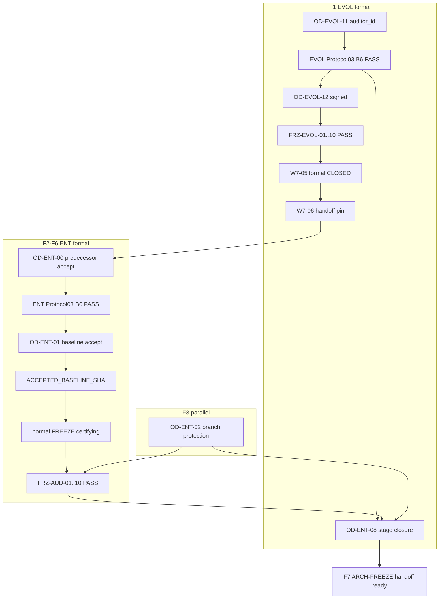

# ENT-AUDIT-X — COMPLETE FORMAL CERTIFICATION & CLOSURE MASTER PLAN

> **Status overlay (2026-11-08, `T-IGX-024-A`):** closure authority for ENT-AUDIT-X is now IIAC (`IIAC-2026-11-05.1`, IN_FORCE, activation `f8c29fb8dfe5e14d9b06ff16659fd9cbe9ad326d`). Statements below that assume a human Protocol 03 auditor, a named external auditor, or "ECAP-P4 NOT IN FORCE" are historical and **superseded**; this text is preserved unchanged. Current status: [ENT_AUDIT_X_IIAC_CLOSURE_MATRIX.md](ENT_AUDIT_X_IIAC_CLOSURE_MATRIX.md).

**Terminal planning disposition:** `PLAN COMPLETE — READY FOR ONE-PASS FORMAL CLOSURE CAMPAIGN`  
**Campaign ID:** `ENT-AUDIT-X-FORMAL-CERTIFICATION-AND-CLOSURE`  
**Branch:** `development` @ [`jakbuczarnecki/intergrax`](https://github.com/jakbuczarnecki/intergrax)

---

## 1. Executive current-state audit (F0 baseline)

### 1.1 Git delta vs operator baseline

| Check | Result |
| --- | --- |
| `HEAD` | `4d54dfa9e485329d81d0e0fa72436867458f3426` (= operator baseline) |
| `origin/development` | **identical** — `development...origin/development` bez ahead/behind |
| Worktree | **clean** (brak lokalnych zmian) |
| Since POST-B4 publication `477017f15…` | **1 commit:** `4d54dfa9` — doc-only pin `POST_B4_CORRECTIVE_PUBLICATION_SHA` on [ENT_AUDIT_X_SHA_LADDER.md](docs/project/maintainers/qualification/ent_audit_x/ENT_AUDIT_X_SHA_LADDER.md) |
| Certifying code @ TES | **unchanged** — `89c76eb7b53a0a3ce6f75ab395cf4a2802638a91` remains ancestor of HEAD |

**Classification:** brak technicznego triggera do re-qual całego ENT; kampania to **authority + publication + enforcement**, nie W-A..W-E.

### 1.2 Verified internal disposition (SSOT)

- **Internal:** `INTERNALLY CLOSED — AUTOMATED INTERNAL AUDIT ACCEPTED — PUBLISHED` ([ENT_AUDIT_X_POST_B4_EXACT_BLOCKER_AUDIT_AND_CORRECTIVE_CLOSURE_REPORT.md](docs/project/maintainers/qualification/ent_audit_x/ENT_AUDIT_X_POST_B4_EXACT_BLOCKER_AUDIT_AND_CORRECTIVE_CLOSURE_REPORT.md), [ENT_AUDIT_X_CLOSURE_EXECUTION_STATUS.json](docs/project/maintainers/qualification/ent_audit_x/ENT_AUDIT_X_CLOSURE_EXECUTION_STATUS.json)).
- **Formal ECAP:** `FORMAL PROTOCOL 03 B6 = PENDING_AUTHORITY`; `FRZ-AUD-01..10 = OPEN`; ladder unset: `B6_ACCEPTANCE_PUBLICATION_SHA`, `FORMAL_CLOSURE_PUBLICATION_SHA`, `ACCEPTED_BASELINE_SHA` ([ENT_AUDIT_X_SHA_LADDER.md](docs/project/maintainers/qualification/ent_audit_x/ENT_AUDIT_X_SHA_LADDER.md)).
- **Evidence pins (active):** TES `89c76eb7…` · B5 `30085953…` · technical re-audit `0e538269…` · B4 nightly `42015310879` @ `162acea3…` · B3 semantic 88/88 @ `d07fbde5…`.
- **Matrix C:** 69 QUALIFIED / 6 NOT_QUALIFIED (C001,C002,C003,C042,C057,C065) — **by design** until OD-ENT-01.
- **EVOL predecessor:** [EVOL_X_CLOSURE_EXECUTION_STATUS.json](docs/project/maintainers/qualification/evol_x/EVOL_X_CLOSURE_EXECUTION_STATUS.json) — `TECHNICALLY_COMPLETE_FORMAL_CLOSURE_BLOCKED_BY_AUTHORITY`; TES `3c4a641b…` · FINAL `bbf3e33b…` · CI `41337077334`; **not** `CLOSED — INDEPENDENTLY ACCEPTED`.

### 1.3 SSOT hierarchy (no competing plans)

| Layer | Document | Role in campaign |
| --- | --- | --- |
| Program | [PLATFORM_ENTERPRISE_COMPLETION_ROADMAP.md](docs/project/maintainers/plans/PLATFORM_ENTERPRISE_COMPLETION_ROADMAP.md) §1–§5, §3.1 | Stage order, ledger §5 — update **only** after independent B6 + OD-ENT-08 |
| Technical ENT execution | [ENT_AUDIT_X_POST_IMPLEMENTATION_FINAL_CLOSURE_MASTER_PLAN.md](docs/project/maintainers/qualification/ent_audit_x/ENT_AUDIT_X_POST_IMPLEMENTATION_FINAL_CLOSURE_MASTER_PLAN.md) | Matrix C, GAP-B, waves — **do not reopen** without contrary evidence |
| **This campaign (new publication)** | `docs/project/maintainers/qualification/ent_audit_x/ENT_AUDIT_X_COMPLETE_FORMAL_CERTIFICATION_AND_CLOSURE_MASTER_PLAN.md` | Single orchestration SSOT for formal closure; supersede narrative-only [ENT_AUDIT_X_FINAL_COMPLETION_AND_CERTIFICATION_MASTER_PLAN.md](docs/project/maintainers/qualification/ent_audit_x/ENT_AUDIT_X_FINAL_COMPLETION_AND_CERTIFICATION_MASTER_PLAN.md) (stale HEAD `754ee000…`) via front-matter **SUPERSEDED BY** pointer |
| ECAP / FRZ | [ENTERPRISE_CONTINUOUS_ARCHITECTURE_ASSURANCE_PROTOCOL.md](docs/project/maintainers/qualification/ENTERPRISE_CONTINUOUS_ARCHITECTURE_ASSURANCE_PROTOCOL.md), [PLATFORM_ENTERPRISE_FREEZE_ACCEPTANCE_CHECKLIST.md](docs/project/maintainers/qualification/PLATFORM_ENTERPRISE_FREEZE_ACCEPTANCE_CHECKLIST.md) | B6 fail-closed; FRZ-EVOL + FRZ-AUD rows |
| Cross-stage OD | [ENT_EVOL_CROSS_STAGE_DECISION_MATRIX.md](docs/project/maintainers/qualification/ENT_EVOL_CROSS_STAGE_DECISION_MATRIX.md) | OD-ENT-00..08 sequencing |

**Ticket (publication):** scaffold [`governance/tickets/T-IGX-015-A.md`](governance/tickets/T-IGX-015-A.md) — scope: formal closure docs + operator record paths + governance updates only; product commits only if verifier/preflight scripts added. Trailer: `Ref: governance/tickets/T-IGX-015-A.md`.

---

## 2. Authority and decision inventory (F0 + §17)

Diagnostic categories (non-canonical): `READY_FOR_SIGNATURE` | `AUTHORIZED_PENDING_EXECUTION` | `BLOCKED_BY_AUTHORITY` | `BLOCKED_BY_QUALIFICATION`.

| DECISION_ID | ACTOR | CURRENT | INPUT EVIDENCE | NEXT GATE |
| --- | --- | --- | --- | --- |
| **OD-EVOL-11** | Operator | Appointment **SIGNED** but `auditor_id` **NOT RECORDED** | [EVOL_X_OD_EVOL_11_INDEPENDENT_AUDITOR_APPOINTMENT_RECORD.md](docs/project/maintainers/qualification/evol_x/EVOL_X_OD_EVOL_11_INDEPENDENT_AUDITOR_APPOINTMENT_RECORD.md) | EVOL B6 |
| **EVOL Protocol 03 B6** | Named independent auditor | **BLOCKED** — draft only | [EVOL_X_B6_FINAL_AUDIT_DOSSIER_FOR_INDEPENDENT_SIGNATURE.md](docs/project/maintainers/qualification/evol_x/EVOL_X_B6_FINAL_AUDIT_DOSSIER_FOR_INDEPENDENT_SIGNATURE.md), pins TES/FINAL/CI | `B6_ACCEPTANCE_PUBLICATION_SHA` on [EVOL_X_SHA_LADDER.md](docs/project/maintainers/qualification/evol_x/EVOL_X_SHA_LADDER.md) |
| **OD-EVOL-12** | Operator | Package **PREPARED**, unsigned | [EVOL_X_OD_EVOL_12_DECISION_PACKAGE.md](docs/project/maintainers/qualification/evol_x/EVOL_X_OD_EVOL_12_DECISION_PACKAGE.md) | Post EVOL B6 + FRZ-EVOL promotion |
| **OD-EVOLX-08** | Operator | **PREPARED**, blocked record | [EVOL_X_OD_EVOLX_08_CLOSURE_PACKAGE.md](docs/project/maintainers/qualification/evol_x/EVOL_X_OD_EVOLX_08_CLOSURE_PACKAGE.md) | W7-05 atomic pack |
| **FRZ-EVOL-07 Outcome A** | Operator | **PREPARED**, not decided | [EVOL_X_W7_03_FRZ_EVOL_07_OUTCOME_A_DECISION_PACKAGE_PREPARED.md](docs/project/maintainers/qualification/evol_x/EVOL_X_W7_03_FRZ_EVOL_07_OUTCOME_A_DECISION_PACKAGE_PREPARED.md) | Signed OD-EVOL-12 row |
| **W7-05 / W7-06** | Operator + maintainer publish | **BLOCKED** | [EVOL_X_W7_05_ATOMIC_PUBLICATION_PACK.md](docs/project/maintainers/qualification/evol_x/EVOL_X_W7_05_ATOMIC_PUBLICATION_PACK.md) | `evol_x_closure_publication_preflight.py` exit 0 |
| **OD-ENT-00** | Operator | **OPEN** | EVOL formal CLOSED evidence | ENT formal closure chain |
| **ENT Protocol 03 B6 (OD-ENT-03)** | Independent auditor (≠ implementer) | **DRAFT** | [ENT_AUDIT_X_B6_FORMAL_ACCEPTANCE_PACKAGE_DRAFT.md](docs/project/maintainers/qualification/ent_audit_x/ENT_AUDIT_X_B6_FORMAL_ACCEPTANCE_PACKAGE_DRAFT.md), handoff @ `b6_independent_handoff/qualification_at_89c76eb7…` | `B6_ACCEPTANCE_PUBLICATION_SHA` |
| **OD-ENT-01** | Operator | **OPEN** — no JSON in [operator_records/](docs/project/maintainers/qualification/ent_audit_x/operator_records/) | Trust chain L6; ENT B6 ACCEPT | `ACCEPTED_BASELINE_SHA` + promote CLI |
| **OD-ENT-02** | Operator + GitHub admin | **OPEN** — protection **404** | [OD_ENT_02_OPERATOR_PACKET.md](docs/project/maintainers/qualification/ent_audit_x/OD_ENT_02_OPERATOR_PACKET.md) | Live required checks |
| **OD-ENT-08** | Operator | **OPEN** | All §12 prerequisites | `FORMAL_CLOSURE_PUBLICATION_SHA` |
| **OD-IC-01** | Operator | **VALID** (internal only) | [EVOL_ENT_INTERNAL_CERTIFICATION_RECORD_2026_11_04.md](docs/project/maintainers/qualification/EVOL_ENT_INTERNAL_CERTIFICATION_RECORD_2026_11_04.md) | Does **not** satisfy formal gates |

**Operator Decision and External Authority Packet (single bundle for human):** one markdown index in campaign commit listing the above with deep links, exact review bullets, signature method (git commit on `development` for ODs; signed Protocol 03 PASS record files for auditors), and consequences of REJECT.

**Auditor strategy:** Path A (ECAP-P4 **NOT IN FORCE**). Same eligible human may sign **EVOL** then **ENT** Protocol 03 if separate independence declarations and dossier replays @ respective pinned SHAs. Agent **must not** sign B6 or fabricate `auditor_id`. Optional separate Cursor session (@`.cursor/rules/intergrax-independent-audit.mdc`) prepares **findings only** — organizational PASS still requires human PASS record filename per W7-05 pack.

---

## 3. Dependency DAG (hard + parallel)



**Parallel execution groups (safe):**

- **G1:** Finalize ENT B6 dossier hygiene + `mechanical_readiness_check` @ HEAD (agent) **∥** EVOL appointment packet completion **∥** draft `ent_audit_x_branch_protection_verify.py` (read-only gh API).
- **G2:** After `auditor_id` recorded — EVOL auditor Mode A/B @ EVOL pins **∥** ENT auditor prep review of B5 tree (no signature yet).
- **G3:** GitHub admin configures OD-ENT-02 **∥** EVOL B6 publication (different actors).

**Forbidden shortcuts:** OD-ENT-00 waiver without roadmap/ECAP-cited exception; FRZ mass PASS without per-row evidence; doc-only commit as TES substitute.

---

## 4. Phase WBS (F0–F7) — one campaign batch boundaries

### F0 — Baseline and authority audit (agent, read-only + reconcile)

1. `git fetch origin development`; confirm ancestor chain TES → HEAD.
2. Refresh [ENT_AUDIT_X_CLOSURE_EXECUTION_STATUS.json](docs/project/maintainers/qualification/ent_audit_x/ENT_AUDIT_X_CLOSURE_EXECUTION_STATUS.json) `plan_baseline_sha` → campaign HEAD after plan publish.
3. Reconcile stale statements in annexes (CI run IDs, HEAD pins) against ladder — **append-only** SHA rows.
4. Build consolidated **closure matrix** CSV/markdown under `.tmp/session/ENT-AUDIT-X-FORMAL-CLOSURE/` then commit matrix snapshot into campaign plan annex (not repo root).
5. Run existing mechanical gates @ HEAD (single pytest invocation where possible per test budget):
   - `uv run python scripts/enterprise_audit/mechanical_readiness_check.py`
   - `verify_b5_publication_tree` via qual unit tests path

**Acceptance:** F0 report embedded in campaign terminal doc; no formal status promotion.

### F1 — EVOL-X formal predecessor closure

**WBS (ordered):**

| Step | Action | Evidence | Publication |
| --- | --- | --- | --- |
| F1-1 | Operator completes **OD-EVOL-11** `auditor_id` + register row | Register + appointment record | commit |
| F1-2 | Auditor independence declaration + Mode A/B @ TES `3c4a641b…`, FINAL `bbf3e33b…`, CI `41337077334` | `EVOL_X_PROTOCOL_03_INDEPENDENT_AUDIT_PASS_RECORD.md` (non-draft) | **`B6_ACCEPTANCE_PUBLICATION_SHA`** |
| F1-3 | Operator **OD-EVOL-12** + **OD-EVOLX-08** signed | Decision register | commit |
| F1-4 | FRZ-EVOL-01..10 rows → PASS with scoped notes (Path A / AUTOMATION_FIRST_SCOPED) | Checklist + [EVOL_X_INTERNAL_FRZ_EVOL_ACCEPTANCE_MATRIX.md](docs/project/maintainers/qualification/evol_x/EVOL_X_INTERNAL_FRZ_EVOL_ACCEPTANCE_MATRIX.md) reconciled | same atomic commit |
| F1-5 | `uv run python scripts/qualification/evol_x_closure_publication_preflight.py` | exit 0 log → `.tmp/session/...` | gate |
| F1-6 | Execute [EVOL_X_W7_05_ATOMIC_PUBLICATION_PACK.md](docs/project/maintainers/qualification/evol_x/EVOL_X_W7_05_ATOMIC_PUBLICATION_PACK.md) | roadmap §3 EVOL row + §5 ledger | **`FORMAL_CLOSURE_PUBLICATION_SHA`** |
| F1-7 | W7-06 ENT handoff formal pin | [EVOL_X_ENT_AUDIT_X_HANDOFF_RECORD.md](docs/project/maintainers/qualification/evol_x/EVOL_X_ENT_AUDIT_X_HANDOFF_RECORD.md) | ladder |

**Acceptance:** Roadmap states EVOL-X **`CLOSED — INDEPENDENTLY ACCEPTED (AUTOMATION_FIRST SCOPED) — PUBLISHED`** OR campaign stops with **fail-closed** blocker doc (no ENT formal closure claims).

### F2 — ENT independent Protocol 03 B6

**Inputs (reuse — no full re-qual):** [ENT_AUDIT_X_PROTOCOL_03_DOSSIER.md](docs/project/maintainers/qualification/ent_audit_x/ENT_AUDIT_X_PROTOCOL_03_DOSSIER.md), [ENT_AUDIT_X_B6_TRUST_CHAIN_MATRIX.md](docs/project/maintainers/qualification/ent_audit_x/ENT_AUDIT_X_B6_TRUST_CHAIN_MATRIX.md), [ENT_AUDIT_X_W8_B6_FINDINGS_DISPOSITION.md](docs/project/maintainers/qualification/ent_audit_x/ENT_AUDIT_X_W8_B6_FINDINGS_DISPOSITION.md), b6 handoff tree.

**Auditor checklist (independent replay, not trust implementer report):**

1. `git checkout` clean @ TES; `merge-base --is-ancestor TES EVID`.
2. `verify_b5_publication_tree` @ `qualification_at_89c76eb7…`.
3. Mode A change delta vs IMPLEMENTATION baseline rows on ladder.
4. Mode B parent: EVOL formal CLOSED + EBH-7 + QUAL scoped evidence (or documented residual per dossier).
5. 85-check manifest + C001–C075 accounting; acknowledge 6 operator-gated NOT_QUAL until OD-ENT-01.
6. Adversarial / negative evidence in dossier + W8 dispositions.
7. CI: reconcile check **names** from latest green runs on `enterprise-audit.yml` (not stale run IDs only).
8. Verdict: ACCEPT | REJECT | ACCEPT WITH CONDITIONS (only if ECAP permits — conditions must close before OD-ENT-01).

**Publication:** signed Protocol 03 record + pin **`B6_ACCEPTANCE_PUBLICATION_SHA`** on ENT ladder; update [ENT_AUDIT_X_PROTOCOL_03_DOSSIER.md](docs/project/maintainers/qualification/ent_audit_x/ENT_AUDIT_X_PROTOCOL_03_DOSSIER.md) from template if needed.

**Corrective wave (only if auditor finds real defects):** single consolidated fix batch + **one** certifying qual_wave @ new TES — do not repeat W-A..W-E.

### F3 — GitHub branch protection (OD-ENT-02)

Per [ENT_AUDIT_X_CI_ENFORCEMENT_RUNBOOK.md](docs/project/maintainers/qualification/ent_audit_x/ENT_AUDIT_X_CI_ENFORCEMENT_RUNBOOK.md):

- **Required checks (minimum):** `Enterprise audit (ENT-AUDIT-X) / ent-audit-fast`, `Enterprise audit (ENT-AUDIT-X) / ent-audit-pr-gate` from [`.github/workflows/enterprise-audit.yml`](.github/workflows/enterprise-audit.yml).
- Admin configures ruleset/branch protection on `development`; capture `gh api repos/jakbuczarnecki/intergrax/branches/development/protection` JSON → operator-controlled store (reference path in OD record, not secrets in repo).
- **Negative test:** open test PR with intentional audit failure → merge blocked (manual or scripted).
- Add repo script `scripts/governance/verify_ent_audit_branch_protection.py` (fail-closed) — agent implements; CI optional doc-only.

**403 vs 404:** document API context; lack of integration admin **≠** proof protection exists.

**Acceptance:** verifier exit 0 + OD-ENT-02 signed record referencing check names.

### F4 — Operator baseline (OD-ENT-00, OD-ENT-01, C tasks, GAP-RC-OD-TRUST)

1. **OD-ENT-00:** After F1 complete — operator signed record accepting EVOL-X formal status satisfies ENT predecessor ([ENT_EVOL_CROSS_STAGE_DECISION_MATRIX.md](docs/project/maintainers/qualification/ENT_EVOL_CROSS_STAGE_DECISION_MATRIX.md)); closes **BLK-ROADMAP-ENT-DEP**.
2. **OD-ENT-01:** Only after ENT B6 ACCEPT — operator publishes JSON schema-valid record under [operator_records/](docs/project/maintainers/qualification/ent_audit_x/operator_records/) (operator commit, not agent-forged production record unless operator explicitly commits via session).
3. **Promote baseline:** `uv run python scripts/enterprise_audit/run_enterprise_audit.py promote --od-record <path> --evidence-dir <b5 l3-cli-full>` — uses [promote_accepted_baseline](intergrax/platform/enterprise_audit/baseline.py) with closed bundle verification.
4. **Matrix C:** Reconcile C001,C002,C003,C042,C057,C065 → QUALIFIED **only if** OD-ENT-01 scope covers operator-trust checks; update [ANNEX_C_CONTROL_MATRIX.md](docs/project/maintainers/qualification/ent_audit_x/ANNEX_C_CONTROL_MATRIX.md) + GAP register; close **GAP-RC-OD-TRUST**.
5. Target **75/75 QUALIFIED** only if canonical criteria allow after operator gates (not before).

### F5 — Normal FREEZE + FRZ-AUD-01..10

1. Clean checkout @ `ACCEPTED_BASELINE_SHA` ancestor TES.
2. Certifying **FREEZE** mode run → `.tmp/proof/ent-audit-x/formal-freeze-<run-id>/` (session artifacts rule).
3. Exit code 0; manifest SHA fields match ladder.
4. **FRZ-AUD-01..10:** For each row in [ANNEX_B_FRZ_AUD_CLOSURE_MATRIX.md](docs/project/maintainers/qualification/ent_audit_x/ANNEX_B_FRZ_AUD_CLOSURE_MATRIX.md), produce acceptance row: technical evidence path + B6 authority cite + operator FRZ promotion + SHA.
5. Update [PLATFORM_ENTERPRISE_FREEZE_ACCEPTANCE_CHECKLIST.md](docs/project/maintainers/qualification/PLATFORM_ENTERPRISE_FREEZE_ACCEPTANCE_CHECKLIST.md) — **FRZ-AUD-10** requires OD-ENT-02 live enforcement proof.

**Risk-based requalification:** If HEAD != TES after F2–F4, run delta qual only for changed controls (ECAP change delta); full L3 only on material runner/manifest change.

### F6 — Formal ENT-AUDIT-X closure (OD-ENT-08)

**Preflight (new script recommended):** `scripts/qualification/ent_audit_x_formal_closure_preflight.py` mirroring EVOL preflight — verifies: EVOL formal CLOSED, both B6 SHAs set, OD-ENT-00/01/02 records, ACCEPTED_BASELINE_SHA, FRZ-AUD none OPEN, ladder consistency.

**Atomic publication pack (single commit + optional pin follow-up):**

- Roadmap §3.1 + §5 ENT-AUDIT-X row → **`CLOSED — INDEPENDENTLY ACCEPTED — PUBLISHED`**
- FRZ-AUD checklist rows
- [ENT_AUDIT_X_SHA_LADDER.md](docs/project/maintainers/qualification/ent_audit_x/ENT_AUDIT_X_SHA_LADDER.md) — `FORMAL_CLOSURE_PUBLICATION_SHA`
- [ENT_AUDIT_X_CLOSURE_EXECUTION_STATUS.json](docs/project/maintainers/qualification/ent_audit_x/ENT_AUDIT_X_CLOSURE_EXECUTION_STATUS.json) — formal fields set
- Terminal report: `ENT_AUDIT_X_FORMAL_CLOSURE_CAMPAIGN_TERMINAL_REPORT.md`
- **OD-ENT-08** operator record

**Acceptance:** No document before this commit may assert final CLOSED disposition.

### F7 — ARCH-FREEZE handoff (readiness only)

Complete [ENT_AUDIT_X_ARCH_FREEZE_HANDOFF.md](docs/project/maintainers/qualification/ent_audit_x/ENT_AUDIT_X_ARCH_FREEZE_HANDOFF.md) with manifest: stage closure SHA, ENT B6 SHA, TES, B5, accepted baseline, normal FREEZE log path, FRZ-AUD evidence, EVOL formal closure SHA, OD refs, OD-ENT-02 proof, non-blocking limitations (PROD-Q Dimension B, etc.). **Do not implement ARCH-FREEZE stage** in this campaign.

---

## 5. Consolidated closure matrix (GAP-B + gates — excerpt)

Full matrix in campaign annex; every row must map to action below.

| GATE_ID | CURRENT_STATUS | AUTHORITY | REQUIRED_ACTION | FINAL_STATE |
| --- | --- | --- | --- | --- |
| BLK-EVOL-B6 | BLOCKED_BY_AUTHORITY | Independent auditor | F1-2 signed PASS @ EVOL pins | CLOSED_WITH_EVIDENCE |
| BLK-ROADMAP-ENT-DEP | BLOCKED_BY_AUTHORITY | Operator OD-ENT-00 | Accept EVOL formal CLOSED | CLOSED_WITH_EVIDENCE |
| BLK-ENT-B6 | BLOCKED_BY_AUTHORITY | Independent auditor OD-ENT-03 | F2 Protocol 03 @ ENT TES/B5 | CLOSED_WITH_EVIDENCE |
| BLK-CI-ENFORCE | BLOCKED_BY_AUTHORITY | Admin + OD-ENT-02 | F3 protection + verifier | CLOSED_WITH_EVIDENCE |
| BLK-FRZ-AUD | BLOCKED_BY_QUALIFICATION | Operator post-B6 | F5 per-row promotion | CLOSED_WITH_EVIDENCE |
| BLK-ACCEPTED-BASELINE | BLOCKED_BY_AUTHORITY | Operator OD-ENT-01 | F4 promote CLI | CLOSED_WITH_EVIDENCE |
| GAP-RC-OD-TRUST | OPEN | Operator | OD-ENT-01 + Matrix C | CLOSED_WITH_EVIDENCE |
| C001–C065 (×6) | NOT_QUALIFIED | Operator | F4 requal reconcile | QUALIFIED |
| FRZ-EVOL-01..10 | OPEN | Operator | F1-4 W7-05 pack | PASS |
| FRZ-AUD-01..10 | OPEN | Operator + B6 | F5 | PASS |
| W7-05 EVOL | BLOCKED | Operator | F1-6 | PUBLISHED |
| FORMAL ENT closure | BLOCKED | OD-ENT-08 | F6 | PUBLISHED |

---

## 6. Evidence and SHA publication matrix

**EVOL chain:** TES `3c4a641b…` → FINAL `bbf3e33b…` → **INDEPENDENT_B6** (unset) → FRZ promotion → **FORMAL_CLOSURE** (unset) → W7-06 handoff pin.

**ENT chain:** TES `89c76eb7…` → B5 `30085953…` → re-audit `0e538269…` → **INDEPENDENT_B6** (unset) → **ACCEPTED_BASELINE** (unset) → normal FREEZE → FRZ-AUD → **FORMAL_CLOSURE** (unset) → ARCH-FREEZE handoff.

| Step | Producer | Verifier | Approver | Replay trigger |
| --- | --- | --- | --- | --- |
| B5 integrity | Implementer qual_wave | Auditor `verify_b5_publication_tree` | — | New TES |
| EVOL B6 | Independent auditor | ECAP B6 | Operator OD-EVOL-12 | TES/FINAL change |
| ENT B6 | Independent auditor | ECAP B6 | Operator OD-ENT-01 eligibility | TES/B5 change |
| Baseline promote | Operator CLI | `verify_operator_decision_record` | OD-ENT-01 | New FREEZE candidate |
| FRZ rows | Maintainer docs commit | preflight scripts | Operator | Contradictory OPEN PASS |

---

## 7. Rollback and rejection procedures

- **Auditor REJECT:** File EXACT BLOCKERS list; agent executes **one** corrective batch; new TES + B5 publication; re-audit from F2/F1 step 2 — no parallel micro-campaigns.
- **OD REJECT:** Record disposition; formal status unchanged; preserve prior SHAs on ladder (append supersession rows).
- **Failed preflight:** No roadmap/checklist CLOSED strings; fix governance contradiction first.
- **Git:** Stay on `development`; no detached HEAD; `git push` only after `uv run python -m scripts.governance.igx_gov ticket` when product paths touched.

---

## 8. Final planning completeness audit (§19)

| # | Criterion | Plan coverage |
| --- | --- | --- |
| 1–6 | GAP-B, ODs, auditor, FRZ-EVOL/AUD | §5 matrix + F1/F5 |
| 7–9 | Branch protection, C tasks, GAP-RC | F3, F4 |
| 10–15 | FREEZE, baseline, EVOL/ENT B6, publication, handoff | F1,F2,F5,F6,F7 |
| 16–19 | Producers/owners, no conflict/circular deps | §3 DAG |
| 20–25 | No fabricated approval; git verify steps | §1, F0, F6 |

**Outstanding external authority is expected** (auditor_id, signatures, GitHub admin) — plan is **COMPLETE** with explicit owners and packets.

---

## 9. One-pass Cursor Agent execution prompt (copy for next session)

```text
Campaign ENT-AUDIT-X-FORMAL-CERTIFICATION-AND-CLOSURE on branch development.
Read SSOT: docs/project/maintainers/qualification/ent_audit_x/ENT_AUDIT_X_COMPLETE_FORMAL_CERTIFICATION_AND_CLOSURE_MASTER_PLAN.md
Technical SSOT unchanged: ENT_AUDIT_X_POST_IMPLEMENTATION_FINAL_CLOSURE_MASTER_PLAN.md
Ticket: governance/tickets/T-IGX-015-A.md

Execute F0→F7 in one batch-first campaign. Do not reopen EVOL/ENT implementation without auditor REJECT evidence.
Agent may: reconcile docs, add preflight/branch-protection verifiers, prepare operator/auditor packets, run mechanical_readiness + targeted pytest @ HEAD, capture logs under .tmp/session/ENT-AUDIT-X-FORMAL-CLOSURE/.
Agent must NOT: sign Protocol 03 B6, forge auditor_id, mark FRZ PASS without authority, claim CLOSED — INDEPENDENTLY ACCEPTED without FORMAL_CLOSURE_PUBLICATION_SHA, implement ARCH-FREEZE.

Stop only on fail-closed authority blockers; deliver consolidated Operator Decision and External Authority Packet for remaining human actions.
Preflight: git fetch; HEAD must ancestor-contain TES 89c76eb7…; merge-base TES EVID 30085953….
End with terminal report + igx_gov ticket when committing product paths.
```

---

## 10. Verification commands (campaign checkpoint)

```powershell
git fetch origin development
git merge-base --is-ancestor 89c76eb7b53a0a3ce6f75ab395cf4a2802638a91 HEAD
git merge-base --is-ancestor 89c76eb7b53a0a3ce6f75ab395cf4a2802638a91 300859537f12a1de7bf3d75fd685bc3a5c727183
uv run python scripts/enterprise_audit/mechanical_readiness_check.py
gh api repos/jakbuczarnecki/intergrax/branches/development/protection
uv run python -m scripts.governance.igx_gov ticket  # before push if scripts/intergrax/agents touched
```

Session logs: `.tmp/session/ENT-AUDIT-X-FORMAL-CLOSURE/` only.
