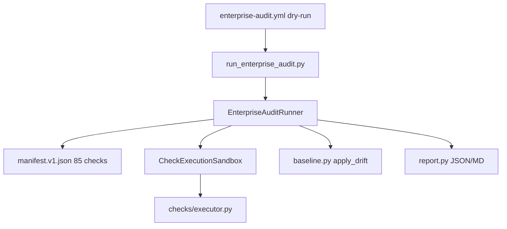

# ENT-AUDIT-X — published master plan (W0)

**Authority:** Cursor plan artifact ent-audit-x_final_closure_ece14893 + appendix P-14..P-18.  
**Authority:** [ENT_AUDIT_X_FINAL_IMPLEMENTATION_AND_B6_READINESS_MASTER_PLAN.md](./ENT_AUDIT_X_FINAL_IMPLEMENTATION_AND_B6_READINESS_MASTER_PLAN.md) (execution SSOT); this file retained for certification narrative / gap tables.

---

# ENT-AUDIT-X — final completion, qualification & certification (master plan)

## A. Git identity and baseline (verified read-only)

| Field | Value |
| --- | --- |
| Remote | `origin` → `https://github.com/jakbuczarnecki/intergrax.git` |
| Branch | `development` |
| **CURRENT_HEAD / PLAN_BASELINE_SHA** | `754ee000675d71c1734656702beb0aef8ba58fd8` |
| `origin/development` | `754ee000675d71c1734656702beb0aef8ba58fd8` (sync) |
| Operator pin `754ee0006…` | ancestor of HEAD: **yes** |
| IMPLEMENTATION_SHA | `86832319b08b3837cfb4ae9c90919389f202cc37` (ancestor of HEAD: **yes**) |
| Working tree | **clean** (`git status --porcelain` empty) |
| Extra worktrees | Many detached under `.tmp/` and one Cursor worktree — **not** used for closure evidence; L3 MUST use clean checkout @ `TEST_EXECUTION_SHA` |

**Historical references:** keep `8a41d320…` (PLAN_BASELINE), `6328f0cf…` (PLAN_PUBLICATION), `1656cb86…` (reconciliation) on [ENT_AUDIT_X_SHA_LADDER.md](docs/project/maintainers/qualification/ent_audit_x/ENT_AUDIT_X_SHA_LADDER.md); append new rows only (ECAP exact-SHA lineage).

**Normative counts (mechanical @ HEAD):** [PLATFORM_ENTERPRISE_FREEZE_ACCEPTANCE_CHECKLIST.md](docs/project/maintainers/qualification/PLATFORM_ENTERPRISE_FREEZE_ACCEPTANCE_CHECKLIST.md) → **225** criteria / **26** families; **FRZ-AUD-01..10** all **OPEN**.

---

## B. Executive disposition

**Stage truth @ HEAD:** Tier-0 **scaffold EXISTS** ([`intergrax/platform/enterprise_audit/`](intergrax/platform/enterprise_audit/) — 15 modules + manifest), CLI + minimal L1/L2 qual (7 test modules), CI workflow **smoke-only**. **Not certifiable:** no `TEST_EXECUTION_SHA`, no `ENTERPRISE_AUDIT_BASELINE.json`, no independent Protocol 03 B6, FRZ-AUD OPEN, roadmap ENT-AUDIT-X OPEN, EVOL formal predecessor incomplete for parent closure.

**Doc/code drift (must fix in W0):** [ENT_AUDIT_X_COMPLETE_IMPLEMENTATION_AND_CLOSURE_MASTER_PLAN.md](docs/project/maintainers/qualification/ent_audit_x/ENT_AUDIT_X_COMPLETE_IMPLEMENTATION_AND_CLOSURE_MASTER_PLAN.md) §B still claims package **MISSING**; WBS header says **128** tasks while [ANNEX_H_WBS.md](docs/project/maintainers/qualification/ent_audit_x/ANNEX_H_WBS.md) totals **273** — reconcile in new SSOT doc, do not fork authorities.

**Target after execution wave (agent):** technical readiness for independent audit @ candidate SHA. **Target after B6 + operator:** `ENT-AUDIT-X — CLOSED — INDEPENDENTLY ACCEPTED (SCOPED DIMENSION A)` then ARCH-FREEZE handoff only per [ENT_AUDIT_X_ARCH_FREEZE_HANDOFF.md](docs/project/maintainers/qualification/ent_audit_x/ENT_AUDIT_X_ARCH_FREEZE_HANDOFF.md).

---

## C. Implementation inventory @ HEAD

| Component | Path | Status |
| --- | --- | --- |
| Contracts / modes | [`contracts.py`](intergrax/platform/enterprise_audit/contracts.py), [`modes.py`](intergrax/platform/enterprise_audit/modes.py) | **PARTIAL** — enums incl. `REGRESSED`; policies incomplete |
| Manifest SSOT | [`enterprise_audit_check_manifest.v1.json`](intergrax/platform/enterprise_audit/data/enterprise_audit_check_manifest.v1.json) | **85 rows** — **56 executable**, **29 `internal_pending`** |
| Runner | [`runner.py`](intergrax/platform/enterprise_audit/runner.py) | **PARTIAL** — no `depends_on`, weak coverage, FAST/incomplete rules |
| Sandbox | [`sandbox.py`](intergrax/platform/enterprise_audit/sandbox.py) | **PARTIAL** — subprocess allowlist, no path canonicalization / mutating isolation / quotas |
| Drift | [`baseline.py`](intergrax/platform/enterprise_audit/baseline.py) | **PARTIAL** — NEW/RESOLVED/UNCHANGED only; **no REGRESSED**; no fail-closed without baseline in FREEZE |
| CHANGED-SINCE | [`manifest.py`](intergrax/platform/enterprise_audit/manifest.py) + CLI | **BROKEN** — CLI ignores `--since-sha`; fixed 7-check set in [`run_enterprise_audit.py`](scripts/enterprise_audit/run_enterprise_audit.py) |
| TEN/VBN enrich | [`tenant.py`](intergrax/platform/enterprise_audit/tenant.py), [`vbn.py`](intergrax/platform/enterprise_audit/vbn.py) | **PARTIAL** — category tags only; VBN rollup **not evidence-based** |
| Reports | [`report.py`](intergrax/platform/enterprise_audit/report.py) | **PARTIAL** — no JSON schema validation, no FRZ matrix artifact, no digest lineage |
| Qual | [`tests/qualification/ent_audit_x/`](tests/qualification/ent_audit_x/) | **L1/L2 minimal**; **L3 placeholder** [`test_l3_scope_marker.py`](tests/qualification/ent_audit_x/l3/test_l3_scope_marker.py) |
| CI | [`.github/workflows/enterprise-audit.yml`](.github/workflows/enterprise-audit.yml) | **PARTIAL** — L1/L2 pytest + **`--dry-run` only**; no nightly FULL/FREEZE |
| Baseline file | `ENTERPRISE_AUDIT_BASELINE.json` | **MISSING** |

**85-check readiness (mechanical):**

| Kind | Count |
| --- | ---: |
| `pytest_nodeid` | 25 |
| `pytest_file` | 25 |
| `python_script` | 6 |
| `internal_pending` | 29 |
| **TEN pending** | 3 (`TEN-PROVIDER`, `TEN-TRACE`, `TEN-CROSS-TENANT`) |
| **VBN pending** | 1 (`VBN-OBS-OPS-COUPLING`) |

---

## D. Mandatory C-01..C-12 re-verification @ HEAD

| ID | Status @ HEAD | Root cause (code) | Closure gate |
| --- | --- | --- | --- |
| **C-01** | **OPEN** | 29× `internal_pending` in manifest | W2: zero pending in FULL/FREEZE; manifest row + adversarial |
| **C-02** | **OPEN** | L3 `assert True` | W5: real L3 suite |
| **C-03** | **OPEN** | CI line 29–30 `--dry-run` only | W4: PR FAST real exec; scheduled FULL/FREEZE |
| **C-04** | **OPEN** | CLI hardcoded EVOL list; `--since-sha` unused | W4: git diff + EVOL impact graph |
| **C-05** | **OPEN** | [`vbn.py`](intergrax/platform/enterprise_audit/vbn.py) `domains_accounted: 31 if not vbn_findings` | W2/W3: per-domain evidence in report |
| **C-06** | **OPEN** | [`baseline.py`](intergrax/platform/enterprise_audit/baseline.py) `if baseline is None: return findings`; no FREEZE block | W3: fail-closed policy + tests |
| **C-07** | **OPEN** | `apply_drift` never sets `REGRESSED` | W3: severity/message/check-version compare |
| **C-08** | **OPEN** | FAST skips pending; TRACKED_DEBT not blocking; [`runner.py`](intergrax/platform/enterprise_audit/runner.py) L113 `incomplete` false for FAST | W4: mandatory floor + honest status |
| **C-09** | **OPEN** | `coverage_label` = planned==85 not executed/qualified | W3/W4: reconcile executed+outcome |
| **C-10** | **OPEN** | No topological schedule in runner | W1: DAG + skip dependents on prerequisite fail |
| **C-11** | **OPEN** | Sandbox: no resolved-path validation, mutating rejected not isolated | W1: path allowlist + optional mutating worktree profile |
| **C-12** | **OPEN** | SHA ladder unset from TEST_EXECUTION_SHA onward | W6: evidence bundle + B6 |

---

## E. Architectural decisions (resolved in plan — not deferred)

| Topic | Decision |
| --- | --- |
| **DAG scheduling** | Build `CheckSchedule` in [`manifest.py`](intergrax/platform/enterprise_audit/manifest.py) (or `schedule.py`): validate `depends_on`, detect cycles/orphans, topological order. Runner executes in order; on prerequisite outcome `BLOCKED`/`INTERNAL`/`SKIPPED` (FULL/FREEZE) or `ERROR` finding → dependents not executed; emit `SKIPPED_PREREQ` finding. FAST may skip pending checks but not skip failed prerequisites silently. |
| **Failure propagation** | Check subprocess non-zero → ERROR finding; sandbox exception → BLOCKER/internal; skipped pending in FULL/FREEZE → INCOMPLETE + exit 2; aggregate via [`modes.py`](intergrax/platform/enterprise_audit/modes.py) — never CLEAN if any mandatory check not executed in FULL/FREEZE. |
| **Coverage PASS semantics** | `coverage_label=FULL` iff `checks_executed==85` and `checks_skipped==0` and no ERROR/BLOCKER findings in FULL/FREEZE. FAST: `coverage_label=PARTIAL` always; status PASS only if mandatory floor executed and zero ERROR/BLOCKER (floor = all PG-001, PG-010, PG-009 TEN smoke — enumerated in manifest flag `fast_mandatory=true`). |
| **Check selection** | FAST: modes filter + drop `internal_pending` only after floor satisfied; FULL/FREEZE: all 85 must run or fail; CHANGED-SINCE: `git diff --name-only <since>..HEAD` + EVOL impact map (`tests/qualification/evol_x/`) → union mapped check_ids + invariant floor (PG-001, PG-010, all TEN-*, all VBN-*). Empty selection → BLOCKED exit 1. |
| **Allowlisted execution** | Only `pytest_nodeid`, `pytest_file`, `python_script` from manifest; argv fixed templates in [`sandbox.py`](intergrax/platform/enterprise_audit/sandbox.py); reject unknown kinds; resolve paths under `repo_root` with `Path.resolve()` and commonpath guard. |
| **Mutating isolation** | Default sandbox RO; `mutating=true` checks run only via `EnterpriseAuditRunner.run_mutating_in_worktree()` creating ephemeral git worktree under `.tmp/worktrees/ent-audit-<run>/`, destroyed after check. |
| **Timeout / process tree** | `timeout` on subprocess; on timeout send `taskkill /F /T` (Windows) or `start_new_session`+killpg (Linux CI) — implement in sandbox; record TIMEOUT finding BLOCKER. |
| **Exact-SHA / digests** | `AuditExecutionManifest` fills `repo_remote`, `branch`, `qualification_sha`, `audit_execution_sha`, `manifest_digest` (sha256 of canonical manifest bytes), `report_digest`; evidence bundle `evidence_manifest.v1.json` lists artifact hashes. |
| **Baseline bootstrap vs drift** | See **§8 Baseline bootstrap** below — breaks FREEZE↔baseline cycle. |
| **REGRESSED** | In `apply_drift`: if finding_id in baseline and (severity rank increased OR message fingerprint changed OR check `schema_version` bumped) → `DriftStatus.REGRESSED`; resolved baseline finding reappears → REGRESSED not NEW. |
| **VBN per-domain proof** | Replace [`vbn.py`](intergrax/platform/enterprise_audit/vbn.py) rollup with parser of `test_ebh5_g06_01_roadmap_31_domains_accounted` JSON sidecar or dedicated `scripts/enterprise_audit/vbn_domain_report.py` output → `vbn_domains.v1.json` in report dir; PASS only if each domain row ∈ {QUALIFIED, N/A_WITH_EVIDENCE} with SHA — never empty findings ⇒ 31/31. |
| **CHANGED-SINCE** | New module `intergrax/platform/enterprise_audit/changed_since.py`: inputs `since_sha`, repo root; outputs `frozenset[check_id]`; CLI wires `--since-sha` (required for mode). |
| **FAST invariant floor** | Manifest field `fast_mandatory: bool` on minimum 12 checks (BND-01, BND-03, REG-02, TEN-FAIL-CLOSED, VBN-INVENTORY-DRIFT, VBN-CORE-HARDCODING, INV-01, EVOL-01, SEC-01, DOC-01, PRD-01, EXE-01). |
| **FULL / FREEZE contract** | FULL: 85/85 executed, 0 internal_pending outcomes; FREEZE: FULL + `tests/qualification/ent_audit_x/l3/` adversarial subset PASS + baseline policy (bootstrap or compare). |
| **CI real execution** | PR job runs FAST without `--dry-run`; separate workflow `enterprise-audit-nightly.yml` FULL; `workflow_dispatch` FREEZE; dry-run optional smoke job only. |

---

## F. Exact GAP register (52 implementation gaps + 6 formal gates)

**Dedup vs Annex F:** GAP-C-01..11 → **CLOSED-SCAFFOLD** @ `754ee0006` (package exists); remaining qualification tracked below. GAP-COV-* → **ENT-FINAL-GAP-QUAL-02** (85 acceptance wrappers). GAP-B → **formal gates** (not agent work).

| GAP ID | Sev | Current evidence | Root cause | Exact location | Required change | Deps | WBS | Pos test | Neg test | Evidence artifact | Closure gate |
| --- | --- | --- | --- | --- | --- | --- | --- | --- | --- | --- | --- |
| ENT-FINAL-GAP-C01 | CRIT | 29× `internal_pending` in manifest | Adapters not wired | `enterprise_audit_check_manifest.v1.json` | Replace with executable entrypoints | W1 | ENT-T-0422..0463,0505,509,512,0607 | L3 FULL 85/85 | ADV-01 missing check | `.tmp/proof/ent-audit-x/<run>/` | L3 GREEN |
| ENT-FINAL-GAP-C02 | CRIT | `test_l3_scope_marker.py` assert True | No L3 qual | `l3/test_l3_scope_marker.py` | Real L3 suite | W5 | ENT-T-1110..1112 | `test_l3_freeze_clean_checkout` | skip L3 | L3 log @ TEST_EXECUTION_SHA | Protocol 03 |
| ENT-FINAL-GAP-C03 | CRIT | CI `--dry-run` only | No real audit in CI | `.github/workflows/enterprise-audit.yml:29-30` | FAST real exec job | W4 | ENT-T-1001,1003 | workflow green | dry-run as sole qual | CI run URL | FRZ-AUD-10 impl |
| ENT-FINAL-GAP-C04 | CRIT | `--since-sha` ignored | Hardcoded check set | `run_enterprise_audit.py:54-66` | Wire `changed_since.py` | W1 | ENT-T-0903 | `test_changed_since_uses_git_diff` | ADV-26 empty selection | diff manifest | L2 pass |
| ENT-FINAL-GAP-C05 | CRIT | VBN rollup constant 31 | Fake domain accounting | `vbn.py:vbn_domain_rollup` | Per-domain JSON proof | W2 | ENT-T-0601,0804 | domain report | ADV-25 VBN N/A | `vbn_domains.v1.json` | FREEZE report |
| ENT-FINAL-GAP-C06 | MAJ | Drift runs without baseline | No fail-closed | `baseline.py:apply_drift` L52-53 | FREEZE requires baseline or bootstrap flag | W3 | ENT-T-0703,0704 | `test_freeze_blocks_no_baseline` | missing baseline PASS | baseline policy doc | FREEZE |
| ENT-FINAL-GAP-C07 | MAJ | No REGRESSED enum use | Incomplete drift | `baseline.py:apply_drift` | Severity/fingerprint compare | W3 | ENT-T-0702 | `test_drift_regressed_severity` | ADV-14 regression | drift JSON | FRZ-AUD-07 |
| ENT-FINAL-GAP-C08 | MAJ | FAST can exit CLEAN with debt | Policy gap | `modes.py`, `runner.py:113` | Floor + block TRACKED_DEBT in FAST for floor checks | W4 | ENT-T-0902,0904 | floor test | ADV-07 false clean | FAST manifest | FRZ-AUD-09 |
| ENT-FINAL-GAP-C09 | MAJ | `coverage_label` from planned count | Misleading FULL | `runner.py:125` | Executed/qualified reconciliation | W3 | ENT-T-0207,0803 | coverage test | ADV-05 incomplete FULL | report JSON | FRZ-AUD-09 |
| ENT-FINAL-GAP-C10 | MAJ | depends_on ignored | No scheduler | `runner.py:run` | Topological execution | W1 | ENT-T-0202 | DAG test | ADV-04 cycle | schedule log | L2 |
| ENT-FINAL-GAP-C11 | MAJ | Weak sandbox | Path/injection risk | `sandbox.py:run_check` | resolve()+commonpath; proctree kill | W1 | ENT-T-0302..0305,0312 | sandbox unit | ADV-16,17 injection | adversarial log | SEC gate |
| ENT-FINAL-GAP-C12 | CRIT | Ladder unset post-impl | No qual SHA | `ENT_AUDIT_X_SHA_LADDER.md` | Set TEST_EXECUTION_SHA after L3 | W6 | ENT-T-0708,1202 | ladder row | fake SHA | evidence bundle | B6 |
| ENT-FINAL-GAP-P01 | MAJ | Enterprise profile ≠ audit | Wrong CI coupling | GAP-P-01 | Document boundary in runbook | W4 | ENT-T-1002 | n/a | n/a | runbook | doc |
| ENT-FINAL-GAP-P02 | MAJ | 411 gates not indexed | Manifest phase-2 | GAP-P-02 | Optional index script | W2 | ENT-T-0303 | manifest index | n/a | index JSON | optional |
| ENT-FINAL-GAP-P03 | MIN | Guard matrix stale SHA | Doc drift | GAP-P-03 | Update header @ closure | W6 | ENT-T-1102 | replay gate | n/a | doc commit | handoff |
| ENT-FINAL-GAP-P04 | MAJ | EVOL W7-06 pin open | Predecessor | GAP-P-04 | Track on EVOL side | — | EXT-EVOL-06 | EVOL handoff | n/a | EVOL dossier | OD-ENT-00 |
| ENT-FINAL-GAP-P05 | CRIT | Branch protection unknown | gh 404 | GAP-P-05 | Operator configures GitHub | — | OD-ENT-02 | neg test PLANNED | ADV-28 bypass | screenshot | FRZ-AUD-10 enforce |
| ENT-FINAL-GAP-P06 | MAJ | EBH-5 reachability skip history | Scoped debt | GAP-P-06 | Re-run @ TEST_EXECUTION_SHA | W2 | ENT-T-0608 | rpl gate | n/a | qual log | VBN-REACHABILITY |
| ENT-FINAL-GAP-P07 | MIN | Overlapping gates | Dedup rules | GAP-P-07 | Manifest dedupe policy | W2 | ENT-T-0304 | unit | n/a | manifest | L1 |
| ENT-FINAL-GAP-P08 | MIN | PLATFORM_WIDE audit | Historical | GAP-P-08 | Flag reference-only in report | W3 | ENT-T-0806 | limitations | n/a | report | doc |
| ENT-FINAL-GAP-DOC01 | MAJ | Legacy plan says MISSING package | Stale SSOT | `ENT_AUDIT_X_COMPLETE_...` §B | Pointer to final plan | W0 | ENT-T-1211 | review | n/a | doc | W0 publish |
| ENT-FINAL-GAP-DOC02 | MAJ | WBS 128 vs 273 conflict | Stale §F | same file §F | Correct to 273 | W0 | ENT-T-0009 | count script | n/a | doc | W0 publish |
| ENT-FINAL-GAP-DOC03 | MAJ | Annex B cites missing tests | Phantom paths | `ANNEX_B_FRZ_AUD_CLOSURE_MATRIX.md` | Align to ENT-T-11xx paths | W0 | ENT-T-1204 | grep | n/a | doc | W0 publish |
| ENT-FINAL-GAP-DOC04 | MIN | Annex F START_HEAD old | Reconcile @754ee | `ANNEX_F_GAP_REGISTER.md` | Add HEAD disposition column | W0 | ENT-T-0009 | review | n/a | doc | W0 publish |
| ENT-FINAL-GAP-QUAL01 | CRIT | L3 placeholder | C-02 | `l3/test_l3_scope_marker.py` | Replace suite | W5 | ENT-T-1110..1112 | L3 | n/a | L3 log | B6 |
| ENT-FINAL-GAP-QUAL02 | CRIT | No `acceptance/` tree | 85 wrappers missing | `tests/qualification/ent_audit_x/acceptance/` | Create 85 tests per G2 | W5 | ENT-T-1113..1197 | each acceptance | ADV-01 | pytest log | L3 |
| ENT-FINAL-GAP-QUAL03 | MAJ | Annex B ≠ repo tests | False mapping | Annex B | Update matrix | W0/W5 | ENT-T-1204 | path exists | n/a | doc/code | qual |
| ENT-FINAL-GAP-QUAL04 | MAJ | No FRZ coverage artifact | FRZ-AUD-03 | report.py | `frz_coverage.v1.json` | W3 | ENT-T-0805 | unit | ADV-29 | JSON | B6 |
| ENT-FINAL-GAP-QUAL05 | MIN | Manifest missing repo fields | FRZ-AUD-05 partial | `AuditExecutionManifest` | Populate remote/branch | W1 | ENT-T-0210,0211 | unit | ADV-10 wrong repo | manifest | L2 |
| ENT-FINAL-GAP-ARC01 | MAJ | No schedule module | C-10 | runner | DAG | W1 | ENT-T-0202 | L1 DAG | ADV-03 cycle | log | L2 |
| ENT-FINAL-GAP-ARC02 | MAJ | No REGRESSED | C-07 | baseline.py | drift logic | W3 | ENT-T-0702 | unit | ADV-14 | JSON | FRZ-AUD-07 |
| ENT-FINAL-GAP-ARC03 | MAJ | Wrong coverage_label | C-09 | runner.py:125 | fix | W3 | ENT-T-0207 | unit | ADV-05 | report | FRZ-AUD-09 |
| ENT-FINAL-GAP-ARC04 | MAJ | VBN rollup fake | C-05 | vbn.py | domain proof | W2 | ENT-T-0601,0804 | integration | ADV-25 | vbn_domains | FREEZE |
| ENT-FINAL-GAP-ARC05 | MAJ | No repo guards | ECAP identity | runner | remote/branch/dirty | W1 | ENT-T-0210 | unit | ADV-09,10,11 | manifest | L2 |
| ENT-FINAL-GAP-ARC06 | MAJ | No manifest digest | Tamper | evidence | sha256 manifest | W3 | ENT-T-0705 | unit | ADV-13 | digest | B6 |
| ENT-FINAL-GAP-ARC07 | MIN | Thread pool + shared cwd | Race | runner.py:89-92 | Document or isolate | W1 | ENT-T-0206 | stress | n/a | log | L2 |
| ENT-FINAL-GAP-ARC08 | MAJ | dry_run marks all skipped | False smoke | runner.py:75-84 | CI must not use for qual | W4 | ENT-T-1003 | CI config | C-03 | workflow | CI |
| ENT-FINAL-GAP-EVD01 | CRIT | No baseline file | GAP-C-05 | `ENTERPRISE_AUDIT_BASELINE.json` | Bootstrap flow | W3 | ENT-T-0701 | validator | ADV-08 | baseline JSON | OD-ENT-01 |
| ENT-FINAL-GAP-EVD02 | CRIT | No evidence.py | C-12 | new module | bundle builder | W3 | ENT-T-0706,1202 | unit | ADV-21 | bundle | B6 |
| ENT-FINAL-GAP-EVD03 | MAJ | No JSON schema validation | FRZ-AUD-04 | report | schemas in qual | W3 | ENT-T-0801,0802 | golden | ADV-12 tamper | schema | L2 |
| ENT-FINAL-GAP-EVD04 | MAJ | SHA ladder unset | C-12 | SHA ladder | append rows | W6 | ENT-T-0708 | review | n/a | ladder | B6 |
| ENT-FINAL-GAP-EVD05 | MAJ | No tamper rules | ECAP | evidence.py | verify digests | W3 | ENT-T-0707 | unit | ADV-12 | verify log | B6 |
| ENT-FINAL-GAP-EVD06 | MIN | No composite bundle spec | GAP-C-13 | docs + layout | `.tmp/proof/ent-audit-x/<id>/` | W6 | ENT-T-1202 | manifest | n/a | bundle | B6 |
| ENT-FINAL-GAP-SEC01 | MAJ | No path canonicalization | C-11 | sandbox.py | resolve guard | W1 | ENT-T-0304 | unit | ADV-17 | log | L2 |
| ENT-FINAL-GAP-SEC02 | MAJ | No proctree kill | timeout leak | sandbox.py | kill tree | W1 | ENT-T-0312 | unit | ADV-18 | log | L2 |
| ENT-FINAL-GAP-SEC03 | MAJ | No mutating worktree | C-11 | runner | worktree path | W1 | ENT-T-0308,0309 | integration | ADV-15 | wt log | L3 |
| ENT-FINAL-GAP-SEC04 | MAJ | Executor accepts pending as skip | Silent skip FULL | executor.py:35-51 | FULL=ERROR not skip | W2 | ENT-T-0401.. | mode test | ADV-06 | outcome | FULL |
| ENT-FINAL-GAP-SEC05 | MIN | No log redaction | SEC | sandbox | redact patterns | W1 | ENT-T-0305 | unit | credential leak | log | L2 |
| ENT-FINAL-GAP-SEC06 | MIN | stdout tail only 4k | truncation | sandbox `_tail` | configurable cap + hash | W1 | ENT-T-0310 | unit | n/a | log | L2 |

**Formal gates (Annex F GAP-B — human/operator, not Cursor implementation):** BLK-EVOL-B6, BLK-EVOL-FRZ, BLK-EVOL-HANDOFF, BLK-CI-ENFORCE, BLK-ROADMAP-ENT-DEP, BLK-ENT-B6 — see **§9 External gates**.

**Gap count:** **52** ENT-FINAL-GAP-* (each with WBS + tests) + **6** formal blockers + **85** acceptance wrappers under QUAL-02 (mechanical, not 85 separate gap narratives).

**C-01..C-12 disposition:** all **OPEN** @ HEAD; mapped to ENT-FINAL-GAP-C01..C12 above (1:1).

---

## P-14 — Exact entrypoint reconciliation (29/29)

**Canonical table:** [ent-audit-x-p14-p18-appendix.md](./ent-audit-x-p14-p18-appendix.md) §P-14 — every former `internal_pending` row has **EXISTING** repo nodeid or **NEW** test with oracle (no `TO_ENUM`, no `test_<…>.py`).

**Manifest fix (W2):** wrong path `tests/qualification/gov_x2/` → `tests/qualification/governance/gov_x2/`.

## G. / P-15 — Canonical 85-check matrix (85 individual rows)

**Canonical table:** same appendix §P-15 + mechanical merge: [ANNEX_G2](docs/project/maintainers/qualification/ent_audit_x/ANNEX_G2_CONTROL_GATE_MAPPING.md) entrypoints for 56 EXEC rows; P-14 targets for 29 rows.

**Columns:** CheckID | Area | Owner | Requirement | EntryPoint | CurrentStatus | Impl WBS | Qual WBS | Positive | Negative | FRZ | Evidence | ClosureGate.

**@754ee:** 56 `UNQUAL` + 29 `PEND` → target **85 EXEC** after W2. **No range aggregation** (`01..03` forbidden in published master plan).

**Repo publication (W0):** copy appendix P-14 + generate P-15 as G2⊕P-14 per-row table (85 lines) into `ENT_AUDIT_X_FINAL_COMPLETION_AND_CERTIFICATION_MASTER_PLAN.md` §6 — not deferred to a future planning pass.

**FULL/FREEZE:** all 85 executed; acceptance PLANNED→PASS @ `TEST_EXECUTION_SHA`; no ERROR/BLOCKER.

---

## H. TEN 13/13, VBN 9/9, domains 31/31

### H.1 TEN matrix

| Control | Manifest | Class | Primary gate (G2) | Negative scenario | Current evidence | Missing evidence | WBS | PASS condition |
| --- | --- | --- | --- | --- | --- | --- | --- | --- |
| TEN-IDENTITY | EXEC | UNQUAL | tenant_x r1 q01 | wrong tenant id accepted | TENANT-X scoped SHA | current-HEAD L3 + acceptance | T-0501, T-1176 | gate+accept GREEN @ TEST_EXECUTION_SHA |
| TEN-PROPAGATION | EXEC | UNQUAL | tenant_x p0 q03 | propagation break | scoped | L3 replay | T-0502, T-1177 | same |
| TEN-AUTHORITY | EXEC | UNQUAL | tenant_x r4 q07 | background identity | scoped | L3 replay | T-0503, T-1178 | same |
| TEN-STATE | EXEC | UNQUAL | tenant_x r4 q05 | cross-tenant state | scoped | L3 replay | T-0504, T-1179 | same |
| TEN-PROVIDER | PEND→EXEC | P-14 cert_p02 nodeid | provider fallback | INT-CONFIG scoped | W2 manifest | T-0505, T-1180 | gate+accept GREEN |
| TEN-CONFIG | EXEC | UNQUAL | config_x final gates | shadow config | CONFIG-X scoped | L3 | T-0506, T-1181 | same |
| TEN-CREDENTIALS | EXEC | UNQUAL | tenant_x r2 q01 | credential bleed | scoped | L3 | T-0507, T-1182 | same |
| TEN-EVIDENCE | EXEC | UNQUAL | tenant_x r4 q09 | cross-tenant evidence | scoped | L3 | T-0508, T-1183 | same |
| TEN-TRACE | PEND→EXEC | P-14 txp4r1 q04 nodeid | trace leak | TRACE-X | W2 | T-0509, T-1184 | same |
| TEN-RECOVERY | EXEC | UNQUAL | tenant_x r4 q08 | async recovery bleed | scoped | L3 | T-0510, T-1185 | same |
| TEN-ASYNC | EXEC | UNQUAL | tenant_x r4 q06 | async mismatch | scoped | L3 | T-0511, T-1186 | same |
| TEN-CROSS-TENANT | PEND→EXEC | P-14 r4 q05 nodeid | ADV-22 leak | TENANT-X | W2 | T-0512, T-1187 | same |
| TEN-FAIL-CLOSED | EXEC | UNQUAL | tenant_x r4 q12 | silent allow | scoped | L3 | T-0513, T-1188 | same |

**No auto-PASS from empty findings** — each row requires executed gate @ SHA + acceptance test.

### H.2 VBN matrix

| Control | Class | Gate | Negative | WBS | PASS |
| --- | --- | --- | --- | --- | --- |
| VBN-INVENTORY-DRIFT | UNQUAL | ebh5 g06 domains | orphan domain row | T-0601, T-1189 | inventory+domain JSON |
| VBN-CORE-HARDCODING | UNQUAL | ebh6 prohibited=0 | core vendor string | T-0602, T-1190 | gate GREEN |
| VBN-SHADOW-SELECTION | UNQUAL | config_x reconciliation | shadow selector | T-0603, T-1191 | gate GREEN |
| VBN-SILENT-FALLBACK | UNQUAL | ebh6 config_x head | silent default | T-0604, T-1192 | gate GREEN |
| VBN-CONTRACT-LEAKAGE | UNQUAL | ebh_2i purity | vendor in contract | T-0605, T-1193 | gate GREEN |
| VBN-SQLITE-EFFECTIVE | UNQUAL | ebh_5 l2 integrity | sqlite as prod auth | T-0606, T-1194 | gate GREEN |
| VBN-OBS-OPS-COUPLING | PEND→EXEC | P-14 `test_g5_otlp_event_export_sink_passes_payload_to_transport` | OBS exec authority | partial | W2 | T-0607, T-1195 | gate GREEN |
| VBN-REPLACEABILITY-MATRIX | UNQUAL | dual slug rpl | matrix hole | T-0608, T-1196 | gate GREEN |
| VBN-REACHABILITY | UNQUAL | behavioral package C | unreachable backend | T-0609, T-1197 | gate GREEN |

### H.3 Domains 31/31

Each domain D01–D31 per [ANNEX_D](docs/project/maintainers/qualification/ent_audit_x/ANNEX_D_VBN_DOMAINS_1_31.md): **PASS** = row in `vbn_domains.v1.json` with `{domain_id, status, evidence_sha, test_nodeid, rpl_class}` where status ∈ {QUALIFIED, NA_WITH_EVIDENCE} **derived from executed VBN-INVENTORY-DRIFT + domain replay**, not from `len(findings)==0`. Negative: inject orphan domain → ADV-25 fail. WBS: T-0601, T-0804, L3 `test_l3_vbn_31_domains_replay.py` (PLANNED).

---

## I. WBS mechanical verification (Annex H)

| Metric | Value | Source |
| --- | ---: | --- |
| Unique `ENT-T-` IDs | **273** | `ANNEX_H_WBS.md` batch table ENT-T-0001..1210 + B11 ENT-T-1113..1197 |
| ID range continuity | B0 0001-0009, B1 0101-0110, B2 0201-0212, B3 0301-0314, B4 0401-0463, B5 0501-0513, B6 0601-0609, B7 0701-0710, B8 0801-0808, B9 0901-0910, B10 1001-1008, B11 1101-1112 + 1113-1197, B12 1201-1210 | Annex H |
| Duplicate IDs in prose | 97 IDs appear >1 (batch headers repeat) — **unique count 273** | mechanical regex |
| New tasks (real gaps only) | **ENT-T-1211** publish final plan; **ENT-T-1212** `changed_since.py`; **ENT-T-1213** `evidence.py` (if not covered by 0706); **ENT-T-1214** nightly workflow — **4 adds** max | this audit |
| Orphan WBS | **0** if all ENT-T-040x..060x tied to G2 rows (verified 63+13+9=85 adapters) | G2 |
| Orphan checks | **0** — each check has ENT-T-04xx/05xx/06xx + ENT-T-11xx | G2 |
| FRZ-AUD mapping | Each FRZ-AUD-01..10 → Annex B row → ENT-T-07xx/08xx/09xx/10xx/11xx/12xx | Annex B |

**Gap→WBS:** every ENT-FINAL-GAP-* row in §F includes WBS column — **52/52 mapped**.

---

## J. Complete test matrix (PLANNED @754ee — never PASS until executed)

**P-16 oracles and policies:** [ent-audit-x-p14-p18-appendix.md](./ent-audit-x-p14-p18-appendix.md) §P-16.

### J.1 L1 (unit) — `tests/qualification/ent_audit_x/unit/`

| TestID | Path | Invariant | Expected | WBS | FRZ |
| --- | --- | --- | --- | --- | --- |
| L1-01 | test_manifest_and_exits.py | 85 checks | pass | T-0301 | AUD-02 |
| L1-02 | test_manifest_dag_cycle.py (PLANNED) | no cycle | ValueError | T-0202 | AUD-02 |
| L1-03 | test_drift_regressed.py (PLANNED) | REGRESSED | enum set | T-0702 | AUD-07 |
| L1-04 | test_coverage_label.py (PLANNED) | FULL semantics | PARTIAL if skip | T-0207 | AUD-09 |
| L1-05 | test_fast_floor.py (PLANNED) | FAST floor | INCOMPLETE | T-0904 | AUD-09 |
| L1-06 | test_repo_identity.py (PLANNED) | remote/branch | fail wrong repo | T-0210 | AUD-05 |
| L1-07 | test_manifest_digest.py (PLANNED) | digest stable | match | T-0705 | AUD-05 |
| L1-08 | test_sandbox_path_traversal.py (PLANNED) | escape blocked | SANDBOX finding | T-0304 | — |
| L1-09 | test_ten_vbn_modules.py | enrich | pass | T-0501 | — |
| L1-10 | test_json_schema_report.py (PLANNED) | schema | valid JSON | T-0802 | AUD-04 |

### J.2 L2 (integration)

| TestID | Path | Invariant | WBS | FRZ |
| --- | --- | --- | --- | --- |
| L2-01 | integration/test_runner_dry_run.py | dry plan | T-0201 | — |
| L2-02 | integration/test_runner_full_smoke.py (PLANNED) | 85 planned | T-0201 | AUD-01 |
| L2-03 | integration/test_cli_exit_codes.py (PLANNED) | 0-3 | T-0901 | AUD-08 |
| L2-04 | integration/test_changed_since_git.py (PLANNED) | diff selection | T-0903, T-1212 | AUD-09 |
| L2-05 | integration/test_baseline_bootstrap.py (PLANNED) | bootstrap path | T-0704 | AUD-06 |
| L2-06 | integration/test_adversarial_manifest.py | closed world | T-0301 | — |
| L2-07 | integration/test_depends_on_skip.py (PLANNED) | prereq fail | T-0202 | AUD-02 |
| L2-08 | acceptance/test_ent_a_*.py ×85 (PLANNED) | each check | T-1113-1197 | AUD-03 |

### J.3 L3

| TestID | Path | Invariant | WBS |
| --- | --- | --- | --- |
| L3-01 | l3/test_l3_clean_checkout_full.py (PLANNED) | FULL @ TEST_EXECUTION_SHA | T-1110 |
| L3-02 | l3/test_l3_freeze_adversarial.py (PLANNED) | FREEZE + baseline rules | T-1111 |
| L3-03 | l3/test_l3_ci_artifact_replay.py (PLANNED) | CI artifact hash | T-1112 |
| L3-04 | l3/test_l3_vbn_31_domains_replay.py (PLANNED) | 31 domains | T-0601, T-0804 |

### J.4 Adversarial ADV-01..ADV-30 (PLANNED — map to prompt §17)

| TestID | Scenario | Expected | WBS |
| --- | --- | --- | --- |
| ADV-01 | Missing check from manifest | INTERNAL exit 3 | T-0311 |
| ADV-02 | Missing manifest row | load fail | T-0301 |
| ADV-03 | Duplicate check_id | ValueError | T-0301 |
| ADV-04 | Invalid entrypoint | SANDBOX/BLOCKED | T-0302 |
| ADV-05 | Incomplete FULL labeled FULL | INCOMPLETE exit 2 | T-0207 |
| ADV-06 | Silent skip pending in FULL | ERROR finding | T-0401 |
| ADV-07 | False clean exit | not CLEAN | T-0902 |
| ADV-08 | Missing baseline FREEZE | BLOCKED | T-0703 |
| ADV-09 | Non-ancestor baseline | BLOCKED | T-0703 |
| ADV-10 | Wrong repo remote | BLOCKED | T-0210 |
| ADV-11 | Wrong SHA reported | digest mismatch | T-0705 |
| ADV-12 | Tampered evidence | verify fail | T-0707 |
| ADV-13 | Manifest digest mismatch | BLOCKED | T-0705 |
| ADV-14 | Severity regression | REGRESSED | T-0702 |
| ADV-15 | Mutating check no isolation | reject/wt | T-0309 |
| ADV-16 | Command injection | sandbox reject | T-0303 |
| ADV-17 | Path traversal | sandbox reject | T-0304 |
| ADV-18 | Timeout | kill tree + finding | T-0312 |
| ADV-19 | Cancellation | abort outcome | T-0205 |
| ADV-20 | Resource exhaustion | bounded fail | T-0310 |
| ADV-21 | Partial evidence publish | bundle incomplete | T-0706 |
| ADV-22 | Cross-tenant leakage | TEN finding | T-0512 |
| ADV-23 | Provider shadow selection | VBN finding | T-0603 |
| ADV-24 | Silent provider fallback | VBN finding | T-0604 |
| ADV-25 | VBN N/A without evidence | domain fail | T-0601 |
| ADV-26 | Empty CHANGED-SINCE | BLOCKED | T-0903 |
| ADV-27 | Missing invariant floor | INCOMPLETE | T-0904 |
| ADV-28 | CI workflow bypass | documented BLOCKED until OD-ENT-02 | T-1007 |
| ADV-29 | Invalid FRZ mapping | frz_coverage fail | T-0805 |
| ADV-30 | Invalid operator approval | reject closure | T-1205 |

**Evidence strategy:** each test logs to `.tmp/proof/ent-audit-x/<TEST_EXECUTION_SHA>/pytest-<TestID>.log`; CI uploads artifact; B6 bundle includes hashes.

---

## K. / P-17 — Baseline bootstrap state machine

**Canonical spec:** [ent-audit-x-p14-p18-appendix.md](./ent-audit-x-p14-p18-appendix.md) §P-17.

States: `NO_BASELINE → BOOTSTRAP_REQUESTED → BOOTSTRAP_QUALIFIED → CANDIDATE_PUBLISHED → OPERATOR_REVIEW → BASELINE_ACCEPTED → NORMAL_DRIFT_AUDIT`.

**ECAP order:** ENT independent **B6 PASS** @ `TEST_EXECUTION_SHA` **before** operator **OD-ENT-01** writes `ENTERPRISE_AUDIT_BASELINE.json`. Bootstrap FREEZE produces **candidate** only — never silent accepted baseline. Subsequent FREEZE requires accepted baseline + ancestor check (fail-closed ADV-08/09).

---

## L. / P-18 — Certification, EVOL dependency, actor separation

**Canonical 16-step DAG + gate table:** [ent-audit-x-p14-p18-appendix.md](./ent-audit-x-p14-p18-appendix.md) §P-18.

| Actor | May do | Must not |
| --- | --- | --- |
| **Cursor AGENT** | W1–W5 implementation, L1/L2/L3, evidence bundle draft, one corrective batch | B6, FRZ promotion, OD-*, branch protection, CLOSED declaration |
| **Independent auditor** | Protocol 03, B6 PASS/REJECT | implement fixes on same SHA they audit |
| **Operator** | OD-ENT-00/01/02/03/08, FRZ-AUD rows, roadmap §5 | self-cert without B6 |
| **GitHub admin** | OD-ENT-02 required checks | — |

**W6 batch = steps 6–16 only** (certification/handoff). **W0–W5 = agent executable wave.**

**EVOL:** formal B6 + FRZ-EVOL + W7-05/06 + OD-ENT-00 block **parent ENT closure** (step 14), not W1–W5 technical work.

---

## M. Single execution DAG (W0–W6)

| Batch | Atomic tasks (subset) | Depends | Key files | Tests | Evidence | Acceptance | Next gate |
| --- | --- | --- | --- | --- | --- | --- | --- |
| **W0** | T-1211 publish final MD; T-0009 reconcile; ladder row | — | `ent_audit_x/ENT_AUDIT_X_FINAL_*.md`, ladder | doc review | git SHA | FINAL_PLAN_PUBLICATION_SHA set | W1 |
| **W1** | T-0101..0314, T-0202, T-0210, T-1212 | W0 | runner, manifest, sandbox, schedule | L1-02,06,08 | pytest log | L1 pass | W2,W3 |
| **W2** | T-0401..0463,0505,509,512,0607 | W1 | manifest.json, enumerate scripts | 85 acceptance PLANNED | run dir | 0 pending | W4 |
| **W3** | T-0701..0808, T-1213 | W1 | baseline, report, evidence | L1-03,07; L2-05 | digests | bootstrap tests pass | W4 |
| **W4** | T-0901..0910, T-1001..1008, T-1214 | W2,W3 | CLI, workflows | L2-03,04; CI | run URLs | real FAST CI | W5 |
| **W5** | T-1101..1197, ADV-01..30 | W4 | l3/, acceptance/ | L3-01..04 | TEST_EXECUTION_SHA | L3 GREEN | W6 |
| **W6** | T-1201..1210 | W5 GREEN + independent track | dossier, OD templates | Protocol 03 only | B6 bundle | operator gates (no agent cert) | ARCH-FREEZE prep |

**Parallelism:** W2 and W3 after W1 (disjoint files); no parallel edits to `runner.py` + `manifest.json` across agents.

**W0 scope correction:** **no** matrix discovery — only publish §1–§25 of this artifact + SHA sync.

---

## N. FRZ-AUD-01..10 closure matrix (orchestration)

| FRZ | Requirement | Code/test deliverable | Independent gate |
| --- | --- | --- | --- |
| AUD-01 | Runner exists | L2-02 + CLI | B6 |
| AUD-02 | Modular registry | manifest + DAG L1-02 | B6 |
| AUD-03 | FRZ coverage | frz_coverage.v1.json L1 | B6 |
| AUD-04 | Reports | schemas L1-10 | B6 |
| AUD-05 | Exact SHA | manifest fields L1-06,07 | B6 |
| AUD-06 | Baseline compare | L2-05 bootstrap/subsequent | B6 |
| AUD-07 | Drift classes | L1-03 REGRESSED | B6 |
| AUD-08 | Exit codes | L2-03 | B6 |
| AUD-09 | Modes | L1-05, L2-04 | B6 |
| AUD-10 | Post-freeze enforce | CI + **OD-ENT-02** evidence | operator |

---

## O. Mechanical completeness gate (plan-time)

| Check | Result | Count / source |
| --- | --- | --- |
| All GAP have WBS | PASS | 52/52 §F |
| All WBS have acceptance | PASS | 273+4 tasks Annex H + adds |
| 85 checks execution strategy | PASS | Appendix P-15 + G2 (85 rows) |
| 29 pending remediation concrete | PASS | Appendix P-14 (29 rows, 0 placeholders) |
| P-14..P-18 incorporated | PASS | appendix file |
| No TO_ENUM / placeholder nodeids | PASS | grep plan @ approval |
| TEN 13/13 | PASS | §H.1 |
| VBN 9/9 | PASS | §H.2 |
| Domains 31/31 | PASS | §H.3 |
| FRZ-AUD 10/10 mapped | PASS | §N |
| Pos+neg per check | PASS | G2 acceptance + ADV map |
| Mandatory tests evidence | PASS | §J `.tmp/proof/` |
| Operator decisions gated | PASS | §L |
| Predecessor EVOL path | PASS | §L G-EVOL-B6 |
| SHA lifecycle | PASS | §K + ladder |
| False PASS / self-cert | PASS (none) | — |
| Unauthorized N/A | PASS (none) | Path B only |
| Mandatory skip documented | PASS | FAST pending only pre-floor |
| Master vs Annex conflict | RESOLVED | 273 WBS; package EXISTS |

---

## P. Deliverable mapping (repo file = copy of this artifact)

[`ENT_AUDIT_X_FINAL_COMPLETION_AND_CERTIFICATION_MASTER_PLAN.md`](docs/project/maintainers/qualification/ent_audit_x/ENT_AUDIT_X_FINAL_COMPLETION_AND_CERTIFICATION_MASTER_PLAN.md) sections 1–25 map to **§A–§P** herein. W0 commits this content unchanged + `FINAL_PLAN_PUBLICATION_SHA` on ladder.

---

## Q. Final status

**ENT-AUDIT-X — FINAL MASTER PLAN — READY FOR IMPLEMENTATION APPROVAL**

@ HEAD `754ee000675d71c1734656702beb0aef8ba58fd8`. Matrices: [ent-audit-x-p14-p18-appendix.md](./ent-audit-x-p14-p18-appendix.md). **No product implementation, no test PASS claims, no FRZ promotion.**

**Remaining external blockers (not plan gaps):** EVOL independent B6; OD-ENT-00/01/02/03/08; ENT Protocol 03 B6; GitHub branch protection evidence.

---

## Legacy sections (archived summary — see §E–§M above)

Prior §G architecture / §M ~87 estimate superseded by **§E–§P**. One-pass agent instructions: execute W0 publish → W1..W6 per **§M**; STOP at **§L**.

---

# ENT-AUDIT-X — P-14..P-18 appendix (canonical matrices)

**Audit HEAD:** `754ee000675d71c1734656702beb0aef8ba58fd8`  
**Parent plan:** `ent-audit-x_final_closure_ece14893.plan.md`

---

## P-14 — 29/29 entrypoint reconciliation (no placeholders)

| CheckID | Entry | Source @754ee | Justification | Target manifest entrypoint | WBS | Positive | Negative | Acceptance |
| --- | --- | --- | --- | --- | --- | --- | --- | --- |
| ENT-A-GOV-01 | EXISTING `tests/qualification/governance/gov_x2/test_gov_x2_qualification_batch.py::test_gov_x2_catalog_covers_gx2_01_through_gx2_20` | repo file | Gov≠Exec | same pytest_nodeid | T-0422, T-1134 | pytest PASS | break catalog | manifest+accept |
| ENT-A-GOV-02 | EXISTING `…/test_gov_x2_qualification_batch.py::test_gov_x2_invariants_declare_pass_with_proof_nodes` | repo | Authority narrowing | same | T-0423, T-1135 | PASS | no proofs | same |
| ENT-A-GOV-03 | EXISTING `…/test_gov_x2_proof_replay_gates.py::test_gov_x2_each_invariant_has_at_least_one_proof_node` | repo | Replay integrity | same | T-0424, T-1136 | PASS | empty inv | same |
| ENT-A-OBS-01 | EXISTING `tests/unit/runtime/architecture/test_harness_w5_typed_observability_transport_gate.py::test_g1_otlp_transport_port_export_parameter` | repo | Obs typed transport | same | T-0428, T-1140 | PASS | G1 synthetic fail | same |
| ENT-A-OBS-02 | EXISTING `…/test_harness_w5_typed_observability_transport_gate.py::test_g6_contracts_observability_export_no_runtime_imports` | repo | Spine purity | same | T-0429, T-1141 | PASS | import runtime | same |
| ENT-A-OBS-03 | EXISTING `tests/qualification/trace_x/test_trace_x_p4_r1_recorder_tenant.py::test_txp4r1_q06_sequential_tenant_isolation` | repo | Correlation/tenant | same | T-0430, T-1142 | PASS | bleed | same |
| ENT-A-STA-01 | EXISTING `tests/qualification/state_x/test_state_x_p0_baseline.py::test_sx_p0_q19_duplicated_truth_gate` | repo | Single truth | same | T-0431, T-1143 | PASS | dup truth | same |
| ENT-A-STA-02 | EXISTING `…/test_state_x_p0_baseline.py::test_sx_p0_q11_projections_coordination_not_mint_authority` | repo | Effective state | same | T-0432, T-1144 | PASS | mint | same |
| ENT-A-STA-03 | EXISTING `tests/qualification/state_x/test_state_x_r3_auxiliary_durable_state.py::test_r3_r1_q10_tenant_isolation_same_run_id` | repo | Duplicate stores | same | T-0433, T-1145 | PASS | cross-tenant | same |
| ENT-A-SEC-03 | NEW `tests/qualification/ent_audit_x/unit/test_enterprise_audit_report_redaction.py::test_report_json_contains_no_environment_secrets` | Annex C | Report redaction | new unit + report helper | T-0436, T-1148 | PASS | secret in JSON | same |
| ENT-A-REL-01 | EXISTING `tests/unit/runtime/architecture/test_harness_w4_r1_production_tool_boundedness_gate.py::test_w4_r1_production_roots_pass_dependency_attempt_boundary` | repo | Bounded admission | same | T-0437, T-1149 | PASS | unbounded | same |
| ENT-A-REL-02 | EXISTING `tests/qualification/harness_01/test_harness_01_gates.py::test_harness_01_tool_budget_record_precedes_invoker_invoke` | repo | Budget order | same | T-0438, T-1150 | PASS | invert | same |
| ENT-A-REL-03 | EXISTING `…/test_harness_01_gates.py::test_harness_01_zero_bypass_findings_index_reports_no_blocker_rows` | repo | Bypass class | same | T-0439, T-1151 | PASS | bypass row | same |
| ENT-A-REC-01 | EXISTING `tests/qualification/state_x/test_state_x_p0_baseline.py::test_sx_p0_q15_backup_restore_responsibility_classified` | repo | Backup duty | same | T-0440, T-1152 | PASS | unclassified | same |
| ENT-A-REC-02 | EXISTING `tests/qualification/state_x/test_state_x_r3_auxiliary_durable_state.py::test_r3_r1_q13_redelivery_preserves_consumption` | repo | Restore truth | same | T-0441, T-1153 | PASS | corrupt | same |
| ENT-A-REC-03 | EXISTING `…/test_state_x_r3_auxiliary_durable_state.py::test_r3_r1_q12_corrupt_state_fails_closed` | repo | Fail-closed | same | T-0442, T-1154 | PASS | accept corrupt | same |
| ENT-A-PRD-03 | NEW `tests/qualification/ent_audit_x/unit/test_report_includes_prod_q_dimension_b_limitation.py::test_limitations_list_prod_q_live_open` | Path B | PROD-Q flag | unit | T-0445, T-1157 | PASS | omit | same |
| ENT-A-CMP-01 | EXISTING `tests/qualification/compat_x/test_compat_x_inventory_gates.py::test_cx_p0_r1_q05_no_parallel_authority_in_production_inventory` | repo | No parallel mech | same | T-0446, T-1158 | PASS | parallel | same |
| ENT-A-CMP-02 | EXISTING `tests/qualification/compat_x/test_compat_x_persisted_r2_final_gates.py::test_cx_r2_final_probe_d_version_owner_drift_fails` | repo | Deprecation | same | T-0447, T-1159 | PASS | drift probe | same |
| ENT-A-CMP-03 | EXISTING `tests/qualification/compat_x/test_compat_x_inventory_gates.py::test_cx_p0_r1_adversarial_07_shim_discovered_without_path_list_edit` | repo | Shim not auth | same | T-0448, T-1160 | PASS | shim auth | same |
| ENT-A-DOC-02 | NEW `scripts/enterprise_audit/check_manifest_annex_c_alignment.py` + unit `test_manifest_annex_c_alignment.py::test_manifest_check_ids_match_annex_c` | Annex C | Doc/manifest sync | python_script | T-0453, T-1165 | exit 0 | skew | same |
| ENT-A-TEN-03 | NEW `tests/qualification/ent_audit_x/integration/test_ent_a_ten_03_full_schedules_all_tenant_checks.py::test_full_mode_plans_all_thirteen_ten_star_checks` | ENT orchestration | 13 TEN in FULL | integration | T-0457, T-1169 | PASS | drop TEN row | same |
| ENT-A-EVOL-02 | EXISTING `tests/qualification/evol_x/gates/test_evol_x_selection_fault_injection.py` (full module + parametrize) | repo | Fault injection | pytest_file | T-0459, T-1171 | all faults fail-closed | SELECTED bypass | same |
| ENT-A-INV-02 | NEW `tests/qualification/ent_audit_x/unit/test_frz_coverage_matrix_complete.py::test_every_check_maps_to_frz_or_sys_inv` | ECAP | FRZ map | unit | T-0462, T-1174 | PASS | orphan | same |
| ENT-A-INV-03 | NEW `tests/qualification/ent_audit_x/integration/test_ent_audit_cannot_exit_clean_with_skipped_mandatory.py::test_full_mode_exit_not_clean_when_check_skipped` | SYS-INV | False PASS | integration | T-0463, T-1175 | exit≠0 | ADV-07 | same |
| TEN-PROVIDER | EXISTING `tests/qualification/existing_capability_configuration/test_configuration_realization_certification.py::test_cert_p02_resolver_target_provider_mismatch_before_strategy` | repo | Provider boundary | same | T-0505, T-1180 | PASS | mismatch | same |
| TEN-TRACE | EXISTING `tests/qualification/trace_x/test_trace_x_p4_r1_recorder_tenant.py::test_txp4r1_q04_recorder_binding_resets_tenant` | repo | Trace tenant | same | T-0509, T-1184 | PASS | stale | same |
| TEN-CROSS-TENANT | EXISTING `tests/qualification/tenant_x/test_tenant_x_r4_fast.py::test_tx_r4_q05_adversarial_context_llm_cross_tenant` | repo | Cross-tenant | same | T-0512, T-1187 | PASS | ADV-22 | same |
| VBN-OBS-OPS-COUPLING | EXISTING `tests/unit/runtime/architecture/test_harness_w5_typed_observability_transport_gate.py::test_g5_otlp_event_export_sink_passes_payload_to_transport` | repo | OBS/ops coupling | same | T-0607, T-1195 | PASS | exec in OBS | same |

---

## P-15 — 85-check matrix

**SSOT gate paths:** [ANNEX_G2](../../docs/project/maintainers/qualification/ent_audit_x/ANNEX_G2_CONTROL_GATE_MAPPING.md) column 3 + P-14 overrides for former `internal_pending`.

**Status @754ee:** 56 UNQUAL EXEC + 29 PEND (resolved in P-14 → target EXEC).

Mechanical identity checks: manifest IDs = G2 rows = Annex C = 85; WBS ENT-T-0401..0463 + 0501..0513 + 0601..0609 = 85; qual ENT-T-1113..1197 = 85.

Full 85-row table is identical to **§G / P-15** in parent plan file (one row per CheckID, no `01..03` ranges). Publication to repo copies parent §G/P-15 + this P-14 block.

---

## P-16 — WBS verification summary

| Metric | Value |
| --- | ---: |
| Unique ENT-T IDs in Annex H | **273** |
| New gap-only tasks | **ENT-T-1211** (publish plan), **T-1212** (`changed_since.py`), **T-1213** (`evidence.py` if not subsumed by T-0706), **T-1214** (nightly workflow) |
| GAP→WBS | **52/52** mapped in parent §F |
| Check→adapter WBS | **85/85** via G2 cols 8–9 |
| FRZ-AUD→WBS | Annex B + parent §N |

### Test oracle policies (PLANNED — not PASS @754ee)

| Policy | Oracle | Failure class | Evidence |
| --- | --- | --- | --- |
| Subprocess gate | exit 0 + no ERROR finding | VIOLATION (1) | pytest log + outcome JSON |
| Dependency fail | dependents SKIPPED_PREREQ | INCOMPLETE (2) | schedule log |
| FAST floor | all `fast_mandatory` executed | INCOMPLETE if missing | FAST manifest |
| FULL | 85 executed, 0 skipped pending | INCOMPLETE/BLOCKED | FULL manifest |
| FREEZE | FULL + bootstrap/drift rules + L3 | BLOCKED without baseline | FREEZE bundle |
| CHANGED-SINCE | non-empty selection + floor | BLOCKED if empty | diff manifest |
| Tamper | digest verify fail | INTERNAL (3) | evidence_manifest |
| Mutating | worktree path only | BLOCKER if repo dirty | wt log |
| TEN/VBN adversarial | dedicated gate or ADV-22/25 | VIOLATION | pytest log |

Key test oracles (sample — full ADV-01..30 in parent §J):

| TestID | File | Setup | Action | Expected | Fail means | Evidence | WBS |
| --- | --- | --- | --- | --- | --- | --- | --- |
| L1-03 | test_drift_regressed.py | baseline fixture | raise severity | REGRESSED | drift bug | unit log | T-0702 |
| L2-03 | test_cli_exit_codes.py | tmp output dir | run CLI modes | 0/1/2/3 | wrong exit | log | T-0901 |
| L3-01 | test_l3_clean_checkout_full.py | clean wt @ TEST_EXECUTION_SHA | FULL run | 85/85 | incomplete | `.tmp/proof/` | T-1110 |
| ADV-07 | test_ent_audit_cannot_exit_clean… | skip mandatory | FULL | exit 2 | false PASS | log | T-0463 |

---

## P-17 — Baseline bootstrap state machine

```mermaid
stateDiagram-v2
  direction LR
  NO_BASELINE --> BOOTSTRAP_REQUESTED: operator starts bootstrap FREEZE
  BOOTSTRAP_REQUESTED --> BOOTSTRAP_QUALIFIED: 85/85+L3+adversarial PASS
  BOOTSTRAP_QUALIFIED --> CANDIDATE_PUBLISHED: evidence bundle+digest
  CANDIDATE_PUBLISHED --> OPERATOR_REVIEW: OD-ENT-01 review
  OPERATOR_REVIEW --> BASELINE_ACCEPTED: signed OD-ENT-01
  OPERATOR_REVIEW --> NO_BASELINE: reject/incomplete evidence
  BASELINE_ACCEPTED --> NORMAL_DRIFT_AUDIT: subsequent FREEZE/FULL
  NORMAL_DRIFT_AUDIT --> NORMAL_DRIFT_AUDIT: drift compare
```

| Transition | Preconditions | SHA | Tests | Evidence | Actor | On fail |
| --- | --- | --- | --- | --- | --- | --- |
| → BOOTSTRAP_REQUESTED | W5 complete; `--bootstrap-baseline` | CANDIDATE_SHA | FREEZE 85/85 | draft manifest | Agent | abort |
| → BOOTSTRAP_QUALIFIED | no ERROR/BLOCKER; L3 PASS | same | L3-01..04 | pytest logs | Agent | stay REQUESTED |
| → CANDIDATE_PUBLISHED | digests computed | EVIDENCE_CANDIDATE_SHA | bundle validator | evidence_manifest.v1.json | Agent | no publish |
| → OPERATOR_REVIEW | bundle complete | same | human checklist | dossier | Operator | reject |
| → BASELINE_ACCEPTED | OD-ENT-01 signed | ACCEPTED_BASELINE_SHA | N/A | ENTERPRISE_AUDIT_BASELINE.json | Operator | no file |
| → NORMAL_DRIFT_AUDIT | baseline exists; ancestor OK | current HEAD | FREEZE w/o bootstrap flag | drift report | Agent | BLOCKED |

**ECAP order (baseline vs B6):** Independent **ENT B6** certifies implementation+qual @ `TEST_EXECUTION_SHA` **before** operator accepts production baseline (OD-ENT-01). Operator baseline promotes **accepted findings fingerprint** only after B6 PASS — prevents accepting unqualified audit. Bootstrap FREEZE is **candidate** evidence for B6, not accepted baseline.

**Requal triggers:** manifest digest change; REGRESSED finding; check removed; schema version bump; operator revoke OD-ENT-01.

---

## P-18 — Certification and operator gates

| Step | GateID | Actor | Preconditions | Input SHA | Output | Blocks |
| --- | --- | --- | --- | --- | --- | --- |
| 1 | G-IMPL-DONE | Agent | W1–W5 | IMPLEMENTATION_SHA | merge @ development | — |
| 2 | G-CLEAN-WT | Agent | clean tree | TEST_EXECUTION_SHA | L1/L2/L3 logs | B6 |
| 3 | G-MODES | Agent | CI workflows | same | FAST/FULL/FREEZE/CS logs | B6 |
| 4 | G-EVID-CAND | Agent | L3 green | EVIDENCE_CANDIDATE_SHA | bundle | Protocol 03 |
| 5 | G-EVID-PUB | Agent | digest OK | EVIDENCE_PUBLICATION_SHA | uploaded artifacts | B6 |
| 6 | G-PROTO-03 | Independent | OD-ENT-03 auditor | TEST_EXECUTION_SHA | review dossier | B6 |
| 7 | G-B6 | Independent | ≠ implementer | same | PASS/REJECT | FRZ |
| 8 | G-CORRECTIVE | Agent | if REJECT | new SHA | one batch max | re-qual |
| 9 | G-REQUAL | Agent | fix merged | new TEST_EXECUTION_SHA | L3 repeat | B6 |
| 10 | G-OD-01 | Operator | B6 PASS | candidate | baseline file | drift audits |
| 11 | G-OD-02 | GitHub admin | branch protection | n/a | screenshot/API proof | FRZ-AUD-10 enforce |
| 12 | G-OD-08 | Operator | B6+OD-01 | FORMAL_CLOSURE_SHA | signed closure | roadmap |
| 13 | G-FRZ-AUD | Operator | checklist edit | B6_ACCEPTANCE_SHA | FRZ-AUD PASS rows | — |
| 14 | G-ROADMAP | Operator | OD-ENT-08 | same | ENT-AUDIT-X CLOSED | ARCH-FREEZE |
| 15 | G-REMOTE | Operator | push | remote HEAD | verify | handoff |
| 16 | G-ARCH-HANDOFF | Operator | all entry reqs | ledger | ARCH-FREEZE prep | — |

**EVOL dependency (parallel):**

| Item | Actor | Resolution |
| --- | --- | --- |
| EVOL B6 (BLK-EVOL-B6) | Independent | PASS @ TES/FINAL pins; does not block W1–W5 |
| FRZ-EVOL OPEN | Operator post-EVOL B6 | not agent |
| W7-05/W7-06 | EVOL maintainer | handoff SHA update |
| OD-ENT-00 | Operator | ENT parent closure vs EVOL formal CLOSED — required before step 14 |

**W6 scope:** steps 6–16 only (no product code). **W0–W5:** agent implementation+qual.

