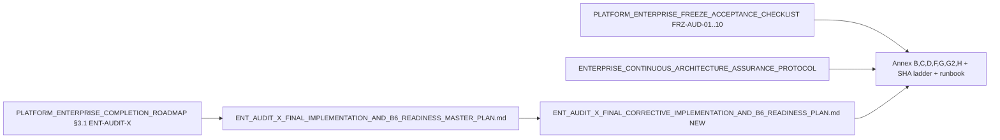
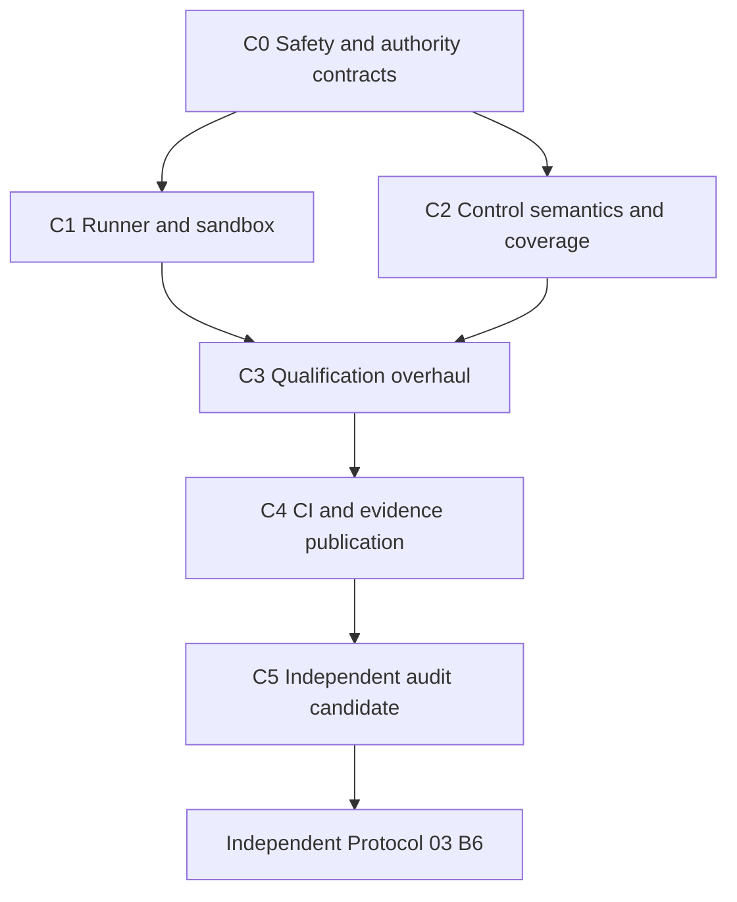

# ENT-AUDIT-X — Final Corrective Implementation & B6 Readiness Plan

## A. Git identity (@ audit time)

| Field | Value | Source |
| --- | --- | --- |
| Repository | `https://github.com/jakbuczarnecki/intergrax.git` | `git remote -v` |
| Branch | `development` (not detached) | `git branch --show-current` |
| **CURRENT_HEAD / audit pin** | `0321bf525d6c78c829706fe3498a8a95941fe528` | `git rev-parse HEAD` |
| `origin/development` | `0321bf525…` (in sync) | `git rev-parse origin/development` |
| Ancestor of pin | yes (`merge-base --is-ancestor` exit 0) | pin = HEAD |
| Working tree | clean (`## development...origin/development`) | `git status -sb` |
| Implementation wave | `0cee41a88` (W0–W6 land) → doc-only `0321bf525` (SHA ladder) | `git log --oneline -3` |

**SHA ladder reconciliation (P1-17):** [`ENT_AUDIT_X_SHA_LADDER.md`](docs/project/maintainers/qualification/ent_audit_x/ENT_AUDIT_X_SHA_LADDER.md) lists `TEST_EXECUTION_SHA` = `0321bf525` with note “164 passed”, but that commit is **docs-only**; executable qualification @ `0cee41a88` is the **only** defensible `IMPLEMENTATION_SHA`. Corrective wave must **re-pin** `TEST_EXECUTION_SHA` after real L3 FULL/FREEZE @ new merge commit; `EVIDENCE_*` and `ACCEPTED_BASELINE_SHA` remain unset.

---

## B. Document authority (no competing roadmap)

- **Execution SSOT (unchanged role):** [`ENT_AUDIT_X_FINAL_IMPLEMENTATION_AND_B6_READINESS_MASTER_PLAN.md`](docs/project/maintainers/qualification/ent_audit_x/ENT_AUDIT_X_FINAL_IMPLEMENTATION_AND_B6_READINESS_MASTER_PLAN.md) — W0–W6 narrative; **superseded for corrective work** by new doc §implementation only.
- **Deliverable (implementation session):** create [`ENT_AUDIT_X_FINAL_CORRECTIVE_IMPLEMENTATION_AND_B6_READINESS_PLAN.md`](docs/project/maintainers/qualification/ent_audit_x/ENT_AUDIT_X_FINAL_CORRECTIVE_IMPLEMENTATION_AND_B6_READINESS_PLAN.md) containing all 26 sections from operator prompt §16; **reconcile** (not duplicate) [`ANNEX_F_GAP_REGISTER.md`](docs/project/maintainers/qualification/ent_audit_x/ANNEX_F_GAP_REGISTER.md) @ HEAD (Annex F still references pre-package GAP-C-01..14 @ `8a41d320` — **stale**).
- **No FRZ/roadmap status changes** in agent sessions; FRZ-AUD-01..10 remain **OPEN** per checklist @ HEAD.

---

## C. Independent architecture audit — component disposition

Tier-0 package [`intergrax/platform/enterprise_audit/`](intergrax/platform/enterprise_audit/) exists with manifest **85 checks**, **0** `internal_pending` ([`enterprise_audit_check_manifest.v1.json`](intergrax/platform/enterprise_audit/data/enterprise_audit_check_manifest.v1.json)). Qual tree: **164** pytest items (`uv run pytest tests/qualification/ent_audit_x --collect-only`).

| Component | Expected invariant | Actual @ HEAD | Gap severity |
| --- | --- | --- | --- |
| [`runner.py`](intergrax/platform/enterprise_audit/runner.py) | Certifying modes; operator baseline | `bootstrap_baseline` → `save_baseline()` writes `accepted_baseline_sha` without OD-ENT-01; `check_ids_filter` without non-cert flag | **P0-01, P0-04** |
| [`baseline.py`](intergrax/platform/enterprise_audit/baseline.py) | Candidate vs accepted; regressed drift | Single `accepted_baseline_sha`; `_regressed` has empty `schema_version` branch (`pass`) | **P0-01, P1-02** |
| [`vbn.py`](intergrax/platform/enterprise_audit/vbn.py) | Fail-closed 31 domains | Rollup counts only; trusts cached `vbn_domains.v1.json`; no GAP/PARTIAL → exit | **P0-03, P1-07** |
| [`digests.py`](intergrax/platform/enterprise_audit/digests.py) | CheckID→FRZ matrix | All rows `frz_aud: FRZ-AUD-03` | **P1-08** |
| [`manifest.py`](intergrax/platform/enterprise_audit/manifest.py) | Closed-world vs Annex C SSOT | Count 85 + unique IDs only | **P1-09** |
| [`evidence.py`](intergrax/platform/enterprise_audit/evidence.py) | Closed artifact set + tamper | Open `rglob` manifest; no required-set / traversal / extra-file detection | **P1-01, P1-12** |
| [`changed_since.py`](intergrax/platform/enterprise_audit/changed_since.py) | Path→owner→invariant→CheckID | File-path + EVOL floor; no semantic owner graph; partial fail-closed (evol unmapped only) | **P1-03** |
| [`coverage.py`](intergrax/platform/enterprise_audit/coverage.py) | Honest FULL label | Logic OK if `planned==85` and all executed; **undermined** by filter + tests accepting INCOMPLETE exits as success | **P0-04** |
| [`sandbox.py`](intergrax/platform/enterprise_audit/sandbox.py) | Isolation + redaction | Path allowlist, timeout, tree kill; keyword-only redaction | **P1-10, P1-11** |
| [`repo_identity.py`](intergrax/platform/enterprise_audit/repo_identity.py) | Ancestry for baseline/since | HEAD + dirty only; no `merge-base` validation | **P1-13** |
| CI [`.github/workflows/enterprise-audit-nightly.yml`](.github/workflows/enterprise-audit-nightly.yml) | No auto baseline | FREEZE path uses `--bootstrap-baseline` | **P0-01, P1-06** |
| L3 [`test_l3_clean_checkout_full.py`](tests/qualification/ent_audit_x/l3/test_l3_clean_checkout_full.py) | Real 85/85 FULL/FREEZE | Dry-run FULL; single-check filters; loose exit codes `{0,1,2,3}` | **P0-02** |
| Acceptance `tests/qualification/ent_audit_x/acceptance/` (**87** test fns / **85** check files) | Subprocess gate oracle | **84** files use only `assert (root / rel).is_file` (mechanical grep count); **2** oracle tests in `test_acceptance_runner_oracle.py` (still allow INCOMPLETE exit) | **P0-02, P1-15, P1-16** |
| ADV [`test_adversarial_adv01_30.py`](tests/qualification/ent_audit_x/integration/test_adversarial_adv01_30.py) | Fault injection ADV-01..30 | **6** substantive (ADV-01,02,08,12,26 + partial 25); **24** pseudo (existence/import/dry-run) | **P1-04** |

---

## D. P0 disposition (mandatory closure)

| ID | Status | Code evidence | Required remediation (WBS batch) |
| --- | --- | --- | --- |
| **P0-01** | **CONFIRMED_OPEN** | [`runner.py:252-259`](intergrax/platform/enterprise_audit/runner.py); nightly FREEZE bootstrap | Introduce **baseline state machine**: `CANDIDATE_BASELINE.json` vs `ENTERPRISE_AUDIT_BASELINE.json` (accepted); `promote_baseline` CLI subcommand requiring `OD-ENT-01` record file + qualification bundle validator; remove auto-`save_baseline` from runner/nightly; negative tests: bootstrap without operator → no accepted write; tamper accepted file → VIOLATION |
| **P0-02** | **CONFIRMED_OPEN** | L3 + acceptance oracles | Add `test_l3_full_real_85_of_85` and `test_l3_freeze_real_85_of_85` (subprocess CLI, clean tree, strict exit **0** only when `coverage_label==FULL` and zero BLOCKER/ERROR); replace acceptance wrappers with runner subprocess or pytest replay of mapped gate; split pytest markers: `ent_l1`, `ent_l2`, `ent_l3_heavy`, `ent_acceptance_gate` |
| **P0-03** | **CONFIRMED_OPEN** | [`vbn.py:49-65`](intergrax/platform/enterprise_audit/vbn.py), rollup in runner | Authoritative domain validator: exact 31 IDs (Annex D), forbid duplicate/missing; **GAP/PARTIAL** → findings + non-CLEAN exit for FULL/FREEZE; domain report must bind `execution_sha`, `manifest_digest`, `run_id`; reject stale cache without matching provenance; security tests: forged JSON |
| **P0-04** | **CONFIRMED_OPEN** | [`run_enterprise_audit.py`](scripts/enterprise_audit/run_enterprise_audit.py) `--check-id`; runner filter | Add explicit **`AuditMode.DIAGNOSTIC`** or `--non-certifying` required with any filter; certifying FULL/FREEZE/FAST forbid filter in CLI (fail closed); report field `certifying_run: bool`; evidence bundle refuses publication when `certifying_run=false`; L3 must not use filters for qualification |

---

## E. P1 disposition (all mandatory)

| ID | Status | Remediation summary | Primary files / tests |
| --- | --- | --- | --- |
| P1-01 | **CONFIRMED_OPEN** | Closed artifact catalog in [`evidence.py`](intergrax/platform/enterprise_audit/evidence.py) + JSON schema; integrity + provenance | `validators.py` (new/enhance), unit tamper tests |
| P1-02 | **CONFIRMED_OPEN** | Complete REGRESSED: severity, fingerprint, **check schema_version**, finding identity, RESOLVED reopen rules | [`baseline.py`](intergrax/platform/enterprise_audit/baseline.py), drift unit tests |
| P1-03 | **PARTIAL** | Extend [`changed_since.py`](intergrax/platform/enterprise_audit/changed_since.py) with SSOT impact map (reuse Annex G2 + EVOL artifacts); unknown path → BLOCKER finding | integration + fail-closed tests |
| P1-04 | **CONFIRMED_OPEN** | Rewrite ADV-01..30 with injected faults per [`ANNEX_C`](docs/project/maintainers/qualification/ent_audit_x/ANNEX_C_CONTROL_MATRIX.md) threats | `test_adversarial_adv01_30.py` |
| P1-05 | **PARTIAL** | Expand PR paths: post-freeze matrix, FRZ docs, reusable gates, `intergrax/platform/**` audit-adjacent | [`.github/workflows/enterprise-audit.yml`](.github/workflows/enterprise-audit.yml) |
| P1-06 | **CONFIRMED_OPEN** | Nightly: pytest + FULL real only; FREEZE/bootstrap **workflow_dispatch + operator** only | nightly yml + runbook |
| P1-07 | **CONFIRMED_OPEN** | Fresh domain report generation; no blind cache read | [`vbn.py`](intergrax/platform/enterprise_audit/vbn.py) |
| P1-08 | **CONFIRMED_OPEN** | `frz_coverage_artifact` uses [`ANNEX_B`](docs/project/maintainers/qualification/ent_audit_x/ANNEX_B_FRZ_AUD_CLOSURE_MATRIX.md) + per-check `frz_mapping` in manifest | [`digests.py`](intergrax/platform/enterprise_audit/digests.py) |
| P1-09 | **CONFIRMED_OPEN** | Closed-world validate against Annex C export / alignment script output | [`manifest.py`](intergrax/platform/enterprise_audit/manifest.py), existing alignment script |
| P1-10 | **PARTIAL** | Per-check output dir, concurrent run_id, mutating allowlist file, Windows session kill tests | [`sandbox.py`](intergrax/platform/enterprise_audit/sandbox.py) |
| P1-11 | **CONFIRMED_OPEN** | Structured redaction policy + tenant ID patterns; negative leakage tests | sandbox + report |
| P1-12 | **CONFIRMED_OPEN** | Extra/missing artifact detection; path traversal in manifest paths | evidence verifier |
| P1-13 | **CONFIRMED_OPEN** | `assert_ancestor(baseline_sha, head)` for FREEZE/CHANGED-SINCE | [`repo_identity.py`](intergrax/platform/enterprise_audit/repo_identity.py) |
| P1-14 | **PARTIAL** | Global concurrency cap, output quotas, partial-run classification in manifest | runner + sandbox |
| P1-15 | **CONFIRMED_OPEN** | Executable qual @ pinned SHA — see L3 design §9 | new L3 module |
| P1-16 | **CONFIRMED_OPEN** | Document 164-test breakdown: ~unit/integration vs ~84 file-existence acceptance vs 0 true L3 FULL | corrective plan § + Annex F |
| P1-17 | **CONFIRMED_OPEN** | SHA ladder append-only; separate doc vs qual SHAs | SHA ladder + dossier |
| P1-18 | **PARTIAL** | Operator matrix OD-ENT-00..08, EVOL B6 pending, branch protection evidence | operator record docs; **no agent closure** |

---

## F. Adjacent boundary audit (§6) — summary

| Risk area | Disposition | Action |
| --- | --- | --- |
| Audit-of-auditor / false PASS | **CONFIRMED_OPEN** | Mutation tests on report/status fields; ADV + L3 |
| Check semantics versioning | **PARTIAL** | Wire manifest `schema_version` into drift + requalification trigger |
| DAG fault propagation | **PARTIAL** | Already skips on prereq fail; add manifest tests for orphan deps |
| Flaky/retry | **UNKNOWN** | Policy: no auto-retry on FREEZE; single attempt + ENV classification |
| Reproducible environment | **PARTIAL** | Fingerprint in evidence bundle (uv lock, OS, Python) |
| Windows/Linux | **PARTIAL** | CI ubuntu-only; document Windows qual on operator machine @ ECAP |
| Toolchain pinning | **PARTIAL** | Record lockfile digest in evidence |
| Duplicate gate dedup | **RULED_OUT** @ HEAD | Manifest is authoritative list |
| Provider neutrality bypass | **CONFIRMED_OPEN** | VBN checks must execute, not file-exist |
| Tenant leakage | **CONFIRMED_OPEN** | P1-11 tests |
| Report atomic publication | **CONFIRMED_OPEN** | write temp dir + rename |
| Evidence poisoning | **CONFIRMED_OPEN** | P1-12 closed world |
| Output path collisions | **PARTIAL** | Require unique `run_id` subdirs |
| Partial/cancelled runs | **PARTIAL** | Manifest `run_status` enum |
| Requalification on engine change | **CONFIRMED_OPEN** | manifest_digest change → invalidate accepted baseline |
| FRZ/roadmap drift | **PARTIAL** | Check ENT-A-REG-* gates in FULL |
| CI skipped-job false pass | **CONFIRMED_OPEN** | Document required checks; operator BLK-CI-ENFORCE |
| Mandatory check disablement | **CONFIRMED_OPEN** | Branch rules + OD-ENT-02 evidence |
| Invalid N/A (VBN domains) | **CONFIRMED_OPEN** | P0-03 |
| ARCH-FREEZE compatibility | **BLOCKED** | ENT-AUDIT-X must close before ARCH-FREEZE per roadmap |

---

## G. Coverage matrices (plan completeness — not PASS)

| Matrix | Rows | Plan assignment |
| --- | ---: | --- |
| Annex C controls | **85** | Retain [`ANNEX_C_CONTROL_MATRIX.md`](docs/project/maintainers/qualification/ent_audit_x/ANNEX_C_CONTROL_MATRIX.md); corrective plan adds column **Corrective WBS** + **Qual status @ HEAD** = *manifest wired / gate not executed* for most acceptance rows |
| TEN-* | **13** | Manifest + tenant enrich; qual = replace file-exist with gate subprocess |
| VBN-* | **9** | Same + domain rollup authority |
| VBN domains D01–D31 | **31** | [`ANNEX_D_VBN_DOMAINS_1_31.md`](docs/project/maintainers/qualification/ent_audit_x/ANNEX_D_VBN_DOMAINS_1_31.md) + validator |
| FRZ-AUD-01..10 | **10** | [`ANNEX_B_FRZ_AUD_CLOSURE_MATRIX.md`](docs/project/maintainers/qualification/ent_audit_x/ANNEX_B_FRZ_AUD_CLOSURE_MATRIX.md); closure only post independent B6 |
| ADV-01..30 | **30** | Remap in adversarial matrix with fault injection spec |

---

## CP-01 — CP-12 (finalized @ `0321bf525`)

Full mechanical detail: sections **CP-01 through CP-12** below (canonical copy also staged for ENT-T-C056 repo publish).

---

## CP-01 — Canonical authorities (verified @ `0321bf525`)

| Authority | Role | Change in corrective wave |
| --- | --- | --- |
| [`PLATFORM_ENTERPRISE_COMPLETION_ROADMAP.md`](docs/project/maintainers/plans/PLATFORM_ENTERPRISE_COMPLETION_ROADMAP.md) | ENT-AUDIT-X **OPEN**; depends EVOL-X | **No status edit** |
| [`PLATFORM_ENTERPRISE_FREEZE_ACCEPTANCE_CHECKLIST.md`](docs/project/maintainers/qualification/PLATFORM_ENTERPRISE_FREEZE_ACCEPTANCE_CHECKLIST.md) | FRZ-AUD-01..10 **OPEN** | **No promotion** |
| [`ENTERPRISE_CONTINUOUS_ARCHITECTURE_ASSURANCE_PROTOCOL.md`](docs/project/maintainers/qualification/ENTERPRISE_CONTINUOUS_ARCHITECTURE_ASSURANCE_PROTOCOL.md) | B6 independence, exact-SHA | Evidence lifecycle CP-08 |
| [`SYSTEM_INVARIANTS.md`](docs/project/technical/guides/SYSTEM_INVARIANTS.md) | Invariant semantics for checks | Reference only |
| Annex B/C/D/F/G/G2/H | Mechanical matrices | **Reconcile F @ HEAD**; G2 = 85-check SSOT |
| ENT final implementation master plan | W0–W6 narrative | Superseded for execution by corrective doc |
| ENT SHA ladder | Pin lineage | Re-pin after real L3 (not `0321bf525` doc-only) |
| Protocol 03 dossier template | B6 package shape | Filled in C5 |
| CI enforcement runbook | PR/nightly/FREEZE policy | Updated in C4 |

---

## CP-02 — Historical WBS disposition (273 tasks — no bulk DONE)

| Batch | Task IDs | Count | CLOSED_WITH_EVIDENCE | PARTIAL | OPEN | Rationale |
| --- | --- | ---: | ---: | ---: | ---: | --- |
| B0 Planning | ENT-T-0001..0009 | 9 | 9 | 0 | 0 | Plans/annexes published @ `6328f0cf`–`1656cb8` |
| B1 Contracts | ENT-T-0101..0110 | 10 | 0 | 10 | 0 | Types/schemas exist; closed-world + baseline binding incomplete |
| B2 Runner | ENT-T-0201..0212 | 12 | 0 | 12 | 0 | P0-01/04, certifying semantics |
| B3 Registry/safety | ENT-T-0301..0314 | 14 | 0 | 14 | 0 | Sandbox/evidence partial |
| B4 Area adapters | ENT-T-0401..0463 | 63 | 0 | 63 | 0 | Manifest wired; **0/63** semantic qual @ SHA |
| B5 TEN | ENT-T-0501..0513 | 13 | 0 | 13 | 0 | Same |
| B6 VBN | ENT-T-0601..0609 | 9 | 0 | 9 | 0 | Same + domain authority P0-03 |
| B7 Baseline/SHA | ENT-T-0701..0710 | 10 | 0 | 4 | 6 | Promotion/ancestry/evidence OPEN (0701–0706 OPEN; 0707–0710 PARTIAL scaffold) |
| B8 Reporting | ENT-T-0801..0808 | 8 | 0 | 8 | 0 | Atomic publish missing |
| B9 CLI/modes | ENT-T-0901..0910 | 10 | 0 | 10 | 0 | Diagnostic/certifying split OPEN |
| B10 CI | ENT-T-1001..1008 | 8 | 0 | 8 | 0 | Nightly bootstrap P1-06 |
| B11 Qualification | ENT-T-1101..1197 | 97 | 0 | 97 | 0 | 164 tests; **no** L3 85/85 |
| B12 Closure | ENT-T-1201..1210 | 10 | 0 | 0 | 10 | Blocked on independent B6 |
| **Total** | | **273** | **9** | **248** | **16** | 9+248+16=273 (F-03) |

**Corrective wave:** **64** tasks **ENT-T-C001..ENT-T-C064** (C0=8, C1=10, C2=12, C3=14, **C4=14**, C5=6). **Total tracked: 337** (273+64).

### Atomic corrective WBS (64 tasks — full)

| TaskID | Batch | Pri | GAP IDs | Files / functions | Required change | Deps | Positive test | Negative test | Evidence | Acceptance | Owner |
| ENT-T-C001 | C0 | CRIT | GAP-FND-P0-01 | `baseline.py` | BaselinePhase; candidate vs accepted paths | — | `test_baseline_phase_no_accepted_without_operator` | `test_save_accepted_without_od_record_fails` | candidate schema | No accepted without OD-ENT-01 | ENT |
| ENT-T-C002 | C0 | CRIT | GAP-FND-P0-01 | `runner.py` | Remove auto `save_baseline`; candidate write only | C001 | `test_freeze_bootstrap_writes_candidate_not_accepted` | `test_freeze_bootstrap_never_touches_accepted` | candidate JSON | No auto-promotion | ENT |
| ENT-T-C003 | C0 | CRIT | GAP-FND-P0-01 | `run_enterprise_audit.py`, `baseline.py` | `promote-baseline`: **operator trust boundary only** (F-07); verify OD-ENT-01 **record schema + ladder SHA pins**; **no** closed-bundle verify here (F-01) | **C001,C006** | `test_promote_rejects_agent_only_record` | `test_promote_without_record_rejected` | promotion audit log | Promotion impossible from agent-dropped file alone | ENT |
| ENT-T-C004 | C0 | CRIT | GAP-FND-P0-04 | `contracts.py`, `runner.py` | `certifying_run` flag | — | `test_report_certifying_run_default_true` | `test_certifying_mode_rejects_check_id_filter` | report | No certifying filter | ENT |
| ENT-T-C005 | C0 | CRIT | GAP-FND-P0-04 | CLI | `--check-id` requires `--non-certifying` | C004 | `test_cli_check_id_requires_non_certifying` | `test_cli_full_with_check_id_exits_nonzero` | stderr | P0-04 closed | ENT |
| ENT-T-C006 | C0 | CRIT | GAP-FND-P1-01,12 | `evidence.py`, catalog JSON | Closed-world artifact catalog | — | `test_evidence_build_matches_catalog` | `test_extra_artifact_fails_verify` | catalog | Closed verifier | ENT |
| ENT-T-C007 | C0 | CRIT | GAP-FND-P0-01,P1-06 | nightly yml | Remove scheduled bootstrap | C002 | workflow lint | review | yaml | No nightly accept | ENT |
| ENT-T-C008 | C0 | CRIT | GAP-FND-P0-03 | `vbn.py` | `validate_domain_report()` 31 IDs | — | `test_vbn_validator_31_ids` | `test_vbn_forged_sha_rejected` | unit | P0-03 contract | ENT |
| ENT-T-C009 | C1 | CRIT | GAP-FND-P0-01 | `runner.py` | FREEZE: (a) no accepted + no bootstrap → VIOLATION; (b) bootstrap → **candidate only** (F-02); (c) accepted → normal FREEZE | C001,C002 | `test_freeze_without_accepted_and_without_bootstrap_blocked` | `test_first_candidate_freeze_writes_candidate` | FREEZE manifest | F-02 lifecycle | ENT |
| ENT-T-C010 | C1 | CRIT | GAP-FND-P0-03,P1-07 | `vbn.py` | Fresh domain report; provenance cache | C008 | `test_vbn_fresh_run_on_full` | `test_stale_cache_rejected` | vbn JSON | Fresh proof | ENT |
| ENT-T-C011 | C1 | CRIT | GAP-FND-P0-03 | `runner.py`,`modes.py` | GAP/PARTIAL → BLOCKER | C008 | `test_full_fails_on_domain_gap` | `test_full_passes_31_qualified` | findings | 31/31 | ENT |
| ENT-T-C012 | C1 | MAJ | GAP-FND-P1-13 | `repo_identity.py` | `assert_ancestor` | — | `test_ancestor_valid` | `test_baseline_sha_not_ancestor_fails` | git | ECAP | ENT |
| ENT-T-C013 | C1 | MAJ | report atomic | `report.py` | temp+rename | — | `test_report_atomic_on_interrupt` | partial write | report | No torn JSON | ENT |
| ENT-T-C014 | C1 | MAJ | GAP-FND-P1-10 | `sandbox.py` | per-run isolation | — | `test_concurrent_runs_isolated` | collision | dirs | Isolation | ENT |
| ENT-T-C015 | C1 | MAJ | GAP-FND-P1-11 | `sandbox.py` | Redaction v2 | — | `test_redaction_strips_tenant_uuid` | leak fixture | unit | P1-11 | ENT |
| ENT-T-C016 | C1 | MAJ | GAP-FND-P1-14 | `runner.py` | `run_status` enum | — | `test_manifest_run_status_complete` | kill mid-run | manifest | Partial class | ENT |
| ENT-T-C017 | C1 | MAJ | GAP-FND-P1-14 | `sandbox.py` | Timeout/orphan policy | — | `test_sandbox_timeout_exit_124` | hung proc | sandbox | Windows kill | ENT |
| ENT-T-C018 | C1 | CRIT | GAP-FND-P0-03 | `runner.py` | domains_accounted&lt;31 fail | C011 | integration | gap inject | summary | VBN enforced | ENT |
| ENT-T-C019 | C2 | MAJ | GAP-FND-P1-09 | `manifest.py` | Closed-world vs Annex C | — | `test_manifest_matches_annex_c_ids` | extra ID | alignment | 85 exact | ENT |
| ENT-T-C020 | C2 | MAJ | GAP-FND-P1-08 | `digests.py` | FRZ map JSON | — | `test_frz_map_not_all_aud03` | missing map | frz_coverage | Per-check FRZ | ENT |
| ENT-T-C021 | C2 | MAJ | GAP-FND-P1-08 | manifest | `frz_mapping` rows | C020 | schema | invalid FRZ | manifest | Matrix | ENT |
| ENT-T-C022 | C2 | MAJ | GAP-FND-P1-02 | `baseline.py` | schema_version drift | — | `test_drift_regressed_on_schema_bump` | stable | unit | P1-02 | ENT |
| ENT-T-C023 | C2 | MAJ | GAP-FND-P1-02 | `baseline.py` | RESOLVED reopen | C022 | `test_resolved_reopens_as_regressed` | stable | drift | FRZ-AUD-07 | ENT |
| ENT-T-C024 | C2 | MAJ | GAP-FND-P1-03 | `changed_since.py` | impact map data | — | `test_impact_map_selects_invariant_owner` | unknown BLOCKER | map | Fail-closed | ENT |
| ENT-T-C025 | C2 | MAJ | GAP-FND-P1-03 | `changed_since.py` | unknown paths | C024 | `test_unknown_platform_path_fail_closed` | mapped ok | report | P1-03 | ENT |
| ENT-T-C026 | C2 | MAJ | GAP-FND-P1-01,12 | `validators.py`, `evidence.py` | Closed bundle verify; enables **production** promote gate (wired in C042 after C026, not C003 dep) | C006 | `test_verify_closed_bundle_ok` | tamper/extra | manifest | P1-12 | ENT |
| ENT-T-C027 | C2 | MAJ | GAP-FND-P1-12 | `validators.py` | path traversal | C026 | unit | `../` paths | validator | Security | ENT |
| ENT-T-C028 | C2 | MAJ | requalification | `baseline.py`,`runner.py` | manifest_digest mismatch | C019 | `test_manifest_digest_change_invalidates_baseline` | same ok | baseline | Requal rule | ENT |
| ENT-T-C029 | C2 | MAJ | GAP-FND-P1-03 | `build_impact_map.py` | G2 generator | C024 | dry-run | diff | JSON | SSOT | ENT |
| ENT-T-C030 | C2 | MAJ | DAG | `schedule.py` | orphan deps | C019 | orphan test | cycle | unit | DAG | ENT |
| ENT-T-C031 | C3 | CRIT | GAP-FND-P0-02,P1-15 | `l3/test_l3_full_real_85.py` | REAL FULL 85/85 | C004,C011 | `test_l3_full_real_85_of_85` | fail inject | l3-full | FULL oracle | ENT |
| ENT-T-C032 | C3 | CRIT | GAP-FND-P0-02 | `l3/test_l3_freeze_real_85.py` | **Two tests:** (1) `test_l3_first_candidate_freeze_85` — bootstrap candidate, **no** accepted baseline (F-02); (2) `test_l3_normal_freeze_85` — requires **accepted** fixture post-OD (lab/simulated) | C002,C009,C011,C031 | first-candidate pass | plain FREEZE blocked | l3-freeze dirs | Does not require pre-accepted baseline for (1) | ENT |
| ENT-T-C033 | C3 | CRIT | GAP-SQ-* | `acceptance/conftest.py` | gate helper | C004 | helper | N/A | fixture | DRY | ENT |
| ENT-T-C034 | C3 | CRIT | GAP-SQ-ENT-A (63) | acceptance ENT-A | gate subprocess | C033 | per gate | fail inject | outcomes | 63 semantic | ENT |
| ENT-T-C035 | C3 | CRIT | GAP-SQ-TEN (13) | acceptance TEN | gate subprocess | C033 | 13 | tenant neg | TEN | 13/13 | ENT |
| ENT-T-C036 | C3 | CRIT | GAP-SQ-VBN (9) | acceptance VBN | gate subprocess | C033 | 9 | VBN neg | VBN | 9/9 | ENT |
| ENT-T-C037 | C3 | MAJ | GAP-FND-P1-04 | adversarial | ADV 01–10 | C004,C026 | per ADV | N/A | log | fault inject | ENT |
| ENT-T-C038 | C3 | MAJ | GAP-FND-P1-04 | adversarial | ADV 11–20 | C037 | per ADV | N/A | log | fault inject | ENT |
| ENT-T-C039 | C3 | MAJ | GAP-FND-P1-04 | adversarial | ADV 21–31 | C037 | per ADV | N/A | log | fault inject | ENT |
| ENT-T-C040 | C3 | MAJ | GAP-FND-P1-16 | pytest markers | ent_l1/l2/l3_heavy | — | collect | N/A | doc | taxonomy | ENT |
| ENT-T-C041 | C3 | MAJ | GAP-FND-P1-16 | plan § | Pytest inventory **F-04:** unit **28**, integration **41**, l3 **7**, acceptance **88** → **164** @ HEAD (`0321bf525`) | C040 | `pytest --collect-only` | N/A | § | Mechanical reconcile | ENT |
| ENT-T-C042 | C3 | CRIT | GAP-FND-P0-01, F-07 | `test_baseline_promotion.py` | Unauthorized promote; agent-only OD file rejected; full bundle check after C026 | C003 (+ C026 for bundle leg) | operator fixture path | agent file / no bundle | log | Trust boundary | ENT |
| ENT-T-C043 | C3 | CRIT | GAP-FND-P0-03 | `test_vbn_forged_report.py` | forged JSON | C008 | detect | valid | vbn | Security | ENT |
| ENT-T-C044 | C3 | MAJ | false PASS | `test_report_status_mutation.py` | mutate status | C026 | tamper | clean | report | audit-of-auditor | ENT |
| ENT-T-C045 | C4 | MAJ | GAP-FND-P1-05 | enterprise-audit.yml | Base workflow skeleton + path list (extended by C059) | — | syntax | N/A | yaml | PR cov | ENT |
| ENT-T-C046 | C4 | CRIT | GAP-FND-P1-06 | nightly yml | align C007 | C007 | CI | N/A | yaml | nightly | ENT |
| ENT-T-C047 | C4 | MAJ | GAP-FND-P1-05,18 | runbook | required checks | — | review | N/A | runbook | BLK-CI | ENT/Op |
| ENT-T-C048 | C4 | MAJ | GAP-FND-P1-17 | SHA ladder | re-pin rules | C031 | review | doc-only qual | ladder | P1-17 | ENT |
| ENT-T-C049 | C4 | MAJ | CP-08 | `evidence.py` | env fingerprint | C026 | present | missing | fingerprint | repro | ENT |
| ENT-T-C050 | C4 | MAJ | CP-08 | `build_evidence_bundle.py` | bundle builder | C026,C031 | integration | tamper | `.tmp/proof/` | bundle | ENT |
| ENT-T-C051 | C4 | MAJ | CP-08 | `run_qual_wave.py` | L1→L3 orchestrator | C031,C032 | e2e | fail mid | qual log | one wave | ENT |
| ENT-T-C052 | C4 | MAJ | GAP-FND-P1-05 | runbook | retention/replay | C047 | doc | N/A | runbook | CI evidence | ENT |
| ENT-T-C059 | C4 | CRIT | **C4-PR-FAST**, GAP-FND-P1-05, **F-05** | `.github/workflows/enterprise-audit.yml` | PR FAST; checkout **`pull_request.head.sha`**; report SHA fields; artifact metadata; job summary | C004,C045 | `test_ci_pr_report_sha_matches_head` | invariant PR BLOCKED | artifact @ head SHA | OD-ENT-02 separate | ENT |
| ENT-T-C060 | C4 | MAJ | **C4-BAT** | `scripts/enterprise_audit/audit.bat` | Windows launcher: default/fast/full/changed/freeze; repo root discovery; uv/python check; unique `.tmp/proof/ent-audit-x/local-<ts>/`; exit code propagation; **no** `--bootstrap-baseline`; freeze requires accepted baseline | C004,C005,C062 | `test_audit_bat_default_fast` (Windows) | missing uv, invalid sha, spaces in path | local run dir | Same runner as CI | ENT |
| ENT-T-C061 | C4 | MAJ | **C4-SH** | `scripts/enterprise_audit/audit.sh` | Bash launcher: functional parity with BAT; `chmod +x`; POSIX-safe quoting; no cloud deps | C060,C062 | `test_audit_sh_default_fast` (Linux/macOS) | same negatives as BAT | local run dir | Parity with BAT | ENT |
| ENT-T-C062 | C4 | MAJ | **C4-REPORT-UX** | `run_enterprise_audit.py`, optional `report_summary.py` | Post-run console summary: mode, SHA, status, executed/skipped/failed counts, top findings, duration, MD/JSON paths, optional bundle path; `--open` local only; FAST labeled non-certifying-full | C004 | `test_cli_prints_summary_fields` | FAST never claims FULL cert | stdout + reports | C4-D contract | ENT |
| ENT-T-C063 | C4 | MAJ | **C4-LAUNCHER-TESTS** | `tests/qualification/ent_audit_x/integration/test_audit_launchers_*.py` | 16 acceptance tests (C4-E matrix); mark `ent_launcher`; Windows job for BAT | C059–C062 | items 1–16 pass in target OS | N/A | pytest log | Cross-entrypoint semantics | ENT |
| ENT-T-C064 | C4 | MAJ | **C4-DOCS**, GAP-FND-P1-18, FRZ-AUD-10 | runbook, corrective plan, CLI doc, dossier §CI, `docs/.../ENT_AUDIT_X_OPERATOR_QUICKSTART.md` | User quickstart (FAST one-liner, FULL, CHANGED-SINCE, FREEZE, reports, GitHub required checks); FRZ-AUD-10 evidence mapping; **no** claim OD-ENT-02 done | C047,C059–C063 | doc link checks | N/A | published md | Operator can run audit without long uv command | ENT |
| ENT-T-C053 | C5 | MAJ | CP-08 | dossier template | mechanical fill | C050 | checklist | N/A | draft | B6 candidate | ENT |
| ENT-T-C054 | C5 | MAJ | CP-12 | `mechanical_readiness_check.py` | pre-B6 script incl. audit.bat/sh + PR workflow checks | C050,C059,C064 | pass | inject fail | report | mechanical | ENT |
| ENT-T-C055 | C5 | MAJ | CP-06 | Annex F | 136 rows | all C* | review | N/A | annex | Gap SSOT | ENT |
| ENT-T-C056 | C5 | MAJ | — | corrective plan md | repo publish | C055 | lint | N/A | doc | operator SSOT | ENT |
| ENT-T-C057 | C5 | DOC | GAP-FND-P1-18 | operator record | OD-ENT matrix | — | table | N/A | doc | no agent sign | Operator |
| ENT-T-C058 | C5 | MAJ | CP-08 | b6-handoff layout | replay tree | C050,C053 | validator | missing | handoff | independent | ENT |

**Math:** C0 **8** + C1 **10** + C2 **12** + C3 **14** + C4 **14** + C5 **6** = **64** (`ENT-T-C001..C064`; C053–C058 remain C5 batch IDs).

---

## C4-A — C4-F: Mandatory operational integration (extends C4 batch)

**Scope:** Obowiązkowe przed B6 readiness; **jeden** kanoniczny runner (`run_enterprise_audit.py` / `EnterpriseAuditRunner`); **bez** drugiego systemu audytowego.

**Dependency gate:** C059–C064 land **after** C0–C3 (certifying semantics, baseline FSM); **before** final C5 dossier evidence (C053–C058 consume C059–C064 artifacts).

### C4-A — Automatic Pull Request FAST (`ENT-T-C059` / **C4-PR-FAST**)

| Requirement | Design |
| --- | --- |
| Trigger | `on.pull_request`: `opened`, `synchronize`, `reopened` (covers new PR + push updates) |
| Paths | Superset: `intergrax/platform/**`, `intergrax/**/enterprise*`, manifest, `scripts/enterprise_audit/**`, `tests/qualification/ent_audit_x/**`, ent_audit_x docs, `.github/workflows/enterprise-audit*.yml`, post-freeze guard docs per runbook |
| Execution | Certifying **FAST**, **no** `--dry-run`; mandatory fast floor fail-closed |
| Status | Map exit 0→PASS summary; 1→VIOLATION/BLOCKED; 2→INCOMPLETE; 3→INTERNAL |
| Artifacts | Upload `.tmp/proof/ent-audit-x/pr-<pr>-<head_sha>/` (JSON, MD, manifest) |
| Job Summary | `$GITHUB_STEP_SUMMARY`: mode, SHA, counts, top 5 findings, artifact path |
| SHA binding | `qualification_sha` = `github.event.pull_request.head.sha` |
| Forbidden | `--bootstrap-baseline`, FREEZE, accepted baseline writes |
| Skip protection | `paths-ignore` minimal; companion doc for required check name `ent-audit-fast` (OD-ENT-02) |
| Fork PR | Standard `pull_request` + `contents: read`; no `pull_request_target` secret exposure; document label/fork limitations |
| Cost | `concurrency`: cancel in-progress per PR; timeout job 45m; reuse uv cache |

**Acceptance:** green PR → PASS artifact @ head SHA; injected invariant failure → non-zero exit + BLOCKED summary. **Merge enforcement** = operator OD-ENT-02 only.

**Reconcile:** extends **ENT-T-C045** (paths); C045 remains yaml skeleton; C059 owns PR FAST semantics.

### C4-B — Windows `audit.bat` (`ENT-T-C060` / **C4-BAT**)

Path: [`scripts/enterprise_audit/audit.bat`](scripts/enterprise_audit/audit.bat).

| Invocation | Maps to |
| --- | --- |
| `audit.bat` | `--mode FAST` (certifying) |
| `audit.bat fast` | FAST |
| `audit.bat full` | FULL |
| `audit.bat changed <SHA>` | `--mode CHANGED-SINCE --since-sha <SHA>` |
| `audit.bat freeze` | `--mode FREEZE` (requires accepted baseline; **no** bootstrap flag) |

Implementation notes: `%~dp0` + git rev-parse to find repo root; verify `uv` on PATH; output `%REPO%\.tmp\proof\ent-audit-x\local-%DATE%-%TIME%` sanitized; call `uv run python scripts/enterprise_audit/run_enterprise_audit.py ...`; `exit /b %ERRORLEVEL%`.

### C4-C — Linux/macOS `audit.sh` (`ENT-T-C061` / **C4-SH**)

Path: [`scripts/enterprise_audit/audit.sh`](scripts/enterprise_audit/audit.sh) — **bash** (documented in C4-F). Same argument contract as BAT; `set -euo pipefail`; quote `"$@"`; executable bit in git.

### C4-D — Report usability (`ENT-T-C062` / **C4-REPORT-UX**)

Shared by CLI, BAT, SH, CI (CI uses Job Summary + same fields in log step):

- Mode, git SHA, aggregate status (PASS/BLOCKED/INCOMPLETE/INTERNAL_FAILURE)
- Checks executed / skipped / failed (mandatory floor)
- Top N findings (severity order)
- Duration ms
- Paths: `enterprise_audit_report.md`, `.json`, optional evidence bundle dir
- `--open`: open MD locally (launcher/CLI only; **never** in CI default)
- FAST footer: not enterprise FULL certification

### C4-E — Launcher acceptance tests (`ENT-T-C063` / **C4-LAUNCHER-TESTS**)

| # | Test | Env | Maps |
| ---: | --- | --- | --- |
| 1 | BAT default FAST | Windows | C060 |
| 2 | SH default FAST | Linux | C061 |
| 3 | FULL dispatch | both | C060/C061 |
| 4 | CHANGED-SINCE SHA forward | both | invalid → non-zero |
| 5 | FREEZE without accepted baseline | both | blocked; no bootstrap |
| 6 | Missing uv | both | friendly error, non-zero |
| 7 | Invalid since SHA | both | non-zero |
| 8 | Repo root from subdir | both | cwd ≠ root |
| 9 | Path with spaces | both | quoting |
| 10 | Exit code propagation | both | inject failing gate |
| 11 | Unique output dirs | both | two runs ≠ path |
| 12 | Failed audit ≠ exit 0 | both | |
| 13 | PR workflow runs real gates | CI | C059 |
| 14 | Required-check doc present | doc | C064 (not enforced without OD-ENT-02) |
| 15 | Artifact SHA matches report | CI | C059 |
| 16 | BAT/SH/CI same exit semantics | cross | compare sample gate |

CI workflow: Linux runs 2,3,4,7,8,11,13,15,16; Windows workflow or manual matrix for 1,9,10,12.

### C4-F — Documentation (`ENT-T-C064` / **C4-DOCS**)

Update: [`ENT_AUDIT_X_CI_ENFORCEMENT_RUNBOOK.md`](docs/project/maintainers/qualification/ent_audit_x/ENT_AUDIT_X_CI_ENFORCEMENT_RUNBOOK.md), corrective master plan (C056), CLI section in runbook, Protocol 03 dossier §CI replay, Annex B **FRZ-AUD-10** row (workflow URL + required-check procedure).

New: `docs/project/maintainers/qualification/ent_audit_x/ENT_AUDIT_X_OPERATOR_QUICKSTART.md` — one-command FAST (`audit.bat` / `audit.sh`), FULL, CHANGED-SINCE, FREEZE rules, report locations, interpreting exit codes, configuring GitHub required checks (points to OD-ENT-02).

### C4 task reconciliation

| Alias | Canonical TaskID | Depends |
| --- | --- | --- |
| C4-PR-FAST | ENT-T-C059 | C004, C045 |
| C4-BAT | ENT-T-C060 | C004, C005, C062 |
| C4-SH | ENT-T-C061 | C062 (parity C060) |
| C4-REPORT-UX | ENT-T-C062 | C004 |
| C4-LAUNCHER-TESTS | ENT-T-C063 | C059–C062 |
| C4-DOCS | ENT-T-C064 | C047, C059–C063 |

C5 dossier (C053–C058) **depends on** C064 for operator-facing CI/launcher evidence.

---

## F-01 — F-07 Execution consistency patch (@ `0321bf525`)

### F-01 — Acyclic Task DAG (64 TaskIDs)

**Removed cycle:** `ENT-T-C003` **no longer depends on** `C026`. Promotion contract: **C001** (FSM + OD record schema + reject agent-origin records) + **C006** (artifact catalog for promotion manifest). **C026** adds closed-bundle verification; **C042** integration requires **C003 + C026** before successful promote in implementation wave (sequencing, not C0→C2 back-edge).

**Topological levels (batch-safe):**

| Level | TaskIDs |
| --- | --- |
| L0 | C001, C004, C005, C006, C007, C008 |
| L1 | C002, C003, C019, C020, C022, C024, C029, C045 |
| L2 | C009–C018, C021, C023, C025–C028, C030, C046–C052, C062 |
| L3 | C031–C044, C040–C041, C059 |
| L4 | C060, C061, C063 |
| L5 | C064 |
| L6 | C053–C058 (C5; consumes C050,C064 + all C0–C4 evidence) |

**Batch DAG:** C0→{C1,C2}→C3→C4→C5 (acyclic). **Verified:** no C0 task depends on C2+.

### F-02 — First FREEZE / B6 / baseline lifecycle (replaces CP-03 narrative)

| Phase | State | Accepted baseline required? | Allowed agent action |
| --- | --- | --- | --- |
| 1 | Candidate qualification | **No** | L3 **FULL** C031 @ TEST_EXECUTION_SHA |
| 2 | First candidate FREEZE | **No** | Certifying FREEZE + `--bootstrap-candidate` → **CANDIDATE_*.json** only (C002) — **C032 test (1)** |
| 3 | Evidence publication | No | C050/C051 bundle @ EVIDENCE_CANDIDATE_SHA |
| 4 | Independent B6 | No | External auditor only |
| 5 | Operator OD-ENT-01 | No (decision) | Operator **outside agent trust** (F-07) |
| 6 | Accepted promotion | After B6+OD | `promote-baseline` C003 → `ENTERPRISE_AUDIT_BASELINE.json` |
| 7 | Normal FREEZE | **Yes** | Drift vs accepted — **C032 test (2)**; FREEZE without accepted **and** without bootstrap → **fail-closed** (C009) |

**Forbidden:** auto-write accepted; bootstrap → accepted; L3 first FREEZE requiring pre-accepted baseline.

### F-03 — Historical WBS (273)

Correct aggregate: **9 CLOSED_WITH_EVIDENCE / 248 PARTIAL / 16 OPEN** (was wrongly 254/10 in Total row). Per-batch counts unchanged except explicit B7 split (4 PARTIAL + 6 OPEN = 10).

### F-04 — Pytest inventory (mechanical @ HEAD)

`uv run pytest tests/qualification/ent_audit_x --collect-only` → **164** tests:

| Layer | Count | Notes |
| --- | ---: | --- |
| unit | **28** | incl. 6× `test_ten_vbn_negative.py` |
| integration | **41** | incl. 30× ADV |
| l3 | **7** | no true 85/85 yet |
| acceptance | **88** | 85 check files + **3** in `test_acceptance_runner_oracle.py`; **84** files still `is_file`-only |

Prior error 27+41+7+87=162 under-counted **unit (+1)** and **acceptance (+1)**.

### F-05 — PR SHA integrity (C059)

| Field | Value |
| --- | --- |
| Checkout ref | `${{ github.event.pull_request.head.sha }}` (PR head, **not** merge ref) |
| Executed commit | Same as checkout HEAD |
| Report `qualification_sha` / `audit_execution_sha` | Must equal executed HEAD |
| Metadata | `pr_number`, `pr_head_sha`, `pr_base_sha` (informational), `workflow_run_id` |
| Artifact | `ent-audit-pr-<number>-<head_sha_short>/` + manifest SHA field |
| Check conclusion | Job fails if report SHA ≠ checkout SHA |
| Tests | C063 #15–16; `test_ci_pr_report_sha_matches_head` |

### F-06 — GAP → WBS mechanical trace (136 rows)

| GapID pattern | Count | TaskID(s) | TestID pattern | Evidence | Acceptance |
| --- | ---: | --- | --- | --- | --- |
| GAP-FND-P0-01..04 | 4 | C001–C002,C004–C005,C008–C011,C031–C032,C042,C059 freeze rules | L3/integration per P0 | `.tmp/proof/` logs | P0 closed |
| GAP-FND-P1-01..18 | 18 | Map 1:1 per §E + C059–C064 for P1-05/06/16/18 | unit/integration/L3 | artifacts | P1 closed |
| GAP-SQ-ENT-A-* | 63 | C033,C034 | per acceptance gate | execution manifest | gate exit 0 |
| GAP-SQ-TEN-* | 13 | C033,C035 | tenant acceptance | manifest | 13/13 exec |
| GAP-SQ-VBN-* | 9 | C033,C036 | VBN acceptance | manifest | 9/9 exec |
| GAP-C-01..14 | 14 | Reconcile only (C055); code via FND/SQ | Annex F review | annex diff | status row |
| GAP-P-01..09 | 9 | C045,C046,C047,C059,C064 (+ operator) | C063 #14 doc | runbook | mixed |
| GAP-B-01..06 | 6 | C057 track; **no agent closure** | — | external | operator |

**Agent-closable gap closures:** **22 + 85 = 107** (FND + SQ). Remaining **29** rows = status reconciliation (GAP-C), operator (GAP-P partial, GAP-B, GAP-C-14) — **no orphan TaskIDs**; **no orphan GAP-FND/SQ** without WBS.

### F-07 — OD-ENT-01 trust boundary (C001,C003,C057)

| Layer | Rule |
| --- | --- |
| Operator decision record | Lives **outside** agent-writable promotion path (operator commit on protected branch, or out-of-band record path documented in C057 — **no** invented crypto) |
| Authorization verify | C003 validates record **schema**, ladder SHA pins (B6, EVIDENCE_PUBLICATION, TEST_EXECUTION), and **rejects** records generated only inside PR/agent workspace |
| Candidate baseline | Agent may write **candidate** only (C002) |
| Promotion | **Operator** invokes `promote-baseline`; agent tests use **fixture** simulating operator-origin record, not self-signed |
| Evidence provenance | Closed bundle (C026) must match pinned SHAs before promote succeeds |
| B6 | Independent external record; agent fills dossier (C053) only |

### F — Final acceptance checklist

| Check | Status |
| --- | --- |
| 64/64 TaskIDs unique complete | PASS |
| Task DAG acyclic (F-01) | PASS |
| Batch DAG acyclic | PASS |
| Baseline/B6 lifecycle acyclic (F-02) | PASS |
| 273 WBS 9/248/16 (F-03) | PASS |
| Pytest 164=28+41+7+88 (F-04) | PASS |
| 136 GAP traced (F-06) | PASS |
| CP/P0/P1/C4 retained | PASS |
| PR/BAT/SH/report/launcher retained | PASS |
| No unauthorized promotion / no self-cert | PASS |

---

## CP-03 — Baseline / B6 state machine (F-02 SSOT)

States (F-02): `NO_ACCEPTED` → `CANDIDATE_QUALIFIED` → `FIRST_CANDIDATE_FREEZE` → `EVIDENCE_PUBLISHED` → `INDEPENDENT_B6` → `OPERATOR_OD_ENT_01` → `ACCEPTED_ACTIVE` → `NORMAL_FREEZE`.

| Transition | Precondition | Actor | SHA | Tests | Evidence | Action | Failure |
| --- | --- | --- | --- | --- | --- | --- | --- |
| → CANDIDATE_QUALIFIED | C0–C2 done | Agent | TEST_EXECUTION_SHA | C031 | FULL 85/85 manifest | qual log | STOP |
| → FIRST_CANDIDATE_FREEZE | no accepted; bootstrap; certifying CLEAN | Agent | TEST_EXECUTION_SHA | C032(1), C002, C009 | CANDIDATE json | candidate only | VIOLATION |
| → EVIDENCE_PUBLISHED | L1–L3 green | Agent | EVIDENCE_CANDIDATE_SHA | C051, C026 | closed bundle | upload | no dossier |
| → INDEPENDENT_B6 | dossier C053 | **Auditor** | pin | Protocol 03 | external | PASS/FAIL | OPEN |
| → ACCEPTED_ACTIVE | B6 + OD-ENT-01 verified (F-07) | **Operator** | ACCEPTED_BASELINE_SHA | C003, C042 | accepted file | promote | reject |
| → NORMAL_FREEZE | accepted + ancestor | Agent/CI | HEAD | C032(2) | drift report | certifying FREEZE | VIOLATION |
| (guard) | no accepted, no bootstrap | any | — | C009 | — | **blocked** | VIOLATION |

B6 **before** accepted; **no** auto-promotion; first FREEZE **does not** require pre-accepted baseline.

---

## CP-04 — ADV-01..31 matrix

| ADV | Threat | Injection | Test (post C037–039) | Finding | Exit | WBS |
| --- | --- | --- | --- | --- | --- | --- |
| ADV-01 | manifest shrink | 84-check manifest | `test_adv01_manifest_too_few_rejected` | load error | 3 | C019 |
| ADV-02 | duplicate ID | dup row | `test_adv02_duplicate_check_id_rejected` | ValueError | — | C019 |
| ADV-03 | Annex C drift | unknown ID | `test_adv03_unknown_check_id_rejected` | closed-world | 3 | C019 |
| ADV-04 | DAG cycle | cycle | `test_adv04_cycle_rejected` | ValueError | — | C030 |
| ADV-05 | false FULL dry | dry_run FULL | `test_adv05_dry_run_coverage_not_full` | INCOMPLETE | 2 | C004 |
| ADV-06 | FAST as FULL | FAST run | `test_adv06_fast_never_full_label` | PARTIAL label | 0/2 | C004 |
| ADV-07 | FAST floor skip | non-cert filter | `test_adv07_fast_floor_incomplete_exit` | INCOMPLETE | 2 | C004 |
| ADV-08 | FREEZE no baseline | no accepted **and** no bootstrap | `test_adv08_freeze_without_baseline_blocked` | BLOCKER | 1 | C009 |
| ADV-09 | baseline path jail | bad path | `test_adv09_baseline_path_jail` | ValueError | — | C001 |
| ADV-10 | orphan dep | unknown dep | `test_adv10_orphan_dep_rejected` | ValueError | — | C030 |
| ADV-11 | mutating sandbox | mutating check | `test_adv11_sandbox_rejects_mutating` | ValueError | — | C014 |
| ADV-12 | evidence tamper | bit flip | `test_adv12_tampered_evidence_fails` | verify false | — | C026 |
| ADV-13 | CHANGED-SINCE no sha | CLI | `test_adv13_changed_since_requires_since_sha_cli` | error | 3 | C025 |
| ADV-14 | REGRESSED | severity bump | `test_adv14_regressed_on_severity_increase` | REGRESSED | 1/2 | C022 |
| ADV-15 | extra artifact | add file | `test_adv15_extra_artifact_fails_closed_verify` | verify false | — | C026 |
| ADV-16 | path traversal | `../` entry | `test_adv16_path_traversal_rejected` | ValueError | — | C027 |
| ADV-17 | shell | shell=True | `test_adv17_sandbox_never_shell_true` | rejected | — | C014 |
| ADV-18 | digest swap | wrong digest | `test_adv18_manifest_digest_mismatch_finding` | BLOCKER | 1 | C028 |
| ADV-19 | wrong SHA | fake HEAD | `test_adv19_report_sha_matches_git_head` | BLOCKER | 1 | C012 |
| ADV-20 | tenant category | strip category | `test_adv20_tenant_enrich_restores_category` | TEN | — | C015 |
| ADV-21 | VBN category | strip category | `test_adv21_vbn_enrich_restores_category` | VBN | — | C011 |
| ADV-22 | non-atomic report | interrupt write | `test_adv22_no_partial_report_without_status` | no torn file | — | C013 |
| ADV-23 | FRZ lie | all AUD-03 | `test_adv23_frz_map_varies_by_check` | BLOCKER | 1 | C020 |
| ADV-24 | bootstrap accepted | bootstrap | `test_adv24_bootstrap_never_writes_accepted` | no accepted | — | C002 |
| ADV-25 | fake VBN NA | forged domains | `test_adv25_domain_gap_fails_full` | VBN BLOCKER | 1 | C043 |
| ADV-26 | empty CHANGED-SINCE | since=HEAD | `test_adv26_empty_changed_since_blocked` | EMPTY | 1 | C025 |
| ADV-27 | bad mode | invalid mode | `test_adv27_invalid_mode_rejected` | argparse | 3 | C005 |
| ADV-28 | CI gap | readiness script | `test_adv28_mechanical_readiness_ci_section` | fail | — | C054 |
| ADV-29 | non-cert bundle | non-cert run | `test_adv29_evidence_refused_when_non_certifying` | build error | — | C006 |
| ADV-30 | L3 false qual | exit 3 | `test_adv30_l3_full_strict_exit_zero_only` | assert | — | C031 |
| ADV-31 | status mutation | PASS+findings | `test_adv31_mutated_status_not_clean` | internal | 3 | C044 |

---

## CP-05 / CP-09 — 85-check qualification @ HEAD

**Mechanical @ `0321bf525`:** MW **85/85**; EP **82/85 Y**; SC **0/85**; EX **85/85**; QS **0/85**. Acceptance **88** tests / **84** `is_file`-only files (F-04).

Per-CheckID rows: **Annex G2** (85 lines) + columns above; closure via **C033–C036** + **C031** execution manifest @ `TEST_EXECUTION_SHA`.

**L3 FULL/FREEZE:** CLI certifying, no `--check-id`/`--dry-run`/`--non-certifying`; assert exit **0**, `coverage_label==FULL`, `checks_executed==85`, domains GAP+PARTIAL=**0** (C031,C032).

---

## CP-06 / CP-07 — GAP register (**136 rows**)

| Bucket | Count | Agent-closable |
| --- | ---: | --- |
| GAP-FND-P0/P1 | **22** | 22 |
| GAP-SQ-&lt;CheckID&gt; | **85** | 85 |
| GAP-C-01..14 | **14** | 3 CWE, 10 PARTIAL, 1 OPEN (C-14 OD-ENT-08) |
| GAP-P-01..09 | **9** | 3 agent / 6 operator |
| GAP-B-01..06 | **6** | 0 |

**22+85+14+9+6 = 136.** **Agent-closable (F-06):** **107** (= GAP-FND 22 + GAP-SQ 85). **Operator/external:** 29 rows (GAP-B 6, GAP-P operator legs, GAP-C-14, reconciliation-only GAP-C partial).

---

## CP-08 / CP-11 — Evidence lifecycle

Stages: `IMPLEMENTATION_SHA` → `TEST_EXECUTION_SHA` → `manifest_digest` → `EVIDENCE_CANDIDATE_SHA` → `EVIDENCE_PUBLICATION_SHA` → external `B6_ACCEPTANCE_PUBLICATION_SHA` → operator `ACCEPTED_BASELINE_SHA`.

**Requalification → full L3:** changes to enterprise_audit package, manifest, evidence catalog, baseline FSM, certifying runner logic (C0–C2). **Doc-only commits** append ladder rows; do not reuse prior TEST evidence.

Verifier: **C026**; tamper tests **ADV-12,15,29,31**.

---

## CP-10 — File implementation map (C0–C5)

| File | Issue | Planned change | TaskID | Dep | Test layer |
| --- | --- | --- | --- | --- | --- |
| `baseline.py` | Single accepted; weak drift | FSM + schema_version drift | C001,C022,C023,C028 | — | L1 |
| `runner.py` | Auto promote; VBN soft; filter | FSM, domain fail-closed, certifying | C002,C004,C009,C011,C018 | C001,C008 | L2/L3 |
| `vbn.py` | Stale cache; weak rollup | Fresh run + validate | C008,C010,C011 | C008 | L2 |
| `digests.py` | FRZ-AUD-03 only | Real FRZ map | C020 | C019 | L1 |
| `manifest.py` | Count-only validate | Closed-world | C019 | — | L1 |
| `evidence.py` | Open rglob | Catalog + closed verify | C006,C026,C049 | C006 | L1/L2 |
| `validators.py` | Missing/incomplete | Closed bundle + traversal | C026,C027 | C006 | L1 |
| `changed_since.py` | Narrow mapping | Impact SSOT + fail-closed | C024,C025,C029 | C024 | L2 |
| `coverage.py` | OK if uncorrupted | Guard certifying+filter | C004 | C004 | L1 |
| `modes.py` | No domain gate | Domain failure → exit | C011,C018 | C011 | L1 |
| `sandbox.py` | Redaction weak | v2 + isolation | C014,C015,C017 | — | L1/L2 |
| `repo_identity.py` | No ancestry | merge-base guard | C012 | — | L1 |
| `report.py` | Non-atomic | temp+rename | C013 | — | L2 |
| `run_enterprise_audit.py` | check-id bypass | non-certifying gate | C003,C005 | C004 | L2 |
| `enterprise-audit.yml` | Narrow paths; PR FAST partial | C045+C059 full PR FAST | C045,C059 | C004 | CI |
| `scripts/enterprise_audit/audit.bat` | missing | Windows one-command launcher | C060 | C062 | L2/Win |
| `scripts/enterprise_audit/audit.sh` | missing | Unix launcher parity | C061 | C062 | L2/Unix |
| `run_enterprise_audit.py` | no summary UX | C4-D console + `--open` | C062 | C004 | L2 |
| `enterprise-audit-nightly.yml` | bootstrap | remove | C007,C046 | C007 | CI |
| `l3/test_l3_*.py` | False L3 | real 85/85 | C031,C032 | C004,C011 | L3 |
| `acceptance/*.py` (85) | is_file | gate oracle | C033–C036 | C033 | L2 |
| `test_adversarial_adv01_30.py` | pseudo ADV | CP-04 matrix | C037–C039 | C004 | L2 |
| Annex F / ladder / dossier / runbook | stale | reconcile | C048,C055–C058 | C050 | doc |

---

## CP-12 — Mechanical certification

| Gate | Result |
| --- | ---: |
| P0 | **4/4** |
| P1 | **18/18** |
| CP-01..12 | **12/12** |
| GAP rows | **136** |
| GAP→WBS | **136/136** |
| ENT-T-C* tasks | **64/64** |
| Historical WBS | **273** (9/248/16) |
| 85 / TEN / VBN / dom | **85 / 13 / 9 / 31** |
| ADV specs | **31/31** |
| FRZ-AUD | **10/10** (Annex B; close post-B6) |
| Baseline graph | acyclic |
| False PASS / self-cert | forbidden |

---

## I. Atomic WBS DAG (C0–C5)

| Batch | Task count (new) | Focus |
| --- | ---: | --- |
| **C0** | 8 | Baseline FSM, remove auto-promotion, VBN fail-closed, certifying vs diagnostic modes, evidence trust contract |
| **C1** | 10 | Runner exit semantics, sandbox concurrency, ancestry guards, atomic reports |
| **C2** | 12 | FRZ digest matrix, closed manifest, CHANGED-SINCE impact SSOT, drift completeness |
| **C3** | 14 | L3 real FULL/FREEZE, acceptance rewrite, ADV fault injection, 164-test taxonomy |
| **C4** | 14 | PR FAST (C059), BAT/SH (C060–061), report UX (C062), launcher tests (C063), docs (C064), nightly/SHA/bundle (C045–C052) |
| **C5** | 6 | Protocol 03 dossier populate, mechanical readiness checklist, handoff package |

**Parallelism:** C1 and C2 may run in parallel after C0 merges; C3 waits for C0 contracts; **no** parallel edits to `baseline.py` / `runner.py` across agents without lock.

**STOP gates (implementation wave):** security blocker; arch boundary violation; operator decision required (OD-ENT-01 promotion, OD-ENT-02 branch protection); EVOL B6 not available when roadmap gate enforced; inability to produce real L3 evidence @ pinned SHA.

---

## J. Qualification design (L1 / L2 / L3 / adversarial)

| Layer | Scope | Corrective action |
| --- | --- | --- |
| **L1** | contracts, manifest closed-world, exit codes, drift, SHA fields | Extend unit tests; fail closed manifest |
| **L2** | CLI, sandbox, reports, baseline lifecycle, tenant/VBN integration | Integration with real subprocess for sample gates |
| **L3** | clean checkout, **85/85** executed, TEN13, VBN9, domains31, FREEZE with **accepted** baseline only | New heavy tests (marked, optional CI schedule); **one** consolidated qual run per pinned SHA |
| **Adversarial** | ADV-01..30 real faults | Table in corrective doc: Fault → invariant → expected exit → test path |

**164 test breakdown (P1-16 / F-04):** unit **28**, integration **41**, l3 **7**, acceptance **88**; total **164** (`pytest --collect-only` @ HEAD).

---

## M. Mechanical completeness — superseded by CP-12

---

## N. One-pass implementation policy (§14)

Future agent session order:

1. Implement C0→C5 on `development` (grouped commits).
2. Single consolidated qual: L1 → L2 → L3 @ new `TEST_EXECUTION_SHA`.
3. Generate evidence bundle + update SHA ladder + reconciled Annex F.
4. Commit + push; verify `origin/development`.
5. Fill Protocol 03 dossier for **independent** auditor only.

Do **not** declare B6 PASS, OD-ENT-08, or FRZ-AUD closure.

---

## O. External blockers (§G)

| Blocker | Owner |
| --- | --- |
| EVOL independent B6 (`EVOL B6_ACCEPTANCE_PUBLICATION_SHA` PENDING) | Human auditor + operator |
| FRZ-EVOL / W7 handoff | Operator after EVOL B6 |
| GitHub branch protection / required checks | Operator OD-ENT-02 |
| OD-ENT-00 roadmap dependency EVOL | Operator |
| OD-ENT-01 baseline acceptance | Operator only |
| Independent ENT Protocol 03 B6 | External auditor |
| ARCH-FREEZE | Blocked until ENT-AUDIT-X formally closed |

---

## P. Implementation session — file touch list (preflight)

**Read scope:** ent_audit_x annexes + enterprise_audit package + qual tree + workflows + scripts/enterprise_audit.

**Edit scope:** files listed in C0–C5; new corrective master plan; reconciled Annex F (+ optional Annex B/G2 deltas); SHA ladder append; no FRZ checklist promotion.

**Tests:** one final `uv run pytest tests/qualification/ent_audit_x` after C3; separate heavy L3 job documented for operator/CI schedule.

---

## Q. Final verdict

**ENT-AUDIT-X — FINAL CORRECTIVE MASTER PLAN — READY FOR AGENT IMPLEMENTATION APPROVAL**

Pełny plan (CP-01..CP-12, **64×ENT-T-C***, C4-A..F, 136 GAP, FSM, ADV-31): [`ent-audit-x_corrective_plan_85f2f370.plan.md`](c:\Users\XPS\.cursor\plans\ent-audit-x_corrective_plan_85f2f370.plan.md).

**Repo publish:** ENT-T-C056 → `docs/project/maintainers/qualification/ent_audit_x/ENT_AUDIT_X_FINAL_CORRECTIVE_IMPLEMENTATION_AND_B6_READINESS_PLAN.md`.

**Nie:** implementacja w tej sesji · B6 PASS · FRZ · podpis operatora.
