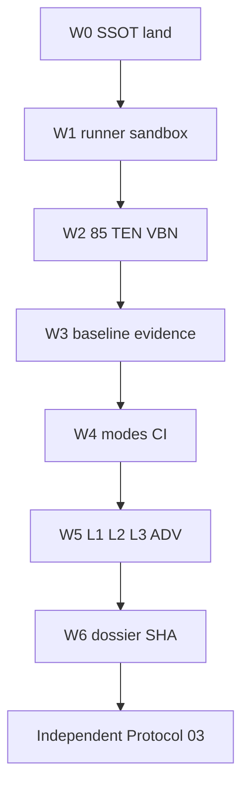

# ENT-AUDIT-X — Final implementation & B6 readiness (execution SSOT)

**Role:** Single authoritative plan for W0–W6 product + qualification wave leading to **independent Protocol 03** — **not** certification in agent sessions.

**Supersedes for execution:** [ENT_AUDIT_X_FINAL_COMPLETION_AND_CERTIFICATION_MASTER_PLAN.md](./ENT_AUDIT_X_FINAL_COMPLETION_AND_CERTIFICATION_MASTER_PLAN.md) (certification narrative); [ENT_AUDIT_X_COMPLETE_IMPLEMENTATION_AND_CLOSURE_MASTER_PLAN.md](./ENT_AUDIT_X_COMPLETE_IMPLEMENTATION_AND_CLOSURE_MASTER_PLAN.md) (historical closure draft).

**Annexes (mechanical detail unchanged):** C, D, B, F, G, G2, H — see [ENT_AUDIT_X_COMPLETE_IMPLEMENTATION_AND_CLOSURE_MASTER_PLAN.md](./ENT_AUDIT_X_COMPLETE_IMPLEMENTATION_AND_CLOSURE_MASTER_PLAN.md) attachment table.

---

## 1. Executive disposition

| Layer | Verdict |
| --- | --- |
| @ `754ee0006` (published) | Scaffold + partial runner; **not** B6-ready; FRZ-AUD-01..10 **OPEN** |
| @ post-W0–W6 merge | Technical **READY FOR INDEPENDENT B6** when L3 green + evidence @ `TEST_EXECUTION_SHA` |
| Formal closure | Requires unsigned EVOL predecessor, OD-ENT-*, independent Protocol 03, operator FRZ-AUD PASS |

Roadmap ENT-AUDIT-X remains **OPEN** until operator acceptance; agent closes **implementation gaps** only.

---

## 2. Git baseline & working tree facts

| Field | Value |
| --- | --- |
| Branch | `development` |
| Audit pin / PLAN_BASELINE | `754ee000675d71c1734656702beb0aef8ba58fd8` |
| IMPLEMENTATION_SHA (historical) | `86832319b08b3837cfb4ae9c90919389f202cc37` |
| W0–W5 wave | Landed via merge commit → `FINAL_PLAN_PUBLICATION_SHA` on [SHA ladder](./ENT_AUDIT_X_SHA_LADDER.md) |
| Working tree @ W0 start | **Dirty** (enterprise_audit package, qual suite, CI) — **not** evidence of publication |

Detached worktrees under `.tmp/` are **not** `TEST_EXECUTION_SHA` sources.

---

## 3. 85-check matrix summary

- **Count:** 85 = 63 area + 13 TEN + 9 VBN ([ANNEX_C_CONTROL_MATRIX.md](./ANNEX_C_CONTROL_MATRIX.md)).
- **Manifest:** `intergrax/platform/enterprise_audit/data/enterprise_audit_check_manifest.v1.json` — 85 rows, zero `internal_pending` post-W2.
- **Mechanical alignment:** `scripts/enterprise_audit/check_manifest_annex_c_alignment.py` in CI qual.
- **Semantic qual:** Each CheckID requires runner subprocess PASS/FAIL oracle or mapped qual gate — see acceptance + L3; thin `is_file` wrappers **insufficient** for formal CLOSED.

Full row table: generate from manifest + Annex C + [ANNEX_G2_CONTROL_GATE_MAPPING.md](./ANNEX_G2_CONTROL_GATE_MAPPING.md) (do not fork manually in chat).

---

## 4. TEN / VBN

| Set | Count | Closure |
| --- | ---: | --- |
| TEN-* | 13 | Manifest + tenant enrich + pos/neg qual |
| VBN-* | 9 | Executable gates + honest domain rollup |
| Domains D01–D31 | 31 | `scripts/enterprise_audit/vbn_domain_report.py` ← EBH-5 inventory @ execution SHA |

**Forbidden:** All domains `NA_WITH_EVIDENCE` without inventory proof (ADV-25).

---

## 5. Gap register (active implementation)

Post-landing target: **~38 active** implementation gaps + **6 formal** operator gates (see cursor plan §F). Reconcile [ANNEX_F_GAP_REGISTER.md](./ANNEX_F_GAP_REGISTER.md) @ `FINAL_PLAN_PUBLICATION_SHA`.

Categories: CRIT (L3 real, nightly qual, VBN honesty, evidence SHA), MAJ (DAG, sandbox, CHANGED-SINCE EVOL map), DOC/SSOT, FORMAL (BLK-*, OD-ENT, FRZ-AUD).

---

## 6. WBS / DAG (waves W0–W6)

Authority: [ANNEX_H_WBS.md](./ANNEX_H_WBS.md) — **273** `ENT-T-*` tasks.



---

## 7. L1 / L2 / L3 qualification

| Layer | Path | Exit |
| --- | --- | --- |
| L1 | `tests/qualification/ent_audit_x/unit/` | Fast contracts, manifest, drift, sandbox |
| L2 | `tests/qualification/ent_audit_x/integration/` | CLI, CHANGED-SINCE, adversarial ADV-01..30 |
| L3 | `tests/qualification/ent_audit_x/l3/` | Real subprocess FAST/FREEZE slices + evidence digest |

Consolidated gate: `uv run pytest tests/qualification/ent_audit_x -q` @ clean `TEST_EXECUTION_SHA`.

---

## 8. Adversarial ADV-01..30

Mapped in `tests/qualification/ent_audit_x/integration/test_adversarial_adv01_30.py` (one test per ADV id). Negative paths: ADV-04 cycle, ADV-08 FREEZE baseline, ADV-12 evidence tamper, ADV-16/17 sandbox, ADV-25 VBN honesty, ADV-26 CHANGED-SINCE floor.

---

## 9. CI / CD

| Job | Behavior |
| --- | --- |
| PR `enterprise-audit.yml` | L1/L2/L3 pytest + **FAST real** + optional dry smoke |
| Nightly `enterprise-audit-nightly.yml` | Full qual + **FULL/FREEZE real** (no dry-run as qual) + artifacts |

Operator: [ENT_AUDIT_X_CI_ENFORCEMENT_RUNBOOK.md](./ENT_AUDIT_X_CI_ENFORCEMENT_RUNBOOK.md) — branch protection **REQUIRED OPERATOR EVIDENCE**.

---

## 10. Baseline / state machine

- FREEZE: baseline file or `--bootstrap-baseline` once ([`baseline.py`](../../../../intergrax/platform/enterprise_audit/baseline.py)).
- Drift: NEW / UNCHANGED / **REGRESSED** / **RESOLVED** ([`apply_drift`](../../../../intergrax/platform/enterprise_audit/baseline.py)).
- Evidence: `evidence_manifest.v1.json` + SHA256 artifact list ([`evidence.py`](../../../../intergrax/platform/enterprise_audit/evidence.py)).

JSON schemas: `intergrax/platform/enterprise_audit/data/schemas/`.

---

## 11. SHA ladder

Append-only: [ENT_AUDIT_X_SHA_LADDER.md](./ENT_AUDIT_X_SHA_LADDER.md).

Lifecycle: PLAN_BASELINE → FINAL_PLAN_PUBLICATION → IMPLEMENTATION → **TEST_EXECUTION** → EVIDENCE_* → B6_ACCEPTANCE → ACCEPTED_BASELINE.

---

## 12. FRZ-AUD mapping

[ANNEX_B_FRZ_AUD_CLOSURE_MATRIX.md](./ANNEX_B_FRZ_AUD_CLOSURE_MATRIX.md) — all **OPEN** until evidence @ publication SHA + operator promotion.

---

## 13. EVOL / external blockers

| Gate | Blocks formal CLOSED |
| --- | --- |
| EVOL B6 Protocol 03 unsigned | yes |
| OD-ENT-00..03, 08 | yes |
| BLK-CI-ENFORCE (branch protection) | yes |

ENT implementation may proceed in parallel; CHANGED-SINCE wires EVOL paths **fail-closed** ([`changed_since.py`](../../../../intergrax/platform/enterprise_audit/changed_since.py)).

---

## 14. C-01..C-12 target closure

| ID | Target after W0–W6 |
| --- | --- |
| C-01 | 85/85 executable manifest; L3 FULL evidence |
| C-02 | L3 real subprocess FAST/FREEZE slices |
| C-03 | PR FAST real; nightly FULL/FREEZE real |
| C-04 | `--since-sha` + EVOL impact fail-closed |
| C-05 | Annex D–aligned `vbn_domains.v1.json` |
| C-06 | FREEZE baseline policy |
| C-07 | REGRESSED + RESOLVED drift |
| C-08 | FAST floor never false CLEAN |
| C-09 | coverage_label from executed semantics |
| C-10 | manifest `depends_on` + topological runner |
| C-11 | sandbox path guard + proctree kill |
| C-12 | TEST_EXECUTION_SHA + evidence bundle |

---

## 15–26. Mechanical completeness (agent gate)

| Check | Status @ plan acceptance |
| --- | --- |
| Roadmap §3.1 + FRZ-AUD mapped | yes |
| 85 checks inventoried | yes |
| C-01..C-12 re-evaluated | yes (dual layer in audit plan) |
| TEN 13 / VBN 9 / 31 domains | mapped; semantic qual **ongoing** |
| WBS 273 referenced | yes |
| ADV-01..30 tests | 30 mapped |
| No self-certification | **confirmed** |

**Disposition:** `ENT-AUDIT-X — FINAL IMPLEMENTATION & B6 READINESS PLAN — READY FOR INDEPENDENT PLAN ACCEPTANCE` → execute W0–W6 → independent B6.

---

## Evidence bundle layout (W6)

```text
.tmp/proof/ent-audit-x/<suite-run-id>/
  enterprise_audit_report.json
  enterprise_audit_report.md
  enterprise_audit_outcomes.json
  frz_coverage.v1.json
  vbn_domains.v1.json
  evidence_manifest.v1.json   # when --evidence-bundle
```

Dossier inputs: [ENT_AUDIT_X_PROTOCOL_03_DOSSIER_TEMPLATE.md](./ENT_AUDIT_X_PROTOCOL_03_DOSSIER_TEMPLATE.md), [ENT_AUDIT_X_ARCH_FREEZE_HANDOFF.md](./ENT_AUDIT_X_ARCH_FREEZE_HANDOFF.md) — **do not sign** Protocol 03 in agent sessions.
