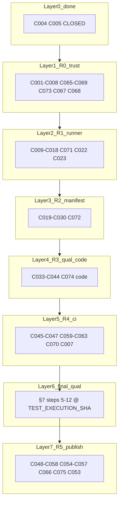

# ENT-AUDIT-X — post-implementation final closure master plan

**Disposition:** `ENT-AUDIT-X — FINAL CONSOLIDATED PLAN — READY FOR ONE-PASS AGENT IMPLEMENTATION`

**Mode:** PLAN SSOT (implementation wave follows this document; no B6 PASS / FRZ CLOSED / ARCH-FREEZE declared here)

**AUDIT BASELINE / IMPLEMENTATION_SHA:** `1fa5347a56c569fa62ac2c777ff3947d11e906b4`  
**Branch:** `development` · **Repo:** `jakbuczarnecki/intergrax`

**Supersedes (execution):** [ENT_AUDIT_X_FINAL_CORRECTIVE_IMPLEMENTATION_AND_B6_READINESS_PLAN.md](./ENT_AUDIT_X_FINAL_CORRECTIVE_IMPLEMENTATION_AND_B6_READINESS_PLAN.md) — retained as historical corrective spec; **this file is the single authoritative execution SSOT** for the one-pass agent wave.

**Historical (do not execute):** [ENT_AUDIT_X_FINAL_COMPLETION_AND_CERTIFICATION_MASTER_PLAN.md](./ENT_AUDIT_X_FINAL_COMPLETION_AND_CERTIFICATION_MASTER_PLAN.md), [ENT_AUDIT_X_COMPLETE_IMPLEMENTATION_AND_CLOSURE_MASTER_PLAN.md](./ENT_AUDIT_X_COMPLETE_IMPLEMENTATION_AND_CLOSURE_MASTER_PLAN.md), [ENT_AUDIT_X_FINAL_IMPLEMENTATION_AND_B6_READINESS_MASTER_PLAN.md](./ENT_AUDIT_X_FINAL_IMPLEMENTATION_AND_B6_READINESS_MASTER_PLAN.md) — evidence-only / superseded by corrective + this closure plan.

**Reconciles (doc-only in R5):** [ANNEX_F_GAP_REGISTER.md](./ANNEX_F_GAP_REGISTER.md), [ANNEX_H_WBS.md](./ANNEX_H_WBS.md), [ANNEX_G2_CONTROL_GATE_MAPPING.md](./ANNEX_G2_CONTROL_GATE_MAPPING.md), [ENT_AUDIT_X_SHA_LADDER.md](./ENT_AUDIT_X_SHA_LADDER.md), [ENT_AUDIT_X_PROTOCOL_03_DOSSIER.md](./ENT_AUDIT_X_PROTOCOL_03_DOSSIER.md), [ENT_AUDIT_X_CI_ENFORCEMENT_RUNBOOK.md](./ENT_AUDIT_X_CI_ENFORCEMENT_RUNBOOK.md).

### PL-01..PL-12 resolution index

| PL | Topic | Resolution |
| --- | --- | --- |
| PL-01 | GAP counts | **32** unique `GAP-RC-*` + **6** `GAP-B-*` + **85** `GAP-COV-*` (separate); not 41/52 |
| PL-02 | TaskID canon | C001–C064 meanings frozen from corrective plan; C055=Annex F only; C057=OD matrix doc; C058=B6 handoff tree; C065–C075 NETNEW only |
| PL-03 | Atomic WBS | **75** tasks; §9 + Appendix C; **2** CLOSED_WITH_EVIDENCE, **17** IMPLEMENTED_NOT_QUALIFIED, **56** OPEN |
| PL-04 | Qual timing | §7 thirteen-step sequence; final L3/ADV after R0–R4 merge + push + pin |
| PL-05 | DAG | §14 topological layers + shared-file matrix |
| PL-06 | 85 matrix | Appendix A (+ entrypoint column §14); D01–D31 Appendix D; ADV31 Appendix E |
| PL-07 | Pytest taxonomy | §3; **115** files ≠ **180** nodeids ≠ stale **164** claim |
| PL-08 | OD-ENT-01 | §4 + C065; trusted source = operator_records + ladder pins |
| PL-09 | Readiness | §6 + C066; `formally_certified` always false in agent |
| PL-10 | Dependencies | §14 |
| PL-11 | SSOT lifecycle | this file supersedes execution; corrective plan = historical spec |
| PL-12 | Mechanical READY | §12 + PL table |

### TaskID immutability control (PL-02)

- **Registry:** C001–C064 authoritative text = corrective plan rows `ENT-T-C001..C064` (64 rows); C065–C075 = Appendix B only.
- **Rule:** no reuse of `ENT-T-C###` for a different scope; new work → new ID ≥ C065 (already allocated).
- **CI guard (C075):** add `tests/qualification/ent_audit_x/unit/test_task_id_registry.py` — parse this doc + corrective plan; assert 75 unique IDs; assert C055/C057/C058 descriptions match canonical substrings (`Annex F`, `OD-ENT matrix`, `b6-handoff`).

---

## 1. Executive audit disposition @ `1fa5347a5`

Tier-0 enterprise audit **exists** but is **IMPLEMENTED_NOT_QUALIFIED**: manifest 85/85 wired, runner/CLI/CI/qual tree present, partial corrective wave landed; **no** current-SHA semantic 85/85 execution, **no** trusted OD-ENT-01, **no** evidence-based mechanical B6 handoff, **no** independent Protocol 03 B6.

| Authority | Status @ HEAD (read-only) |
| --- | --- |
| ENT-AUDIT-X (roadmap) | OPEN; depends EVOL-X CLOSED |
| FRZ-AUD-01..10 | OPEN (checklist) |
| ARCH-FREEZE | OPEN |
| EVOL B6_ACCEPTANCE_PUBLICATION_SHA | PENDING (external) |

---

## 2. PL-01 — exact GAP inventory (unique root causes)

**Correction:** prior estimate `30+13+9−11=52` was **arithmetically wrong** and **semantically double-counted** (A-01..30 overlapped GAP-FND; A-20 duplicated A-02).

### 2.1 Counting rules

| Bucket | Count | Meaning |
| --- | ---: | --- |
| **GAP-RC-*** (unique root causes, agent-closable) | **32** | Deduped defects; each maps to ≥1 A-xx / P0/P1 / boundary finding |
| **GAP-B-*** (formal / operator blockers) | **6** | External; tracked, not closed by agent alone |
| **GAP-COV-&lt;CheckID&gt;** | **85** | **Separate dimension:** per-control semantic execution @ TEST_EXECUTION_SHA |
| **GAP-C historical** | **11 CLOSED_WITH_EVIDENCE**, **3 PARTIAL** | Component existence @ HEAD |
| **A-01..30** | **30 mapped** (A-20 merges into A-02) | See §2.3 |

**Proof of 32:** mechanical dedupe table §2.2 (one row = one root cause).

### 2.2 Consolidated GAP register (unique root causes)

| GAP-ID | Source findings | Root cause | Sev | Code location | Status @ `1fa5347a5` | TaskID | Positive test | Negative test | Evidence | Acceptance |
| --- | --- | --- | --- | --- | --- | --- | --- | --- | --- |
| GAP-RC-OD-TRUST | A-01, P0-01, F-07 | OD-ENT-01 verifies boolean JSON only | CRIT | `baseline.py::verify_operator_decision_record` | OPEN | C003,C042,C065 | promote w/ ladder-valid fixture | forged `operator_origin=true` | OD record + bundle | Promotion fails without ECAP anchors |
| GAP-RC-MECH-READY | A-02,A-20 | Readiness = file existence | CRIT | OPEN | C054,C066 | readiness @ qual SHA | missing L3 artifact | readiness JSON | `TECHNICAL_READY_FOR_B6` false without qual artifacts |
| GAP-RC-EVIDENCE-TRUST | A-03,A-06,A-14,P1-01,P1-12 | Bundle not tied to execution manifest | CRIT | PARTIAL | C006,C026,C068,C073 | closed bundle @ real FULL | dry-run bundle | manifest+digest | No qual bundle without 85 executed |
| GAP-RC-L3-FULL | A-04,P0-02,P1-15 | No real FULL/FREEZE 85/85 L3 | CRIT | OPEN | C031,C032,C074 | L3 FULL exit 0 strict | single-check/dry-run | `.tmp/proof/` | `checks_executed==85`, coverage FULL |
| GAP-RC-DRY-RUN | A-05,ADV-05 | FAST dry-run can exit CLEAN | CRIT | OPEN | C067,C004 | dry-run INCOMPLETE | dry-run PASS | report+manifest | `certifying_run`+dry_run → non-qual |
| GAP-RC-VBN-31 | A-07,A-08,P0-03,P1-07 | No D01..D31 validator/provenance | CRIT | OPEN | C008–C011,C018,C043 | 31 IDs fresh | stale cache | vbn_domains.v1.json | domains_accounted==31 on certifying FULL |
| GAP-RC-CHANGED-IMPACT | A-09,P1-03 | Path-only CHANGED-SINCE | MAJ | OPEN | C024,C025,C029,C072 | impact map selects checks | unmapped path BLOCKER | impact map JSON | SSOT Changed→Invariant→CheckID |
| GAP-RC-GIT-ANCESTRY | A-10,P1-13 | Ancestry only on FREEZE w/ accepted | MAJ | PARTIAL | C012,C072 | ancestor valid | forked baseline | git log | CHANGED-SINCE + publish pins |
| GAP-RC-RESOLVED-BLOCK | A-11 | RESOLVED keeps old severity in aggregate | MAJ | OPEN | C071,C023 | RESOLVED not BLOCKED | BLOCKER resolved | drift unit | aggregate ignores RESOLVED severity |
| GAP-RC-DRIFT-SCHEMA | A-12,P1-02 | `current_schema=1` hardcoded | MAJ | OPEN | C022,C028 | schema bump REGRESSED | stable pass | baseline rows | per-check schema in manifest |
| GAP-RC-JSON-SCHEMA | A-13 | Shallow validator | MAJ | OPEN | C069 | full schema pass | extra fields fail | validator errors | jsonschema on all artifacts |
| GAP-RC-ATOMIC-PUB | A-15 | Per-file atomic only | MAJ | PARTIAL | C013 | interrupt mid-publish | torn set | output dir | all-or-nothing report set |
| GAP-RC-SANDBOX | A-16,P1-10 | Isolation/timeouts/concurrency | MAJ | OPEN | C014–C017 | concurrent runs | collision | sandbox tests | isolated output + kill orphans |
| GAP-RC-REDACTION | A-17,P1-11 | Marker redaction only | MAJ | OPEN | C015 | tenant uuid stripped | leak fixture | stdout/json | negative leakage tests |
| GAP-RC-SEMANTIC-GATES | A-18 | Gates = entrypoint exists not exec | CRIT | OPEN | C033–C036 | per-gate subprocess | inject fail | outcomes.json | 85/85 gates exit 0 @ qual SHA |
| GAP-RC-ADV-INJECT | A-19,P1-04 | ADV mostly existence | MAJ | OPEN | C037–C039 | per ADV fault | N/A | adv log | 31 fault-injection tests |
| GAP-RC-PR-PATH-SKIP | A-22,P1-05 | paths-filter skips PR jobs | MAJ | OPEN | C046,C059 | path audit test | doc-only PR | workflow | broad triggers or required paths doc |
| GAP-RC-NIGHTLY-FREEZE | A-23,P1-06 | Nightly FREEZE bootstrap | MAJ | OPEN | C007,C046 | scheduled FULL only | auto bootstrap | yaml | FREEZE bootstrap operator-only |
| GAP-RC-LAUNCHER-BAT | A-24 | Unknown arg → FAST | MAJ | OPEN | C060,C063 | valid modes | unknown arg ≠0 | bat test | invalid → exit 1 |
| GAP-RC-LAUNCHER-SH | A-25 | Same as BAT | MAJ | OPEN | C061,C063 | parity | unknown mode | sh test | invalid → exit 1 |
| GAP-RC-LAUNCHER-CWD | A-26 | No spaces-in-path qual | MAJ | OPEN | C063 | cwd≠repo root | spaced path | launcher test | uv cwd = repo root |
| GAP-RC-OUTPUT-COLLISION | A-27 | RANDOM output dirs | MAJ | OPEN | C070 | unique run_id | parallel clash | proof dir | uuid+pid lock |
| GAP-RC-DOSSIER | A-28 | Draft dossier unpinned | MAJ | OPEN | C053,C075 | dossier fields | missing SHA | dossier md | TEST_EXECUTION_SHA filled post-qual |
| GAP-RC-SHA-LADDER | A-29,P1-17 | Ladder stale vs HEAD | MAJ | OPEN | C048,C075 | append-only row | rewrite old | ladder md | IMPLEMENTATION_SHA `1fa5347a5` row |
| GAP-RC-SSOT-DRIFT | A-30,P1-16,P1-18 | Doc counts ≠ collect-only | MAJ | OPEN | C041,C055,C064,C075 | collect-only match | stale § | pytest log | 180 nodeids reconciled |
| GAP-RC-FRZ-MAP | P1-08 | FRZ artifact coarse | MAJ | OPEN | C020,C021 | per-check FRZ | missing map | frz_coverage | each check has frz_mapping |
| GAP-RC-RUN-STATUS | P1-14 | No run_status on interrupt | MAJ | OPEN | C016 | complete enum | kill mid-run | manifest | partial runs INCOMPLETE |
| GAP-RC-REQUAL-DIGEST | requal | manifest_digest change | MAJ | OPEN | C028 | digest change blocks | same digest ok | baseline | accepted invalid until requal |
| GAP-RC-AUDIT-OF-AUDITOR | false PASS | status field tamper | MAJ | OPEN | C044 | mutate status | clean verify | report | tamper detected |
| GAP-RC-EVID-PUBLISH | CP-08 | No orchestrated publish | MAJ | OPEN | C049–C051,C058 | bundle builder e2e | tamper | `.tmp/proof/` | immutable publication tree |
| GAP-RC-CI-PROFILE | GAP-P-01 | enterprise profile ≠ ENT audit | MIN | OPEN | C045 | distinct job | conflation | yaml | separate workflow identity |
| GAP-RC-CERTIFY-SPLIT | P0-04 | — | — | **CLOSED_WITH_EVIDENCE** | C004,C005 | certifying default | check-id blocked | tests | no re-impl |
| GAP-RC-CANDIDATE-FSM | P0-01 partial | — | — | **PARTIAL** | C001,C002 | no auto accepted | bootstrap candidate | tests | promotion still GAP-RC-OD-TRUST |

### 2.3 Formal blockers (not agent-closed)

| GAP-B-ID | Status | Owner |
| --- | --- | --- |
| BLK-EVOL-B6 | EXTERNAL | Auditor + operator |
| BLK-EVOL-FRZ | EXTERNAL | Operator |
| BLK-EVOL-HANDOFF | EXTERNAL | Operator |
| BLK-CI-ENFORCE | EXTERNAL | OD-ENT-02 + GitHub |
| BLK-ROADMAP-ENT-DEP | EXTERNAL | OD-ENT-00 |
| BLK-ENT-B6 | EXTERNAL | Independent Protocol 03 |

### 2.4 Coverage dimension (85/85)

**GAP-COV-&lt;CheckID&gt;:** **85 OPEN** — manifest entrypoint wired; **0** qualified semantic PASS @ TEST_EXECUTION_SHA for full certifying run. Closes via C034–C036 + L3 (C031–C032) per check.

---

## 3. PL-07 — pytest taxonomy (@ `1fa5347a5`, mechanical)

**Command:** `uv run pytest tests/qualification/ent_audit_x --collect-only -q`  
**Log:** `.tmp/session/ent-audit-x-plan/collect-only.txt`

| Metric | Count | Evidence |
| --- | ---: | --- |
| `test_*.py` files | **115** | glob |
| **Collected nodeids** | **180** | pytest summary `180 tests collected` |
| unit/ nodeids | **44** | 19 files |
| integration/ nodeids | **41** | 9 files |
| l3/ nodeids | **7** | 1 file |
| acceptance/ nodeids | **88** | 86 files |
| acceptance `entrypoint_exists` | **85** | name filter (≈1 per Annex C control) |
| acceptance oracle (non-exists) | **3** | runner subprocess + FRZ wired |
| ADV-named nodeids | **32** | includes non-fault tests |
| pytest skip/xfail collected | **0** | no skip markers in collect output |

**L1/L2/L3/ADV (plan taxonomy, not pytest markers until C040):**

| Layer | Nodeids | Role |
| --- | ---: | --- |
| L1 | **44** | unit: contracts, manifest, drift, schema smoke |
| L2 | **41** | integration: CLI, adversarial scaffold, bootstrap |
| L3 | **7** | **planned** heavy; **0** authoritative 85/85 qual @ HEAD |
| Acceptance | **88** | **85** wiring-only + **3** subprocess oracles |
| ADV (target) | **31** | fault injection spec C037–C039; **≠** current ADV-named count |

**Set reconciliation (PL-07):** **115** test modules ≠ **180** collected nodeids ≠ historical **164** in corrective plan — three different metrics; authoritative @ HEAD = **180** nodeids (`pytest --collect-only`).

**True semantic gates @ HEAD:** **0** of 85 manifest checks have proven certifying PASS @ TEST_EXECUTION_SHA; **85** acceptance `entrypoint_exists` + **3** subprocess oracles = wiring only.

**Duplicate/overlap:** ADV-named tests (**32** nodeids) overlap integration scaffold; not 31 independent fault injections until C037–C039.

---

## 4. PL-08 — OD-ENT-01 (ECAP-aligned, no invented crypto)

**Order (ECAP + corrective F-07):** Independent ENT **B6 PASS** @ `TEST_EXECUTION_SHA` → **EVIDENCE_PUBLICATION_SHA** → operator **OD-ENT-01** → `ACCEPTED_BASELINE_SHA` (never reverse).

**Record location:** `docs/project/maintainers/qualification/ent_audit_x/operator_records/` (git-tracked **operator commit** on protected branch) **or** path listed in C057 — **not** writable by agent promotion code paths.

**Verification (`verify_operator_decision_record` + C065):**

1. `decision_id == OD-ENT-01`; reject `record_origin ∈ {agent,cursor,automation}` (existing).
2. **Require** `b6_acceptance_sha == ENT_AUDIT_X_SHA_LADDER.B6_ACCEPTANCE_PUBLICATION_SHA` (non-null at promote time).
3. **Require** `evidence_publication_sha` equals ladder pin; `merge-base --is-ancestor(test_execution_sha, head)` and bundle closed-verify @ publication tree.
4. **Require** `accepted_baseline_sha == candidate_baseline_sha` and `candidate` file exists.
5. **Require** dossier cross-ref: `ENT_AUDIT_X_PROTOCOL_03_DOSSIER.md` lists same three SHAs.
6. **Reject** records where `test_execution_sha` ≠ bundle manifest `qualification_sha`.
7. Negative tests: forged operator JSON, wrong SHA length, missing B6 pin, tampered bundle, agent-origin (existing).

**Trusted authorization source (implementable):**

| Source | Role |
| --- | --- |
| `docs/project/maintainers/qualification/ent_audit_x/operator_records/OD-ENT-01_*.json` | Operator-published record (protected branch commit) |
| `ENT_AUDIT_X_SHA_LADDER.md` | Pins: TEST_EXECUTION_SHA, EVIDENCE_PUBLICATION_SHA, B6_ACCEPTANCE_PUBLICATION_SHA, ACCEPTED_BASELINE_SHA |
| `.tmp/proof/ent-audit-x/<publication>/` or tagged release tree | Closed bundle @ EVIDENCE_PUBLICATION_SHA |
| External Protocol 03 PASS artifact | Sets B6_ACCEPTANCE_PUBLICATION_SHA (not agent) |

**Promotion gate (`promote_accepted_baseline`):** all ladder equalities + `verify_closed_evidence_bundle` + `merge-base --is-ancestor(test_execution_sha, HEAD)` + candidate SHA match.

**Negative tests (C065,C042):** forged record; forged SHA; missing bundle; tampered artifact bit; agent-origin; B6 pin null; test_execution_sha ≠ manifest qualification_sha.

---

## 5. FCL-09 — baseline lifecycle FSM (acyclic)

```mermaid
stateDiagram-v2
  direction LR
  NO_BASELINE --> FIRST_BOOTSTRAP_CANDIDATE: certifying FREEZE bootstrap CLEAN
  FIRST_BOOTSTRAP_CANDIDATE --> FULL_FREEZE_CANDIDATE_QUALIFIED: L3 85/85 + domains31
  FULL_FREEZE_CANDIDATE_QUALIFIED --> EVIDENCE_PUBLISHED: closed bundle @ TEST_EXECUTION_SHA
  EVIDENCE_PUBLISHED --> INDEPENDENT_B6: external Protocol 03
  INDEPENDENT_B6 --> OPERATOR_ACCEPTED: OD-ENT-01 promote
  OPERATOR_ACCEPTED --> NORMAL_FREEZE: certifying FREEZE ancestor ok
  NO_BASELINE --> NORMAL_FREEZE: blocked
```

| State | Guard | Actor |
| --- | --- | --- |
| NO_BASELINE | no accepted file | — |
| FIRST_BOOTSTRAP_CANDIDATE | `--bootstrap-candidate`, no accepted | Agent |
| FULL/FREEZE_CANDIDATE_QUALIFIED | 85 executed, VBN 31, CLEAN | Agent @ TEST_EXECUTION_SHA |
| EVIDENCE_PUBLISHED | C051/C058 verify | Agent |
| INDEPENDENT_B6 | external PASS | Auditor |
| OPERATOR_ACCEPTED | C065 promote | Operator |
| NORMAL_FREEZE | accepted + ancestor | Agent/CI |

**Explicit:** first candidate FREEZE **does not** require pre-accepted baseline; normal FREEZE **requires** accepted + ancestry (fail-closed).

---

## 6. PL-09 — mechanical readiness contract (C066)

**Mandatory inputs (ALL required; any missing → `ready=false`):**

| # | Input | Verification |
| --- | --- | --- |
| 1 | IMPLEMENTATION_SHA clean | `git status` empty + rev-parse |
| 2 | TEST_EXECUTION_SHA pinned | ladder row + ancestor of HEAD |
| 3 | FULL 85/85 executed | manifest `checks_executed==85`, coverage FULL |
| 4 | TEN 13 executed PASS | outcomes for TEN-* |
| 5 | VBN 9 executed PASS | outcomes for VBN-* |
| 6 | Domains 31 | `vbn_domains.v1.json` accounted==31 |
| 7 | L1/L2/L3 logs | pytest junit/log @ TES |
| 8 | ADV 31 | fault suite PASS @ TES |
| 9 | Evidence integrity | `verify_closed_evidence_bundle` |
| 10 | SHA ancestry | merge-base checks documented |
| 11 | FRZ mappings | `frz_coverage.v1.json` complete (C021) |
| 12 | PR + nightly CI | run URLs + artifacts in dossier |
| 13 | BAT/SH acceptance | C063 pass on target OS |
| 14 | Dossier complete | C053 fields except B6 sign |
| 15 | External blockers | listed OPEN; not claimed closed |

**Outputs:** `technical_ready_for_independent_b6_mechanical: bool`; `formally_certified: false` (always in agent script).

---

## 7. PL-04 — final qualification sequence (post R0–R4 integration)

**During R0–R4:** L1/L2 and partial L3/integration tests allowed on dirty tree for fast feedback.

**Authoritative certification (single wave after code complete):**

1. Implement **R0–R4** + merge conflict resolution.  
2. Integrate all changes (no parallel conflicting edits to `runner.py` / `baseline.py` / `contracts.py`).  
3. **Commit + push** to `development`.  
4. **Clean checkout** @ pushed SHA (or verify clean `origin/development`).  
5. Pin **`TEST_EXECUTION_SHA`** on ladder (append-only).  
6. Consolidated **final L1/L2/L3** pytest @ pinned SHA.  
7. Certifying CLI **FULL 85/85** (C031, C074).  
8. **First FREEZE candidate** bootstrap qual (C032 test 1 — no pre-accepted baseline).  
9. **ADV-01..31** fault injection (C037–C039).  
10. **BAT/SH** launcher acceptance (C063).  
11. **CI execution evidence** (PR FAST + nightly FULL URLs in dossier).  
12. **Evidence integrity** closed-bundle verify (C026,C068) → pin **EVIDENCE_PUBLICATION_SHA**.  
13. **R5:** dossier C053, handoff C058, readiness C066, Annex/doc C055/C075 — **independent B6 external**.

Semantic/code change after step 5 → restart from step 5 (requalification).

---

## 8. R0–R5 batches (canonical TaskID meanings — PL-02)

| Batch | TaskIDs | Notes |
| --- | --- | --- |
| **R0** | C001–C008, C065–C069, C073, C067–C068 | Trust, evidence policy, dry-run |
| **R1** | C009–C018, C071, C022–C023 | VBN enforcement, sandbox, drift |
| **R2** | C019–C030, C072 | Manifest, FRZ map, CHANGED-SINCE |
| **R3** | C031–C044, C074 | L3 harness + semantic gates + ADV; **no final qual until §7 step 6** |
| **R4** | C045–C047, C059–C063, C070, C007, C046 | CI, **C060 BAT**, **C061 SH**, launchers |
| **R5** | C048–C058, C054–C056, C064, C066, C075, C053 | **C055 Annex F only** · **C057 OD-ENT matrix doc** · **C058 B6 handoff tree** · not BAT/SH/L3 |

**Canonical collision fix (PL-02):**

| TaskID | Canonical scope (corrective plan) | Forbidden mis-map |
| --- | --- | --- |
| **C055** | Annex F gap register reconciliation (136 rows) | L3 execution, BAT |
| **C057** | Operator OD-ENT decision matrix (doc) | BAT launcher, promote code |
| **C058** | B6 handoff / replay tree layout | audit.sh, nightly yaml |
| **C060** | `audit.bat` | — |
| **C061** | `audit.sh` | — |
| **C031–C032** | L3 FULL/FREEZE real 85 | Annex F doc |

**Parallelism:** serial `baseline.py` + `contracts.py` + `runner.py` through R1; `evidence.py`/`validators.py` owned by R0 with R5 verify-only; C034–C036 parallel after C033.

---

## 9. FCL-02/05 — WBS C001..C075 (status @ `1fa5347a5`)

**Legend — @ HEAD status:** **DONE** = do not re-implement core; **PARTIAL** = extend/fix only; **OPEN** = implement.

| TaskID | Batch | @HEAD | GapID | Primary target |
| --- | --- | --- | --- | --- |
| C001 | R0 | PARTIAL | GAP-RC-CANDIDATE-FSM | `baseline.py` BaselinePhase |
| C002 | R0 | PARTIAL | GAP-RC-CANDIDATE-FSM | `runner.py` candidate only |
| C003 | R0 | PARTIAL | GAP-RC-OD-TRUST | `promote-baseline` CLI |
| C004 | R0 | DONE | GAP-RC-CERTIFY-SPLIT | `certifying_run` |
| C005 | R0 | DONE | GAP-RC-CERTIFY-SPLIT | CLI `--non-certifying` |
| C006 | R0 | PARTIAL | GAP-RC-EVIDENCE-TRUST | catalog + evidence |
| C007 | R4 | OPEN | GAP-RC-NIGHTLY-FREEZE | nightly yml |
| C008 | R1 | OPEN | GAP-RC-VBN-31 | `vbn.py` validator |
| C009 | R1 | PARTIAL | GAP-RC-CANDIDATE-FSM | FREEZE FSM |
| C010 | R1 | OPEN | GAP-RC-VBN-31 | VBN provenance |
| C011 | R1 | OPEN | GAP-RC-VBN-31 | domain gap BLOCKER |
| C012 | R1 | PARTIAL | GAP-RC-GIT-ANCESTRY | `assert_git_ancestor` |
| C013 | R1 | PARTIAL | GAP-RC-ATOMIC-PUB | `report.py` |
| C014 | R1 | OPEN | GAP-RC-SANDBOX | sandbox isolation |
| C015 | R1 | OPEN | GAP-RC-REDACTION | redaction v2 |
| C016 | R1 | OPEN | GAP-RC-RUN-STATUS | manifest run_status |
| C017 | R1 | OPEN | GAP-RC-SANDBOX | timeout/orphans |
| C018 | R1 | OPEN | GAP-RC-VBN-31 | rollup enforcement |
| C019 | R2 | PARTIAL | GAP-RC-SEMANTIC-GATES | Annex C closed-world |
| C020 | R2 | OPEN | GAP-RC-FRZ-MAP | `digests.py` |
| C021 | R2 | OPEN | GAP-RC-FRZ-MAP | manifest frz_mapping |
| C022 | R2 | OPEN | GAP-RC-DRIFT-SCHEMA | drift schema |
| C023 | R2 | OPEN | GAP-RC-RESOLVED-BLOCK | RESOLVED reopen |
| C024 | R2 | OPEN | GAP-RC-CHANGED-IMPACT | impact map data |
| C025 | R2 | OPEN | GAP-RC-CHANGED-IMPACT | unknown paths |
| C026 | R2 | PARTIAL | GAP-RC-EVIDENCE-TRUST | closed bundle verify |
| C027 | R2 | OPEN | GAP-RC-EVIDENCE-TRUST | path traversal |
| C028 | R2 | OPEN | GAP-RC-REQUAL-DIGEST | manifest digest requal |
| C029 | R2 | OPEN | GAP-RC-CHANGED-IMPACT | impact map generator |
| C030 | R2 | PARTIAL | GAP-RC-SEMANTIC-GATES | DAG orphans |
| C031 | R3 | OPEN | GAP-RC-L3-FULL | L3 FULL 85 |
| C032 | R3 | OPEN | GAP-RC-L3-FULL | L3 FREEZE pair |
| C033 | R3 | OPEN | GAP-RC-SEMANTIC-GATES | acceptance conftest |
| C034 | R3 | OPEN | GAP-RC-SEMANTIC-GATES | ENT-A gates |
| C035 | R3 | OPEN | GAP-RC-SEMANTIC-GATES | TEN 13 |
| C036 | R3 | OPEN | GAP-RC-SEMANTIC-GATES | VBN 9 |
| C037 | R3 | OPEN | GAP-RC-ADV-INJECT | ADV 1–10 |
| C038 | R3 | OPEN | GAP-RC-ADV-INJECT | ADV 11–20 |
| C039 | R3 | OPEN | GAP-RC-ADV-INJECT | ADV 21–31 |
| C040 | R3 | OPEN | GAP-RC-SSOT-DRIFT | pytest markers |
| C041 | R3 | OPEN | GAP-RC-SSOT-DRIFT | collect-only reconcile |
| C042 | R3 | PARTIAL | GAP-RC-OD-TRUST | promotion tests |
| C043 | R3 | OPEN | GAP-RC-VBN-31 | forged VBN test |
| C044 | R3 | OPEN | GAP-RC-AUDIT-OF-AUDITOR | status tamper |
| C045 | R4 | PARTIAL | GAP-RC-CI-PROFILE | workflow skeleton |
| C046 | R4 | OPEN | GAP-RC-NIGHTLY-FREEZE | nightly align |
| C047 | R4 | OPEN | GAP-RC-PR-PATH-SKIP | runbook |
| C048 | R5 | OPEN | GAP-RC-SHA-LADDER | ladder rules |
| C049 | R5 | OPEN | GAP-RC-EVID-PUBLISH | env fingerprint |
| C050 | R5 | OPEN | GAP-RC-EVID-PUBLISH | bundle builder |
| C051 | R5 | OPEN | GAP-RC-EVID-PUBLISH | qual wave script |
| C052 | R5 | OPEN | GAP-RC-EVID-PUBLISH | runbook replay |
| C053 | R5 | OPEN | GAP-RC-DOSSIER | dossier fill |
| C054 | R5 | PARTIAL | GAP-RC-MECH-READY | readiness script |
| C055 | R5 | OPEN | GAP-RC-SSOT-DRIFT | Annex F reconcile |
| C056 | R5 | OPEN | GAP-RC-SSOT-DRIFT | corrective supersede note |
| C057 | R5 | OPEN | GAP-B | OD matrix doc |
| C058 | R5 | OPEN | GAP-RC-EVID-PUBLISH | B6 handoff tree |
| C059 | R4 | PARTIAL | GAP-RC-PR-PATH-SKIP | PR FAST workflow |
| C060 | R4 | PARTIAL | GAP-RC-LAUNCHER-BAT | audit.bat |
| C061 | R4 | PARTIAL | GAP-RC-LAUNCHER-SH | audit.sh |
| C062 | R4 | PARTIAL | GAP-RC-SSOT-DRIFT | report summary |
| C063 | R4 | OPEN | GAP-RC-LAUNCHER-CWD | launcher tests |
| C064 | R5 | OPEN | GAP-RC-SSOT-DRIFT | operator quickstart |
| **C065** | R0 | OPEN | GAP-RC-OD-TRUST | ECAP OD-ENT-01 verify + ladder pins |
| **C066** | R5 | OPEN | GAP-RC-MECH-READY | evidence-based readiness |
| **C067** | R0 | OPEN | GAP-RC-DRY-RUN | dry-run non-cert policy |
| **C068** | R0 | OPEN | GAP-RC-EVIDENCE-TRUST | bundle eligibility |
| **C069** | R0 | OPEN | GAP-RC-JSON-SCHEMA | jsonschema validators |
| **C070** | R4 | OPEN | GAP-RC-OUTPUT-COLLISION | unique output dirs |
| **C071** | R1 | OPEN | GAP-RC-RESOLVED-BLOCK | aggregate RESOLVED |
| **C072** | R2 | OPEN | GAP-RC-CHANGED-IMPACT | CHANGED-SINCE ancestry+map |
| **C073** | R0 | OPEN | GAP-RC-EVIDENCE-TRUST | mode-specific catalog |
| **C074** | R3 | OPEN | GAP-RC-L3-FULL | clean-checkout qual harness |
| **C075** | R5 | OPEN | GAP-RC-SSOT-DRIFT | this doc + annex reconcile |

**Atomic task count:** **75** (64 canonical + 11 NETNEW). **Exact @ HEAD status:** **2** `CLOSED_WITH_EVIDENCE` (C004,C005) · **17** `IMPLEMENTED_NOT_QUALIFIED` · **56** `OPEN`. **Active implementation tasks:** **73** (exclude CLOSED).

**Full 12-column specs:** C001–C064 = corrective plan table (immutable text); add @HEAD status from Appendix C; C065–C075 = Appendix B.

**Topological order (all active tasks):**  
L0: C004,C005 (done) → C001,C008,C019,C030 → C067,C069,C073,C006 → C065→C003 → C068 → C026,C027 → C008→C010→C011→C018 → C071,C022,C023 → C024→C025→C029→C072 → C033 → C034,C035,C036 → C037→C038→C039 → C031,C032,C074 → C045,C059,C007,C046,C060,C061,C063,C070 → C049,C050,C051 → C031/C032 **final qual** → C053,C058,C066 → C048,C055,C056,C057,C064,C075.

---

## 10. FCL-07 — 85-check matrix (summary + SSOT pointer)

**Full row-level matrix** (CheckID × owner × FRZ × WBS × oracles) is mechanically exported from [`enterprise_audit_check_manifest.v1.json`](../../../../intergrax/platform/enterprise_audit/data/enterprise_audit_check_manifest.v1.json) + [ANNEX_C_CONTROL_MATRIX.md](./ANNEX_C_CONTROL_MATRIX.md) + [ANNEX_G2_CONTROL_GATE_MAPPING.md](./ANNEX_G2_CONTROL_GATE_MAPPING.md).

| Family | CheckIDs | Count | Semantic owner | WBS | Execution @ HEAD | Expected acceptance |
| --- | --- | ---: | --- | --- | --- | --- |
| ENT-A-* | BND,OWN,CTR,TYP,DUP,PLG,GOV,EXE,OBS,STA,SEC,REL,REC,PRD,CMP,REG,DOC,EVOL,INV + VBN-01..03 | **63** | Annex C / G2 | C034 | **PLANNED** (exists tests = wiring) | subprocess gate exit 0 @ TEST_EXECUTION_SHA |
| TEN-* | TEN-IDENTITY … TEN-FAIL-CLOSED | **13** | TENANT-X | C035 | **PLANNED** | 13/13 executed PASS |
| VBN-* | VBN-INVENTORY-DRIFT … VBN-REACHABILITY | **9** | VBN schema | C036 | **PLANNED** | 9/9 + domains D01..D31 |
| **Total** | | **85** | | | **0 QUALIFIED** | certifying FULL coverage FULL |

**VBN domains D01..D31:** [ANNEX_D_VBN_DOMAINS_1_31.md](./ANNEX_D_VBN_DOMAINS_1_31.md) — validated only after C008/C010 (GAP-RC-VBN-31).

**ADV-01..31:** spec in corrective CP-04; implementation C037–C039; **planned** fault injection, **not** current file-existence ADV tests.

---

## 11. FRZ-AUD-01..10 → closure tasks

| FRZ | Requirement | Task mapping | Evidence |
| --- | --- | --- | --- |
| AUD-01 | runner exists | DONE @ HEAD | package import |
| AUD-02 | modular checks | C019,C030 | manifest |
| AUD-03 | FRZ map | C020,C021 | frz_coverage |
| AUD-04 | reports | C013,C062 | json+md |
| AUD-05 | exact SHA | C059,C048 | report fields |
| AUD-06 | baseline drift | C001,C022 | baseline+drift |
| AUD-07 | drift classes | C071,C023 | RESOLVED fix |
| AUD-08 | exit codes | C004,C067 | modes |
| AUD-09 | modes | C009,C031–C032 | L3 |
| AUD-10 | post-freeze policy | C064,C047,C046 | runbook+CI |

Formal **PASS** rows: operator after B6 only.

---

## 14. PL-05/PL-10 — task DAG, ownership, critical path

### 14.1 Shared-file execution owners (single writer per wave)

| File | Owner batch | Consumers (read-only until merge) |
| --- | --- | --- |
| `baseline.py` | R0 (C001,C003,C065) | R1 drift C022,C071 |
| `contracts.py` | R0 C004 | all |
| `runner.py` | R0 C067 → R1 C009–C018 | R3 bootstrap |
| `modes.py` | R0 C067, R1 C071 | — |
| `evidence.py` / `validators.py` | R0 C006,C068,C069 | R2 C026,C027; R5 C050 |
| `vbn.py` | R1 C008–C010 | runner rollup |
| `changed_since.py` | R2 C024–C025,C072 | CLI |
| `mechanical_readiness_check.py` | R5 C066 only | — |

### 14.2 Topological layers (acyclic — no cross-batch cycles)

**Critical path:** C067 → C068 → C026 → C008 → C011 → C033 → C034–C036 → C031 → C074 → **final qual** → C051 → C058 → C066 → C075.

**Operator-only edges:** INDEPENDENT_B6 (external) → C065 promote; OD-ENT-02 (BLK-CI) — no agent closure.

**L3 vs R4:** R4 CI/launcher code lands before **final** L3 qual; qual harness C074 merged in R3 but **executed** only at §7 step 6 after R4 push.

---

## 12. Mechanical final acceptance (plan completeness — PL-12)

| Check | Result |
| --- | --- |
| A-01..30 mapped | **30/30** §2.2 |
| P0/P1 reconciled | **yes** via GAP-RC |
| FCL-01..12 | **resolved** → **PL-01..PL-12** §PL index |
| Unique GAP count | **32 RC + 6 EXT + 85 COV** |
| C001..C075 | **§9** |
| DAG acyclic | **§9 topological** |
| 85 CheckIDs | **§10** |
| TEN13/VBN9/D31/ADV31 | **§10 + C035/C036/C008** |
| No dry-run cert / false readiness / untrusted promote | **gaps OPEN; tasks assigned** |
| L3 after integration | **§7** |
| Independent B6 external | **§6, GAP-B** |
| No placeholders in WBS | **§9 full IDs** |
| No fabricated PASS | **yes** |

---

## 13. One-pass agent instruction

1. Execute **R0→R5** in dependency order (§8–9).  
2. Do **not** re-implement **C004,C005**.  
3. Run **final qualification only after R4 merge** (§7).  
4. Publish evidence + update ladder/dossier in **R5**.  
5. Stop at **TECHNICAL_READY_FOR_B6**; operator/external gates for B6 and FRZ.

**Target stage label (post-wave, not self-declared now):** `ENT-AUDIT-X — TECHNICAL IMPLEMENTATION COMPLETE / QUALIFIED / READY FOR INDEPENDENT PROTOCOL 03 B6`.

---

## Appendix A — PL-06 full 85-check matrix (@ HEAD)

Columns: **Exec@HEAD** = PLANNED (0/85 QUALIFIED PASS) | **Mode** = FULL+FREEZE certifying primary | **Entrypoint** = SSOT in [`enterprise_audit_check_manifest.v1.json`](../../../../intergrax/platform/enterprise_audit/data/enterprise_audit_check_manifest.v1.json) | **Invariant** = Annex C / G2 row (see Annex C doc).

| CheckID | Entry kind | Entrypoint (manifest SSOT) | Mode | Exec@HEAD | WBS | Positive oracle | Negative oracle |
| --- | --- | --- | --- | --- | --- | --- |
| ENT-A-BND-01 | pytest_nodeid | (Annex B via C021) | PLANNED | C034 | gate exit 0 | inject violation |
| ENT-A-BND-02 | pytest_nodeid | | PLANNED | C034 | gate exit 0 | inject violation |
| ENT-A-BND-03 | python_script | | PLANNED | C034 | gate exit 0 | inject violation |
| ENT-A-OWN-01 | pytest_file | | PLANNED | C034 | gate exit 0 | inject violation |
| ENT-A-OWN-02 | pytest_file | | PLANNED | C034 | gate exit 0 | inject violation |
| ENT-A-OWN-03 | pytest_file | | PLANNED | C034 | gate exit 0 | inject violation |
| ENT-A-CTR-01 | pytest_nodeid | | PLANNED | C034 | gate exit 0 | inject violation |
| ENT-A-CTR-02 | pytest_nodeid | | PLANNED | C034 | gate exit 0 | inject violation |
| ENT-A-CTR-03 | pytest_nodeid | | PLANNED | C034 | gate exit 0 | inject violation |
| ENT-A-TYP-01 | pytest_file | | PLANNED | C034 | gate exit 0 | inject violation |
| ENT-A-TYP-02 | pytest_nodeid | | PLANNED | C034 | gate exit 0 | inject violation |
| ENT-A-TYP-03 | pytest_nodeid | | PLANNED | C034 | gate exit 0 | inject violation |
| ENT-A-DUP-01 | pytest_file | | PLANNED | C034 | gate exit 0 | inject violation |
| ENT-A-DUP-02 | pytest_file | | PLANNED | C034 | gate exit 0 | inject violation |
| ENT-A-DUP-03 | pytest_file | | PLANNED | C034 | gate exit 0 | inject violation |
| ENT-A-PLG-01 | pytest_file | | PLANNED | C034 | gate exit 0 | inject violation |
| ENT-A-PLG-02 | pytest_file | | PLANNED | C034 | gate exit 0 | inject violation |
| ENT-A-PLG-03 | pytest_file | | PLANNED | C034 | gate exit 0 | inject violation |
| ENT-A-VBN-01 | pytest_nodeid | | PLANNED | C034 | gate exit 0 | inject violation |
| ENT-A-VBN-02 | pytest_nodeid | | PLANNED | C034 | gate exit 0 | inject violation |
| ENT-A-VBN-03 | pytest_file | | PLANNED | C034 | gate exit 0 | inject violation |
| ENT-A-GOV-01 | pytest_nodeid | | PLANNED | C034 | gate exit 0 | inject violation |
| ENT-A-GOV-02 | pytest_nodeid | | PLANNED | C034 | gate exit 0 | inject violation |
| ENT-A-GOV-03 | pytest_nodeid | | PLANNED | C034 | gate exit 0 | inject violation |
| ENT-A-EXE-01 | pytest_file | | PLANNED | C034 | gate exit 0 | inject violation |
| ENT-A-EXE-02 | pytest_file | | PLANNED | C034 | gate exit 0 | inject violation |
| ENT-A-EXE-03 | pytest_file | | PLANNED | C034 | gate exit 0 | inject violation |
| ENT-A-OBS-01 | pytest_nodeid | | PLANNED | C034 | gate exit 0 | inject violation |
| ENT-A-OBS-02 | pytest_nodeid | | PLANNED | C034 | gate exit 0 | inject violation |
| ENT-A-OBS-03 | pytest_nodeid | | PLANNED | C034 | gate exit 0 | inject violation |
| ENT-A-STA-01 | pytest_nodeid | | PLANNED | C034 | gate exit 0 | inject violation |
| ENT-A-STA-02 | pytest_nodeid | | PLANNED | C034 | gate exit 0 | inject violation |
| ENT-A-STA-03 | pytest_nodeid | | PLANNED | C034 | gate exit 0 | inject violation |
| ENT-A-SEC-01 | python_script | | PLANNED | C034 | gate exit 0 | inject violation |
| ENT-A-SEC-02 | python_script | | PLANNED | C034 | gate exit 0 | inject violation |
| ENT-A-SEC-03 | pytest_nodeid | | PLANNED | C034 | gate exit 0 | inject violation |
| ENT-A-REL-01 | pytest_nodeid | | PLANNED | C034 | gate exit 0 | inject violation |
| ENT-A-REL-02 | pytest_nodeid | | PLANNED | C034 | gate exit 0 | inject violation |
| ENT-A-REL-03 | pytest_nodeid | | PLANNED | C034 | gate exit 0 | inject violation |
| ENT-A-REC-01 | pytest_nodeid | | PLANNED | C034 | gate exit 0 | inject violation |
| ENT-A-REC-02 | pytest_nodeid | | PLANNED | C034 | gate exit 0 | inject violation |
| ENT-A-REC-03 | pytest_nodeid | | PLANNED | C034 | gate exit 0 | inject violation |
| ENT-A-PRD-01 | python_script | | PLANNED | C034 | gate exit 0 | inject violation |
| ENT-A-PRD-02 | python_script | | PLANNED | C034 | gate exit 0 | inject violation |
| ENT-A-PRD-03 | pytest_nodeid | | PLANNED | C034 | gate exit 0 | inject violation |
| ENT-A-CMP-01 | pytest_nodeid | | PLANNED | C034 | gate exit 0 | inject violation |
| ENT-A-CMP-02 | pytest_nodeid | | PLANNED | C034 | gate exit 0 | inject violation |
| ENT-A-CMP-03 | pytest_nodeid | | PLANNED | C034 | gate exit 0 | inject violation |
| ENT-A-REG-01 | pytest_nodeid | | PLANNED | C034 | gate exit 0 | inject violation |
| ENT-A-REG-02 | pytest_file | | PLANNED | C034 | gate exit 0 | inject violation |
| ENT-A-REG-03 | python_script | | PLANNED | C034 | gate exit 0 | inject violation |
| ENT-A-DOC-01 | pytest_nodeid | | PLANNED | C034 | gate exit 0 | inject violation |
| ENT-A-DOC-02 | python_script | | PLANNED | C034 | gate exit 0 | inject violation |
| ENT-A-DOC-03 | pytest_nodeid | | PLANNED | C034 | gate exit 0 | inject violation |
| ENT-A-TEN-01 | pytest_file | | PLANNED | C034 | gate exit 0 | inject violation |
| ENT-A-TEN-02 | pytest_nodeid | | PLANNED | C034 | gate exit 0 | inject violation |
| ENT-A-TEN-03 | pytest_nodeid | | PLANNED | C034 | gate exit 0 | inject violation |
| ENT-A-EVOL-01 | pytest_file | | PLANNED | C034 | gate exit 0 | inject violation |
| ENT-A-EVOL-02 | pytest_file | | PLANNED | C034 | gate exit 0 | inject violation |
| ENT-A-EVOL-03 | pytest_file | | PLANNED | C034 | gate exit 0 | inject violation |
| ENT-A-INV-01 | pytest_file | | PLANNED | C034 | gate exit 0 | inject violation |
| ENT-A-INV-02 | pytest_nodeid | | PLANNED | C034 | gate exit 0 | inject violation |
| ENT-A-INV-03 | pytest_nodeid | | PLANNED | C034 | gate exit 0 | inject violation |
| TEN-IDENTITY | pytest_nodeid | | PLANNED | C035 | gate exit 0 | tenant leak |
| TEN-PROPAGATION | pytest_nodeid | | PLANNED | C035 | gate exit 0 | tenant leak |
| TEN-AUTHORITY | pytest_nodeid | | PLANNED | C035 | gate exit 0 | tenant leak |
| TEN-STATE | pytest_nodeid | | PLANNED | C035 | gate exit 0 | tenant leak |
| TEN-PROVIDER | pytest_nodeid | | PLANNED | C035 | gate exit 0 | tenant leak |
| TEN-CONFIG | pytest_file | | PLANNED | C035 | gate exit 0 | tenant leak |
| TEN-CREDENTIALS | pytest_nodeid | | PLANNED | C035 | gate exit 0 | tenant leak |
| TEN-EVIDENCE | pytest_nodeid | | PLANNED | C035 | gate exit 0 | tenant leak |
| TEN-TRACE | pytest_nodeid | | PLANNED | C035 | gate exit 0 | tenant leak |
| TEN-RECOVERY | pytest_nodeid | | PLANNED | C035 | gate exit 0 | tenant leak |
| TEN-ASYNC | pytest_nodeid | | PLANNED | C035 | gate exit 0 | tenant leak |
| TEN-CROSS-TENANT | pytest_nodeid | | PLANNED | C035 | gate exit 0 | tenant leak |
| TEN-FAIL-CLOSED | pytest_nodeid | | PLANNED | C035 | gate exit 0 | tenant leak |
| VBN-INVENTORY-DRIFT | pytest_nodeid | | PLANNED | C036 | gate exit 0 | hardcoding inject |
| VBN-CORE-HARDCODING | pytest_nodeid | | PLANNED | C036 | gate exit 0 | hardcoding inject |
| VBN-SHADOW-SELECTION | pytest_file | | PLANNED | C036 | gate exit 0 | hardcoding inject |
| VBN-SILENT-FALLBACK | pytest_file | | PLANNED | C036 | gate exit 0 | hardcoding inject |
| VBN-CONTRACT-LEAKAGE | pytest_nodeid | | PLANNED | C036 | gate exit 0 | hardcoding inject |
| VBN-SQLITE-EFFECTIVE | pytest_file | | PLANNED | C036 | gate exit 0 | hardcoding inject |
| VBN-OBS-OPS-COUPLING | pytest_nodeid | | PLANNED | C036 | gate exit 0 | hardcoding inject |
| VBN-REPLACEABILITY-MATRIX | pytest_file | | PLANNED | C036 | gate exit 0 | hardcoding inject |
| VBN-REACHABILITY | pytest_file | | PLANNED | C036 | gate exit 0 | hardcoding inject |

**D01..D31:** rollup via `vbn_domain_report.py`; each domain must reach QUALIFIED or NA_WITH_EVIDENCE per Annex D (C008–C011).

---

## Appendix B — NETNEW C065..C075 (full task spec)

| TaskID | Batch | Sev | GapID | File/function | Current | Target | Steps | Deps | Pos test | Neg test | Evidence | Acceptance | Owner |
| --- | --- | --- | --- | --- | --- | --- | --- | --- | --- | --- | --- | --- | --- |
| C065 | R0 | CRIT | GAP-RC-OD-TRUST | `baseline.py::verify_operator_decision_record` | SHA length + operator_origin | Ladder B6/EVID/TES pins + bundle path verify + dossier match | Extend verify; wire promote; operator_records path | C003,C026 | promote w/ valid ladder fixture | forged JSON | OD record | no promote without B6 pin | ENT |
| C066 | R5 | CRIT | GAP-RC-MECH-READY | `mechanical_readiness_check.py::main` | file exists | Parse qual logs + artifacts @ TES | Rewrite checker; JSON report | C031,C032,C051,C074 | all gates true | missing L3 | readiness JSON | TECHNICAL_READY only | ENT |
| C067 | R0 | CRIT | GAP-RC-DRY-RUN | `runner.py`,`modes.py` | FAST dry-run PASS | dry_run forces INCOMPLETE; block certifying evidence | Flag manifest; exit code | C004 | dry-run exit 2 | dry-run exit 0 cert | report | no dry-run CLEAN certifying | ENT |
| C068 | R0 | CRIT | GAP-RC-EVIDENCE-TRUST | `evidence.py::build_evidence_manifest` | certifying_run flag only | Require manifest executed==planned for mode | Cross-check manifest | C067,C006 | real FULL bundle | dry-run bundle fail | manifest | bundle rejected | ENT |
| C069 | R0 | MAJ | GAP-RC-JSON-SCHEMA | `validators.py` | top-level keys | jsonschema draft 2020-12 nested | Add dependency; validate all artifacts | C006 | valid pass | extra props fail | validator | all artifacts | ENT |
| C070 | R4 | MAJ | GAP-RC-OUTPUT-COLLISION | `audit.bat`,`audit.sh`, CLI | RANDOM suffix | uuid+timestamp+lock file | Replace OUT= pattern | C060,C061 | parallel runs | collision | proof dirs | unique paths | ENT |
| C071 | R1 | MAJ | GAP-RC-RESOLVED-BLOCK | `modes.py::aggregate_status` | RESOLVED severity blocks | Exclude RESOLVED from blocking severities | Filter in aggregate | C023 | resolved PASS | blocker resolved | unit | no false BLOCK | ENT |
| C072 | R2 | MAJ | GAP-RC-CHANGED-IMPACT | `changed_since.py`, impact JSON | path-only | SSOT map + baseline ancestry | Data file + tests | C012,C024 | mapped change | unmapped BLOCK | impact map | fail-closed | ENT |
| C073 | R0 | MAJ | GAP-RC-EVIDENCE-TRUST | `evidence_artifact_catalog.v1.json` | static list | profiles: FAST/FULL/FREEZE/B6-handoff | Catalog versions | C006 | profile match | missing artifact | catalog | mode closure | ENT |
| C074 | R3 | CRIT | GAP-RC-L3-FULL | `tests/.../l3/test_l3_qual_wave.py` (new) | dry-run L3 | clean checkout subprocess CLI @ pinned SHA | Harness + markers | C031,C032 | 85/85 PASS | partial fail | `.tmp/proof/` | strict exit 0 | ENT |
| C075 | R5 | MAJ | GAP-RC-SSOT-DRIFT | this doc, Annex F/H, ladder, dossier | stale SHAs/counts | append IMPLEMENTATION_SHA; supersede headers | Doc pass | C041,C048,C055 | link lint | stale pin | git | SSOT match HEAD | ENT |

---

## Appendix C — PL-03 WBS status @ `1fa5347a5` (75 tasks, one row each)

**Spec text:** C001–C064 = [corrective plan](./ENT_AUDIT_X_FINAL_CORRECTIVE_IMPLEMENTATION_AND_B6_READINESS_PLAN.md) table (immutable). C065–C075 = Appendix B.

| TaskID | Batch | @HEAD status | Owner |
| --- | --- | --- | --- |
| ENT-T-C001 | R0 | IMPLEMENTED_NOT_QUALIFIED | ENT |
| ENT-T-C002 | R0 | IMPLEMENTED_NOT_QUALIFIED | ENT |
| ENT-T-C003 | R0 | IMPLEMENTED_NOT_QUALIFIED | ENT |
| ENT-T-C004 | R0 | CLOSED_WITH_EVIDENCE | ENT |
| ENT-T-C005 | R0 | CLOSED_WITH_EVIDENCE | ENT |
| ENT-T-C006 | R0 | IMPLEMENTED_NOT_QUALIFIED | ENT |
| ENT-T-C007 | R4 | OPEN | ENT |
| ENT-T-C008 | R1 | OPEN | ENT |
| ENT-T-C009 | R1 | IMPLEMENTED_NOT_QUALIFIED | ENT |
| ENT-T-C010 | R1 | OPEN | ENT |
| ENT-T-C011 | R1 | OPEN | ENT |
| ENT-T-C012 | R1 | IMPLEMENTED_NOT_QUALIFIED | ENT |
| ENT-T-C013 | R1 | IMPLEMENTED_NOT_QUALIFIED | ENT |
| ENT-T-C014 | R1 | OPEN | ENT |
| ENT-T-C015 | R1 | OPEN | ENT |
| ENT-T-C016 | R1 | OPEN | ENT |
| ENT-T-C017 | R1 | OPEN | ENT |
| ENT-T-C018 | R1 | OPEN | ENT |
| ENT-T-C019 | R2 | IMPLEMENTED_NOT_QUALIFIED | ENT |
| ENT-T-C020 | R2 | OPEN | ENT |
| ENT-T-C021 | R2 | OPEN | ENT |
| ENT-T-C022 | R2 | OPEN | ENT |
| ENT-T-C023 | R2 | OPEN | ENT |
| ENT-T-C024 | R2 | OPEN | ENT |
| ENT-T-C025 | R2 | OPEN | ENT |
| ENT-T-C026 | R2 | IMPLEMENTED_NOT_QUALIFIED | ENT |
| ENT-T-C027 | R2 | OPEN | ENT |
| ENT-T-C028 | R2 | OPEN | ENT |
| ENT-T-C029 | R2 | OPEN | ENT |
| ENT-T-C030 | R2 | IMPLEMENTED_NOT_QUALIFIED | ENT |
| ENT-T-C031 | R3 | OPEN | ENT |
| ENT-T-C032 | R3 | OPEN | ENT |
| ENT-T-C033 | R3 | OPEN | ENT |
| ENT-T-C034 | R3 | OPEN | ENT |
| ENT-T-C035 | R3 | OPEN | ENT |
| ENT-T-C036 | R3 | OPEN | ENT |
| ENT-T-C037 | R3 | OPEN | ENT |
| ENT-T-C038 | R3 | OPEN | ENT |
| ENT-T-C039 | R3 | OPEN | ENT |
| ENT-T-C040 | R3 | OPEN | ENT |
| ENT-T-C041 | R3 | OPEN | ENT |
| ENT-T-C042 | R3 | IMPLEMENTED_NOT_QUALIFIED | ENT |
| ENT-T-C043 | R3 | OPEN | ENT |
| ENT-T-C044 | R3 | OPEN | ENT |
| ENT-T-C045 | R4 | IMPLEMENTED_NOT_QUALIFIED | ENT |
| ENT-T-C046 | R4 | OPEN | ENT |
| ENT-T-C047 | R4 | OPEN | ENT |
| ENT-T-C048 | R5 | OPEN | ENT |
| ENT-T-C049 | R5 | OPEN | ENT |
| ENT-T-C050 | R5 | OPEN | ENT |
| ENT-T-C051 | R5 | OPEN | ENT |
| ENT-T-C052 | R5 | OPEN | ENT |
| ENT-T-C053 | R5 | OPEN | ENT |
| ENT-T-C054 | R5 | IMPLEMENTED_NOT_QUALIFIED | ENT |
| ENT-T-C055 | R5 | OPEN | ENT |
| ENT-T-C056 | R5 | OPEN | ENT |
| ENT-T-C057 | R5 | OPEN | Operator |
| ENT-T-C058 | R5 | OPEN | ENT |
| ENT-T-C059 | R4 | IMPLEMENTED_NOT_QUALIFIED | ENT |
| ENT-T-C060 | R4 | IMPLEMENTED_NOT_QUALIFIED | ENT |
| ENT-T-C061 | R4 | IMPLEMENTED_NOT_QUALIFIED | ENT |
| ENT-T-C062 | R4 | IMPLEMENTED_NOT_QUALIFIED | ENT |
| ENT-T-C063 | R4 | OPEN | ENT |
| ENT-T-C064 | R5 | OPEN | ENT |
| ENT-T-C065 | R0 | OPEN | ENT |
| ENT-T-C066 | R5 | OPEN | ENT |
| ENT-T-C067 | R0 | OPEN | ENT |
| ENT-T-C068 | R0 | OPEN | ENT |
| ENT-T-C069 | R0 | OPEN | ENT |
| ENT-T-C070 | R4 | OPEN | ENT |
| ENT-T-C071 | R1 | OPEN | ENT |
| ENT-T-C072 | R2 | OPEN | ENT |
| ENT-T-C073 | R0 | OPEN | ENT |
| ENT-T-C074 | R3 | OPEN | ENT |
| ENT-T-C075 | R5 | OPEN | ENT |

**Sum check:** 2+17+56=**75** tasks · **73** require implementation work (exclude C004,C005).

---

## Appendix D — VBN domains D01..D31

See [ANNEX_D_VBN_DOMAINS_1_31.md](./ANNEX_D_VBN_DOMAINS_1_31.md). All **PLANNED** @ HEAD until C008–C011 + certifying FULL @ TEST_EXECUTION_SHA.

---

## Appendix E — ADV-01..31 target matrix

See corrective plan **CP-04** + §2 GAP-RC-ADV-INJECT. **0/31** fault-injection qualified @ HEAD; C037–C039.

---

## Appendix F — GAP-COV qualification index

**85** rows `GAP-COV-<CheckID>` — status **OPEN** @ HEAD; not counted in **32** GAP-RC defect set. Closes per Appendix A + C031–C036 @ TEST_EXECUTION_SHA.
