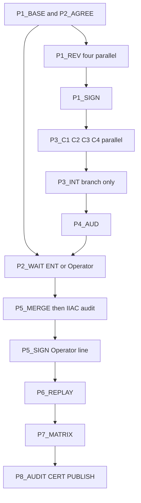

# Historical certification closure — master plan (HIST-01..04)

> **Publication copy.** Canonical Operator approval was recorded in Cursor plan mode artifact `hist_closure_master_plan_6d5c72f5.plan.md` (2026-11-08). This repository copy lives under `docs/project/maintainers/qualification/historical_certification_campaign/` on branch `hist-cert/plan-reviews` at START_HEAD `fe09375177bd0fa0d9ebb661b7f9bf64e2f1ed25`.

# Historical certification closure — master plan (HIST-01..04)

## A. Executive baseline

- Repository: `jakbuczarnecki/intergrax`. Canonical branch: `development`.
- **START_HEAD (remote, verified this session):** `fe09375177bd0fa0d9ebb661b7f9bf64e2f1ed25` (`git ls-remote origin refs/heads/development` equals `origin/development`). Merge of PR 417. No newer remote commit.
- **Local checkout is not that SHA.** `D:/Projekty/intergrax` is clean, on `development`, at `15347255ac62dbccfb7b64762b4c0f8af7ec38fa` (PR 404), **behind by 64 commits**. Do not pull, reset, or checkout that directory. Other sessions own worktrees there. All new work uses fresh worktrees from `origin/development`.
- IIAC policy `IIAC-2026-11-05.1` is `IN_FORCE`. Activation / effective SHA `f8c29fb8dfe5e14d9b06ff16659fd9cbe9ad326d`. Audited SHA `ae467c8c4dd9c87521c1c60a7e5e75224d3214a0`. Between that audit SHA and `fe0937517` the diff of `intergrax/`, `agents/`, `applications/` is **empty**, and the six `MATERIAL_GOVERNANCE_PATHS` are unchanged. The first product commit after this HEAD turns `verify_iiac_policy_activation --require-in-force` red with `ACT-N11 product path changed after the audited SHA` for every changed product file. That gate is global: it would also fail the ENT-AUDIT-X stream.
- Campaign result on the published package remains **`PARTIAL / EXACT BLOCKERS`**. Independent closures: 0. FRZ promotions: 0. Checklist subset of 85 historical rows was all `OPEN` at generation (`ba07ebaa3`). Counts below are the published matrix, not a new HEAD replay.
- Already done and not to be redone: worker inventories; PR 405–408, 410, 413–417 merged; DR-1..DR-12 and W1-R1..R3 / W1-PLAN recorded (sequence only, process-enforced delegate lines); T-IGX-030-A tests-only merged, plan approved by `cert-030a`, implementation **PASS_SCOPED** by `aud-030a` at `683f95572`, ticket still `ready_for_audit`; T-IGX-031-A tests-only merged, **PASS_SCOPED** by `aud-tests` (`b28398026`) and `aud-s12` (`47c29b4c3`), ticket still `ready_for_audit`. F-016 is resolved only for that 27-path selection, and that run’s pytest process did not exit after the summary (exit code not captured).
- Held, `plan_pending`, no `Approved:` line: T-IGX-030-B (digest `8c650422…3378`), T-IGX-030-C (`55d4c9e6…0103`), T-IGX-032-A (`2628d1a8…7446`), T-IGX-033-A (`ae167672…3775`).
- Differences from the PR 408 final report, already stated by the 2026-11-08 addendum (do not overwrite PR 408 files): the seven original operator decisions are answered; T-IGX-031-A is merged PASS_SCOPED; 032-A and 033-A plans exist but are not reviewed or approved; 030-B/C unchanged and HELD; ENT PRs 409, 411, 412 landed between campaign PRs. This plan is the next statement. It does not rewrite earlier evidence.
- ENT-AUDIT-X is a live separate stream. Protected: its implementation, dossier, FRZ-AUD-01..10, B6, closure, and the IIAC records it is using. Local worktree `D:/Projekty/_wt/intergrax/ent-w3-evid` branch `ent-w3-evid` is **1 commit ahead of a point 65 commits behind** `origin/development`: `163ef0c03` publishes a B5 evidence tree for TES `62d1c615` (8 JSON files, not on `development`). Do not rebase, reset, merge, or edit that worktree or `ent-w1` / `ent-w2-fix` / `ent-tes3`. T-IGX-024-A has no `Approved:` line; its chat standing authorization does not cover this campaign. No in-repo record shows the ENT owner agreed to a shared IIAC re-activation.
- There is no agent-to-agent channel. A coordination document is not consent.

### Adopted only if this plan is approved

Approving this plan answers the technical questions below. It does **not** write `Approved:` lines, does **not** sign IIAC activation, and does **not** speak for the ENT-AUDIT-X owner.

1. **T-IGX-032-A = A2.** Resolver `resolve_skill_execution_pinning_wiring` passes `document_store` only when `kv_store is None`. Leaf `wire_skill_execution_pinning_store` keeps rejecting both. Owner SKILL-X. KV is authoritative. Document store is fallback only. The binding wider measurement is the **four** paths in plan section 7 step 6 (the question text says “five”; no fifth path is named). That four-file run is in scope. Hard-coded `is_durable` is **out of ticket scope** and becomes tracked finding `HIST-F-DUR-01`, not a fifth code change.
2. **T-IGX-033-A = (b2).** Command-set seam; `external-work` and `demo governed-contractor` move to `python -m applications.governed_contractor_application`. Old names: argparse invalid choice, no Tier-0 stub (a stub would put a Tier-3 command string back in Tier-0). Regenerate the one EBH-7 matrix row. `product_manifest_registry.py` stays out of this ticket and becomes tracked blocker `HIST-F-BND-03B`. FRZ-BND-03 is not closed by 033-A alone.
3. **T-IGX-030-B / 030-C** keep the already written DR-5 / DR-7 scope. They still need a fresh plan review and a designated signer because `cert-030a` explicitly did not approve them.
4. **T-IGX-021-B/C stay a separate stage** (DR-2). They are not part of the product batch. Current activation grammar accepts only `Approved IIAC policy activation IIAC-2026-11-05.1: operator @ <time>`. A delegate line cannot activate policy. Q-12 / F-H4-03 stay OPEN.
5. **Merge grant, narrow:** after an independent audit and green required CI on the exact PR head, this campaign may merge its own `hist-cert/*` PRs with a **merge commit** (never squash, rebase, or force). Not granted: edits under the ENT dossier, edits to `IIAC_POLICY_ACTIVATION_RECORD.json`, or any activation line.
6. **Not granted by this approval:** ENT-AUDIT-X consent, and the Operator’s IIAC activation signature. Those remain hard stops.

## B. Remaining work (deduplicated)

Implementation defects that already have a held ticket:

- `HIST02-F-013` / FRZ-BND-04 (also linked on BND-03): EBH-4 R1 red because `tool_operation_recovery.py` imports Nexus `RuntimeErrorCode`. Ticket T-IGX-030-B.
- `H01-F015`: no-boundary `pool.submit` failure does not terminalize the external-operation record. Ticket T-IGX-030-C. Source commits `29c387879` and `98b4bf514` are references, not a cherry-pick mandate.
- `HIST03-F-015`: strict composition passes both stores into the pin leaf. Ticket T-IGX-032-A. Rows that stay unqualified until this is green and re-audited include FRZ-SEC-04, PRD-08, PRD-09 (they are not auto-promoted by the fix).
- `HIST02-F-001` / `F-002` CLI half: Tier-0 `intergrax/cli/external_work.py` static and dynamic edges into Tier-3. Ticket T-IGX-033-A.

Tracked, not implemented in this batch (new authority would be a scope amendment):

- `HIST-F-BND-03B`: `intergrax/applications/_shared/product_manifest_registry.py` dynamic Tier-0 to Tier-3 imports. Separate blocker. BND-03 cannot become a full PASS while it remains.
- `HIST-F-DUR-01`: `is_durable` hard-coded `True` on both pin stores.
- `HIST-F-OLLAMA`: duplicate integration slug `ollama` (T-IGX-031-A residual R1). Tests were isolated around it.
- `HIST-F-SECSTORE`: raw `TypeError` for a pre-built non-contract secrets store (R7).
- `HIST-F-REGISO`: other bare `register_default_integrations()` callers unmeasured (R2). Not a proven failure.
- `HIST-F-NOCI`: `no_ci` still excludes `test_sec_ent.py` from GitHub CI. Marker change was out of 031-A scope.
- `HIST-F-HANG`: 27-path process did not exit after the pytest summary (AUD-1). Cause unknown.
- `F-H4-03` / Q-12: mechanical delegate-signature enforcement. Owner is the future T-IGX-021-B stage, not this product batch.
- Polish inventory (838 lines) and EVOL-X roadmap L489 prose-vs-cell tension. Do not mass-rewrite. Do not flip the EVOL-X stage cell to CLOSED (a prior review reverted that flip). DR-1 already ratified the signature lines.

Qualification / authority that this campaign does not own:

- FRZ-RPL-01..04: next owner is ARCH-FREEZE `T-B7-VBN-INDEPENDENT-ACCEPT` (`BLOCKED_EXTERNAL`). Read-only here.
- FRZ-REG-01, 04, 05 and, by W1-R3, REG-02, 03, 06, 09: wait for the ENT-AUDIT-X Population E rollup. Do not promote.
- FRZ-REG-07 and REG-10: Dimension A replay on the final integrated SHA (DR-10 already yes), then audit. REG-10 is one of the 19 candidates and still needs that replay.
- FRZ-PRD-01, PRD-02: Path B live. Stay OPEN. Never PASS.
- FRZ-AUD-01..10 and ENT B6: ENT stream only.
- IIAC re-activation signature: Operator, current grammar.
- Shared re-activation consent: ENT execution owner. Absent.

Already closed enough to leave alone: T-IGX-030-A and T-IGX-031-A code. Lifecycle strings stay `ready_for_audit` until a certifier session, not this planner, updates them. No second implementation.

Published dashboard states to recalculate only after Phases 3–6, on the integrated SHA, in a new matrix file. Do not edit `HISTORICAL_FRZ_85_DISPOSITION_MATRIX.json` in place. Baseline to preserve: QUALIFICATION_REQUIRED 51, AUDIT_REQUIRED 29, AUTHORITY_REQUIRED 2, IMPLEMENTATION_REQUIRED 1, PATH_B_DEFERRED 2; classifications include 19 `VALID_SCOPED_PASS_CANDIDATE` (not PASS).

## C. Eight-phase WBS

Global rules for every task: English artifacts; `Ref:` trailer on commits that touch `intergrax/`, `agents/`, `applications/`, or `scripts/`; one `uv run pytest` at a time under `D:/Projekty/intergrax/.tmp/session/hist-cert-campaign/locks/heavy.lock` (mkdir / holder.txt / rmdir; never steal a lock); capture pytest’s own exit code; no `skip` / `xfail` / allow-list added to make a gate green; no `--no-verify` unless a new Operator authorization record exists; no force-push; do not modify accepted evidence files in place; this planning session does not audit or certify implementation it later performs. A Cursor subagent is not automatically a certification session. Auditor and certifier are new sessions, new transcripts, own worktrees. Assurance level, if they are subagents, is `process_enforced` and must be written as such. If a fresh session cannot be started, publish the handoff and leave that gate BLOCKED.

### Phase 1 — Decision and plan readiness

**P1-BASE.** Owner: orchestrator. Prerequisite: none. Files: none (read-only). Action: in a new worktree `D:/Projekty/_wt/intergrax/hist-base` detached at `fe0937517`, record START_HEAD, recompute the four plan digests with `python -I scripts/governance/plan_digest.py`, and confirm each ticket digest still matches. Re-read the four defect sites at that SHA (recovery import, invoker no-boundary branch, pin resolver, `external_work.py` and `product_manifest_registry.py`). Evidence: `historical_certification_campaign/HISTORICAL_FINAL_AUTHORITY_AND_DECISIONS.md` section “baseline reconfirmation” (created later by P1-DEC; until then notes live in the worktree only). Audit owner: none. Gate: digests match or the mismatched plan is BLOCKED and not implemented. Publication: none. Terminal: baseline note or BLOCKED.

**P1-REV-B, P1-REV-C, P1-REV-032, P1-REV-033.** Owner: four fresh read-only reviewer sessions, parallel, worktrees `hist-rev-b`, `hist-rev-c`, `hist-rev-032`, `hist-rev-033`, detached at `fe0937517`. Prerequisite: P1-BASE digest match. Files: review notes only under `historical_certification_campaign/audits/plan-030b/`, `plan-030c/`, `plan-032a-r2/`, `plan-033a-r2/`. 032 and 033 already have planner reports; these reviews are the missing independent plan reviews. Each review checks: digest, allowed-file list, no gate weakening, ACT-N11 expectation, overlap with the other three tickets (must stay file-disjoint), and the adopted decisions in section A. 032 review must state the step-6 list is four files. 033 review must state `product_manifest_registry.py` is excluded on purpose. Negative probe: none (no code). Evidence: `PLAN_REVIEW.md` with PASS or FAIL. Gate: FAIL stops only that ticket. Publication: one docs PR `hist-cert/plan-reviews` after all four finish, mergeable without ENT consent (docs only, no product, no material path). Terminal: PASS or ticket BLOCKED.

**P1-SIGN.** Owner: a new designated signing session, not the reviewers and not the later implementers. Prerequisite: this master plan approved, and the four reviews PASS. Files: the four ticket files only, `Approved:` line plus `Delegation:` pointing at a new delegation record under `historical_certification_campaign/delegations/`. The line form is the Amendment 01 delegate form. Scope of each signature is that ticket’s plan digest only. The signer recomputes the digest and refuses on mismatch. Evidence: delegation record and the four lines. Gate: `uv run python scripts/governance/verify_plan_approval.py` (the repository’s actual checker; one invocation, ticket paths as that script requires) exits 0 for each ticket. Publication: docs PR `hist-cert/plan-approvals`. Terminal: `plan_approved` or BLOCKED. No implementation starts before this.

**P1-DEC.** Owner: orchestrator, docs only, after P1-SIGN or in the same docs PR if the signer is a different session from the author of the matrix. File: `docs/project/maintainers/qualification/historical_certification_campaign/HISTORICAL_FINAL_AUTHORITY_AND_DECISIONS.md`. Content: the decision matrix (question, existing record, adopted answer, rejected alternative, risk, authority, whether W1-PLAN already covered it, blocking effect, dependent task). Include the explicit non-decisions: ENT consent absent, IIAC activation unsigned, 021-B/C not started, residuals HIST-F-* not authorized to code. Publication: with the approvals PR. Terminal: matrix published.

**P1-031-LIFECYCLE.** Owner: certifier session, optional, docs only. Prerequisite: read `aud-030a`, `aud-tests`, `aud-s12`, `cert-031a2`. Action: do not change code. If policy allows, move T-IGX-030-A and T-IGX-031-A off `ready_for_audit` only to a state the ticket README already defines for a scoped pass. Do not write PASS or CLOSED for TOOL-LIFE-X, HIST-03, or any FRZ row. If the exit-code gap makes that state unavailable, leave `ready_for_audit` and record the reason. Terminal: unchanged or advanced within policy.

Exit P1: four plans reviewed, digest-bound, and signed, or named tickets BLOCKED. No unsigned plan is implemented.

### Phase 2 — IIAC coordination (parallel with Phase 1)

**P2-WHY.** Owner: orchestrator, read-only. Prerequisite: none. Action: write the factual explanation into the agreement draft. ACT-N11 (`iiac_activation_gate.py` product loop and `_material_changes`) compares `audit_execution_sha` `ae467c8c4` to the verified HEAD. Any path under `intergrax/`, `agents/`, or `applications/` fails `--require-in-force`. Any edit to the six material paths fails it too. Today that diff is empty, which is why ENT could keep the gate green by moving delegated promotion out of `intergrax/` (`e02dc2b19`). A HIST product merge makes the gate red on `development` for every consumer, including ENT, until a new audited activation. Tests-only and docs-only commits do not.

**P2-AGREE.** Owner: orchestrator. Files: `docs/project/maintainers/qualification/historical_certification_campaign/HIST_IIAC_SHARED_REACTIVATION_AGREEMENT.md` only. This file is a **request**, status `PROPOSED_NO_CONSENT`. It must name: HIST owner (this campaign), ENT owner (T-IGX-024-A session; identity not assumed), branches (`hist-cert/product-batch` vs ENT branches; do not list `ent-w3-evid` as agreed), policy version `IIAC-2026-11-05.1`, product batch C1–C4, governance batch **not** including 021-B unless a later amendment says so, audit owners as “fresh sessions, not yet assigned ids”, target integration SHA as `TBD until P3-INT`, Operator decisions still required (activation line; ENT consent), acceptance gates (independent IIAC audit, `verify_iiac_policy_activation --require-in-force` exit 0, old record preserved), rollback (revert the product merge commits; do not delete the old activation). Proposed sequence: ENT either (i) finishes and publishes its current non-product closure first, then HIST merges one product batch and one re-activation, or (ii) explicitly accepts one shared final re-activation after both product sets. HIST does not choose (ii) alone. Publication: docs PR, does not claim consent. Terminal: `PROPOSED_NO_CONSENT`.

**P2-WAIT.** Owner: Operator or ENT owner. Prerequisite: P2-AGREE published. Action: stop. Dependent tasks P3 merge-to-development, P5, P6-on-development, P7 promotion, P8 closure claim do not start. Isolated implementation on `hist-cert/*` branches may start after P1-SIGN because those branches are not `development`. Exit P2 for **development publication** is either an ENT counter-signed revision of the agreement (same file, new section, ENT session id, exact SHA they accept) or an Operator supersession record that names the sequencing and accepts the temporary ACT-N11 red window. Silence is not supersession.

### Phase 3 — Product batch (isolated; four lanes)

Prerequisite for every C lane: P1-SIGN for that ticket. Lanes are file-disjoint and may run together. Heavy pytest is serialized on the shared lock. Each lane: worktree from `fe0937517`, branch `hist-cert/c1-030b` | `c2-030c` | `c3-032a` | `c4-033a`, own `uv` environment, red commit then green commit, `Ref:` trailer, no IIAC/roadmap/FRZ edits.

**P3-C1 (T-IGX-030-B).** Files: new `intergrax/contracts/runtime_error_code.py`; `intergrax/runtime/nexus/errors/error_codes.py` (re-export, same class identity); `intergrax/runtime/tools/tool_operation_recovery.py` (import the contract module); new `tests/unit/architecture/test_runtime_error_code_contract_home.py`. No edit to the EBH-4 gate. Tests, from the ticket plan, one process each: the new contract test; `tests/unit/architecture/test_ebh_4_r1_nexus_encapsulation_gate.py::test_ebh_4_r1_production_nexus_imports_outside_ee_are_zero`; importer blast-radius check the plan already names. Negative probe: a scratch tree that points recovery back at `intergrax.runtime.nexus.errors.error_codes` must make the gate red, then be discarded. Evidence: red log, green log, exit codes, `git diff --name-only fe0937517..HEAD`. Audit handoff: `audits/impl-c1/HANDOFF.md` with SHA. Publication: push branch, no merge. Terminal: implementation SHA or FAIL.

**P3-C2 (T-IGX-030-C).** Files: `intergrax/runtime/nexus/tools/invoker.py` (guard only `pool.submit` in the `dep_boundary is None` branch: mark the external operation failed, then re-raise); new `tests/unit/runtime/nexus/tools/test_tool_life_x_c0_no_boundary_submit_failure_terminal.py`. Do not copy history blindly: read current `invoker.py` at `fe0937517` and apply only that guard if the defect is still present. No new error code, no retry/idempotency change, no swallowed `Cancelled`/`BaseException` without re-raise, no edit to Tool lifecycle files owned by 030-A. Red-first: test commit is red before the product commit. Negative probes from the plan (bind_future residual R-1 stays unfixed). Evidence and handoff as C1. Terminal: implementation SHA or FAIL.

**P3-C3 (T-IGX-032-A).** Files: `intergrax/skills/skill_execution_pinning_wiring.py` only in product; new `tests/unit/skills/test_skill_execution_pinning_wiring_store_precedence.py`. Forbidden: leaf, durability module, `harness_host_runtime.py`, factories, the P2-C test file. Tests: plan section 7 steps 1–6 with `uv run --extra dev-ci`, including the four wider files. Probes P-A, P-B, P-C from the plan, recorded, not committed. Expected after: P2-C 7 passed. Any other red in the four files is reported and not fixed here. Record `HIST-F-DUR-01` in the handoff. Terminal: implementation SHA or FAIL.

**P3-C4 (T-IGX-033-A).** Files: the plan section 3.1 and 3.2 list (command_set.py, main.py, external_work.py, Tier-3 `cli_commands.py`, `__main__.py`, `offline_demo.py` recovery string, host CLI tests, new `test_bnd03_tier0_upward_edges_gate.py`, ebh5 skip removal for `intergrax/cli/` only, `TIER_IMPORT_EXCEPTIONS` to empty, regenerated `EBH_7_B6_F10_ECAP_NORMATIVE_MATRIX.md`, five command docs). Not `product_manifest_registry.py`. Not `AGENTS.md`. Not the historical EBH-7 audit report. If `test_ebh_7_w8_ecap_l3_gates.py` pins the old exception row, stop this lane and report (plan pre-check). Negative probe: function-local `applications` import and `importlib.import_module` of a Tier-3 name added to `main.py` in a scratch worktree must each fail the new gate; discard the scratch. Commit shape: one atomic product+tests+matrix commit, then one docs commit. Terminal: implementation SHA or FAIL.

**P3-INT.** Owner: integration session, not one of the four implementers if a fifth session is available; if not, the orchestrator integrates and then cannot audit. Prerequisite: four lane SHAs, each green on its own branch. Worktree `hist-int`, branch `hist-cert/product-batch`, merge the four branches with merge commits. Rebase onto latest `origin/development` first only with a name-only impact diff. Abort if `development` gained product paths or material paths (ENT or anyone else). Abort if the four diffs are no longer disjoint. Tests: re-run each lane’s focused pytest once on the integrated SHA (still one process at a time). Evidence: `HISTORICAL_CORRECTIVE_EXECUTION_AND_SHA_LADDER.md` with per-lane SHAs and `INTEGRATION_SHA`. Push the branch. Open a draft PR to `development`. **Do not merge** until P2-WAIT is satisfied. Terminal: integrated SHA, unpublished to `development`, or BLOCKED.

Exit P3: four fixes exist on one audited-ready SHA, or named lanes BLOCKED. Residuals HIST-F-* remain unimplemented on purpose.

### Phase 4 — Independent corrective audit

**P4-AUD.** Owner: one fresh auditor session, worktree `hist-aud-prod` detached at `INTEGRATION_SHA`. Not an implementer. Prerequisite: P3-INT SHA immutable (branch pushed; auditor does not pull new commits mid-run). Surfaces: EBH-4 R1 and contract identity (`RuntimeErrorCode is` the re-export); invoker failure terminalization and re-raise; pin precedence and untouched leaf dual-backend test; P2-C file byte-identical and 7 passed; Tier-0/Tier-3 gate including the two negative mutations in a scratch clone; allowed-file diff versus each ticket; no weakened assertion. Commands: the same focused commands as Phase 3, re-executed, plus `ruff check` / `ruff format --check` on touched files, plus `uv run python -m scripts.governance.verify_iiac_policy_activation --require-in-force` which is **expected red** listing exactly the product paths of C1–C4. Record that red line. Do not “fix” it. Environment: auditor worktree’s own `uv run`, not another session’s `.venv`. Evidence: `audits/aud-product/AUDIT_REPORT.md` and `findings.json` with exit codes, counts, log hashes, run id = session id. Verdicts, separate: C1, C2, C3, C4 each `PASS`, `PASS_SCOPED`, `PARTIAL`, or `FAIL`.

**P4-FIX.** Only if the auditor returns a consolidated finding batch. Owner: the implementer of the affected lane only. Smallest change inside that ticket’s allowed files. Re-audit only the failed surface plus the integration diff, new SHA. Cap: **two** corrective loops per lane. Third failure stops that lane as `FAIL` and leaves it out of promotion. Unrelated lanes continue.

Exit P4: every merged-candidate lane has an independent verdict on one SHA. A FAIL lane is not in the activation set.

### Phase 5 — IIAC re-audit and re-activation

Prerequisite: P2-WAIT cleared, P4 verdicts for the lanes being published are PASS or PASS_SCOPED, draft PR still applies cleanly to current `origin/development`.

**P5-RECHECK.** Owner: orchestrator, read-only. If ENT has already published a later activation whose audit SHA is a descendant of `INTEGRATION_SHA` and whose product diff covers C1–C4, verify that record with the canonical command. Reuse it only when ancestry, path set, and verdict match. Do not create a second activation. If ENT’s activation does not contain these commits, do not reuse it.

**P5-MERGE-PRODUCT.** Owner: orchestrator under the merge grant. Merge the product PR with a merge commit. Verify `origin/development` equals that merge SHA (`git ls-remote`). This makes ACT-N11 red. That is expected. Do not edit the activation JSON in this commit.

**P5-AUDIT-IIAC.** Owner: fresh IIAC auditor, not the product auditor if the product auditor implemented nothing but still separate from implementers. Scope: activation prerequisites for a product-only delta. No material-path edit. No 021-B. Tests: repository IIAC gate unit tests already used by aud-030a (`test_iiac_activation_gate.py`, `test_iiac_negative_guards.py`) plus the activation verifier. Negative cases: tampered signature, missing delegation where a delegate line is used for a **non-activation** record, product path omitted from the new audit scope. Evidence under `iiac_evidence/` in a new campaign id, not by editing `IIAC-GOV-1` bytes. Old activation stays in git history.

**P5-SIGN-ACT.** Owner: **Operator only**. The current regex rejects every delegate line. This campaign stops here until the Operator writes the activation record and the `operator @` line for the new policy binding, two-phase SHA publication as the existing IIAC procedure requires. Agents do not copy `f8c29fb8` signatures onto the new SHA. Agents do not set `"status": "IN_FORCE"` by hand.

**P5-VERIFY.** After the Operator’s commit is on `development`, a fresh session runs `uv run python -m scripts.governance.verify_iiac_policy_activation --require-in-force` and records exit 0, policy version, and the new audit SHA. If exit is non-zero, dependent certification stays blocked.

Exit P5: verifier green on the published SHA, or BLOCKED with the exact missing signature / missing ENT consent. No FRZ promotion before that.

### Phase 6 — QUAL-X Dimension A replay

**P6-REPLAY.** Owner: fresh qualification session. Prerequisite: P5-VERIFY green, so the replay SHA is the activated development SHA. If P5 is blocked, this task may still run **labeled `PRE_ACTIVATION_DIAGNOSTIC`** on `INTEGRATION_SHA` and cannot feed promotion. Action: load the exact 35-module Dimension A list plus the BND-03 and W2-C modules from the AUD-QUALX inventory cited by `dossiers/hist01/HIST01_QUALX_SKILLX_PREDECESSOR_RECONCILIATION.md` (historical pass: 630 passed at `d9ea0d6e8`). Do not invent a substitute selection. Run one locked pytest of that list. Capture exit code. Confirm the process actually exited. Zero unexplained skips. Compare failures to the `d9ea0d6e8` baseline. A missing dependency is an environment FAIL, not a pass. One retry if the hang class `HIST-F-HANG` reproduces; then stop and dossier it. Coordinate the heavy lock so ENT is not running a suite. Evidence: `HISTORICAL_FINAL_QUALIFICATION_EVIDENCE.md` with SHA, command, counts, exit, log hash. This does not certify ENT Population E. Terminal: package accepted for that SHA, or blocker dossier.

### Phase 7 — FRZ dispositions

**P7-RECALC.** Owner: qualification analyst session, read-only against the P6 SHA. New file `HISTORICAL_FRZ_85_FINAL_DISPOSITION_MATRIX.json`. Do not edit the PR 408 matrix. Every row carries the 16 fields in the campaign brief. Starting point is the published row, then update only where P3–P6 produced evidence.

**P7-CAND-19.** The 19 candidates (REG-10, BND-05, CTR-01, CTR-02, CTR-06, TYP-01, PLG-01, PLG-04, OBS-01, OBS-02, OBS-03, REL-04, REL-06, REL-07, REL-08, REL-09, REL-10, REL-11, PRD-07). One fresh auditor may batch them if each ID has its own verdict, evidence pointer, and scope. REG-10 waits for P6. Promote a row only to the status the checklist’s own vocabulary allows, and only inside the recorded scope. No row moves on the checklist file until P7-PUB and P8 audit.

**P7-ARCH.** Apply C1 result to BND-04 only if P4-C1 is PASS or PASS_SCOPED and P5 is green. Apply C4 to the CLI portion of BND-03 as `PASS_SCOPED` at most, with `HIST-F-BND-03B` still OPEN, or leave BND-03 `OPEN` if a scoped status is not a legal checklist value. Do not convert the second edge into an exclusion. RPL-01..04 stay at their current next-stage pointer. Do not run ARCH-FREEZE acceptance.

**P7-PATHB.** File `HISTORICAL_FINAL_PATH_B_RESIDUAL_REGISTER.md`. PRD-01 and PRD-02 remain OPEN, live-scoped, future owner PROD-Q, not blocking an architecture-scoped predecessor note, never marked production-ready. SEC/REL live halves stay as W1-R1/R2 already ruled: architecture part may be evidenced; live part stays open. No waivers.

**P7-REG-ENT.** REG rows reserved for Population E stay OPEN. If the ENT stream has published a Population E result on a SHA that is an ancestor of the replay SHA, cite it. Do not wait forever and do not promote without it.

**P7-PUB.** Checklist and roadmap edits only for rows a certifier session has accepted, in a separate commit from the analyst’s draft, after P8’s audit of the draft. Until then the checklist stays as it is.

Exit P7: 85 rows present in the new matrix, each with a disposition that names evidence or an exact blocker. Draft is not acceptance.

### Phase 8 — Reconciliation, certification, publication

**P8-DOCS.** Owner: orchestrator. Update, by new files or clearly marked successor sections, the deliverables in section 9. Cross-link the existing dossiers. Do not edit ENT formal results. Do not mark ARCH-FREEZE accepted. Supersede the campaign dashboard with a pointer to the terminal report; leave the PR 408 report and the addendum intact.

**P8-AUD-FINAL.** Fresh final auditor. Checks the 13 conditions in the brief (85 IDs, no global PASS, no stale SHA, no mutated historical evidence, no Path B upgrade, no ENT conflict, no weakened gate, no fake session ids). Verdict PASS only if those checks hold. A PASS of the dossier is not a PASS of all 85 rows.

**P8-CERT.** Fresh certifier, after P8-AUD-FINAL. Accepts the terminal label. Cannot be the implementer or the final auditor. Writes no activation line.

**P8-PUB.** PR of the documentation set. Required CI green on that head. Merge commit under the merge grant. `git ls-remote` must show `origin/development` equal to the merge. The terminal report’s `PUBLICATION_SHA` is that merge, filled in by a tiny follow-up commit only if the report was merged before it could name itself; that follow-up is the last SHA and is verified again. A branch push is not closure.

**P8-VERDICT.** Exactly one of:

- `HISTORICAL_CAMPAIGN_CLOSED_VERIFIED` only if section 8 of the brief is true, including RPL, REG/ENT, Path B rules, IIAC green, and remote merge.
- Otherwise `HISTORICAL_CAMPAIGN_PARTIAL_EXACT_BLOCKERS` with one next action per remaining blocker.

The expected result, given owners that sit outside this campaign, is **`PARTIAL_EXACT_BLOCKERS`** even after a clean product batch. That is a valid completion of this plan.

## D. Root-cause groups

- RC-ENUM: Nexus error-code home. Impact: EBH-4 R1, BND-04. Fix: P3-C1.
- RC-SUBMIT: no-boundary `pool.submit` misses terminalization. Impact: TOOL-LIFE residual H01-F015. Fix: P3-C2. Does not reopen 030-A.
- RC-PIN: resolver forwards both stores; leaf correctly rejects them. Impact: P2-C HTTP admission and any both-store host. Fix: P3-C3. Durability hard-code is a different cause (RC-DUR), not fixed.
- RC-CLI-EDGE: Tier-0 CLI demo composition. Impact: BND-03 CLI half, ebh5 skip, EBH-7 exception row. Fix: P3-C4.
- RC-MANIFEST-EDGE: `product_manifest_registry.py`. Not the same edit. Stays open.
- RC-IIAC-WINDOW: product bytes after `ae467c8c4` invalidate the current activation for every stream. Fix is sequencing plus a new activation, not a weaker gate.
- RC-ENT-SHARE: one activation authority. Fix is consent or Operator supersession, not a second JSON status.
- RC-ISOLATION: catalog pollution. Already mitigated in tests by 031-A. Product slug/type residuals stay open.
- RC-RPL / RC-POP-E / RC-PATHB: outside this campaign’s implementation authority.

## E. Git and worktrees

- Do not touch `D:/Projekty/intergrax` (local `development` at `15347255`).
- Do not touch existing `_wt/intergrax/ent-*`, `ent-tes3`, `.tmp/session/**`, or `.claude/worktrees/**`.
- New worktrees only under `D:/Projekty/_wt/intergrax/` with slugs: `hist-base`, `hist-rev-b`, `hist-rev-c`, `hist-rev-032`, `hist-rev-033`, `hist-sign`, `hist-c1-030b`, `hist-c2-030c`, `hist-c3-032a`, `hist-c4-033a`, `hist-int`, `hist-aud-prod`, `hist-iiac-aud`, `hist-qual-a`, `hist-frz`, `hist-final-aud`, `hist-final-cert`. Create each at execution time from `origin/development` or from the pinned SHA named in the task. Remove only worktrees this campaign created, and only after their branch is pushed.
- Integration owner is `hist-int` only. Lane branches merge there. `development` is updated only by the authorized merge commits in P5 and P8.
- Shared SSOT (`HISTORICAL_FRZ_85_FINAL_*`, roadmap, checklist) is edited only on `hist-cert/final-docs` after P7, not on lane branches.
- If `origin/development` moves, stop the lane that would publish, diff names, and rebase only when the new commits do not touch that lane’s files or the material paths. Product or material commits from ENT freeze P5 until P2 is redone.

Critical path: plan review, signature, slowest of C4 vs C1, integration, product audit, ENT/Operator wait, IIAC signature, Dimension A, final audit, merge. C1–C4 overlap. P2 draft overlaps P1. P7 drafting can start from lane evidence before P5, but publication waits for P5 and P6.

## F. Test matrix

- L1: each ticket’s new unit test and the focused modules named in that plan (contract home, invoker terminal test, pin precedence, BND-03 gate, CLI host tests).
- L2: P2-C file; pinning batch files in 032 step 3; EBH-4 R1 test; ebh5 gate after skip removal; EBH-7 matrix sync; IIAC gate unit tests at P5.
- L3: QUAL-X Dimension A 35-module set plus the HIST-01 BND-03 and W2-C modules, once, on the activated SHA (P6). Not the entire repository default suite.
- Adversarial: C1 import revert; C2 cancel still propagates; C3 probes P-A/P-B/P-C; C4 synthetic Tier-0 import and importlib; IIAC bad signature.
- Clean checkout: auditor and P6 session use a new worktree at the pinned SHA, not the implementer’s dirty tree.
- CI: required checks on the exact PR head before any merge. A green local run does not replace them.
- Not run: live provider qualification, cloud production, Docker/vendor C10/C15 stacks, ENT Population E, ARCH-FREEZE acceptance, a second 27-path diagnostic unless a published authorization is renewed. The old 27-path authorization was one run and is spent.

## G. Authority matrix

- Plan technical choices in section A: this plan’s Operator approval.
- Ticket `Approved:` lines: P1-SIGN designated session, digest-bound, Amendment 01 delegate form. Not this planner, not the implementer.
- Product merge to `development`: P2-WAIT plus the narrow merge grant.
- IIAC `operator @` activation: Operator in person. Not delegable under the code that is in force today.
- T-IGX-021-B/C and material-path edits: not approved.
- FRZ checklist status edits: certifier after final audit, only for rows whose evidence is on the published SHA.
- ENT files and FRZ-AUD: no authority.
- Path B live PASS: no authority.

## H. Publication plan

1. Docs PR: plan reviews, delegation, `Approved:` lines, decision matrix, coordination request (`PROPOSED_NO_CONSENT`).
2. Four implementation branches pushed, then `hist-cert/product-batch` draft PR. CI on that PR is informative. Merge waits on P2-WAIT.
3. After consent: merge product PR, verify remote SHA, expect IIAC verifier red, do not hide it.
4. Operator activation publication follows the existing two-phase IIAC procedure. Verify remote SHA and verifier green.
5. Final docs PR (ladder, audits, 85-row final matrix, terminal report, predecessor handoff). Merge only after P8-AUD-FINAL and P8-CERT. Verify `origin/development`.
6. Every PR uses a merge commit. Squash would break `Delegation: path@sha` reachability.

## I. Failure handling

- Digest mismatch or plan review FAIL: that ticket stays `plan_pending`. Other tickets continue.
- Red-first test is already green: stop that lane; the defect may already be fixed or the test is wrong. Do not weaken the test.
- Focused test stays red after two fix loops: lane `FAIL`, dropped from the activation set, named in the terminal report.
- `development` moved with overlapping files: stop publish, recompute impact, do not force.
- ENT consent missing at P5: leave the product branch unmerged. Terminal blocker `ENT_REACTIVATION_CONSENT`. Implementation evidence still counts for the branch SHA, not for `development`.
- Operator will not sign IIAC: stop P6 promotion and P7 checklist edits. Diagnostic replay may exist but is labeled pre-activation.
- Pytest hang: one retry, capture exit. Second hang is `HIST-F-HANG` environment blocker, not a pass.
- Auditor and implementer are the same session: discard the verdict, re-queue the audit. Do not cite it.
- No third session available: publish handoff, gate BLOCKED.
- No infinite micro-iteration. No new ticket is opened for HIST-F-* inside this execution unless the Operator amends this plan.

## J. Acceptance map

`CLOSED_VERIFIED` requires all of: 85 rows reconciled in the final matrix; architecture-mandatory rows either accepted on the published SHA or covered by an already recorded scoped rule; C1–C4 PASS or PASS_SCOPED and merged; P6 exit 0 on that SHA; P4 and P8 audits PASS; certifier distinct; IIAC verifier green; ENT consent honored or a real supersession record present; Path B rows still OPEN; residuals HIST-F-BND-03B and HIST-F-DUR-01 not marked fixed; remote SHA verified.

If RPL-01..04 are still waiting on ARCH-FREEZE, or REG rows are still waiting on Population E, or ENT consent or the Operator activation line is missing, the only legal label is **`HISTORICAL_CAMPAIGN_PARTIAL_EXACT_BLOCKERS`**. Predecessor readiness for ARCH-FREEZE is then “not satisfied” or “satisfied only for the scoped subset the handoff lists”, and the handoff must say which. The report will not say the campaign is closed.

### Deliverables (new successor files; PR 408 package kept)

Under `docs/project/maintainers/qualification/historical_certification_campaign/`:

- `HISTORICAL_CERTIFICATION_FINAL_MASTER_PLAN.md` (this plan, copied at execution start so the repo matches the approval)
- `HISTORICAL_CORRECTIVE_EXECUTION_AND_SHA_LADDER.md`
- `HISTORICAL_FINAL_IMPLEMENTATION_REPORT.md`
- `HISTORICAL_FINAL_INDEPENDENT_AUDIT_REGISTER.md`
- `HISTORICAL_FRZ_85_FINAL_DISPOSITION_MATRIX.json`
- `HISTORICAL_FINAL_AUTHORITY_AND_DECISIONS.md`
- `HISTORICAL_FINAL_QUALIFICATION_EVIDENCE.md`
- `HISTORICAL_FINAL_PATH_B_RESIDUAL_REGISTER.md`
- `HISTORICAL_FINAL_SSOT_RECONCILIATION.md`
- `HISTORICAL_CAMPAIGN_TERMINAL_CLOSURE_REPORT.md` (START_SHA, implementation SHAs, test SHAs, audit SHAs, certification SHAs, PUBLICATION_SHA, before/after counts, defects corrected, gates passed, remaining blockers, scoped limitations, Path B deferrals, verdict, predecessor-readiness answer)
- `ARCH_FREEZE_HISTORICAL_PREDECESSOR_HANDOFF.md` (successor; the existing readiness handoff stays)
- `HIST_IIAC_SHARED_REACTIVATION_AGREEMENT.md`

### Execution order after approval

Start P1-BASE, P1 reviews, and P2-AGREE immediately. Do not ask again for the section A choices. Stop only the dependent lane when a hard gate in P1-SIGN, P2-WAIT, P4 two-loop cap, or P5-SIGN-ACT is actually unmet. Do not declare closure from a green test run.
