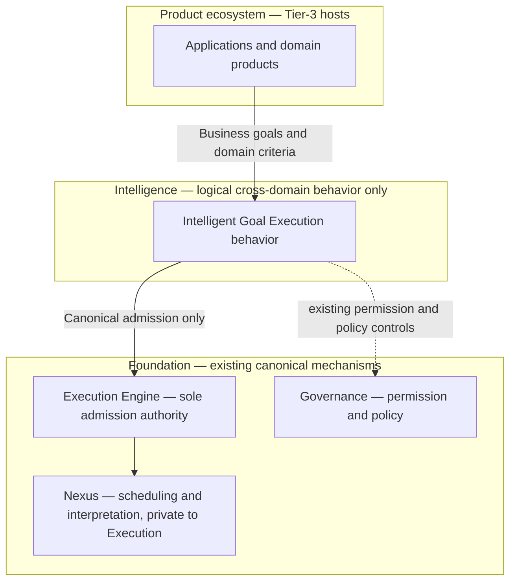

# II-W0-01 — Architecture Layer and Tier Boundary Matrix

**Package:** II-W0-01 (W0-A)
**Ticket:** T-IGX-079-D
**Correction batch:** II-W0-A-CORRECTIVE-01
**Evidence baseline commit:** `79e978feb280614e35daf2c8f09d83c9634ed348`
**Normative architecture blob:** `c89c4ccb9e253108de70b126c62c1c206063ab83`
**Original W0-A candidate preserved:** `1b81169a6dee214abf056cba0650d9892b199e26` (ancestor of this correction)
**Erroneous historical reported SHA (discrepancy only):** `1b81169a86a6717b2ca0c2609f8b491f2322bc40` — transcription error; not a Git object.

## 1. Scope and normative source register

| Role | Path | Source commit SHA | Source blob SHA |
|---|---|---|---|
| Ratified Intelligence architecture | `docs/project/capabilities/architecture/INTEGRAX_INTELLIGENCE.md` | `79e978feb280614e35daf2c8f09d83c9634ed348` | `c89c4ccb9e253108de70b126c62c1c206063ab83` |
| Master Roadmap | `governance/tickets/plans/INTELLIGENCE-X-MASTER-PLAN.md` | `79e978feb280614e35daf2c8f09d83c9634ed348` | `ce7d248cd43fe2dace182fb6eedf7cdc65b82622` |
| Tier import canon | `docs/project/technical/guides/SYSTEM_INVARIANTS.md` (SYS-INV-01) | `79e978feb280614e35daf2c8f09d83c9634ed348` | `e45b9a3efaebc03f7eda332032e9b9fadd44b099` |
| Sole Execution authority | `docs/project/architecture/UNIFIED_EXECUTION_ARCHITECTURE.md` | `79e978feb280614e35daf2c8f09d83c9634ed348` | `dc99950e58d77e48fa390527909b13c50ec8632d` |
| Execution runtime model | `docs/project/architecture/UNIFIED_EXECUTION_RUNTIME.md` | `79e978feb280614e35daf2c8f09d83c9634ed348` | `cb8a28d2ae8ec38b202cc906c55d3b6012681a9d` |

Documentary acceptance only. Three logical capability layers (Foundation, Intelligence, Product ecosystem). Four physical tiers (Tier-0–Tier-3) unchanged. Intelligence is **not** a new physical tier.

## 2. Logical capability layer diagram (ratified §3)

Aligned with `INTEGRAX_INTELLIGENCE.md` §3: products submit business goals; Intelligence composes behavior within canonical owners; **all effectful paths pass canonical Execution admission**; Nexus scheduling remains **private to Execution** (reachable only through Execution, not as a peer admission path from Intelligence).

**Binding:** Architecture §3 (lines 172–232). Governance edges represent **existing permission and policy controls**, not independent admission authority. Logical composition ≠ physical import direction (§3 prose: strategic capability layers, not package import directions).

## 3. Physical tier boundary matrix

| Logical capability layer | Existing physical tier | Concern | Canonical owner | Allowed dependency direction | Prohibited dependency direction | Admission authority | Exact source path and section | Source commit SHA | Source blob SHA | Documentary evaluation |
|---|---|---|---|---|---|---|---|---|---|---|
| Foundation | Tier-0 | Contracts and integrations | Tier-0 owners | Higher tiers may depend on Tier-0 | Tier-0 must not depend on upper tiers | Execution at effect boundary | `docs/project/technical/guides/SYSTEM_INVARIANTS.md` SYS-INV-01 | `79e978feb280614e35daf2c8f09d83c9634ed348` | `e45b9a3efaebc03f7eda332032e9b9fadd44b099` | ACCEPTED — tier canon preserved |
| Foundation | Tier-1 | Canonical runtime, admission, lifecycle | Execution / UER | Tier-2/3 consume Tier-1 ports | Tier-1 must not import agents/apps as authority owners | **Execution sole admission** | `docs/project/capabilities/architecture/INTEGRAX_INTELLIGENCE.md` §3 table Tier-1 | `79e978feb280614e35daf2c8f09d83c9634ed348` | `c89c4ccb9e253108de70b126c62c1c206063ab83` | ACCEPTED |
| Foundation | Tier-1 | Nexus scheduling and interpretation | Execution (Nexus private) | Execution → Nexus; Orchestration under Execution | Nexus as lifecycle, budget, or admission owner | Execution | `docs/project/architecture/UNIFIED_EXECUTION_ARCHITECTURE.md` UEA-INV-007 | `79e978feb280614e35daf2c8f09d83c9634ed348` | `dc99950e58d77e48fa390527909b13c50ec8632d` | ACCEPTED — LOOP→EE→NX, not LOOP→NX |
| Intelligence | Tier-2 (logical behavior) | Domain reasoning and specialized behavior | Agent / Cognition owners | Tier-3 → Tier-2 patterns per SYS-INV-01 | Tier-2 bypass of ToolRuntime or Execution admission | Execution admits all effects | `docs/project/capabilities/architecture/INTEGRAX_INTELLIGENCE.md` §3 Tier-2 row | `79e978feb280614e35daf2c8f09d83c9634ed348` | `c89c4ccb9e253108de70b126c62c1c206063ab83` | ACCEPTED |
| Product ecosystem | Tier-3 | Business goals, acceptance, UX | Application / host | Tier-3 composes lower tiers | Lower tiers must not import Tier-3 | Execution after Governance bind | `docs/project/capabilities/architecture/INTEGRAX_INTELLIGENCE.md` §3 Tier-3 row | `79e978feb280614e35daf2c8f09d83c9634ed348` | `c89c4ccb9e253108de70b126c62c1c206063ab83` | ACCEPTED |
| Intelligence | Cross-tier (logical) | Goal-realization behavior | Composed across Foundation owners | Products → LOOP → Execution admission | No `intergrax/intelligence/` monolith or second root | Execution | `docs/project/capabilities/architecture/INTEGRAX_INTELLIGENCE.md` §3 prose (219–232) | `79e978feb280614e35daf2c8f09d83c9634ed348` | `c89c4ccb9e253108de70b126c62c1c206063ab83` | ACCEPTED |
| Foundation | Tier-1 | Permission and policy | Governance | Governance decides; Execution applies admission consequences | Consumer or Intelligence as permission owner | Governance decision; Execution admission gate (UEA-INV-022) | `docs/project/capabilities/architecture/INTEGRAX_INTELLIGENCE.md` §7.1 permissions row | `79e978feb280614e35daf2c8f09d83c9634ed348` | `c89c4ccb9e253108de70b126c62c1c206063ab83` | ACCEPTED |
| Product ecosystem | Tier-3 | Private harness prohibition | Product + Execution | Shared consumption via II-OPR-01 contract | Product-local general scheduler or second execution root | Execution | `docs/project/capabilities/architecture/INTEGRAX_INTELLIGENCE.md` §3 (line 232) | `79e978feb280614e35daf2c8f09d83c9634ed348` | `c89c4ccb9e253108de70b126c62c1c206063ab83` | ACCEPTED |

## 4. Legal authority and dependency relationships

- **Admission:** Every effectful path requires canonical Execution admission (II-INV-02; UEA-INV-005, UEA-INV-022).
- **Intelligence role:** Coordinated behavior and consumption semantics; not an execution root.
- **Nexus:** Scheduling and interpretation remain private to Execution (UEA-INV-007); Intelligence does not call Nexus as an alternate admission or lifecycle owner.
- **Governance:** Sole permission and policy authority; goal submission does not transfer permission.
- **Products:** Define business goals and domain acceptance; invoke canonical execution entry points only.

## 5. Negative oracle evaluation (documentary — not runtime tests)

| Negative case | Violated requirement | Documentary evaluation result | W1 verification obligation |
|---|---|---|---|
| Physical tier insertion | Architecture §3; SYS-INV-01 tier canon | **REJECT** — no Tier-4 or logical-layer-as-import-tier in matrix or diagram | CI tier-boundary gates |
| Reverse import (lower imports Tier-3/apps) | `SYSTEM_INVARIANTS.md` SYS-INV-01 | **REJECT** — prohibited direction recorded on every row | Architecture import audit |
| Second execution root | UEA-INV-005; II-INV-02 | **REJECT** — single Execution tree; Intelligence not a root | Admission negative suite |
| Private product scheduler | Architecture §3 line 232 | **REJECT** — products must use canonical admission | Consumer harness audit |
| Alternative admission authority | UEA-INV-022; §7.3 sequence | **REJECT** — Nexus, ToolRuntime, consumers not admission owners | Child-authority checkpoint tests |

## 6. Exact evidence references

- Primary normative diagram: `docs/project/capabilities/architecture/INTEGRAX_INTELLIGENCE.md` §3 mermaid (baseline blob `c89c4ccb9e253108de70b126c62c1c206063ab83`).
- W0-A reviewed diagram: §2 above (corrected LOOP→Execution→Nexus per audit F-W0A-15/F-W0A-16).
- Execution authority: `docs/project/architecture/UNIFIED_EXECUTION_ARCHITECTURE.md` UEA-INV-005, UEA-INV-007.

## 7. Qualification result and limitations

**Positive oracle:** Every matrix relationship has a legal dependency direction; Execution retains sole canonical admission authority. **PASS (documentary).**

**Limitations:** No runtime tier-boundary test execution in this package. Formal package closure and independent G6 remain pending per T-IGX-079-D. W1 must not introduce physical tier remapping.

**Original acceptance criterion:** Layer diagram and classification; Tier-0–Tier-3 unchanged — **met at documentation level.**
