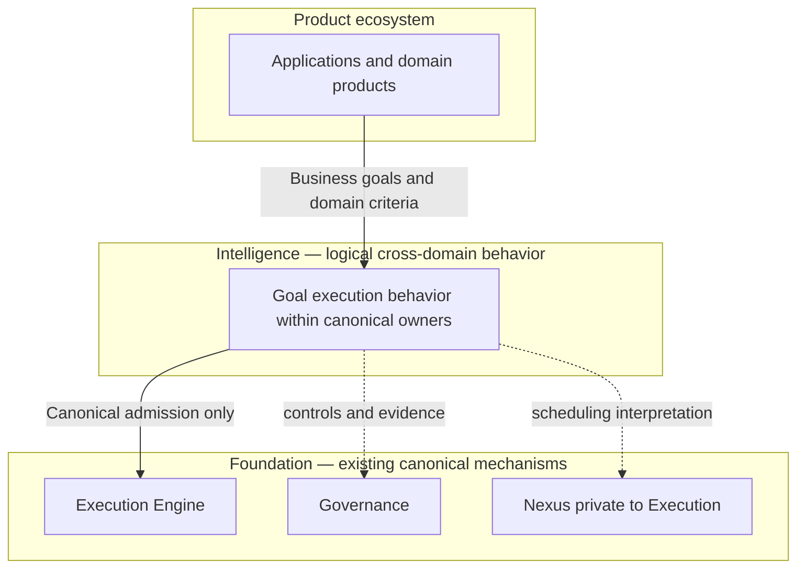

# II-W0-01 — Architecture Layer and Tier Boundary Matrix

**Package:** II-W0-01 (W0-A)  
**Ticket:** T-IGX-079-D  
**Evidence baseline commit:** `79e978feb280614e35daf2c8f09d83c9634ed348`  
**Normative architecture blob:** `c89c4ccb9e253108de70b126c62c1c206063ab83`

## 1. Scope and normative source register

| Role | Path | Blob SHA (baseline) |
|---|---|---|
| Ratified Intelligence architecture | `docs/project/capabilities/architecture/INTEGRAX_INTELLIGENCE.md` | `c89c4ccb9e253108de70b126c62c1c206063ab83` |
| Master Roadmap | `governance/tickets/plans/INTELLIGENCE-X-MASTER-PLAN.md` | `ce7d248cd43fe2dace182fb6eedf7cdc65b82622` |
| Tier import canon | `docs/project/technical/guides/SYSTEM_INVARIANTS.md` (SYS-INV-01) | `e45b9a3efaebc03f7eda332032e9b9fadd44b099` |
| Sole Execution authority | `docs/project/architecture/UNIFIED_EXECUTION_ARCHITECTURE.md` | `dc99950e58d77e48fa390527909b13c50ec8632d` |
| Execution runtime model | `docs/project/architecture/UNIFIED_EXECUTION_RUNTIME.md` | `cb8a28d2ae8ec38b202cc906c55d3b6012681a9d` |

Documentary acceptance only. No physical tier insertion, no product delta, no runtime qualification claimed.

## 2. Logical capability layer diagram

Logical layers (strategic only; **not** physical import tiers):

**Binding:** Architecture §3; §3 tier table (lines 221–226). Intelligence composes existing owners; diagram edges are responsibility flow, not new import edges.

## 3. Physical tier boundary matrix

| Logical capability layer | Existing physical tier | Concern | Canonical owner | Allowed dependency direction | Prohibited dependency direction | Admission authority | Exact source path and section | Source commit SHA | Source blob SHA | Acceptance result |
|---|---|---|---|---|---|---|---|---|---|---|
| Foundation | Tier-0 | Contracts and integrations | Tier-0 owners | Higher tiers may depend on Tier-0 | Tier-0 must not depend on upper tiers | Execution at admission boundary | `SYSTEM_INVARIANTS.md` SYS-INV-01 | `79e978fe…` | `e45b9a3e…` | ACCEPTED |
| Foundation | Tier-1 | Canonical runtime, admission, lifecycle | Execution / UER | Tier-2/3 consume Tier-1 ports | Tier-1 must not import agents/apps as authority owners | **Execution sole admission** | `INTEGRAX_INTELLIGENCE.md` §3 table Tier-1 | `79e978fe…` | `c89c4ccb…` | ACCEPTED |
| Foundation | Tier-1 | Nexus scheduling and interpretation | Execution (Nexus private) | Orchestration under Execution | Nexus as lifecycle or budget owner | Execution | `UNIFIED_EXECUTION_ARCHITECTURE.md` UEA-INV-007 | `79e978fe…` | `dc99950e…` | ACCEPTED |
| Intelligence | Tier-2 (logical) | Domain reasoning and specialized behavior | Agent / Cognition owners | Tier-3 → Tier-2 invocation patterns per SYS-INV-01 | Tier-2 bypass of ToolRuntime or Execution admission | Execution admits all effects | `INTEGRAX_INTELLIGENCE.md` §3 Tier-2 row | `79e978fe…` | `c89c4ccb…` | ACCEPTED |
| Product ecosystem | Tier-3 | Business goals, acceptance, UX | Application / host | Tier-3 composes lower tiers | Lower tiers must not import Tier-3 | Execution after Governance bind | `INTEGRAX_INTELLIGENCE.md` §3 Tier-3 row | `79e978fe…` | `c89c4ccb…` | ACCEPTED |
| Intelligence | Cross-tier (logical) | Goal-realization behavior | Composed across Foundation owners | Products → LOOP → Execution admission | No `intergrax/intelligence/` monolith or second root | Execution | `INTEGRAX_INTELLIGENCE.md` §3 prose (lines 219–232) | `79e978fe…` | `c89c4ccb…` | ACCEPTED |
| Foundation | Tier-1 | Permission and policy | Governance | Governance decides; Execution applies admission consequences | Consumer or Intelligence as permission owner | Governance decision; Execution admission gate | `INTEGRAX_INTELLIGENCE.md` §7.1 permissions row | `79e978fe…` | `c89c4ccb…` | ACCEPTED |
| Product ecosystem | Tier-3 | Private harness prohibition | Product + Execution | Shared consumption via II-OPR-01 contract | Product-local general scheduler or second execution root | Execution | `INTEGRAX_INTELLIGENCE.md` §3 (line 232) | `79e978fe…` | `c89c4ccb…` | ACCEPTED |

Tier-0–Tier-3 classification unchanged from ratified architecture. Logical layers do not add Tier-4 or remap import matrix.

## 4. Legal authority and dependency relationships

- **Admission:** Every effectful path requires canonical Execution admission (II-INV-02; UEA-INV-005, UEA-INV-022).
- **Intelligence role:** Coordinated behavior and consumption semantics; not an execution root.
- **Nexus:** Scheduling and interpretation remain private to Execution (UEA-INV-007).
- **Governance:** Sole permission and policy authority; goal submission does not transfer permission.
- **Products:** Define business goals and domain acceptance; invoke canonical execution entry points only.

## 5. Negative oracle evaluation (documentary)

| Negative case | Violated requirement | Expected rejection |
|---|---|---|
| Physical tier insertion | Architecture §3; SYS-INV-01 tier canon | Reject any proposal adding Tier-4 or logical-tier-as-import-tier |
| Reverse import (lower imports Tier-3/apps) | SYS-INV-01 | CI tier-boundary and architecture review reject |
| Second execution root | UEA-INV-005; II-INV-02 | Reject parallel execution tree or Intelligence-owned lifecycle |
| Private product scheduler | Architecture §3 line 232; Tier-3 constraints | Reject product-local harness bypassing Execution admission |
| Alternative admission authority | UEA-INV-022; §7.3 sequence | Reject consumer, Nexus, or ToolRuntime as admission owner |

## 6. Exact evidence references

- Primary diagram: `INTEGRAX_INTELLIGENCE.md` §3 mermaid (baseline blob above).
- Tier table: same section table Tier-0–Tier-3.
- Execution authority: `UNIFIED_EXECUTION_ARCHITECTURE.md` invariant table §UEA-INV-005, UEA-INV-007.

## 7. Qualification result and limitations

**Positive oracle:** Every matrix relationship has a legal dependency direction; Execution retains sole canonical admission authority. **PASS (documentary).**

**Limitations:** No runtime tier-boundary test execution in this package; diagram acceptance is normative traceability only. Formal package closure and independent G6 remain pending per T-IGX-079-D. W1 must not introduce physical tier remapping.

**Original acceptance criterion:** Layer diagram and classification; Tier-0–Tier-3 unchanged — **met at documentation level.**