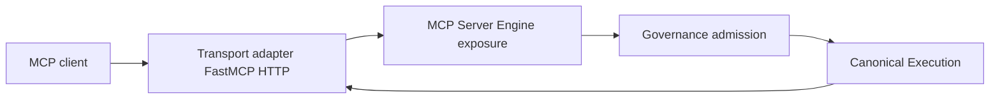

# MCP-SERVER-X — architecture and ownership

**Status:** P1 architecture prep — **not** implementation authorization  
**Audit base:** `ROADMAP_AMENDMENT_SHA` `bd5d04d1a3244ccb9c4464007b147dc54fc0cfd6`  
**ADR pack:** `ADR_MCP_01` … `ADR_MCP_07` — **Proposed** (pending OD-MCP-01..07)

## Single authority per concern

| Concern | Semantic owner | Composition / exposure | MCP engine role |
| --- | --- | --- | --- |
| Task & step execution | Canonical Execution (`HostTaskExecutionPort`, active binding) | Harness host loop | Bridge only — `execute_mcp_agent_task`, catalog child per ADR-TL11 |
| Tool dispatch & outcomes | ToolRuntime (`ExecutionBoundCatalogToolInvoker`) | Nexus / host wiring | No second invoker or handler map |
| Side-effect admission | Governance (`MeaningfulSideEffectAuthorizationPort`) | MCP catalog enforcement builder | Request port; no policy decision |
| Identity & tenant | Harness principal + `RequestIdentity` | `mcp_harness_principal.py` | Resolve principal; client tenant/user = assertions |
| Tool schemas & registry | `ToolContract` / `ToolRegistry` (Tier-0 tools) | Application composition | Read bindings; **no shadow registry** |
| Transport & protocol surface | FastMCP adapter (streamable HTTP) | `fastapi_mcp.py` | Adapter only — no execution semantics |
| Server shape & exposure | Platform MCP Server Engine (planned) | `intergrax/contracts/` + `_shared` composition | Typed definition, allowlist, versioning |
| Configuration mount | CONFIG-X / `settings_loader` | `MCP_MOUNT_PATH`, profiles | Enabled path; fail-closed |
| Compatibility & fingerprint | COMPAT-X | Contract inventory | `mcp-server-definition.v1` surface |
| Cancellation & transport drop | Execution supervision + TOOL-LIFE-X | `mcp_host_execution_transport_cancel.py` | Propagate disconnect; no MCP-local cancel authority |
| Observability truth | Existing execution/trace events | Host OTEL | Correlation fields only — no MCP audit log SSOT |
| Skill / prompt influence | SKILL-X | Agent harness | **Out of MCP** (no `@mcp.prompt`) |
| Stage qualification | MCP-ACC matrix (dossier) | `tests/qualification/mcp_server_x/` | Evidence @ P7 — not historical TOOL-LIFE host tests alone |

## Target logical architecture

**Engine boundary:** protocol exposure, capability discovery, binding validation, composition of allowed tools. **Not in engine:** retry policy, second supervisor, tool business logic, RAG/document stores, skill registry.

## Planned modules (P2+ — names per ADR-MCP-01)

| Layer | Path (planned) | Imports FastMCP? |
| --- | --- | --- |
| Server Definition v1 | `intergrax/contracts/mcp_server_definition.py` | **No** |
| Composition / engine | `intergrax/applications/_shared/mcp_server_engine.py` (final name in ADR-MCP-01) | Via adapter only |
| Transport | `intergrax/applications/_shared/fastapi_mcp.py` | Yes (host boundary) |
| Legacy facades | `mcp_nexus_server.py`, `applications/*/mcp/server.py` | Compatibility adapters |

## Reuse vs gap (audit scope summary)

**Reuse (keep):** ASGI mount, harness auth middleware, principal resolver, transport cancel, catalog bridge (TL11 child path), schema exporter, result bounds, import guard, surface opt-in.

**Gaps (P2–P7):** typed server definition; exposure allowlist; public developer API; surface version/fingerprint; concurrent session bound; unified error catalog; reference L3 qualification server; eight-app facade migration.

## Eight applications

All Tier-3 MCP entrypoints today are thin `build_nexus_mcp_server` (or research pipeline tool). Post-engine: **only** definition parameters differ (name, default capability, default tenant/user, optional extra binding). No per-app FastMCP infrastructure.

## Related ADRs

| ID | Title |
| --- | --- |
| ADR-MCP-01 | Platform ownership & public API |
| ADR-MCP-02 | Capability scope (Tools only v1) |
| ADR-MCP-03 | Transport (streamable HTTP) |
| ADR-MCP-04 | Declarative definition & exposure |
| ADR-MCP-05 | Compatibility facades & v1 contract |
| ADR-MCP-06 | Trust boundary (harness principal) |
| ADR-MCP-07 | Qualification (MCP-ACC; no new FRZ family default) |

## Explicit non-claims (P1)

- Not **ARCHITECTURE APPROVED** for implementation until OD gate clears.
- Not **ENGINE IMPLEMENTED**, **FRZ PASS**, **IIAC**, or **MCP-SERVER-X CLOSED**.
