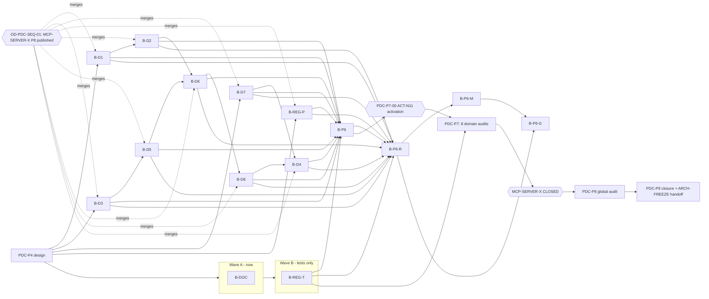

# PDC-X — dependency DAG (PDC-P4-02)

**Generated** by `scripts/qualification/pdc_x_wbs.py`. Waves run in order; batches within a wave run in parallel in separate worktrees (at most 3 concurrent implementer sessions, one bounded pytest each). Fala 3 is deliberately sequential because its batches share `intergrax/applications/_shared/` and `intergrax/contracts/`.

## Critical path

PDC-P4 → (implementation in worktrees, merges gated) → **MCP-SERVER-X P8 published** → B-D6 → B-D8 → B-D4 → B-P6 → PDC-P7-00 ACT-N11 → PDC-P7 → PDC-P8 → PDC-P9.

Wave 3 sets the length of the path. Its three batches run in sequence because they share hotspot files. Waves 1–2 run alongside it and finish earlier.

## Waves

| Wave | Batches | Can start | Merge |
| --- | --- | --- | --- |
| W0-done | B-P3 | — | done |
| W0-external | B-MCP | MCP-SERVER-X campaign | MCP-SERVER-X |
| WA | B-DOC | now | any time |
| WB | B-REG-T | after P4 | any time (tests only) |
| W1 | B-REG-P, B-D1, B-D3, B-D7 | after P4 | after MCP-SERVER-X P8 |
| W2 | B-D2, B-D5 | after W1 dependencies | after MCP-SERVER-X P8 |
| W3a | B-D6 | after W2 | after MCP-SERVER-X P8 |
| W3b | B-D8 | after B-D6 | after MCP-SERVER-X P8 |
| W3c | B-D4 | after B-D7 and B-D8 | after MCP-SERVER-X P8 |
| W4 | B-P6 | after all P5 batches | after MCP-SERVER-X P8 |
| W5 | B-P6-R | after B-P6 (XD runs) | after MCP-SERVER-X P8 |
| W6 | B-P6-M | after B-P6-R | after MCP-SERVER-X P8 |
| W7 | B-P6-G | after B-P6-R and B-P6-M | after MCP-SERVER-X P8 |

## Operator gates

| Gate | Blocks | Authority |
| --- | --- | --- |
| MCP-SERVER-X P8 published | every product-path merge (B-REG-P, B-D1..B-D8, B-P6) | OD-PDC-SEQ-01 |
| PDC-P7-00 ACT-N11 activation at INTEGRATED_BASELINE_SHA | PDC-P7 audits | OD-PDC-IIAC-SCOPE + Operator activation line |
| IIAC protocol header sub-question | PDC-P7-00 | Operator (open) |
| MCP-SERVER-X CLOSED | PDC-P8 | roadmap §3.2 |
| PDC-P9 closure | ARCH-FREEZE handoff | IIAC-B6 + Operator |
