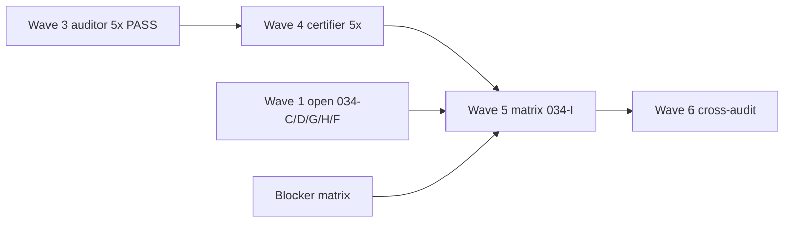

# PRE-ENT Waves 4–6 — closure path

**Campaign:** `pre_ent_enterprise_certification`  
**Plan:** `pre-ent_certification_closure` — [`PRE_ENT_FORMAL_CLOSURE_CHECKPOINT.md`](PRE_ENT_FORMAL_CLOSURE_CHECKPOINT.md) §5  
**CERT_DOCS_HEAD:** `d00df592037404cd6c2b1bc95c00757544d551d8`  
**AUDIT_HEAD (predecessor evidence):** `1e83ade3f5fb951a9eedd85d4dae89ead48955ee`  
**Date:** 2026-11-10  

**Ceiling until Wave 6 complete:** no `ALL_PRE_ENT_PREDECESSORS_INDEPENDENTLY_CERTIFIED` unless every matrix row meets B6 standard; otherwise `PRE_ENT_PREDECESSORS_EXACT_BLOCKERS` (plan §Wynik końcowy).

---

## Wave 4 — certifier (**PUBLISHED**)

| Gate | Criterion | SSOT | Status |
| --- | --- | --- | --- |
| **W4-G0** | Wave 3 register published; 5/5 auditor PASS @ `AUDIT_HEAD` | [`wave3_audits/WAVE3_AUDIT_CONSOLIDATED_REGISTER.md`](wave3_audits/WAVE3_AUDIT_CONSOLIDATED_REGISTER.md) | **met** |
| **W4-G1** | Handoff queue + briefs @ `CERT_DOCS_HEAD` | [`PRE_ENT_WAVE4_CERTIFICATION_HANDOFF_QUEUE.md`](PRE_ENT_WAVE4_CERTIFICATION_HANDOFF_QUEUE.md), [`PRE_ENT_WAVE4_CERTIFIER_SESSION_BRIEFS.md`](PRE_ENT_WAVE4_CERTIFIER_SESSION_BRIEFS.md) | **met** |
| **W4-G2** | Blocker matrix acknowledged | [`PRE_ENT_WAVE4_BLOCKER_MATRIX.md`](PRE_ENT_WAVE4_BLOCKER_MATRIX.md) | **met** |
| **W4-G3** | Five **certifier** sessions executed (operator) | Per-brief pytest replay + scoped **ACCEPT_SCOPED** @ `AUDIT_HEAD`; logs under `.tmp/session/pre-ent-wave4-cert/` | **met (5/5)** |
| **W4-G4** | Certifier register + reports **published** on `development` | [`wave4_certs/WAVE4_CERT_CONSOLIDATED_REGISTER.md`](wave4_certs/WAVE4_CERT_CONSOLIDATED_REGISTER.md), `WAVE4_CERT_T-IGX-*.md` | **PUBLISHED** (publication batch; **not** re-cert) |

**Wave 4 label:** **PUBLISHED** — **not** campaign **CLOSED**, **not** FRZ promotion, **not** `ALL_PRE_ENT_PREDECESSORS_INDEPENDENTLY_CERTIFIED`.

**Not in Wave 4 scope:** FRZ promotion, roadmap §5 CLOSED, G6/IIAC campaign PASS, Population E, 034-C/D/G/H implementation.

**Recommended certifier order:** 034-B → 034-E → 030-B → 030-C → 032-A (see handoff queue).

---

## Wave 5 — matrix publication (`T-IGX-034-I`) — **PUBLISHED**

| Gate | Criterion | SSOT | Status |
| --- | --- | --- | --- |
| **W5-G0** | Wave 4 certifier dispositions for five ready predecessors | [`wave4_certs/WAVE4_CERT_CONSOLIDATED_REGISTER.md`](wave4_certs/WAVE4_CERT_CONSOLIDATED_REGISTER.md) | **met** (5/5 **ACCEPT_SCOPED**) |
| **W5-G1** | Wave 1 open rows honest in matrix (**034-C/D/G/H**, **034-F**) | [`PRE_ENT_ENTERPRISE_CERTIFICATION_FINAL_MATRIX.md`](PRE_ENT_ENTERPRISE_CERTIFICATION_FINAL_MATRIX.md) §3 | **met** (all **EXACT_BLOCKER** or routed defer — no silent OPEN) |
| **W5-G2** | Global blockers **G-SKILL, F10, OD-HIST04, Pop E** = N/A-with-evidence or **EXACT_BLOCKER** | Same matrix §3 | **met** |
| **W5-G3** | Final matrix + optional §5 ledger row | Final matrix + [`PLATFORM_ENTERPRISE_COMPLETION_ROADMAP.md`](../../plans/PLATFORM_ENTERPRISE_COMPLETION_ROADMAP.md) §5 | **PUBLISHED** (matrix SSOT; ledger row non-closing) |
| **W5-G4** | `verify_iiac --require-in-force` @ publication tree | IIAC activation script | **met** @ `f4ca1c864` (exit **0**; Wave 6 audit + publisher replay) |

**034-I ticket:** `governance/tickets/T-IGX-034-I.md` — lifecycle `plan_pending` until operator `Approved:` line for push.

**Wave 5 label:** **PUBLISHED** — **not** campaign **CLOSED**, **not** Wave 6, **not** FRZ promotion.

---

## Wave 6 — cross-audit and campaign label — **AUDIT COMPLETE** (publication pending)

| Gate | Criterion | Status @ `f4ca1c864` |
| --- | --- | --- |
| **W6-G0** | Cross-audit: consistency of Wave 3 auditor reports, Wave 4 certifier dispositions, Wave 5 matrix rows, and §3 / §5 roadmap citations (no contradictory CLOSED language) | **met** — auditor **PASS** ([`PRE_ENT_WAVE6_CROSS_AUDIT_REPORT.md`](PRE_ENT_WAVE6_CROSS_AUDIT_REPORT.md) §2) |
| **W6-G1** | SHA ladder published: `AUDIT_HEAD`, certifier evidence SHAs, matrix publication SHA on `origin/development` | **met** — auditor **PASS** (§3) |
| **W6-G2** | Full parent regression per plan (where not waived by operator budget) | **partial** — **41 passed** bounded bundle; **full** `igx_gov` / L1–L3 **NOT RUN** (§4) — **not** full protocol PASS |
| **W6-G3** | Campaign terminal label per plan: `ALL_PRE_ENT_PREDECESSORS_INDEPENDENTLY_CERTIFIED` **or** `PRE_ENT_PREDECESSORS_EXACT_BLOCKERS` | **met** — **`PRE_ENT_PREDECESSORS_EXACT_BLOCKERS`** (§5) — **not** full Enterprise certification |
| **W6-G4** | `T-IGX-034-A` lifecycle closure with operator sign-off — **not** before W6-G0..G3 | **met** (2026-11-10) — D-W6-03/04; campaign **`CLOSED — EXACT_BLOCKERS`**; **not** full cert / **not** FRZ |

**AUDITOR_SESSION_ID:** `W6-INDEP-AUDIT-2026-11-10-f4ca1c864` @ `f4ca1c864b14c917ea032aabcda1dc169654ace2`.

**Independence:** Cross-audit executed in isolated worktree — not the Wave 5 orchestrator.

---

## Dependency diagram

---

## SSOT cross-links

- Campaign progress: [`PRE_ENT_CAMPAIGN_PROGRESS.md`](PRE_ENT_CAMPAIGN_PROGRESS.md)  
- Formal checkpoint: [`PRE_ENT_FORMAL_CLOSURE_CHECKPOINT.md`](PRE_ENT_FORMAL_CLOSURE_CHECKPOINT.md)  
- Parent: `governance/tickets/T-IGX-034-A.md`
