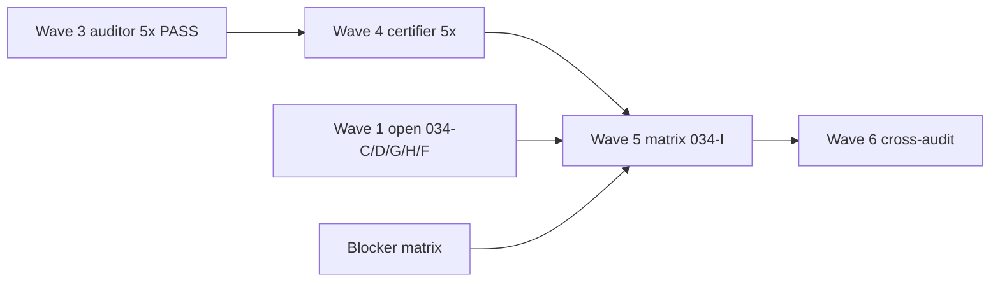

# PRE-ENT Waves 4–6 — closure path

**Campaign:** `pre_ent_enterprise_certification`  
**Plan:** `pre-ent_certification_closure` — [`PRE_ENT_FORMAL_CLOSURE_CHECKPOINT.md`](PRE_ENT_FORMAL_CLOSURE_CHECKPOINT.md) §5  
**CERT_DOCS_HEAD:** `d00df592037404cd6c2b1bc95c00757544d551d8`  
**AUDIT_HEAD (predecessor evidence):** `1e83ade3f5fb951a9eedd85d4dae89ead48955ee`  
**Date:** 2026-11-10  

**Ceiling until Wave 6 complete:** no `ALL_PRE_ENT_PREDECESSORS_INDEPENDENTLY_CERTIFIED` unless every matrix row meets B6 standard; otherwise `PRE_ENT_PREDECESSORS_EXACT_BLOCKERS` (plan §Wynik końcowy).

---

## Wave 4 — certifier (current gate)

| Gate | Criterion | SSOT |
| --- | --- | --- |
| **W4-G0** | Wave 3 register published; 5/5 auditor PASS @ `AUDIT_HEAD` | [`wave3_audits/WAVE3_AUDIT_CONSOLIDATED_REGISTER.md`](wave3_audits/WAVE3_AUDIT_CONSOLIDATED_REGISTER.md) |
| **W4-G1** | Handoff queue + briefs @ `CERT_DOCS_HEAD` | [`PRE_ENT_WAVE4_CERTIFICATION_HANDOFF_QUEUE.md`](PRE_ENT_WAVE4_CERTIFICATION_HANDOFF_QUEUE.md), [`PRE_ENT_WAVE4_CERTIFIER_SESSION_BRIEFS.md`](PRE_ENT_WAVE4_CERTIFIER_SESSION_BRIEFS.md) |
| **W4-G2** | Blocker matrix acknowledged | [`PRE_ENT_WAVE4_BLOCKER_MATRIX.md`](PRE_ENT_WAVE4_BLOCKER_MATRIX.md) |
| **W4-G3** | Five **certifier** sessions executed (operator) | Per-brief pytest replay + scoped ACCEPT/CONDITIONAL records (local logs under `.tmp/session/pre-ent-wave4-cert/`) |
| **W4-STOP** | **This orchestrator turn stops here** — no certifier chats until operator authorizes | Campaign progress STOP line |

**Not in Wave 4 scope:** FRZ promotion, roadmap §5 CLOSED, G6/IIAC campaign PASS, Population E, 034-C/D/G/H implementation.

**Recommended certifier order:** 034-B → 034-E → 030-B → 030-C → 032-A (see handoff queue).

---

## Wave 5 — matrix publication (`T-IGX-034-I`)

| Gate | Criterion | Owner |
| --- | --- | --- |
| **W5-G0** | Wave 4 certifier dispositions recorded for all **ready** predecessor tickets (or explicit CONDITIONAL with operator acceptance) | Certifier + operator |
| **W5-G1** | Wave 1 open batches advanced or formally deferred in matrix: **034-C, 034-D, 034-G, 034-H**, **034-F** (F10 blocker) | Campaign / operator |
| **W5-G2** | Blocker matrix rows **G-SKILL, F10, OD-HIST04, Pop E** = PASS, N/A-with-evidence, or **EXACT_BLOCKER** (no silent OPEN) | Operator |
| **W5-G3** | Publish [`PRE_ENT_ENTERPRISE_CERTIFICATION_FINAL_MATRIX.md`](PRE_ENT_ENTERPRISE_CERTIFICATION_FINAL_MATRIX.md) (create @ Wave 5) + roadmap §5 ledger update per ticket **034-I** | Orchestrator after operator gate |
| **W5-G4** | `verify_iiac --require-in-force` (or successor) green @ publication SHA | CI |

**034-I ticket:** matrix/ledger pub — **blocked** until W5-G0..G2 honest.

---

## Wave 6 — cross-audit and campaign label

| Gate | Criterion |
| --- | --- |
| **W6-G0** | Cross-audit: consistency of Wave 3 auditor reports, Wave 4 certifier dispositions, Wave 5 matrix rows, and §3 / §5 roadmap citations (no contradictory CLOSED language) |
| **W6-G1** | SHA ladder published: `AUDIT_HEAD`, certifier evidence SHAs, matrix publication SHA on `origin/development` |
| **W6-G2** | Full parent regression per plan (where not waived by operator budget) |
| **W6-G3** | Campaign terminal label per plan: `ALL_PRE_ENT_PREDECESSORS_INDEPENDENTLY_CERTIFIED` **or** `PRE_ENT_PREDECESSORS_EXACT_BLOCKERS` |
| **W6-G4** | `T-IGX-034-A` lifecycle closure with operator sign-off — **not** before W6-G0..G3 |

**Independence:** Wave 6 cross-audit is a **new** session (auditor or certifier per operator routing) — implementer/orchestrator that published Wave 4 handoff **must not** self-declare final campaign PASS.

---

## Dependency diagram

---

## SSOT cross-links

- Campaign progress: [`PRE_ENT_CAMPAIGN_PROGRESS.md`](PRE_ENT_CAMPAIGN_PROGRESS.md)  
- Formal checkpoint: [`PRE_ENT_FORMAL_CLOSURE_CHECKPOINT.md`](PRE_ENT_FORMAL_CLOSURE_CHECKPOINT.md)  
- Parent: `governance/tickets/T-IGX-034-A.md`
