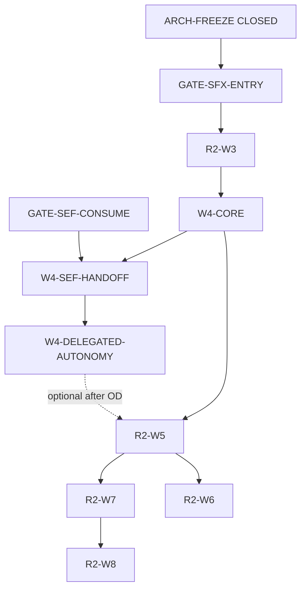

# SFX R2 — WBS Overlay and Dependency DAG (PROPOSED — IGX-SFX-R2-CORR-001)

**Canonical WBS:** R1 [`SFX_WBS.md`](../SFX_WBS.md) unchanged.

## Acyclic DAG (corrected)

**Forbidden edge removed:** `GATE-SEF-CONSUME → W4` as a whole; SEF gate feeds only `W4-SEF-HANDOFF` / `W4-DELEGATED`.

## Critical paths (four milestones — not equivalent)

1. **First sandbox POC (assisted):** AF → GSE → W3 → W4-CORE → R2-W4-06 → R2-W5-01 → R2-W7-01 (no R2-W5-03 driver).
2. **First autonomous POC:** path 1 + OD-SEF-R2 + R2-W4-07 + R2-W5-03 + R2-W7-01 bounded mode.
3. **Product certification:** full W7 (REF+GEN) → W8-01..04 → GATE-SFX-FULL.
4. **Client production:** external SCENARIO-GATE + PROD-Q (outside SFX W8 closure).

## Gate taxonomy (ENTRY vs CERTIFICATION)

| Label in table below | Meaning |
| --- | --- |
| **ENTRY_GATE** (column DEPENDENCIES when value is a programme gate) | Preconditions before starting the task (e.g. GATE-SFX-ENTRY, GATE-SEF-CONSUME, OD-SEF-R2). |
| **CERTIFICATION_GATE** (column GATE) | Programme gate whose checklist must be green before the task's evidence counts toward wave certification (GATE-SFX-FULL, GATE-SEF-CONSUME). |
| **internal demo gate** | EXIT evidence for sandbox POC packaging only (R2-W6-03, R2-W6-04); **not** factory certification. |
| — | No programme certification gate; documentation or commercial checklist only. |

Expanded I/O and ENTRY/CERT columns: [SFX_R2_IMPLEMENTATION_READINESS_MATRIX.md](./SFX_R2_IMPLEMENTATION_READINESS_MATRIX.md).

## Full task registry

| TASK_ID | WAVE | OBJECTIVE | SCOPE | OUT_OF_SCOPE | OWNER | FILE_SET | DEPENDENCIES | GATE | TESTS | EVIDENCE | ACCEPTANCE | PAR | RISK | R1_MAPPING |
| --- | --- | --- | --- | --- | --- | --- | --- | --- | --- | --- | --- | --- | --- | --- |
| R2-W3-01 | W3 | Measurable goals in CON-01/03 | Extend goal/acceptance fields | Runtime | SFX impl | agents/scenario_factory/contracts/ (PROPOSED) | GATE-SFX-ENTRY | GATE-SFX-ENTRY | contract round-trip | .tmp/proof/sfx/R2-W3-01/ | round-trip green | ∥ | M | SFX-P5-02 |
| R2-W3-02 | W3 | SourceIntakeManifest | Schema + validation | Secrets in manifest | SFX | contracts + schema | R2-W3-01 | GATE-SFX-ENTRY | provenance tests | log | schema valid | ∥ | M | SFX-P6 + P7-03 |
| R2-W3-03 | W3 | AutonomyEnvelope adapters | Record + bind CON-13 | Executive authority | SFX | mission/envelope modules (PROPOSED) | R2-W3-01 | GATE-SFX-ENTRY | grant deny/expire | log | fail-closed budgets | — | H | SFX-P5-03 |
| R2-W3-04 | W3 | Iteration/eval/compare views | CW adapters only | Second store | SFX | persistence views (PROPOSED) | R2-W3-01 | GATE-SFX-ENTRY | CAS/replay | log | append-only | ∥ | M | SFX-P5-05 |
| R2-W3-05 | W3 | Mission API op catalog | L0/L1 parity | L2 from offline CLI | SFX | Tier-3 API (PROPOSED) | R2-W3-03 | GATE-SFX-ENTRY | PC drift | parity subset | digests stable | ∥ | M | SFX-P5-07,P10-01 |
| R2-W4-01 | W4-CORE | Goal-first discovery | P6 discovery+spec | SEF jobs | SFX | discovery/spec (PROPOSED) | R2-W3-01 | GATE-SFX-ENTRY | replay fixtures | eval | blocking validation | lane A | H | SFX-P6-01/02 |
| R2-W4-02 | W4-CORE | Business oracles in test plan | CON-07 extensions | Runtime engine | SFX | testing/ (PROPOSED) | R2-W4-01 | GATE-SFX-ENTRY | oracle unit | golden | independent negatives | ∥ | M | SFX-P9-01 |
| R2-W4-03 | W4-CORE | Goal-aware blueprint diff | P7 resolver | SEF | SFX | blueprint/ (PROPOSED) | R2-W3-01 | GATE-SFX-ENTRY | golden digest | log | deterministic | lane B | M | SFX-P7-01..04 |
| R2-W4-04 | W4-CORE | Deterministic scaffold baseline | P8-01 path | Agentic autopilot | SFX | handoff/scaffold (PROPOSED) | R2-W4-03 | GATE-SFX-ENTRY | scaffold determinism | tree digest | ≠ POC label | ∥ | M | SFX-P8-01 |
| R2-W4-05 | W4-CORE | Candidate planner projection | Hypothesis only | Engineering FSM | SFX | mission/planner (PROPOSED) | R2-W3-04 | GATE-SFX-ENTRY | planner unit | log | no side effects | ∥ | M | new |
| R2-W4-06 | W4-SEF | SEF handoff assisted mode | HO-2 human submit | Auto submit | SFX+SEF | handoff/sef_adapter (PROPOSED) | R2-W4-04,R2-W4-01,R2-W4-02,R2-W4-03 | GATE-SEF-CONSUME | HO tests | HO bundle | HO-1..7 green | — | H | SFX-P8-03 |
| R2-W4-08 | W4-SEF | Handoff idempotency/DLQ | Job boundary recovery | Cross-tenant | SFX | handoff/jobs (PROPOSED) | R2-W4-06 | GATE-SEF-CONSUME | idempotency | log | no duplicate effects | — | M | SFX-P8-02 |
| R2-W4-07 | W4-DELEGATED | Delegated multi-submit | Grant-bound derived intents | HO-2 bypass | SFX+SEF | sef_adapter grant mode (PROPOSED) | R2-W4-06,OD-SEF-R2 | GATE-SEF-CONSUME+OD | grant integration | cross-track log | fail without OD | — | H | SFX-P8-03 ext |
| R2-W5-01 | W5 | Business outcome evaluator | Verdict view | Certification | SFX | testing/eval_view (PROPOSED) | R2-W4-02 | GATE-SFX-FULL | oracle injection | verdict digest | code≠business pass | lane C | H | SFX-P9-01 |
| R2-W5-02 | W5 | Champion comparison | CON-R2-06 | Catalog mutate | SFX | compare (PROPOSED) | R2-W5-01 | GATE-SFX-FULL | regression suite | compare record | security non-regress | ∥ | M | new |
| R2-W5-03 | W5 | Autonomous mission driver | Within grant only | L3 | SFX | mission/driver (PROPOSED) | R2-W3-03,R2-W4-07 | GATE-SFX-FULL | adversarial driver | driver log | STOP rules | — | H | new |
| R2-W5-04 | W5 | Studio mission dashboard | Mission UX | Production deploy | SFX FE | web mission (PROPOSED) | R2-W3-05 | GATE-SFX-FULL | e2e subset | screenshots | pause/stop | lane E | M | SFX-P10-06 |
| R2-W5-05 | W5 | Source/evidence trace UI | Business trace | GEN reveal | SFX FE | web trace (PROPOSED) | R2-W5-04 | GATE-SFX-FULL | e2e | log | provenance visible | ∥ | L | SFX-P10-05 |
| R2-W5-06 | W5 | Mission security hardening | Auth/tenant/upload | Prod data | SFX | P9+P10 (PROPOSED) | R2-W5-03 | GATE-SFX-FULL | adversarial T-R2 | qual log | fail closed | — | H | SFX-P9-05,P10-01 |
| R2-W5-07 | W5 | Mission op parity | PC suite mission ops | Schema drift | SFX | parity/ (PROPOSED) | R2-W5-04,R2-W3-05 | GATE-SFX-FULL | PC-1..6 | parity | 100% mission ops | — | M | SFX-P10-03 |
| R2-W6-01 | W6 | Candidate comparison reports | Value of champion | Prod admission | SFX | reporting/compare (PROPOSED) | R2-W5-02 | GATE-SFX-FULL | golden | report | predeclared metrics | ∥ | M | SFX-P11-01 |
| R2-W6-02 | W6 | ROI with sourced baselines | Value model | Fabricated KPI | SFX | value_model (PROPOSED) | R2-W6-01 | GATE-SFX-FULL | source ref scan | value report | every number sourced | ∥ | M | SFX-P11-02 |
| R2-W6-03 | W6 | Portable POC package | Demo bundle | Prod creds | SFX | packaging (PROPOSED) | R2-W5-01 | internal demo gate | repro checklist | bundle | independent replay | — | M | new |
| R2-W6-04 | W6 | Sandbox demo packaging | NOT PRODUCTION labels | Public URL prod | SFX | demo pack (PROPOSED) | R2-W6-03 | internal demo gate | label tests | demo manifest | tenant-bound | ∥ | M | new |
| R2-W6-05 | W6 | Commercial handoff report | Client briefing | Production scope | SFX | commercial (PROPOSED) | R2-W6-01 | — | checklist | handoff doc | PROD separate | ∥ | L | new |
| R2-W7-01 | W7 | REF-1 mission loop | Invoice/PO match oracles | Real ERP | SFX test | fixtures+qual (PROPOSED) | R2-W5-01,R2-W4-06 | GATE-SFX-FULL | REF1-O-* | ref-1 bundle | assisted or bounded per mode | — | H | SFX-P12-01 |
| R2-W7-02 | W7 | REF-2 loop | API idempotency | — | SFX | REF-2 qual | R2-W5-01,R2-W4-06 | GATE-SFX-FULL | REF-2 suite | bundle | OD-SFX-08 | ∥ | H | SFX-P12-02 |
| R2-W7-03 | W7 | REF-3 loop | RAG+HITL | — | SFX | REF-3 qual | R2-W5-01,R2-W4-06 | GATE-SFX-FULL | REF-3 suite | bundle | OD-SFX-08 | ∥ | H | SFX-P12-03 |
| R2-W7-04 | W7 | GEN sealed run | Independent reveal | Pre-reveal tune | Independent | GEN qual | R2-W7-01 | GATE-SFX-FULL | GEN suite | GEN report | seal verified | — | H | SFX-P12-04 |
| R2-W7-05 | W7 | UX rehearsal round | Internal reviewers | Replace P12-05 silently | UX | usability | R2-W5-04 | GATE-SFX-FULL | protocol | report | no safety ambiguity | ∥ | M | SFX-P12-05 |
| R2-W7-06 | W7 | Multi-backend portability | 2 backends if qualified | Fake parity | SFX | qual report | R2-W4-06 | GATE-SFX-FULL | backend matrix | report | honest non-equiv | ∥ | M | new |
| R2-W7-07 | W7 | AUTO/cost benchmarking | Measured AUTO | Marketing SLA | SFX | metrics job | R2-W7-01 | GATE-SFX-FULL | metrics @ SHA | .tmp/proof/ | MS rules | ∥ | M | SFX-P12-06 |
| R2-W8-01 | W8 | R1+R2 traceability replay | REQ map | Fake PASS | SFX | qual/trace | W7 | GATE-SFX-FULL | trace matrix | matrix | 0 unmapped critical | — | M | SFX-P13-02 |
| R2-W8-02 | W8 | SEF consume + grant evidence | HO+grant | SEF authority change | Joint | integration qual | R2-W4-07 | GATE-SEF-CONSUME | HO+grant tests | log | no HO bypass | — | H | SFX-P8-03 |
| R2-W8-03 | W8 | ECAP/IIAC rebind | REBIND-W8 | IIAC forge | SFX | governance | R2-W8-01,R2-W8-02,C-ECAP-01-OPEN | GATE-SFX-FULL | ACT-N11 | rebind log | OD-SFX-06+09 | — | H | SFX-P13-01 |
| R2-W8-04 | W8 | Product certification closure | Factory CLOSED | Prod admission | Operator | P13 | R2-W8-01,R2-W8-02,R2-W8-03 | GATE-SFX-FULL | P13 suite | closure text | ≠ PROD-Q | — | H | SFX-P13-04 OD-SFX-11 |
| R2-W8-05 | W8 | Commercial pilot gate doc | Pricing boundaries | Self-service launch | Commercial | doc only | R2-W6-05 | — | checklist | pilot gate | explicit limits | ∥ | L | new |
