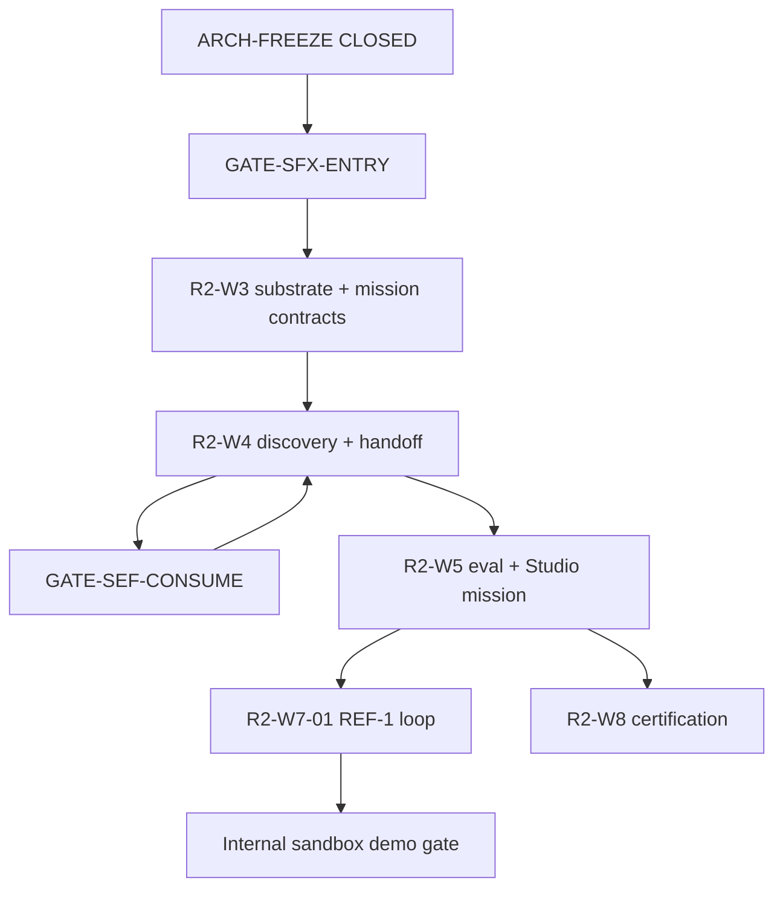

# SFX R2 — WBS Overlay and Dependency DAG (PROPOSED)

**Canonical WBS:** R1 [`SFX_WBS.md`](../SFX_WBS.md) — **not replaced**. This overlay maps R2 units to existing waves P5..P13.

## DAG (critical path emphasis)

## R2 unit → R1 task mapping

### Pre-freeze (documentation — T-IGX-070-A)

| ID | Maps to | Status |
| --- | --- | --- |
| R2-D01 | gap analysis extension | **This campaign** |
| R2-D02 | autonomous mission spec | **This campaign** |
| R2-D03 | contract proposals | **This campaign** |
| R2-D04 | SEF amendment | **This campaign** |
| R2-D05 | REF-1 eval plan | **This campaign** |
| R2-D06 | WBS/traceability/review | **This campaign** |

### W3 (P5)

| R2 unit | R1 anchor | Owner | Par | Verification |
| --- | --- | --- | --- | --- |
| R2-W3-01 | SFX-P5-02 CON-01/03/07 | implementer | ∥ | contract round-trip |
| R2-W3-02 | SFX-P5-02 + P6 | implementer | ∥ | tenant/provenance |
| R2-W3-03 | SFX-P5-03 CON-13/15 | implementer | — | grant deny/expire |
| R2-W3-04 | SFX-P5-05 | implementer | ∥ | CAS/replay |
| R2-W3-05 | SFX-P5-07, P10-01 | implementer | ∥ | parity digests |

### W4 (P6–P8)

| R2 unit | R1 anchor | Deps | Gate |
| --- | --- | --- | --- |
| R2-W4-01 | SFX-P6-01/02 | W3 | — |
| R2-W4-02 | SFX-P9-01 | W4-01 | — |
| R2-W4-03 | SFX-P7-01/02/04 | W3 | — |
| R2-W4-04 | SFX-P8-01 | W4-03 | — |
| R2-W4-05 | **new** planner module | P5-05 | — |
| R2-W4-06 | SFX-P8-03 | P8-02, GSC | HO-2 |
| R2-W4-07 | SFX-P8-03 | R2-W4-06, **OD-SEF-R2** | delegated submit |
| R2-W4-08 | SFX-P8-02 | W4 | idempotency |

### W5 (P9–P10)

| R2 unit | R1 anchor |
| --- | --- |
| R2-W5-01 | SFX-P9-01 |
| R2-W5-02 | SFX-P7-04 + new compare view |
| R2-W5-03 | new `mission/driver` |
| R2-W5-04..05 | SFX-P10-05/06 |
| R2-W5-06 | SFX-P10-01, P9-04/05 |
| R2-W5-07 | SFX-P10-03 |

### W6–W8

Align with blueprint §9 tables: R2-W6-01..05 → P11; R2-W7-01..07 → P12; R2-W8-01..05 → P13.

## Milestone separation

| Milestone | Meaning | Not equivalent to |
| --- | --- | --- |
| Technical W5 REF-1 slice | Runnable autonomous loop in LAB | SFX product CLOSED |
| Internal demo gate | Controlled sandbox demos | Production admission |
| GATE-SFX-FULL | Factory certification | Scenario PROD-Q |