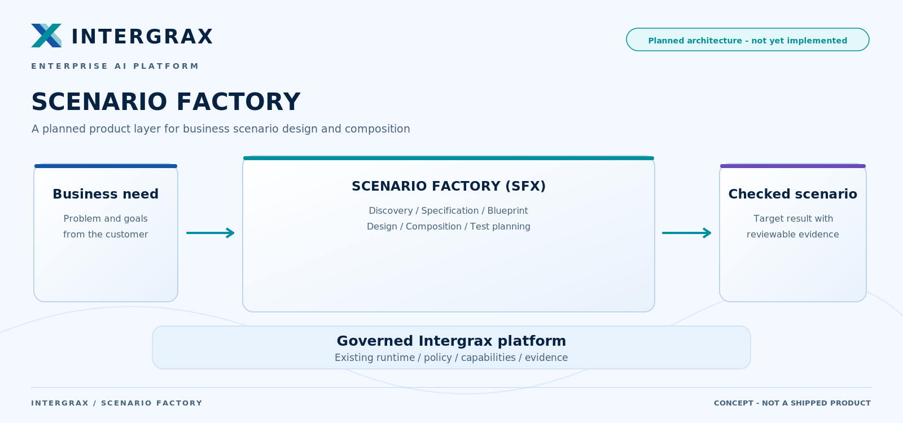
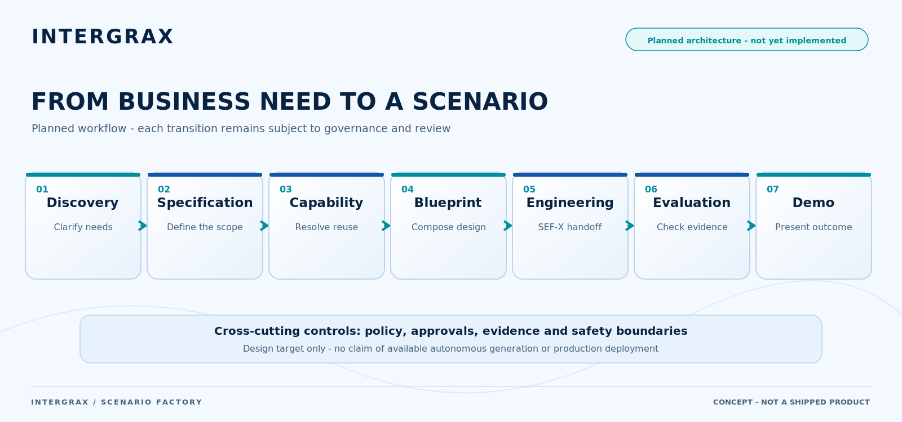
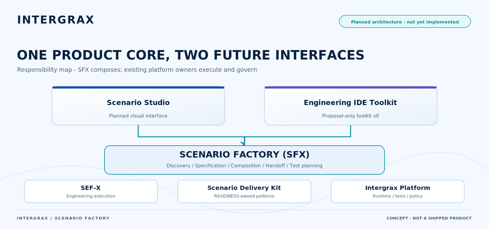

# Scenario Factory

**Status:** `Planned` · `Architecture/Design` · `Proposal-only Toolkit` · **`Not yet implemented`**  
**Not a call to action.** The first-screen action on the repository front page stays [Try LKW](../../../README.md#try-lkw). Scenario Factory is a planned product layer, not something you can run today.

<a href="../assets/public/scenario-factory/fullsize/scenario-factory-hero.md">
<picture>
  <source media="(prefers-color-scheme: dark)" srcset="../assets/public/scenario-factory/scenario-factory-hero-dark.png">
  <source media="(prefers-color-scheme: light)" srcset="../assets/public/scenario-factory/scenario-factory-hero-light.png">
  
</picture>
</a>

[View full-size diagram](../assets/public/scenario-factory/fullsize/scenario-factory-hero.md)

## What it is

Scenario Factory is a **planned** product layer for Intergrax. Its purpose: a business need becomes a **designed and checked scenario** that runs on the governed platform, instead of every scenario being hand-built from scratch.

It is a design that is being documented before the platform architecture freeze. No Scenario Factory product code exists. Nothing on this page can be run, installed or tried.

## The planned journey

```text
Business Problem → Discovery → Scenario Specification → Capability Resolution → Blueprint
→ Configuration → Engineering → Testing / Evaluation → Demonstration → Lifecycle / Reporting
```

Every phase below is a **plan**. Each phase ends at an approval point: a person decides before the next phase starts.

<a href="../assets/public/scenario-factory/fullsize/scenario-factory-journey.md">
<picture>
  <source media="(prefers-color-scheme: dark)" srcset="../assets/public/scenario-factory/scenario-factory-journey-dark.png">
  <source media="(prefers-color-scheme: light)" srcset="../assets/public/scenario-factory/scenario-factory-journey-light.png">
  
</picture>
</a>

[View full-size diagram](../assets/public/scenario-factory/fullsize/scenario-factory-journey.md)

The picture compresses the journey to seven steps. The list above is the complete planned journey.

## Two planned entry points, one core

- **Scenario Studio** is the planned visual experience for business and solution users. It does not exist yet.
- **Engineering IDE Toolkit** is a proposal for technical teams: skills, a rule and personas for Claude Code and Cursor. It is a **Proposal-only Toolkit**. It produces draft files for people to review. It does not run scenarios and holds no authority of its own.

Both entry points are meant to sit on one shared core, so a scenario designed in one can be continued in the other.

## Who owns what

Scenario Factory is meant to **compose** existing mechanisms. It does not replace them and it does not own them.

| Concern | Owner |
| --- | --- |
| Designing and composing a scenario from a business need | Scenario Factory (planned) |
| Engineering work on the scenario code | SEF-X, the planned engineering factory track |
| Reusable delivery components and patterns | Scenario Delivery Kit, owned by the scenario-readiness track |
| Executing a scenario, policy, tool calls, approvals | The Intergrax runtime and platform |
| Evidence that a scenario holds up | [Scenario Proofs](../proofs/PROOF_LIBRARY.md), a separate evidence track |
| Permission to use a scenario in production | Separate admission and live-environment qualification, outside Scenario Factory |

Scenario Factory is not meant to add a second engine, a second policy authority, a second tool runtime or a second registry.

<a href="../assets/public/scenario-factory/fullsize/scenario-factory-ownership.md">
<picture>
  <source media="(prefers-color-scheme: dark)" srcset="../assets/public/scenario-factory/scenario-factory-ownership-dark.png">
  <source media="(prefers-color-scheme: light)" srcset="../assets/public/scenario-factory/scenario-factory-ownership-light.png">
  
</picture>
</a>

[View full-size diagram](../assets/public/scenario-factory/fullsize/scenario-factory-ownership.md)

## What this page does not claim

- It does not claim that you can build or deploy scenarios with it today.
- It does not claim a shipped Scenario Studio.
- It does not claim a certified or production-ready Scenario Factory, and it does not claim certified scenario generation.
- It does not promise business results or return on investment.
- Even when it exists, a generated scenario will not be admitted to production by the factory. Admission and live qualification are separate steps with their own owners.
- It does not say anything about the platform architecture freeze. That is a separate stage.

## Where this sits in the Intergrax story

- **Scenario Proofs** are executable evidence on real problems: [Proof Library](../proofs/PROOF_LIBRARY.md). A proof is evidence. Scenario Factory is a plan. The two are separate.
- **Products**: the current product is the Local Knowledge Workspace, see [Try LKW](../../../README.md#try-lkw).
- **Platform**: the governed foundation described in [Platform architecture](../../../README.md#explore-the-intergrax-platform).
- **Future directions**: the longer-term [North Star](AUTONOMOUS_ORGANIZATION.md) is a separate program.

## Engineering documentation

The engineering documents hold the [architecture and scope](../capabilities/architecture/SCENARIO_FACTORY.md) and [plan](../capabilities/plan/SCENARIO_FACTORY.md). They are the source of truth if this overview differs.
