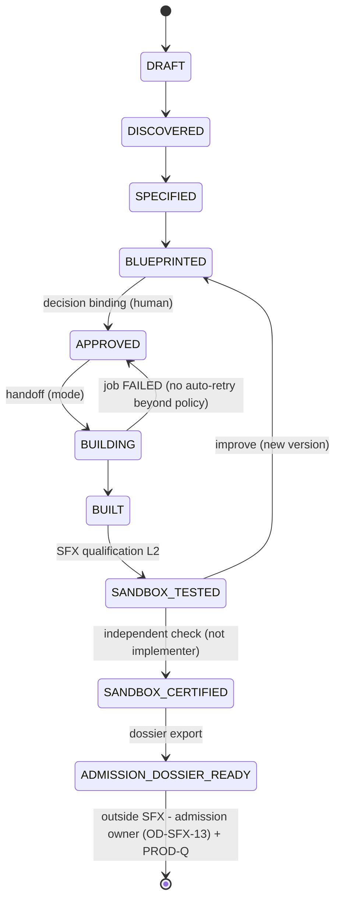

# ADR-SFX-006: SFX authority levels, engineering modes, and certification/admission separation

| Field | Value |
|-------|-------|
| **Status** | **Proposed** (T-IGX-037-C, SFX-P2-01; **not Accepted** - acceptance is OD-SFX-06, a separate operator review) |
| **Date** | 2026-11-12 |
| **Deciders** | Operator (OD-SFX-06). Per-scenario admission ownership is the open decision **OD-SFX-13**. The SEF-X track decides C-SEF-01..04 |
| **Code reference SHA** | `eadb1c2116fe` |
| **Related** | [`T-IGX-037-C`](../../../../../../governance/tickets/T-IGX-037-C.md) · SFX master plan R1 §3, §6 (SFX-GAP-15/16), §7.9, §7.10, §13, §14 (`governance/tickets/plans/SFX-MASTER-PLAN.md`, published by T-IGX-037-A) · [`ADR-SEF-001`](../2026-11-05/ADR-SEF-001.md) · [`ASF-SEF-MASTER-PLAN.md`](../../../../../../governance/tickets/plans/ASF-SEF-MASTER-PLAN.md) · [`ADR-SFX-001`](ADR-SFX-001.md) · [`ADR-SFX-005`](ADR-SFX-005.md) |

## Context

SFX produces scenario packages that can run. This creates three risks:

- A generated scenario, or SFX itself, could escalate its own authority.
- A scaffold-only skeleton could be presented as a finished scenario.
- SFX product certification could be mistaken for production admission of what it generates.

SFX must consume the SEF-X engineering engine without duplicating it ([`ADR-SEF-001`](../2026-11-05/ADR-SEF-001.md)), and it must not create a new semantic authority (OD-SFX-01).

R0 looked for a `ScenarioAdmission` symbol and treated its absence as a gap of SCENARIO-GATE. R1 §14.2 replaces that with a semantic assessment. SCENARIO-GATE is a one-time **programme** Go/No-Go (the "Enterprise → Scenario transition gate") with no per-scenario function. The question is therefore which real mechanisms gate production today, and where the self-promotion seams are.

Alternatives considered:

| Variant | Summary | Rejection rationale |
|---------|---------|---------------------|
| **A - SFX admits scenarios** | SFX writes a per-scenario production admission record at the end of its FSM | A new semantic authority inside a product module. SFX would certify its own output (implementer ≠ certifier is violated). |
| **B - SCENARIO-GATE per scenario** | Reinterpret the programme gate as a per-scenario gate | Changes the meaning of a roadmap gate. A one-time programme decision cannot carry per-scenario evidence. |
| **C - Agentic-only build** | Every build goes through SEF-X | Blocks all SFX building until GATE-SEF-CONSUME and removes the deterministic, LLM-free baseline. |
| **D - Scaffold-only build** | No SEF-X dependency | Cannot produce business logic. SFX closure would certify a factory that cannot finish a scenario. |
| **E - Levels + two modes + dossier hand-off (selected)** | L0-L3 with L3 never granted by SFX; `DETERMINISTIC_SCAFFOLD` and `AGENTIC_ENGINEERING` behind one `EngineeringHandoffPort`; the FSM ends at `ADMISSION_DOSSIER_READY` | Keeps SFX inside product scope and reuses the existing gates. Admission stays with an owner that OD-SFX-13 assigns. |

## Decision

Adopt **Variant E**.

### 1. Authority levels

| Level | Allows | Doors | Runtime posture |
|-------|--------|-------|-----------------|
| **L0 read-only** | Read SFX artifacts, catalog sidecar entries, reports | All, including the offline CLI | None |
| **L1 proposal-only** | Create and edit SFX artifacts as proposals; no execution. The pre-freeze IDE toolkit v0 is L1 (OD-SFX-04) | Offline CLI on **local files only**; shared-store writes only through an authenticated door (API or MCP) | None |
| **L2 sandbox-executable** | Sandbox runs of an `APPROVED` blueprint: fixture adapters, budgets, egress deny (`sandbox_network_egress` allowlist empty) | Authenticated door only, with the same principal model (harness principal → tenant reconciliation → PolicyEngine) | `ScenarioRuntimeMode.LAB` (`intergrax/applications/_shared/scenario_runtime_profiles.py:25`) |
| **L3 production** | Production execution | **Never granted by SFX** | `PRODUCTION_ATTACHED` (`:26`) on a STRICT+PRODUCT host, only after admission outside SFX |

- SFX code never calls `build_scenario_production_runtime` (`intergrax/applications/_shared/scenario_runtime_profiles.py:114-159`). SFX never holds L3 credentials.
- Every Studio/IDE action shows its level (authority badge, R0 §8).
- The permission matrix test, level × door, is parity rule PC-3 (ADR-SFX-004).

### 2. Engineering modes behind one `EngineeringHandoffPort`

| | `DETERMINISTIC_SCAFFOLD` | `AGENTIC_ENGINEERING` |
|---|---|---|
| Mechanism | `python -m intergrax.scaffold new-application/new-agent/new-integration/new-skill` and `scripts/proof/init_scenario_implementation.py`. No LLM. The same blueprint digest gives the same tree digest | SEF-X Engineering Execution Authority (EEA) |
| Output | A conformant skeleton; business logic stays `NotImplemented` | A complete package + PR + `EngineeringEvidenceBundle` (CON-E-05) + `DeliveryManifest` (CON-N-04) |
| Authority | The SFX handoff adapter writes only inside its job workspace (path-escape tests, SFX-P9-04) | SEF-X: `WorkspaceLease` (CON-N-03), `CodingExecutionBackend` (CON-N-05), engineering FSM, DevOS ticket and PR, no auto-merge (T-P9-005) |
| Available | After GATE-SFX-ENTRY | Only after **GATE-SEF-CONSUME** |
| Certifies | Factory determinism and conformance | **Required for SFX closure** (GATE-SFX-FULL): REF-1..3 plus the generalization set |

A scaffold-only result can never reach `SANDBOX_CERTIFIED` with business logic. The agentic job state stays in SEF (`EngineeringExecutionRecord`, CON-N-02). SFX holds the SEF `job_id` by reference only, in `EngineeringJobRecord` (SFX-CON-15).

### 3. GATE-SEF-CONSUME (precondition for `AGENTIC_ENGINEERING`)

All of the following must hold:

- ADR-SEF-001 has passed its acceptance review (its status is no longer Proposed).
- OD-SEF-04 (FSM ↔ ticket binding) is resolved.
- CON-N-01/02/03/04/05 and CON-E-01/02/04/05 are implemented.
- SEF **GATE-SEF-FULL** has passed.
- SEF scoped B6 (T-P12-003) has passed on the consumed mechanisms.
- OD-SFX-10 (cross-track edge SFX → SEF-X) is signed.
- SEF records SFX as a registered intake consumer (C-SEF-01).

### 4. Handoff certification criteria HO-1..HO-7

- **HO-1 Lineage.** The bundle references the approved blueprint digest `D_bp`, and every artifact digest in `DeliveryManifest` is reproducible.
- **HO-2 Human submit only.** SFX drafts the `EngineeringIntent` (CON-N-01 fields; `text_untrusted` contains the canonical blueprint and `D_bp`). Only a human approver submits it (`operator_id` = approver). SFX never auto-submits.
- **HO-3 Reference, not copy.** The SFX job record links the SEF `job_id` by reference. SFX does not replicate the SEF state machine.
- **HO-4 Conformance.** The generated package passes `scenario_architecture_conformance` and the SFX gates.
- **HO-5 One-to-one failure mapping.** SEF `failed` / `paused` map to SFX job `FAILED` / `WAITING`. There are no silent retries.
- **HO-6 Merge is operator-only.**
- **HO-7 Pinned evidence.** Evidence is pinned to exact SHAs and enters the SFX SHA ladder.

### 5. Lifecycle FSM (SFX stops before production)

- **Terminal SFX state:** `ADMISSION_DOSSIER_READY`.
- **Authoritative state:** the Collaborative Work lifecycle record (`ScenarioLifecycleRecord`, SFX-CON-14; R1 §7.5).
- **Mapping to `scripts/proof/scenario_lifecycle.py`:**
  - DRAFT..BLUEPRINTED → DESIGN
  - APPROVED → ACCEPTED_FOR_IMPLEMENTATION
  - BUILT → IMPLEMENTATION_INITIALIZED
  - SANDBOX_TESTED → EXECUTABLE
  - SANDBOX_CERTIFIED → VERIFIED
- The markdown lifecycle value is **informational only**, because spec frontmatter (`VERIFIED`, `scripts/proof/scenario_lifecycle.py:29`) is hand-editable.
- **Invariant SFX-INV-01:** generated code is never a certified scenario.

### 6. Semantic gate assessment (R1 §14.2)

Mechanisms that gate production on real execution paths today, re-verified at `eadb1c2116fe`:

| Mechanism | Citation | What it enforces | Limit for per-scenario admission |
|-----------|----------|------------------|----------------------------------|
| STRICT+PRODUCT roster certification | `intergrax/applications/_shared/agent_certification_wiring.py:100-155` (`validate_strict_roster_agent_certification`) | Active only when `execution_mode is STRICT` and `profile is PRODUCT` (`:107`, `:109`). Requires revision-bound contract authority (`:115`). Blocks deploy-blocked lifecycles (`:131`). Requires an `AgentCertificationRecord` for certification-required states (`:150`) | Validates records but does not establish who wrote them (see seam S5) |
| Revision-bound contract authority | `intergrax/applications/_shared/roster_agent_contract_authority.py:55-100` (`from_revision_roster`, `contract_for_binding`) | Roster package digests must be installed in the runtime revision (`:70`). Conflicting digests per contract fail (`:79`). Contracts resolve by digest only | Agent-level, not scenario-level |
| Plugin production admission | `intergrax/runtime/decision_plugin_policy.py:44-66` (`production_admission_rejection_for_spec`) | When `require_production_admission` is set (`:48`), a non-admitted entry point is rejected `PRODUCTION_ADMISSION_DENIED` (`:63`), fail-closed (`:65`) | Applies to plugin entry points, not scenarios. The flag defaults to `False` (`:30`) |
| Production-attached runtime build | `intergrax/applications/_shared/scenario_runtime_profiles.py:114-159` (`build_scenario_production_runtime`) | Fails closed without an explicit manifest, a valid tenant, and a runtime-events path; sets `PRODUCTION_ATTACHED` (`:158`) | **Posture, not authorization:** it does not check STRICT or PRODUCT (seam S3) |
| STRICT-gated MSE authorization | Named in R1 §14.2; **citation not re-traced in this ADR** | Meaningful-side-effect authorization on STRICT hosts | Must be re-traced before acceptance (open item) |
| PROD-Q live slice | Per integration | Live vendor qualification | NOT QUALIFIED today (DIM6/DIM17 OPEN) |

**Assessment:**

- These mechanisms gate **agents, plugins and integrations**. **No owner exists for an operator-signed per-scenario admission record** (SFX-GAP-16, VERIFIED).
- SFX must not create one (Variant A rejected).
- **OD-SFX-13 (open owner decision)** assigns it. The candidates are the scenario programme opened by SCENARIO-GATE, or platform Agent Runtime Governance.

### 7. Self-promotion seams (SFX-GAP-15) - platform-owned

| Seam | Citation | Effect |
|------|----------|--------|
| S1 | `intergrax/contracts/agent_contract_meta.py:71` | `AgentContract.lifecycle_state` defaults to `PRODUCTION`. `production_eligible` defaults to `False` (`:72`) |
| S2 | `intergrax/applications/contracts/environment_profile/root.py:85` | `ApplicationEnvironmentProfile` uses `validate_assignment=True` and is not frozen, so it can be mutated after construction |
| S3 | `intergrax/applications/_shared/scenario_runtime_profiles.py:114-159` | `PRODUCTION_ATTACHED` does not require STRICT+PRODUCT |
| S4 | `intergrax/runtime/architecture/agent_promotion.py:36` | `evaluate_agent_promotion` has no call site under `intergrax/`, `agents/` or `applications/` other than its package re-export (`intergrax/runtime/architecture/__init__.py:17`, `:416`) |
| S5 | `intergrax/applications/_shared/agent_certification_wiring.py:64-78`, `:35-61` | `apply_roster_agent_governance` attaches records produced by `materialize_roster_certifications_for_agents`, with `certified_by` defaulting to `"platform-reference-host"` (`:39`) and the compatibility resolver allowed (`:50`). The host certifies itself |
| S6 | `scripts/proof/scenario_lifecycle.py:29` | Spec frontmatter `VERIFIED` is hand-editable markdown |

- **Ownership:** these seams are **platform-owned** (Agent Runtime Governance / PDC-X D1, D6). SFX does **not** fix them. SFX records them and hands them to the platform owner.
- **What they block:** production admission. They do not block SFX closure.
- **SFX compensations, inside its own scope (R1 §13):**
  - The no-self-escalation conformance rule (SFX-P9-02) forbids generated code from constructing or mutating `ApplicationEnvironmentProfile.execution_mode`/`profile`, `policy_enforcement_mode`, `AgentGovernanceProfile`, certification records (`apply_roster_agent_governance`), `AgentContract.lifecycle_state = PRODUCTION`, exposure policies, or registries.
  - SFX holds no L3 credentials.
  - SFX lifecycle authority is the CW record, not the frontmatter.

### 8. Product certification vs admission

- **SFX product certification (stage scope):**
  - IIAC per-stage activation (OD-SFX-09).
  - Audit by a distinct session with exact-SHA manifests.
  - ECAP per wave.
  - ENT-AUDIT CHANGED-SINCE at closure.
  - Scope: the factory only (doors, service, contracts, persistence, handoff, gates, parity, generalization). It certifies **no generated scenario** for production.
- **Admission dossier (`ScenarioAdmissionDossier`, SFX-CON-17)** is an export, not an admission. For each `SANDBOX_CERTIFIED` scenario it contains:
  - canonical artifacts plus digests;
  - the engineering evidence bundle;
  - qualification records;
  - security gate results;
  - the required-integrations list for PROD-Q;
  - known limitations.
- **Admission happens outside SFX** and requires all of:
  - SCENARIO-GATE CLOSED;
  - an admission decision by the OD-SFX-13 owner;
  - PROD-Q live qualification for each integration;
  - a STRICT+PRODUCT host with revision-bound authority.
- The catalog sidecar may reference the dossier and an external admission reference, but it never asserts admission ([`ADR-SFX-005`](ADR-SFX-005.md)).

### 9. Conflicts with SEF-X (reported, not resolved)

| ID | Conflict | SFX position | Resolver |
|----|----------|--------------|----------|
| **C-SEF-01** | SEF names no external intake consumer. CON-N-01 is "human submit only" (`governance/tickets/plans/ASF-SEF-MASTER-PLAN.md:381`) | SFX conforms through HO-2, but SEF must acknowledge SFX as a consumer | SEF track (OD-SEF-07 or a new SEF OD) + OD-SFX-10 |
| **C-SEF-02** | T-P5-004 (network egress) is OPTIONAL and excluded from certification (`ASF-SEF-MASTER-PLAN.md:516`, `:588`; GAP-MED-07 `:275`) | SFX asks that it become mandatory for GATE-SEF-CONSUME. Otherwise GATE-SFX-FULL stays BLOCKED | SEF track |
| **C-SEF-03** | CON-E-04 `VerificationRecord` (`ASF-SEF-MASTER-PLAN.md:372`) has no SEF WBS task (R1 §3.4) | SFX consumption is BLOCKED until SEF assigns one | SEF track |
| **C-SEF-04** | GAP-HIGH-07, SEF ↔ READINESS kit coupling, is OPEN (`ASF-SEF-MASTER-PLAN.md:264`) | SFX scaffold templates stay on the existing scaffold tools until the READINESS kit is CLOSED. SFX never defines kit templates (C-RDY-01) | SEF + READINESS tracks |

## Consequences

### Positive

- SFX cannot promote its own output. Production remains behind existing agent, plugin and integration gates plus an owner that OD-SFX-13 assigns.
- The deterministic mode gives an LLM-free, reproducible baseline that does not depend on SEF-X timing.
- Gate claims rest on traced mechanisms instead of symbol presence.

### Negative

- SFX closure depends on SEF-X (GATE-SEF-CONSUME) and on four SEF-side resolutions. B-SFX-03 remains until then.
- Production admission of any SFX output is blocked until OD-SFX-13 is decided and the platform-owned seams S1-S6 are handled. This is outside SFX control.
- The level × door permission model adds a parity test dimension to every door.

## Compliance

- Tier boundaries: SFX adds nothing to `intergrax/`. The seams are reported, not patched.
- Governance: no new authority. Approvals use CW decision bindings, and execution uses PolicyEngine/ToolRuntime.
- Stays **Proposed** until OD-SFX-06. OD-SFX-13 and C-SEF-01..04 stay open.

## Implementation notes

- **Not in scope at Proposed:** the `EngineeringHandoffPort` code, the conformance rules (SFX-P9-02), the dossier exporter, and any platform seam fix.
- **Open before acceptance:** re-trace the STRICT-gated MSE authorization citation.
- **Revision triggers:** any SFX write of an admission record; any L3 path in SFX; any SEF contract change to CON-N-01..05 or CON-E-01/02/04/05; an OD-SFX-13 decision.
- **Verification (when implemented):** the level × door permission matrix; a no-self-escalation conformance test; path-escape tests; HO-1..HO-7 checks on recorded SEF bundles; a test that the FSM has no transition past `ADMISSION_DOSSIER_READY`.
