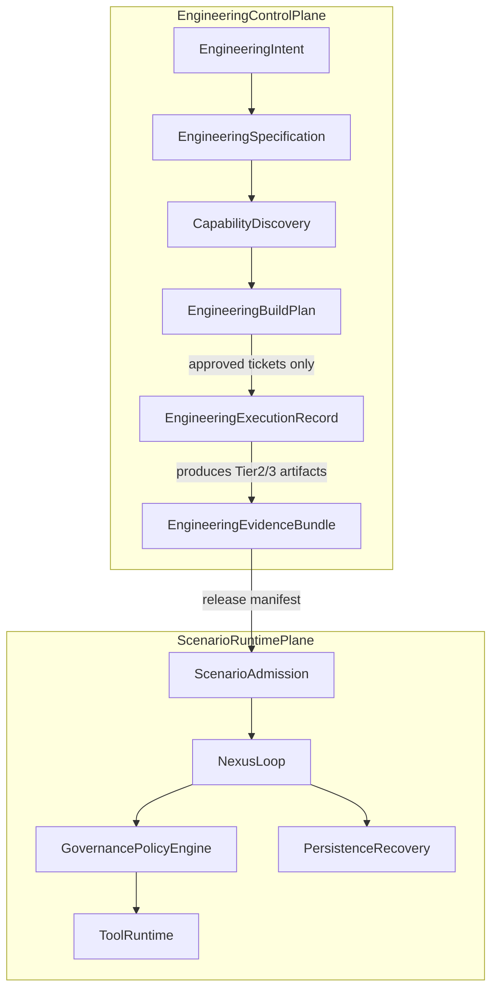
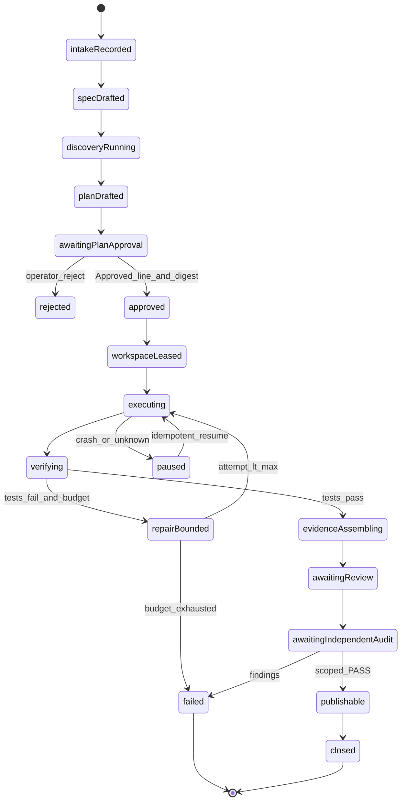

# ASF/SEF — Corrective Enterprise Architecture & Implementation Master Plan

**Campaign:** `ASF-SEF-P0` — operator decisions **OD-SEF-01/02/03 integrated**; cert-gate **GATE-SEF-FULL×63**  
**Plan review gate:** `ASF-SEF-P0 — OPERATOR DECISIONS INTEGRATED — READY FOR FINAL PLAN REVIEW`  
**Plan SSOT path:** `C:\Users\XPS\.cursor\plans\asf-sef_corrective_master_plan_89133b21.plan.md`  
**Mode:** PLAN — **repo `intergrax` read-only** (no product commits/push)  
**Proposed future doc paths (NOT created in repo):** `docs/project/maintainers/plans/satellites/ASF_SEF_*.md`

### WBS cardinality (78 vs 82 — resolved)

| Set | Count | Definition |
|-----|-------|------------|
| **WBS-PRIOR-LABEL** | 78 | **Miscount** in first corrective plan |
| **WBS-DELIVERY-RECOUNT** | 82 | `6+6+5+10+6+6+6+5+5+5+6+4+6+6` = **82** (not 78) |
| **WBS-TOTAL** | **82** | Unique IDs in Deliverable 8; integrity scope merged into T-P0-006, T-P0-002, T-P3-001, T-P1-002 |

---

## Terminal summary (§16)

| Item | Value |
|------|--------|
| **AUDIT_BASELINE_SHA** | `bffd689d3b127bbcd753f0cf6f2c863c4db4a032` (= `origin/development`) |
| **Read-only (repo)** | Confirmed — plan file only mutated in this wave |
| **Capabilities inventoried** | **52** (`CAP-001`…`CAP-052`) |
| **Requirements** | **38** (`REQ-ASF-001`…`REQ-ASF-038`) |
| **Gaps** | **30** total — CRIT **6**, HIGH **11**, MED **9**, LOW **4** |
| **WBS tasks** | **82** unique IDs (see reconciliation; integrity scope merged) |
| **Contracts** | REUSE **9**, EXTEND **7**, NEW **9**, REJECT **5** (total **30** contract rows) |
| **Architecture (operator)** | **APPROVED — OD-SEF-01:** Variant **C + D-lite**; separate EEA vs Scenario Runtime; provider-neutral **CodingExecutionBackend**; no second Nexus/ToolRuntime/PolicyEngine SSOT |
| **Roadmap (operator)** | **APPROVED — OD-SEF-02:** **Option 3** — **SEF-X parallel SCENARIO-READINESS-X** after **ARCH-FREEZE CLOSED**; **no** automatic SCENARIO-READINESS-X ← SEF-X completion dependency |
| **Option 4 pilot** | **NOT AUTHORIZED** — documented as **deferred/rejected** alternative; **not** an active execution path |
| **ADR-SEF-001 (operator)** | **OD-SEF-03:** approved for **preparation only**; status remains **`Proposed`** until separate acceptance review |
| **ARCH-FREEZE impact** | SEF implementation **blocked** until EVOL/ENT **formal** closure + ARCH-FREEZE; pre-freeze **contract/port design** = Class **B/C** analysis required (not `NONE_WITH_EVIDENCE`) |
| **20 deliverables** | **FILLED_IN_PLAN** (expanded integrity wave) |
| **Plan completeness verdict** | **STRUCTURALLY_COMPLETE** — 38 REQ, 82 WBS, 30 GAP, 52 CAP, 30 CON rows present; **30 GAP status OPEN** |
| **Implementation readiness** | **BLOCKED** — B6 PENDING, ADR PROPOSED, ARCH-FREEZE OPEN, CAP-049..052 MISSING |
| **Next allowed repo work** | **P1-B0 Bootstrap** (ticket + digest + `Approved:` + `verify_plan_approval` → **`plan_approved`**) then **P1-B1 Publication** — see §ASF-SEF-P1 |

**Worktree note @ baseline:** tracked tree clean; **3 untracked** files under `scripts/qualification/local_b6/` (EVOL B6 local mechanics) — do not treat as certified evidence until governed ticket + SHA ladder.

**Authority rebaseline (blob @ HEAD):** roadmap `8d551a467…`, FRZ checklist `6ece5d831…`, ECAP `86628db3c…`, SYSTEM_INVARIANTS `fe6d2d271…` (**verified via `git show HEAD:…`**), post-freeze gov `447237cd6…`, role_registry `e7e416933…`, task_lifecycle `646168f5e…`.

---

## Deliverable 1 — `ASF_SEF_MASTER_ARCHITECTURE_AND_IMPLEMENTATION_PLAN`

Single narrative spine:

1. **Purpose:** End-to-end factory from business intent → bounded engineering → evidence → PR/artifact; **distinct** from scenario production admission (`SCENARIO-GATE`, PROD-Q Dim B).
2. **Non-goals:** Second Nexus, second ToolRuntime, second FRZ/ECAP SSOT, implementer B6, Cursor-as-runtime-authority.
3. **Phases:** P0 audit → P1 ADR → P2 integration → P3–P9 build → P10 scenario qual → P11 benchmark → P12 independent cert → P13 closure (maps to WBS §11).
4. **Critical path:** EVOL/ENT formal B6 → ARCH-FREEZE → **OD-SEF-03 ADR Proposed (P1)** → engineering contracts → REF-A/B/C → GATE-SEF-FULL quals → **T-P12-006** → **T-P12-003** → **parallel tracks:** SEF-X scoped B6 **∥** SCENARIO-READINESS-X (Option 3; cross-track edges only with technical justification).

### Engineering Execution Authority (EEA)

| Attribute | Value |
|-----------|--------|
| Owner | DevOS control plane + PROPOSED `agents/sef_orchestration/` (Class A/B) |
| Authority | Orchestrate **engineering jobs** (spec, discovery, edit, test, evidence, PR) bound to tickets |
| Non-authority | NexusLoop root for repo edits, ToolRuntime prod profiles, PolicyEngine, FRZ/B6, Cursor as runtime SSOT |
| Scenario execution | **Only** Scenario Runtime Plane: `HostTaskExecutionPort` → `NexusLoop` → `PolicyEngine` → `RuntimeToolInvoker` |
| Task | T-P1-002 charter; REQ-ASF-002 |

### DevOS ticket FSM ↔ Engineering job FSM

| Ticket (`task_lifecycle.yaml`) | Engineering job FSM | Gate |
|-------------------------------|---------------------|------|
| draft | intakeRecorded, specDrafted | no lease |
| plan_pending | planDrafted, awaitingPlanApproval | Plan digest |
| plan_approved | approved | `verify_plan_approval.py` |
| in_progress | workspaceLeased, executing, verifying, repairBounded, paused | lease active |
| quality_gate | evidenceAssembling, awaitingReview | `igx_gov ticket` |
| ready_for_audit | awaitingIndependentAudit | separate session |
| closed | closed | OD-SEF-08 |

Sync spec: **T-P3-001** (includes DevOS↔Eng FSM sync scope). Ticket FSM ≠ job FSM (GAP-CRIT-03).

### Nexus / ToolRuntime boundaries

| Operation | Engineering Plane | Scenario Runtime |
|-----------|-------------------|------------------|
| Repo edit via CodingExecutionBackend | ALLOWED (lease) | DENY Nexus shortcut |
| Local pytest | ALLOWED | ALLOWED in harness/proof hosts |
| Production external tool effects | DENY | ALLOWED if admitted + PROD-Q |
| REF-A/B/C runtime demo | via proof host + HostTaskExecutionPort | YES |

### SEF-X vs ARCH-FREEZE / SCENARIO-READINESS-X (operator — OD-SEF-02)

- **Do not reorder** EVOL → ENT → ARCH-FREEZE (roadmap canon).
- **Selected (OD-SEF-02 APPROVED): Option 3** — after **ARCH-FREEZE CLOSED**, **SEF-X** and **SCENARIO-READINESS-X** may proceed **in parallel** with explicit schedule coupling in roadmap ledger.
- **Forbidden by default:** SCENARIO-READINESS-X **blocked on** SEF-X completion (no automatic gate). Any cross-track WBS dependency requires **documented technical justification** in ticket + plan digest.
- **Option 4 (proof-only `platform_proofs/`):** **NOT AUTHORIZED** — retain in impact analysis as **deferred/rejected**; **not** GATE-SEF-PILOT active path.
- **ADR-SEF-001 draft** does **not** depend on EVOL B6; **T-P10-001+** depends on **T-P12-004** (ARCH-FREEZE).

---

## Deliverable 2 — `ASF_SEF_AS_IS_COMPONENT_REGISTER`

**Maturity (orthogonal):** CODE | CONTRACT | TESTED | QUAL_SCOPED | PROD_ADMITTED

### Section A — CAP-001..CAP-048 (existing in repo @ bffd689)

| CAP_ID | PATH | SYMBOL | PUBLIC_CONTRACT | SEMANTIC_OWNER | TIER | MATURITY | QUALIFICATION | PROVENANCE | REUSABLE_PORT | KNOWN_LIMITATIONS | CONSUMERS | CANDIDATE_REUSE |
|--------|------|--------|-----------------|----------------|------|----------|---------------|------------|---------------|-------------------|-----------|------------------|
| CAP-001 | intergrax/applications/contracts/graph_spec.py | ApplicationGraphSpec | pydantic graph | Tier-3 apps contracts | 0 | CONTRACT,TESTED | proof gates | git HEAD | host orchestration | no factory plan artifact | platform_proofs | REF-A compose |
| CAP-002 | scripts/proof/scenario_architecture_conformance.py:630 | discover_initialized_scenario_slugs | CLI discovery | proof scripts | scripts | CODE,TESTED | OBS 4 slugs | git HEAD | arch validation | not admission registry | proof CI | REF-A |
| CAP-003 | platform_proofs/scenarios/* | scenario packages | proof.json + spec | Tier-3 proofs | 3 | CODE,TESTED | platform proof | git HEAD | reference scenarios | not SCENARIO-GATE | qual | REF-A/B/C |
| CAP-004 | intergrax/runtime/nexus/nexus_loop.py:215 | NexusLoop | runtime API | Tier-1 execution | 1 | CODE,QUAL_SCOPED | QUAL,TOOL-LIFE,DIST | qual records | Scenario runtime | not IDE engineering | all hosts | REF-C runtime |
| CAP-005 | intergrax/runtime/nexus/agents/agent_engine.py:38 | AgentEngine | ACP/UAEP bridge | Tier-1 | 1 | CODE,TESTED | integration tests | git HEAD | agent execution | ACP-only | Nexus | scenario agents |
| CAP-006 | intergrax/runtime/task/unified_task_runner.py | UnifiedTaskRunner | run_task | Tier-1 | 1 | CODE,TESTED | harness | git HEAD | harness entry | prod hosts forbidden test_ue_11gp | tests,harness | harness only |
| CAP-007 | intergrax/runtime/execution/host_task.py:344 | HostTaskExecutionPort | Protocol | Tier-3 composition | 1/3 | CONTRACT,QUAL_SCOPED | EBH-2F scoped | qual SHA | production execution | single owner | applications hosts | factory runtime proof |
| CAP-008 | intergrax/runtime/nexus/tools/invoker.py | RuntimeToolInvoker | tool invoke | ToolRuntime | 1 | CODE,QUAL_SCOPED | TOOL-LIFE-X | qual scoped | side effects | Class B/C | agents via UAEP | REF-B adapter |
| CAP-009 | intergrax/runtime/policy/policy_engine.py | PolicyEngine | policy API | Governance | 1 | CODE,TESTED | governance qual | git HEAD | authorization | not DevOS rules | Nexus | scenario only |
| CAP-010 | intergrax/runtime/nexus/context/context_compiler.py | ContextCompiler | compile API | Context | 1 | CODE,QUAL_SCOPED | ADR-MEM-001 | ADR | LLM context | budget ladder | Nexus | scenario context |
| CAP-011 | intergrax/runtime/workspace/manager.py | ShadowWorkspaceManager | shadow paths | workspace | 1 | CODE,TESTED | UAEP shadow tests | git HEAD | workspace isolation | not SEF qual yet | ACP | WorkspaceLease pattern |
| CAP-012 | intergrax/contracts/runtime_sandbox_isolation_authority.py:14 | RuntimeSandboxIsolationAuthority | dataclass | composition | 0 | CONTRACT | explicit preset | git HEAD | sandbox exec | composition required | UAEP hosts | eng sandbox |
| CAP-013 | intergrax/runtime/sandbox/manager.py | SandboxSessionManager | session API | sandbox | 1 | CODE,TESTED | sandbox tests | git HEAD | exec isolation | policy-bound | ToolRuntime | eng sandbox |
| CAP-014 | testing_support/change_safety/workflow.py | EVOL A1-A8 | pipeline | EVOL-X | support | CODE,QUAL_SCOPED | evol_x qual | qual dir | change impact | passive | CI,EVOL | CapabilityDiscoveryResult |
| CAP-015 | testing_support/change_safety/graph/impact.py | impact graph | graph API | EVOL-X | support | CODE,QUAL_SCOPED | EVOL-X | qual dir | regression select | conservative default | workflow | Engineering discovery |
| CAP-016 | scripts/enterprise_audit/run_enterprise_audit.py | EnterpriseAuditRunner | CLI | ENT-AUDIT-X | scripts | CODE,QUAL_SCOPED | ENT L3 | ent_audit_x | FULL/FREEZE/CHANGED | FRZ-AUD OPEN | ARCH-FREEZE | evidence integration |
| CAP-017 | intergrax/platform/enterprise_audit/ | check manifest | manifest v1 | ENT-AUDIT-X | 0 | CODE,QUAL_SCOPED | 85 checks doc | ARCH-FREEZE WBS | continuous audit | not SEF-specific | ENT | bundle extend |
| CAP-018 | governance/agent-control-plane/role_registry.yaml | roles | yaml FSM roles | DevOS | gov | CONTRACT,TESTED | verify_agent_control_plane | git HEAD | engineering roles | Cursor session | all DevOS | EEA owner |
| CAP-019 | governance/agent-control-plane/task_lifecycle.yaml | ticket FSM | states yaml | DevOS | gov | CONTRACT,TESTED | verify_ticket_lifecycle | git HEAD | delivery approval | not eng job FSM | tickets | sync T-P3-001 |
| CAP-020 | scripts/governance/verify_plan_approval.py | plan verify | CLI | DevOS | scripts | CODE,TESTED | tickets | git HEAD | plan binding | human Approved | tickets | EngineeringSpecification |
| CAP-021 | scripts/governance/igx_gov/ | quality CLI | ticket subcmd | DevOS | scripts | CODE,TESTED | pre-push | git HEAD | quality gate | not autonomous | implementer | quality_gate state |
| CAP-022 | .cursor/skills/igx-devos-* | skills | SKILL.md | DevOS | IDE | CODE | doctor | cursor | cockpit | IDE-dependent | Cursor | CursorCodingAdapter |
| CAP-023 | applications/local_workspace_application/ | LKW host | host factory | Tier-3 | 3 | CODE,TESTED | workspace app | git HEAD | workspace pattern | not generic SEF | LKW | adapter reference |
| CAP-024 | intergrax/agents/authoring/acp_run.py | run_acp_session | session API | Tier-2 | 2 | CODE,TESTED | ACP gates | git HEAD | agent sessions | domain | AgentEngine | scenario agents |
| CAP-025 | intergrax/runtime/nexus/uaep.py | UAEPExecutor | UAEP | Tier-1 | 1 | CODE,TESTED | UAEP qual | qual | tool steps | blocked errors | AgentEngine | scenario only |
| CAP-026 | intergrax/runtime/execution/application_graph_spec_to_plan.py | graph to plan | function | orchestration | 1 | CODE,TESTED | orch tests | git HEAD | DAG materialize | scenario runtime | hosts | not eng task DAG |
| CAP-027 | intergrax/runtime/nexus/execution/graph_executor.py | GraphExecutor | executor | orchestration | 1 | CODE,QUAL_SCOPED | SYS-INV-23 | git HEAD | graph exec | no tool ReAct | Nexus | REF-C |
| CAP-028 | intergrax/runtime/execution/suspended_operation/ | resume coord | modules | state | 1 | CODE,QUAL_SCOPED | STATE-X | qual | recovery | durable ops | Nexus | REF-C |
| CAP-029 | docs+runtime Agent Distribution | install/activate | distribution API | Tier-0 | 0 | CONTRACT,QUAL_SCOPED | SYS-INV-36 | arch doc | agent lifecycle | no private registry | all prod agents | SEF packages agents |
| CAP-030 | intergrax/runtime/registry/agent_registry_read.py | AgentRegistryRead | read API | Tier-1 | 1 | CODE | derived | git HEAD | lookup | not lifecycle | Nexus | read-only |
| CAP-031 | SKILLS.md architecture | skill packs | declarative | Tier-0/2 | doc | CONTRACT | SKILL-X roadmap | arch | composition | no control flow | agents | eng skill packs |
| CAP-032 | intergrax/llm/ | LLMAdapter | adapter API | Tier-0 | 0 | CODE,QUAL_SCOPED | ADR-LLM | ADR | model routing | vendor behind adapter | Nexus | local LLM backend |
| CAP-033 | CODE_CRAFT.md + runtime | CodeCraft | domain API | Tier-1 | 1 | CODE,QUAL_SCOPED | SYS-INV-31-34 | ADR | bounded codegen | not free shell | Nexus | eng codegen bounded |
| CAP-034 | scripts/governance/plan_digest.py | plan digest | SHA256 | DevOS | scripts | CODE,TESTED | tickets | git HEAD | approval binding | | tickets | EngineeringSpecification |
| CAP-035 | scripts/dev/install_git_hooks.py | hooks | installer | DevOS | scripts | CODE | ENTERPRISE_QUALITY | doc | local enforce | | devs | optional |
| CAP-036 | scripts/governance/* gates | CI gates | scripts | platform | scripts | CODE,TESTED | CI map | git HEAD | boundaries | partial factory | CI | T-P2-003 inventory |
| CAP-037 | testing_support/change_safety/assess/extension_safety.py | class assess | function | post-freeze | support | CODE,QUAL_SCOPED | frozen_core_registry | evol_x data | change class | fail-safe C | merge gates | SEF path class |
| CAP-038 | tests/qualification/evol_x/ | EVOL qual | pytest SSOT | EVOL-X | tests | QUAL_SCOPED | OD-IC-01 internal | qual dir | EVOL | B6 PENDING | EVOL | change safety |
| CAP-039 | tests/qualification/ent_audit_x/ | ENT qual | pytest SSOT | ENT-AUDIT-X | tests | QUAL_SCOPED | internal cert | qual dir | ENT | B6 PENDING | ENT | audit adapter |
| CAP-040 | docs/project/maintainers/plans/PLATFORM_ENTERPRISE_COMPLETION_ROADMAP.md | roadmap | markdown SSOT | roadmap | docs | AUTHORITY | section 5 HEAD | git HEAD | sequencing | SCENARIO-GATE BLOCKED | all stages | SEF-X patch |
| CAP-041 | INTEGRAX_POST_FREEZE_EVOLUTION_GOVERNANCE.md | Class ABC | markdown | post-freeze | docs | AUTHORITY | core freeze baseline | git HEAD | evolution | not ARCH-FREEZE | merge | class hooks |
| CAP-042 | SYSTEM_INVARIANTS.md | SYS-INV | markdown index | cross-layer | docs | AUTHORITY | CI section 5 | git show fe6d2d | invariants | | review | all REQ mapping |
| CAP-043 | intergrax/contracts/external_work.py | external work | contracts | Tier-0 | 0 | CONTRACT | PROD-Q scoped | qual | sanctioned FX | not factory default | PROD-Q | reject default |
| CAP-044 | Observability RuntimeEventBus | event bus | spine | Tier-1 | 1 | QUAL_SCOPED | TRACE-X | qual | telemetry | passive | all tiers | eng logs only |
| CAP-045 | governance/tickets/ | T-IGX | ticket md | DevOS | gov | PROCESS | ticket Ref | governance | traceability | | batches | all eng work |
| CAP-046 | scripts/governance/verify_arch_freeze_plan_traceability.py | traceability | script | ARCH-FREEZE | scripts | CODE | WBS | git HEAD | FRZ map | | ARCH-FREEZE | pattern for SEF |
| CAP-047 | igx-devos-github-pr-workflow skill | gh pr | skill | DevOS | IDE | PROCESS | delivery-closure | skill | publication | no merge | closure | DeliveryManifest |
| CAP-048 | igx-devos-parallel-orchestration | worktrees | skill | DevOS | IDE | PROCESS | PARALLEL-EXEC | skill | isolation | max_parallel yaml | implementer | eng parallelism |

### Section B — CAP-049..CAP-052 (missing — planned)

| CAP_ID | PATH | SYMBOL | PUBLIC_CONTRACT | SEMANTIC_OWNER | TIER | MATURITY | QUALIFICATION | PROVENANCE | REUSABLE_PORT | KNOWN_LIMITATIONS | CONSUMERS | CANDIDATE_REUSE |
|--------|------|--------|-----------------|----------------|------|----------|---------------|------------|---------------|-------------------|-----------|------------------|
| CAP-049 | PROPOSED agents/sef/ | SEF product module | PROPOSED package | DevOS+SEF | 2/3 | MISSING | none | ADR-SEF-001 | factory API | blocked until ADR | operator | build after ARCH-FREEZE |
| CAP-050 | PROPOSED applications/sef/adapters/ | CodingExecutionBackend | Protocol v1 | Tier-3 adapter | 3 | MISSING | none | T-P3-008 | provider swap | not verified CLI/API | orchestrator | REQ-003 |
| CAP-051 | PROPOSED agents/sef_orchestration/ | EngOrchestrator | job API | EEA owner | 2 | MISSING | none | T-P4-001 | job FSM | not Nexus | tickets | REQ-002 |
| CAP-052 | PROPOSED sef/evidence/ | EngineeringEvidenceBundle | json manifest v1 | ENT pattern | support | MISSING | none | T-P3-009 | SHA ladder | GAP-CRIT-05 | ENT audit | REQ-032 |

---

## Deliverable 3 — `ASF_SEF_GAP_AND_CORRECTIVE_FINDINGS_REGISTER`

### Prior report findings (ASF-CORR-01..15)

| FINDING_ID | SEV | FACT | ROOT_CAUSE | CORRECTIVE_ACTION | TASK_ID | VERIFICATION | STATUS |
|------------|-----|------|------------|-------------------|---------|--------------|--------|
| ASF-CORR-01 | CRIT | SYSTEM_INVARIANTS unread | tool permission | `git show HEAD:…` read; map SYS-INV to SEF | T-P0-003 | blob fe6d2d271… + §5 index | **CLOSED_IN_DOSSIER** |
| ASF-CORR-02 | CRIT | AS-IS register truncated (~15) | token scope | 52-cap register Deliverable 2 | T-P0-004 | count=52 | **CLOSED_IN_DOSSIER** |
| ASF-CORR-03 | HIGH | Gap matrix shallow | same | 38 REQ + traceability Deliverable 4 | T-P0-005 | RTM complete | **CLOSED_IN_DOSSIER** |
| ASF-CORR-04 | HIGH | TO-BE conceptual only | no plane split | §5 + contracts §6 + ADR Deliverable 15 | T-P1-002 | diagrams+matrices | **CLOSED_IN_DOSSIER** |
| ASF-CORR-05 | CRIT | DevOS=Nexus conflation | IDE vs runtime | Engineering vs Scenario matrix Deliverable 5 | T-P1-003 | ownership matrix | **CLOSED_IN_DOSSIER** |
| ASF-CORR-06 | CRIT | No engineering execution contract set | greenfield assumption | §6 FSM + contract matrix Deliverable 6 | T-P3-001..010 | per-contract tests listed | **CLOSED_IN_DOSSIER** |
| ASF-CORR-07 | CRIT | Security/tenant hand-waved | TENANT-X overreach | Threat model + tenant matrix Deliverables 9–10 | T-P5-003, T-P12-002 | negative tests | **CLOSED_IN_DOSSIER** |
| ASF-CORR-08 | HIGH | ~12 representative WBS tasks | planning shortcut | 82-task WBS Deliverable 8 | T-P0-006 | count=82 | **CLOSED_IN_DOSSIER** |
| ASF-CORR-09 | MED | ADR→EVOL B6 implied | wrong DAG edge | **Remove dependency**; ADR parallel to roadmap chain after operator scope only | T-P1-001 | DAG review | **CLOSED_IN_DOSSIER** |
| ASF-CORR-10 | HIGH | Premature Class A / NONE | freeze analysis skip | ARCH-FREEZE impact Deliverable 14 Options 1–4 | T-P1-004 | class per surface | **CLOSED_IN_DOSSIER** |
| ASF-CORR-11 | MED | No benchmark method | no runs | Reference qual plan Deliverable 17 | T-P11-001..004 | run_id required | **CLOSED_IN_DOSSIER** |
| ASF-CORR-12 | HIGH | Incomplete qual/closure | | Test matrix + independent plan Deliverables 12, 19 | T-P12-* | ECAP alignment | **CLOSED_IN_DOSSIER** |
| ASF-CORR-13 | CRIT | Promised annexes missing | no files | All 20 deliverables in this plan artifact | T-P0-001 | §15 gate | **CLOSED_IN_DOSSIER** |
| ASF-CORR-14 | HIGH | Cursor-centric factory | DevOS=IDE | Provider matrix Deliverable 11 + CodingBackend port | T-P4-002 | substitution tests | **CLOSED_IN_DOSSIER** |
| ASF-CORR-15 | HIGH | Boundaries not mechanically proven | prose only | Enforcement matrix in Deliverable 20 + existing gates catalog | T-P2-003 | gate inventory | **CLOSED_IN_DOSSIER** |
| ASF-CORR-16 | CRIT | WBS dependency cycles CYCLE-01/02 | audit blocked | Evidence chain + ENT stub order; T-P12-006→T-P12-003; T-P7-005 prep | T-P0-006 | mechanical DAG 0 cycles | **CLOSED_IN_DOSSIER** |
| ASF-CORR-17 | HIGH | Incomplete GATE-SEF-FULL predecessor closure | dossier gap | 63 mandatory tasks → T-P12-006; pilot gate split | T-P12-006 | mechanical closure 0 missing | **CLOSED_IN_DOSSIER** |
| ASF-CORR-18 | MED | Operator OD-SEF-01/02/03 not bound to plan | execution drift | OD register + Option 3 + Option 4 not authorized + P1 batch | Deliverable 18 | OD status rows | **CLOSED_IN_DOSSIER** |
| ASF-CORR-19 | MED | P1 precondition deadlock | ticket after plan_approved | Split **P1-B0 Bootstrap** vs **P1-B1 Publication** per DevOS lifecycle | §ASF-SEF-P1 | no fake Approved | **CLOSED_IN_DOSSIER** |

### New gaps (30 rows — all OPEN until implementation evidence)

| GAP_ID | SEV | DESCRIPTION | REQ | TASK | EVIDENCE | STATUS |
|--------|-----|-------------|-----|------|----------|--------|
| GAP-CRIT-01 | CRIT | EVOL/ENT formal B6 PENDING blocks ARCH-FREEZE | REQ-026,027,025 | T-P12-001,002,004 | B6_ACCEPTANCE_SHA | OPEN |
| GAP-CRIT-02 | CRIT | Missing CodingExecutionBackend port | REQ-003 | T-P3-008,T-P4-002 | contract tests | OPEN |
| GAP-CRIT-03 | CRIT | Engineering job FSM not defined vs ticket FSM | REQ-002 | T-P3-001,T-P1-002 | FSM spec | OPEN |
| GAP-CRIT-04 | CRIT | PROD-Q Dim B not satisfied for live effects | REQ-007 | T-P13-001 | FRZ-PRD OPEN | OPEN |
| GAP-CRIT-05 | CRIT | EngineeringEvidenceBundle schema missing | REQ-032 | T-P3-009,T-P8-001 | manifest hash | OPEN |
| GAP-CRIT-06 | CRIT | SEF scoped B6 not executed | REQ-037 | T-P12-006,T-P12-003 | Protocol 03 SEF | OPEN |
| GAP-HIGH-01 | HIGH | SYS-INV-07 UTR vs HostTaskExecutionPort production path | REQ-001 | T-P2-001,T-P1-001 | ADR+gate | OPEN |
| GAP-HIGH-02 | HIGH | No mechanical engineering budget gate | REQ-019 | T-P6-004 | verify_sef_engineering_budget PROPOSED | OPEN |
| GAP-HIGH-03 | HIGH | Engineering tenant isolation not qualified | REQ-008 | T-P5-005 | L2 tenant tests | OPEN |
| GAP-HIGH-04 | HIGH | Repair loop bounds not encoded | REQ-009 | T-P7-002 | RepairAttemptRecord | OPEN |
| GAP-HIGH-05 | HIGH | SCENARIO-GATE conflation risk | REQ-011 | T-P13-002 | prereq doc | OPEN |
| GAP-HIGH-06 | HIGH | Autonomous PR safety incomplete | REQ-018 | T-P9-005 | checklist | OPEN |
| GAP-HIGH-07 | HIGH | SCENARIO-READINESS kit coupling undefined | REQ-023 | T-P13-005 | handoff | OPEN |
| GAP-HIGH-08 | HIGH | CodeCraft misuse risk in eng executor | REQ-028 | T-P7-003 | codecraft tests | OPEN |
| GAP-HIGH-09 | HIGH | Untrusted instruction elevation | REQ-030 | T-P7-003 | injection tests | OPEN |
| GAP-HIGH-10 | HIGH | Mechanical boundary map incomplete | REQ-031 | T-P2-003,T-P0-006 | gate inventory | OPEN |
| GAP-HIGH-11 | HIGH | REF-C recovery observability detail | REQ-036 | T-P10-003 | REF-C bundle | OPEN |
| GAP-MED-01 | MED | Untracked local_b6 scripts @ baseline | — | T-P0-002 | operator note | OPEN |
| GAP-MED-02 | MED | Skill packs orchestration ambiguity | REQ-014 | T-P4-006 | skill review | OPEN |
| GAP-MED-03 | MED | Checkpoint format not standardized | REQ-020 | T-P6-002 | checkpoint schema | OPEN |
| GAP-MED-04 | MED | Benchmark harness not created | REQ-024 | T-P11-001 | methodology | OPEN |
| GAP-MED-05 | MED | DeliveryManifest not implemented | REQ-033 | T-P9-001 | contract test | OPEN |
| GAP-MED-06 | MED | ENT SEF-specific checks not registered | REQ-006 | T-P2-005 | check stub list | OPEN |
| GAP-MED-07 | MED | Network egress policy draft only | REQ-008 | T-P5-004 | policy doc | OPEN |
| GAP-MED-08 | MED | Artifact signing undecided | REQ-006 | T-P9-003 | OD record | OPEN |
| GAP-MED-09 | MED | Plan file SHA not in closure historically | REQ-031 | T-P13-006 | SHA256 in OD record | OPEN |
| GAP-LOW-01 | LOW | CLI/API adapters market unverified | REQ-003 | T-P4-003,004 | stub tests | OPEN |
| GAP-LOW-02 | LOW | Remote exec service deferred | REQ-003 | — | REJECT ADR | OPEN |
| GAP-LOW-03 | LOW | ScenarioBuildPlan naming collision | — | — | REJECT CON | CLOSED |
| GAP-LOW-04 | LOW | FactoryExecutionRecord duplicate | — | — | REJECT CON | CLOSED |

---

## Deliverable 4 — `ASF_SEF_REQUIREMENTS_TRACEABILITY_MATRIX` (38 rows)

| REQ_ID | Requirement | Owner | CAP/GAP | TASK | TEST | EVIDENCE | ACCEPTANCE |
|--------|-------------|-------|---------|------|------|----------|------------|
| REQ-ASF-001 | Single scenario runtime authority via HostTaskExecutionPort to Nexus | platform runtime | CAP-004,007; GAP-HIGH-01 | T-P2-001 | L1 test_ue_11gp_production_host_execution_gate.py | gate log @ R1 | no UTR.run_task in prod hosts |
| REQ-ASF-002 | Engineering plane must not mint Nexus runtime policy | DevOS architect | CAP-051; GAP-CRIT-03 | T-P3-001,T-P1-002 | L2 test_eng_plane_no_nexus_policy.py | FSM+EEA doc | Eng FSM separated |
| REQ-ASF-003 | Provider-neutral coding backend | Tier-3 integration | CAP-050; GAP-CRIT-02 | T-P3-008,T-P4-002,003 | L2 test_coding_backend_substitution.py | adapter report | dual adapter same spec |
| REQ-ASF-004 | Plan approval before implementation | governance | CAP-019,020,034 | T-P2-002 | verify_plan_approval.py | ticket log | Approved + digest |
| REQ-ASF-005 | Independent audit separation | ECAP | CAP-018 | T-P7-005,T-P12-003 | tamper qual harness; Protocol 03 session | Protocol 03 dossier | independent-quality-auditor only |
| REQ-ASF-006 | Evidence SHA ladder | ENT-AUDIT-X | CAP-016,017,052 | T-P8-002,T-P3-009,T-P8-001,T-P8-003 | manifest unit tests | evidence_manifest.v1.json | R0-R7 populated |
| REQ-ASF-007 | No live PROD without PROD-Q Dim B | operator roadmap | CAP-040; GAP-CRIT-04 | T-P13-001 | FRZ-PRD review | roadmap 2.0.3 | FRZ-PRD OPEN at freeze |
| REQ-ASF-008 | Engineering workspace tenant isolation | TENANT/workspace | CAP-011-013; GAP-HIGH-03 | T-P5-001,005 | L2 test_workspace_lease_cross_tenant_deny.py | tenant matrix | cross-tenant deny pass |
| REQ-ASF-009 | Bounded repair loops | tester | CON RepairAttemptRecord; GAP-HIGH-04 | T-P7-002 | L2 test_repair_attempt_budget_enforced.py | Repair JSON | max attempts fail-closed |
| REQ-ASF-010 | Post-freeze change class compliance | EVOL/post-freeze | CAP-037,041 | T-P2-004 | extension_safety | class verdict | unclassified to Class C |
| REQ-ASF-011 | Scenario admission distinct from engineering | SCENARIO-GATE | CAP-003,040; GAP-HIGH-05 | T-P10-006,T-P13-002 | roadmap 3.0.7 | gate doc | no gate claim without READINESS |
| REQ-ASF-012 | Tool side effects via ToolRuntime SYS-INV-16 | ToolRuntime | CAP-008 | T-P2-001 | check_tool_invocation_patterns.py | CI log | no direct handler in sef scope |
| REQ-ASF-013 | Agent lifecycle via Agent Distribution SYS-INV-36 | Agent Distribution | CAP-029,030 | T-P10-001 | check_agent_registry_bypass.py | gate log | no private registry path |
| REQ-ASF-014 | Skills declarative only SYS-INV-21 | Skills | CAP-031; GAP-MED-02 | T-P4-006 | skill review | routing diff | no control flow in skills |
| REQ-ASF-015 | Context via ContextCompiler in runtime | Context | CAP-010 | T-P10-003 | context unit tests | test log | eng no prod prompt assembly |
| REQ-ASF-016 | Trace immutability for audit | TRACE-X | CAP-044 | T-P8-001 | trace qual subset | export sample | append-only evidence |
| REQ-ASF-017 | Git integrity no force push | DevOS | CAP-018,045 | T-P9-002 | role_registry denied cmds | verify output | force push denied |
| REQ-ASF-018 | PR safety no auto-merge | delivery-closure | CAP-047; GAP-HIGH-06 | T-P9-005 | workflow review | PR checklist | delivery-closure no merge |
| REQ-ASF-019 | Cost and token budget caps | orchestrator | CAP-051; GAP-HIGH-02 | T-P6-004,005 | L2 test_engineering_budget_exhaustion.py | budget gate log | exhaustion to failed |
| REQ-ASF-020 | Idempotent engineering job resume | Eng orchestrator | CON EngineeringExecutionRecord; GAP-MED-03 | T-P6-001,002 | L2 test_eng_job_idempotent_resume.py | checkpoint file | crash resume same job_id |
| REQ-ASF-021 | Parallelism caps subagent worktree | DevOS | CAP-018,048 | T-P6-005 | role_registry max_parallel | doctor | caps respected |
| REQ-ASF-022 | Frozen surface registry mapping SEF paths | post-freeze gov | CAP-041,037 | T-P2-004,T-P1-004 | frozen_core_registry.v1.json | extension_safety | paths classified ABC |
| REQ-ASF-023 | SCENARIO-READINESS delivery kit alignment | SCENARIO-READINESS-X | CAP-003; GAP-HIGH-07 | T-P13-005 | roadmap 3.0.7 | handoff doc | kit inputs documented |
| REQ-ASF-024 | Benchmark reproducibility run IDs | tester | GAP-MED-04 | T-P11-001,004 | .tmp/session/sef-bench/ | CSV+SHA | two runs comparable |
| REQ-ASF-025 | ARCH-FREEZE before SEF implementation | roadmap | CAP-040; GAP-CRIT-01 | T-P12-004 | ARCH-FREEZE checklist | FREEZE audit PASS | ARCH-FREEZE CLOSED |
| REQ-ASF-026 | Formal EVOL-X closure before ENT/ARCH-FREEZE | ECAP | CAP-038; GAP-CRIT-01 | T-P12-001 | EVOL B6 record | B6_ACCEPTANCE_SHA | not OD-IC-01 alone |
| REQ-ASF-027 | Formal ENT-AUDIT-X closure before ARCH-FREEZE | ECAP | CAP-039; GAP-CRIT-01 | T-P12-002 | ENT B6 record | FRZ-FRZ-11 path | independent attestation |
| REQ-ASF-028 | CodeCraft boundaries SYS-INV-31-34 | CodeCraft | CAP-033; GAP-HIGH-08 | T-P7-003 | codecraft safety tests | test log | no silent promotion |
| REQ-ASF-029 | Vendor SDK not Tier-0/1 adapters SYS-INV-17 | architecture | CAP-032 | T-P4-004 | check_agents_vendor_imports.py | CI log | adapters Tier-3 only |
| REQ-ASF-030 | Untrusted repo text not policy | security | GAP-HIGH-09 | T-P7-003 | indirect_prompt_injection + lint | negative report | injection fail-closed |
| REQ-ASF-031 | Mechanical enforcement catalog complete | architecture | CAP-036; GAP-HIGH-10 | T-P2-003,T-P0-006 | gate inventory | D20 row | each boundary mapped |
| REQ-ASF-032 | EngineeringEvidenceBundle integrity | ENT-AUDIT-X | CAP-052; GAP-CRIT-05 | T-P3-009,T-P8-001 | hash tests | bundle digest | tamper detect pass |
| REQ-ASF-033 | DeliveryManifest links PR to evidence | delivery-closure | CON DeliveryManifest; GAP-MED-05 | T-P9-001 | L2 test_delivery_manifest_fields.py | Delivery JSON | PR URL + digests |
| REQ-ASF-034 | Reference scenario A declarative composition | platform proofs | CAP-001,003 | T-P10-001 | scenario_architecture_conformance.py | REF-A log | PASS @ TEST_EXECUTION_SHA |
| REQ-ASF-035 | Reference scenario B adapter extension | integrations | CAP-008,050 | T-P10-002 | TOOL-LIFE loopback pattern | REF-B record | PASS scoped |
| REQ-ASF-036 | Reference scenario C stateful pipeline | runtime state | CAP-004,028; GAP-HIGH-11 | T-P10-003 | resume/cancel integration | REF-C bundle | cancel retry recovery |
| REQ-ASF-037 | SEF scoped independent B6 after ARCH-FREEZE | ECAP | GAP-CRIT-06 | T-P12-006,T-P12-003 | Protocol 03 SEF | scoped record | no implementer self-cert |
| REQ-ASF-038 | Campaign closure OD-SEF-08 roadmap ledger | operator | CAP-040 | T-P13-006 | roadmap section 5 + plan SHA256 | OD-SEF-08 signed | zero open CRIT findings |

---

## Deliverable 5 — `ASF_SEF_SEMANTIC_OWNERSHIP_AND_REUSE_MATRIX`

| Concern | Canonical owner | Engineering plane may | Scenario plane may | Duplicate risk |
|---------|-----------------|----------------------|--------------------|----------------|
| Policy/authorization | PolicyEngine + Governance | **read-only** policy for tool allowlists in eng sandbox | full runtime path | DevOS rules ≠ PolicyEngine |
| Execution root | HostTaskExecutionPort → Nexus | **must not** root Nexus for IDE edits | **yes** admitted scenarios | Cursor shell |
| Scenario lifecycle | Tier-3 manifest + graph spec | produce artifacts | run admitted | local bypass |
| Tools/side effects | ToolRuntime | sandbox-limited tools only | production tool profiles | direct subprocess |
| Agent lifecycle | Agent Distribution | package agents in repo | activate via distribution | AgentRegistry write |
| Qualification | ECAP + FRZ checklist | candidate evidence | scoped qual records | implementer B6 |
| Change classification | POST-FREEZE governance + EVOL | assess before merge | N/A post-build | ad-hoc labels |
| Roadmap SSOT | PLATFORM_ENTERPRISE_COMPLETION_ROADMAP | no new stage without OD | SCENARIO-GATE | SEF-X proposal only |

**Dependency direction:** Engineering → (artifacts, manifests, tests, evidence) → Tier-3 composition → Scenario runtime. **Never** Engineering → live ToolRuntime production profiles without PROD-Q.

---

## Deliverable 6 — `ASF_SEF_CONTRACT_AND_PORT_MATRIX` (30 contracts)

Summary: **REUSE 9** | **EXTEND 7** | **NEW 9** | **REJECT 5**

### REUSE (9)

| ID | Name | Owner | Semantics | Key fields v1 | Invariants | Errors | Idempotency | Recovery | Tests |
|----|------|-------|-----------|---------------|------------|--------|-------------|----------|-------|
| CON-R-01 | CapabilityDiscoveryResult | EVOL-X | Closed-world impact discovery output | `change_set_digest`, `impact_status`, `affected_paths[]` | read-only on runtime | FAIL on unknown path conservative | same digest same result | re-run discovery | L2 change_safety workflow |
| CON-R-02 | ChangeManifest | EVOL-X | Git change set for qualification | `paths[]`, `base_sha`, `head_sha` | no secret paths in manifest | invalid sha FAIL | head_sha unique per batch | re-intake git | L2 git_change_set |
| CON-R-03 | ChangeSet | EVOL-X | Normalized path change set | `added`, `modified`, `removed` | bounded size | overflow FAIL | batch_id | replay intake | L2 unit |
| CON-R-04 | TaskEnvelope (runtime) | Tier-1 intake | Scenario runtime task only — **not** engineering job | platform task schema | SYS-INV-07/08 host path | schema FAIL | task_id | Nexus recovery | L1 intake tests |
| CON-R-05 | PlanDigestRecord | DevOS | SHA256 of approved plan file | `digest_hex`, `plan_path` | 64 hex chars | mismatch FAIL | digest per plan version | recompute digest | verify_plan_approval |
| CON-R-06 | ScenarioSpec_platform | platform_proofs | Existing scenario lifecycle spec file | slug, lifecycle enums | proof script schema | parse FAIL | slug immutable | re-parse file | scenario_architecture_conformance |
| CON-R-07 | ClosedWorldInventory | EVOL-X | Frozen discovery inventory | `nodes[]`, `version` | version pinned | stale FAIL | inventory version | reload JSON | evol_x qual |
| CON-R-08 | igx_gov_ticket_result | DevOS | Ticket+fast gate exit artifact | `exit_code`, `log_path` | exit 0 required for quality_gate | non-zero BLOCK | per ticket state transition | re-run igx_gov | igx_gov ticket |
| CON-R-09 | EnterpriseAuditReportShell | ENT-AUDIT-X | Audit JSON report shape | `checks[]`, `exit_code`, `sha` | sha binding | VIOLATION exit | mode+sha | re-run audit | run_enterprise_audit L3 |

### EXTEND (7)

| ID | Name | Owner | Extension | New fields | Version | Tests |
|----|------|-------|-----------|------------|---------|-------|
| CON-E-01 | EngineeringSpecification | architect-planner | plan + ticket scope | `plan_digest`, `ticket_id`, `scope_paths[]`, `spec_version=1` | semver spec | L2 schema |
| CON-E-02 | EngineeringBuildPlan | architect-planner | delivery WBS slice | `tasks[]`, `dependencies[]`, `cap_refs[]` | v1 | L2 validate DAG |
| CON-E-03 | EngineeringTask | DevOS | binds ticket row to job | `ticket_id`, `job_id`, `ticket_state`, `job_state` | v1 | lifecycle sync T-P3-001,T-P3-006 |
| CON-E-04 | VerificationRecord | tester | pytest+gov output | `pytest_nodeids[]`, `igx_gov_sha`, `exit_code` | v1 | L2 attach to bundle |
| CON-E-05 | EngineeringEvidenceBundle | ENT-AUDIT-X | extends evidence_manifest | `r0..r7`, `bundle_digest`, `artifacts[]` | manifest v1 | L2 hash tamper |
| CON-E-06 | RepairAttemptRecord | tester | bounded repair | `attempt`, `max_attempts`, `diff_sha`, `reason` | v1 | L2 budget enforce |
| CON-E-07 | AcceptedBaselineManifest (SEF slice) | ENT-AUDIT-X | SEF scoped baseline | `baseline_sha`, `scope` | v1 | L3 drift compare |

### NEW (9)

| ID | Name | Owner | Fields v1 | Permissions | FSM states | Timeout | Cancel | Isolation | Tests |
|----|------|-------|-----------|-------------|------------|---------|--------|-----------|-------|
| CON-N-01 | EngineeringIntent | orchestrator | `intent_id`, `text_untrusted`, `operator_id`, `created_at` | human submit only | intakeRecorded | 24h | abort to rejected | no policy authority | L2 untrusted lint |
| CON-N-02 | EngineeringExecutionRecord | Eng orchestrator | `job_id`, `state`, `head_sha`, `lease_id`, `checkpoint_path` | implementer role | see Deliverable 7 | job budget | cancel token | lease scoped | L2 resume |
| CON-N-03 | WorkspaceLease | workspace | `lease_id`, `root_path`, `tenant_id`, `expires_at`, `allowed_prefixes[]` | implementer | workspaceLeased | TTL | revoke | path allowlist | L2 deny traversal |
| CON-N-04 | DeliveryManifest | delivery-closure | `pr_url`, `artifact_digests[]`, `evidence_bundle_digest` | delivery-closure | publishable | 7d | N/A | public only | L2 fields |
| CON-N-05 | CodingExecutionBackend | Tier-3 adapter | `execute(request)->result` typed | adapter register | executing | per-op timeout | cancel | sandbox | L2 substitution |
| CON-N-06 | EngineeringOrchestrationPolicy | governance yaml | `allowed_backends[]`, `max_cost`, `max_parallel` | operator OD | approved | static | N/A | config | review |
| CON-N-07 | EngJobCheckpoint | Eng orchestrator | `job_id`, `state`, `partial_outputs` | implementer | paused | disk | resume idempotent | lease | L2 crash |
| CON-N-08 | PublicationIndex | delivery | `publication_sha`, `artifacts[]` | delivery | publishable | immutable | N/A | signed optional | L2 index |
| CON-N-09 | CapabilityNegotiationRecord | orchestrator | `backend_id`, `capabilities`, `negotiated_at` | orchestrator | discoveryRunning | 1h | restart discovery | read-only | L2 stub |

### REJECT (5)

| ID | Name | Reason |
|----|------|--------|
| CON-X-01 | FactoryExecutionRecord | Duplicate of CON-N-02 |
| CON-X-02 | ScenarioBuildPlan | Collides with CON-E-02 + ApplicationGraphSpec |
| CON-X-03 | CursorAsRuntimeAuthority | Violates EEA; Cursor is adapter only |
| CON-X-04 | SecondNexusLoop | Violates SYS-INV-10 single execution spine |
| CON-X-05 | RemoteExecServiceInCore | Tier-0/1 forbidden without ADR Class C |

---

## Deliverable 7 — `ASF_SEF_ENGINEERING_EXECUTION_FSM`

**Distinct from** [`task_lifecycle.yaml`](governance/agent-control-plane/task_lifecycle.yaml) (ticket procedural FSM).

**Recovery rules:** persist `EngineeringExecutionRecord` + git HEAD + lease id; unknown tool outcome → `paused` fail-closed; git conflict → `failed` with operator merge; parallel jobs → max 2 implementer worktrees per role_registry.

---

## Deliverable 8 — `ASF_SEF_DEPENDENCY_DAG_AND_WBS` (82 tasks)

### DAG edges (mandatory — acyclic; authoritative = WBS `DEPENDENCIES` column)

**Certification / freeze chain**

| From | To | Relation |
|------|-----|----------|
| T-P12-001 | T-P12-002 | EVOL B6 before ENT B6 |
| T-P12-002 | T-P12-004 | ENT B6 before ARCH-FREEZE |
| T-P12-004 | T-P10-001 | ARCH-FREEZE before REF scenarios impl |

**Evidence / ENT integration chain (CYCLE-01/02 corrected)**

| From | To | Relation |
|------|-----|----------|
| T-P8-002 | T-P3-009 | SHA ladder spec before bundle schema |
| T-P3-009 | T-P8-001 | schema before bundle builder |
| T-P8-001 | T-P8-003 | builder before ENT audit hook |
| T-P2-005 | T-P8-003 | ENT SEF check stubs before ENT integration |

**Audit gate (prep vs independent session — GATE-SEF-FULL)**

| From | To | Relation |
|------|-----|----------|
| T-P12-004 | T-P12-006 | ARCH-FREEZE before dossier |
| T-P1-006 | T-P12-006 | operator decision pack |
| T-P2-001,T-P2-004,T-P2-005 | T-P12-006 | HostTask + EVOL + ENT stubs |
| T-P3-010 | T-P12-006 | contract negative scaffold |
| T-P4-002,T-P4-003,T-P4-006 | T-P12-006 | substitution + orchestration policy |
| T-P5-005,T-P5-006 | T-P12-006 | tenant qual + sandbox |
| T-P6-002,T-P6-003,T-P6-004,T-P6-006 | T-P12-006 | checkpoint, cancel, budget, unknown-outcome |
| T-P7-001..005 | T-P12-006 | L1/L2/L3, repair, security, change_safety, tamper prep |
| T-P8-003 | T-P12-006 | ENT integration + evidence ladder |
| T-P9-005 | T-P12-006 | PR safety (closes T-P8→T-P9 chain) |
| T-P10-001..006 | T-P12-006 | REF + SCENARIO-READINESS align |
| T-P11-004 | T-P12-006 | benchmark compare report (FULL) |
| T-P12-006 | T-P12-003 | dossier before certifying audit |
| T-P12-003 | T-P13-004 | audit PASS before OD-SEF-08 |

**GATE-SEF-PILOT-Option4 (historical — NOT AUTHORIZED):** described in Deliverable 14 Option 4 only as **deferred/rejected**; **no** active qualification gate; **no** FRZ/SEF-X promotion via pilot.

**Delivery / ADR (unchanged corrections)**

| From | To | Relation |
|------|-----|----------|
| T-P1-001 | T-P3-008,T-P4-001 | ADR before adapters (draft may parallel B6) |
| T-P3-001 | T-P6-001,T-P4-001 | FSM before runner |
| T-P8-005 | T-P9-001 | evidence index before PR workflow |
| T-P12-006 | T-P13-006 | SEF dossier + audit chain before campaign close (via T-P13-004) |

**Not edges (unchanged):** T-P1-001 does **not** depend on T-P12-001. **T-P7-005** does **not** depend on T-P12-003. **T-P2-005** does **not** depend on T-P8-003.

**Parallel after T-P12-004:** T-P4-* adapter track, T-P5-* isolation, T-P8 evidence chain until **T-P12-006** merge.

### SEF-X certification gate registry (82 TASK_ID)

Legend: **M** = `MANDATORY_FOR_SEF_FULL` (cert) · **O** = `OPTIONAL` · **X_cert** = `EXCLUDED_FROM_CERTIFICATION` · **Exec** = execution/org requirement (may still be **X_cert**).

**Classification rules (operator wave):**

| Label | Meaning |
|-------|---------|
| `EXCLUDED_FROM_CERTIFICATION` | Not a predecessor of `T-P12-006` dossier (e.g. P0 plan wave, P13 closure, `T-P12-003` audit session) |
| `NOT_REQUIRED_FOR_EXECUTION` | May be skipped with documented OD (e.g. `T-P5-004` egress draft, `T-P9-004` rollback playbook) |
| `REQUIRED_FOR_EXECUTION` | Org/product batch obligation even when **X_cert** (e.g. P0 complete before P1; **T-P1-005** roadmap patch in **P1** per OD-SEF-02) |

**GATE-SEF-FULL mandatory count unchanged:** **63** tasks (cert predecessors of `T-P12-006`).

| TASK_ID | FULL | Pilot OD4 | OD / rationale |
|---------|------|-----------|----------------|
| T-P0-001..006 | X_cert | X_cert | Exec: plan campaign | EXCLUDED_FROM_CERTIFICATION; P0 org-complete enables P1 |
| T-P1-001,002,003,004,006 | M | — | Exec + cert | OD-SEF-01/03 |
| T-P1-005 | X_cert | — | **REQUIRED_FOR_EXECUTION (P1)** | OD-SEF-02 Option 3 roadmap patch — **not** in 63 cert set until applied |
| T-P2-001..005 | M | M | Integration gates |
| T-P3-001..010 | M | O | Contracts — pilot defer **OD-SEF-02** |
| T-P4-001..006 | M | O | Orchestrator/adapters |
| T-P5-001,002,003,005,006 | M | O | Isolation; **T-P5-006 M FULL** |
| T-P5-004 | O | X | Egress draft defer |
| T-P6-001..006 | M | X | Runner/resume/budget — **002,004,006 M FULL** |
| T-P7-001..005 | M | M/X | **002,004 M FULL**; tamper prep M |
| T-P8-001..005 | M | O | Evidence ladder |
| T-P9-001,002,005 | M | X | Delivery — **T-P9-005 M FULL** |
| T-P9-003 | X | X | **OD-SEF-05** signing |
| T-P9-004 | O | X | Rollback playbook defer |
| T-P10-001..006 | M | partial | REF/handoff |
| T-P11-001..004 | M | **NOT AUTHORIZED pilot path** | Benchmark FULL cert; Option 4 inactive |
| T-P12-001,002,004 | M | X | Platform B6 + freeze |
| T-P12-003 | N/A | — | Successor certifying audit (not a T-P12-006 predecessor) |
| T-P12-005 | O | — | FRZ promotion parallel |
| T-P12-006 | GATE | — | FULL dossier merge node |
| T-P13-001..006 | X_cert | — | Post-cert closure (**EXCLUDED_FROM_CERTIFICATION**) |

**WBS cert classification (82 TASK_ID — reconciled):**

| CERT_CLASS | Count | Members |
|------------|-------|---------|
| `MANDATORY_FOR_SEF_FULL` | **63** | All cert predecessors of `T-P12-006` (mechanical closure) |
| `EXCLUDED_FROM_CERTIFICATION` | **14** | `T-P0-001..006`, `T-P1-005`, `T-P9-003`, `T-P13-001..006` |
| `OPTIONAL` (cert) | **3** | `T-P5-004`, `T-P9-004`, `T-P12-005` |
| `GATE` | **1** | `T-P12-006` |
| `N/A` | **1** | `T-P12-003` (post-merge certifying session) |
| **Total** | **82** | 63+14+3+1+1 |

**Correction:** prior label **“16 EXCLUDED”** was wrong (double-counted `T-P12-003` and conflated **GATE**). **`T-P1-005`** is **EXCLUDED_FROM_CERTIFICATION** but **REQUIRED_FOR_EXECUTION** in P1-B1.

**Mechanical closure:** 63/63 mandatory ancestors of `T-P12-006` — **PASS** (123 WBS edges, 0 cycles, 0 dangling).

### Per-TASK_ID cert classification (82 rows)

Column **`CERT_CLASS`:** `MANDATORY` | `OPTIONAL` | `EXCLUDED_FROM_CERTIFICATION` | `GATE` | `N/A`

| TASK_ID | CERT_CLASS | EXECUTION | Note |
|---------|------------|-----------|------|
| T-P0-001 | EXCLUDED_FROM_CERTIFICATION | NOT_REQUIRED_FOR_EXECUTION | plan wave complete |
| T-P0-002 | EXCLUDED_FROM_CERTIFICATION | NOT_REQUIRED_FOR_EXECUTION | plan wave |
| T-P0-003 | EXCLUDED_FROM_CERTIFICATION | NOT_REQUIRED_FOR_EXECUTION | plan wave |
| T-P0-004 | EXCLUDED_FROM_CERTIFICATION | NOT_REQUIRED_FOR_EXECUTION | plan wave |
| T-P0-005 | EXCLUDED_FROM_CERTIFICATION | NOT_REQUIRED_FOR_EXECUTION | plan wave |
| T-P0-006 | EXCLUDED_FROM_CERTIFICATION | NOT_REQUIRED_FOR_EXECUTION | plan wave |
| T-P1-001 | MANDATORY | MANDATORY | — |
| T-P1-002 | MANDATORY | MANDATORY | — |
| T-P1-003 | MANDATORY | OPTIONAL | — |
| T-P1-004 | MANDATORY | OPTIONAL | — |
| T-P1-005 | EXCLUDED_FROM_CERTIFICATION | REQUIRED_FOR_EXECUTION | P1 roadmap Option 3 (**OD-SEF-02**) |
| T-P1-006 | MANDATORY | MANDATORY | — |
| T-P2-001 | MANDATORY | MANDATORY | — |
| T-P2-002 | MANDATORY | OPTIONAL | — |
| T-P2-003 | MANDATORY | OPTIONAL | — |
| T-P2-004 | MANDATORY | OPTIONAL | — |
| T-P2-005 | MANDATORY | OPTIONAL | — |
| T-P3-001 | MANDATORY | OPTIONAL | **OD-SEF-02** defer |
| T-P3-002 | MANDATORY | OPTIONAL | — |
| T-P3-003 | MANDATORY | OPTIONAL | — |
| T-P3-004 | MANDATORY | OPTIONAL | — |
| T-P3-005 | MANDATORY | OPTIONAL | — |
| T-P3-006 | MANDATORY | OPTIONAL | — |
| T-P3-007 | MANDATORY | OPTIONAL | — |
| T-P3-008 | MANDATORY | OPTIONAL | — |
| T-P3-009 | MANDATORY | OPTIONAL | — |
| T-P3-010 | MANDATORY | OPTIONAL | — |
| T-P4-001 | MANDATORY | OPTIONAL | — |
| T-P4-002 | MANDATORY | OPTIONAL | — |
| T-P4-003 | MANDATORY | OPTIONAL | — |
| T-P4-004 | MANDATORY | OPTIONAL | — |
| T-P4-005 | MANDATORY | OPTIONAL | — |
| T-P4-006 | MANDATORY | OPTIONAL | — |
| T-P5-001 | MANDATORY | OPTIONAL | — |
| T-P5-002 | MANDATORY | OPTIONAL | — |
| T-P5-003 | MANDATORY | OPTIONAL | — |
| T-P5-004 | OPTIONAL | EXCLUDED | **OD-SEF-02** egress defer |
| T-P5-005 | MANDATORY | OPTIONAL | — |
| T-P5-006 | MANDATORY | OPTIONAL | CAP-012 sandbox |
| T-P6-001 | MANDATORY | EXCLUDED | FULL factory only |
| T-P6-002 | MANDATORY | EXCLUDED | REQ-020 checkpoint |
| T-P6-003 | MANDATORY | OPTIONAL | REF-C cancel |
| T-P6-004 | MANDATORY | EXCLUDED | REQ-019 budget |
| T-P6-005 | MANDATORY | OPTIONAL | REQ-021 caps |
| T-P6-006 | MANDATORY | EXCLUDED | REQ-020 unknown outcome |
| T-P7-001 | MANDATORY | MANDATORY | L1/L2/L3 map |
| T-P7-002 | MANDATORY | EXCLUDED | REQ-009 repair |
| T-P7-003 | MANDATORY | MANDATORY | adversarial |
| T-P7-004 | MANDATORY | EXCLUDED | REQ-010 change_safety |
| T-P7-005 | MANDATORY | MANDATORY | tamper prep |
| T-P8-001 | MANDATORY | OPTIONAL | — |
| T-P8-002 | MANDATORY | OPTIONAL | — |
| T-P8-003 | MANDATORY | OPTIONAL | — |
| T-P8-004 | MANDATORY | OPTIONAL | — |
| T-P8-005 | MANDATORY | OPTIONAL | — |
| T-P9-001 | MANDATORY | EXCLUDED | delivery chain |
| T-P9-002 | MANDATORY | OPTIONAL | REQ-017 |
| T-P9-003 | EXCLUDED_FROM_CERTIFICATION | NOT_REQUIRED | **OD-SEF-05** |
| T-P9-004 | OPTIONAL | EXCLUDED | rollback defer |
| T-P9-005 | MANDATORY | EXCLUDED | REQ-018 PR safety |
| T-P10-001 | MANDATORY | MANDATORY | REF-A |
| T-P10-002 | MANDATORY | OPTIONAL | REF-B |
| T-P10-003 | MANDATORY | OPTIONAL | REF-C |
| T-P10-004 | MANDATORY | OPTIONAL | narrative |
| T-P10-005 | MANDATORY | MANDATORY | conformance |
| T-P10-006 | MANDATORY | OPTIONAL | REQ-023; align handoff — parallel READINESS (**Option 3**) |
| T-P11-001 | MANDATORY | NOT_AUTHORIZED | FULL benchmark only |
| T-P11-002 | MANDATORY | NOT_AUTHORIZED | — |
| T-P11-003 | MANDATORY | NOT_AUTHORIZED | — |
| T-P11-004 | MANDATORY | NOT_AUTHORIZED | REQ-024 compare |
| T-P12-001 | MANDATORY | EXCLUDED | platform EVOL B6 |
| T-P12-002 | MANDATORY | EXCLUDED | platform ENT B6 |
| T-P12-003 | N/A | REQUIRED_FOR_EXECUTION | post-006 audit session |
| T-P12-004 | MANDATORY | REQUIRED_FOR_EXECUTION | ARCH-FREEZE |
| T-P12-005 | OPTIONAL | NOT_REQUIRED | FRZ OD parallel |
| T-P12-006 | GATE | REQUIRED_FOR_EXECUTION | dossier merge |
| T-P13-001 | EXCLUDED_FROM_CERTIFICATION | REQUIRED_FOR_EXECUTION | post-cert |
| T-P13-002 | EXCLUDED_FROM_CERTIFICATION | REQUIRED_FOR_EXECUTION | post-cert |
| T-P13-003 | EXCLUDED_FROM_CERTIFICATION | REQUIRED_FOR_EXECUTION | roadmap OD apply |
| T-P13-004 | EXCLUDED_FROM_CERTIFICATION | REQUIRED_FOR_EXECUTION | post-cert |
| T-P13-005 | EXCLUDED_FROM_CERTIFICATION | REQUIRED_FOR_EXECUTION | post-cert |
| T-P13-006 | EXCLUDED_FROM_CERTIFICATION | REQUIRED_FOR_EXECUTION | post-cert |

### Audit-gate predecessor checklist (GATE-SEF-FULL)

Every **M** task in registry (except `T-P12-006`) must be **PASS** before dossier assembly; **T-P12-003** verifies dossier + tamper effectiveness. Explicit merge deps on `T-P12-006`: checkpoint **`T-P6-002`**, budget **`T-P6-004`**, unknown-outcome **`T-P6-006`**, repair **`T-P7-002`**, change_safety **`T-P7-004`**, sandbox **`T-P5-006`**, no-auto-merge **`T-P9-005`**, benchmark report **`T-P11-004`**.

### WBS full registry

Columns: TASK_ID | DESCRIPTION | OWNER | DEPENDENCIES | FILES | CONTRACTS | TESTS | EVIDENCE | EXIT_GATE | CLASS

**P0 (6):** T-P0-001 plan integrity 20 deliverables | architect | — | plan md | — | manual | SHA256 | D20 verified | A  
T-P0-002 git rebaseline + local_b6 disposition | architect,operator | — | scripts/qualification/local_b6 | — | git | baseline+ticket | HEAD pin,GAP-MED-01 | A  
T-P0-003 SYS-INV map | architect | T-P0-002 | SYSTEM_INVARIANTS | SYS-INV | git show | map | complete | A  
T-P0-004 CAP-52 register | architect | T-P0-002 | repo paths | — | audit | D2 | 52 rows | A  
T-P0-005 RTM-38 | architect | T-P0-004 | — | REQ | crosswalk | D4 | 38 rows | A  
T-P0-006 DAG build + cardinality audit 82 | architect | T-P0-005 | — | — | acyclic+count | D8 edges | 82 unique IDs | A  

**P1 (6):** T-P1-001 ADR-SEF-001 draft | architect | T-P0-005 | ADR PROPOSED | ADR | template | draft | OD-SEF-03 prep approved; **P1 publish** | B  
T-P1-002 plane charter + EEA | architect | T-P1-001 | plan | — | review | D1 EEA | REQ-002 | A  
T-P1-003 ownership matrix | architect | T-P1-002 | — | — | review | D5 | unique owners | A  
T-P1-004 ARCH-FREEZE options 1-4 | architect | T-P0-003 | roadmap,gov | — | review | D14 | scored | A  
T-P1-005 SEF-X roadmap patch | architect | T-P1-004 | roadmap PROPOSED | — | review | D16 | P1 apply Option 3 (**OD-SEF-02**) | A  
T-P1-006 operator decision pack | architect | T-P1-005 | — | — | review | D18 | OD listed | A  

**P2 (5):** T-P2-001 HostTaskExecutionPort alignment | architect | T-P1-002 | host_task.py,test_ue_11gp | HostTaskExecutionPort | L1 gate | log | REQ-001 | B  
T-P2-002 DevOS approval wiring | implementer | T-P3-001 | verify_plan_approval,tickets | CON-E-03 | L1 igx_gov | ticket | REQ-004 | B  
T-P2-003 gate inventory | architect | T-P0-006 | scripts/governance | — | inventory | D20 | REQ-031 | A  
T-P2-004 change class hooks | implementer | T-P1-004 | extension_safety.py | CON-R-02 | L2 EVOL | report | REQ-010 | B  
T-P2-005 ENT SEF check stubs | implementer | T-P2-003 | enterprise_audit PROPOSED | — | L3 list | stubs | REQ-006 partial | B  

**P3 (10):** T-P3-001 Eng job FSM + DevOS sync | architect | T-P1-002 | plan D7,task_lifecycle.yaml | FSM | review | spec+sync | GAP-CRIT-03 | B  
T-P3-002 EngineeringIntent schema | implementer | T-P3-001 | agents/sef PROPOSED | CON-N-01 | L2 | schema | CON-N-01 | A  
T-P3-003 EngineeringSpecification schema | implementer | T-P3-001 | plan_digest.py | CON-E-01 | L2 | digest | CON-E-01 | A  
T-P3-004 CapabilityDiscovery reuse | implementer | T-P3-001 | change_safety | CON-R-01 | L2 EVOL | graph | CON-R-01 | A  
T-P3-005 EngineeringBuildPlan schema | implementer | T-P3-001 | — | CON-E-02 | L2 | DAG valid | CON-E-02 | A  
T-P3-006 EngineeringTask ticket bind | implementer | T-P2-002 | governance/tickets | CON-E-03 | L1 | ticket | CON-E-03 | A  
T-P3-007 EngineeringExecutionRecord | implementer | T-P3-001 | — | CON-N-02 | L2 | checkpoint | CON-N-02 | B  
T-P3-008 CodingExecutionBackend port | implementer | T-P1-001 | applications/sef/adapters PROPOSED | CON-N-05 | L2 | substitution | GAP-CRIT-02 | A  
T-P3-009 EngineeringEvidenceBundle extend | implementer | T-P8-002 | change_safety/evidence | CON-E-05 | L2 hash | manifest | GAP-CRIT-05 | B  
T-P3-010 contract negative scaffold | tester | T-P3-002 | tests/qualification/sef_x PROPOSED | ALL CON | L2 batch | pytest log | contracts | B  

**P4 (6):** T-P4-001 Eng orchestrator module | implementer | T-P3-001,T-P1-003 | agents/sef_orchestration PROPOSED | CON-N-02 | L2 | tests | CAP-051 | B  
T-P4-002 CursorCodingAdapter | implementer | T-P3-008 | .cursor/skills | CON-N-05 | L2 | adapter | REQ-003 | A  
T-P4-003 CliCodingAdapter stub | implementer | T-P3-008 | applications/sef/adapters | CON-N-05 | L2 stub | log | REQ-003 | A  
T-P4-004 ApiCodingAdapter interface | implementer | T-P3-008 | applications/sef/adapters | CON-N-05 | L2 mock | mock | REQ-029 | A  
T-P4-005 capability negotiation | implementer | T-P4-001 | policy yaml PROPOSED | CON-N-09 | L2 | test | D11 | A  
T-P4-006 orchestration policy yaml | implementer | T-P4-005 | governance PROPOSED | CON-N-06 | review | yaml | REQ-014 | A  

**P5 (6):** T-P5-001 WorkspaceLease | implementer | T-P3-007 | workspace | CON-N-03 | L2 | lease | REQ-008 | B  
T-P5-002 filesystem allowlist | implementer | T-P5-001 | — | CON-N-03 | L2 negative | deny | REQ-008 | B  
T-P5-003 secret redaction logs | implementer | T-P5-001 | — | — | L2 canary | log | D9 | B  
T-P5-004 network egress draft | architect | T-P5-001 | — | — | review | policy | GAP-MED-07 | A  
T-P5-005 cross-tenant deny tests | tester | T-P5-001 | tests/qualification/sef_x | CON-N-03 | L2 | pytest | D10 PASS | B  
T-P5-006 sandbox composition | implementer | T-P5-001 | runtime_sandbox_isolation_authority.py | CAP-012 | L2 | sandbox | CAP-012 | B  

**P6 (6):** T-P6-001 idempotent job runner | implementer | T-P3-007,T-P4-001 | sef_orchestration PROPOSED | CON-N-02 | L2 | resume | REQ-020 | B  
T-P6-002 checkpoint persistence | implementer | T-P6-001 | .tmp/session/sef-jobs | CON-N-07 | L2 | file | REQ-020 | B  
T-P6-003 cancellation tokens | implementer | T-P6-001 | — | Eng FSM | L2 | cancel | REF-C | B  
T-P6-004 budget gate PROPOSED | implementer | T-P6-001 | verify_sef_engineering_budget.py PROPOSED | — | L1 | log | REQ-019 | B  
T-P6-005 parallel cap enforcement | implementer | T-P4-001 | role_registry.yaml | — | doctor | cap | REQ-021 | A  
T-P6-006 unknown outcome handling | implementer | T-P6-001 | — | Eng FSM paused | L2 | fault | REQ-020 | B  

**P7 (5):** T-P7-001 L1/L2/L3 map | tester | T-P3-010 | — | — | matrix | D12 | complete | A  
T-P7-002 bounded repair | implementer | T-P3-010 | — | CON-E-06 | L2 | repair | REQ-009 | B  
T-P7-003 adversarial security | tester | T-P7-001 | tests/qualification/sef_x/security | — | L2 | log | D9 | B  
T-P7-004 regression change_safety | tester | T-P2-004 | change_safety | CON-R-02 | L2 EVOL | selection | REQ-010 | B  
T-P7-005 anti test tamper qual harness | tester | T-P7-001,T-P8-001 | tests/qualification/sef_x | — | L2 signed digest prep | tamper fixture log | REQ-005 prep | B  

**P8 (5):** T-P8-001 evidence bundle builder | implementer | T-P3-009 | sef/evidence PROPOSED | CON-E-05 | L2 | builder | REQ-032 | B  
T-P8-002 SHA ladder spec | architect | T-P3-004 | plan D13 | R0-R7 | review | ladder | REQ-006 | A  
T-P8-003 ENT audit integration | tester | T-P2-005,T-P8-001 | run_enterprise_audit.py | CON-R-09 | L3 | json | REQ-006 | B  
T-P8-004 external signatures | delivery | T-P8-001 | — | — | process | sig | R5/R6 | A  
T-P8-005 publication index | delivery | T-P8-004 | — | CON-N-08 | review | index | REQ-033 | A  

**P9 (5):** T-P9-001 PR workflow | delivery | T-P8-005 | gh skill | CON-N-04 | process | PR URL | REQ-018 | A  
T-P9-002 branch protections doc | delivery | T-P9-001 | — | — | review | policy | REQ-017 | A  
T-P9-003 artifact signing optional | implementer | OD-SEF-05 | — | — | review | OD | GAP-MED-08 | A  
T-P9-004 rollback playbook | architect | T-P9-001 | — | — | review | doc | ops | A  
T-P9-005 no auto-merge | delivery | T-P9-001 | role_registry | — | review | checklist | REQ-018 | A  

**P10 (6):** T-P10-001 REF-A | implementer | T-P12-004,T-P4-001 | platform_proofs | CAP-001 | L2 proof | REF-A log | REQ-034 | A  
T-P10-002 REF-B | implementer | T-P10-001 | integrations | CON-N-05 | L2 | REF-B | REQ-035 | A  
T-P10-003 REF-C | implementer | T-P10-001 | runtime | CAP-004 | L2 integration | REF-C | REQ-036 | B  
T-P10-004 factory-built narrative | tester | T-P10-001 | — | — | review | narrative | factory proof | A  
T-P10-005 arch conformance script | tester | T-P10-001 | scenario_architecture_conformance.py | — | L2 | log | CAP-002 | A  
T-P10-006 SCENARIO-READINESS align | architect | T-P1-005 | roadmap 3.0.7 | — | review | handoff | REQ-023 | A  

**P11 (4):** T-P11-001 benchmark method | tester | T-P10-004 | .tmp/session/sef-bench | — | review | method | REQ-024 | A  
T-P11-002 baseline DevOS runs | tester | T-P11-001 | — | — | bench | run-id A | baseline CSV | A  
T-P11-003 SEF runs | tester | T-P11-001,T-P4-001 | — | — | bench | run-id B | SEF CSV | A  
T-P11-004 compare report | tester | T-P11-002,T-P11-003 | — | — | analysis | report | REQ-024 no fake % | A  

**P12 (6):** T-P12-001 EVOL formal B6 | independent auditor | T-P0-002 | evol_x | — | Protocol 03 | B6 EVOL | REQ-026 | ext  
T-P12-002 ENT formal B6 | independent auditor | T-P12-001 | ent_audit_x | — | Protocol 03 | B6 ENT | REQ-027 | ext  
T-P12-003 SEF scoped independent audit | independent auditor | T-P12-006 | — | — | Protocol 03 SEF session | dossier+verdict | REQ-037 | ext  
T-P12-004 ARCH-FREEZE closure | operator | T-P12-002 | ARCH-FREEZE checklist | — | FREEZE audit | PASS | REQ-025 | ext  
T-P12-005 FRZ promotion OD | operator | T-P12-004 | FRZ checklist | — | OD | rows | no implementer | ext  
T-P12-006 Protocol 03 SEF audit package assembly | delivery,tester | T-P12-004,T-P1-006,T-P2-001,T-P2-002,T-P2-004,T-P2-005,T-P3-003,T-P3-005,T-P3-006,T-P3-010,T-P4-002,T-P4-003,T-P4-004,T-P4-006,T-P5-002,T-P5-003,T-P5-005,T-P5-006,T-P6-002,T-P6-003,T-P6-004,T-P6-005,T-P6-006,T-P7-001,T-P7-002,T-P7-003,T-P7-004,T-P7-005,T-P8-003,T-P9-002,T-P9-005,T-P10-001,T-P10-002,T-P10-003,T-P10-004,T-P10-005,T-P10-006,T-P11-004 | — | — | dossier bundle | pub SHA inputs | REQ-037 prep | ext  

**P13 (6):** T-P13-001 PROD-Q Dim B statement | architect | T-P12-004 | roadmap 2.0.3 | — | review | statement | REQ-007 | A  
T-P13-002 SCENARIO-GATE prereq | architect | T-P10-006 | roadmap | — | review | list | REQ-011 | A  
T-P13-003 roadmap ledger OD apply | operator | T-P1-005 | roadmap | — | OD | row | D16 applied | A  
T-P13-004 prepare OD-SEF-08 | operator | T-P12-003 | — | — | signature | OD | REQ-038 | A  
T-P13-005 SCENARIO-READINESS handoff | architect | T-P13-002 | section 3.0.7 | — | review | handoff | REQ-023 | A  
T-P13-006 campaign closure incl plan SHA256 | operator | T-P13-004 | — | — | checklist+hash | record+SHA | REQ-038,GAP-MED-09 | A  

**WBS count verification:** P0 6 + P1 6 + P2 5 + P3 10 + P4 6 + P5 6 + P6 6 + P7 5 + P8 5 + P9 5 + P10 6 + P11 4 + P12 6 + P13 6 = **82** unique task IDs.

---

## Deliverable 9 — `ASF_SEF_SECURITY_THREAT_MODEL` (STRIDE)

| Threat | STRIDE | Mitigation | Test (negative) |
|--------|--------|------------|-----------------|
| Repo prompt injection | I | untrusted text ≠ policy; plan Approved human | indirect_prompt_injection scenario + eng lint |
| Malicious dependency | T | lockfiles, qual, no auto install in eng | supply-chain gate PROPOSED |
| Unauthorized file write | E | WorkspaceLease path allowlist | write outside lease |
| Secret exfil | I/T | no secrets in logs; redaction | grep hooks + fake secret canary |
| Shell escalation | E | sandbox policy; least privilege | deny network by default eng |
| Cross-tenant leakage | I | separate lease roots | two-tenant fixture |
| Malicious codegen | T | CodeCraft boundaries SYS-INV-31 | craft promotion deny |
| Test tampering | T | independent audit SHA; signed evidence | mutate test post-verify fail |
| Evidence fabrication | R | ENT manifest + external signer | hash mismatch fail-closed |
| Unsafe autonomous PR | E | delivery-closure no merge; review required | PR without review gate |
| Stale approval reuse | I | plan digest stale check | old digest reject |
| Untrusted tool output | I | no tool output → policy | injection fixture |
| Lateral workspace move | E | lease boundary | path traversal |
| Cost/token runaway | D | budget caps T-P6-004 | exhaustion stop |

---

## Deliverable 10 — `ASF_SEF_TENANT_ISOLATION_MATRIX`

| Surface | ECAP/TENANT applicable | SEF engineering verdict @ plan | Evidence path |
|---------|------------------------|------------------------------|---------------|
| Workspace disk | TENANT-X (platform) | **BLOCKED** until REF-B/C + lease tests | T-P5-005 |
| Cache | TENANT-X | **BLOCKED** | qual sef_x |
| Context/memory | TENANT-X | **N/A — WITH EVIDENCE** for eng (no cross-tenant RAG in eng plane) | design |
| Logs | TRACE-X | **PARTIAL** — redaction required | T-P5-003 |
| Credentials | SEC | **PASS design** fail-closed; **BLOCKED** qual | PROD-Q separate |
| Tools | TOOL-LIFE | **BLOCKED** for eng sandbox profile | loopback qual pattern |
| Artifacts | REG | **BLOCKED** until manifest | T-P8-001 |
| Agent memory | MEMORY | **N/A — WITH EVIDENCE** if eng doesn't persist agent mem cross-tenant | |

**Explicit:** TENANT-X PASS rows in FRZ **do not** auto-extend to Engineering Plane (ASF-CORR-07 correction).

---

## Deliverable 11 — `ASF_SEF_PROVIDER_NEUTRALITY_MATRIX`

| Backend class | Orchestration | Execution adapter | Verified @ baseline | Replaceability test |
|---------------|---------------|-------------------|---------------------|---------------------|
| Cursor IDE agent | DevOS skills | **CursorCodingAdapter** PROPOSED | in use de facto | T-P4-002 |
| CLI coding agent | Engineering orchestrator | CliCodingAdapter PROPOSED | **NOT_VERIFIED** | stub contract test |
| API coding agent | same | ApiCodingAdapter PROPOSED | **NOT_VERIFIED** | mock server |
| Local LLM | ModelCatalog | existing LLMAdapter | CODE+QUAL scoped | ADR-LLM tests |
| Remote exec service | same | **REJECT** in core until ADR | — | — |

**Policy vs provider:** `EngineeringOrchestrationPolicy` (NEW yaml) selects adapter by capability flags; **no** vendor SDK in Tier-0/1 (SYS-INV-17).

---

## Deliverable 12 — `ASF_SEF_TEST_AND_QUALIFICATION_MATRIX` (REQ and TASK coverage)

**Certification gates:** **GATE-SEF-FULL** — **63** `MANDATORY` predecessors of `T-P12-006`. **Option 4 pilot:** **NOT AUTHORIZED** (no alternate gate).

| REQ_ID | TASK | L1 | L2 | L3 | Adversarial | Tenant | Provider | Recovery |
|--------|------|----|----|-----|-------------|--------|----------|----------|
| REQ-ASF-001 | T-P2-001 | test_ue_11gp | — | — | — | — | — | — |
| REQ-ASF-002 | T-P3-001,T-P1-002 | — | test_eng_plane_no_nexus_policy | — | — | — | — | — |
| REQ-ASF-003 | T-P3-008,T-P4-002,003 | — | test_coding_backend_substitution | — | — | — | dual adapter | — |
| REQ-ASF-004 | T-P2-002 | verify_plan_approval | — | — | — | — | — | — |
| REQ-ASF-005 | T-P7-005,T-P12-003 | — | tamper qual harness | Protocol 03 | auditor verifies prep | — | — | — |
| REQ-ASF-006 | T-P8-002,T-P3-009,T-P8-001,T-P8-003 | manifest unit | sef_x contracts | run_enterprise_audit subset | evidence tamper | — | — | — |
| REQ-ASF-007 | T-P13-001 | — | — | FRZ review | — | — | — | — |
| REQ-ASF-008 | T-P5-001,005 | — | test_workspace_lease_cross_tenant_deny | — | path traversal | matrix D10 | — | — |
| REQ-ASF-009 | T-P7-002 | — | test_repair_attempt_budget_enforced | — | — | — | — | — |
| REQ-ASF-010 | T-P2-004,T-P7-004 | extension_safety | change_safety selection | — | — | — | — | — |
| REQ-ASF-011 | T-P10-006,T-P13-002 | — | — | roadmap review | — | — | — | — |
| REQ-ASF-012 | T-P2-001 | check_tool_invocation_patterns | — | — | — | — | — | — |
| REQ-ASF-013 | T-P10-001 | check_agent_registry_bypass | — | — | — | — | — | — |
| REQ-ASF-014 | T-P4-006 | — | skill review | — | — | — | — | — |
| REQ-ASF-015 | T-P10-003 | context unit | — | — | — | — | — | — |
| REQ-ASF-016 | T-P8-001 | — | trace subset | — | — | — | — | — |
| REQ-ASF-017 | T-P9-002 | role_registry | — | — | — | — | — | — |
| REQ-ASF-018 | T-P9-005 | — | PR checklist | — | unsafe PR | — | — | — |
| REQ-ASF-019 | T-P6-004,005 | verify_sef_engineering_budget PROPOSED | test_engineering_budget_exhaustion | — | cost runaway | — | — | — |
| REQ-ASF-020 | T-P6-001,002 | — | test_eng_job_idempotent_resume | — | — | — | — | crash inject |
| REQ-ASF-021 | T-P6-005 | verify_agent_control_plane | — | — | — | — | — | — |
| REQ-ASF-022 | T-P2-004 | frozen_core_registry | extension_safety | — | — | — | — | — |
| REQ-ASF-023 | T-P13-005 | — | — | handoff review | — | — | — | — |
| REQ-ASF-024 | T-P11-001-004 | — | benchmark harness | — | — | — | — | — |
| REQ-ASF-025 | T-P12-004 | — | — | FREEZE audit | — | — | — | — |
| REQ-ASF-026 | T-P12-001 | — | — | EVOL B6 | — | — | — | — |
| REQ-ASF-027 | T-P12-002 | — | — | ENT B6 | — | — | — | — |
| REQ-ASF-028 | T-P7-003 | codecraft safety | sef_x security | — | malicious codegen | — | — | — |
| REQ-ASF-029 | T-P4-004 | check_agents_vendor_imports | — | — | — | — | adapter tier | — |
| REQ-ASF-030 | T-P7-003 | — | indirect_prompt_injection | — | prompt injection | — | — | — |
| REQ-ASF-031 | T-P2-003,T-P0-006 | gate inventory | — | — | — | — | — | — |
| REQ-ASF-032 | T-P3-009,T-P8-001 | hash unit | bundle builder | ENT hook | evidence forge | — | — | — |
| REQ-ASF-033 | T-P9-001 | — | test_delivery_manifest_fields | — | — | — | — | — |
| REQ-ASF-034 | T-P10-001 | scenario_architecture_conformance | REF-A proof | — | — | — | — | — |
| REQ-ASF-035 | T-P10-002 | — | REF-B TOOL-LIFE pattern | — | — | tenant tool | adapter swap | — |
| REQ-ASF-036 | T-P10-003 | — | REF-C integration | — | — | — | — | cancel retry |
| REQ-ASF-037 | T-P12-006,T-P12-003 | — | sef_x qual | Protocol 03 SEF | full adversarial D9 | isolation D10 | provider matrix | REF-C |
| REQ-ASF-038 | T-P13-006 | — | closure checklist | — | — | — | — | — |

**Consolidation rule:** one `uv run pytest` path per implementer verification step ([intergrax-test-process-budget.mdc](.cursor/rules/intergrax-test-process-budget.mdc)).

### GATE-SEF-FULL — qualification tasks bound to T-P12-006 (highlighted)

| TASK_ID | REQ | Role @ dossier |
|---------|-----|----------------|
| T-P6-002 | REQ-020 | checkpoint persistence before resume qual |
| T-P6-004 | REQ-019 | budget gate evidence |
| T-P6-006 | REQ-020 | unknown-outcome / paused FSM |
| T-P7-002 | REQ-009 | bounded repair |
| T-P7-004 | REQ-010 | change_safety regression |
| T-P5-006 | REQ-008 | sandbox composition CAP-012 |
| T-P9-005 | REQ-018 | no-auto-merge delivery safety |
| T-P11-004 | REQ-024 | benchmark compare (FULL only; pilot **OD-SEF-02**) |

---

## Deliverable 13 — `ASF_SEF_EVIDENCE_AND_SHA_LADDER_SPECIFICATION`

| Rung | Field | Owner |
|------|-------|-------|
| R0 | AUDIT_BASELINE_SHA | auditor |
| R1 | IMPLEMENTATION_SHA (product batch) | implementer |
| R2 | TEST_EXECUTION_SHA | tester |
| R3 | EVIDENCE_BUNDLE_DIGEST | tester |
| R4 | EVIDENCE_PUBLICATION_SHA | delivery |
| R5 | INDEPENDENT_AUDIT_BASELINE_SHA | independent-quality-auditor |
| R6 | B6_ACCEPTANCE_PUBLICATION_SHA | operator + auditor |
| R7 | FRZ_PROMOTION_OD | operator only |

**Immutable fields:** canonical JSON (`testing_support/change_safety/contracts/canonical_json.py` pattern). **Forgery controls:** external signature on R5/R6; ENT manifest cross-check.

---

## Deliverable 14 — `ASF_SEF_ARCH_FREEZE_IMPACT_ANALYSIS`

| Gate | Relation to SEF |
|------|-----------------|
| Historical Core Platform Freeze | Class A/B/C for **core** paths; frozen baseline ≠ HEAD |
| ARCH-FREEZE (mandatory) | **Blocks** SEF production program until CLOSED |
| Class A | New agents/apps/skills adapters under allowed prefixes |
| Class B | Qual infra, gates, internal hardening — **pre-freeze port schemas may be B** if no semantic change |
| Class C | Any frozen surface / new execution authority → Architecture Reopen |
| SCENARIO-READINESS-X | Post-freeze; SEF outputs feed kit, not substitute |
| SCENARIO-GATE | Still BLOCKED; SEF ≠ gate open |
| PROD-Q Dim B | Live effects separate |

### Options (corrected — no NONE_WITH_EVIDENCE)

| Option | Summary | Class impact | FRZ | Risk |
|--------|---------|--------------|-----|------|
| **1** | Full SEF after ARCH-FREEZE | mostly A in agents/applications | promotes after SEF B6 scoped | low reopen |
| **2** | Pre-freeze **design-only** ports (ADR, json schema in docs/governance) | B docs; C if contract in intergrax/ | none until impl | medium doc drift |
| **3** | SEF parallel post-freeze + READINESS | A + qual coupling | SCENARIO-READINESS dependency | schedule coupling | **SELECTED — OD-SEF-02 APPROVED** |
| **4** | Proof-only `platform_proofs/` before freeze | A in proofs | no factory SSOT | was lowest-risk pilot | **NOT AUTHORIZED — deferred/rejected**; not execution path |

**Pre-freeze obligations (corrected):** document **Option 2/4** port contracts + frozen surface mapping (`tests/qualification/evol_x/data/frozen_core_registry.v1.json`); **not** `NONE_WITH_EVIDENCE`.

---

## Deliverable 15 — `ASF_SEF_ADR_001_PROPOSAL`

**Path (PROPOSED):** `docs/project/technical/adr/entries/2026-11-05/ADR-SEF-001.md`  
**Status:** **Proposed — NOT ACCEPTED** (per [`adr/README.md`](docs/project/technical/adr/README.md))  
**Operator — OD-SEF-03:** **APPROVED FOR ADR PREPARATION ONLY** (P1 may publish **`Proposed`** entry; **`Accepted`** requires separate review + procedure).

**Decision (draft — aligns OD-SEF-01):** Adopt **Engineering/Delivery Plane** (Variant **C + D-lite**) as composition of DevOS + engineering orchestrator + **provider-neutral** `CodingExecutionBackend` adapters; **Scenario Runtime Plane** remains Nexus/HostTaskExecutionPort/Governance/ToolRuntime. **No** second Nexus, ToolRuntime, PolicyEngine, or alternate SSOT.

**Alternatives rejected:** A embedded factory core (violates SYS-INV-10); B external factory with separate governance SSOT.

**Revision triggers:** new execution authority; Class C touch; provider lock-in; failed replaceability tests.

**Dependencies (corrected):** **Not** dependent on EVOL B6 for **draft**; **implementation** dependent on **ARCH-FREEZE** + operator OD + ticket plan approval.

---

## Deliverable 16 — `ASF_SEF_CANONICAL_ROADMAP_PATCH_PROPOSAL` (P1 apply — Option 3)

**Operator — OD-SEF-02 APPROVED:** apply **Option 3** in **ASF-SEF-P1** (not before plan final review + ticket).

Insert **SEF-X** after **ARCH-FREEZE**, **parallel** with **SCENARIO-READINESS-X** (explicit ledger coupling; **no** automatic READINESS blocked on SEF-X completion):

- **Purpose:** Qualify agentic software/scenario **engineering** factory on frozen platform.
- **Prerequisites:** ARCH-FREEZE CLOSED; EVOL/ENT formal CLOSED (roadmap canon — **do not reorder**).
- **Parallelism:** SEF-X scoped work **∥** SCENARIO-READINESS-X; cross-track deps **forbidden** unless technically justified in ticket.
- **Exclusions:** PROD-Q live; SCENARIO-GATE auto-open; **Option 4 pilot NOT AUTHORIZED**.
- **Completion:** REF-A/B/C + scoped B6 + OD-SEF-08 (SEF track); READINESS kit on separate track.
- **Ledger row template:** mirror EVOL-X §5 style @ future SHA (**T-P1-005**, **T-P13-003**).

---

## Deliverable 17 — `ASF_SEF_REFERENCE_SCENARIO_QUALIFICATION_PLAN`

| Ref | Build target | Factory must prove | Runtime proof |
|-----|--------------|-------------------|---------------|
| **A** Declarative | compose existing CAP-001/024/026 | discovery→plan→PR without core change | run via HostTaskExecutionPort in proof host |
| **B** Adapter | new loopback tool adapter Class A | CodingExecutionBackend swap | TOOL-LIFE loopback pattern |
| **C** Stateful DAG | multi-agent + cancel/retry | Engineering FSM crash recovery | `test_ue_11e_resume_recovery` class patterns + REF-C observability |

**Benchmark (T-P11):** measure wall time, human interventions, repair count, cost estimate, reproducibility (same SHA rerun); **no fabricated success rates**.

---

## Deliverable 18 — `ASF_SEF_OPERATOR_DECISION_REGISTER`

| OD_ID | Decision | Status @ P0 close | Authorized signer | Blocks |
|-------|----------|-------------------|-------------------|--------|
| OD-SEF-01 | Accept Variant **C + D-lite** | **APPROVED** | Operator | was architecture choice |
| OD-SEF-02 | Roadmap **Option 3** (SEF-X ∥ READINESS post-freeze); Option 4 **not authorized** | **APPROVED** | Operator | P1 roadmap patch |
| OD-SEF-03 | ADR-SEF-001 **preparation** (`Proposed` only) | **APPROVED FOR PREP ONLY** | Operator | P1 ADR file; **not** Accepted |
| OD-SEF-04 | Engineering FSM binding to tickets | PENDING | Operator | T-P3-001 |
| OD-SEF-05 | Coding backend allowlist | PENDING | Operator | T-P4 |
| OD-SEF-06 | SEF scoped B6 auditor appointment | PENDING | Operator | T-P12-003 |
| OD-SEF-07 | SCENARIO-READINESS handoff scope | PENDING | Operator | T-P13-005 |
| OD-SEF-08 | Campaign closure | PENDING | Operator | T-P13-006 |
| (existing) OD-IC-01 | Internal EVOL/ENT | Operator | **does not** replace B6 |
| (existing) EVOL B6 | Protocol 03 | Independent auditor | ARCH-FREEZE |

---

## Deliverable 19 — `ASF_SEF_INDEPENDENT_AUDIT_AND_CLOSURE_PLAN`

1. **Separate session** (`independent-quality-auditor`; `declares_g6_pass: false`).
2. **Exact SHA** ancestry check vs AUDIT_BASELINE_SHA.
3. **Scope:** SEF-X ticket Ref + changed paths only.
4. **Platform chain first:** EVOL B6 (`T-P12-001`) → ENT B6 (`T-P12-002`) → ARCH-FREEZE (`T-P12-004`) — **no** SEF certifying audit before freeze.
5. **GATE-SEF-FULL mandatory closure:** **63** implementation/platform tasks (Deliverable 8 per-TASK_ID `MANDATORY`) must **PASS** before `T-P12-006`, including **`T-P6-002`**, **`T-P6-004`**, **`T-P6-006`**, **`T-P7-002`**, **`T-P7-004`**, **`T-P5-006`**, **`T-P9-005`**, **`T-P11-004`**, plus REF-A/B/C, L1/L2/L3, security, tenant, substitution, recovery, evidence ENT hook, tamper prep (`T-P7-005`).
6. **GATE-SEF-PILOT-Option4:** **NOT AUTHORIZED** — no pilot dossier path; FULL gate unchanged (**63** mandatory).
7. **Dossier assembly (`T-P12-006`):** aggregates evidence + test logs + SHA ladder inputs; **not** a substitute for independent audit.
8. **Certifying audit (`T-P12-003`):** Protocol 03 SEF scoped session **only after** `T-P12-006` PASS; auditor **verifies** tamper-control effectiveness (does not depend on implementer self-attestation alone).
9. **Adversarial suite** from Deliverable 9 re-run or attested in dossier.
10. **Open findings** block `T-P13-004` / `T-P13-006`.
11. **Publication** R4/R6 rungs; **no** FRZ row edits by implementer.

---

## Deliverable 20 — `ASF_SEF_FINAL_COMPLETENESS_MATRIX` (evidence-based)

| Check | Evidence pointer | Status |
|-------|------------------|--------|
| REQ-001..038 rows in D4 | Deliverable 4 table line count | **PASS** (38 rows) |
| GAP register CRIT6 HIGH11 MED9 LOW4 | Deliverable 3 table | **PASS** (30 rows; 2 CLOSED) |
| WBS 82 unique TASK_ID | Deliverable 8 sum 6+6+5+10+6+6+6+5+5+5+6+4+6+6 | **PASS** |
| CAP 001..052 unique | Deliverable 2 sections A+B | **PASS** |
| CON 30 rows R9 E7 N9 X5 | Deliverable 6 | **PASS** |
| Each GAP links TASK | Deliverable 3 TASK column | **PASS** |
| Each REQ links TASK+TEST | Deliverable 4 + D12 | **PASS** |
| DAG acyclic (82-node WBS deps) | Deliverable 8 WBS + mechanical validation wave | **PASS** (0 cycles post CYCLE-01/02 fix) |
| Audit-gate predecessors | T-P12-006 checklist → T-P12-003 | **PASS** (63/63 mandatory closure) |
| GATE-SEF-FULL vs PILOT split | Option 4 **NOT AUTHORIZED**; OD-SEF-01/02/03 integrated | **PASS** |
| Operator decisions OD-SEF-01..03 | Deliverable 18 + §16 | **PASS** (01/02 full; 03 prep-only) |
| Cert gate highlighted tasks | T-P6-002,004,006; T-P7-002,004; T-P5-006; T-P9-005; T-P11-004 | **PASS** on WBS deps |
| Anti-test-tamper order | T-P7-005 before T-P12-003; auditor verifies at audit | **PASS** |
| 20 deliverable sections present | headings Deliverable 1..20 | **PASS** |
| No ellipsis placeholders in D4/D8 | this integrity wave | **PASS** |
| Implementation code exists | CAP-049..052 MISSING | **FAIL** (expected BLOCKED) |
| 30 GAP closed in production | all OPEN except GAP-LOW-03/04 | **FAIL** (expected) |
| Formal B6 EVOL/ENT | GAP-CRIT-01 OPEN | **FAIL** (external) |
| TENANT engineering qual | D10 BLOCKED until T-P5-005 | **FAIL** until tests |
| Plan file SHA at closure | T-P13-006 exit criteria; pinned in § validation report | **PASS** (structural pin); OD-SEF-08 signature **OPEN** |

**Mechanical enforcement catalog (T-P2-003):** `test_ue_11gp_production_host_execution_gate.py`, `verify_plan_approval.py`, `verify_ticket_lifecycle.py`, `check_agents_vendor_imports.py`, `check_tool_invocation_patterns.py`, `extension_safety.py`, `run_enterprise_audit.py`, PROPOSED `verify_sef_engineering_budget.py`, PROPOSED `verify_workspace_lease_scope.py`.

**Plan structural completeness:** **PASS** (registers populated, traceability complete).  
**Implementation/certification completeness:** **FAIL** (30 GAP OPEN, CAP missing, B6 pending) — do **not** conflate.

---

## §15 Completeness gate — dual verdict

| Verdict type | Result |
|--------------|--------|
| **Plan structural completeness** | **PASS** — OD-SEF-01/02/03 integrated; GATE-SEF-FULL **63** unchanged; Option 4 not active |
| **Operator decision integration** | **PASS** — OD-SEF-01 APPROVED; OD-SEF-02 Option 3 APPROVED; OD-SEF-03 prep-only; Option 4 NOT AUTHORIZED |
| **Ready for final plan review** | **YES** — pending operator sign-off on this SSOT (not repo ADR Accepted) |
| **Implementation readiness** | **BLOCKED** — GAP-CRIT-01..06 OPEN, CAP-049..052 MISSING, ADR PROPOSED, ARCH-FREEZE OPEN |
| **Certification readiness** | **BLOCKED** — EVOL/ENT B6 external, SEF scoped B6 not run |

---

## ASF-SEF-P1 — Governance publication (DevOS — no deadlock)

Canonical DevOS ([`governance/tickets/README.md`](governance/tickets/README.md), [`task_lifecycle.yaml`](governance/agent-control-plane/task_lifecycle.yaml), `verify_plan_approval.py`):

| State | Allowed repo work |
|-------|-------------------|
| **`draft`** | Ticket scaffold under `governance/tickets/` only; **no** `plan_approved` implementation |
| **`plan_pending`** | Plan digest recorded; **awaiting** operator `Approved:` line — **STOP** |
| **`plan_approved`** | Governed documentation batches may start (still **not** CAP-049..052 product factory) |

**Binding rule:** `plan_pending → plan_approved` requires operator **`Approved: <name> @ <ISO8601>`** and passing **`verify_plan_approval.py`** against the **same `--plan` file** whose digest is in the ticket. **No fictional approval.**

---

### P1-B0 — Bootstrap governance (**before** `plan_approved`)

**Precondition:** operator accepts this Master Plan SSOT for binding (final plan review / `ASF-SEF-P0 — READY FOR FINAL PLAN REVIEW`).

| Step | Action | DevOS |
|------|--------|-------|
| B0-1 | **STOP unless authorized:** operator explicitly authorizes **P1-B0** Agent session (ticket-only bootstrap). | human gate |
| B0-2 | Create **`governance/tickets/T-IGX-SEF-A.md`** (or `-B` split if needed): Scope, Out of scope, Test contract placeholder, lifecycle **`draft`**. | README §Required sections |
| B0-3 | Stage **plan binding target in repo** (ticket-linked markdown under `governance/tickets/` and/or approved `docs/project/maintainers/plans/` satellite) — content aligned with this SSOT; record **Plan digest:** from `uv run python scripts/governance/plan_digest.py <repo-plan.md>`. | plan digest skill |
| B0-4 | Set ticket lifecycle **`plan_pending`**. | |
| B0-5 | **STOP — operator required:** add **`Approved: <operator> @ <ISO8601>`** to ticket (documents final plan review + OD-SEF-01/02/03 intent; **not** ADR Accepted). | procedural gateway |
| B0-6 | `uv run python scripts/governance/verify_plan_approval.py governance/tickets/T-IGX-SEF-A.md --plan <repo-plan.md>` → exit 0. | mechanical |
| B0-7 | Set lifecycle **`plan_approved`**. | unlocks P1-B1 |

**Forbidden in B0:** ADR file, roadmap ledger edit, architecture satellites, `igx_gov` product batch, CAP-049..052 code, fake `Approved:`.

**Optional commit in B0:** governance-only commit(s) for ticket + plan binding file(s) with `Ref:` trailer — **still** lifecycle **`draft`/`plan_pending`** until B0-5..B0-7 complete.

---

### P1-B1 — Publication (**only after** `plan_approved`)

| Step | Action | WBS |
|------|--------|-----|
| B1-1 | Record **OD-SEF-01/02/03** in canonical operator decision store (repo) | Deliverable 18 |
| B1-2 | Publish architecture narrative **Variant C + D-lite** | T-P1-002 scope |
| B1-3 | Create/update **ADR-SEF-001** status **`Proposed`** only | T-P1-001 |
| B1-4 | Apply roadmap patch **Option 3** (SEF-X ∥ SCENARIO-READINESS-X post-freeze) | T-P1-005, D16 |
| B1-5 | Operator decision pack cross-refs in ticket | T-P1-006 |
| B1-6 | `uv run python -m scripts.governance.igx_gov ticket` (+ hooks) | governance |
| B1-7 | **Commit/push documentation-only** PR with `Ref: governance/tickets/T-IGX-SEF-A.md` | no factory code |
| B1-8 | Handoff independent audit / next gate | separate session |

**Still forbidden in B1:** ADR **`Accepted`**, CAP-049..052 implementation, REF execution, `T-P12-006` dossier, B6 promotion, **`T-P13-003`** roadmap apply (execution-time per WBS).

**Transition to product work:** P1-B1 merge + remaining ODs (04+) + ARCH-FREEZE chain.

---

## Next step (authorized)

1. Operator **final plan review** on this SSOT (status above).
2. Operator authorizes **P1-B0 Bootstrap** Agent session → ticket + digest + **`Approved:`** + **`plan_approved`** (no ADR/roadmap yet).
3. Operator authorizes **P1-B1 Publication** Agent session → docs + ADR **`Proposed`** + Option 3 roadmap + governed commit.
4. **No** ASF/SEF product implementation until P1-B1 merge + ARCH-FREEZE chain + ADR acceptance procedure (separate from OD-SEF-03 prep).

---

## Plan file validation report (ASF-SEF-P0-FINAL-PLAN-INTEGRITY)

| Metric | Value |
|--------|--------|
| **Modified file** | `C:\Users\XPS\.cursor\plans\asf-sef_corrective_master_plan_89133b21.plan.md` |
| **SHA-256** | **External only** — run `Get-FileHash -Algorithm SHA256` after save; do not embed digest in this file (self-hash drift) |
| **DAG mechanical validation** | WBS `DEPENDENCIES` (82 nodes) | **PASS** — see terminal report (edges/cycles/dangling) |
| **GATE-SEF-FULL closure** | 63 mandatory ancestors of T-P12-006 | **PASS** (unchanged) |
| **WBS cert class 63+14+3+1+1=82** | Deliverable 8 reconciled | **PASS** |
| **P1 B0/B1 split (no deadlock)** | §ASF-SEF-P1 | **PASS** |
| **OD-SEF-01/02/03 consistency** | §16 + D18 + P1 batch | **PASS** |
| **Option 4 active path** | **NOT AUTHORIZED** | **PASS** (inactive) |
| **Dangling T-P refs** | **0** (mechanical check post-edit) |
| **ID uniqueness** | REQ-ASF-001..038, GAP-*, CAP-001..052, T-P*-* — **PASS** |
| **Register counts** | REQ **38**, GAP **30**, CAP **52**, WBS **82**, CON **30** (R9/E7/N9/X5) |
| **Structural completeness** | **PASS** |
| **Implementation completeness** | **FAIL** (GAP CRIT open, CAP-049..052 missing) |
| **Certification completeness** | **FAIL** (B6 external) |
