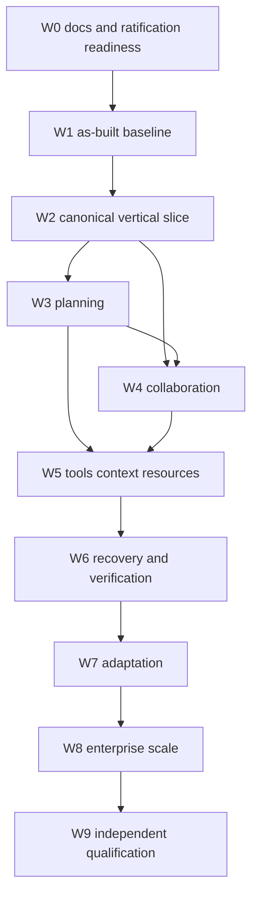
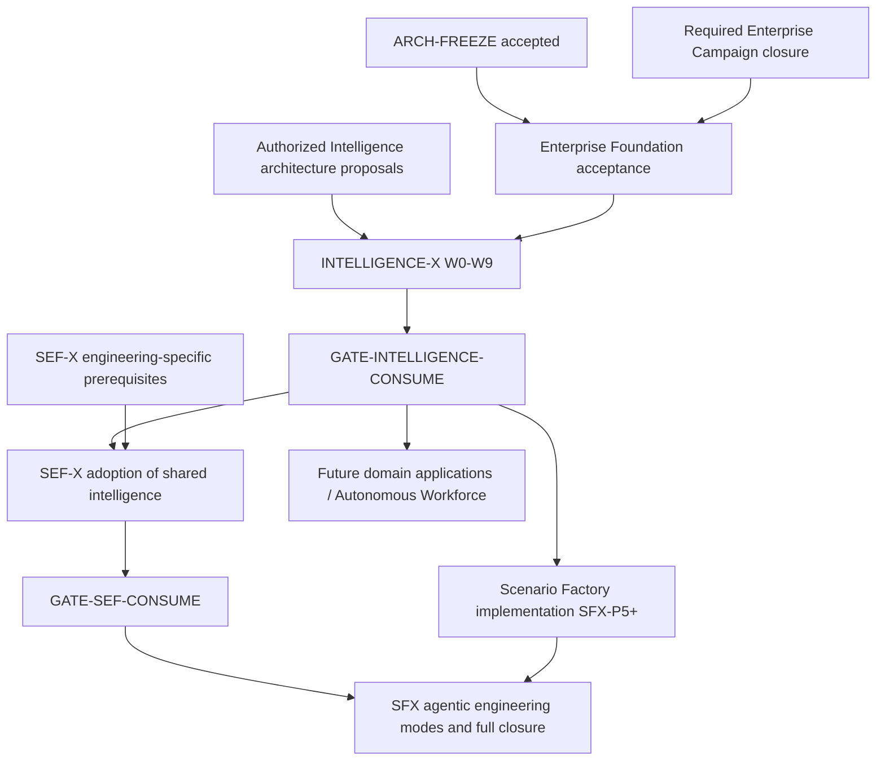

<!--
© Artur Czarnecki. All rights reserved.
Intergrax framework – proprietary and confidential.
Use, modification, or distribution without written permission is prohibited.
-->

**Execution status (mutable; not part of this normative body):** [Integrax Intelligence delivery register](../../../docs/project/capabilities/plan/INTEGRAX_INTELLIGENCE.md)

# INTELLIGENCE-X Master Roadmap

| Attribute | Value |
|---|---|
| Document | Canonical work breakdown for Integrax Intelligence |
| Revision | 1.0 |
| Status | **FINAL DRAFT — PENDING INDEPENDENT REVIEW AND FORMAL RATIFICATION** |
| Architecture | [Revision 1.1](../../../docs/project/capabilities/architecture/INTEGRAX_INTELLIGENCE.md) |
| Program | `INTELLIGENCE-X` |
| Package count | 69, identifiers unchanged from architecture revision 1.0 |
| Authority of this file | Documentation candidate. No `Approved:` line. II-W0-RATIFICATION-01 is not authority. |

This roadmap owns the work breakdown, waves, packages, dependency graph, sequencing, package acceptance, qualification strategy, and implementation prerequisites. It does not own mutable execution status. Status lives only in the delivery register linked above.

The 69 packages below preserve the original architecture revision 1.0 packages. Identifiers, titles, owners, and acceptance sentences are preserved. Each package is extended with the architecture requirements it serves, including II-OPR mappings. Nothing in this file is an immediately executable ticket. W1 produces write-sets, ticket bindings, test commands, and source evidence.

## 1. Authority and status boundary

This normative candidate grants no implementation, publication, certification or gate authority. Current mutable status is in the execution register. Formal W0 acceptance is a separate document and decision process; executable work requires the applicable program gates and approved tickets.

## 2. Wave outcomes

### W0 — Documents and ratification readiness (6)

W0 delivers formally accepted and adopted architecture, roadmap, invariant and ownership traceability, canonical document integration, authorized dependency amendments and the execution-environment qualification plan. Candidate preparation alone closes none of these. W0 has an independent documentation acceptance contract and may close before ARCH-FREEZE under separate authority. It does not depend on executable W1.

### W1 — As-built baseline (7)

W1 produces a mechanism inventory, a code-and-document reconciliation, runtime-connectivity evidence, a reuse classification, an owner map, six workload families with fixtures, a benchmark methodology, baseline measurements, a refined consumer contract, a workload envelope, quantitative thresholds, and execution-ready package scopes. The classification words are `REUSE_VERIFIED`, `WIRING_REQUIRED`, `EXTENSION_REQUIRED`, `NEW_CAPABILITY_REQUIRED`, or another disposition an authorized reviewer names. Executable W1 needs an accepted Foundation and GATE-II-ENTRY. Before that gate, W1 is read-only or proposal-only. W1 does not assume that every function needs new code. It does not invent production SLO numbers; it locks the method that later waves must use. Thresholds are not retuned after a failure unless the contract changes and the affected work is requalified.

### W2 — First vertical slice (6)

W2 runs on the real canonical runtime. The chain is Accepted Goal, Plan, Execution, Evidence, Verification, Outcome. A reference adopter uses the shared consumption contract. The slice includes a minimal deterministic case and a bounded intelligent case. It does not depend on capabilities that are born in W3–W8. It starts behavioral measurement, performance measurement, end-to-end traceability, checkpoint and recovery proof, authorized execution, and negative tests. It cannot finish as schemas or mocks only. There is no private scheduler.

### W3 — Planning (6)

W3 shows dynamic decomposition, dependency validation, plan repair, preservation of valid work, cross-plane cognition, stagnation detection, and a measured planning overhead. Invalid plans are not executed. A wrong assumption can be repaired on held-out tasks.

### W4 — Collaboration (7)

W4 shows heterogeneous team selection, canonical delegation, scoped communication, evidence sharing, conflict resolution, team replacement, independent branch continuation, and safe parallelism. An agent does not execute work by calling another agent. Qualification includes communication overhead and redundant work.

### W5 — Tools, context, and resources (7)

W5 shows permitted tool selection, sequence composition, result verification, authorized alternatives, dynamic context distribution, evidence-preserving compaction, qualified model routing, and aggregate resource accounting. Efficiency that weakens quality or safety is not acceptance.

### W6 — Recovery and outcome verification (8)

W6 shows typed obstacles, authorized recovery, local correction, global strategy revision, independent branch continuation, completeness verification, independent outcome evaluation, and safe stop and escalation. The full II-OPR-06 matrix is in force. Semantic outcome verification is not formal independent platform certification. A correct stop is not an autonomy failure.

### W7 — Adaptation and experience (6)

W7 shows evidence-backed adaptation, validated strategy patterns, scoped experience reuse, measurable model and tool recommendations, durable governance, controlled experiments, promotion, and rollback. Exit requires evidence-backed improvement on new comparable goals against W1-locked criteria. No unauthorized production change. Experience must not contaminate held-out benchmarks. One tenant's experience does not affect another tenant unless existing policy says so.

### W8 — Enterprise scale and consumers (8)

W8 proves, inside the declared scope: real distributed execution; multi-worker concurrency; aggregate budgets; horizontal scale; backpressure and overload containment; multi-tenant isolation; durability and process recovery; security and adversarial behavior; Autonomous Work integration; the universal consumer contract; and affected Foundation regression. All six load profiles are in scope. All six workload families share the consumption semantics. Reference adopters prove that more than one consumer can use the contract. They do not implement all of Scenario Factory or SEF-X. Process-local concurrency is not accepted as this proof.

### W9 — Independent qualification (8)

W9 runs the sealed benchmark, compares it with the W1 baseline, qualifies the required domains, checks performance and cost, takes an independent architecture audit, completes the required enterprise delta certification, publishes evidence, and only then supports an authorized consumer-gate decision. Exit requires zero unresolved mandatory critical findings and every mandatory acceptance obligation met; no optional exclusion may hide a mandatory failure. The result is scoped consumer readiness. It is not unrestricted production readiness. PROD-Q and per-scenario production admission stay where they are.

## 3. Sequencing rules

The conservative integration order is W0 → W1 → W2 → W3 → W4 → W5 → W6 → W7 → W8 → W9. Non-conflicting preparation may overlap, but execution/qualification follows the entry milestones in §5.2 unless an authorized amendment changes them. Disjoint preparation does not have to wait for an unrelated package. A material change to this order needs analysis and approval. Technical edges from revision 1.0, including plan revision before safe parallelism and verified outcomes before adaptation, are kept.

W0 documents do not require ARCH-FREEZE closure when they have their own authority. Executable W1 requires GATE-II-ENTRY. W2 requires W0, W1, and GATE-II-ARCH. W2 does not depend on capabilities born in W3–W8. INTELLIGENCE-X does not depend on finishing Scenario Factory or SEF-X. INTELLIGENCE-X is not a new predecessor of ARCH-FREEZE. SCENARIO-READINESS-X and the global SCENARIO-GATE keep their existing conditions. PROD-Q and Path B are unchanged.

### 3.1 Prerequisite availability and batch readiness

A Foundation capability is not assumed present merely because a document, class or historical certificate exists. II-W1-01/03 identify reachable owner contracts; II-W1-04 eliminates duplicates; II-W1-07 binds for each future package the verified existing prerequisite, earlier package, same-wave edge, optional extension, and source/test evidence. An absent mandatory prerequisite blocks the affected package until an authorized sequence/scope correction; optional extensions cannot silently become prerequisites. Before each batch, re-pin and validate current sources and evidence, exact scope and risk, tests, rollback and authority. Do not start a package with an unresolved mandatory prerequisite. Preserve independent eligible work.

| Wave | Minimum Foundation availability to establish in W1 before delegation |
|---|---|
| W2 | Admitted host/Execution entry, planner/validator, authorized tool path, canonical evidence, minimum verification and durable recovery; both reference cases must be feasible without W3–W8 additions. |
| W3 | Existing NexusPlan/version and cognition carriers, validation and lifecycle for plan revisions. |
| W4 | Agent assembly/catalog, topology, scoped context and deliberation; minimum parent budget, cancellation and concurrency admission already available for W4-07. If W5-07 enhancement is required for W4-07, obtain an approved split/resequence before W4, never declare a future-wave prerequisite satisfied. |
| W5 | ToolRuntime, UCL, memory, model routing and aggregate reservation/settlement owner paths. |
| W6 | Typed ERL/Self-Healing failure paths, effect reconciliation and Decision Verification. |
| W7 | AHI proposal/approval/version, Memory, telemetry and experiment mechanisms. |
| W8 | Actual multi-worker capacity, claim/fencing, durable stores, tenant boundary, AW dispatch and existing host contracts; distinguish production live scope from provider-neutral scope. |
| W9 | Applicable existing qualification, independent certification, evidence access and publication authority. |

W1 documents these availability checks; if mandatory mechanisms are absent, amend the plan before relevant execution, preserving the original obligations. For W0 and W1, exact review/test commands are bound by their own authorized ticket at entry. Neither requires W1-07 to have been completed first.

## 4. External dependencies and formal W0-06 adoption obligations

The following are proposed normative obligations of future authorized W0-06, not changes made by this candidate. Register INTELLIGENCE-X after ARCH-FREEZE and required Enterprise Campaign acceptance; explicitly except it from the global mandatory predecessor quantifiers for ARCH-FREEZE and SCENARIO-GATE, preserving their previous predecessor sets, Path B and PROD-Q. Adopt the additional scoped SFX-P5+ gate through an approved versioned amendment/overlay with explicit precedence and preserved historical digests; preserve independent SEF work and gate shared-intelligence adoption only. Obtain Operator and affected-program owner approval; check the complete before/after dependency graph. No silent override.

At review baseline `7d2cc3d28640df4823fa04e07abdc8f98451ccc6`, [SFX wave entry decision packet](../../../docs/project/maintainers/qualification/scenario_factory_x/SFX_WAVE6_ENTRY_DECISION_PACKET.md) and [implementation handoff](../../../docs/project/maintainers/qualification/scenario_factory_x/SFX_IMPLEMENTATION_HANDOFF.md) still describe fast-start after ARCH-FREEZE and existing gates. W0-06 must reconcile their W3/P5 start language, ADR/OD prerequisites, intake contract, and the global roadmap ledger/§3.0.7b and all normative gate predicates. Preserve GATE-SFX-FULL, HO-2, CON-N-01, OD-SEF-02 Option 3, OD-SEF-R2, GATE-SEF-CONSUME, GATE-SEF-FULL, scoped B6 and the assisted REF-1 slice. The decision packet is not an implementation grant. No consumer plan or protected file is amended by this candidate.

- SFX R1, in [`SFX-MASTER-PLAN.md`](SFX-MASTER-PLAN.md), authorizes a bounded pre-freeze scope and stops before SFX-P5. `GATE-SFX-ENTRY` still requires ARCH-FREEZE closure, the accepted SFX ADRs, the signed SFX operator decisions named in that plan, a re-pinned inventory, and a sealed generalization set.
- The adopted R2 overlay does not by itself authorize bounded autonomous multi-submit. HO-2 remains binding until OD-SEF-R2 and SEF acceptance. OD-SEF-R2 is still pending authority. CON-N-01 remains the human-submit contract until that authority exists.
- After formal adoption of the dependency, SFX-P5+ requires `GATE-INTELLIGENCE-CONSUME`. That adoption has not been made. Existing SFX ADR and operator-decision prerequisites stay.
- SEF-X keeps independent engineering work under OD-SEF-02 Option 3. `GATE-SEF-CONSUME` and `GATE-SEF-FULL` remain SEF gates. Scoped B6 stays a SEF concern. Intelligence-dependent SEF adoption needs consumer qualification. SEF does not become a prerequisite of Intelligence qualification.
- Product-specific production admission is unchanged.

## 5. Gates

These gates are not G2 and not other DevOS ticket gates. Current statuses are maintained only in the execution register.

| Gate | Required state before it can be used | What it means |
|---|---|---|
| `GATE-II-ENTRY` | ARCH-FREEZE formally closed; required Enterprise Campaign Foundation scope accepted; exact baseline recorded; required execution authority recorded | Executable W1 baseline work may start after W0 completion inside an approved scope; W2 also requires GATE-II-ARCH and qualified execution environment. Pre-freeze W0 proposals use their own authority. |
| `GATE-II-ARCH` | W0 and W1 complete, including executable package scopes, canonical ownership, and the locked benchmark and acceptance method | Architecture eligibility for W2. Not capability certification. |
| `GATE-II-CORE` | W2–W4 qualified | Goal execution, cognition, and team collaboration are integrated. |
| `GATE-II-ADAPTIVE` | W5–W7 qualified | Tools, context, resources, recovery, verification, and experience behaviors are proved. |
| `GATE-II-ENTERPRISE` | W8 qualified | Declared scale, durability, tenant isolation, security, and the consumer boundary. |
| `GATE-INTELLIGENCE-CONSUME` | The closure order below has been followed | Scoped consumer readiness. Not unrestricted production admission. |

### 5.1 Closure order for II-W9-08 and II-AC-14

Revision 1.0 asked II-W9-08 to record every mandatory acceptance row, while II-AC-14 included the consumer-gate record that II-W9-08 itself produces. This roadmap breaks that loop:

1. II-W9-01 through II-W9-07 are complete.
2. II-AC-01 through II-AC-13 are accepted.
3. The independent certification component of II-AC-14 is accepted.
4. The authorized consumer-gate decision is made.
5. The gate record completes the remaining part of II-AC-14 and completes II-W9-08.
6. The proper authority closes W9.

II-W9-08 does not require itself to be closed already. `GATE-INTELLIGENCE-CONSUME` is not a prerequisite edge into II-W9-08.

### 5.2 Entry, package acceptance and wave exit (normative procedural order)

| Wave | Entry | Exit / produced milestone |
|---|---|---|
| W0 | Separately authorized documentation scope | Accepted architecture, roadmap, ownership and dependency obligations; no executable W1 prerequisite. |
| W1 | GATE-II-ENTRY and W0 complete | Accepted inventory/baseline and refined packages, locked protocol; produces GATE-II-ARCH eligibility with W0. |
| W2 | GATE-II-ARCH and qualified environment | Qualified working vertical slice. |
| W3 | Qualified W2 | Qualified planning/cognition. |
| W4 | Qualified W2 and W3 | Qualified collaboration; W2–W4 produce GATE-II-CORE. |
| W5 | GATE-II-CORE | Qualified tool/context/resource mechanisms. |
| W6 | Qualified W5 and relevant earlier mechanisms | Qualified recovery and verification. |
| W7 | Qualified W6 and required telemetry | Qualified adaptation/experience; W5–W7 produce GATE-II-ADAPTIVE. |
| W8 | GATE-II-ADAPTIVE | Qualified enterprise operation and consumer integration; produces GATE-II-ENTERPRISE. |
| W9 | GATE-II-ENTERPRISE | Independent qualification, consumer decision/record and formal closure in §5.1. |

The wave exit gate is never a prerequisite of a package producing that gate. An accepted package requires its own prerequisites, evidence and authority, not formal closure of its containing wave. Wave exit requires all mandatory packages and integrated wave evidence. Opening any program gate requires its proper authority and exact scoped evidence; no gate replaces ticket approval. The environment qualification plan is accepted in W0-05; executable environment proof is an entry prerequisite to W2, after the W1 refinement and before W2, not a W0-05 closure condition. W1's own executable work requires an authorized viable environment and the W1 baseline contract, not the later W2 qualification verdict.

## 6. Dependency graph

Package-to-package edges are the **Explicit dependencies** field of each package. Each package additionally depends on its wave entry as specified in §12. The diagram below is the conservative wave ordering; the full procedural graph is in §12. The v1.0 strategic product diagram is preserved unchanged after it.

### 6.1 Preserved strategic product diagram

Meaning is unchanged from architecture revision 1.0 §13.1. It is not a claim that any box is already true.

### 6.2 Structural critical path

Longest package dependency chain (unit node weights, not a time estimate):

II-W0-01 → II-W0-03 → II-W0-04 → II-W0-05 → II-W0-06 → II-W1-01 → II-W1-03 → II-W1-06 → II-W1-07 → II-W2-01 → II-W2-02 → II-W2-04 → II-W2-06 → II-W4-01 → II-W4-02 → II-W4-03 → II-W4-04 → II-W4-05 → II-W5-01 → II-W5-04 → II-W5-05 → II-W6-01 → II-W6-02 → II-W6-03 → II-W7-01 → II-W7-02 → II-W7-03 → II-W8-01 → II-W8-02 → II-W8-03 → II-W8-05 → II-W8-07 → II-W8-08 → II-W9-01 → II-W9-05 → II-W9-06 → II-W9-07 → II-W9-08

Procedural graph, including entries/exits and gate records, is specified in §12.

## 7. Work packages

Common controls in §3.1 and §9 apply to every package. Original acceptance is retained verbatim; the positive/negative, evidence and atomic obligations below are additional mandatory acceptance, not optional illustrations. The exact runtime paths, concrete test commands and numeric thresholds are W1 deliverables only where they are needed for W2–W9. W0 uses document review; W1 uses its own baseline protocol.

### II-W0-01 — Three-layer strategic architecture

**ID:** II-W0-01

**Objective:** Classify Foundation, Intelligence and product ecosystem as logical capability layers.

**Architecture requirement refs:** II-AC-01, strategic three-layer model; final acceptance: II-AC-01

**Primary semantic owner:** Platform Architecture

**Supporting owners and affected mechanisms:** Architecture principles, UEA and dependency ownership.

**Explicit dependencies:** none

**Reuse strategy / prerequisite availability:** Existing canonical docs, applicable governance and owner authority; use document evidence only. No executable W1 dependency. Reuse and verify the existing mechanisms identified in this package; no new owner by default.

**Implementation scope:** Classify Foundation, Intelligence and product ecosystem as logical capability layers; map each to the existing Tier-0–Tier-3 constraints.

**Explicit exclusions:** No runtime/product changes or self-approval; only authorized document scope.

**Required outputs:** Reviewed architecture diagram and tier/authority boundary comparison.

**Original acceptance criteria:** Layer diagram and classification; Tier-0–Tier-3 unchanged

**Mandatory positive behavior:** Every relationship has a legal direction; Execution retains sole admission authority.

**Mandatory negative behavior:** Reject physical tier insertion, reverse import or second execution root.

**Qualification scope:** Document/decision review: compare against cited canonical sources and independently verify the required record. Oracle: Every relationship has a legal direction; Execution retains sole admission authority. Negative: Reject physical tier insertion, reverse import or second execution root.

**Regression scope:** Architecture principles, UEA and dependency ownership.. Select adjacent and affected-domain checks under existing EVOL-X/ENT-AUDIT-X rules.

**Risk and evolution / rollback:** Misclassification could authorize a competing runtime; withdraw the proposed diagram, never alter frozen tiers.

**Required evidence:** Reviewed architecture diagram and tier/authority boundary comparison.; record exact reviewed source/candidate identity, actual review or test procedure, result and limitations.

**Atomic obligations (implementation or qualification):** No direct II-OPR sub-obligation; original acceptance and architecture references remain mandatory.

**Closure prerequisites:** Entry: separate authorized W0 documentation scope. All explicit package prerequisites accepted; original and expanded acceptance satisfied and evidence reviewed by proper authority. Wave exit gate is not an input.

**W1 refinement obligations:** None for W0 document acceptance; record future as-built questions separately.

### II-W0-02 — Intelligence capability contract

**ID:** II-W0-02

**Objective:** Specify shared goal-consumption semantics, non-goals and consumer/domain responsibilities.

**Architecture requirement refs:** II-01, II-OPR-01, II-AC-12; final acceptance: II-AC-12

**Primary semantic owner:** Platform Architecture / Execution

**Supporting owners and affected mechanisms:** Execution, Cognition, Governance, host and AW contracts.

**Explicit dependencies:** II-W0-01

**Reuse strategy / prerequisite availability:** Existing canonical docs, applicable governance and owner authority; use document evidence only. No executable W1 dependency. Reuse and verify the existing mechanisms identified in this package; no new owner by default.

**Implementation scope:** Specify shared goal-consumption semantics, non-goals and consumer/domain responsibilities; separate proposal, admission and execution.

**Explicit exclusions:** No runtime/product changes or self-approval; only authorized document scope.

**Required outputs:** Reviewed contract inventory and consumer responsibility matrix, with current versus proposed fields.

**Original acceptance criteria:** Definition, scope, non-goals and adoption contract accepted

**Mandatory positive behavior:** Representative deterministic and intelligent requests can be expressed without transferring authority or duplicating domain criteria.

**Mandatory negative behavior:** Reject implicit permissions, private product harnesses and an invented runtime API.

**Qualification scope:** Document/decision review: compare against cited canonical sources and independently verify the required record. Oracle: Representative deterministic and intelligent requests can be expressed without transferring authority or duplicating domain criteria. Negative: Reject implicit permissions, private product harnesses and an invented runtime API.

**Regression scope:** Execution, Cognition, Governance, host and AW contracts.. Select adjacent and affected-domain checks under existing EVOL-X/ENT-AUDIT-X rules.

**Risk and evolution / rollback:** Contract ambiguity can propagate to every consumer; reject the candidate contract rather than invent a new API.

**Required evidence:** Reviewed contract inventory and consumer responsibility matrix, with current versus proposed fields.; record exact reviewed source/candidate identity, actual review or test procedure, result and limitations.

**Atomic obligations (implementation or qualification):** No direct II-OPR sub-obligation; original acceptance and architecture references remain mandatory.

**Closure prerequisites:** Entry: separate authorized W0 documentation scope. All explicit package prerequisites accepted; original and expanded acceptance satisfied and evidence reviewed by proper authority. Wave exit gate is not an input.

**W1 refinement obligations:** None for W0 document acceptance; record future as-built questions separately.

### II-W0-03 — Twelve architectural invariants

**ID:** II-W0-03

**Objective:** Map each of the twelve II-INV obligations to actual SYS-INV, UEA-INV, FRZ and ECAP sources.

**Architecture requirement refs:** II-AC-01, II-INV-01, II-INV-02, II-INV-03, II-INV-04, II-INV-05, II-INV-06, II-INV-07, II-INV-08, II-INV-09, II-INV-10, II-INV-11, II-INV-12; final acceptance: II-AC-01

**Primary semantic owner:** Platform Architecture / Governance

**Supporting owners and affected mechanisms:** Architecture principles, governance and FRZ requirements.

**Explicit dependencies:** II-W0-01

**Reuse strategy / prerequisite availability:** Existing canonical docs, applicable governance and owner authority; use document evidence only. No executable W1 dependency. Reuse and verify the existing mechanisms identified in this package; no new owner by default.

**Implementation scope:** Map each of the twelve II-INV obligations to actual SYS-INV, UEA-INV, FRZ and ECAP sources; record conflicts and disposition.

**Explicit exclusions:** No runtime/product changes or self-approval; only authorized document scope.

**Required outputs:** Twelve-row invariant traceability review with exact source revisions and conflict dispositions.

**Original acceptance criteria:** Traceability to existing invariants; no conflicting authority

**Mandatory positive behavior:** Each invariant preserves existing authority and has a future evidence owner.

**Mandatory negative behavior:** Reject weakened or superseded frozen controls and unbound normative claims.

**Qualification scope:** Document/decision review: compare against cited canonical sources and independently verify the required record. Oracle: Each invariant preserves existing authority and has a future evidence owner. Negative: Reject weakened or superseded frozen controls and unbound normative claims.

**Regression scope:** Architecture principles, governance and FRZ requirements.. Select adjacent and affected-domain checks under existing EVOL-X/ENT-AUDIT-X rules.

**Risk and evolution / rollback:** Conflicting invariants could legitimize bypass; retain existing canon until authorized amendment.

**Required evidence:** Twelve-row invariant traceability review with exact source revisions and conflict dispositions.; record exact reviewed source/candidate identity, actual review or test procedure, result and limitations.

**Atomic obligations (implementation or qualification):** No direct II-OPR sub-obligation; original acceptance and architecture references remain mandatory.

**Closure prerequisites:** Entry: separate authorized W0 documentation scope. All explicit package prerequisites accepted; original and expanded acceptance satisfied and evidence reviewed by proper authority. Wave exit gate is not an input.

**W1 refinement obligations:** None for W0 document acceptance; record future as-built questions separately.

### II-W0-04 — Ownership model

**ID:** II-W0-04

**Objective:** Assign one accountable semantic owner per concern and distinguish logical proposals from runtime authority.

**Architecture requirement refs:** II-AC-01, II-INV-12; final acceptance: II-AC-01

**Primary semantic owner:** All affected owners

**Supporting owners and affected mechanisms:** UEA, Nexus, domain contracts and dependency rules.

**Explicit dependencies:** II-W0-01, II-W0-03

**Reuse strategy / prerequisite availability:** Existing canonical docs, applicable governance and owner authority; use document evidence only. No executable W1 dependency. Reuse and verify the existing mechanisms identified in this package; no new owner by default.

**Implementation scope:** Assign one accountable semantic owner per concern and distinguish logical proposals from runtime authority; review overlap with AHI, ERI, AW and Self-Healing.

**Explicit exclusions:** No runtime/product changes or self-approval; only authorized document scope.

**Required outputs:** Concern-level ownership and overlap matrix with provisional W1 checks.

**Original acceptance criteria:** Single owner per concern; overlap and conflict matrix

**Mandatory positive behavior:** Every concern has one accountable owner or an explicit blocking ownership decision before implementation.

**Mandatory negative behavior:** Reject duplicate execution identity, store, recovery or control authority; no invented owner resolution.

**Qualification scope:** Document/decision review: compare against cited canonical sources and independently verify the required record. Oracle: Every concern has one accountable owner or an explicit blocking ownership decision before implementation. Negative: Reject duplicate execution identity, store, recovery or control authority; no invented owner resolution.

**Regression scope:** UEA, Nexus, domain contracts and dependency rules.. Select adjacent and affected-domain checks under existing EVOL-X/ENT-AUDIT-X rules.

**Risk and evolution / rollback:** Incorrect ownership produces parallel mechanisms; withdraw unresolved allocation and request owner resolution.

**Required evidence:** Concern-level ownership and overlap matrix with provisional W1 checks.; record exact reviewed source/candidate identity, actual review or test procedure, result and limitations.

**Atomic obligations (implementation or qualification):** No direct II-OPR sub-obligation; original acceptance and architecture references remain mandatory.

**Closure prerequisites:** Entry: separate authorized W0 documentation scope. All explicit package prerequisites accepted; original and expanded acceptance satisfied and evidence reviewed by proper authority. Wave exit gate is not an input.

**W1 refinement obligations:** None for W0 document acceptance; record future as-built questions separately.

### II-W0-05 — Main architecture documentation

**ID:** II-W0-05

**Objective:** Prepare and formally adopt the architecture, roadmap and navigation through authorized tickets.

**Architecture requirement refs:** II-AC-13; final acceptance: II-AC-13

**Primary semantic owner:** Documentation / architecture owners

**Supporting owners and affected mechanisms:** Documentation map, existing approval/digest and ticket lifecycle rules.

**Explicit dependencies:** II-W0-02, II-W0-03, II-W0-04

**Reuse strategy / prerequisite availability:** Existing canonical docs, applicable governance and owner authority; use document evidence only. No executable W1 dependency. Reuse and verify the existing mechanisms identified in this package; no new owner by default.

**Implementation scope:** Prepare and formally adopt the architecture, roadmap and navigation through authorized tickets; reconcile original chapter 14 and T-IGX-079-A findings, including README scope and EOL drift; produce environment qualification plan.

**Explicit exclusions:** No runtime/product changes or self-approval; only authorized document scope.

**Required outputs:** Reviewed document set, adoption register, link/anchor results, digest approval and authorized publication records; environment trial specification.

**Original acceptance criteria:** Canonical cross-links and approved status; no duplicate semantics

**Mandatory positive behavior:** Canonical paths and SSOT links agree, historical evidence is intact, plan approval is explicit.

**Mandatory negative behavior:** Reject stale links, duplicate WBS, invented approval, unapproved writes or treating plan preparation as environment qualification.

**Qualification scope:** Document/decision review: compare against cited canonical sources and independently verify the required record. Oracle: Canonical paths and SSOT links agree, historical evidence is intact, plan approval is explicit. Negative: Reject stale links, duplicate WBS, invented approval, unapproved writes or treating plan preparation as environment qualification.

**Regression scope:** Documentation map, existing approval/digest and ticket lifecycle rules.. Select adjacent and affected-domain checks under existing EVOL-X/ENT-AUDIT-X rules.

**Risk and evolution / rollback:** Unbound documents or churn can invalidate evidence; restore only the authorized document delta.

**Required evidence:** Reviewed document set, adoption register, link/anchor results, digest approval and authorized publication records; environment trial specification.; record exact reviewed source/candidate identity, actual review or test procedure, result and limitations.

**Atomic obligations (implementation or qualification):** No direct II-OPR sub-obligation; original acceptance and architecture references remain mandatory.

**Closure prerequisites:** Entry: separate authorized W0 documentation scope. All explicit package prerequisites accepted; original and expanded acceptance satisfied and evidence reviewed by proper authority. Wave exit gate is not an input.

**W1 refinement obligations:** None for W0 document acceptance; record future as-built questions separately.

### II-W0-06 — Roadmap dependency amendments

**ID:** II-W0-06

**Objective:** Prepare and obtain authorized adoption of the cross-program amendments in section 4, including every mandatory-stage quantifier and SFX fast-start reference..

**Architecture requirement refs:** II-AC-13; final acceptance: II-AC-13

**Primary semantic owner:** Operator / program owners

**Supporting owners and affected mechanisms:** Global roadmap, AF/EQO, SFX R1/R2 and SEF authority records.

**Explicit dependencies:** II-W0-05

**Reuse strategy / prerequisite availability:** Existing canonical docs, applicable governance and owner authority; use document evidence only. No executable W1 dependency. Reuse and verify the existing mechanisms identified in this package; no new owner by default.

**Implementation scope:** Prepare and obtain authorized adoption of the cross-program amendments in section 4, including every mandatory-stage quantifier and SFX fast-start reference.

**Explicit exclusions:** No unilateral edit of protected roadmap or approved plans; formally authorized amendment is in scope. No historical approval rewrite, no change to Foundation acceptance or live admission.

**Required outputs:** Owner-approved dependency overlay or versioned amendments, before/after DAG and preserved historical digests.

**Original acceptance criteria:** ARCH-FREEZE, EQO, SFX and SEF dependency changes explicitly ratified; no cycle

**Mandatory positive behavior:** INTELLIGENCE-X follows Foundation; SFX-P5+ requires both entry conditions after adoption, with independent SEF work preserved.

**Mandatory negative behavior:** Reject dependency cycles, silent digest changes, expansion of ARCH-FREEZE/SCENARIO-GATE or bypass of HO-2.

**Qualification scope:** Document/decision review: compare against cited canonical sources and independently verify the required record. Oracle: INTELLIGENCE-X follows Foundation; SFX-P5+ requires both entry conditions after adoption, with independent SEF work preserved. Negative: Reject dependency cycles, silent digest changes, expansion of ARCH-FREEZE/SCENARIO-GATE or bypass of HO-2.

**Regression scope:** Global roadmap, AF/EQO, SFX R1/R2 and SEF authority records.. Select adjacent and affected-domain checks under existing EVOL-X/ENT-AUDIT-X rules.

**Risk and evolution / rollback:** A missing amendment can trigger premature product work; do not activate the new stage until formally adopted.

**Required evidence:** Owner-approved dependency overlay or versioned amendments, before/after DAG and preserved historical digests.; record exact reviewed source/candidate identity, actual review or test procedure, result and limitations.

**Atomic obligations (implementation or qualification):** No direct II-OPR sub-obligation; original acceptance and architecture references remain mandatory.

**Closure prerequisites:** Entry: separate authorized W0 documentation scope. All explicit package prerequisites accepted; original and expanded acceptance satisfied and evidence reviewed by proper authority. Wave exit gate is not an input.

**W1 refinement obligations:** None for W0 document acceptance; record future as-built questions separately.

### II-W1-01 — Mechanism and contract inventory

**ID:** II-W1-01

**Objective:** Inventory relevant implementation, contracts, host composition, registered capabilities, tests and qualification records at the accepted Foundation SHA..

**Architecture requirement refs:** II-OPR-01; final acceptance: II-AC-01

**Primary semantic owner:** Domain owners; post-freeze SHA

**Supporting owners and affected mechanisms:** Foundation owner inventory and PDC boundaries.

**Explicit dependencies:** II-W0-01, II-W0-02, II-W0-03, II-W0-04, II-W0-05, II-W0-06

**Reuse strategy / prerequisite availability:** Accepted Foundation SHA and authorized W1; use the predeclared W1 method in §9, not the output of W1-07 as its own input. Reuse and verify the existing mechanisms identified in this package; no new owner by default.

**Implementation scope:** Inventory relevant implementation, contracts, host composition, registered capabilities, tests and qualification records at the accepted Foundation SHA.

**Explicit exclusions:** No unapproved code changes; no invented qualification or live production admission.

**Required outputs:** Path- and symbol-level inventory, reachability hypotheses, owner and test references, explicit missing evidence.

**Original acceptance criteria:** Code, contracts, host consumers, tests and existing tickets mapped

**Mandatory positive behavior:** Every pillar and package has a source-backed inventory entry or a precise gap.

**Mandatory negative behavior:** Reject treating a class, test filename or historical PASS as reachable qualified behavior.

**Qualification scope:** Baseline qualification: independently reproduce the inventory, trace or trial using the W1 method in §9. Oracle: Every pillar and package has a source-backed inventory entry or a precise gap. Negative: Reject treating a class, test filename or historical PASS as reachable qualified behavior.

**Regression scope:** Foundation owner inventory and PDC boundaries.. Select adjacent and affected-domain checks under existing EVOL-X/ENT-AUDIT-X rules.

**Risk and evolution / rollback:** Incomplete census leads to duplicate implementation; mark unknowns and expand the scoped inventory before approving work.

**Required evidence:** Path- and symbol-level inventory, reachability hypotheses, owner and test references, explicit missing evidence.; record exact reviewed source/candidate identity, actual review or test procedure, result and limitations.

**Atomic obligations (implementation or qualification):** No direct II-OPR sub-obligation; original acceptance and architecture references remain mandatory.

**Closure prerequisites:** Entry: GATE-II-ENTRY and W0 complete. All explicit package prerequisites accepted; original and expanded acceptance satisfied and evidence reviewed by proper authority. Wave exit gate is not an input.

**W1 refinement obligations:** Use the approved W1 baseline ticket/method; record source evidence and unresolved gaps. W1-07 consolidates these outputs; it is not an input.

### II-W1-02 — Documentation/code reconciliation

**ID:** II-W1-02

**Objective:** Reconcile historical II-AUD-01..07 and current documents against actual source and owner evidence.

**Architecture requirement refs:** II-AUD-01..07 historical; final acceptance: II-AC-01

**Primary semantic owner:** Domain owners

**Supporting owners and affected mechanisms:** AW, AHI, ERI, execution and consumer docs.

**Explicit dependencies:** II-W1-01

**Reuse strategy / prerequisite availability:** Accepted Foundation SHA and authorized W1; use the predeclared W1 method in §9, not the output of W1-07 as its own input. Reuse and verify the existing mechanisms identified in this package; no new owner by default.

**Implementation scope:** Reconcile historical II-AUD-01..07 and current documents against actual source and owner evidence; distinguish code presence, wiring and behavior.

**Explicit exclusions:** No unapproved code changes; no invented qualification or live production admission.

**Required outputs:** Finding-by-finding historical/current comparison and proposed owner-specific corrections.

**Original acceptance criteria:** II-AUD-01 and other stale claims resolved with evidence

**Mandatory positive behavior:** AW dispatch/recovery ports, authority and consumer dependencies receive explicit supported dispositions.

**Mandatory negative behavior:** Reject stale maturity promotions or false claims of absent runtime.

**Qualification scope:** Baseline qualification: independently reproduce the inventory, trace or trial using the W1 method in §9. Oracle: AW dispatch/recovery ports, authority and consumer dependencies receive explicit supported dispositions. Negative: Reject stale maturity promotions or false claims of absent runtime.

**Regression scope:** AW, AHI, ERI, execution and consumer docs.. Select adjacent and affected-domain checks under existing EVOL-X/ENT-AUDIT-X rules.

**Risk and evolution / rollback:** Documentation drift can hide real gaps; preserve historical findings and issue scoped corrections only.

**Required evidence:** Finding-by-finding historical/current comparison and proposed owner-specific corrections.; record exact reviewed source/candidate identity, actual review or test procedure, result and limitations.

**Atomic obligations (implementation or qualification):** No direct II-OPR sub-obligation; original acceptance and architecture references remain mandatory.

**Closure prerequisites:** Entry: GATE-II-ENTRY and W0 complete. All explicit package prerequisites accepted; original and expanded acceptance satisfied and evidence reviewed by proper authority. Wave exit gate is not an input.

**W1 refinement obligations:** Use the approved W1 baseline ticket/method; record source evidence and unresolved gaps. W1-07 consolidates these outputs; it is not an input.

### II-W1-03 — Runtime connectivity audit

**ID:** II-W1-03

**Objective:** Trace representative accepted goal through host composition, Execution, Nexus/UAEP, tools, evidence and verification.

**Architecture requirement refs:** II-03, II-OPR-01; final acceptance: II-AC-01

**Primary semantic owner:** Execution, Nexus, UAEP, Tools, AW

**Supporting owners and affected mechanisms:** UEA, tools, AW and host composition.

**Explicit dependencies:** II-W1-01

**Reuse strategy / prerequisite availability:** Accepted Foundation SHA and authorized W1; use the predeclared W1 method in §9, not the output of W1-07 as its own input. Reuse and verify the existing mechanisms identified in this package; no new owner by default.

**Implementation scope:** Trace representative accepted goal through host composition, Execution, Nexus/UAEP, tools, evidence and verification; enumerate unbound ports and bypass candidates.

**Explicit exclusions:** No unapproved code changes; no invented qualification or live production admission.

**Required outputs:** Reachability and call-path map with admitted runtime probes, identity and receipt references.

**Original acceptance criteria:** Trace admission-to-outcome, identify unbound ports and bypass risks

**Mandatory positive behavior:** Trace shows actual authoritative entrypoint and effects or a reproducible missing link.

**Mandatory negative behavior:** Reject mock-only wiring proof, direct adapter invocation and unverifiable identity.

**Qualification scope:** Baseline qualification: independently reproduce the inventory, trace or trial using the W1 method in §9. Oracle: Trace shows actual authoritative entrypoint and effects or a reproducible missing link. Negative: Reject mock-only wiring proof, direct adapter invocation and unverifiable identity.

**Regression scope:** UEA, tools, AW and host composition.. Select adjacent and affected-domain checks under existing EVOL-X/ENT-AUDIT-X rules.

**Risk and evolution / rollback:** Unreachable functionality may be mistaken for reuse; hold affected packages until wired or re-planned.

**Required evidence:** Reachability and call-path map with admitted runtime probes, identity and receipt references.; record exact reviewed source/candidate identity, actual review or test procedure, result and limitations.

**Atomic obligations (implementation or qualification):** No direct II-OPR sub-obligation; original acceptance and architecture references remain mandatory.

**Closure prerequisites:** Entry: GATE-II-ENTRY and W0 complete. All explicit package prerequisites accepted; original and expanded acceptance satisfied and evidence reviewed by proper authority. Wave exit gate is not an input.

**W1 refinement obligations:** Use the approved W1 baseline ticket/method; record source evidence and unresolved gaps. W1-07 consolidates these outputs; it is not an input.

### II-W1-04 — Duplicate responsibility audit

**ID:** II-W1-04

**Objective:** Compare inventory of contracts, state, schedulers, cognition, decision and recovery mechanisms by concern and authority..

**Architecture requirement refs:** II-OPR-07, II-AC-01, II-INV-12; final acceptance: II-AC-01

**Primary semantic owner:** Architecture / EVOL-X

**Supporting owners and affected mechanisms:** Tier dependencies, EVOL-X and existing owner rules.

**Explicit dependencies:** II-W1-01

**Reuse strategy / prerequisite availability:** Accepted Foundation SHA and authorized W1; use the predeclared W1 method in §9, not the output of W1-07 as its own input. Reuse and verify the existing mechanisms identified in this package; no new owner by default.

**Implementation scope:** Compare inventory of contracts, state, schedulers, cognition, decision and recovery mechanisms by concern and authority.

**Explicit exclusions:** No unapproved code changes; no invented qualification or live production admission.

**Required outputs:** Overlap/conflict matrix with source evidence and one owner per concern.

**Original acceptance criteria:** Overlap matrix; no second owner or runtime planned

**Mandatory positive behavior:** Every proposed extension is assigned to an existing owner or a justified new capability without competing authority.

**Mandatory negative behavior:** Reject a second lifecycle, policy store, goal identity or control plane.

**Qualification scope:** Baseline qualification: independently reproduce the inventory, trace or trial using the W1 method in §9. Oracle: Every proposed extension is assigned to an existing owner or a justified new capability without competing authority. Negative: Reject a second lifecycle, policy store, goal identity or control plane.

**Regression scope:** Tier dependencies, EVOL-X and existing owner rules.. Select adjacent and affected-domain checks under existing EVOL-X/ENT-AUDIT-X rules.

**Risk and evolution / rollback:** Duplicate semantics can cause cross-domain regressions; reject duplicate design and reassign scope.

**Required evidence:** Overlap/conflict matrix with source evidence and one owner per concern.; record exact reviewed source/candidate identity, actual review or test procedure, result and limitations.

**Atomic obligations (implementation or qualification):** No direct II-OPR sub-obligation; original acceptance and architecture references remain mandatory.

**Closure prerequisites:** Entry: GATE-II-ENTRY and W0 complete. All explicit package prerequisites accepted; original and expanded acceptance satisfied and evidence reviewed by proper authority. Wave exit gate is not an input.

**W1 refinement obligations:** Use the approved W1 baseline ticket/method; record source evidence and unresolved gaps. W1-07 consolidates these outputs; it is not an input.

### II-W1-05 — Reference workload suite

**ID:** II-W1-05

**Objective:** Design and seal six reference families with independent oracles, failure taxonomy, datasets, repeated-trial methodology and workload profiles..

**Architecture requirement refs:** II-OPR-03, II-OPR-04, II-AC-11; final acceptance: II-AC-11

**Primary semantic owner:** Evaluation / domain adopters

**Supporting owners and affected mechanisms:** Existing qualified test harnesses and sandbox policies.

**Explicit dependencies:** II-W1-01

**Reuse strategy / prerequisite availability:** Accepted Foundation SHA and authorized W1; use the predeclared W1 method in §9, not the output of W1-07 as its own input. Reuse and verify the existing mechanisms identified in this package; no new owner by default.

**Implementation scope:** Design and seal six reference families with independent oracles, failure taxonomy, datasets, repeated-trial methodology and workload profiles.

**Explicit exclusions:** No unapproved code changes; no invented qualification or live production admission.

**Required outputs:** Versioned fixture manifest, development/tuning/held-out separation, sample rules, metric definitions and negative oracles.

**Original acceptance criteria:** Reproducible task sets, seeds, oracles, failure taxonomy and held-out split

**Mandatory positive behavior:** Independent runner can reproduce a task and classify safe stop versus false completion.

**Mandatory negative behavior:** Reject leaked held-out outcomes, unbounded resources, unsafe live effects or ambiguous oracle.

**Qualification scope:** Baseline qualification: independently reproduce the inventory, trace or trial using the W1 method in §9. Oracle: Independent runner can reproduce a task and classify safe stop versus false completion. Negative: Reject leaked held-out outcomes, unbounded resources, unsafe live effects or ambiguous oracle.

**Regression scope:** Existing qualified test harnesses and sandbox policies.. Select adjacent and affected-domain checks under existing EVOL-X/ENT-AUDIT-X rules.

**Risk and evolution / rollback:** Biased workload or oracle can inflate success; re-seal before target trials and record changes.

**Required evidence:** Versioned fixture manifest, development/tuning/held-out separation, sample rules, metric definitions and negative oracles.; record exact reviewed source/candidate identity, actual review or test procedure, result and limitations.

**Atomic obligations (implementation or qualification):** II-OPR-03.01, II-OPR-07.03

**Closure prerequisites:** Entry: GATE-II-ENTRY and W0 complete. All explicit package prerequisites accepted; original and expanded acceptance satisfied and evidence reviewed by proper authority. Wave exit gate is not an input.

**W1 refinement obligations:** Use the approved W1 baseline ticket/method; record source evidence and unresolved gaps. W1-07 consolidates these outputs; it is not an input.

### II-W1-06 — Measure existing harness

**ID:** II-W1-06

**Objective:** Execute baseline through existing admitted runtime on approved reference workloads.

**Architecture requirement refs:** II-OPR-03, II-OPR-04, II-AC-11; final acceptance: II-AC-11

**Primary semantic owner:** Qualification

**Supporting owners and affected mechanisms:** Existing qualification and observability.

**Explicit dependencies:** II-W1-03, II-W1-05

**Reuse strategy / prerequisite availability:** Accepted Foundation SHA and authorized W1; use the predeclared W1 method in §9, not the output of W1-07 as its own input. Reuse and verify the existing mechanisms identified in this package; no new owner by default.

**Implementation scope:** Execute baseline through existing admitted runtime on approved reference workloads; record failures, interventions, cost, latency and resource metrics.

**Explicit exclusions:** No unapproved code changes; no invented qualification or live production admission.

**Required outputs:** Raw run receipts, exact environment/profile, per-family statistics and uncertainty; explicit unavailable paths.

**Original acceptance criteria:** Baseline raw trials, outcome, cost, latency, interventions and uncertainty

**Mandatory positive behavior:** Baseline can be independently reproduced or its bounded nondeterminism quantified.

**Mandatory negative behavior:** Reject synthetic PASS, omitted failed attempts, unmatched model claims or unapproved production calls.

**Qualification scope:** Baseline qualification: independently reproduce the inventory, trace or trial using the W1 method in §9. Oracle: Baseline can be independently reproduced or its bounded nondeterminism quantified. Negative: Reject synthetic PASS, omitted failed attempts, unmatched model claims or unapproved production calls.

**Regression scope:** Existing qualification and observability.. Select adjacent and affected-domain checks under existing EVOL-X/ENT-AUDIT-X rules.

**Risk and evolution / rollback:** Incomparable measurements invalidate uplift; repeat matched baseline or report non-comparability.

**Required evidence:** Raw run receipts, exact environment/profile, per-family statistics and uncertainty; explicit unavailable paths.; record exact reviewed source/candidate identity, actual review or test procedure, result and limitations.

**Atomic obligations (implementation or qualification):** II-OPR-03.16

**Closure prerequisites:** Entry: GATE-II-ENTRY and W0 complete. All explicit package prerequisites accepted; original and expanded acceptance satisfied and evidence reviewed by proper authority. Wave exit gate is not an input.

**W1 refinement obligations:** Use the approved W1 baseline ticket/method; record source evidence and unresolved gaps. W1-07 consolidates these outputs; it is not an input.

### II-W1-07 — Classify gaps and execution packages

**ID:** II-W1-07

**Objective:** Dispose all 69 packages using source evidence.

**Architecture requirement refs:** II-OPR-01, II-OPR-03, II-OPR-04, II-OPR-07; final acceptance: II-AC-01

**Primary semantic owner:** Program owner

**Supporting owners and affected mechanisms:** W0 requirements, W1 inventory, EVOL-X and ticket governance.

**Explicit dependencies:** II-W1-02, II-W1-03, II-W1-04, II-W1-06

**Reuse strategy / prerequisite availability:** Accepted Foundation SHA and authorized W1; use the predeclared W1 method in §9, not the output of W1-07 as its own input. Reuse and verify the existing mechanisms identified in this package; no new owner by default.

**Implementation scope:** Dispose all 69 packages using source evidence; bind execution scopes, prerequisites, tests, thresholds, rollback and authority; lock benchmark and environment trial protocol.

**Explicit exclusions:** No unapproved code changes; no invented qualification or live production admission.

**Required outputs:** Approved per-package refinement records, updated dependency graph, SLO/threshold ledger and gap resolution plan.

**Original acceptance criteria:** REUSE/WIRING/EXTEND/NEW dispositions; exact tickets, dependencies, tests, write-sets and acceptance; thresholds locked

**Mandatory positive behavior:** Every mandatory W2 prerequisite is available or an authorized sequence amendment precedes W2; later prerequisites are resolved before affected wave.

**Mandatory negative behavior:** Reject unknown mandatory prerequisites, circular plan approval, retroactive threshold changes and unexplained NEW classification.

**Qualification scope:** Baseline qualification: independently reproduce the inventory, trace or trial using the W1 method in §9. Oracle: Every mandatory W2 prerequisite is available or an authorized sequence amendment precedes W2; later prerequisites are resolved before affected wave. Negative: Reject unknown mandatory prerequisites, circular plan approval, retroactive threshold changes and unexplained NEW classification.

**Regression scope:** W0 requirements, W1 inventory, EVOL-X and ticket governance.. Select adjacent and affected-domain checks under existing EVOL-X/ENT-AUDIT-X rules.

**Risk and evolution / rollback:** Bad refinement can strand downstream work; reopen only affected packages and reapprove changed plan before delegation.

**Required evidence:** Approved per-package refinement records, updated dependency graph, SLO/threshold ledger and gap resolution plan.; record exact reviewed source/candidate identity, actual review or test procedure, result and limitations.

**Atomic obligations (implementation or qualification):** No direct II-OPR sub-obligation; original acceptance and architecture references remain mandatory.

**Closure prerequisites:** Entry: GATE-II-ENTRY and W0 complete. All explicit package prerequisites accepted; original and expanded acceptance satisfied and evidence reviewed by proper authority. Wave exit gate is not an input.

**W1 refinement obligations:** Use the approved W1 baseline ticket/method; record source evidence and unresolved gaps. W1-07 consolidates these outputs; it is not an input.

### II-W2-01 — Goal and success criteria contract

**ID:** II-W2-01

**Objective:** Map bounded goal, accepted revision, domain criteria and scope onto existing Execution/Cognition types.

**Architecture requirement refs:** II-01, II-OPR-01, II-AC-02, II-INV-01; final acceptance: II-AC-02, II-AC-12

**Primary semantic owner:** Execution/Cognition + AW

**Supporting owners and affected mechanisms:** Execution contracts, Cognition and AW goals.

**Explicit dependencies:** II-W1-01, II-W1-02, II-W1-03, II-W1-04, II-W1-05, II-W1-06, II-W1-07

**Reuse strategy / prerequisite availability:** W1 proves existing admission, goal/plan, execution, tool, evidence, verification and recovery paths required for the slice; §3.1 applies. Reuse and verify the existing mechanisms identified in this package; no new owner by default.

**Implementation scope:** Map bounded goal, accepted revision, domain criteria and scope onto existing Execution/Cognition types; distinguish persistent AW goals.

**Explicit exclusions:** No competing owner/runtime, unauthorized side effect, unapproved frozen-contract change or premature certification.

**Required outputs:** Contract mapping, version compatibility and validation fixtures.

**Original acceptance criteria:** Reuse existing types; accepted objective/criteria/version/scope mapped

**Mandatory positive behavior:** Accepted objective and immutable criteria round-trip with canonical identity; criterion changes require authority.

**Mandatory negative behavior:** Reject conflicting criteria, stale revision, tenant mismatch and silent goal mutation.

**Qualification scope:** Execute positive and negative fixtures for the stated behavior using W1-bound commands and oracles; preserve raw results. Oracle: Accepted objective and immutable criteria round-trip with canonical identity; criterion changes require authority. Negative: Reject conflicting criteria, stale revision, tenant mismatch and silent goal mutation.

**Regression scope:** Execution contracts, Cognition and AW goals.. Select adjacent and affected-domain checks under existing EVOL-X/ENT-AUDIT-X rules.

**Risk and evolution / rollback:** Duplicate goal identity fractures lifecycle; use existing contract evolution and retain prior compatible version.

**Required evidence:** Contract mapping, version compatibility and validation fixtures.; record exact reviewed source/candidate identity, actual review or test procedure, result and limitations.

**Atomic obligations (implementation or qualification):** II-OPR-01.01, II-OPR-01.02, II-OPR-07.01

**Closure prerequisites:** Entry: GATE-II-ARCH and qualified execution environment. All explicit package prerequisites accepted; original and expanded acceptance satisfied and evidence reviewed by proper authority. Wave exit gate is not an input.

**W1 refinement obligations:** W1 binds confirmed owner paths, reuse disposition, prerequisites, write-set, tests, thresholds, approval route and rollback; refresh at batch entry without weakening locked criteria.

### II-W2-02 — Goal-to-Execution binding

**ID:** II-W2-02

**Objective:** Bind accepted goal to canonical Execution admission, parent/child identity and lifecycle.

**Architecture requirement refs:** II-01, II-OPR-01, II-INV-02; final acceptance: II-AC-01

**Primary semantic owner:** Execution

**Supporting owners and affected mechanisms:** UEA, Nexus, UAEP and host execution.

**Explicit dependencies:** II-W2-01

**Reuse strategy / prerequisite availability:** W1 proves existing admission, goal/plan, execution, tool, evidence, verification and recovery paths required for the slice; §3.1 applies. Reuse and verify the existing mechanisms identified in this package; no new owner by default.

**Implementation scope:** Bind accepted goal to canonical Execution admission, parent/child identity and lifecycle; resolve host port composition.

**Explicit exclusions:** No competing owner/runtime, unauthorized side effect, unapproved frozen-contract change or premature certification.

**Required outputs:** Admitted execution trace with identity and parent/child evidence.

**Original acceptance criteria:** One admitted root; correct identity and child lineage

**Mandatory positive behavior:** One root admits children with correct correlation and no direct execution path.

**Mandatory negative behavior:** Reject unadmitted child, mismatched parent and competing execution identity.

**Qualification scope:** Execute positive and negative fixtures for the stated behavior using W1-bound commands and oracles; preserve raw results. Oracle: One root admits children with correct correlation and no direct execution path. Negative: Reject unadmitted child, mismatched parent and competing execution identity.

**Regression scope:** UEA, Nexus, UAEP and host execution.. Select adjacent and affected-domain checks under existing EVOL-X/ENT-AUDIT-X rules.

**Risk and evolution / rollback:** Identity fork may duplicate effects; disable new binding and retain canonical execution path.

**Required evidence:** Admitted execution trace with identity and parent/child evidence.; record exact reviewed source/candidate identity, actual review or test procedure, result and limitations.

**Atomic obligations (implementation or qualification):** II-OPR-01.08

**Closure prerequisites:** Entry: GATE-II-ARCH and qualified execution environment. All explicit package prerequisites accepted; original and expanded acceptance satisfied and evidence reviewed by proper authority. Wave exit gate is not an input.

**W1 refinement obligations:** W1 binds confirmed owner paths, reuse disposition, prerequisites, write-set, tests, thresholds, approval route and rollback; refresh at batch entry without weakening locked criteria.

### II-W2-03 — Goal authorization and budget

**ID:** II-W2-03

**Objective:** Bind authorization, autonomy envelope, budget and deadline at admission.

**Architecture requirement refs:** II-OPR-01, II-INV-04; final acceptance: II-AC-05, II-AC-09, II-AC-10

**Primary semantic owner:** Governance / Execution

**Supporting owners and affected mechanisms:** Governance, security, Execution and accounting.

**Explicit dependencies:** II-W2-01

**Reuse strategy / prerequisite availability:** W1 proves existing admission, goal/plan, execution, tool, evidence, verification and recovery paths required for the slice; §3.1 applies. Reuse and verify the existing mechanisms identified in this package; no new owner by default.

**Implementation scope:** Bind authorization, autonomy envelope, budget and deadline at admission; propagate restrictions to children and tools.

**Explicit exclusions:** No competing owner/runtime, unauthorized side effect, unapproved frozen-contract change or premature certification.

**Required outputs:** Positive/negative policy and budget receipts including required HITL.

**Original acceptance criteria:** Negative tests for denied scope and budget; no silent grants

**Mandatory positive behavior:** Permitted goal and bounded child work execute; budget/permission checked again for new effects.

**Mandatory negative behavior:** Reject scope expansion, caller-supplied identity conflicts, denied actions through delegation and exhausted budget.

**Qualification scope:** Execute positive and negative fixtures for the stated behavior using W1-bound commands and oracles; preserve raw results. Oracle: Permitted goal and bounded child work execute; budget/permission checked again for new effects. Negative: Reject scope expansion, caller-supplied identity conflicts, denied actions through delegation and exhausted budget.

**Regression scope:** Governance, security, Execution and accounting.. Select adjacent and affected-domain checks under existing EVOL-X/ENT-AUDIT-X rules.

**Risk and evolution / rollback:** Privilege or budget amplification; fail closed and revert changed binding.

**Required evidence:** Positive/negative policy and budget receipts including required HITL.; record exact reviewed source/candidate identity, actual review or test procedure, result and limitations.

**Atomic obligations (implementation or qualification):** II-OPR-01.03, II-OPR-01.05, II-OPR-01.06, II-OPR-01.07, II-OPR-02.02

**Closure prerequisites:** Entry: GATE-II-ARCH and qualified execution environment. All explicit package prerequisites accepted; original and expanded acceptance satisfied and evidence reviewed by proper authority. Wave exit gate is not an input.

**W1 refinement obligations:** W1 binds confirmed owner paths, reuse disposition, prerequisites, write-set, tests, thresholds, approval route and rollback; refresh at batch entry without weakening locked criteria.

### II-W2-04 — Progress and completion projection

**ID:** II-W2-04

**Objective:** Project progress and completion from canonical accepted criteria, evidence and execution facts.

**Architecture requirement refs:** II-01, II-09, II-OPR-01, II-OPR-05, II-INV-06; final acceptance: II-AC-02, II-AC-09

**Primary semantic owner:** Execution / evidence owners

**Supporting owners and affected mechanisms:** Proof Receipts, Observability, Decision Verification.

**Explicit dependencies:** II-W2-02

**Reuse strategy / prerequisite availability:** W1 proves existing admission, goal/plan, execution, tool, evidence, verification and recovery paths required for the slice; §3.1 applies. Reuse and verify the existing mechanisms identified in this package; no new owner by default.

**Implementation scope:** Project progress and completion from canonical accepted criteria, evidence and execution facts; expose remaining work and blocker.

**Explicit exclusions:** No competing owner/runtime, unauthorized side effect, unapproved frozen-contract change or premature certification.

**Required outputs:** Reconstructed trace and criterion coverage records for complete and incomplete goals.

**Original acceptance criteria:** Reconstruct criteria coverage and explicit incomplete result

**Mandatory positive behavior:** Verified completion only when every mandatory criterion has valid current evidence.

**Mandatory negative behavior:** Reject missing, stale or fabricated evidence and progress inferred from number of steps.

**Qualification scope:** Execute positive and negative fixtures for the stated behavior using W1-bound commands and oracles; preserve raw results. Oracle: Verified completion only when every mandatory criterion has valid current evidence. Negative: Reject missing, stale or fabricated evidence and progress inferred from number of steps.

**Regression scope:** Proof Receipts, Observability, Decision Verification.. Select adjacent and affected-domain checks under existing EVOL-X/ENT-AUDIT-X rules.

**Risk and evolution / rollback:** False completion could propagate to consumers; disable projection and retain authoritative facts.

**Required evidence:** Reconstructed trace and criterion coverage records for complete and incomplete goals.; record exact reviewed source/candidate identity, actual review or test procedure, result and limitations.

**Atomic obligations (implementation or qualification):** II-OPR-01.09, II-OPR-05.01, II-OPR-05.09

**Closure prerequisites:** Entry: GATE-II-ARCH and qualified execution environment. All explicit package prerequisites accepted; original and expanded acceptance satisfied and evidence reviewed by proper authority. Wave exit gate is not an input.

**W1 refinement obligations:** W1 binds confirmed owner paths, reuse disposition, prerequisites, write-set, tests, thresholds, approval route and rollback; refresh at batch entry without weakening locked criteria.

### II-W2-05 — Durable checkpoint

**ID:** II-W2-05

**Objective:** Use existing checkpoint and recovery to preserve goal/plan identity, accepted state, wait conditions and evidence across interruption..

**Architecture requirement refs:** II-08, II-OPR-01, II-OPR-05, II-OPR-06; final acceptance: II-AC-07

**Primary semantic owner:** Existing persistence/recovery

**Supporting owners and affected mechanisms:** Persistence, ERL, Execution lifecycle.

**Explicit dependencies:** II-W2-02

**Reuse strategy / prerequisite availability:** W1 proves existing admission, goal/plan, execution, tool, evidence, verification and recovery paths required for the slice; §3.1 applies. Reuse and verify the existing mechanisms identified in this package; no new owner by default.

**Implementation scope:** Use existing checkpoint and recovery to preserve goal/plan identity, accepted state, wait conditions and evidence across interruption.

**Explicit exclusions:** No competing owner/runtime, unauthorized side effect, unapproved frozen-contract change or premature certification.

**Required outputs:** Before/after restart records, durable checkpoint and resumed attempt lineage.

**Original acceptance criteria:** Restart preserves accepted state, identity and evidence

**Mandatory positive behavior:** Interrupted work resumes through canonical trigger and retains valid outputs; cancel terminates admitted work.

**Mandatory negative behavior:** Reject stale checkpoint, duplicate effect, unauthorized resume and lost identity.

**Qualification scope:** Execute positive and negative fixtures for the stated behavior using W1-bound commands and oracles; preserve raw results. Oracle: Interrupted work resumes through canonical trigger and retains valid outputs; cancel terminates admitted work. Negative: Reject stale checkpoint, duplicate effect, unauthorized resume and lost identity.

**Regression scope:** Persistence, ERL, Execution lifecycle.. Select adjacent and affected-domain checks under existing EVOL-X/ENT-AUDIT-X rules.

**Risk and evolution / rollback:** Restart may repeat side effects; stop uncertain attempts, reconcile and revert unsafe wiring.

**Required evidence:** Before/after restart records, durable checkpoint and resumed attempt lineage.; record exact reviewed source/candidate identity, actual review or test procedure, result and limitations.

**Atomic obligations (implementation or qualification):** II-OPR-01.10, II-OPR-06.06

**Closure prerequisites:** Entry: GATE-II-ARCH and qualified execution environment. All explicit package prerequisites accepted; original and expanded acceptance satisfied and evidence reviewed by proper authority. Wave exit gate is not an input.

**W1 refinement obligations:** W1 binds confirmed owner paths, reuse disposition, prerequisites, write-set, tests, thresholds, approval route and rollback; refresh at batch entry without weakening locked criteria.

### II-W2-06 — First reference E2E scenario

**ID:** II-W2-06

**Objective:** Exercise actual runtime using one shared consumer contract for deterministic and bounded intelligent reference cases.

**Architecture requirement refs:** II-01, II-02, II-OPR-01, II-OPR-02, II-OPR-03, II-OPR-05, II-AC-02, II-AC-12; final acceptance: II-AC-02, II-AC-10, II-AC-11, II-AC-12

**Primary semantic owner:** Reference host / verification

**Supporting owners and affected mechanisms:** W2 contracts plus existing planner, tools, evidence, verification and recovery.

**Explicit dependencies:** II-W2-02, II-W2-03, II-W2-04, II-W2-05

**Reuse strategy / prerequisite availability:** W1 proves existing admission, goal/plan, execution, tool, evidence, verification and recovery paths required for the slice; §3.1 applies. Reuse and verify the existing mechanisms identified in this package; no new owner by default.

**Implementation scope:** Exercise actual runtime using one shared consumer contract for deterministic and bounded intelligent reference cases; establish end-to-end trace and baseline overhead.

**Explicit exclusions:** No competing owner/runtime, unauthorized side effect, unapproved frozen-contract change or premature certification.

**Required outputs:** Reproducible two-case run bundle, plan/goal/receipt lineage, timings, model-call count, oracle and incomplete/denied case results.

**Original acceptance criteria:** End-to-end accepted goal, plan, execution, evidence and verified result

**Mandatory positive behavior:** Goal to verified outcome works with real mechanisms; deterministic case requires no unnecessary LLM; missing mandatory evidence yields incomplete result.

**Mandatory negative behavior:** Reject mocks as E2E proof, unauthorized effects, private harness and later-wave dependencies.

**Qualification scope:** Execute positive and negative fixtures for the stated behavior using W1-bound commands and oracles; preserve raw results. Oracle: Goal to verified outcome works with real mechanisms; deterministic case requires no unnecessary LLM; missing mandatory evidence yields incomplete result. Negative: Reject mocks as E2E proof, unauthorized effects, private harness and later-wave dependencies.

**Regression scope:** W2 contracts plus existing planner, tools, evidence, verification and recovery.. Select adjacent and affected-domain checks under existing EVOL-X/ENT-AUDIT-X rules.

**Risk and evolution / rollback:** A fragile slice poisons later qualification; keep previous admitted paths, stop expansion until required slice works.

**Required evidence:** Reproducible two-case run bundle, plan/goal/receipt lineage, timings, model-call count, oracle and incomplete/denied case results.; record exact reviewed source/candidate identity, actual review or test procedure, result and limitations.

**Atomic obligations (implementation or qualification):** II-OPR-01.01, II-OPR-02.01, II-OPR-02.06, II-OPR-03.02, II-OPR-03.07, II-OPR-03.08

**Closure prerequisites:** Entry: GATE-II-ARCH and qualified execution environment. All explicit package prerequisites accepted; original and expanded acceptance satisfied and evidence reviewed by proper authority. Wave exit gate is not an input.

**W1 refinement obligations:** W1 binds confirmed owner paths, reuse disposition, prerequisites, write-set, tests, thresholds, approval route and rollback; refresh at batch entry without weakening locked criteria.

### II-W3-01 — Improve Nexus plan generation

**ID:** II-W3-01

**Objective:** Improve existing Nexus plan proposals on sealed baseline task types.

**Architecture requirement refs:** II-02, II-OPR-02, II-AC-03; final acceptance: II-AC-03

**Primary semantic owner:** Cognition

**Supporting owners and affected mechanisms:** Cognition, NexusPlan validators and routing.

**Explicit dependencies:** II-W2-01, II-W2-02, II-W2-03, II-W2-04, II-W2-05, II-W2-06

**Reuse strategy / prerequisite availability:** W1 verifies existing NexusPlan/validators, typed cognition and W2 slice; §3.1 applies. Reuse and verify the existing mechanisms identified in this package; no new owner by default.

**Implementation scope:** Improve existing Nexus plan proposals on sealed baseline task types; use eligible capabilities, dependencies, expected evidence and bounded resource estimates.

**Explicit exclusions:** No competing owner/runtime, unauthorized side effect, unapproved frozen-contract change or premature certification.

**Required outputs:** Matched plan-quality trials, proposed/accepted plan records, latency and fallback counts.

**Original acceptance criteria:** Measurable improvement on baseline plan cases

**Mandatory positive behavior:** Plan correctness improves without losing criteria, permissions or budget compliance.

**Mandatory negative behavior:** Reject unqualified capability, invalid graph and claiming improvement from easy tasks only.

**Qualification scope:** Execute positive and negative fixtures for the stated behavior using W1-bound commands and oracles; preserve raw results. Oracle: Plan correctness improves without losing criteria, permissions or budget compliance. Negative: Reject unqualified capability, invalid graph and claiming improvement from easy tasks only.

**Regression scope:** Cognition, NexusPlan validators and routing.. Select adjacent and affected-domain checks under existing EVOL-X/ENT-AUDIT-X rules.

**Risk and evolution / rollback:** Planner drift may degrade reliable deterministic cases; retain previous qualified strategy.

**Required evidence:** Matched plan-quality trials, proposed/accepted plan records, latency and fallback counts.; record exact reviewed source/candidate identity, actual review or test procedure, result and limitations.

**Atomic obligations (implementation or qualification):** No direct II-OPR sub-obligation; original acceptance and architecture references remain mandatory.

**Closure prerequisites:** Entry: qualified W2. All explicit package prerequisites accepted; original and expanded acceptance satisfied and evidence reviewed by proper authority. Wave exit gate is not an input.

**W1 refinement obligations:** W1 binds confirmed owner paths, reuse disposition, prerequisites, write-set, tests, thresholds, approval route and rollback; refresh at batch entry without weakening locked criteria.

### II-W3-02 — Iterative plan validation and repair

**ID:** II-W3-02

**Objective:** Perform bounded repair of invalid structured plans and choose configured valid fallback or explicit stop..

**Architecture requirement refs:** II-02, II-OPR-02, II-OPR-06, II-AC-03; final acceptance: II-AC-03, II-AC-07

**Primary semantic owner:** Cognition / validators

**Supporting owners and affected mechanisms:** Cognition validators and Execution admission.

**Explicit dependencies:** II-W3-01

**Reuse strategy / prerequisite availability:** W1 verifies existing NexusPlan/validators, typed cognition and W2 slice; §3.1 applies. Reuse and verify the existing mechanisms identified in this package; no new owner by default.

**Implementation scope:** Perform bounded repair of invalid structured plans and choose configured valid fallback or explicit stop.

**Explicit exclusions:** No competing owner/runtime, unauthorized side effect, unapproved frozen-contract change or premature certification.

**Required outputs:** Invalid-plan fixtures, repair attempt history, validation and fallback verdicts.

**Original acceptance criteria:** Invalid plan rejected; bounded repair and valid fallback behavior

**Mandatory positive behavior:** Recoverable malformed plan becomes valid before admission within limits.

**Mandatory negative behavior:** Reject executing invalid plan, weakening validation or unlimited repair loops.

**Qualification scope:** Execute positive and negative fixtures for the stated behavior using W1-bound commands and oracles; preserve raw results. Oracle: Recoverable malformed plan becomes valid before admission within limits. Negative: Reject executing invalid plan, weakening validation or unlimited repair loops.

**Regression scope:** Cognition validators and Execution admission.. Select adjacent and affected-domain checks under existing EVOL-X/ENT-AUDIT-X rules.

**Risk and evolution / rollback:** Repair may hide invalid semantics; revert repair strategy and keep validator strict.

**Required evidence:** Invalid-plan fixtures, repair attempt history, validation and fallback verdicts.; record exact reviewed source/candidate identity, actual review or test procedure, result and limitations.

**Atomic obligations (implementation or qualification):** II-OPR-06.02

**Closure prerequisites:** Entry: qualified W2. All explicit package prerequisites accepted; original and expanded acceptance satisfied and evidence reviewed by proper authority. Wave exit gate is not an input.

**W1 refinement obligations:** W1 binds confirmed owner paths, reuse disposition, prerequisites, write-set, tests, thresholds, approval route and rollback; refresh at batch entry without weakening locked criteria.

### II-W3-03 — Dynamic decomposition

**ID:** II-W3-03

**Objective:** Decompose unseen objectives into capability-oriented steps, inputs, outputs, dependencies and evidence without a complete manual graph..

**Architecture requirement refs:** II-02, II-OPR-02, II-OPR-06, II-AC-03; final acceptance: II-AC-03

**Primary semantic owner:** Cognition

**Supporting owners and affected mechanisms:** NexusPlan, catalog and planner.

**Explicit dependencies:** II-W3-02

**Reuse strategy / prerequisite availability:** W1 verifies existing NexusPlan/validators, typed cognition and W2 slice; §3.1 applies. Reuse and verify the existing mechanisms identified in this package; no new owner by default.

**Implementation scope:** Decompose unseen objectives into capability-oriented steps, inputs, outputs, dependencies and evidence without a complete manual graph.

**Explicit exclusions:** No competing owner/runtime, unauthorized side effect, unapproved frozen-contract change or premature certification.

**Required outputs:** Held-out decomposition proposals, independent rubric and dependency validation.

**Original acceptance criteria:** Unseen goal decomposed without complete manual graph

**Mandatory positive behavior:** Novel goal covers all required work and valid order with reasonable resource estimates.

**Mandatory negative behavior:** Reject missing criterion, invented capability, cyclic dependency or unjustified decomposition.

**Qualification scope:** Execute positive and negative fixtures for the stated behavior using W1-bound commands and oracles; preserve raw results. Oracle: Novel goal covers all required work and valid order with reasonable resource estimates. Negative: Reject missing criterion, invented capability, cyclic dependency or unjustified decomposition.

**Regression scope:** NexusPlan, catalog and planner.. Select adjacent and affected-domain checks under existing EVOL-X/ENT-AUDIT-X rules.

**Risk and evolution / rollback:** Over-decomposition increases cost or loses scope; retain validated previous plan method.

**Required evidence:** Held-out decomposition proposals, independent rubric and dependency validation.; record exact reviewed source/candidate identity, actual review or test procedure, result and limitations.

**Atomic obligations (implementation or qualification):** No direct II-OPR sub-obligation; original acceptance and architecture references remain mandatory.

**Closure prerequisites:** Entry: qualified W2. All explicit package prerequisites accepted; original and expanded acceptance satisfied and evidence reviewed by proper authority. Wave exit gate is not an input.

**W1 refinement obligations:** W1 binds confirmed owner paths, reuse disposition, prerequisites, write-set, tests, thresholds, approval route and rollback; refresh at batch entry without weakening locked criteria.

### II-W3-04 — Dependency and ordering revision

**ID:** II-W3-04

**Objective:** Version accepted/proposed topology and dependency revisions.

**Architecture requirement refs:** II-02, II-OPR-02, II-OPR-06, II-AC-03, II-INV-03; final acceptance: II-AC-03, II-AC-07

**Primary semantic owner:** Orchestration / Execution

**Supporting owners and affected mechanisms:** Orchestration, Execution, Cognition and proof lineage.

**Explicit dependencies:** II-W3-03

**Reuse strategy / prerequisite availability:** W1 verifies existing NexusPlan/validators, typed cognition and W2 slice; §3.1 applies. Reuse and verify the existing mechanisms identified in this package; no new owner by default.

**Implementation scope:** Version accepted/proposed topology and dependency revisions; invalidate affected artifacts and settle or cancel affected active nodes through owners.

**Explicit exclusions:** No competing owner/runtime, unauthorized side effect, unapproved frozen-contract change or premature certification.

**Required outputs:** Before/after graph, invalidation map, version/authorization checks and receipts.

**Original acceptance criteria:** Valid revision preserves unaffected work; stale/cyclic revision denied

**Mandatory positive behavior:** Preserve unaffected verified work, re-admit changed effects and enforce remaining budget.

**Mandatory negative behavior:** Reject stale/cyclic revision, orphan evidence, overwriting active nodes and unapproved permission change.

**Qualification scope:** Execute positive and negative fixtures for the stated behavior using W1-bound commands and oracles; preserve raw results. Oracle: Preserve unaffected verified work, re-admit changed effects and enforce remaining budget. Negative: Reject stale/cyclic revision, orphan evidence, overwriting active nodes and unapproved permission change.

**Regression scope:** Orchestration, Execution, Cognition and proof lineage.. Select adjacent and affected-domain checks under existing EVOL-X/ENT-AUDIT-X rules.

**Risk and evolution / rollback:** Concurrent revisions may duplicate effects; restore prior accepted revision only through canonical version control and reconcile active work.

**Required evidence:** Before/after graph, invalidation map, version/authorization checks and receipts.; record exact reviewed source/candidate identity, actual review or test procedure, result and limitations.

**Atomic obligations (implementation or qualification):** II-OPR-05.03, II-OPR-06.03

**Closure prerequisites:** Entry: qualified W2. All explicit package prerequisites accepted; original and expanded acceptance satisfied and evidence reviewed by proper authority. Wave exit gate is not an input.

**W1 refinement obligations:** W1 binds confirmed owner paths, reuse disposition, prerequisites, write-set, tests, thresholds, approval route and rollback; refresh at batch entry without weakening locked criteria.

### II-W3-05 — Three-plane cognition integration

**ID:** II-W3-05

**Objective:** Bind strategic, agent-step and tool cognition feedback via existing typed carriers.

**Architecture requirement refs:** II-03, II-OPR-02, II-OPR-06; final acceptance: II-AC-07

**Primary semantic owner:** Cognition / UAEP / tools

**Supporting owners and affected mechanisms:** Nexus, UAEP, ToolRuntime and Decision System.

**Explicit dependencies:** II-W3-01

**Reuse strategy / prerequisite availability:** W1 verifies existing NexusPlan/validators, typed cognition and W2 slice; §3.1 applies. Reuse and verify the existing mechanisms identified in this package; no new owner by default.

**Implementation scope:** Bind strategic, agent-step and tool cognition feedback via existing typed carriers; maintain distinct decision owners.

**Explicit exclusions:** No competing owner/runtime, unauthorized side effect, unapproved frozen-contract change or premature certification.

**Required outputs:** Three-plane trace of structured proposals, feedback, reasons and accepted revisions.

**Original acceptance criteria:** Typed cross-plane feedback and evidence, no owner conflation

**Mandatory positive behavior:** Local evidence challenges strategy without granting authority or micromanaging tool execution.

**Mandatory negative behavior:** Reject direct topology mutation by child, untrusted prompt as policy and private reasoning capture.

**Qualification scope:** Execute positive and negative fixtures for the stated behavior using W1-bound commands and oracles; preserve raw results. Oracle: Local evidence challenges strategy without granting authority or micromanaging tool execution. Negative: Reject direct topology mutation by child, untrusted prompt as policy and private reasoning capture.

**Regression scope:** Nexus, UAEP, ToolRuntime and Decision System.. Select adjacent and affected-domain checks under existing EVOL-X/ENT-AUDIT-X rules.

**Risk and evolution / rollback:** Cross-plane authority conflation; remove new wiring while retaining existing typed boundaries.

**Required evidence:** Three-plane trace of structured proposals, feedback, reasons and accepted revisions.; record exact reviewed source/candidate identity, actual review or test procedure, result and limitations.

**Atomic obligations (implementation or qualification):** II-OPR-05.02

**Closure prerequisites:** Entry: qualified W2. All explicit package prerequisites accepted; original and expanded acceptance satisfied and evidence reviewed by proper authority. Wave exit gate is not an input.

**W1 refinement obligations:** W1 binds confirmed owner paths, reuse disposition, prerequisites, write-set, tests, thresholds, approval route and rollback; refresh at batch entry without weakening locked criteria.

### II-W3-06 — Non-progress detection

**ID:** II-W3-06

**Objective:** Detect repeated unproductive plans, tool attempts and absence of criterion progress.

**Architecture requirement refs:** II-02, II-OPR-02, II-OPR-03, II-OPR-05, II-OPR-06, II-AC-07; final acceptance: II-AC-07, II-AC-11

**Primary semantic owner:** Execution / diagnostics / Cognition

**Supporting owners and affected mechanisms:** Execution, diagnostics and Cognition.

**Explicit dependencies:** II-W3-02

**Reuse strategy / prerequisite availability:** W1 verifies existing NexusPlan/validators, typed cognition and W2 slice; §3.1 applies. Reuse and verify the existing mechanisms identified in this package; no new owner by default.

**Implementation scope:** Detect repeated unproductive plans, tool attempts and absence of criterion progress; distinguish slow valid work from stagnation.

**Explicit exclusions:** No competing owner/runtime, unauthorized side effect, unapproved frozen-contract change or premature certification.

**Required outputs:** Controlled stagnation and slow-success traces, attempt budgets and planning overhead measurements.

**Original acceptance criteria:** Repeated unproductive strategy detected; bounded alternative or stop

**Mandatory positive behavior:** Repeated non-progress triggers bounded permitted alternative or precise stop; slow productive work continues.

**Mandatory negative behavior:** Reject endless replanning, identical retries and premature stopping of productive work.

**Qualification scope:** Execute positive and negative fixtures for the stated behavior using W1-bound commands and oracles; preserve raw results. Oracle: Repeated non-progress triggers bounded permitted alternative or precise stop; slow productive work continues. Negative: Reject endless replanning, identical retries and premature stopping of productive work.

**Regression scope:** Execution, diagnostics and Cognition.. Select adjacent and affected-domain checks under existing EVOL-X/ENT-AUDIT-X rules.

**Risk and evolution / rollback:** False stagnation can stop valid work; revert threshold/profile under existing version control.

**Required evidence:** Controlled stagnation and slow-success traces, attempt budgets and planning overhead measurements.; record exact reviewed source/candidate identity, actual review or test procedure, result and limitations.

**Atomic obligations (implementation or qualification):** II-OPR-03.04, II-OPR-06.13

**Closure prerequisites:** Entry: qualified W2. All explicit package prerequisites accepted; original and expanded acceptance satisfied and evidence reviewed by proper authority. Wave exit gate is not an input.

**W1 refinement obligations:** W1 binds confirmed owner paths, reuse disposition, prerequisites, write-set, tests, thresholds, approval route and rollback; refresh at batch entry without weakening locked criteria.

### II-W4-01 — Capability-based agent selection

**ID:** II-W4-01

**Objective:** Select heterogeneous eligible agent definitions by capability, role, trust, permissions, availability and profile..

**Architecture requirement refs:** II-04, II-OPR-02, II-AC-04; final acceptance: II-AC-04, II-AC-09

**Primary semantic owner:** Agent assembly/catalog

**Supporting owners and affected mechanisms:** Agent assembly, catalog, Governance.

**Explicit dependencies:** II-W2-01, II-W2-02, II-W2-03, II-W2-04, II-W2-05, II-W2-06

**Reuse strategy / prerequisite availability:** W1 verifies catalog, assembly, topology, context, decision and minimum aggregate resource controls; W3 revision proof precedes W4; §3.1 applies. Reuse and verify the existing mechanisms identified in this package; no new owner by default.

**Implementation scope:** Select heterogeneous eligible agent definitions by capability, role, trust, permissions, availability and profile.

**Explicit exclusions:** No competing owner/runtime, unauthorized side effect, unapproved frozen-contract change or premature certification.

**Required outputs:** Selection fixture with catalog candidates, selected roles and rejected alternatives.

**Original acceptance criteria:** Eligible heterogeneous roles selected; unqualified agent refused

**Mandatory positive behavior:** Admitted roles jointly cover objective; unavailable or unsuitable agents excluded.

**Mandatory negative behavior:** Reject unqualified agent, arbitrary import, treating role as principal or visibility as admission.

**Qualification scope:** Execute positive and negative fixtures for the stated behavior using W1-bound commands and oracles; preserve raw results. Oracle: Admitted roles jointly cover objective; unavailable or unsuitable agents excluded. Negative: Reject unqualified agent, arbitrary import, treating role as principal or visibility as admission.

**Regression scope:** Agent assembly, catalog, Governance.. Select adjacent and affected-domain checks under existing EVOL-X/ENT-AUDIT-X rules.

**Risk and evolution / rollback:** Bad selection creates privilege or competence gaps; retain configured qualified team.

**Required evidence:** Selection fixture with catalog candidates, selected roles and rejected alternatives.; record exact reviewed source/candidate identity, actual review or test procedure, result and limitations.

**Atomic obligations (implementation or qualification):** II-OPR-05.04

**Closure prerequisites:** Entry: qualified W2 and W3 (conservative integration sequence). All explicit package prerequisites accepted; original and expanded acceptance satisfied and evidence reviewed by proper authority. Wave exit gate is not an input.

**W1 refinement obligations:** W1 binds confirmed owner paths, reuse disposition, prerequisites, write-set, tests, thresholds, approval route and rollback; refresh at batch entry without weakening locked criteria.

### II-W4-02 — Delegation and responsibility hierarchy

**ID:** II-W4-02

**Objective:** Map delegation to accepted topology, canonical child admission, scope, task and execution identities..

**Architecture requirement refs:** II-04, II-OPR-02, II-AC-04; final acceptance: II-AC-04

**Primary semantic owner:** Orchestration / Execution

**Supporting owners and affected mechanisms:** Orchestration, Execution and Governance.

**Explicit dependencies:** II-W4-01

**Reuse strategy / prerequisite availability:** W1 verifies catalog, assembly, topology, context, decision and minimum aggregate resource controls; W3 revision proof precedes W4; §3.1 applies. Reuse and verify the existing mechanisms identified in this package; no new owner by default.

**Implementation scope:** Map delegation to accepted topology, canonical child admission, scope, task and execution identities.

**Explicit exclusions:** No competing owner/runtime, unauthorized side effect, unapproved frozen-contract change or premature certification.

**Required outputs:** Parent/child admission records and delegation graph with denied cases.

**Original acceptance criteria:** Canonical child admission, scope and identity tests

**Mandatory positive behavior:** Child receives only delegated scope and budget with causal identity.

**Mandatory negative behavior:** Reject direct agent invocation, forged parent, excess scope or authority propagation.

**Qualification scope:** Execute positive and negative fixtures for the stated behavior using W1-bound commands and oracles; preserve raw results. Oracle: Child receives only delegated scope and budget with causal identity. Negative: Reject direct agent invocation, forged parent, excess scope or authority propagation.

**Regression scope:** Orchestration, Execution and Governance.. Select adjacent and affected-domain checks under existing EVOL-X/ENT-AUDIT-X rules.

**Risk and evolution / rollback:** Delegation bypass; remove new topology route and preserve canonical child admission.

**Required evidence:** Parent/child admission records and delegation graph with denied cases.; record exact reviewed source/candidate identity, actual review or test procedure, result and limitations.

**Atomic obligations (implementation or qualification):** No direct II-OPR sub-obligation; original acceptance and architecture references remain mandatory.

**Closure prerequisites:** Entry: qualified W2 and W3 (conservative integration sequence). All explicit package prerequisites accepted; original and expanded acceptance satisfied and evidence reviewed by proper authority. Wave exit gate is not an input.

**W1 refinement obligations:** W1 binds confirmed owner paths, reuse disposition, prerequisites, write-set, tests, thresholds, approval route and rollback; refresh at batch entry without weakening locked criteria.

### II-W4-03 — SharedTaskContext and artifact cooperation

**ID:** II-W4-03

**Objective:** Share permitted artifacts through existing SharedTaskContext and context owners with goal/task/revision provenance..

**Architecture requirement refs:** II-05, II-OPR-02, II-OPR-05, II-AC-04; final acceptance: II-AC-04

**Primary semantic owner:** Nexus / Context / evidence

**Supporting owners and affected mechanisms:** Context, Memory, evidence and Nexus.

**Explicit dependencies:** II-W4-02

**Reuse strategy / prerequisite availability:** W1 verifies catalog, assembly, topology, context, decision and minimum aggregate resource controls; W3 revision proof precedes W4; §3.1 applies. Reuse and verify the existing mechanisms identified in this package; no new owner by default.

**Implementation scope:** Share permitted artifacts through existing SharedTaskContext and context owners with goal/task/revision provenance.

**Explicit exclusions:** No competing owner/runtime, unauthorized side effect, unapproved frozen-contract change or premature certification.

**Required outputs:** Producer/consumer artifact trace and tenant/ACL fixtures.

**Original acceptance criteria:** Scoped artifact reuse without cross-tenant leakage

**Mandatory positive behavior:** Authorized downstream agent reads relevant current artifact with provenance.

**Mandatory negative behavior:** Reject stale, foreign-tenant or unauthorized reference and mutation of authoritative source.

**Qualification scope:** Execute positive and negative fixtures for the stated behavior using W1-bound commands and oracles; preserve raw results. Oracle: Authorized downstream agent reads relevant current artifact with provenance. Negative: Reject stale, foreign-tenant or unauthorized reference and mutation of authoritative source.

**Regression scope:** Context, Memory, evidence and Nexus.. Select adjacent and affected-domain checks under existing EVOL-X/ENT-AUDIT-X rules.

**Risk and evolution / rollback:** Leakage or stale artifacts corrupt outcomes; revoke affected sharing and retain scoped stores.

**Required evidence:** Producer/consumer artifact trace and tenant/ACL fixtures.; record exact reviewed source/candidate identity, actual review or test procedure, result and limitations.

**Atomic obligations (implementation or qualification):** No direct II-OPR sub-obligation; original acceptance and architecture references remain mandatory.

**Closure prerequisites:** Entry: qualified W2 and W3 (conservative integration sequence). All explicit package prerequisites accepted; original and expanded acceptance satisfied and evidence reviewed by proper authority. Wave exit gate is not an input.

**W1 refinement obligations:** W1 binds confirmed owner paths, reuse disposition, prerequisites, write-set, tests, thresholds, approval route and rollback; refresh at batch entry without weakening locked criteria.

### II-W4-04 — Typed questions, answers and handoffs

**ID:** II-W4-04

**Objective:** Bind typed questions, answers, critique and handoffs to admitted participants, correlation and accepted revision..

**Architecture requirement refs:** II-05, II-OPR-02, II-OPR-05, II-AC-04, II-INV-05; final acceptance: II-AC-04

**Primary semantic owner:** Orchestration/Nexus owner

**Supporting owners and affected mechanisms:** Nexus coordination, SharedTaskContext, Governance.

**Explicit dependencies:** II-W4-03

**Reuse strategy / prerequisite availability:** W1 verifies catalog, assembly, topology, context, decision and minimum aggregate resource controls; W3 revision proof precedes W4; §3.1 applies. Reuse and verify the existing mechanisms identified in this package; no new owner by default.

**Implementation scope:** Bind typed questions, answers, critique and handoffs to admitted participants, correlation and accepted revision.

**Explicit exclusions:** No competing owner/runtime, unauthorized side effect, unapproved frozen-contract change or premature certification.

**Required outputs:** Message lifecycle and replay/ordering trace with recipient scope checks.

**Original acceptance criteria:** Causal, scoped communication; replay/stale message negative tests

**Mandatory positive behavior:** Question/evidence exchange and handoff integrate without direct tool execution.

**Mandatory negative behavior:** Reject duplicate/stale/foreign message and permission-bearing message content.

**Qualification scope:** Execute positive and negative fixtures for the stated behavior using W1-bound commands and oracles; preserve raw results. Oracle: Question/evidence exchange and handoff integrate without direct tool execution. Negative: Reject duplicate/stale/foreign message and permission-bearing message content.

**Regression scope:** Nexus coordination, SharedTaskContext, Governance.. Select adjacent and affected-domain checks under existing EVOL-X/ENT-AUDIT-X rules.

**Risk and evolution / rollback:** Replay may duplicate work; withdraw unsafe protocol extension and reconcile admitted tasks.

**Required evidence:** Message lifecycle and replay/ordering trace with recipient scope checks.; record exact reviewed source/candidate identity, actual review or test procedure, result and limitations.

**Atomic obligations (implementation or qualification):** No direct II-OPR sub-obligation; original acceptance and architecture references remain mandatory.

**Closure prerequisites:** Entry: qualified W2 and W3 (conservative integration sequence). All explicit package prerequisites accepted; original and expanded acceptance satisfied and evidence reviewed by proper authority. Wave exit gate is not an input.

**W1 refinement obligations:** W1 binds confirmed owner paths, reuse disposition, prerequisites, write-set, tests, thresholds, approval route and rollback; refresh at batch entry without weakening locked criteria.

### II-W4-05 — Conflict and disagreement resolution

**ID:** II-W4-05

**Objective:** Use Decision Deliberation and Verification to reconcile competing admissible evidence, preserving disagreement and evidence..

**Architecture requirement refs:** II-05, II-OPR-02, II-OPR-05, II-AC-04; final acceptance: II-AC-04, II-AC-07

**Primary semantic owner:** Decision Deliberation / verification

**Supporting owners and affected mechanisms:** Decision System, evidence and domain acceptance.

**Explicit dependencies:** II-W4-04

**Reuse strategy / prerequisite availability:** W1 verifies catalog, assembly, topology, context, decision and minimum aggregate resource controls; W3 revision proof precedes W4; §3.1 applies. Reuse and verify the existing mechanisms identified in this package; no new owner by default.

**Implementation scope:** Use Decision Deliberation and Verification to reconcile competing admissible evidence, preserving disagreement and evidence.

**Explicit exclusions:** No competing owner/runtime, unauthorized side effect, unapproved frozen-contract change or premature certification.

**Required outputs:** Conflict fixture, adjudication record, final accepted or unresolved verdict.

**Original acceptance criteria:** Conflicting evidence resolved or explicitly escalated

**Mandatory positive behavior:** Correct resolution or precise escalation when evidence cannot justify selection.

**Mandatory negative behavior:** Reject convenient majority vote without proof and suppressing contrary evidence.

**Qualification scope:** Execute positive and negative fixtures for the stated behavior using W1-bound commands and oracles; preserve raw results. Oracle: Correct resolution or precise escalation when evidence cannot justify selection. Negative: Reject convenient majority vote without proof and suppressing contrary evidence.

**Regression scope:** Decision System, evidence and domain acceptance.. Select adjacent and affected-domain checks under existing EVOL-X/ENT-AUDIT-X rules.

**Risk and evolution / rollback:** False consensus; retain all competing artifacts and revert unqualified evaluator strategy.

**Required evidence:** Conflict fixture, adjudication record, final accepted or unresolved verdict.; record exact reviewed source/candidate identity, actual review or test procedure, result and limitations.

**Atomic obligations (implementation or qualification):** II-OPR-06.09

**Closure prerequisites:** Entry: qualified W2 and W3 (conservative integration sequence). All explicit package prerequisites accepted; original and expanded acceptance satisfied and evidence reviewed by proper authority. Wave exit gate is not an input.

**W1 refinement obligations:** W1 binds confirmed owner paths, reuse disposition, prerequisites, write-set, tests, thresholds, approval route and rollback; refresh at batch entry without weakening locked criteria.

### II-W4-06 — Dynamic team replacement

**ID:** II-W4-06

**Objective:** Replace failed or unavailable role with qualified alternative through existing assembly and topology authority.

**Architecture requirement refs:** II-04, II-OPR-02, II-OPR-05, II-OPR-06, II-AC-04; final acceptance: II-AC-04, II-AC-07

**Primary semantic owner:** Assembly / Orchestration

**Supporting owners and affected mechanisms:** Assembly, Orchestration, Execution lifecycle.

**Explicit dependencies:** II-W4-01, II-W4-02

**Reuse strategy / prerequisite availability:** W1 verifies catalog, assembly, topology, context, decision and minimum aggregate resource controls; W3 revision proof precedes W4; §3.1 applies. Reuse and verify the existing mechanisms identified in this package; no new owner by default.

**Implementation scope:** Replace failed or unavailable role with qualified alternative through existing assembly and topology authority; settle old assignment.

**Explicit exclusions:** No competing owner/runtime, unauthorized side effect, unapproved frozen-contract change or premature certification.

**Required outputs:** Failure and replacement trace, unchanged scope and attempt ownership receipts.

**Original acceptance criteria:** Qualified substitute, unchanged authority, no duplicate running work

**Mandatory positive behavior:** Replacement completes required work without concurrent duplicate execution.

**Mandatory negative behavior:** Reject unauthorized replacement, stale assignment and loss of valid artifacts.

**Qualification scope:** Execute positive and negative fixtures for the stated behavior using W1-bound commands and oracles; preserve raw results. Oracle: Replacement completes required work without concurrent duplicate execution. Negative: Reject unauthorized replacement, stale assignment and loss of valid artifacts.

**Regression scope:** Assembly, Orchestration, Execution lifecycle.. Select adjacent and affected-domain checks under existing EVOL-X/ENT-AUDIT-X rules.

**Risk and evolution / rollback:** Duplicate active agent effects; cancel or reconcile prior assignment before replacement.

**Required evidence:** Failure and replacement trace, unchanged scope and attempt ownership receipts.; record exact reviewed source/candidate identity, actual review or test procedure, result and limitations.

**Atomic obligations (implementation or qualification):** II-OPR-06.04

**Closure prerequisites:** Entry: qualified W2 and W3 (conservative integration sequence). All explicit package prerequisites accepted; original and expanded acceptance satisfied and evidence reviewed by proper authority. Wave exit gate is not an input.

**W1 refinement obligations:** W1 binds confirmed owner paths, reuse disposition, prerequisites, write-set, tests, thresholds, approval route and rollback; refresh at batch entry without weakening locked criteria.

### II-W4-07 — Local blocker isolation and safe parallelism

**ID:** II-W4-07

**Objective:** Isolate blocked branches and schedule independent work with bounded fan-out/fan-in, cancellation, dependency and existing aggregate limits..

**Architecture requirement refs:** II-05, II-OPR-02, II-OPR-03, II-OPR-04, II-OPR-05, II-OPR-06, II-AC-04; final acceptance: II-AC-04, II-AC-10, II-AC-11

**Primary semantic owner:** Nexus / Execution / capacity

**Supporting owners and affected mechanisms:** Nexus, Execution, capacity and existing budget mechanisms.

**Explicit dependencies:** II-W3-04, II-W4-02

**Reuse strategy / prerequisite availability:** W1 verifies catalog, assembly, topology, context, decision and minimum aggregate resource controls; W3 revision proof precedes W4; §3.1 applies. Reuse and verify the existing mechanisms identified in this package; no new owner by default.

**Implementation scope:** Isolate blocked branches and schedule independent work with bounded fan-out/fan-in, cancellation, dependency and existing aggregate limits.

**Explicit exclusions:** No competing owner/runtime, unauthorized side effect, unapproved frozen-contract change or premature certification.

**Required outputs:** Concurrent graph traces, independent completion, cancellation and parent allocation observations; communication overhead and duplicate-work measurement.

**Original acceptance criteria:** Unrelated work continues; dependencies, cancellation and aggregate limits respected

**Mandatory positive behavior:** Unrelated branch continues, dependent branch waits, shared limits remain enforced and results merge by criteria.

**Mandatory negative behavior:** Reject dependency violation, unbounded fan-out, starvation, leaked reservations and duplicate merge effects.

**Qualification scope:** Execute positive and negative fixtures for the stated behavior using W1-bound commands and oracles; preserve raw results. Oracle: Unrelated branch continues, dependent branch waits, shared limits remain enforced and results merge by criteria. Negative: Reject dependency violation, unbounded fan-out, starvation, leaked reservations and duplicate merge effects.

**Regression scope:** Nexus, Execution, capacity and existing budget mechanisms.. Select adjacent and affected-domain checks under existing EVOL-X/ENT-AUDIT-X rules.

**Risk and evolution / rollback:** Race and overcommit; revert affected scheduling policy and drain/reconcile admitted work safely.

**Required evidence:** Concurrent graph traces, independent completion, cancellation and parent allocation observations; communication overhead and duplicate-work measurement.; record exact reviewed source/candidate identity, actual review or test procedure, result and limitations.

**Atomic obligations (implementation or qualification):** II-OPR-02.03, II-OPR-03.05, II-OPR-03.13, II-OPR-04.07

**Closure prerequisites:** Entry: qualified W2 and W3 (conservative integration sequence). All explicit package prerequisites accepted; original and expanded acceptance satisfied and evidence reviewed by proper authority. Wave exit gate is not an input.

**W1 refinement obligations:** W1 binds confirmed owner paths, reuse disposition, prerequisites, write-set, tests, thresholds, approval route and rollback; refresh at batch entry without weakening locked criteria.

### II-W5-01 — Tool selection quality

**ID:** II-W5-01

**Objective:** Rank goal-relevant permitted tools using qualified catalog/profile criteria and existing tool cognition..

**Architecture requirement refs:** II-03, II-06, II-OPR-02, II-AC-05; final acceptance: II-AC-05, II-AC-07

**Primary semantic owner:** Tool cognition

**Supporting owners and affected mechanisms:** Tools, skills, MCP, catalog and Governance.

**Explicit dependencies:** II-W3-01, II-W3-02, II-W3-03, II-W3-04, II-W3-05, II-W3-06, II-W4-01, II-W4-02, II-W4-03, II-W4-04, II-W4-05, II-W4-06, II-W4-07

**Reuse strategy / prerequisite availability:** W1 verifies tool/runtime, UCL, Memory, routing and aggregate accounting paths; qualified W3/W4 contracts; §3.1 applies. Reuse and verify the existing mechanisms identified in this package; no new owner by default.

**Implementation scope:** Rank goal-relevant permitted tools using qualified catalog/profile criteria and existing tool cognition.

**Explicit exclusions:** No competing owner/runtime, unauthorized side effect, unapproved frozen-contract change or premature certification.

**Required outputs:** Adjudicated selection trials with distractors, refusal and abstention counts.

**Original acceptance criteria:** Accuracy and permitted-candidate measurements

**Mandatory positive behavior:** Appropriate permitted tool or justified abstention selected, measured against locked rubric.

**Mandatory negative behavior:** Reject unauthorized tool selection as executable, invalid modality and hidden vendor choice.

**Qualification scope:** Execute positive and negative fixtures for the stated behavior using W1-bound commands and oracles; preserve raw results. Oracle: Appropriate permitted tool or justified abstention selected, measured against locked rubric. Negative: Reject unauthorized tool selection as executable, invalid modality and hidden vendor choice.

**Regression scope:** Tools, skills, MCP, catalog and Governance.. Select adjacent and affected-domain checks under existing EVOL-X/ENT-AUDIT-X rules.

**Risk and evolution / rollback:** Selection bias can enable unsafe tools; retain qualified selector configuration.

**Required evidence:** Adjudicated selection trials with distractors, refusal and abstention counts.; record exact reviewed source/candidate identity, actual review or test procedure, result and limitations.

**Atomic obligations (implementation or qualification):** II-OPR-06.11

**Closure prerequisites:** Entry: GATE-II-CORE. All explicit package prerequisites accepted; original and expanded acceptance satisfied and evidence reviewed by proper authority. Wave exit gate is not an input.

**W1 refinement obligations:** W1 binds confirmed owner paths, reuse disposition, prerequisites, write-set, tests, thresholds, approval route and rollback; refresh at batch entry without weakening locked criteria.

### II-W5-02 — Intelligent tool operation composition

**ID:** II-W5-02

**Objective:** Compose dependency-valid tool sequences and safe batches with preconditions, deadlines, idempotency and individual admission..

**Architecture requirement refs:** II-06, II-OPR-02, II-AC-05; final acceptance: II-AC-05

**Primary semantic owner:** Tools / UAEP

**Supporting owners and affected mechanisms:** ToolRuntime, UAEP and effect lifecycle.

**Explicit dependencies:** II-W5-01

**Reuse strategy / prerequisite availability:** W1 verifies tool/runtime, UCL, Memory, routing and aggregate accounting paths; qualified W3/W4 contracts; §3.1 applies. Reuse and verify the existing mechanisms identified in this package; no new owner by default.

**Implementation scope:** Compose dependency-valid tool sequences and safe batches with preconditions, deadlines, idempotency and individual admission.

**Explicit exclusions:** No competing owner/runtime, unauthorized side effect, unapproved frozen-contract change or premature certification.

**Required outputs:** Sequence graph, per-invocation receipts and bounded concurrency trace.

**Original acceptance criteria:** Dependency-valid, bounded sequences and batches

**Mandatory positive behavior:** Independent calls may run in parallel; dependent effects wait for validated inputs.

**Mandatory negative behavior:** Reject forbidden operation hidden in batch, unsafe parallel effects and invalid argument propagation.

**Qualification scope:** Execute positive and negative fixtures for the stated behavior using W1-bound commands and oracles; preserve raw results. Oracle: Independent calls may run in parallel; dependent effects wait for validated inputs. Negative: Reject forbidden operation hidden in batch, unsafe parallel effects and invalid argument propagation.

**Regression scope:** ToolRuntime, UAEP and effect lifecycle.. Select adjacent and affected-domain checks under existing EVOL-X/ENT-AUDIT-X rules.

**Risk and evolution / rollback:** Batch partial failure may obscure effects; settle individual receipts and revert composition policy.

**Required evidence:** Sequence graph, per-invocation receipts and bounded concurrency trace.; record exact reviewed source/candidate identity, actual review or test procedure, result and limitations.

**Atomic obligations (implementation or qualification):** No direct II-OPR sub-obligation; original acceptance and architecture references remain mandatory.

**Closure prerequisites:** Entry: GATE-II-CORE. All explicit package prerequisites accepted; original and expanded acceptance satisfied and evidence reviewed by proper authority. Wave exit gate is not an input.

**W1 refinement obligations:** W1 binds confirmed owner paths, reuse disposition, prerequisites, write-set, tests, thresholds, approval route and rollback; refresh at batch entry without weakening locked criteria.

### II-W5-03 — Result verification and alternatives

**ID:** II-W5-03

**Objective:** Verify results with schema, deterministic invariants, sources or receipts.

**Architecture requirement refs:** II-06, II-OPR-02, II-OPR-05, II-OPR-06, II-AC-05; final acceptance: II-AC-05, II-AC-07

**Primary semantic owner:** Tools / verification

**Supporting owners and affected mechanisms:** Tools, ERL and Decision Verification.

**Explicit dependencies:** II-W5-01

**Reuse strategy / prerequisite availability:** W1 verifies tool/runtime, UCL, Memory, routing and aggregate accounting paths; qualified W3/W4 contracts; §3.1 applies. Reuse and verify the existing mechanisms identified in this package; no new owner by default.

**Implementation scope:** Verify results with schema, deterministic invariants, sources or receipts; choose independently permitted alternatives on recoverable failure.

**Explicit exclusions:** No competing owner/runtime, unauthorized side effect, unapproved frozen-contract change or premature certification.

**Required outputs:** Malformed-result fixtures, validation decisions and alternative invocation receipts.

**Original acceptance criteria:** Incorrect results rejected; permitted alternative recovers

**Mandatory positive behavior:** Bad output rejected, permitted alternative produces oracle-valid result.

**Mandatory negative behavior:** Reject fabricated success, blind retry of unknown external effect and unauthorized fallback.

**Qualification scope:** Execute positive and negative fixtures for the stated behavior using W1-bound commands and oracles; preserve raw results. Oracle: Bad output rejected, permitted alternative produces oracle-valid result. Negative: Reject fabricated success, blind retry of unknown external effect and unauthorized fallback.

**Regression scope:** Tools, ERL and Decision Verification.. Select adjacent and affected-domain checks under existing EVOL-X/ENT-AUDIT-X rules.

**Risk and evolution / rollback:** False result acceptance propagates downstream; fail closed and restore prior validator.

**Required evidence:** Malformed-result fixtures, validation decisions and alternative invocation receipts.; record exact reviewed source/candidate identity, actual review or test procedure, result and limitations.

**Atomic obligations (implementation or qualification):** II-OPR-06.08

**Closure prerequisites:** Entry: GATE-II-CORE. All explicit package prerequisites accepted; original and expanded acceptance satisfied and evidence reviewed by proper authority. Wave exit gate is not an input.

**W1 refinement obligations:** W1 binds confirmed owner paths, reuse disposition, prerequisites, write-set, tests, thresholds, approval route and rollback; refresh at batch entry without weakening locked criteria.

### II-W5-04 — Dynamic context distribution

**ID:** II-W5-04

**Objective:** Distribute goal and task context per agent with scoped retrieval, references, freshness and token constraints..

**Architecture requirement refs:** II-07, II-OPR-02, II-OPR-05, II-AC-06; final acceptance: II-AC-06

**Primary semantic owner:** Context Engineering / UCL

**Supporting owners and affected mechanisms:** Context Engineering, UCL, Memory and RAG.

**Explicit dependencies:** II-W5-01

**Reuse strategy / prerequisite availability:** W1 verifies tool/runtime, UCL, Memory, routing and aggregate accounting paths; qualified W3/W4 contracts; §3.1 applies. Reuse and verify the existing mechanisms identified in this package; no new owner by default.

**Implementation scope:** Distribute goal and task context per agent with scoped retrieval, references, freshness and token constraints.

**Explicit exclusions:** No competing owner/runtime, unauthorized side effect, unapproved frozen-contract change or premature certification.

**Required outputs:** Context assembly manifests and scoped retrieval/denial traces.

**Original acceptance criteria:** Relevant, scoped per-agent context and references

**Mandatory positive behavior:** Relevant required evidence available to each role without unnecessary sensitive data.

**Mandatory negative behavior:** Reject foreign tenant, stale references, untrusted instructions as authority and over-budget context.

**Qualification scope:** Execute positive and negative fixtures for the stated behavior using W1-bound commands and oracles; preserve raw results. Oracle: Relevant required evidence available to each role without unnecessary sensitive data. Negative: Reject foreign tenant, stale references, untrusted instructions as authority and over-budget context.

**Regression scope:** Context Engineering, UCL, Memory and RAG.. Select adjacent and affected-domain checks under existing EVOL-X/ENT-AUDIT-X rules.

**Risk and evolution / rollback:** Context leakage or loss; revert assembly policy and preserve original source records.

**Required evidence:** Context assembly manifests and scoped retrieval/denial traces.; record exact reviewed source/candidate identity, actual review or test procedure, result and limitations.

**Atomic obligations (implementation or qualification):** II-OPR-01.04

**Closure prerequisites:** Entry: GATE-II-CORE. All explicit package prerequisites accepted; original and expanded acceptance satisfied and evidence reviewed by proper authority. Wave exit gate is not an input.

**W1 refinement obligations:** W1 binds confirmed owner paths, reuse disposition, prerequisites, write-set, tests, thresholds, approval route and rollback; refresh at batch entry without weakening locked criteria.

### II-W5-05 — Evidence-preserving compaction

**ID:** II-W5-05

**Objective:** Compact working context using existing owners while preserving provenance, criterion evidence, uncertainty and required references..

**Architecture requirement refs:** II-07, II-OPR-02, II-OPR-03, II-OPR-05, II-AC-06; final acceptance: II-AC-06, II-AC-11

**Primary semantic owner:** Context / Memory

**Supporting owners and affected mechanisms:** UCL, Memory and evidence retention.

**Explicit dependencies:** II-W5-04

**Reuse strategy / prerequisite availability:** W1 verifies tool/runtime, UCL, Memory, routing and aggregate accounting paths; qualified W3/W4 contracts; §3.1 applies. Reuse and verify the existing mechanisms identified in this package; no new owner by default.

**Implementation scope:** Compact working context using existing owners while preserving provenance, criterion evidence, uncertainty and required references.

**Explicit exclusions:** No competing owner/runtime, unauthorized side effect, unapproved frozen-contract change or premature certification.

**Required outputs:** Matched compact/uncompacted trials, token counts, source recovery and oracle comparisons.

**Original acceptance criteria:** Lower token cost without required evidence loss

**Mandatory positive behavior:** Token use decreases within locked quality bound; necessary evidence remains recoverable.

**Mandatory negative behavior:** Reject lossy summary replacing authoritative facts or removing mandatory contradictory evidence.

**Qualification scope:** Execute positive and negative fixtures for the stated behavior using W1-bound commands and oracles; preserve raw results. Oracle: Token use decreases within locked quality bound; necessary evidence remains recoverable. Negative: Reject lossy summary replacing authoritative facts or removing mandatory contradictory evidence.

**Regression scope:** UCL, Memory and evidence retention.. Select adjacent and affected-domain checks under existing EVOL-X/ENT-AUDIT-X rules.

**Risk and evolution / rollback:** Silent evidence loss; retain originals, disable unqualified compaction profile.

**Required evidence:** Matched compact/uncompacted trials, token counts, source recovery and oracle comparisons.; record exact reviewed source/candidate identity, actual review or test procedure, result and limitations.

**Atomic obligations (implementation or qualification):** II-OPR-03.10

**Closure prerequisites:** Entry: GATE-II-CORE. All explicit package prerequisites accepted; original and expanded acceptance satisfied and evidence reviewed by proper authority. Wave exit gate is not an input.

**W1 refinement obligations:** W1 binds confirmed owner paths, reuse disposition, prerequisites, write-set, tests, thresholds, approval route and rollback; refresh at batch entry without weakening locked criteria.

### II-W5-06 — Task-appropriate model routing

**ID:** II-W5-06

**Objective:** Route models by eligible profile, task complexity, quality, availability and cost.

**Architecture requirement refs:** II-12, II-OPR-02, II-OPR-03, II-OPR-05, II-INV-11; final acceptance: II-AC-07, II-AC-11

**Primary semantic owner:** Model routing / AHI

**Supporting owners and affected mechanisms:** LLM adapters, routing, AHI and policy.

**Explicit dependencies:** II-W5-01

**Reuse strategy / prerequisite availability:** W1 verifies tool/runtime, UCL, Memory, routing and aggregate accounting paths; qualified W3/W4 contracts; §3.1 applies. Reuse and verify the existing mechanisms identified in this package; no new owner by default.

**Implementation scope:** Route models by eligible profile, task complexity, quality, availability and cost; prove replaceability without hidden fallback.

**Explicit exclusions:** No competing owner/runtime, unauthorized side effect, unapproved frozen-contract change or premature certification.

**Required outputs:** Profile-matched trials, routing decisions, quota/failure traces and cost-quality comparison.

**Original acceptance criteria:** Profile-driven model selection; replaceability and cost/quality evidence

**Mandatory positive behavior:** Permitted alternate profile meets declared quality; deterministic path unaffected by unavailable model when applicable.

**Mandatory negative behavior:** Reject hardcoded vendor, unqualified fallback or silent permission expansion.

**Qualification scope:** Execute positive and negative fixtures for the stated behavior using W1-bound commands and oracles; preserve raw results. Oracle: Permitted alternate profile meets declared quality; deterministic path unaffected by unavailable model when applicable. Negative: Reject hardcoded vendor, unqualified fallback or silent permission expansion.

**Regression scope:** LLM adapters, routing, AHI and policy.. Select adjacent and affected-domain checks under existing EVOL-X/ENT-AUDIT-X rules.

**Risk and evolution / rollback:** Routing may change cost or accuracy; roll back versioned profile.

**Required evidence:** Profile-matched trials, routing decisions, quota/failure traces and cost-quality comparison.; record exact reviewed source/candidate identity, actual review or test procedure, result and limitations.

**Atomic obligations (implementation or qualification):** II-OPR-03.11, II-OPR-06.01

**Closure prerequisites:** Entry: GATE-II-CORE. All explicit package prerequisites accepted; original and expanded acceptance satisfied and evidence reviewed by proper authority. Wave exit gate is not an input.

**W1 refinement obligations:** W1 binds confirmed owner paths, reuse disposition, prerequisites, write-set, tests, thresholds, approval route and rollback; refresh at batch entry without weakening locked criteria.

### II-W5-07 — Aggregate cost and execution budget

**ID:** II-W5-07

**Objective:** Enforce shared parent cost/time/token/attempt allocations across concurrent children.

**Architecture requirement refs:** II-12, II-OPR-02, II-OPR-03, II-OPR-04, II-OPR-05, II-INV-09; final acceptance: II-AC-07, II-AC-10, II-AC-11

**Primary semantic owner:** Execution / capacity / Worker budgets

**Supporting owners and affected mechanisms:** Execution, capacity, AW budgets and accounting.

**Explicit dependencies:** II-W5-01

**Reuse strategy / prerequisite availability:** W1 verifies tool/runtime, UCL, Memory, routing and aggregate accounting paths; qualified W3/W4 contracts; §3.1 applies. Reuse and verify the existing mechanisms identified in this package; no new owner by default.

**Implementation scope:** Enforce shared parent cost/time/token/attempt allocations across concurrent children; reserve, settle and reconcile through existing owners.

**Explicit exclusions:** No competing owner/runtime, unauthorized side effect, unapproved frozen-contract change or premature certification.

**Required outputs:** Concurrent ledger traces, reservations and actuals, failure/cancel/deadline and restart cases.

**Original acceptance criteria:** Concurrent reservations enforce parent limits and deadlines

**Mandatory positive behavior:** Conservation holds; unused allocation releases once; no work beyond remaining budget or deadline.

**Mandatory negative behavior:** Reject double release, race overcommit, counter reset on delegation and late work after cancellation.

**Qualification scope:** Execute positive and negative fixtures for the stated behavior using W1-bound commands and oracles; preserve raw results. Oracle: Conservation holds; unused allocation releases once; no work beyond remaining budget or deadline. Negative: Reject double release, race overcommit, counter reset on delegation and late work after cancellation.

**Regression scope:** Execution, capacity, AW budgets and accounting.. Select adjacent and affected-domain checks under existing EVOL-X/ENT-AUDIT-X rules.

**Risk and evolution / rollback:** Accounting inconsistency can overspend; deny new reservations, reconcile ledger and restore safe policy.

**Required evidence:** Concurrent ledger traces, reservations and actuals, failure/cancel/deadline and restart cases.; record exact reviewed source/candidate identity, actual review or test procedure, result and limitations.

**Atomic obligations (implementation or qualification):** II-OPR-03.12, II-OPR-04.12, II-OPR-05.08, II-OPR-06.12

**Closure prerequisites:** Entry: GATE-II-CORE. All explicit package prerequisites accepted; original and expanded acceptance satisfied and evidence reviewed by proper authority. Wave exit gate is not an input.

**W1 refinement obligations:** W1 binds confirmed owner paths, reuse disposition, prerequisites, write-set, tests, thresholds, approval route and rollback; refresh at batch entry without weakening locked criteria.

### II-W6-01 — Common obstacle classification

**ID:** II-W6-01

**Objective:** Map all II-OPR-06 failure classes to typed existing owner signals.

**Architecture requirement refs:** II-08, II-OPR-05, II-OPR-06, II-AC-07; final acceptance: II-AC-07

**Primary semantic owner:** Execution / ERL / Self-Healing

**Supporting owners and affected mechanisms:** ERL, Self-Healing, tools, diagnostics and Execution.

**Explicit dependencies:** II-W5-01, II-W5-02, II-W5-03, II-W5-04, II-W5-05, II-W5-06, II-W5-07

**Reuse strategy / prerequisite availability:** W1 verifies ERL, Self-Healing, Decision Verification and canonical lifecycle paths; qualified W2–W5; §3.1 applies. Reuse and verify the existing mechanisms identified in this package; no new owner by default.

**Implementation scope:** Map all II-OPR-06 failure classes to typed existing owner signals; distinguish uncertainty, transient and terminal outcomes.

**Explicit exclusions:** No competing owner/runtime, unauthorized side effect, unapproved frozen-contract change or premature certification.

**Required outputs:** Failure taxonomy crosswalk, fault fixtures and classification traces.

**Original acceptance criteria:** Map existing typed failures; distinguish unknown effects

**Mandatory positive behavior:** Every injected failure has correct owner, recoverability and uncertainty disposition.

**Mandatory negative behavior:** Reject classifying unknown effect as safe retry or policy denial as transient fault.

**Qualification scope:** Execute positive and negative fixtures for the stated behavior using W1-bound commands and oracles; preserve raw results. Oracle: Every injected failure has correct owner, recoverability and uncertainty disposition. Negative: Reject classifying unknown effect as safe retry or policy denial as transient fault.

**Regression scope:** ERL, Self-Healing, tools, diagnostics and Execution.. Select adjacent and affected-domain checks under existing EVOL-X/ENT-AUDIT-X rules.

**Risk and evolution / rollback:** Misclassification triggers unsafe action; default to safe typed stop and revert mapping.

**Required evidence:** Failure taxonomy crosswalk, fault fixtures and classification traces.; record exact reviewed source/candidate identity, actual review or test procedure, result and limitations.

**Atomic obligations (implementation or qualification):** II-OPR-05.05

**Closure prerequisites:** Entry: qualified W5 and applicable earlier mechanisms. All explicit package prerequisites accepted; original and expanded acceptance satisfied and evidence reviewed by proper authority. Wave exit gate is not an input.

**W1 refinement obligations:** W1 binds confirmed owner paths, reuse disposition, prerequisites, write-set, tests, thresholds, approval route and rollback; refresh at batch entry without weakening locked criteria.

### II-W6-02 — Recovery strategy selection

**ID:** II-W6-02

**Objective:** Select authorized recovery strategies by failure class, remaining budget, effect uncertainty and prerequisites..

**Architecture requirement refs:** II-08, II-OPR-05, II-OPR-06, II-AC-07, II-INV-08; final acceptance: II-AC-07

**Primary semantic owner:** Recovery / Self-Healing

**Supporting owners and affected mechanisms:** ERL, Self-Healing, Governance and Execution.

**Explicit dependencies:** II-W6-01

**Reuse strategy / prerequisite availability:** W1 verifies ERL, Self-Healing, Decision Verification and canonical lifecycle paths; qualified W2–W5; §3.1 applies. Reuse and verify the existing mechanisms identified in this package; no new owner by default.

**Implementation scope:** Select authorized recovery strategies by failure class, remaining budget, effect uncertainty and prerequisites.

**Explicit exclusions:** No competing owner/runtime, unauthorized side effect, unapproved frozen-contract change or premature certification.

**Required outputs:** Recovery decision records, candidate alternatives, reconciliation receipts and denied cases.

**Original acceptance criteria:** Authorized alternatives selected; denial stays denied

**Mandatory positive behavior:** Permitted recoverable obstacle resolved; uncertain effects reconciled before new effect.

**Mandatory negative behavior:** Reject privilege laundering, identical retry amplification and compensation without authority.

**Qualification scope:** Execute positive and negative fixtures for the stated behavior using W1-bound commands and oracles; preserve raw results. Oracle: Permitted recoverable obstacle resolved; uncertain effects reconciled before new effect. Negative: Reject privilege laundering, identical retry amplification and compensation without authority.

**Regression scope:** ERL, Self-Healing, Governance and Execution.. Select adjacent and affected-domain checks under existing EVOL-X/ENT-AUDIT-X rules.

**Risk and evolution / rollback:** Recovery may duplicate external effects; stop, reconcile and withdraw unsafe strategy.

**Required evidence:** Recovery decision records, candidate alternatives, reconciliation receipts and denied cases.; record exact reviewed source/candidate identity, actual review or test procedure, result and limitations.

**Atomic obligations (implementation or qualification):** II-OPR-04.13, II-OPR-06.10

**Closure prerequisites:** Entry: qualified W5 and applicable earlier mechanisms. All explicit package prerequisites accepted; original and expanded acceptance satisfied and evidence reviewed by proper authority. Wave exit gate is not an input.

**W1 refinement obligations:** W1 binds confirmed owner paths, reuse disposition, prerequisites, write-set, tests, thresholds, approval route and rollback; refresh at batch entry without weakening locked criteria.

### II-W6-03 — Local work correction

**ID:** II-W6-03

**Objective:** Repair failed local step while retaining unaffected accepted outputs and effect history.

**Architecture requirement refs:** II-08, II-OPR-05, II-OPR-06, II-AC-07; final acceptance: II-AC-07

**Primary semantic owner:** UAEP / Execution

**Supporting owners and affected mechanisms:** UAEP, Execution, verification and persistence.

**Explicit dependencies:** II-W6-02

**Reuse strategy / prerequisite availability:** W1 verifies ERL, Self-Healing, Decision Verification and canonical lifecycle paths; qualified W2–W5; §3.1 applies. Reuse and verify the existing mechanisms identified in this package; no new owner by default.

**Implementation scope:** Repair failed local step while retaining unaffected accepted outputs and effect history; re-admit changed operations.

**Explicit exclusions:** No competing owner/runtime, unauthorized side effect, unapproved frozen-contract change or premature certification.

**Required outputs:** Before/after task evidence, unaffected artifact identities and new attempt receipts.

**Original acceptance criteria:** Repair failed step without repeating unrelated work

**Mandatory positive behavior:** Recoverable step corrected without rerunning independent verified work.

**Mandatory negative behavior:** Reject reuse of invalidated output or re-execution of settled side effect.

**Qualification scope:** Execute positive and negative fixtures for the stated behavior using W1-bound commands and oracles; preserve raw results. Oracle: Recoverable step corrected without rerunning independent verified work. Negative: Reject reuse of invalidated output or re-execution of settled side effect.

**Regression scope:** UAEP, Execution, verification and persistence.. Select adjacent and affected-domain checks under existing EVOL-X/ENT-AUDIT-X rules.

**Risk and evolution / rollback:** Local correction can corrupt valid state; restore prior valid artifacts and reconcile attempts.

**Required evidence:** Before/after task evidence, unaffected artifact identities and new attempt receipts.; record exact reviewed source/candidate identity, actual review or test procedure, result and limitations.

**Atomic obligations (implementation or qualification):** No direct II-OPR sub-obligation; original acceptance and architecture references remain mandatory.

**Closure prerequisites:** Entry: qualified W5 and applicable earlier mechanisms. All explicit package prerequisites accepted; original and expanded acceptance satisfied and evidence reviewed by proper authority. Wave exit gate is not an input.

**W1 refinement obligations:** W1 binds confirmed owner paths, reuse disposition, prerequisites, write-set, tests, thresholds, approval route and rollback; refresh at batch entry without weakening locked criteria.

### II-W6-04 — Global strategy revision

**ID:** II-W6-04

**Objective:** Revise global strategy when design assumption fails using accepted plan revision semantics and evidence invalidation..

**Architecture requirement refs:** II-08, II-OPR-05, II-OPR-06, II-AC-07; final acceptance: II-AC-07

**Primary semantic owner:** Cognition / Orchestration

**Supporting owners and affected mechanisms:** Cognition, Orchestration, W3 revision contracts.

**Explicit dependencies:** II-W3-04, II-W6-02

**Reuse strategy / prerequisite availability:** W1 verifies ERL, Self-Healing, Decision Verification and canonical lifecycle paths; qualified W2–W5; §3.1 applies. Reuse and verify the existing mechanisms identified in this package; no new owner by default.

**Implementation scope:** Revise global strategy when design assumption fails using accepted plan revision semantics and evidence invalidation.

**Explicit exclusions:** No competing owner/runtime, unauthorized side effect, unapproved frozen-contract change or premature certification.

**Required outputs:** Original assumption, revised graph, dependency and authority checks, oracle results.

**Original acceptance criteria:** Replan after design defect; invalidate affected evidence

**Mandatory positive behavior:** New strategy resolves original goal, preserves unaffected work and re-verifies invalidated evidence.

**Mandatory negative behavior:** Reject changing business objective, bypassing admission or stale revision overwrite.

**Qualification scope:** Execute positive and negative fixtures for the stated behavior using W1-bound commands and oracles; preserve raw results. Oracle: New strategy resolves original goal, preserves unaffected work and re-verifies invalidated evidence. Negative: Reject changing business objective, bypassing admission or stale revision overwrite.

**Regression scope:** Cognition, Orchestration, W3 revision contracts.. Select adjacent and affected-domain checks under existing EVOL-X/ENT-AUDIT-X rules.

**Risk and evolution / rollback:** Global replan may destabilize active work; settle affected nodes and retain prior accepted revision where safe.

**Required evidence:** Original assumption, revised graph, dependency and authority checks, oracle results.; record exact reviewed source/candidate identity, actual review or test procedure, result and limitations.

**Atomic obligations (implementation or qualification):** No direct II-OPR sub-obligation; original acceptance and architecture references remain mandatory.

**Closure prerequisites:** Entry: qualified W5 and applicable earlier mechanisms. All explicit package prerequisites accepted; original and expanded acceptance satisfied and evidence reviewed by proper authority. Wave exit gate is not an input.

**W1 refinement obligations:** W1 binds confirmed owner paths, reuse disposition, prerequisites, write-set, tests, thresholds, approval route and rollback; refresh at batch entry without weakening locked criteria.

### II-W6-05 — Independent branch continuation

**ID:** II-W6-05

**Objective:** Continue eligible independent work during local obstruction.

**Architecture requirement refs:** II-08, II-OPR-05, II-OPR-06, II-AC-07; final acceptance: II-AC-07

**Primary semantic owner:** Nexus / Execution

**Supporting owners and affected mechanisms:** Nexus, Execution and W4 parallelism.

**Explicit dependencies:** II-W6-01

**Reuse strategy / prerequisite availability:** W1 verifies ERL, Self-Healing, Decision Verification and canonical lifecycle paths; qualified W2–W5; §3.1 applies. Reuse and verify the existing mechanisms identified in this package; no new owner by default.

**Implementation scope:** Continue eligible independent work during local obstruction; represent wait/dependency, deadline, and cancellation in canonical lifecycle.

**Explicit exclusions:** No competing owner/runtime, unauthorized side effect, unapproved frozen-contract change or premature certification.

**Required outputs:** Faulted branch trace with independent completions and blocked dependent nodes.

**Original acceptance criteria:** Local blocker does not stop eligible independent tasks

**Mandatory positive behavior:** Independent branches progress within budget; dependent work resumes only after valid prerequisite.

**Mandatory negative behavior:** Reject fail-fast blanket stop where safe independent work exists, or execution before prerequisites.

**Qualification scope:** Execute positive and negative fixtures for the stated behavior using W1-bound commands and oracles; preserve raw results. Oracle: Independent branches progress within budget; dependent work resumes only after valid prerequisite. Negative: Reject fail-fast blanket stop where safe independent work exists, or execution before prerequisites.

**Regression scope:** Nexus, Execution and W4 parallelism.. Select adjacent and affected-domain checks under existing EVOL-X/ENT-AUDIT-X rules.

**Risk and evolution / rollback:** Partial completion may be misreported; preserve explicit incomplete outcome and stop unsafe scheduling.

**Required evidence:** Faulted branch trace with independent completions and blocked dependent nodes.; record exact reviewed source/candidate identity, actual review or test procedure, result and limitations.

**Atomic obligations (implementation or qualification):** No direct II-OPR sub-obligation; original acceptance and architecture references remain mandatory.

**Closure prerequisites:** Entry: qualified W5 and applicable earlier mechanisms. All explicit package prerequisites accepted; original and expanded acceptance satisfied and evidence reviewed by proper authority. Wave exit gate is not an input.

**W1 refinement obligations:** W1 binds confirmed owner paths, reuse disposition, prerequisites, write-set, tests, thresholds, approval route and rollback; refresh at batch entry without weakening locked criteria.

### II-W6-06 — Goal completeness verification

**ID:** II-W6-06

**Objective:** Evaluate completeness of accepted goal by criterion, artifact validity, domain oracle and current plan revision..

**Architecture requirement refs:** II-09, II-OPR-05, II-OPR-06, II-AC-07; final acceptance: II-AC-02, II-AC-07, II-AC-12

**Primary semantic owner:** Decision Verification / domain owner

**Supporting owners and affected mechanisms:** Decision Verification, proof receipts and product-domain criteria.

**Explicit dependencies:** II-W6-01

**Reuse strategy / prerequisite availability:** W1 verifies ERL, Self-Healing, Decision Verification and canonical lifecycle paths; qualified W2–W5; §3.1 applies. Reuse and verify the existing mechanisms identified in this package; no new owner by default.

**Implementation scope:** Evaluate completeness of accepted goal by criterion, artifact validity, domain oracle and current plan revision.

**Explicit exclusions:** No competing owner/runtime, unauthorized side effect, unapproved frozen-contract change or premature certification.

**Required outputs:** Criterion-to-evidence matrix with pass/fail/incomplete and provenance.

**Original acceptance criteria:** All required criteria mapped to valid current evidence

**Mandatory positive behavior:** Every mandatory criterion is supported by current valid evidence before success.

**Mandatory negative behavior:** Reject stale, missing, fabricated or incompatible evidence and weakened acceptance criteria.

**Qualification scope:** Execute positive and negative fixtures for the stated behavior using W1-bound commands and oracles; preserve raw results. Oracle: Every mandatory criterion is supported by current valid evidence before success. Negative: Reject stale, missing, fabricated or incompatible evidence and weakened acceptance criteria.

**Regression scope:** Decision Verification, proof receipts and product-domain criteria.. Select adjacent and affected-domain checks under existing EVOL-X/ENT-AUDIT-X rules.

**Risk and evolution / rollback:** False success; invalidate incorrect verdict, preserve raw facts and reverify.

**Required evidence:** Criterion-to-evidence matrix with pass/fail/incomplete and provenance.; record exact reviewed source/candidate identity, actual review or test procedure, result and limitations.

**Atomic obligations (implementation or qualification):** II-OPR-01.02, II-OPR-01.11

**Closure prerequisites:** Entry: qualified W5 and applicable earlier mechanisms. All explicit package prerequisites accepted; original and expanded acceptance satisfied and evidence reviewed by proper authority. Wave exit gate is not an input.

**W1 refinement obligations:** W1 binds confirmed owner paths, reuse disposition, prerequisites, write-set, tests, thresholds, approval route and rollback; refresh at batch entry without weakening locked criteria.

### II-W6-07 — Independent outcome evaluation

**ID:** II-W6-07

**Objective:** Use independent evaluator strategy and deterministic checks where feasible, with blind rubric and adjudication..

**Architecture requirement refs:** II-09, II-OPR-05, II-OPR-06, II-AC-07, II-INV-07; final acceptance: II-AC-07

**Primary semantic owner:** Verification

**Supporting owners and affected mechanisms:** Decision Verification, Decision Deliberation and evaluation controls.

**Explicit dependencies:** II-W4-05, II-W6-06

**Reuse strategy / prerequisite availability:** W1 verifies ERL, Self-Healing, Decision Verification and canonical lifecycle paths; qualified W2–W5; §3.1 applies. Reuse and verify the existing mechanisms identified in this package; no new owner by default.

**Implementation scope:** Use independent evaluator strategy and deterministic checks where feasible, with blind rubric and adjudication.

**Explicit exclusions:** No competing owner/runtime, unauthorized side effect, unapproved frozen-contract change or premature certification.

**Required outputs:** Positive and deceptive-output trials, evaluator identities, disagreements and oracle verdicts.

**Original acceptance criteria:** False-positive success and fabricated evidence refused

**Mandatory positive behavior:** Plausible false success rejected; independent result assessment separated from executor and formal certification.

**Mandatory negative behavior:** Reject executor self-assessment as proof, evaluator authority grants and fabricated receipts.

**Qualification scope:** Execute positive and negative fixtures for the stated behavior using W1-bound commands and oracles; preserve raw results. Oracle: Plausible false success rejected; independent result assessment separated from executor and formal certification. Negative: Reject executor self-assessment as proof, evaluator authority grants and fabricated receipts.

**Regression scope:** Decision Verification, Decision Deliberation and evaluation controls.. Select adjacent and affected-domain checks under existing EVOL-X/ENT-AUDIT-X rules.

**Risk and evolution / rollback:** Evaluator bias may promote bad outcomes; revoke evaluator profile and independently replay.

**Required evidence:** Positive and deceptive-output trials, evaluator identities, disagreements and oracle verdicts.; record exact reviewed source/candidate identity, actual review or test procedure, result and limitations.

**Atomic obligations (implementation or qualification):** No direct II-OPR sub-obligation; original acceptance and architecture references remain mandatory.

**Closure prerequisites:** Entry: qualified W5 and applicable earlier mechanisms. All explicit package prerequisites accepted; original and expanded acceptance satisfied and evidence reviewed by proper authority. Wave exit gate is not an input.

**W1 refinement obligations:** W1 binds confirmed owner paths, reuse disposition, prerequisites, write-set, tests, thresholds, approval route and rollback; refresh at batch entry without weakening locked criteria.

### II-W6-08 — Controlled stop and escalation

**ID:** II-W6-08

**Objective:** Implement explicit bounded stop, wait, cancellation and reserved escalation using canonical owners.

**Architecture requirement refs:** II-08, II-OPR-05, II-OPR-06, II-AC-07; final acceptance: II-AC-07

**Primary semantic owner:** Execution / Governance

**Supporting owners and affected mechanisms:** Execution lifecycle, Governance, recovery and AW.

**Explicit dependencies:** II-W6-02

**Reuse strategy / prerequisite availability:** W1 verifies ERL, Self-Healing, Decision Verification and canonical lifecycle paths; qualified W2–W5; §3.1 applies. Reuse and verify the existing mechanisms identified in this package; no new owner by default.

**Implementation scope:** Implement explicit bounded stop, wait, cancellation and reserved escalation using canonical owners; expose genuine blockers.

**Explicit exclusions:** No competing owner/runtime, unauthorized side effect, unapproved frozen-contract change or premature certification.

**Required outputs:** Terminal/wait disposition traces, reason, budget, resume trigger and authority evidence.

**Original acceptance criteria:** Genuine exhaustion, cancellation, wait and reserved decision paths reconstructable

**Mandatory positive behavior:** Correct safe stop for impossible/denied/exhausted goal; feasible authorized alternatives attempted first.

**Mandatory negative behavior:** Reject indefinite wait without trigger/deadline, budget reset and false success on escalation.

**Qualification scope:** Execute positive and negative fixtures for the stated behavior using W1-bound commands and oracles; preserve raw results. Oracle: Correct safe stop for impossible/denied/exhausted goal; feasible authorized alternatives attempted first. Negative: Reject indefinite wait without trigger/deadline, budget reset and false success on escalation.

**Regression scope:** Execution lifecycle, Governance, recovery and AW.. Select adjacent and affected-domain checks under existing EVOL-X/ENT-AUDIT-X rules.

**Risk and evolution / rollback:** Wrong terminalization may lose work; preserve checkpoints and use authorized resume only.

**Required evidence:** Terminal/wait disposition traces, reason, budget, resume trigger and authority evidence.; record exact reviewed source/candidate identity, actual review or test procedure, result and limitations.

**Atomic obligations (implementation or qualification):** II-OPR-05.10

**Closure prerequisites:** Entry: qualified W5 and applicable earlier mechanisms. All explicit package prerequisites accepted; original and expanded acceptance satisfied and evidence reviewed by proper authority. Wave exit gate is not an input.

**W1 refinement obligations:** W1 binds confirmed owner paths, reuse disposition, prerequisites, write-set, tests, thresholds, approval route and rollback; refresh at batch entry without weakening locked criteria.

### II-W7-01 — Feed verified outcomes into AHI

**ID:** II-W7-01

**Objective:** Feed verified scoped outcomes and canonical telemetry into AHI proposal inputs without new evidence authority..

**Architecture requirement refs:** II-10, II-OPR-07, II-AC-08; final acceptance: II-AC-08

**Primary semantic owner:** AHI / evidence

**Supporting owners and affected mechanisms:** AHI, ERI, proof receipts and Observability.

**Explicit dependencies:** II-W6-01, II-W6-02, II-W6-03, II-W6-04, II-W6-05, II-W6-06, II-W6-07, II-W6-08

**Reuse strategy / prerequisite availability:** W1 verifies AHI, Memory, telemetry, experimentation and existing approval storage; qualified W6; §3.1 applies. Reuse and verify the existing mechanisms identified in this package; no new owner by default.

**Implementation scope:** Feed verified scoped outcomes and canonical telemetry into AHI proposal inputs without new evidence authority.

**Explicit exclusions:** No competing owner/runtime, unauthorized side effect, unapproved frozen-contract change or premature certification.

**Required outputs:** Signal mapping, provenance, scope and accepted/rejected input examples.

**Original acceptance criteria:** Scoped canonical signals and outcome references

**Mandatory positive behavior:** Verified facts become advisory adaptation evidence, no direct runtime change.

**Mandatory negative behavior:** Reject unverified outcome, cross-tenant signal or event as promotion permission.

**Qualification scope:** Execute positive and negative fixtures for the stated behavior using W1-bound commands and oracles; preserve raw results. Oracle: Verified facts become advisory adaptation evidence, no direct runtime change. Negative: Reject unverified outcome, cross-tenant signal or event as promotion permission.

**Regression scope:** AHI, ERI, proof receipts and Observability.. Select adjacent and affected-domain checks under existing EVOL-X/ENT-AUDIT-X rules.

**Risk and evolution / rollback:** Bad signals poison adaptation; disconnect unqualified feed and retain raw evidence.

**Required evidence:** Signal mapping, provenance, scope and accepted/rejected input examples.; record exact reviewed source/candidate identity, actual review or test procedure, result and limitations.

**Atomic obligations (implementation or qualification):** No direct II-OPR sub-obligation; original acceptance and architecture references remain mandatory.

**Closure prerequisites:** Entry: qualified W6 and required telemetry. All explicit package prerequisites accepted; original and expanded acceptance satisfied and evidence reviewed by proper authority. Wave exit gate is not an input.

**W1 refinement obligations:** W1 binds confirmed owner paths, reuse disposition, prerequisites, write-set, tests, thresholds, approval route and rollback; refresh at batch entry without weakening locked criteria.

### II-W7-02 — Identify successful strategy patterns

**ID:** II-W7-02

**Objective:** Derive successful strategy patterns from validated outcomes with conditions, failure modes, provenance and retention..

**Architecture requirement refs:** II-11, II-OPR-07, II-AC-08; final acceptance: II-AC-08

**Primary semantic owner:** AHI / Self-Healing

**Supporting owners and affected mechanisms:** AHI, Self-Healing and Memory.

**Explicit dependencies:** II-W7-01

**Reuse strategy / prerequisite availability:** W1 verifies AHI, Memory, telemetry, experimentation and existing approval storage; qualified W6; §3.1 applies. Reuse and verify the existing mechanisms identified in this package; no new owner by default.

**Implementation scope:** Derive successful strategy patterns from validated outcomes with conditions, failure modes, provenance and retention.

**Explicit exclusions:** No competing owner/runtime, unauthorized side effect, unapproved frozen-contract change or premature certification.

**Required outputs:** Pattern records and validation trials with counterexamples.

**Original acceptance criteria:** Validated patterns and conditions, no competing store

**Mandatory positive behavior:** Pattern predicts applicable strategy within declared conditions, stored by existing owner.

**Mandatory negative behavior:** Reject unsupported generalization, duplicate store and secret retention.

**Qualification scope:** Execute positive and negative fixtures for the stated behavior using W1-bound commands and oracles; preserve raw results. Oracle: Pattern predicts applicable strategy within declared conditions, stored by existing owner. Negative: Reject unsupported generalization, duplicate store and secret retention.

**Regression scope:** AHI, Self-Healing and Memory.. Select adjacent and affected-domain checks under existing EVOL-X/ENT-AUDIT-X rules.

**Risk and evolution / rollback:** Overfitting or poisoning; revoke suspect pattern versions and preserve evidence.

**Required evidence:** Pattern records and validation trials with counterexamples.; record exact reviewed source/candidate identity, actual review or test procedure, result and limitations.

**Atomic obligations (implementation or qualification):** No direct II-OPR sub-obligation; original acceptance and architecture references remain mandatory.

**Closure prerequisites:** Entry: qualified W6 and required telemetry. All explicit package prerequisites accepted; original and expanded acceptance satisfied and evidence reviewed by proper authority. Wave exit gate is not an input.

**W1 refinement obligations:** W1 binds confirmed owner paths, reuse disposition, prerequisites, write-set, tests, thresholds, approval route and rollback; refresh at batch entry without weakening locked criteria.

### II-W7-03 — Experience reuse in future executions

**ID:** II-W7-03

**Objective:** Retrieve scoped validated experience for future planning.

**Architecture requirement refs:** II-11, II-OPR-07, II-AC-08, II-INV-10; final acceptance: II-AC-08, II-AC-09

**Primary semantic owner:** Memory / Cognition

**Supporting owners and affected mechanisms:** Memory, Cognition, AHI and retention rules.

**Explicit dependencies:** II-W7-02

**Reuse strategy / prerequisite availability:** W1 verifies AHI, Memory, telemetry, experimentation and existing approval storage; qualified W6; §3.1 applies. Reuse and verify the existing mechanisms identified in this package; no new owner by default.

**Implementation scope:** Retrieve scoped validated experience for future planning; compare enabled/disabled arms with fresh tasks.

**Explicit exclusions:** No competing owner/runtime, unauthorized side effect, unapproved frozen-contract change or premature certification.

**Required outputs:** Randomized comparable trials, retrieval provenance, quality/cost and freshness measurements.

**Original acceptance criteria:** Relevant retrieval with freshness, provenance and isolation

**Mandatory positive behavior:** Relevant experience measurably improves declared outcomes without leakage or authority transfer.

**Mandatory negative behavior:** Reject stale/poisoned experience, cross-tenant retrieval and held-out contamination.

**Qualification scope:** Execute positive and negative fixtures for the stated behavior using W1-bound commands and oracles; preserve raw results. Oracle: Relevant experience measurably improves declared outcomes without leakage or authority transfer. Negative: Reject stale/poisoned experience, cross-tenant retrieval and held-out contamination.

**Regression scope:** Memory, Cognition, AHI and retention rules.. Select adjacent and affected-domain checks under existing EVOL-X/ENT-AUDIT-X rules.

**Risk and evolution / rollback:** Experience can regress other consumers; disable affected retrieval profile and purge per policy.

**Required evidence:** Randomized comparable trials, retrieval provenance, quality/cost and freshness measurements.; record exact reviewed source/candidate identity, actual review or test procedure, result and limitations.

**Atomic obligations (implementation or qualification):** II-OPR-06.16, II-OPR-07.06

**Closure prerequisites:** Entry: qualified W6 and required telemetry. All explicit package prerequisites accepted; original and expanded acceptance satisfied and evidence reviewed by proper authority. Wave exit gate is not an input.

**W1 refinement obligations:** W1 binds confirmed owner paths, reuse disposition, prerequisites, write-set, tests, thresholds, approval route and rollback; refresh at batch entry without weakening locked criteria.

### II-W7-04 — Model/tool optimization recommendations

**ID:** II-W7-04

**Objective:** Recommend model/tool strategy changes from verified metrics.

**Architecture requirement refs:** II-10, II-OPR-02, II-OPR-03, II-OPR-07, II-AC-08; final acceptance: II-AC-08, II-AC-11

**Primary semantic owner:** AHI / routing / tools

**Supporting owners and affected mechanisms:** AHI, routing, ToolRuntime and evaluation.

**Explicit dependencies:** II-W7-01

**Reuse strategy / prerequisite availability:** W1 verifies AHI, Memory, telemetry, experimentation and existing approval storage; qualified W6; §3.1 applies. Reuse and verify the existing mechanisms identified in this package; no new owner by default.

**Implementation scope:** Recommend model/tool strategy changes from verified metrics; compare quality and full cost under matched conditions.

**Explicit exclusions:** No competing owner/runtime, unauthorized side effect, unapproved frozen-contract change or premature certification.

**Required outputs:** Versioned proposals and independent recommendation evaluation including failures.

**Original acceptance criteria:** Measurable recommendation quality and cost/benefit

**Mandatory positive behavior:** Recommendation offers measured benefit within locked quality and policy limits.

**Mandatory negative behavior:** Reject unqualified provider, cost-only optimization and direct production changes.

**Qualification scope:** Execute positive and negative fixtures for the stated behavior using W1-bound commands and oracles; preserve raw results. Oracle: Recommendation offers measured benefit within locked quality and policy limits. Negative: Reject unqualified provider, cost-only optimization and direct production changes.

**Regression scope:** AHI, routing, ToolRuntime and evaluation.. Select adjacent and affected-domain checks under existing EVOL-X/ENT-AUDIT-X rules.

**Risk and evolution / rollback:** Optimization may shift quality or cost; keep existing profile until authorized qualification.

**Required evidence:** Versioned proposals and independent recommendation evaluation including failures.; record exact reviewed source/candidate identity, actual review or test procedure, result and limitations.

**Atomic obligations (implementation or qualification):** II-OPR-07.08

**Closure prerequisites:** Entry: qualified W6 and required telemetry. All explicit package prerequisites accepted; original and expanded acceptance satisfied and evidence reviewed by proper authority. Wave exit gate is not an input.

**W1 refinement obligations:** W1 binds confirmed owner paths, reuse disposition, prerequisites, write-set, tests, thresholds, approval route and rollback; refresh at batch entry without weakening locked criteria.

### II-W7-05 — Durable governance of adaptation decisions

**ID:** II-W7-05

**Objective:** Preserve proposal, approval, profile revision and rollback identity across restart using existing governance/storage owners..

**Architecture requirement refs:** II-10, II-OPR-03, II-OPR-07, II-AC-08; final acceptance: II-AC-08

**Primary semantic owner:** AHI / Governance

**Supporting owners and affected mechanisms:** AHI, Governance, persistence and audit.

**Explicit dependencies:** II-W7-01

**Reuse strategy / prerequisite availability:** W1 verifies AHI, Memory, telemetry, experimentation and existing approval storage; qualified W6; §3.1 applies. Reuse and verify the existing mechanisms identified in this package; no new owner by default.

**Implementation scope:** Preserve proposal, approval, profile revision and rollback identity across restart using existing governance/storage owners.

**Explicit exclusions:** No competing owner/runtime, unauthorized side effect, unapproved frozen-contract change or premature certification.

**Required outputs:** Durable approval and restart records, rejected stale or unauthorized proposal cases.

**Original acceptance criteria:** Approval, proposal, version and rollback survive restart in qualified scope

**Mandatory positive behavior:** Authorized approval survives restart and binds exact proposal/version; rollback remains possible.

**Mandatory negative behavior:** Reject in-memory-only proof for claimed durable scope, forged approval and replayed promotion.

**Qualification scope:** Execute positive and negative fixtures for the stated behavior using W1-bound commands and oracles; preserve raw results. Oracle: Authorized approval survives restart and binds exact proposal/version; rollback remains possible. Negative: Reject in-memory-only proof for claimed durable scope, forged approval and replayed promotion.

**Regression scope:** AHI, Governance, persistence and audit.. Select adjacent and affected-domain checks under existing EVOL-X/ENT-AUDIT-X rules.

**Risk and evolution / rollback:** Lost approval or wrong profile may change production; fail closed and restore accepted version.

**Required evidence:** Durable approval and restart records, rejected stale or unauthorized proposal cases.; record exact reviewed source/candidate identity, actual review or test procedure, result and limitations.

**Atomic obligations (implementation or qualification):** No direct II-OPR sub-obligation; original acceptance and architecture references remain mandatory.

**Closure prerequisites:** Entry: qualified W6 and required telemetry. All explicit package prerequisites accepted; original and expanded acceptance satisfied and evidence reviewed by proper authority. Wave exit gate is not an input.

**W1 refinement obligations:** W1 binds confirmed owner paths, reuse disposition, prerequisites, write-set, tests, thresholds, approval route and rollback; refresh at batch entry without weakening locked criteria.

### II-W7-06 — Controlled experiments, promotion and rollback

**ID:** II-W7-06

**Objective:** Evaluate scoped shadow/canary experiments, independent approval, versioned promotion and rollback through AHI owners..

**Architecture requirement refs:** II-10, II-OPR-03, II-OPR-07, II-AC-08; final acceptance: II-AC-08

**Primary semantic owner:** AHI / Experimentation

**Supporting owners and affected mechanisms:** AHI, EVOL-X, compatibility and observability.

**Explicit dependencies:** II-W7-04, II-W7-05

**Reuse strategy / prerequisite availability:** W1 verifies AHI, Memory, telemetry, experimentation and existing approval storage; qualified W6; §3.1 applies. Reuse and verify the existing mechanisms identified in this package; no new owner by default.

**Implementation scope:** Evaluate scoped shadow/canary experiments, independent approval, versioned promotion and rollback through AHI owners.

**Explicit exclusions:** No competing owner/runtime, unauthorized side effect, unapproved frozen-contract change or premature certification.

**Required outputs:** Controlled experiment results, promotion authority and induced-regression rollback trace.

**Original acceptance criteria:** Shadow/canary evaluation, reject unauthorized promotion, rollback proven

**Mandatory positive behavior:** Only qualified approved change applies; failed experiment restores prior accepted behavior.

**Mandatory negative behavior:** Reject silent production mutation, contaminated held-out set and promotion after failed quality gate.

**Qualification scope:** Execute positive and negative fixtures for the stated behavior using W1-bound commands and oracles; preserve raw results. Oracle: Only qualified approved change applies; failed experiment restores prior accepted behavior. Negative: Reject silent production mutation, contaminated held-out set and promotion after failed quality gate.

**Regression scope:** AHI, EVOL-X, compatibility and observability.. Select adjacent and affected-domain checks under existing EVOL-X/ENT-AUDIT-X rules.

**Risk and evolution / rollback:** Experiment can destabilize multiple consumers; isolate rollout and roll back canonical profile.

**Required evidence:** Controlled experiment results, promotion authority and induced-regression rollback trace.; record exact reviewed source/candidate identity, actual review or test procedure, result and limitations.

**Atomic obligations (implementation or qualification):** II-OPR-02.05, II-OPR-07.05, II-OPR-07.07

**Closure prerequisites:** Entry: qualified W6 and required telemetry. All explicit package prerequisites accepted; original and expanded acceptance satisfied and evidence reviewed by proper authority. Wave exit gate is not an input.

**W1 refinement obligations:** W1 binds confirmed owner paths, reuse disposition, prerequisites, write-set, tests, thresholds, approval route and rollback; refresh at batch entry without weakening locked criteria.

### II-W8-01 — Resolve process-local parallelism limitations

**ID:** II-W8-01

**Objective:** Qualify actual distributed execution topology, independent workers, bounded fan-out, admission, queue and overload behavior under declared profiles..

**Architecture requirement refs:** II-12, II-OPR-03, II-OPR-04, II-OPR-05, II-AC-10; final acceptance: II-AC-07, II-AC-10, II-AC-11

**Primary semantic owner:** Capacity / Execution

**Supporting owners and affected mechanisms:** Capacity, scheduling, Execution, observability and W4/W5 limits.

**Explicit dependencies:** II-W7-01, II-W7-02, II-W7-03, II-W7-04, II-W7-05, II-W7-06

**Reuse strategy / prerequisite availability:** W1 verifies actual capacity, distributed claim/fencing, persistence, security, host and AW composition; qualified W2–W7; §3.1 applies. Reuse and verify the existing mechanisms identified in this package; no new owner by default.

**Implementation scope:** Qualify actual distributed execution topology, independent workers, bounded fan-out, admission, queue and overload behavior under declared profiles.

**Explicit exclusions:** No competing owner/runtime, unauthorized side effect, unapproved frozen-contract change or premature certification.

**Required outputs:** Infrastructure manifest, worker/claim traces, load curves, saturation and latency data; fairness and backpressure trials.

**Original acceptance criteria:** Declared distribution topology and real bounded parallelism proof

**Mandatory positive behavior:** Scaling and mixed-consumer load meet locked envelope; eligible work is not starved and overload is contained.

**Mandatory negative behavior:** Reject process-local parallelism as distributed proof, unbounded queues, starvation and fabricated throughput.

**Qualification scope:** Execute positive and negative fixtures for the stated behavior using W1-bound commands and oracles; preserve raw results. Oracle: Scaling and mixed-consumer load meet locked envelope; eligible work is not starved and overload is contained. Negative: Reject process-local parallelism as distributed proof, unbounded queues, starvation and fabricated throughput.

**Regression scope:** Capacity, scheduling, Execution, observability and W4/W5 limits.. Select adjacent and affected-domain checks under existing EVOL-X/ENT-AUDIT-X rules.

**Risk and evolution / rollback:** Distributed bottleneck or cascade; reduce admitted load, restore prior capacity profile and reconcile claims.

**Required evidence:** Infrastructure manifest, worker/claim traces, load curves, saturation and latency data; fairness and backpressure trials.; record exact reviewed source/candidate identity, actual review or test procedure, result and limitations.

**Atomic obligations (implementation or qualification):** II-OPR-03.03, II-OPR-03.06, II-OPR-03.09, II-OPR-03.14, II-OPR-04.01, II-OPR-04.02, II-OPR-04.03, II-OPR-04.07, II-OPR-04.08, II-OPR-04.09, II-OPR-04.11, II-OPR-04.14, II-OPR-05.06, II-OPR-05.07, II-OPR-05.11, II-OPR-06.15

**Closure prerequisites:** Entry: GATE-II-ADAPTIVE. All explicit package prerequisites accepted; original and expanded acceptance satisfied and evidence reviewed by proper authority. Wave exit gate is not an input.

**W1 refinement obligations:** W1 binds confirmed owner paths, reuse disposition, prerequisites, write-set, tests, thresholds, approval route and rollback; refresh at batch entry without weakening locked criteria.

### II-W8-02 — Distributed budget enforcement

**ID:** II-W8-02

**Objective:** Qualify distributed aggregate budgets across workers, contention, provider quotas, cancellation and process failure..

**Architecture requirement refs:** II-12, II-OPR-03, II-OPR-04, II-OPR-05, II-OPR-06, II-AC-10; final acceptance: II-AC-07, II-AC-10

**Primary semantic owner:** Execution / capacity

**Supporting owners and affected mechanisms:** W5-07, capacity, persistence and ERL.

**Explicit dependencies:** II-W8-01

**Reuse strategy / prerequisite availability:** W1 verifies actual capacity, distributed claim/fencing, persistence, security, host and AW composition; qualified W2–W7; §3.1 applies. Reuse and verify the existing mechanisms identified in this package; no new owner by default.

**Implementation scope:** Qualify distributed aggregate budgets across workers, contention, provider quotas, cancellation and process failure.

**Explicit exclusions:** No competing owner/runtime, unauthorized side effect, unapproved frozen-contract change or premature certification.

**Required outputs:** Cross-worker reservation/settlement traces and retry/load measurements.

**Original acceptance criteria:** Aggregate accounting across workers, failure and cancellation

**Mandatory positive behavior:** Parent limits conserved across concurrent workers and recovery, quota pressure handled without amplification.

**Mandatory negative behavior:** Reject double debit/release, overcommit, counter reset and late work after cancellation.

**Qualification scope:** Execute positive and negative fixtures for the stated behavior using W1-bound commands and oracles; preserve raw results. Oracle: Parent limits conserved across concurrent workers and recovery, quota pressure handled without amplification. Negative: Reject double debit/release, overcommit, counter reset and late work after cancellation.

**Regression scope:** W5-07, capacity, persistence and ERL.. Select adjacent and affected-domain checks under existing EVOL-X/ENT-AUDIT-X rules.

**Risk and evolution / rollback:** Distributed accounting split-brain; deny admission, reconcile and rollback scoped change.

**Required evidence:** Cross-worker reservation/settlement traces and retry/load measurements.; record exact reviewed source/candidate identity, actual review or test procedure, result and limitations.

**Atomic obligations (implementation or qualification):** II-OPR-01.07, II-OPR-04.04, II-OPR-04.10, II-OPR-04.12, II-OPR-04.13, II-OPR-06.12, II-OPR-06.14

**Closure prerequisites:** Entry: GATE-II-ADAPTIVE. All explicit package prerequisites accepted; original and expanded acceptance satisfied and evidence reviewed by proper authority. Wave exit gate is not an input.

**W1 refinement obligations:** W1 binds confirmed owner paths, reuse disposition, prerequisites, write-set, tests, thresholds, approval route and rollback; refresh at batch entry without weakening locked criteria.

### II-W8-03 — Recovery after process loss

**ID:** II-W8-03

**Objective:** Inject worker/process loss, duplicate delivery, uncertain external effect and claim loss under load.

**Architecture requirement refs:** II-08, II-OPR-03, II-OPR-04, II-OPR-05, II-OPR-06, II-AC-09; final acceptance: II-AC-07, II-AC-09, II-AC-10

**Primary semantic owner:** Persistence / ERL

**Supporting owners and affected mechanisms:** Persistence, ERL, Execution and Proof Receipts.

**Explicit dependencies:** II-W8-01, II-W8-02

**Reuse strategy / prerequisite availability:** W1 verifies actual capacity, distributed claim/fencing, persistence, security, host and AW composition; qualified W2–W7; §3.1 applies. Reuse and verify the existing mechanisms identified in this package; no new owner by default.

**Implementation scope:** Inject worker/process loss, duplicate delivery, uncertain external effect and claim loss under load; prove durable resume and fencing.

**Explicit exclusions:** No competing owner/runtime, unauthorized side effect, unapproved frozen-contract change or premature certification.

**Required outputs:** Restart, claim, checkpoint, reconciliation and effect receipt records across processes.

**Original acceptance criteria:** Restart, duplicate delivery, claim loss, no duplicate external effects

**Mandatory positive behavior:** Same logical goal resumes; no duplicate external effect and independent work continues.

**Mandatory negative behavior:** Reject stale owner, missing checkpoint success, blind repeat and orphaned claim.

**Qualification scope:** Execute positive and negative fixtures for the stated behavior using W1-bound commands and oracles; preserve raw results. Oracle: Same logical goal resumes; no duplicate external effect and independent work continues. Negative: Reject stale owner, missing checkpoint success, blind repeat and orphaned claim.

**Regression scope:** Persistence, ERL, Execution and Proof Receipts.. Select adjacent and affected-domain checks under existing EVOL-X/ENT-AUDIT-X rules.

**Risk and evolution / rollback:** Lost ownership can repeat effects; isolate failed worker, reconcile and restore qualified recovery path.

**Required evidence:** Restart, claim, checkpoint, reconciliation and effect receipt records across processes.; record exact reviewed source/candidate identity, actual review or test procedure, result and limitations.

**Atomic obligations (implementation or qualification):** II-OPR-01.10, II-OPR-03.15, II-OPR-06.05, II-OPR-06.06, II-OPR-06.07, II-OPR-06.10

**Closure prerequisites:** Entry: GATE-II-ADAPTIVE. All explicit package prerequisites accepted; original and expanded acceptance satisfied and evidence reviewed by proper authority. Wave exit gate is not an input.

**W1 refinement obligations:** W1 binds confirmed owner paths, reuse disposition, prerequisites, write-set, tests, thresholds, approval route and rollback; refresh at batch entry without weakening locked criteria.

### II-W8-04 — Tenant isolation in cooperation

**ID:** II-W8-04

**Objective:** Exercise tenant and principal isolation across goal, child, context, message, artifact, tool, evidence and experience paths under mixed load..

**Architecture requirement refs:** II-OPR-04, II-OPR-05, II-OPR-06, II-AC-09; final acceptance: II-AC-08, II-AC-09, II-AC-10

**Primary semantic owner:** Security / Governance / context

**Supporting owners and affected mechanisms:** Security, Governance, context, W4/W5/W7 and capacity.

**Explicit dependencies:** II-W8-01

**Reuse strategy / prerequisite availability:** W1 verifies actual capacity, distributed claim/fencing, persistence, security, host and AW composition; qualified W2–W7; §3.1 applies. Reuse and verify the existing mechanisms identified in this package; no new owner by default.

**Implementation scope:** Exercise tenant and principal isolation across goal, child, context, message, artifact, tool, evidence and experience paths under mixed load.

**Explicit exclusions:** No competing owner/runtime, unauthorized side effect, unapproved frozen-contract change or premature certification.

**Required outputs:** Cross-tenant negative matrix and per-tenant resource/trace observations.

**Original acceptance criteria:** Cross-tenant negative tests across all new paths

**Mandatory positive behavior:** Authorized tenants remain isolated; overload in one does not destabilize others within envelope.

**Mandatory negative behavior:** Reject cross-tenant data, authority, experience or telemetry access and unbounded noisy-neighbor impact.

**Qualification scope:** Execute positive and negative fixtures for the stated behavior using W1-bound commands and oracles; preserve raw results. Oracle: Authorized tenants remain isolated; overload in one does not destabilize others within envelope. Negative: Reject cross-tenant data, authority, experience or telemetry access and unbounded noisy-neighbor impact.

**Regression scope:** Security, Governance, context, W4/W5/W7 and capacity.. Select adjacent and affected-domain checks under existing EVOL-X/ENT-AUDIT-X rules.

**Risk and evolution / rollback:** Data leakage or noisy-neighbor collapse; fail closed, isolate affected workload and preserve incident evidence.

**Required evidence:** Cross-tenant negative matrix and per-tenant resource/trace observations.; record exact reviewed source/candidate identity, actual review or test procedure, result and limitations.

**Atomic obligations (implementation or qualification):** II-OPR-01.03, II-OPR-04.05, II-OPR-04.06, II-OPR-06.17, II-OPR-07.06

**Closure prerequisites:** Entry: GATE-II-ADAPTIVE. All explicit package prerequisites accepted; original and expanded acceptance satisfied and evidence reviewed by proper authority. Wave exit gate is not an input.

**W1 refinement obligations:** W1 binds confirmed owner paths, reuse disposition, prerequisites, write-set, tests, thresholds, approval route and rollback; refresh at batch entry without weakening locked criteria.

### II-W8-05 — Adversarial and security qualification

**ID:** II-W8-05

**Objective:** Adversarially exercise prompt injection, poisoned experience, forged receipts, malformed tools, unsafe generated code and policy boundaries..

**Architecture requirement refs:** II-OPR-04, II-OPR-05, II-OPR-06, II-AC-09; final acceptance: II-AC-05, II-AC-09

**Primary semantic owner:** Security / domain owners

**Supporting owners and affected mechanisms:** Security, CodeCraft, Tools, Memory, Governance and Diagnostics.

**Explicit dependencies:** II-W8-03, II-W8-04

**Reuse strategy / prerequisite availability:** W1 verifies actual capacity, distributed claim/fencing, persistence, security, host and AW composition; qualified W2–W7; §3.1 applies. Reuse and verify the existing mechanisms identified in this package; no new owner by default.

**Implementation scope:** Adversarially exercise prompt injection, poisoned experience, forged receipts, malformed tools, unsafe generated code and policy boundaries.

**Explicit exclusions:** No competing owner/runtime, unauthorized side effect, unapproved frozen-contract change or premature certification.

**Required outputs:** Attack fixtures, denial receipts, sandbox and telemetry redaction tests under declared scope.

**Original acceptance criteria:** Injection, forged evidence, unsafe tools, sandbox and authorization failures

**Mandatory positive behavior:** Untrusted inputs remain data; unauthorized effects denied and legitimate recovery contained.

**Mandatory negative behavior:** Reject sandbox escape, fabricated evidence acceptance, secret/private reasoning telemetry and permission laundering.

**Qualification scope:** Execute positive and negative fixtures for the stated behavior using W1-bound commands and oracles; preserve raw results. Oracle: Untrusted inputs remain data; unauthorized effects denied and legitimate recovery contained. Negative: Reject sandbox escape, fabricated evidence acceptance, secret/private reasoning telemetry and permission laundering.

**Regression scope:** Security, CodeCraft, Tools, Memory, Governance and Diagnostics.. Select adjacent and affected-domain checks under existing EVOL-X/ENT-AUDIT-X rules.

**Risk and evolution / rollback:** Security regression blocks gate; contain affected capability and restore known safe profile.

**Required evidence:** Attack fixtures, denial receipts, sandbox and telemetry redaction tests under declared scope.; record exact reviewed source/candidate identity, actual review or test procedure, result and limitations.

**Atomic obligations (implementation or qualification):** II-OPR-01.05, II-OPR-05.12, II-OPR-06.16

**Closure prerequisites:** Entry: GATE-II-ADAPTIVE. All explicit package prerequisites accepted; original and expanded acceptance satisfied and evidence reviewed by proper authority. Wave exit gate is not an input.

**W1 refinement obligations:** W1 binds confirmed owner paths, reuse disposition, prerequisites, write-set, tests, thresholds, approval route and rollback; refresh at batch entry without weakening locked criteria.

### II-W8-06 — Autonomous Work integration

**ID:** II-W8-06

**Objective:** Integrate persistent goals through AW-owned responsibility, cadence, dispatch, recovery episode and continuity services..

**Architecture requirement refs:** II-01, II-OPR-06; final acceptance: II-AC-07

**Primary semantic owner:** AW / Execution

**Supporting owners and affected mechanisms:** AW, Execution, Background Tasks and persistence.

**Explicit dependencies:** II-W8-02, II-W8-03

**Reuse strategy / prerequisite availability:** W1 verifies actual capacity, distributed claim/fencing, persistence, security, host and AW composition; qualified W2–W7; §3.1 applies. Reuse and verify the existing mechanisms identified in this package; no new owner by default.

**Implementation scope:** Integrate persistent goals through AW-owned responsibility, cadence, dispatch, recovery episode and continuity services.

**Explicit exclusions:** No competing owner/runtime, unauthorized side effect, unapproved frozen-contract change or premature certification.

**Required outputs:** Durable multi-execution goal trace across wake-up, interruption, recovery and resume.

**Original acceptance criteria:** Durable goals, dispatch, recovery and resume via canonical services

**Mandatory positive behavior:** Persistent goal retains identity and scope across admitted executions without new scheduler.

**Mandatory negative behavior:** Reject duplicate dispatch, unapproved background work and private durable goal store.

**Qualification scope:** Execute positive and negative fixtures for the stated behavior using W1-bound commands and oracles; preserve raw results. Oracle: Persistent goal retains identity and scope across admitted executions without new scheduler. Negative: Reject duplicate dispatch, unapproved background work and private durable goal store.

**Regression scope:** AW, Execution, Background Tasks and persistence.. Select adjacent and affected-domain checks under existing EVOL-X/ENT-AUDIT-X rules.

**Risk and evolution / rollback:** Continuity loss or repeated effects; stop wake-up, reconcile episodes and restore AW path.

**Required evidence:** Durable multi-execution goal trace across wake-up, interruption, recovery and resume.; record exact reviewed source/candidate identity, actual review or test procedure, result and limitations.

**Atomic obligations (implementation or qualification):** II-OPR-02.04

**Closure prerequisites:** Entry: GATE-II-ADAPTIVE. All explicit package prerequisites accepted; original and expanded acceptance satisfied and evidence reviewed by proper authority. Wave exit gate is not an input.

**W1 refinement obligations:** W1 binds confirmed owner paths, reuse disposition, prerequisites, write-set, tests, thresholds, approval route and rollback; refresh at batch entry without weakening locked criteria.

### II-W8-07 — SFX and SEF consumer contract

**ID:** II-W8-07

**Objective:** Qualify reference adopters across six workload families using shared semantic contract and preserve domain responsibilities.

**Architecture requirement refs:** II-01, II-OPR-01, II-OPR-02, II-OPR-04, II-OPR-07, II-AC-12; final acceptance: II-AC-01, II-AC-02, II-AC-04, II-AC-06, II-AC-09, II-AC-11, II-AC-12

**Primary semantic owner:** Platform / SFX / SEF owners

**Supporting owners and affected mechanisms:** Execution host contracts, SFX/SEF/AW/CodeCraft and COMPAT-X.

**Explicit dependencies:** II-W8-04, II-W8-05, II-W8-06

**Reuse strategy / prerequisite availability:** W1 verifies actual capacity, distributed claim/fencing, persistence, security, host and AW composition; qualified W2–W7; §3.1 applies. Reuse and verify the existing mechanisms identified in this package; no new owner by default.

**Implementation scope:** Qualify reference adopters across six workload families using shared semantic contract and preserve domain responsibilities; replay prior accepted consumer revision.

**Explicit exclusions:** No competing owner/runtime, unauthorized side effect, unapproved frozen-contract change or premature certification.

**Required outputs:** Consumer contract and compatibility matrix, six real oracle-backed adoption runs, old-revision replay and boundary audit.

**Original acceptance criteria:** Stable neutral contracts, reference adopter proof; no product implementation dependency

**Mandatory positive behavior:** Different consumers share admission/progress/outcome semantics, with no private harness or complete SFX/SEF dependency.

**Mandatory negative behavior:** Reject incompatible silent change, domain logic moved to Intelligence, bypassed HO-2 and mock-only adoption.

**Qualification scope:** Execute positive and negative fixtures for the stated behavior using W1-bound commands and oracles; preserve raw results. Oracle: Different consumers share admission/progress/outcome semantics, with no private harness or complete SFX/SEF dependency. Negative: Reject incompatible silent change, domain logic moved to Intelligence, bypassed HO-2 and mock-only adoption.

**Regression scope:** Execution host contracts, SFX/SEF/AW/CodeCraft and COMPAT-X.. Select adjacent and affected-domain checks under existing EVOL-X/ENT-AUDIT-X rules.

**Risk and evolution / rollback:** Shared contract break has broad blast radius; retain prior compatible binding and gate incompatible migration.

**Required evidence:** Consumer contract and compatibility matrix, six real oracle-backed adoption runs, old-revision replay and boundary audit.; record exact reviewed source/candidate identity, actual review or test procedure, result and limitations.

**Atomic obligations (implementation or qualification):** II-OPR-01.04, II-OPR-01.06, II-OPR-01.08, II-OPR-01.09, II-OPR-02.01, II-OPR-02.02, II-OPR-02.03, II-OPR-02.06, II-OPR-07.01, II-OPR-07.04

**Closure prerequisites:** Entry: GATE-II-ADAPTIVE. All explicit package prerequisites accepted; original and expanded acceptance satisfied and evidence reviewed by proper authority. Wave exit gate is not an input.

**W1 refinement obligations:** W1 binds confirmed owner paths, reuse disposition, prerequisites, write-set, tests, thresholds, approval route and rollback; refresh at batch entry without weakening locked criteria.

### II-W8-08 — ARCH-FREEZE impact and regression

**ID:** II-W8-08

**Objective:** Apply existing EVOL-X/ENT-AUDIT-X impact classification to changed Foundation owners.

**Architecture requirement refs:** II-OPR-07, II-AC-09; final acceptance: II-AC-09, II-AC-13

**Primary semantic owner:** EVOL-X / ENT-AUDIT-X / qualification

**Supporting owners and affected mechanisms:** FRZ, COMPAT-X, EVOL-X, ENT-AUDIT-X and IIAC.

**Explicit dependencies:** II-W8-01, II-W8-02, II-W8-03, II-W8-04, II-W8-05, II-W8-06, II-W8-07

**Reuse strategy / prerequisite availability:** W1 verifies actual capacity, distributed claim/fencing, persistence, security, host and AW composition; qualified W2–W7; §3.1 applies. Reuse and verify the existing mechanisms identified in this package; no new owner by default.

**Implementation scope:** Apply existing EVOL-X/ENT-AUDIT-X impact classification to changed Foundation owners; replay mandatory affected qualifications at exact candidate.

**Explicit exclusions:** No competing owner/runtime, unauthorized side effect, unapproved frozen-contract change or premature certification.

**Required outputs:** Impact manifest, selected regression rationale, raw test results and existing certification references.

**Original acceptance criteria:** Exact-SHA affected-domain recertification and preserved invariants

**Mandatory positive behavior:** All required affected safety, ownership, compatibility and behavior gates hold at candidate.

**Mandatory negative behavior:** Reject unsupported exclusions, global FRZ promotion or historical PASS as fresh evidence.

**Qualification scope:** Execute positive and negative fixtures for the stated behavior using W1-bound commands and oracles; preserve raw results. Oracle: All required affected safety, ownership, compatibility and behavior gates hold at candidate. Negative: Reject unsupported exclusions, global FRZ promotion or historical PASS as fresh evidence.

**Regression scope:** FRZ, COMPAT-X, EVOL-X, ENT-AUDIT-X and IIAC.. Select adjacent and affected-domain checks under existing EVOL-X/ENT-AUDIT-X rules.

**Risk and evolution / rollback:** Invalid scope may hide regressions; halt consumer qualification and correct impact/rollback via owners.

**Required evidence:** Impact manifest, selected regression rationale, raw test results and existing certification references.; record exact reviewed source/candidate identity, actual review or test procedure, result and limitations.

**Atomic obligations (implementation or qualification):** II-OPR-07.02, II-OPR-07.09

**Closure prerequisites:** Entry: GATE-II-ADAPTIVE. All explicit package prerequisites accepted; original and expanded acceptance satisfied and evidence reviewed by proper authority. Wave exit gate is not an input.

**W1 refinement obligations:** W1 binds confirmed owner paths, reuse disposition, prerequisites, write-set, tests, thresholds, approval route and rollback; refresh at batch entry without weakening locked criteria.

### II-W9-01 — Final behavioral benchmark

**ID:** II-W9-01

**Objective:** Run sealed held-out behavioral suite with approved profiles, oracles and repeated trials at exact candidate..

**Architecture requirement refs:** II-OPR-03, II-AC-02, II-AC-11; final acceptance: II-AC-02, II-AC-11

**Primary semantic owner:** Qualification

**Supporting owners and affected mechanisms:** W1 protocol and all affected W2–W8 evidence.

**Explicit dependencies:** II-W8-01, II-W8-02, II-W8-03, II-W8-04, II-W8-05, II-W8-06, II-W8-07, II-W8-08

**Reuse strategy / prerequisite availability:** W1 fixes the evaluation method and applicable existing qualification authorities; qualified W8 and immutable evidence; §3.1 applies. Reuse and verify the existing mechanisms identified in this package; no new owner by default.

**Implementation scope:** Run sealed held-out behavioral suite with approved profiles, oracles and repeated trials at exact candidate.

**Explicit exclusions:** No competing owner/runtime, unauthorized side effect, unapproved frozen-contract change or premature certification.

**Required outputs:** Raw per-family trials, failures, metrics, uncertainty and reproducible commands.

**Original acceptance criteria:** Held-out repeatable trials against locked criteria

**Mandatory positive behavior:** Locked mandatory behavior thresholds met, including safe abstention where required.

**Mandatory negative behavior:** Reject selective reruns, hidden interventions, data leakage and threshold retuning.

**Qualification scope:** Independent qualification/authorized decision using exact candidate and locked W1 protocol; do not substitute implementer self-assessment. Oracle: Locked mandatory behavior thresholds met, including safe abstention where required. Negative: Reject selective reruns, hidden interventions, data leakage and threshold retuning.

**Regression scope:** W1 protocol and all affected W2–W8 evidence.. Select adjacent and affected-domain checks under existing EVOL-X/ENT-AUDIT-X rules.

**Risk and evolution / rollback:** Unreproducible benchmark invalidates claim; preserve failed runs and requalify after authorized correction.

**Required evidence:** Raw per-family trials, failures, metrics, uncertainty and reproducible commands.; record exact reviewed source/candidate identity, actual review or test procedure, result and limitations.

**Atomic obligations (implementation or qualification):** II-OPR-07.03

**Closure prerequisites:** Entry: GATE-II-ENTERPRISE. All explicit package prerequisites accepted; original and expanded acceptance satisfied and evidence reviewed by proper authority. Wave exit gate is not an input.

**W1 refinement obligations:** W1 binds confirmed owner paths, reuse disposition, prerequisites, write-set, tests, thresholds, approval route and rollback; refresh at batch entry without weakening locked criteria.

### II-W9-02 — Comparison with W1 baseline

**ID:** II-W9-02

**Objective:** Compare W9 target and W1 baseline under matched model, tools, budget, task and quality.

**Architecture requirement refs:** II-OPR-03, II-AC-11; final acceptance: II-AC-11

**Primary semantic owner:** Evaluation

**Supporting owners and affected mechanisms:** Evaluation, baseline and W7 experiments.

**Explicit dependencies:** II-W9-01

**Reuse strategy / prerequisite availability:** W1 fixes the evaluation method and applicable existing qualification authorities; qualified W8 and immutable evidence; §3.1 applies. Reuse and verify the existing mechanisms identified in this package; no new owner by default.

**Implementation scope:** Compare W9 target and W1 baseline under matched model, tools, budget, task and quality; quantify uncertainty and unmatched factors.

**Explicit exclusions:** No competing owner/runtime, unauthorized side effect, unapproved frozen-contract change or premature certification.

**Required outputs:** Paired or controlled comparison with per-family outcomes, cost/time and limitations.

**Original acceptance criteria:** Matched model/tool/budget comparison and uncertainty reported

**Mandatory positive behavior:** Measured improvement supports required locked claims without safety or quality loss.

**Mandatory negative behavior:** Reject attributing model upgrade to harness, cherry-picked results or invalid denominator.

**Qualification scope:** Independent qualification/authorized decision using exact candidate and locked W1 protocol; do not substitute implementer self-assessment. Oracle: Measured improvement supports required locked claims without safety or quality loss. Negative: Reject attributing model upgrade to harness, cherry-picked results or invalid denominator.

**Regression scope:** Evaluation, baseline and W7 experiments.. Select adjacent and affected-domain checks under existing EVOL-X/ENT-AUDIT-X rules.

**Risk and evolution / rollback:** Confounded comparison; repeat matched conditions or mark mandatory claim unproven.

**Required evidence:** Paired or controlled comparison with per-family outcomes, cost/time and limitations.; record exact reviewed source/candidate identity, actual review or test procedure, result and limitations.

**Atomic obligations (implementation or qualification):** II-OPR-03.16, II-OPR-07.08

**Closure prerequisites:** Entry: GATE-II-ENTERPRISE. All explicit package prerequisites accepted; original and expanded acceptance satisfied and evidence reviewed by proper authority. Wave exit gate is not an input.

**W1 refinement obligations:** W1 binds confirmed owner paths, reuse disposition, prerequisites, write-set, tests, thresholds, approval route and rollback; refresh at batch entry without weakening locked criteria.

### II-W9-03 — Multi-domain qualification

**ID:** II-W9-03

**Objective:** Independently reconcile all six reference families, 17 fault classes and operational obligation evidence to required oracles..

**Architecture requirement refs:** II-OPR-03, II-OPR-05; final acceptance: II-AC-02, II-AC-07, II-AC-08, II-AC-09, II-AC-10, II-AC-12

**Primary semantic owner:** Domain owners / certifier

**Supporting owners and affected mechanisms:** Domain owners, W6/W8 tests and qualification scope.

**Explicit dependencies:** II-W9-01

**Reuse strategy / prerequisite availability:** W1 fixes the evaluation method and applicable existing qualification authorities; qualified W8 and immutable evidence; §3.1 applies. Reuse and verify the existing mechanisms identified in this package; no new owner by default.

**Implementation scope:** Independently reconcile all six reference families, 17 fault classes and operational obligation evidence to required oracles.

**Explicit exclusions:** No competing owner/runtime, unauthorized side effect, unapproved frozen-contract change or premature certification.

**Required outputs:** Coverage matrix with case IDs, exact candidate, results and unresolved findings.

**Original acceptance criteria:** All mandatory reference families and failure cases covered

**Mandatory positive behavior:** All mandatory families and failure cases have reproducible accepted evidence.

**Mandatory negative behavior:** Reject aggregate score hiding critical failure, missing case or unexecuted proof as PASS.

**Qualification scope:** Independent qualification/authorized decision using exact candidate and locked W1 protocol; do not substitute implementer self-assessment. Oracle: All mandatory families and failure cases have reproducible accepted evidence. Negative: Reject aggregate score hiding critical failure, missing case or unexecuted proof as PASS.

**Regression scope:** Domain owners, W6/W8 tests and qualification scope.. Select adjacent and affected-domain checks under existing EVOL-X/ENT-AUDIT-X rules.

**Risk and evolution / rollback:** Coverage omission yields false readiness; hold gate and replay missing obligation.

**Required evidence:** Coverage matrix with case IDs, exact candidate, results and unresolved findings.; record exact reviewed source/candidate identity, actual review or test procedure, result and limitations.

**Atomic obligations (implementation or qualification):** II-OPR-01.11, II-OPR-02.04, II-OPR-02.05, II-OPR-04.02, II-OPR-04.05, II-OPR-05.01, II-OPR-05.02, II-OPR-05.03, II-OPR-05.04, II-OPR-05.05, II-OPR-05.09, II-OPR-05.10, II-OPR-05.12, II-OPR-06.01, II-OPR-06.02, II-OPR-06.03, II-OPR-06.04, II-OPR-06.05, II-OPR-06.07, II-OPR-06.08, II-OPR-06.09, II-OPR-06.11, II-OPR-06.13, II-OPR-06.17, II-OPR-07.04, II-OPR-07.05

**Closure prerequisites:** Entry: GATE-II-ENTERPRISE. All explicit package prerequisites accepted; original and expanded acceptance satisfied and evidence reviewed by proper authority. Wave exit gate is not an input.

**W1 refinement obligations:** W1 binds confirmed owner paths, reuse disposition, prerequisites, write-set, tests, thresholds, approval route and rollback; refresh at batch entry without weakening locked criteria.

### II-W9-04 — Cost and latency verification

**ID:** II-W9-04

**Objective:** Independently verify all II-OPR-03 metrics and scale/overhead claims against locked workload envelope and full accounting..

**Architecture requirement refs:** II-OPR-03, II-OPR-04, II-OPR-05, II-AC-10, II-AC-11; final acceptance: II-AC-07, II-AC-10, II-AC-11

**Primary semantic owner:** Evaluation / observability

**Supporting owners and affected mechanisms:** Evaluation, Observability, capacity and W1 thresholds.

**Explicit dependencies:** II-W9-01

**Reuse strategy / prerequisite availability:** W1 fixes the evaluation method and applicable existing qualification authorities; qualified W8 and immutable evidence; §3.1 applies. Reuse and verify the existing mechanisms identified in this package; no new owner by default.

**Implementation scope:** Independently verify all II-OPR-03 metrics and scale/overhead claims against locked workload envelope and full accounting.

**Explicit exclusions:** No competing owner/runtime, unauthorized side effect, unapproved frozen-contract change or premature certification.

**Required outputs:** Per-metric measured results, percentile distributions, telemetry overhead, cost denominator and workload manifests.

**Original acceptance criteria:** Cost/time per verified goal, no hidden intervention or uncounted retries

**Mandatory positive behavior:** Quality-constrained cost, latency and throughput meet approved thresholds with all failed attempts counted.

**Mandatory negative behavior:** Reject omitted queue time, retries, interventions, missing p99 or unsupported scale claim.

**Qualification scope:** Independent qualification/authorized decision using exact candidate and locked W1 protocol; do not substitute implementer self-assessment. Oracle: Quality-constrained cost, latency and throughput meet approved thresholds with all failed attempts counted. Negative: Reject omitted queue time, retries, interventions, missing p99 or unsupported scale claim.

**Regression scope:** Evaluation, Observability, capacity and W1 thresholds.. Select adjacent and affected-domain checks under existing EVOL-X/ENT-AUDIT-X rules.

**Risk and evolution / rollback:** Measurement bias; invalidate affected claim and rerun matched measurement.

**Required evidence:** Per-metric measured results, percentile distributions, telemetry overhead, cost denominator and workload manifests.; record exact reviewed source/candidate identity, actual review or test procedure, result and limitations.

**Atomic obligations (implementation or qualification):** II-OPR-03.01, II-OPR-03.02, II-OPR-03.03, II-OPR-03.04, II-OPR-03.05, II-OPR-03.06, II-OPR-03.07, II-OPR-03.08, II-OPR-03.09, II-OPR-03.10, II-OPR-03.11, II-OPR-03.12, II-OPR-03.13, II-OPR-03.14, II-OPR-03.15, II-OPR-04.01, II-OPR-04.03, II-OPR-04.04, II-OPR-04.06, II-OPR-04.08, II-OPR-04.09, II-OPR-04.10, II-OPR-04.11, II-OPR-04.14, II-OPR-05.06, II-OPR-05.07, II-OPR-05.08, II-OPR-05.11, II-OPR-06.14, II-OPR-06.15

**Closure prerequisites:** Entry: GATE-II-ENTERPRISE. All explicit package prerequisites accepted; original and expanded acceptance satisfied and evidence reviewed by proper authority. Wave exit gate is not an input.

**W1 refinement obligations:** W1 binds confirmed owner paths, reuse disposition, prerequisites, write-set, tests, thresholds, approval route and rollback; refresh at batch entry without weakening locked criteria.

### II-W9-05 — Independent architecture audit

**ID:** II-W9-05

**Objective:** Conduct separate exact-candidate architecture audit of authority, tiers, owner boundaries, contracts and evidence traceability..

**Architecture requirement refs:** II-09, II-OPR-05, II-OPR-07, II-AC-01, II-AC-14; final acceptance: II-AC-01, II-AC-14

**Primary semantic owner:** Separate qualified reviewer

**Supporting owners and affected mechanisms:** UEA, domain boundaries and independent review process.

**Explicit dependencies:** II-W9-01

**Reuse strategy / prerequisite availability:** W1 fixes the evaluation method and applicable existing qualification authorities; qualified W8 and immutable evidence; §3.1 applies. Reuse and verify the existing mechanisms identified in this package; no new owner by default.

**Implementation scope:** Conduct separate exact-candidate architecture audit of authority, tiers, owner boundaries, contracts and evidence traceability.

**Explicit exclusions:** No competing owner/runtime, unauthorized side effect, unapproved frozen-contract change or premature certification.

**Required outputs:** Independent scoped findings and reproducible checks, exact SHA and role provenance.

**Original acceptance criteria:** Exact candidate SHA, no duplicate owners or boundary regression

**Mandatory positive behavior:** No competing runtime or unresolved mandatory critical findings; accepted scope explicit.

**Mandatory negative behavior:** Reject implementer self-certification, stale SHA and unresolved owner conflict.

**Qualification scope:** Independent qualification/authorized decision using exact candidate and locked W1 protocol; do not substitute implementer self-assessment. Oracle: No competing runtime or unresolved mandatory critical findings; accepted scope explicit. Negative: Reject implementer self-certification, stale SHA and unresolved owner conflict.

**Regression scope:** UEA, domain boundaries and independent review process.. Select adjacent and affected-domain checks under existing EVOL-X/ENT-AUDIT-X rules.

**Risk and evolution / rollback:** Audit scope mismatch; require new independent delta review before acceptance.

**Required evidence:** Independent scoped findings and reproducible checks, exact SHA and role provenance.; record exact reviewed source/candidate identity, actual review or test procedure, result and limitations.

**Atomic obligations (implementation or qualification):** No direct II-OPR sub-obligation; original acceptance and architecture references remain mandatory.

**Closure prerequisites:** Entry: GATE-II-ENTERPRISE. All explicit package prerequisites accepted; original and expanded acceptance satisfied and evidence reviewed by proper authority. Wave exit gate is not an input.

**W1 refinement obligations:** W1 binds confirmed owner paths, reuse disposition, prerequisites, write-set, tests, thresholds, approval route and rollback; refresh at batch entry without weakening locked criteria.

### II-W9-06 — Enterprise delta certification

**ID:** II-W9-06

**Objective:** Complete applicable enterprise delta certification via existing authority, tying required FRZ/EVOL/ENT/IIAC evidence to exact candidate and declared scope..

**Architecture requirement refs:** II-OPR-07, II-AC-14; final acceptance: II-AC-08, II-AC-09, II-AC-13, II-AC-14

**Primary semantic owner:** Existing certification authority

**Supporting owners and affected mechanisms:** Existing enterprise certification and Path B.

**Explicit dependencies:** II-W9-05

**Reuse strategy / prerequisite availability:** W1 fixes the evaluation method and applicable existing qualification authorities; qualified W8 and immutable evidence; §3.1 applies. Reuse and verify the existing mechanisms identified in this package; no new owner by default.

**Implementation scope:** Complete applicable enterprise delta certification via existing authority, tying required FRZ/EVOL/ENT/IIAC evidence to exact candidate and declared scope.

**Explicit exclusions:** No competing owner/runtime, unauthorized side effect, unapproved frozen-contract change or premature certification.

**Required outputs:** Independent certification record, affected-domain dispositions and explicit limitations.

**Original acceptance criteria:** Required affected FRZ/EVOL/ENT/IIAC evidence, no false global promotion

**Mandatory positive behavior:** Required affected obligations accepted with no false global promotion.

**Mandatory negative behavior:** Reject self-issued certificate, stale evidence, unqualified live provider and hidden mandatory exclusion.

**Qualification scope:** Independent qualification/authorized decision using exact candidate and locked W1 protocol; do not substitute implementer self-assessment. Oracle: Required affected obligations accepted with no false global promotion. Negative: Reject self-issued certificate, stale evidence, unqualified live provider and hidden mandatory exclusion.

**Regression scope:** Existing enterprise certification and Path B.. Select adjacent and affected-domain checks under existing EVOL-X/ENT-AUDIT-X rules.

**Risk and evolution / rollback:** Invalid certification threatens Foundation; withhold consumer gate and requalify affected domain.

**Required evidence:** Independent certification record, affected-domain dispositions and explicit limitations.; record exact reviewed source/candidate identity, actual review or test procedure, result and limitations.

**Atomic obligations (implementation or qualification):** II-OPR-07.02, II-OPR-07.07, II-OPR-07.09

**Closure prerequisites:** Entry: GATE-II-ENTERPRISE. All explicit package prerequisites accepted; original and expanded acceptance satisfied and evidence reviewed by proper authority. Wave exit gate is not an input.

**W1 refinement obligations:** W1 binds confirmed owner paths, reuse disposition, prerequisites, write-set, tests, thresholds, approval route and rollback; refresh at batch entry without weakening locked criteria.

### II-W9-07 — Documentation and evidence publication

**ID:** II-W9-07

**Objective:** Assemble and publish immutable evidence, source pins, final acceptance mapping and canonical navigation through authorized route..

**Architecture requirement refs:** II-OPR-07, II-AC-13; final acceptance: II-AC-13

**Primary semantic owner:** Program owner / authorized publisher

**Supporting owners and affected mechanisms:** DevOS publication, evidence stores and document links.

**Explicit dependencies:** II-W9-01, II-W9-02, II-W9-03, II-W9-04, II-W9-05, II-W9-06

**Reuse strategy / prerequisite availability:** W1 fixes the evaluation method and applicable existing qualification authorities; qualified W8 and immutable evidence; §3.1 applies. Reuse and verify the existing mechanisms identified in this package; no new owner by default.

**Implementation scope:** Assemble and publish immutable evidence, source pins, final acceptance mapping and canonical navigation through authorized route.

**Explicit exclusions:** No competing owner/runtime, unauthorized side effect, unapproved frozen-contract change or premature certification.

**Required outputs:** Publication SHA and evidence manifest, links, digests and review provenance.

**Original acceptance criteria:** Immutable evidence and canonical links; authorized publication

**Mandatory positive behavior:** Authorized published evidence matches reviewed candidate and can be retrieved independently.

**Mandatory negative behavior:** Reject unapproved push, missing raw evidence and status promotion without authority.

**Qualification scope:** Independent qualification/authorized decision using exact candidate and locked W1 protocol; do not substitute implementer self-assessment. Oracle: Authorized published evidence matches reviewed candidate and can be retrieved independently. Negative: Reject unapproved push, missing raw evidence and status promotion without authority.

**Regression scope:** DevOS publication, evidence stores and document links.. Select adjacent and affected-domain checks under existing EVOL-X/ENT-AUDIT-X rules.

**Risk and evolution / rollback:** Publication drift can detach evidence; reconcile exact tree and require delta audit if material.

**Required evidence:** Publication SHA and evidence manifest, links, digests and review provenance.; record exact reviewed source/candidate identity, actual review or test procedure, result and limitations.

**Atomic obligations (implementation or qualification):** No direct II-OPR sub-obligation; original acceptance and architecture references remain mandatory.

**Closure prerequisites:** Entry: GATE-II-ENTERPRISE. All explicit package prerequisites accepted; original and expanded acceptance satisfied and evidence reviewed by proper authority. Wave exit gate is not an input.

**W1 refinement obligations:** W1 binds confirmed owner paths, reuse disposition, prerequisites, write-set, tests, thresholds, approval route and rollback; refresh at batch entry without weakening locked criteria.

### II-W9-08 — Consumer gate opening

**ID:** II-W9-08

**Objective:** Execute only the final authorized decision sequence in section 5.1.

**Architecture requirement refs:** II-OPR-07, II-AC-14; final acceptance: II-AC-14

**Primary semantic owner:** Operator / authorized certifier

**Supporting owners and affected mechanisms:** SFX/SEF consumer dependencies, IIAC and separate PROD-Q admission.

**Explicit dependencies:** II-W9-01, II-W9-02, II-W9-03, II-W9-04, II-W9-05, II-W9-06, II-W9-07

**Reuse strategy / prerequisite availability:** W1 fixes the evaluation method and applicable existing qualification authorities; qualified W8 and immutable evidence; §3.1 applies. Reuse and verify the existing mechanisms identified in this package; no new owner by default.

**Implementation scope:** Execute only the final authorized decision sequence in section 5.1; bind consumer scope to exact certified candidate and accepted criteria.

**Explicit exclusions:** No unilateral gate decision, live admission, global FRZ promotion or rewrite of historical evidence.

**Required outputs:** Operator/authorized certifier gate record, AC-14 completion and formal W9 closure record.

**Original acceptance criteria:** All mandatory acceptance rows met and recorded at exact SHA

**Mandatory positive behavior:** AC-01..13 and independent AC-14 component precede decision; gate record completes remaining AC-14 and W9-08.

**Mandatory negative behavior:** Reject self-dependency, missing mandatory evidence, unapproved gate or unrestricted production readiness claim.

**Qualification scope:** Independent qualification/authorized decision using exact candidate and locked W1 protocol; do not substitute implementer self-assessment. Oracle: AC-01..13 and independent AC-14 component precede decision; gate record completes remaining AC-14 and W9-08. Negative: Reject self-dependency, missing mandatory evidence, unapproved gate or unrestricted production readiness claim.

**Regression scope:** SFX/SEF consumer dependencies, IIAC and separate PROD-Q admission.. Select adjacent and affected-domain checks under existing EVOL-X/ENT-AUDIT-X rules.

**Risk and evolution / rollback:** Premature gate exposes every consumer; withhold/revoke adoption via authorized decision, never rewrite historical evidence.

**Required evidence:** Operator/authorized certifier gate record, AC-14 completion and formal W9 closure record.; record exact reviewed source/candidate identity, actual review or test procedure, result and limitations.

**Atomic obligations (implementation or qualification):** No direct II-OPR sub-obligation; original acceptance and architecture references remain mandatory.

**Closure prerequisites:** Entry: GATE-II-ENTERPRISE. II-W9-01..07 complete, II-AC-01..13 accepted, independent component of II-AC-14 accepted; authorized gate decision produces record, completes II-AC-14 and W9-08; W9 then closes under proper authority. No dependency on its own record.

**W1 refinement obligations:** W1 binds confirmed owner paths, reuse disposition, prerequisites, write-set, tests, thresholds, approval route and rollback; refresh at batch entry without weakening locked criteria.

## 8. Traceability

Architecture requirement to semantic owner, work package, required evidence, and final acceptance. Historical II-AUD rows are inputs, not current qualification.

| Requirement | Scope | Semantic owner | Work packages | Required evidence | Final acceptance |
|---|---|---|---|---|---|
| II-01 | Interpret an objective into an accepted goal with criteria, constraints, and evidence, without a second goal store. | Execution / Cognition | II-W0-02, II-W2-01, II-W2-02, II-W2-04, II-W2-06, II-W8-06, II-W8-07 | II-W0-02: Reviewed contract inventory and consumer responsibility matrix, with current versus proposed fields.; II-W2-01: Contract mapping, version compatibility and validation fixtures.; II-W2-02: Admitted execution trace with identity and parent/child evidence.; II-W2-04: Reconstructed trace and criterion coverage records for complete and incomplete goals.; II-W2-06: Reproducible two-case run bundle, plan/goal/receipt lineage, timings, model-call count, oracle and incomplete/denied case results.; II-W8-06: Durable multi-execution goal trace across wake-up, interruption, recovery and resume.; II-W8-07: Consumer contract and compatibility matrix, six real oracle-backed adoption runs, old-revision replay and boundary audit. | II-AC-01, II-AC-02, II-AC-04, II-AC-06, II-AC-07, II-AC-09, II-AC-10, II-AC-11, II-AC-12 |
| II-02 | Decompose, validate, repair, and revise plans while preserving valid work. | Cognition | II-W2-06, II-W3-01, II-W3-02, II-W3-03, II-W3-04, II-W3-06 | II-W2-06: Reproducible two-case run bundle, plan/goal/receipt lineage, timings, model-call count, oracle and incomplete/denied case results.; II-W3-01: Matched plan-quality trials, proposed/accepted plan records, latency and fallback counts.; II-W3-02: Invalid-plan fixtures, repair attempt history, validation and fallback verdicts.; II-W3-03: Held-out decomposition proposals, independent rubric and dependency validation.; II-W3-04: Before/after graph, invalidation map, version/authorization checks and receipts.; II-W3-06: Controlled stagnation and slow-success traces, attempt budgets and planning overhead measurements. | II-AC-02, II-AC-03, II-AC-07, II-AC-10, II-AC-11, II-AC-12 |
| II-03 | Coordinate strategic, agent-step, and tool cognition through typed decisions without collapsing owners. | Cognition / UAEP | II-W1-03, II-W3-05, II-W5-01 | II-W1-03: Reachability and call-path map with admitted runtime probes, identity and receipt references.; II-W3-05: Three-plane trace of structured proposals, feedback, reasons and accepted revisions.; II-W5-01: Adjudicated selection trials with distractors, refusal and abstention counts. | II-AC-01, II-AC-05, II-AC-07 |
| II-04 | Select and replace heterogeneous authorized participants by capability. | Agent assembly | II-W4-01, II-W4-02, II-W4-06 | II-W4-01: Selection fixture with catalog candidates, selected roles and rejected alternatives.; II-W4-02: Parent/child admission records and delegation graph with denied cases.; II-W4-06: Failure and replacement trace, unchanged scope and attempt ownership receipts. | II-AC-04, II-AC-07, II-AC-09 |
| II-05 | Exchange scoped questions, answers, evidence, critique, and handoffs without agent-to-agent execution. | Orchestration | II-W4-03, II-W4-04, II-W4-05, II-W4-07 | II-W4-03: Producer/consumer artifact trace and tenant/ACL fixtures.; II-W4-04: Message lifecycle and replay/ordering trace with recipient scope checks.; II-W4-05: Conflict fixture, adjudication record, final accepted or unresolved verdict.; II-W4-07: Concurrent graph traces, independent completion, cancellation and parent allocation observations; communication overhead and duplicate-work measurement. | II-AC-04, II-AC-07, II-AC-10, II-AC-11 |
| II-06 | Select permitted tools, compose bounded operations, and check results separately from invocation. | ToolRuntime | II-W5-01, II-W5-02, II-W5-03 | II-W5-01: Adjudicated selection trials with distractors, refusal and abstention counts.; II-W5-02: Sequence graph, per-invocation receipts and bounded concurrency trace.; II-W5-03: Malformed-result fixtures, validation decisions and alternative invocation receipts. | II-AC-05, II-AC-07 |
| II-07 | Deliver relevant scoped context and compact it without dropping required evidence. | Context Engineering | II-W5-04, II-W5-05 | II-W5-04: Context assembly manifests and scoped retrieval/denial traces.; II-W5-05: Matched compact/uncompacted trials, token counts, source recovery and oracle comparisons. | II-AC-06, II-AC-11 |
| II-08 | Classify obstacles and recover or stop inside authority, keeping independent work alive. | ERL / Execution | II-W2-05, II-W6-01, II-W6-02, II-W6-03, II-W6-04, II-W6-05, II-W6-08, II-W8-03 | II-W2-05: Before/after restart records, durable checkpoint and resumed attempt lineage.; II-W6-01: Failure taxonomy crosswalk, fault fixtures and classification traces.; II-W6-02: Recovery decision records, candidate alternatives, reconciliation receipts and denied cases.; II-W6-03: Before/after task evidence, unaffected artifact identities and new attempt receipts.; II-W6-04: Original assumption, revised graph, dependency and authority checks, oracle results.; II-W6-05: Faulted branch trace with independent completions and blocked dependent nodes.; II-W6-08: Terminal/wait disposition traces, reason, budget, resume trigger and authority evidence.; II-W8-03: Restart, claim, checkpoint, reconciliation and effect receipt records across processes. | II-AC-07, II-AC-09, II-AC-10 |
| II-09 | Verify outcomes from acceptance evidence rather than executor declaration. | Decision Verification | II-W2-04, II-W6-06, II-W6-07, II-W9-05 | II-W2-04: Reconstructed trace and criterion coverage records for complete and incomplete goals.; II-W6-06: Criterion-to-evidence matrix with pass/fail/incomplete and provenance.; II-W6-07: Positive and deceptive-output trials, evaluator identities, disagreements and oracle verdicts.; II-W9-05: Independent scoped findings and reproducible checks, exact SHA and role provenance. | II-AC-01, II-AC-02, II-AC-07, II-AC-09, II-AC-12, II-AC-14 |
| II-10 | Adapt run strategy and durable configuration only through governed proposals, promotion, and rollback. | AHI | II-W7-01, II-W7-04, II-W7-05, II-W7-06 | II-W7-01: Signal mapping, provenance, scope and accepted/rejected input examples.; II-W7-04: Versioned proposals and independent recommendation evaluation including failures.; II-W7-05: Durable approval and restart records, rejected stale or unauthorized proposal cases.; II-W7-06: Controlled experiment results, promotion authority and induced-regression rollback trace. | II-AC-08, II-AC-11 |
| II-11 | Reuse validated scoped experience without treating it as permission or contaminating held-out work. | Memory | II-W7-02, II-W7-03 | II-W7-02: Pattern records and validation trials with counterexamples.; II-W7-03: Randomized comparable trials, retrieval provenance, quality/cost and freshness measurements. | II-AC-08, II-AC-09 |
| II-12 | Account for aggregate cost, time, tokens, attempts, and capacity across children. | Execution / capacity | II-W5-06, II-W5-07, II-W8-01, II-W8-02 | II-W5-06: Profile-matched trials, routing decisions, quota/failure traces and cost-quality comparison.; II-W5-07: Concurrent ledger traces, reservations and actuals, failure/cancel/deadline and restart cases.; II-W8-01: Infrastructure manifest, worker/claim traces, load curves, saturation and latency data; fairness and backpressure trials.; II-W8-02: Cross-worker reservation/settlement traces and retry/load measurements. | II-AC-07, II-AC-10, II-AC-11 |
| II-INV-01 | Accepted objective and criteria govern execution; plans remain revisable means. | Platform Architecture with the cited runtime owner | II-W0-03, II-W2-01 | II-W0-03: Twelve-row invariant traceability review with exact source revisions and conflict dispositions.; II-W2-01: Contract mapping, version compatibility and validation fixtures. | II-AC-01, II-AC-02, II-AC-12 |
| II-INV-02 | Every effectful operation and child execution passes canonical admission. One semantic authority, not one process. | Platform Architecture with the cited runtime owner | II-W0-03, II-W2-02 | II-W0-03: Twelve-row invariant traceability review with exact source revisions and conflict dispositions.; II-W2-02: Admitted execution trace with identity and parent/child evidence. | II-AC-01 |
| II-INV-03 | Revisions are typed, validated, versioned, and evidence-bound, and they preserve valid work. | Platform Architecture with the cited runtime owner | II-W0-03, II-W3-04 | II-W0-03: Twelve-row invariant traceability review with exact source revisions and conflict dispositions.; II-W3-04: Before/after graph, invalidation map, version/authorization checks and receipts. | II-AC-01, II-AC-03, II-AC-07 |
| II-INV-04 | No inferred authorization, privilege escalation, or human-approval bypass. | Platform Architecture with the cited runtime owner | II-W0-03, II-W2-03 | II-W0-03: Twelve-row invariant traceability review with exact source revisions and conflict dispositions.; II-W2-03: Positive/negative policy and budget receipts including required HITL. | II-AC-01, II-AC-05, II-AC-09, II-AC-10 |
| II-INV-05 | Teams adapt only through canonical topology and scoped communication. | Platform Architecture with the cited runtime owner | II-W0-03, II-W4-04 | II-W0-03: Twelve-row invariant traceability review with exact source revisions and conflict dispositions.; II-W4-04: Message lifecycle and replay/ordering trace with recipient scope checks. | II-AC-01, II-AC-04 |
| II-INV-06 | Structured decisions, references, and reasons are recorded. Untrusted text is not authority. | Platform Architecture with the cited runtime owner | II-W0-03, II-W2-04 | II-W0-03: Twelve-row invariant traceability review with exact source revisions and conflict dispositions.; II-W2-04: Reconstructed trace and criterion coverage records for complete and incomplete goals. | II-AC-01, II-AC-02, II-AC-09 |
| II-INV-07 | Success requires acceptance evidence beyond the executor's declaration. | Platform Architecture with the cited runtime owner | II-W0-03, II-W6-07 | II-W0-03: Twelve-row invariant traceability review with exact source revisions and conflict dispositions.; II-W6-07: Positive and deceptive-output trials, evaluator identities, disagreements and oracle verdicts. | II-AC-01, II-AC-07 |
| II-INV-08 | Authorized alternatives are attempted before escalation. Uncertain effects are not blindly repeated. | Platform Architecture with the cited runtime owner | II-W0-03, II-W6-02 | II-W0-03: Twelve-row invariant traceability review with exact source revisions and conflict dispositions.; II-W6-02: Recovery decision records, candidate alternatives, reconciliation receipts and denied cases. | II-AC-01, II-AC-07 |
| II-INV-09 | Time, token, cost, attempt, depth, and resource budgets bind parent and children. | Platform Architecture with the cited runtime owner | II-W0-03, II-W5-07 | II-W0-03: Twelve-row invariant traceability review with exact source revisions and conflict dispositions.; II-W5-07: Concurrent ledger traces, reservations and actuals, failure/cancel/deadline and restart cases. | II-AC-01, II-AC-07, II-AC-10, II-AC-11 |
| II-INV-10 | Experience is validated, scoped, versioned, and measured. | Platform Architecture with the cited runtime owner | II-W0-03, II-W7-03 | II-W0-03: Twelve-row invariant traceability review with exact source revisions and conflict dispositions.; II-W7-03: Randomized comparable trials, retrieval provenance, quality/cost and freshness measurements. | II-AC-01, II-AC-08, II-AC-09 |
| II-INV-11 | Model and backend selection is profile-driven, replaceable, and qualified. | Platform Architecture with the cited runtime owner | II-W0-03, II-W5-06 | II-W0-03: Twelve-row invariant traceability review with exact source revisions and conflict dispositions.; II-W5-06: Profile-matched trials, routing decisions, quota/failure traces and cost-quality comparison. | II-AC-01, II-AC-07, II-AC-11 |
| II-INV-12 | Existing owners are extended. Contracts, stores, validators, and control planes are not duplicated. | Platform Architecture with the cited runtime owner | II-W0-03, II-W0-04, II-W1-04 | II-W0-03: Twelve-row invariant traceability review with exact source revisions and conflict dispositions.; II-W0-04: Concern-level ownership and overlap matrix with provisional W1 checks.; II-W1-04: Overlap/conflict matrix with source evidence and one owner per concern. | II-AC-01 |
| II-OPR-01 | One consumption contract for accepted goal, domain acceptance, identity, scope, budgets, canonical invocation, progress, and explicit non-success. | Owners named in the architecture OPR section | II-W0-02, II-W1-01, II-W1-03, II-W1-07, II-W2-01, II-W2-02, II-W2-03, II-W2-04, II-W2-05, II-W2-06, II-W8-07 | Mandatory sub-obligation records in §8.1; package-specific evidence and raw oracles. | II-AC-01, II-AC-02, II-AC-05, II-AC-06, II-AC-07, II-AC-09, II-AC-10, II-AC-12 |
| II-OPR-02 | Simplest effective realization. Behavior classes are properties and may coexist. Deterministic authorized paths stay available. | Owners named in the architecture OPR section | II-W2-06, II-W3-01, II-W3-02, II-W3-03, II-W3-04, II-W3-05, II-W3-06, II-W4-01, II-W4-02, II-W4-03, II-W4-04, II-W4-05, II-W4-06, II-W4-07, II-W5-01, II-W5-02, II-W5-03, II-W5-04, II-W5-05, II-W5-06, II-W5-07, II-W7-04, II-W8-07 | Mandatory sub-obligation records in §8.1; package-specific evidence and raw oracles. | II-AC-04, II-AC-07, II-AC-08, II-AC-09, II-AC-11, II-AC-12 |
| II-OPR-03 | Measure verified-goal throughput, latency, amplification, cost including failures, and quality variance. No production SLO numbers in this revision. | Owners named in the architecture OPR section | II-W1-05, II-W1-06, II-W1-07, II-W2-06, II-W3-06, II-W4-07, II-W5-05, II-W5-06, II-W5-07, II-W7-04, II-W7-05, II-W7-06, II-W8-01, II-W8-02, II-W8-03, II-W9-01, II-W9-02, II-W9-03, II-W9-04 | Mandatory sub-obligation records in §8.1; package-specific evidence and raw oracles. | II-AC-10, II-AC-11 |
| II-OPR-04 | Horizontal scale, multi-worker admission, isolation, backpressure, and the six load profiles on the shared contract. | Owners named in the architecture OPR section | II-W1-05, II-W1-06, II-W1-07, II-W4-07, II-W5-07, II-W8-01, II-W8-02, II-W8-03, II-W8-04, II-W8-05, II-W8-07, II-W9-04 | Mandatory sub-obligation records in §8.1; package-specific evidence and raw oracles. | II-AC-07, II-AC-09, II-AC-10 |
| II-OPR-05 | Reconstruct goal through verified outcome with existing observability. Diagnostics do not change execution state. | Owners named in the architecture OPR section | II-W2-04, II-W2-05, II-W2-06, II-W3-06, II-W4-03, II-W4-04, II-W4-05, II-W4-06, II-W4-07, II-W5-03, II-W5-04, II-W5-05, II-W5-06, II-W5-07, II-W6-01, II-W6-02, II-W6-03, II-W6-04, II-W6-05, II-W6-06, II-W6-07, II-W6-08, II-W8-01, II-W8-02, II-W8-03, II-W8-04, II-W8-05, II-W9-03, II-W9-04, II-W9-05 | Mandatory sub-obligation records in §8.1; package-specific evidence and raw oracles. | II-AC-02, II-AC-07, II-AC-09, II-AC-10, II-AC-11 |
| II-OPR-06 | Seventeen failure classes each have detection, owner, permitted recovery, evidence, safe stop, and forbidden behavior. | Owners named in the architecture OPR section | II-W2-05, II-W3-02, II-W3-03, II-W3-04, II-W3-05, II-W3-06, II-W4-06, II-W4-07, II-W5-03, II-W6-01, II-W6-02, II-W6-03, II-W6-04, II-W6-05, II-W6-06, II-W6-07, II-W6-08, II-W8-02, II-W8-03, II-W8-04, II-W8-05, II-W8-06 | Mandatory sub-obligation records in §8.1; package-specific evidence and raw oracles. | II-AC-07, II-AC-09 |
| II-OPR-07 | Versioned contracts, regression, scoped experience, rollback, and affected-domain recertification inside existing authorities. | Owners named in the architecture OPR section | II-W1-04, II-W1-07, II-W7-01, II-W7-02, II-W7-03, II-W7-04, II-W7-05, II-W7-06, II-W8-07, II-W8-08, II-W9-05, II-W9-06, II-W9-07, II-W9-08 | Mandatory sub-obligation records in §8.1; package-specific evidence and raw oracles. | II-AC-08, II-AC-09, II-AC-11, II-AC-12, II-AC-13 |
| II-W0-01 | Layer diagram and classification; Tier-0–Tier-3 unchanged | Platform Architecture | II-W0-01 | Reviewed architecture diagram and tier/authority boundary comparison. | II-AC-01 |
| II-W0-02 | Definition, scope, non-goals and adoption contract accepted | Platform Architecture / Execution | II-W0-02 | Reviewed contract inventory and consumer responsibility matrix, with current versus proposed fields. | II-AC-12 |
| II-W0-03 | Traceability to existing invariants; no conflicting authority | Platform Architecture / Governance | II-W0-03 | Twelve-row invariant traceability review with exact source revisions and conflict dispositions. | II-AC-01 |
| II-W0-04 | Single owner per concern; overlap and conflict matrix | All affected owners | II-W0-04 | Concern-level ownership and overlap matrix with provisional W1 checks. | II-AC-01 |
| II-W0-05 | Canonical cross-links and approved status; no duplicate semantics | Documentation / architecture owners | II-W0-05 | Reviewed document set, adoption register, link/anchor results, digest approval and authorized publication records; environment trial specification. | II-AC-13 |
| II-W0-06 | ARCH-FREEZE, EQO, SFX and SEF dependency changes explicitly ratified; no cycle | Operator / program owners | II-W0-06 | Owner-approved dependency overlay or versioned amendments, before/after DAG and preserved historical digests. | II-AC-13 |
| II-W1-01 | Code, contracts, host consumers, tests and existing tickets mapped | Domain owners; post-freeze SHA | II-W1-01 | Path- and symbol-level inventory, reachability hypotheses, owner and test references, explicit missing evidence. | II-AC-01 |
| II-W1-02 | II-AUD-01 and other stale claims resolved with evidence | Domain owners | II-W1-02 | Finding-by-finding historical/current comparison and proposed owner-specific corrections. | II-AC-01 |
| II-W1-03 | Trace admission-to-outcome, identify unbound ports and bypass risks | Execution, Nexus, UAEP, Tools, AW | II-W1-03 | Reachability and call-path map with admitted runtime probes, identity and receipt references. | II-AC-01 |
| II-W1-04 | Overlap matrix; no second owner or runtime planned | Architecture / EVOL-X | II-W1-04 | Overlap/conflict matrix with source evidence and one owner per concern. | II-AC-01 |
| II-W1-05 | Reproducible task sets, seeds, oracles, failure taxonomy and held-out split | Evaluation / domain adopters | II-W1-05 | Versioned fixture manifest, development/tuning/held-out separation, sample rules, metric definitions and negative oracles. | II-AC-11 |
| II-W1-06 | Baseline raw trials, outcome, cost, latency, interventions and uncertainty | Qualification | II-W1-06 | Raw run receipts, exact environment/profile, per-family statistics and uncertainty; explicit unavailable paths. | II-AC-11 |
| II-W1-07 | REUSE/WIRING/EXTEND/NEW dispositions; exact tickets, dependencies, tests, write-sets and acceptance; thresholds locked | Program owner | II-W1-07 | Approved per-package refinement records, updated dependency graph, SLO/threshold ledger and gap resolution plan. | II-AC-01 |
| II-W2-01 | Reuse existing types; accepted objective/criteria/version/scope mapped | Execution/Cognition + AW | II-W2-01 | Contract mapping, version compatibility and validation fixtures. | II-AC-02, II-AC-12 |
| II-W2-02 | One admitted root; correct identity and child lineage | Execution | II-W2-02 | Admitted execution trace with identity and parent/child evidence. | II-AC-01 |
| II-W2-03 | Negative tests for denied scope and budget; no silent grants | Governance / Execution | II-W2-03 | Positive/negative policy and budget receipts including required HITL. | II-AC-05, II-AC-09, II-AC-10 |
| II-W2-04 | Reconstruct criteria coverage and explicit incomplete result | Execution / evidence owners | II-W2-04 | Reconstructed trace and criterion coverage records for complete and incomplete goals. | II-AC-02, II-AC-09 |
| II-W2-05 | Restart preserves accepted state, identity and evidence | Existing persistence/recovery | II-W2-05 | Before/after restart records, durable checkpoint and resumed attempt lineage. | II-AC-07 |
| II-W2-06 | End-to-end accepted goal, plan, execution, evidence and verified result | Reference host / verification | II-W2-06 | Reproducible two-case run bundle, plan/goal/receipt lineage, timings, model-call count, oracle and incomplete/denied case results. | II-AC-02, II-AC-10, II-AC-11, II-AC-12 |
| II-W3-01 | Measurable improvement on baseline plan cases | Cognition | II-W3-01 | Matched plan-quality trials, proposed/accepted plan records, latency and fallback counts. | II-AC-03 |
| II-W3-02 | Invalid plan rejected; bounded repair and valid fallback behavior | Cognition / validators | II-W3-02 | Invalid-plan fixtures, repair attempt history, validation and fallback verdicts. | II-AC-03, II-AC-07 |
| II-W3-03 | Unseen goal decomposed without complete manual graph | Cognition | II-W3-03 | Held-out decomposition proposals, independent rubric and dependency validation. | II-AC-03 |
| II-W3-04 | Valid revision preserves unaffected work; stale/cyclic revision denied | Orchestration / Execution | II-W3-04 | Before/after graph, invalidation map, version/authorization checks and receipts. | II-AC-03, II-AC-07 |
| II-W3-05 | Typed cross-plane feedback and evidence, no owner conflation | Cognition / UAEP / tools | II-W3-05 | Three-plane trace of structured proposals, feedback, reasons and accepted revisions. | II-AC-07 |
| II-W3-06 | Repeated unproductive strategy detected; bounded alternative or stop | Execution / diagnostics / Cognition | II-W3-06 | Controlled stagnation and slow-success traces, attempt budgets and planning overhead measurements. | II-AC-07, II-AC-11 |
| II-W4-01 | Eligible heterogeneous roles selected; unqualified agent refused | Agent assembly/catalog | II-W4-01 | Selection fixture with catalog candidates, selected roles and rejected alternatives. | II-AC-04, II-AC-09 |
| II-W4-02 | Canonical child admission, scope and identity tests | Orchestration / Execution | II-W4-02 | Parent/child admission records and delegation graph with denied cases. | II-AC-04 |
| II-W4-03 | Scoped artifact reuse without cross-tenant leakage | Nexus / Context / evidence | II-W4-03 | Producer/consumer artifact trace and tenant/ACL fixtures. | II-AC-04 |
| II-W4-04 | Causal, scoped communication; replay/stale message negative tests | Orchestration/Nexus owner | II-W4-04 | Message lifecycle and replay/ordering trace with recipient scope checks. | II-AC-04 |
| II-W4-05 | Conflicting evidence resolved or explicitly escalated | Decision Deliberation / verification | II-W4-05 | Conflict fixture, adjudication record, final accepted or unresolved verdict. | II-AC-04, II-AC-07 |
| II-W4-06 | Qualified substitute, unchanged authority, no duplicate running work | Assembly / Orchestration | II-W4-06 | Failure and replacement trace, unchanged scope and attempt ownership receipts. | II-AC-04, II-AC-07 |
| II-W4-07 | Unrelated work continues; dependencies, cancellation and aggregate limits respected | Nexus / Execution / capacity | II-W4-07 | Concurrent graph traces, independent completion, cancellation and parent allocation observations; communication overhead and duplicate-work measurement. | II-AC-04, II-AC-10, II-AC-11 |
| II-W5-01 | Accuracy and permitted-candidate measurements | Tool cognition | II-W5-01 | Adjudicated selection trials with distractors, refusal and abstention counts. | II-AC-05, II-AC-07 |
| II-W5-02 | Dependency-valid, bounded sequences and batches | Tools / UAEP | II-W5-02 | Sequence graph, per-invocation receipts and bounded concurrency trace. | II-AC-05 |
| II-W5-03 | Incorrect results rejected; permitted alternative recovers | Tools / verification | II-W5-03 | Malformed-result fixtures, validation decisions and alternative invocation receipts. | II-AC-05, II-AC-07 |
| II-W5-04 | Relevant, scoped per-agent context and references | Context Engineering / UCL | II-W5-04 | Context assembly manifests and scoped retrieval/denial traces. | II-AC-06 |
| II-W5-05 | Lower token cost without required evidence loss | Context / Memory | II-W5-05 | Matched compact/uncompacted trials, token counts, source recovery and oracle comparisons. | II-AC-06, II-AC-11 |
| II-W5-06 | Profile-driven model selection; replaceability and cost/quality evidence | Model routing / AHI | II-W5-06 | Profile-matched trials, routing decisions, quota/failure traces and cost-quality comparison. | II-AC-07, II-AC-11 |
| II-W5-07 | Concurrent reservations enforce parent limits and deadlines | Execution / capacity / Worker budgets | II-W5-07 | Concurrent ledger traces, reservations and actuals, failure/cancel/deadline and restart cases. | II-AC-07, II-AC-10, II-AC-11 |
| II-W6-01 | Map existing typed failures; distinguish unknown effects | Execution / ERL / Self-Healing | II-W6-01 | Failure taxonomy crosswalk, fault fixtures and classification traces. | II-AC-07 |
| II-W6-02 | Authorized alternatives selected; denial stays denied | Recovery / Self-Healing | II-W6-02 | Recovery decision records, candidate alternatives, reconciliation receipts and denied cases. | II-AC-07 |
| II-W6-03 | Repair failed step without repeating unrelated work | UAEP / Execution | II-W6-03 | Before/after task evidence, unaffected artifact identities and new attempt receipts. | II-AC-07 |
| II-W6-04 | Replan after design defect; invalidate affected evidence | Cognition / Orchestration | II-W6-04 | Original assumption, revised graph, dependency and authority checks, oracle results. | II-AC-07 |
| II-W6-05 | Local blocker does not stop eligible independent tasks | Nexus / Execution | II-W6-05 | Faulted branch trace with independent completions and blocked dependent nodes. | II-AC-07 |
| II-W6-06 | All required criteria mapped to valid current evidence | Decision Verification / domain owner | II-W6-06 | Criterion-to-evidence matrix with pass/fail/incomplete and provenance. | II-AC-02, II-AC-07, II-AC-12 |
| II-W6-07 | False-positive success and fabricated evidence refused | Verification | II-W6-07 | Positive and deceptive-output trials, evaluator identities, disagreements and oracle verdicts. | II-AC-07 |
| II-W6-08 | Genuine exhaustion, cancellation, wait and reserved decision paths reconstructable | Execution / Governance | II-W6-08 | Terminal/wait disposition traces, reason, budget, resume trigger and authority evidence. | II-AC-07 |
| II-W7-01 | Scoped canonical signals and outcome references | AHI / evidence | II-W7-01 | Signal mapping, provenance, scope and accepted/rejected input examples. | II-AC-08 |
| II-W7-02 | Validated patterns and conditions, no competing store | AHI / Self-Healing | II-W7-02 | Pattern records and validation trials with counterexamples. | II-AC-08 |
| II-W7-03 | Relevant retrieval with freshness, provenance and isolation | Memory / Cognition | II-W7-03 | Randomized comparable trials, retrieval provenance, quality/cost and freshness measurements. | II-AC-08, II-AC-09 |
| II-W7-04 | Measurable recommendation quality and cost/benefit | AHI / routing / tools | II-W7-04 | Versioned proposals and independent recommendation evaluation including failures. | II-AC-08, II-AC-11 |
| II-W7-05 | Approval, proposal, version and rollback survive restart in qualified scope | AHI / Governance | II-W7-05 | Durable approval and restart records, rejected stale or unauthorized proposal cases. | II-AC-08 |
| II-W7-06 | Shadow/canary evaluation, reject unauthorized promotion, rollback proven | AHI / Experimentation | II-W7-06 | Controlled experiment results, promotion authority and induced-regression rollback trace. | II-AC-08 |
| II-W8-01 | Declared distribution topology and real bounded parallelism proof | Capacity / Execution | II-W8-01 | Infrastructure manifest, worker/claim traces, load curves, saturation and latency data; fairness and backpressure trials. | II-AC-07, II-AC-10, II-AC-11 |
| II-W8-02 | Aggregate accounting across workers, failure and cancellation | Execution / capacity | II-W8-02 | Cross-worker reservation/settlement traces and retry/load measurements. | II-AC-07, II-AC-10 |
| II-W8-03 | Restart, duplicate delivery, claim loss, no duplicate external effects | Persistence / ERL | II-W8-03 | Restart, claim, checkpoint, reconciliation and effect receipt records across processes. | II-AC-07, II-AC-09, II-AC-10 |
| II-W8-04 | Cross-tenant negative tests across all new paths | Security / Governance / context | II-W8-04 | Cross-tenant negative matrix and per-tenant resource/trace observations. | II-AC-08, II-AC-09, II-AC-10 |
| II-W8-05 | Injection, forged evidence, unsafe tools, sandbox and authorization failures | Security / domain owners | II-W8-05 | Attack fixtures, denial receipts, sandbox and telemetry redaction tests under declared scope. | II-AC-05, II-AC-09 |
| II-W8-06 | Durable goals, dispatch, recovery and resume via canonical services | AW / Execution | II-W8-06 | Durable multi-execution goal trace across wake-up, interruption, recovery and resume. | II-AC-07 |
| II-W8-07 | Stable neutral contracts, reference adopter proof; no product implementation dependency | Platform / SFX / SEF owners | II-W8-07 | Consumer contract and compatibility matrix, six real oracle-backed adoption runs, old-revision replay and boundary audit. | II-AC-01, II-AC-02, II-AC-04, II-AC-06, II-AC-09, II-AC-11, II-AC-12 |
| II-W8-08 | Exact-SHA affected-domain recertification and preserved invariants | EVOL-X / ENT-AUDIT-X / qualification | II-W8-08 | Impact manifest, selected regression rationale, raw test results and existing certification references. | II-AC-09, II-AC-13 |
| II-W9-01 | Held-out repeatable trials against locked criteria | Qualification | II-W9-01 | Raw per-family trials, failures, metrics, uncertainty and reproducible commands. | II-AC-02, II-AC-11 |
| II-W9-02 | Matched model/tool/budget comparison and uncertainty reported | Evaluation | II-W9-02 | Paired or controlled comparison with per-family outcomes, cost/time and limitations. | II-AC-11 |
| II-W9-03 | All mandatory reference families and failure cases covered | Domain owners / certifier | II-W9-03 | Coverage matrix with case IDs, exact candidate, results and unresolved findings. | II-AC-02, II-AC-07, II-AC-08, II-AC-09, II-AC-10, II-AC-12 |
| II-W9-04 | Cost/time per verified goal, no hidden intervention or uncounted retries | Evaluation / observability | II-W9-04 | Per-metric measured results, percentile distributions, telemetry overhead, cost denominator and workload manifests. | II-AC-07, II-AC-10, II-AC-11 |
| II-W9-05 | Exact candidate SHA, no duplicate owners or boundary regression | Separate qualified reviewer | II-W9-05 | Independent scoped findings and reproducible checks, exact SHA and role provenance. | II-AC-01, II-AC-14 |
| II-W9-06 | Required affected FRZ/EVOL/ENT/IIAC evidence, no false global promotion | Existing certification authority | II-W9-06 | Independent certification record, affected-domain dispositions and explicit limitations. | II-AC-08, II-AC-09, II-AC-13, II-AC-14 |
| II-W9-07 | Immutable evidence and canonical links; authorized publication | Program owner / authorized publisher | II-W9-07 | Publication SHA and evidence manifest, links, digests and review provenance. | II-AC-13 |
| II-W9-08 | All mandatory acceptance rows met and recorded at exact SHA | Operator / authorized certifier | II-W9-08 | Operator/authorized certifier gate record, AC-14 completion and formal W9 closure record. | II-AC-14 |
| REF-II-01 | Engineering defect analysis, sandboxed change, regression discovery, strategy revision, and independent tests. | Evaluation with the domain owner of the fixture | II-W1-05, II-W2-06, II-W5-01, II-W8-05, II-W9-01 | Sealed trials and oracle results | II-AC-11 |
| REF-II-02 | Multi-source research, contradiction handling, and a cited report against a sealed set. | Evaluation with the domain owner of the fixture | II-W1-05, II-W3-03, II-W5-03, II-W9-03 | Sealed trials and oracle results | II-AC-11 |
| REF-II-03 | Synthetic business reconciliation against a deterministic oracle. | Evaluation with the domain owner of the fixture | II-W1-05, II-W2-06, II-W6-06, II-W9-03 | Sealed trials and oracle results | II-AC-11 |
| REF-II-04 | Injected tool, plan, agent, duplicate-delivery, and uncertain-effect failures. | Evaluation with the domain owner of the fixture | II-W1-05, II-W6-01, II-W8-03, II-W9-01 | Sealed trials and oracle results | II-AC-11 |
| REF-II-05 | Heterogeneous cooperation judged by correctness and causal evidence. | Evaluation with the domain owner of the fixture | II-W1-05, II-W4-04, II-W4-05, II-W9-03 | Sealed trials and oracle results | II-AC-11 |
| REF-II-06 | Interruption, process loss, resume, and later use of verified experience. | Evaluation with the domain owner of the fixture | II-W1-05, II-W2-05, II-W7-03, II-W8-03, II-W8-06, II-W9-01 | Sealed trials and oracle results | II-AC-11 |
| GATE-II-ENTRY | Formal ARCH-FREEZE closure, accepted required Enterprise Campaign Foundation scope, exact baseline, and required execution authority. | Program authority | II-W0-05, II-W1-01 | Recorded baseline and authority. Not produced by this candidate. | Allows executable W1. Does not certify capability. |
| GATE-II-ARCH | W0 and W1 complete, including executable scopes, canonical ownership, and locked benchmark and acceptance. | Platform Architecture | II-W0-05, II-W1-07 | Locked method and package scopes. | Allows W2. Not a capability certificate. |
| GATE-II-CORE | W2, W3, and W4 qualified. | Execution / Cognition / Orchestration | II-W2-06, II-W3-06, II-W4-07 | Integrated goal, plan, and team evidence. | II-AC-02, II-AC-03, II-AC-04 |
| GATE-II-ADAPTIVE | W5, W6, and W7 qualified. | Tools / Verification / AHI | II-W5-07, II-W6-08, II-W7-06 | Tool, recovery, verification, and adaptation evidence. | II-AC-05 through II-AC-08 |
| GATE-II-ENTERPRISE | W8 qualified. | Capacity / Security / Execution | II-W8-08 | Distributed, isolation, durability, and regression evidence. | II-AC-09, II-AC-10 |
| GATE-INTELLIGENCE-CONSUME | Opened only by the W9 closure order after W9-01..07, II-AC-01..13, and the independent certification component. | Operator / authorized certifier | II-W9-08 | The gate record itself. | Completes the remainder of II-AC-14. Not a precondition of II-W9-08. |
| II-AC-01 | One Execution Engine, original tiers, and canonical owners, with an approved boundary audit. | Program acceptance owner | II-W0-01, II-W0-03, II-W0-04, II-W1-04, II-W9-05 | II-W0-01: Reviewed architecture diagram and tier/authority boundary comparison.; II-W0-03: Twelve-row invariant traceability review with exact source revisions and conflict dispositions.; II-W0-04: Concern-level ownership and overlap matrix with provisional W1 checks.; II-W1-04: Overlap/conflict matrix with source evidence and one owner per concern.; II-W9-05: Independent scoped findings and reproducible checks, exact SHA and role provenance.; mandatory operational sub-obligations: II-OPR-01.08 | II-AC-01 |
| II-AC-02 | Accepted objectives achieved and verified in the declared workloads. | Program acceptance owner | II-W2-01, II-W2-06, II-W9-01 | II-W2-01: Contract mapping, version compatibility and validation fixtures.; II-W2-06: Reproducible two-case run bundle, plan/goal/receipt lineage, timings, model-call count, oracle and incomplete/denied case results.; II-W9-01: Raw per-family trials, failures, metrics, uncertainty and reproducible commands.; mandatory operational sub-obligations: II-OPR-01.01, II-OPR-01.09, II-OPR-01.11, II-OPR-05.09 | II-AC-02 |
| II-AC-03 | Dynamic decomposition, valid revisions, and plan repair demonstrated. | Program acceptance owner | II-W3-01, II-W3-02, II-W3-03, II-W3-04 | II-W3-01: Matched plan-quality trials, proposed/accepted plan records, latency and fallback counts.; II-W3-02: Invalid-plan fixtures, repair attempt history, validation and fallback verdicts.; II-W3-03: Held-out decomposition proposals, independent rubric and dependency validation.; II-W3-04: Before/after graph, invalidation map, version/authorization checks and receipts. | II-AC-03 |
| II-AC-04 | Real heterogeneous cooperation, handoff, and result integration. | Program acceptance owner | II-W4-01, II-W4-02, II-W4-03, II-W4-04, II-W4-05, II-W4-06, II-W4-07 | II-W4-01: Selection fixture with catalog candidates, selected roles and rejected alternatives.; II-W4-02: Parent/child admission records and delegation graph with denied cases.; II-W4-03: Producer/consumer artifact trace and tenant/ACL fixtures.; II-W4-04: Message lifecycle and replay/ordering trace with recipient scope checks.; II-W4-05: Conflict fixture, adjudication record, final accepted or unresolved verdict.; II-W4-06: Failure and replacement trace, unchanged scope and attempt ownership receipts.; II-W4-07: Concurrent graph traces, independent completion, cancellation and parent allocation observations; communication overhead and duplicate-work measurement.; mandatory operational sub-obligations: II-OPR-02.03 | II-AC-04 |
| II-AC-05 | Qualified tool selection, invocation, and result verification. Denied operations stay denied. | Program acceptance owner | II-W5-01, II-W5-02, II-W5-03 | II-W5-01: Adjudicated selection trials with distractors, refusal and abstention counts.; II-W5-02: Sequence graph, per-invocation receipts and bounded concurrency trace.; II-W5-03: Malformed-result fixtures, validation decisions and alternative invocation receipts.; mandatory operational sub-obligations: II-OPR-01.05 | II-AC-05 |
| II-AC-06 | Scoped information transfer, provenance, and resource-aware compaction. | Program acceptance owner | II-W5-04, II-W5-05 | II-W5-04: Context assembly manifests and scoped retrieval/denial traces.; II-W5-05: Matched compact/uncompacted trials, token counts, source recovery and oracle comparisons.; mandatory operational sub-obligations: II-OPR-01.04 | II-AC-06 |
| II-AC-07 | Feasible authorized recovery, independent branch continuation, and correct stops. | Program acceptance owner | II-W3-06, II-W6-01, II-W6-02, II-W6-03, II-W6-04, II-W6-05, II-W6-06, II-W6-07, II-W6-08 | II-W3-06: Controlled stagnation and slow-success traces, attempt budgets and planning overhead measurements.; II-W6-01: Failure taxonomy crosswalk, fault fixtures and classification traces.; II-W6-02: Recovery decision records, candidate alternatives, reconciliation receipts and denied cases.; II-W6-03: Before/after task evidence, unaffected artifact identities and new attempt receipts.; II-W6-04: Original assumption, revised graph, dependency and authority checks, oracle results.; II-W6-05: Faulted branch trace with independent completions and blocked dependent nodes.; II-W6-06: Criterion-to-evidence matrix with pass/fail/incomplete and provenance.; II-W6-07: Positive and deceptive-output trials, evaluator identities, disagreements and oracle verdicts.; II-W6-08: Terminal/wait disposition traces, reason, budget, resume trigger and authority evidence.; mandatory operational sub-obligations: II-OPR-01.10, II-OPR-02.04, II-OPR-04.13, II-OPR-05.02, II-OPR-05.03, II-OPR-05.05, II-OPR-05.10, II-OPR-06.01, II-OPR-06.02, II-OPR-06.03, II-OPR-06.04, II-OPR-06.05, II-OPR-06.06, II-OPR-06.07, II-OPR-06.08, II-OPR-06.09, II-OPR-06.10, II-OPR-06.11, II-OPR-06.12, II-OPR-06.13, II-OPR-06.14, II-OPR-06.15 | II-AC-07 |
| II-AC-08 | Validated experience reuse, governed promotion, and rollback. | Program acceptance owner | II-W7-01, II-W7-02, II-W7-03, II-W7-04, II-W7-05, II-W7-06 | II-W7-01: Signal mapping, provenance, scope and accepted/rejected input examples.; II-W7-02: Pattern records and validation trials with counterexamples.; II-W7-03: Randomized comparable trials, retrieval provenance, quality/cost and freshness measurements.; II-W7-04: Versioned proposals and independent recommendation evaluation including failures.; II-W7-05: Durable approval and restart records, rejected stale or unauthorized proposal cases.; II-W7-06: Controlled experiment results, promotion authority and induced-regression rollback trace.; mandatory operational sub-obligations: II-OPR-02.05, II-OPR-07.05, II-OPR-07.06, II-OPR-07.07 | II-AC-08 |
| II-AC-09 | No unresolved mandatory safety, durability, security, or isolation regression. | Program acceptance owner | II-W8-03, II-W8-04, II-W8-05, II-W8-08 | II-W8-03: Restart, claim, checkpoint, reconciliation and effect receipt records across processes.; II-W8-04: Cross-tenant negative matrix and per-tenant resource/trace observations.; II-W8-05: Attack fixtures, denial receipts, sandbox and telemetry redaction tests under declared scope.; II-W8-08: Impact manifest, selected regression rationale, raw test results and existing certification references.; mandatory operational sub-obligations: II-OPR-01.03, II-OPR-01.06, II-OPR-02.02, II-OPR-04.05, II-OPR-05.01, II-OPR-05.04, II-OPR-05.12, II-OPR-06.16, II-OPR-06.17, II-OPR-07.09 | II-AC-09 |
| II-AC-10 | Declared operating scope, capacity, budget, and recovery proved on the required infrastructure. | Program acceptance owner | II-W8-01, II-W8-02, II-W9-04 | II-W8-01: Infrastructure manifest, worker/claim traces, load curves, saturation and latency data; fairness and backpressure trials.; II-W8-02: Cross-worker reservation/settlement traces and retry/load measurements.; II-W9-04: Per-metric measured results, percentile distributions, telemetry overhead, cost denominator and workload manifests.; mandatory operational sub-obligations: II-OPR-01.07, II-OPR-03.02, II-OPR-03.03, II-OPR-03.06, II-OPR-03.09, II-OPR-03.14, II-OPR-03.15, II-OPR-04.01, II-OPR-04.02, II-OPR-04.03, II-OPR-04.04, II-OPR-04.06, II-OPR-04.07, II-OPR-04.08, II-OPR-04.09, II-OPR-04.10, II-OPR-04.11, II-OPR-04.12, II-OPR-04.14, II-OPR-05.06, II-OPR-05.07 | II-AC-10 |
| II-AC-11 | Locked behavioral and quality/cost targets met with raw reproducible evidence. | Program acceptance owner | II-W1-05, II-W1-06, II-W9-01, II-W9-02, II-W9-04 | II-W1-05: Versioned fixture manifest, development/tuning/held-out separation, sample rules, metric definitions and negative oracles.; II-W1-06: Raw run receipts, exact environment/profile, per-family statistics and uncertainty; explicit unavailable paths.; II-W9-01: Raw per-family trials, failures, metrics, uncertainty and reproducible commands.; II-W9-02: Paired or controlled comparison with per-family outcomes, cost/time and limitations.; II-W9-04: Per-metric measured results, percentile distributions, telemetry overhead, cost denominator and workload manifests.; mandatory operational sub-obligations: II-OPR-02.01, II-OPR-03.01, II-OPR-03.04, II-OPR-03.05, II-OPR-03.07, II-OPR-03.08, II-OPR-03.10, II-OPR-03.11, II-OPR-03.12, II-OPR-03.13, II-OPR-03.16, II-OPR-05.08, II-OPR-05.11, II-OPR-07.03, II-OPR-07.08 | II-AC-11 |
| II-AC-12 | Stable consumer contract and reference adoption proof. | Program acceptance owner | II-W0-02, II-W2-06, II-W8-07 | II-W0-02: Reviewed contract inventory and consumer responsibility matrix, with current versus proposed fields.; II-W2-06: Reproducible two-case run bundle, plan/goal/receipt lineage, timings, model-call count, oracle and incomplete/denied case results.; II-W8-07: Consumer contract and compatibility matrix, six real oracle-backed adoption runs, old-revision replay and boundary audit.; mandatory operational sub-obligations: II-OPR-01.02, II-OPR-02.06, II-OPR-07.01, II-OPR-07.04 | II-AC-12 |
| II-AC-13 | Canonical documents, dependency records, architecture, and plans are consistent. | Program acceptance owner | II-W0-05, II-W0-06, II-W9-07 | II-W0-05: Reviewed document set, adoption register, link/anchor results, digest approval and authorized publication records; environment trial specification.; II-W0-06: Owner-approved dependency overlay or versioned amendments, before/after DAG and preserved historical digests.; II-W9-07: Publication SHA and evidence manifest, links, digests and review provenance.; mandatory operational sub-obligations: II-OPR-07.02 | II-AC-13 |
| II-AC-14 | Independent scoped exact-SHA certification plus the consumer-gate record produced by the W9 closure order. | Program acceptance owner | II-W9-05, II-W9-06, II-W9-08 | II-W9-05: Independent scoped findings and reproducible checks, exact SHA and role provenance.; II-W9-06: Independent certification record, affected-domain dispositions and explicit limitations.; II-W9-08: Operator/authorized certifier gate record, AC-14 completion and formal W9 closure record. | II-AC-14 |
| II-AUD-01 | Historical: Autonomous Work docs and code disagree; neither absence nor complete product runtime is established. | W1 reconciliation | II-W1-02 | Re-pinned source evidence. Historical until replayed. | Input to II-W1-02, not a current PASS |
| II-AUD-02 | Historical: Execution remains sole legal authority; child-execution wiring is still to be verified. | W1 reconciliation | II-W1-02 | Re-pinned source evidence. Historical until replayed. | Input to II-W1-02, not a current PASS |
| II-AUD-03 | Historical: planning runner, LLM plan builder, and shared task context need failure and budget inspection before extension. | W1 reconciliation | II-W1-02 | Re-pinned source evidence. Historical until replayed. | Input to II-W1-02, not a current PASS |
| II-AUD-04 | Historical: AHI is governed configuration adaptation, not model training or autonomous production promotion. | W1 reconciliation | II-W1-02 | Re-pinned source evidence. Historical until replayed. | Input to II-W1-02, not a current PASS |
| II-AUD-05 | Historical: ERI interprets facts and must not become control authority. | W1 reconciliation | II-W1-02 | Re-pinned source evidence. Historical until replayed. | Input to II-W1-02, not a current PASS |
| II-AUD-06 | Historical: Self-Healing and Decision Verification are reuse candidates, not engines to duplicate. | W1 reconciliation | II-W1-02 | Re-pinned source evidence. Historical until replayed. | Input to II-W1-02, not a current PASS |
| II-AUD-07 | Historical: SFX and SEF dependency changes require ratification and must not be silent. | W1 reconciliation | II-W1-02 | Re-pinned source evidence. Historical until replayed. | Input to II-W1-02, not a current PASS |

### 8.1 Atomic operational qualification obligations

Each row is mandatory. The implementation package establishes or reuses the mechanism; the qualification package must execute the stated oracle at the required scope (including fault injection or equivalent reproducible negative proof). W1 binds concrete procedures, numbers and fixture identities. A package reference is not evidence by itself. II-OPR-06 rows also require W6-01 classification and W6-02 recovery ownership checks.

| Obligation | Behavior | Accountable concern owner | Implementation package | Qualification package | Final AC | Required positive and negative oracle | Required evidence |
|---|---|---|---|---|---|---|---|
| II-OPR-01.01 | Accepted goal and revision | Execution/Cognition | II-W2-01 | II-W2-06 | II-AC-02 | Round-trip objective, criteria and version through canonical admission; stale or conflicting revision denied | Goal contract and rejection records |
| II-OPR-01.02 | Domain criteria | Domain owner | II-W2-01 | II-W6-06 | II-AC-12 | Bind product-owned criteria to current evidence; reject silent change or missing criterion | Criteria/evidence matrix |
| II-OPR-01.03 | Tenant and principal | Governance | II-W2-03 | II-W8-04 | II-AC-09 | Admitted identity used for all child and artifact operations; deny conflicting caller tenant | Admission and denial receipts |
| II-OPR-01.04 | Input and context refs | Context Engineering | II-W5-04 | II-W8-07 | II-AC-06 | Resolve authorized versioned inputs; stale/foreign ref rejected | Context manifests |
| II-OPR-01.05 | Capability restrictions | Governance | II-W2-03 | II-W8-05 | II-AC-05 | Only admitted capabilities effect operations; reject unqualified choice and delegation laundering | Capability and effect receipts |
| II-OPR-01.06 | Autonomy envelope | Governance | II-W2-03 | II-W8-07 | II-AC-09 | Require reserved HITL when applicable; no silent expansion | Approval and denial trace |
| II-OPR-01.07 | Cost, time, resource budgets | Execution | II-W2-03 | II-W8-02 | II-AC-10 | Parent and child accounting remain bounded; reject exhausted budget | Budget ledger |
| II-OPR-01.08 | Canonical invocation | Execution | II-W2-02 | II-W8-07 | II-AC-01 | One admitted root per bounded execution; reject private entrypoint | Execution identity trace |
| II-OPR-01.09 | Progress and evidence access | Execution/evidence | II-W2-04 | II-W8-07 | II-AC-02 | Reconstruct current criterion status for authorized caller; missing or foreign evidence denied | Progress and access records |
| II-OPR-01.10 | Wait, cancel and resume | Execution | II-W2-05 | II-W8-03 | II-AC-07 | Durable authorized trigger and cancellation; reject stale/unauthorized resume | Checkpoint and lifecycle receipts |
| II-OPR-01.11 | Verified and explicit non-success outcome | Decision Verification | II-W6-06 | II-W9-03 | II-AC-02 | Verified, partial, blocked and failed cases distinguished; reject unsupported success | Outcome oracle records |
| II-OPR-02.01 | Deterministic and bounded intelligent paths | Cognition/Execution | II-W2-06 | II-W8-07 | II-AC-11 | Deterministic path has no unnecessary model calls including unavailable-model case; intelligent path bounded | Call trace and oracle comparison |
| II-OPR-02.02 | Assisted execution | Governance | II-W2-03 | II-W8-07 | II-AC-09 | Human decision required where scope reserves it; no implicit approval | HITL receipts |
| II-OPR-02.03 | Collaborative execution | Orchestration | II-W4-07 | II-W8-07 | II-AC-04 | Independent admitted heterogeneous roles cooperate; reject direct invocation | Role and execution trace |
| II-OPR-02.04 | Persistent execution | Autonomous Work | II-W8-06 | II-W9-03 | II-AC-07 | Durable goal resumes across executions without duplicate dispatch | Worker lineage |
| II-OPR-02.05 | Adaptive execution | AHI | II-W7-06 | II-W9-03 | II-AC-08 | Authorized adaptation and rollback; reject silent profile change | Versioned experiment evidence |
| II-OPR-02.06 | Proportionate composition and reuse | Platform Architecture | II-W2-06 | II-W8-07 | II-AC-12 | Same consumer semantics support simple and complex cases without private harness; no unnecessary delegation | Consumer boundary audit and model-call counts |
| II-OPR-03.01 | Measurement protocol | Evaluation | II-W1-05 | II-W9-04 | II-AC-11 | Lock envelope, denominators, sample rules, SLO and thresholds before target trials; reject post hoc adjustment | Signed protocol revision |
| II-OPR-03.02 | Verified goal throughput | Execution/Observability | II-W2-06 | II-W9-04 | II-AC-10 | Count only oracle-verified goals per declared interval; report failures separately | Goal count and interval |
| II-OPR-03.03 | Concurrent goal executions | Capacity | II-W8-01 | II-W9-04 | II-AC-10 | Measure simultaneously active admitted goals, not submitted jobs | Per-worker interval trace |
| II-OPR-03.04 | Planning latency | Cognition | II-W3-06 | II-W9-04 | II-AC-11 | Measure proposal through accepted plan including repairs; reject omitted failed attempts | Planning spans |
| II-OPR-03.05 | Orchestration overhead | Orchestration | II-W4-07 | II-W9-04 | II-AC-11 | Measure attributable coordination time/resources versus matched baseline; distinguish overlapping spans | Coordination attribution and matched run |
| II-OPR-03.06 | Admission and queue latency | Capacity/Execution | II-W8-01 | II-W9-04 | II-AC-10 | Measure request-to-admission and admitted wait separately; reject queue omission | Admission/queue timestamps |
| II-OPR-03.07 | Time to first useful result | Execution/evidence | II-W2-06 | II-W9-04 | II-AC-11 | Measure first oracle-valid usable artifact from admission; reject arbitrary progress event | Artifact timestamp and oracle |
| II-OPR-03.08 | Time to verified goal | Evaluation | II-W2-06 | II-W9-04 | II-AC-11 | Measure admission to verified completion, with timeout/failure dispositions | Outcome and elapsed records |
| II-OPR-03.09 | p50/p95/p99 latency | Observability | II-W8-01 | II-W9-04 | II-AC-10 | Report sample counts and quantiles for declared cohorts; avoid unsupported tail claim | Raw latency samples and quantile method |
| II-OPR-03.10 | Token consumption/amplification | Context Engineering | II-W5-05 | II-W9-04 | II-AC-11 | Count total input/output and retries versus matched workload; no hidden context costs | Token ledger |
| II-OPR-03.11 | Model/tool call amplification | Tools/routing | II-W5-06 | II-W9-04 | II-AC-11 | Count all calls including repair and verification relative to baseline; flag waste | Invocation counts and reference denominator |
| II-OPR-03.12 | Cost per verified goal | Execution/accounting | II-W5-07 | II-W9-04 | II-AC-11 | Include all attempts and recovery, report zero-success denominator explicitly | Cost ledger and verified count |
| II-OPR-03.13 | Duplicate work | Orchestration | II-W4-07 | II-W9-04 | II-AC-11 | Identify repeated logical task/effect and classify authorized retry versus waste | Task lineage and duplicate counts |
| II-OPR-03.14 | Resource saturation | Capacity | II-W8-01 | II-W9-04 | II-AC-10 | Track queue pressure, worker/resource usage and limit signals; reject ungrounded bottleneck claim | Resource time series |
| II-OPR-03.15 | Recovery latency | ERL | II-W8-03 | II-W9-04 | II-AC-10 | Measure fault detection to safe restored progress or terminal disposition; count failures | Fault and recovery timestamps |
| II-OPR-03.16 | Quality variance | Evaluation | II-W1-06 | II-W9-02 | II-AC-11 | Per-family repeated oracle scores and uncertainty; no aggregate masking critical failure | Distribution and interval records |
| II-OPR-04.01 | Horizontal scaling and real multi-worker | Capacity | II-W8-01 | II-W9-04 | II-AC-10 | Vary worker capacity and offered load; independent workers and declared scaling thresholds proven; reject process-local proxy | Topology, utilization and throughput curves |
| II-OPR-04.02 | Distributed admission | Execution/Capacity | II-W8-01 | II-W9-03 | II-AC-10 | Competing workers respect canonical admission and claims; reject duplicate ownership | Admission and claim receipts |
| II-OPR-04.03 | Workload-aware allocation | Capacity | II-W8-01 | II-W9-04 | II-AC-10 | Run mixed workloads with differentiated limits; allocation respects policy and budget | Allocation and queue records |
| II-OPR-04.04 | Aggregate budgets | Execution | II-W8-02 | II-W9-04 | II-AC-10 | Concurrent workers conserve parent reservations/actuals despite crash and cancel; reject overspend | Distributed ledger |
| II-OPR-04.05 | Tenant isolation | Security | II-W8-04 | II-W9-03 | II-AC-09 | Negative attempts across all paths denied; no foreign data or grants | Isolation case matrix |
| II-OPR-04.06 | Workload isolation | Capacity | II-W8-04 | II-W9-04 | II-AC-10 | Overload one consumer/tenant while others progress within locked SLO; no shared collapse | Per-workload SLO series |
| II-OPR-04.07 | Bounded fan-out/fan-in | Orchestration | II-W4-07 | II-W8-01 | II-AC-10 | Respect concurrency cap, dependencies and result merge; no duplicate effects | Concurrent graph trace |
| II-OPR-04.08 | Fairness and starvation prevention | Capacity | II-W8-01 | II-W9-04 | II-AC-10 | Saturate with sustained competing workloads; eligible classes obtain service within locked bound; detect starvation | Per-class wait/service distribution |
| II-OPR-04.09 | Backpressure and overload protection | Capacity | II-W8-01 | II-W9-04 | II-AC-10 | Offer load beyond envelope; bounded queues, explicit reject/defer; admitted work remains safe | Pressure, reject and queue curves |
| II-OPR-04.10 | Provider quotas | Routing/Capacity | II-W8-02 | II-W9-04 | II-AC-10 | Inject quota exhaustion; bounded delay or authorized fallback, no uncontrolled retries | Quota and retry trace |
| II-OPR-04.11 | Controlled degradation | Execution/Capacity | II-W8-01 | II-W9-04 | II-AC-10 | Shed/defer only policy-permitted work; preserve required safety and report incomplete outcome | Admission/degradation receipts |
| II-OPR-04.12 | Cancellation propagation | Execution | II-W5-07 | II-W8-02 | II-AC-10 | Cancel parent during child contention; stop new admissions, settle allocations and in-flight effects | Cancellation and settlement trace |
| II-OPR-04.13 | Retry amplification | ERL | II-W6-02 | II-W8-02 | II-AC-07 | Inject repeated transient/provider faults under concurrency; aggregate attempt budget bounds retry fan-out | Attempt counts and deadline trace |
| II-OPR-04.14 | LOAD/STRESS/SPIKE/SOAK/RECOVERY/MIXED-TENANT | Evaluation/Capacity | II-W8-01 | II-W9-04 | II-AC-10 | Execute each locked profile with declared infrastructure, duration and failure oracle; no substitution of one profile for another | Six profile manifests and raw run evidence |
| II-OPR-05.01 | Correlation and causal lineage | Execution/Observability | II-W2-04 | II-W9-03 | II-AC-09 | Reconstruct goal, revision, child, tool, evidence and outcome by canonical identity; reject missing/foreign link | Reconstruction trace |
| II-OPR-05.02 | Structured decision summaries | Decision System | II-W3-05 | II-W9-03 | II-AC-07 | Record typed choice and reasons, not private reasoning; reject untrusted instruction as authority | Decision record and negative trace |
| II-OPR-05.03 | Plan and strategy revisions | Cognition | II-W3-04 | II-W9-03 | II-AC-07 | Correlate accepted/rejected revisions and invalidation; no overwrite of history | Revision lineage |
| II-OPR-05.04 | Capability selection evidence | Agent assembly/Tools | II-W4-01 | II-W9-03 | II-AC-09 | Identify chosen and rejected candidates with qualification and reason; no implicit grant | Selection and admission record |
| II-OPR-05.05 | Typed obstacles and recovery decisions | Diagnostics/ERL | II-W6-01 | II-W9-03 | II-AC-07 | Link failure class to permitted recovery or stop, reject unsupported cause | Obstacle and recovery trace |
| II-OPR-05.06 | Latency attribution and bottlenecks | Observability | II-W8-01 | II-W9-04 | II-AC-10 | Attribute planning, coordination, model, context, tool, storage, queue, worker, verification and recovery; report overlapping/unknown spans rather than double count | Critical-path attribution with injected slow component |
| II-OPR-05.07 | Queue and resource pressure | Capacity | II-W8-01 | II-W9-04 | II-AC-10 | Correlate saturation signals with admission decisions; no invented metrics | Pressure time series |
| II-OPR-05.08 | Model/tool costs | Execution/accounting | II-W5-07 | II-W9-04 | II-AC-11 | Associate actual costs and failed attempts with admitted goal; reject missing charge record | Cost trace |
| II-OPR-05.09 | Progress and outcome reconstruction | Execution/evidence | II-W2-04 | II-W9-03 | II-AC-02 | Map every current criterion to evidence and explicit missing state; reject false completion | Criterion projection and receipts |
| II-OPR-05.10 | Diagnostic replay | Diagnostics/ERI | II-W6-08 | II-W9-03 | II-AC-07 | Reconstruct using canonical records where supported; no lifecycle mutation, document unsupported replay | Replay and read-only boundary checks |
| II-OPR-05.11 | Telemetry overhead and cardinality | Observability | II-W8-01 | II-W9-04 | II-AC-11 | Compare qualified telemetry profiles on same workload with bounded label/cardinality and export costs; no weakening mandatory audit trail | CPU/storage/latency/cardinality comparison |
| II-OPR-05.12 | Access, retention, redaction and sensitive-data exclusion | Security/Observability | II-W8-05 | II-W9-03 | II-AC-09 | Test authorized and unauthorized trace reads, retention/deletion, secret/private reasoning/foreign data redaction; reject leakage | Access and redaction fixtures with retention evidence |
| II-OPR-06.01 | Unavailable model | Model routing / AHI | II-W5-06 | II-W9-03 | II-AC-07 | Inject unavailable model; detect: Profile routing returns no qualified model or the selected model is unreachable; recover: Select another qualified profile or follow the deterministic path when one is authorized; stop: Stop or wait when no qualified profile and no deterministic path remain; reject: Hardcode a vendor or bypass the profile policy. | Routing decision, profile identity, error class |
| II-OPR-06.02 | Invalid plan | Cognition, with existing validators | II-W3-02 | II-W9-03 | II-AC-07 | Inject invalid plan; detect: Plan validation rejects shape, cycle, dependency, or evidence rules; recover: Bounded repair, valid configured fallback, or typed stop; stop: Stop when repair budget is exhausted; reject: Execute the invalid graph or weaken the validator. | Rejection reason and proposal identity |
| II-OPR-06.03 | Stale plan revision | Orchestration / Execution | II-W3-04 | II-W9-03 | II-AC-07 | Inject stale plan revision; detect: Version or conflict check fails against the accepted revision; recover: Discard the stale proposal; submit a fresh revision if still authorized; stop: Keep the accepted revision active; reject: Overwrite an accepted active node. | Accepted revision and rejected proposal identity |
| II-OPR-06.04 | Failed agent | Agent assembly / Orchestration | II-W4-06 | II-W9-03 | II-AC-07 | Inject failed agent; detect: Admitted participant is unavailable or fails its local work; recover: Qualified substitute under the same authority, or typed stop; stop: Stop that assignment when no qualified substitute exists; reject: Spawn an unauthorized agent or duplicate running work. | Failure class, original assignment, substitute identity |
| II-OPR-06.05 | Lost worker | Execution / capacity / ERL | II-W8-03 | II-W9-03 | II-AC-07 | Inject lost worker; detect: Claim or heartbeat is lost under existing capacity semantics; recover: Reclaim through canonical claim and fencing; stop: Stop the attempt if ownership cannot be proved; reject: Mint a competing execution identity to hide the loss. | Claim identity and fencing result |
| II-OPR-06.06 | Process interruption | Persistence / ERL | II-W2-05 | II-W8-03 | II-AC-07 | Inject process interruption; detect: Process exit before canonical completion; recover: Restore the checkpoint and resume the same logical work; stop: Stop if the checkpoint is absent or inconsistent; reject: Reconstruct a second runtime truth. | Checkpoint identity and restored execution identity |
| II-OPR-06.07 | Duplicate delivery | Execution / ERL | II-W8-03 | II-W9-03 | II-AC-07 | Inject duplicate delivery; detect: The same effect or message is presented again; recover: Idempotent acknowledgement after reconciliation; stop: Stop the duplicate path; reject: Apply the external effect twice. | Effect identity and prior receipt |
| II-OPR-06.08 | Malformed tool result | ToolRuntime | II-W5-03 | II-W9-03 | II-AC-07 | Inject malformed tool result; detect: Result fails schema, invariant, or receipt checks; recover: Reject the result; use a permitted alternative when semantics and policy allow; stop: Stop the step when no permitted alternative exists; reject: Treat the malformed payload as success. | Tool call identity and validation failure |
| II-OPR-06.09 | Contradictory evidence | Decision Verification / Decision Deliberation | II-W4-05 | II-W9-03 | II-AC-07 | Inject contradictory evidence; detect: Two admissible artifacts disagree on a material fact; recover: Resolve from evidence or escalate explicitly; stop: Escalate or stop rather than guess; reject: Choose the convenient result without a recorded reason. | Both artifacts and the verdict or escalation |
| II-OPR-06.10 | Uncertain external effect | ERL | II-W6-02 | II-W8-03 | II-AC-07 | Inject uncertain external effect; detect: The platform cannot tell whether an external effect occurred; recover: Reconcile the canonical effect identity before any retry; compensate only under its own authorized contract; stop: Wait or stop while the effect is unknown; reject: Blind retry or a new identity that avoids deduplication. | Uncertainty record and reconciliation result |
| II-OPR-06.11 | Unavailable permitted capability | Tool and capability owners | II-W5-01 | II-W9-03 | II-AC-07 | Inject unavailable permitted capability; detect: An allowed capability cannot be bound; recover: Defer, or use an independently permitted alternative; stop: Stop or wait inside the autonomy envelope; reject: Import or activate an unqualified implementation. | Capability reference and denial or deferral reason |
| II-OPR-06.12 | Exhausted budget | Execution | II-W5-07 | II-W8-02 | II-AC-07 | Inject exhausted budget; detect: Time, token, cost, attempt, depth, or capacity budget is spent; recover: Checkpoint and record an explicit disposition; stop: Stop; do not continue the goal; reject: Raise the budget or reset counters through delegation. | Budget ledger and remaining-zero cause |
| II-OPR-06.13 | Stalled workflow | Execution / diagnostics / Cognition | II-W3-06 | II-W9-03 | II-AC-07 | Inject stalled workflow; detect: Repeated attempts show no change in verified progress; recover: Bounded strategy change, or stop; stop: Stop when the bounded alternatives are exhausted; reject: Infinite identical retries or endless replanning. | Attempt history and progress projection |
| II-OPR-06.14 | Provider throttling | Routing / capacity | II-W8-02 | II-W9-04 | II-AC-07 | Inject provider throttling; detect: Provider quota or rate signal; recover: Back off through existing quota and backpressure controls; stop: Wait until the quota window or stop at the deadline; reject: Unbounded retry that amplifies load. | Quota signal and delay decision |
| II-OPR-06.15 | Workload overload | Capacity / Execution | II-W8-01 | II-W9-04 | II-AC-07 | Inject workload overload; detect: Admission or queue pressure exceeds the qualified envelope; recover: Backpressure, controlled degradation, or rejection of new work; stop: Refuse new admission rather than collapse admitted work; reject: Bypass admission to keep throughput. | Pressure signal and shed or delay decision |
| II-OPR-06.16 | Poisoned experience | Memory / AHI | II-W7-03 | II-W8-05 | II-AC-09 | Inject poisoned experience; detect: Retrieved experience fails validation, freshness, or scope checks; recover: Quarantine the record and continue without it; stop: Ignore the record; reject: Let it authorize an action, cross a tenant boundary, or contaminate held-out benchmarks. | Experience identity and quarantine reason |
| II-OPR-06.17 | Tenant isolation attempt | Security / Governance | II-W8-04 | II-W9-03 | II-AC-09 | Inject tenant isolation attempt; detect: A reference, message, retrieval, or tool call names another tenant or a conflicting caller tenant; recover: Deny the reference; stop: Stop that path; reject: Accept a caller-supplied tenant override. | Principal, tenant, and denied reference |
| II-OPR-07.01 | Versioned contract and backward compatibility | Execution/contract owners | II-W2-01 | II-W8-07 | II-AC-12 | Replay previous accepted consumer revision; compatible evolution maintains semantics | Versioned contract and compatibility results |
| II-OPR-07.02 | Explicit incompatible change | EVOL-X/contract owners | II-W8-08 | II-W9-06 | II-AC-13 | Require approved version/migration and affected consumers; reject silent breaking change | Impact and migration approval |
| II-OPR-07.03 | Behavioral regression suite | Evaluation | II-W1-05 | II-W9-01 | II-AC-11 | Replay earlier qualified behavior plus negative cases; reject weakening baseline | Versioned regression results |
| II-OPR-07.04 | Consumer compatibility | Platform/consumer owners | II-W8-07 | II-W9-03 | II-AC-12 | Same semantic contract across six families; no product-private runtime | Adopter and prior-revision matrix |
| II-OPR-07.05 | Controlled shadow/canary experiments | AHI | II-W7-06 | II-W9-03 | II-AC-08 | Compare authorized scoped strategy variants, no hidden live mutation | Experiment and promotion record |
| II-OPR-07.06 | Scoped experience and held-out isolation | Memory | II-W7-03 | II-W8-04 | II-AC-08 | Reject stale, poisoned or foreign experience; no cross-product influence absent policy | Retrieval and held-out separation proof |
| II-OPR-07.07 | Rollback | AHI | II-W7-06 | II-W9-06 | II-AC-08 | Induce regression, restore prior accepted version and reverify | Rollback and replay records |
| II-OPR-07.08 | Quality and performance impact | Evaluation | II-W7-04 | II-W9-02 | II-AC-11 | Measure full matched cost/quality including failures; reject cost-only uplift | Comparison and uncertainty |
| II-OPR-07.09 | Affected-domain recertification | EVOL-X/ENT-AUDIT-X | II-W8-08 | II-W9-06 | II-AC-09 | Exact candidate and impact-selected tests, accepted authority; no global promotion | Impact and certificate record |

## 9. Qualification strategy

### W0 independent documentation contract

Before W0 execution, bind its authorized document scope, baseline blobs, actual review steps and publication authority. Review architecture against frozen boundaries; reconcile all original package IDs, owners and acceptance obligations; check link/anchor resolution, DAG including procedural milestones, dependency adoption and traceability. Document candidate digest, actual review result, finding dispositions, independent reviewer and authorized publication. W0 does not use a runtime benchmark or wait for W1. A proposal alone cannot close W0-05 or W0-06.

### W1 independent baseline contract

At authorized W1 entry, record exact accepted Foundation baseline, allowed environment, admitted fixtures and safe read/execution scope. II-W1-01..04 use source inventory and real reachability/owner evidence; II-W1-05 produces oracle and repeatability rules before II-W1-06 executes trials; II-W1-06 records all trials, including failures and unavailable paths. II-W1-07 consolidates and locks the target protocol and refines W2–W9 before judged implementation. It does not retroactively determine the acceptance of its own prerequisites. Any threshold refinement before lock must retain original obligations and document rationale and authority; later changes require explicit reapproval and affected requalification.

### Common execution and closure contract

Reuse first; no effect outside canonical admission; preserve owner boundaries, tenant isolation, resource limits and evidence. Batch-first with disjoint safe parallelism only. Architecture Authority prepares and audits the exact instructions; implementer executes scoped decisions and resolves routine faults; Operator retains reserved decisions and publication; independent reviewer/certifier is separate. Before delegation verify actual source, dependencies, approved write-set, tests and rollback. Record exact SHA, command, exit result, evidence, audit and authorized publication; mark absent evidence not verified. Do not weaken tests, bypass hooks or claim certification from self-review. Stop affected work for missing authority or unresolvable architecture conflict, preserve independent work. On session handoff use the execution register. This is a program procedure, not new governance.

Reference workload families stay REF-II-01 Engineering, REF-II-02 Research, REF-II-03 Business, REF-II-04 Recovery, REF-II-05 Collaborative, and REF-II-06 Persistent. They are defined in the architecture. They are not six commercial products.

Qualification classes, using existing classes rather than a new global test system:

- unit and contract
- component integration
- end-to-end
- negative and adversarial
- fault injection
- distributed qualification
- performance
- load, stress, spike, soak, mixed-tenant
- recovery under load
- consumer compatibility
- independent qualification

Each batch is risk-based. Each wave preserves previously qualified behavior. A Foundation-affecting change uses the existing change-impact classification. W1 locks methodology, envelope, and thresholds before judged implementation. There is no PASS without execution evidence. W0 document review is not a behavioral PASS.

Load profiles required by II-OPR-04 are LOAD, STRESS, SPIKE, SOAK, RECOVERY, and MIXED-TENANT. W1 defines the concrete conditions. This roadmap does not invent those numbers.

## 10. Execution-environment readiness

Before W2 implementation, the execution environment used to build and qualify the program is itself qualified for: instruction adherence; scope preservation; repository governance; independent role separation; a safe worktree; reliable testing; evidence integrity; bounded recovery; context continuity; token and time efficiency; and controlled session handoff.

Claude Code is a previously preferred candidate, not an architectural dependency or qualification result. Compare candidate environments on the same permitted tasks, baseline and authority envelope; record adherence, actual commands/results, scope deviations, recovery, handoff after interruption, operator interventions, and cost/time. Do not treat an unexecuted plan as a PASS. The Operator decides the model, the harness, and the configuration. This document does not say that any environment is already qualified. Product architecture is not bound to a model or to a developer harness.

The execution-environment qualification plan is a W0 document output of II-W0-05, refined by II-W1-07 when executable W1 is authorized. Use a disposable authorized workspace at a pinned baseline; the trial never grants product, certification or publication rights. Require the following practical trial families on the same permitted scope:

| Trial | Observable acceptance | Hard failure |
|---|---|---|
| Bounded documentation / code fixture | Complete exact specified change and focused tests, no out-of-scope tracked changes. Use documentation only if product trial not authorized. | Scope drift, invented architecture or unauthorized write. |
| Recovery | Reproduce an injected test or environment failure, diagnose it, correct within authorized scope, preserve raw before/after evidence. | Test weakening, false PASS, repeated identical failed strategy without progress. |
| Context continuity | Interrupt and resume in a fresh session from canonical plan/status/evidence, preserve exact baseline and remaining work. | Loss of scope, duplicated effects, false completion. |
| Governance and role boundary | Respect worktree, permissions, denied commands, independent review and human publication restrictions. | Any bypass, self-approval, unauthorized push or fabricated evidence. |
| Efficiency | Compare elapsed time, token/cost accounting where available, verified completion and avoidable human interventions under matched scope. W1 locks thresholds and sample rules before trials. | Unreported failed runs, missing mandatory measurements or unsupported comparison. |

Use the existing test/governance environment and one permitted validation command at a time. Review raw logs, exact patch and role provenance independently. Select the harness on actual evidence and Operator authorization; changing the harness or material permissions requires a risk-based recheck before further affected batches. It is not a seventieth normative package. The original W0 count stays six.

## 11. Non-normative note

No additional normative package is proposed. Atomic II-OPR obligations map onto the preserved 69 packages; execution-environment qualification plan is a W0-05 output, and actual readiness is a procedural prerequisite before W2. If a later review finds a mandatory behavior that cannot be accepted inside those packages, the fix is a separately authorized package with its own owner, dependencies, and acceptance. That package must not renumber II-W0-01 through II-W9-08.

## 12. Procedural graph and integrity rules

The package edges in §7 and the non-package edges below jointly define the acyclic procedural order. Every package additionally depends on its wave entry. Each wave exit depends on all of that wave's packages, and W9 exit additionally depends on the AC-14 record. Nodes are logical milestones, not new tickets or governance states. All accepted prerequisites require actual evidence and authority. An external predecessor is not claimed complete by this graph.

| Procedural node | Prerequisites |
|---|---|
| AUTH-W0 | External authorized input |
| FOUNDATION-ACCEPTED | External authorized input |
| AUTH-W1 | External authorized input |
| GATE-II-ENTRY | AUTH-W1, FOUNDATION-ACCEPTED |
| ENTRY-W0 | AUTH-W0 |
| EXIT-W0 | II-W0-01, II-W0-02, II-W0-03, II-W0-04, II-W0-05, II-W0-06 |
| ENTRY-W1 | EXIT-W0, GATE-II-ENTRY |
| EXIT-W1 | II-W1-01, II-W1-02, II-W1-03, II-W1-04, II-W1-05, II-W1-06, II-W1-07 |
| ENTRY-W2 | ENV-QUALIFIED, GATE-II-ARCH |
| EXIT-W2 | II-W2-01, II-W2-02, II-W2-03, II-W2-04, II-W2-05, II-W2-06 |
| ENTRY-W3 | EXIT-W2 |
| EXIT-W3 | II-W3-01, II-W3-02, II-W3-03, II-W3-04, II-W3-05, II-W3-06 |
| ENTRY-W4 | EXIT-W2, EXIT-W3 |
| EXIT-W4 | II-W4-01, II-W4-02, II-W4-03, II-W4-04, II-W4-05, II-W4-06, II-W4-07 |
| ENTRY-W5 | GATE-II-CORE |
| EXIT-W5 | II-W5-01, II-W5-02, II-W5-03, II-W5-04, II-W5-05, II-W5-06, II-W5-07 |
| ENTRY-W6 | EXIT-W5 |
| EXIT-W6 | II-W6-01, II-W6-02, II-W6-03, II-W6-04, II-W6-05, II-W6-06, II-W6-07, II-W6-08 |
| ENTRY-W7 | EXIT-W6 |
| EXIT-W7 | II-W7-01, II-W7-02, II-W7-03, II-W7-04, II-W7-05, II-W7-06 |
| ENTRY-W8 | GATE-II-ADAPTIVE |
| EXIT-W8 | II-W8-01, II-W8-02, II-W8-03, II-W8-04, II-W8-05, II-W8-06, II-W8-07, II-W8-08 |
| ENTRY-W9 | GATE-II-ENTERPRISE |
| EXIT-W9 | AC-14-RECORD, II-W9-01, II-W9-02, II-W9-03, II-W9-04, II-W9-05, II-W9-06, II-W9-07, II-W9-08 |
| GATE-II-ARCH | EXIT-W0, EXIT-W1 |
| ENV-QUALIFIED | EXIT-W1, II-W0-05 |
| GATE-II-CORE | EXIT-W2, EXIT-W3, EXIT-W4 |
| GATE-II-ADAPTIVE | EXIT-W5, EXIT-W6, EXIT-W7 |
| GATE-II-ENTERPRISE | EXIT-W8 |
| AC-01..13-ACCEPTED | II-W9-01, II-W9-02, II-W9-03, II-W9-04, II-W9-05, II-W9-06, II-W9-07 |
| AC-14-INDEPENDENT | II-W9-05, II-W9-06 |
| GATE-DECISION | AC-01..13-ACCEPTED, AC-14-INDEPENDENT |
| GATE-INTELLIGENCE-CONSUME | GATE-DECISION |
| AC-14-RECORD | AC-14-INDEPENDENT, GATE-INTELLIGENCE-CONSUME |

II-W9-08 additionally requires AC-14-RECORD; that record follows the authorized gate decision and does not require W9-08 completion. W9-07 publishes the pre-decision qualification dossier; W9-08 publishes the authorized decision record separately.

Longest structural procedural path (unit node weights, not duration):

AUTH-W0 → ENTRY-W0 → II-W0-01 → II-W0-03 → II-W0-04 → II-W0-05 → II-W0-06 → EXIT-W0 → ENTRY-W1 → II-W1-01 → II-W1-03 → II-W1-06 → II-W1-07 → EXIT-W1 → ENV-QUALIFIED → ENTRY-W2 → II-W2-01 → II-W2-02 → II-W2-04 → II-W2-06 → EXIT-W2 → ENTRY-W3 → II-W3-01 → II-W3-02 → II-W3-03 → II-W3-04 → EXIT-W3 → ENTRY-W4 → II-W4-01 → II-W4-02 → II-W4-03 → II-W4-04 → II-W4-05 → EXIT-W4 → GATE-II-CORE → ENTRY-W5 → II-W5-01 → II-W5-04 → II-W5-05 → EXIT-W5 → ENTRY-W6 → II-W6-01 → II-W6-02 → II-W6-03 → EXIT-W6 → ENTRY-W7 → II-W7-01 → II-W7-02 → II-W7-03 → EXIT-W7 → GATE-II-ADAPTIVE → ENTRY-W8 → II-W8-01 → II-W8-02 → II-W8-03 → II-W8-05 → II-W8-07 → II-W8-08 → EXIT-W8 → GATE-II-ENTERPRISE → ENTRY-W9 → II-W9-01 → II-W9-05 → II-W9-06 → II-W9-07 → AC-01..13-ACCEPTED → GATE-DECISION → GATE-INTELLIGENCE-CONSUME → AC-14-RECORD → II-W9-08 → EXIT-W9

All references must resolve; no self-dependency, cycles, missing mandatory predecessor or duplicate owner. Changes to package or procedural graph require impact review and revalidation.
