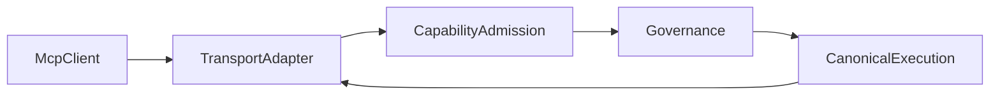
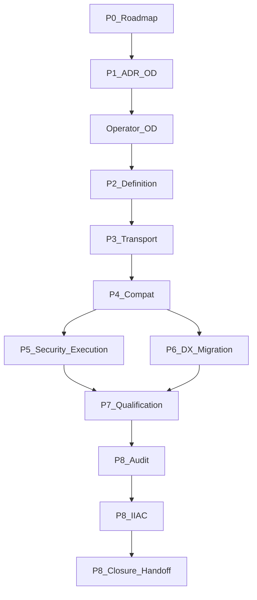

# MCP-SERVER-X — plan nadrzędny kampanii

**Tryb:** plan. Produkcja, merge, certyfikacja i promocja FRZ pozostają poza tą sesją.
**Cel terminalny:** `ROADMAP AMENDED → ARCHITECTURE APPROVED → ENGINE IMPLEMENTED → L1/L2/L3 QUALIFIED → INDEPENDENT AUDIT PASS → IIAC CERTIFICATION ACCEPTED → MCP-SERVER-X CLOSED → ARCH-FREEZE HANDOFF PUBLISHED`

## 1. Zweryfikowany baseline i autorytety

**BASELINE_SHA (pin):** `c228799785db8f35826f47ba0790d6a21d97fbe3`
**Zdalny HEAD:** `git ls-remote origin refs/heads/development` zwraca ten sam SHA. Różnicy względem obserwowanego baseline nie ma. Komunikat commita: `Merge pull request #449 from jakbuczarnecki/ent/w5-w6-formal-closure`.

**Checkout w chwili planu:** gałąź `pre-ent/w6-g4-closure` @ `65981575fd6187ea88486f361061ca4940f4ceec` jest przodkiem `origin/development` (0 commitów do przodu, 27 do tyłu). Pliki Pythona MCP są identyczne z `origin/development`. Roadmapa i checklista FRZ na development różnią się od tego checkoutu (zamknięcie ENT-AUDIT-X). Nieśledzony plik `tests/qualification/ent_audit_x/CANDIDATE_ENTERPRISE_AUDIT_BASELINE.json` nie wchodzi do kampanii i nie jest kasowany ani commitowany.

**Autoryzacja operatora (2026-11-11), krok 0 przed jakimkolwiek batchem:** w głównym checkoutcie przełączyć się na gałąź `development` (`git switch development`). Jeśli lokalny `development` jest ściśle za `origin/development`, dopiąć go wyłącznie `git merge --ff-only origin/development`. Rozjazd inny niż fast-forward zatrzymuje kampanię. Warunek startu edycji: `git rev-parse --abbrev-ref HEAD` = `development` oraz `HEAD` = pin `c228799785db8f35826f47ba0790d6a21d97fbe3` (albo nowszy zdalny SHA, wtedy stop i raport różnicy). Gałąź robocza PR `mcp-server-x-p0` powstaje dopiero z tego HEAD. Commity kampanii nie lądują wprost na `development` ani na `pre-ent/w6-g4-closure`. Równoległe strumienie P2+ dalej dostają własne worktree od aktualnego `development`.

**Program SSOT:** [docs/project/maintainers/plans/PLATFORM_ENTERPRISE_COMPLETION_ROADMAP.md](docs/project/maintainers/plans/PLATFORM_ENTERPRISE_COMPLETION_ROADMAP.md) na development. Sekwencja Dimension A kończy się: EVOL-X (narracja §5: zamknięty, komórka statusu tabeli nadal `FORMAL PROTOCOL 03 B6 — PENDING_AUTHORITY` — napięcie SSOT, kampania go nie przepisuje) → **ENT-AUDIT-X = CLOSED — INDEPENDENTLY AUDITED (INTERNAL AGENT CERTIFICATION) — PUBLISHED** (IIAC PASS_SCOPED, OD-ENT-08, baseline `480550d80b2515fc8cbd2a0ba6f79d1ee1c44541`) → **ARCH-FREEZE = FINAL / MANDATORY, nieotwarty**. Następny etap w roadmapie development to ARCH-FREEZE. MCP-SERVER-X wchodzi jako nowa bramka między ENT-AUDIT-X a ARCH-FREEZE. Zamknięcia historyczne zostają.

**Akceptacja globalna:** [PLATFORM_ENTERPRISE_FREEZE_ACCEPTANCE_CHECKLIST.md](docs/project/maintainers/qualification/PLATFORM_ENTERPRISE_FREEZE_ACCEPTANCE_CHECKLIST.md). Licznik mechaniczny: **225** kryteriów FRZ, **26** rodzin. Walidator [scripts/governance/verify_arch_freeze_plan_traceability.py](scripts/governance/verify_arch_freeze_plan_traceability.py) wymaga `len(canonical) == 225`. ECAP §3.0: jeśli `|C| ≠ 225`, dokument nie jest gotowy do audytu bez przeliczenia.

**ECAP:** [ENTERPRISE_CONTINUOUS_ARCHITECTURE_ASSURANCE_PROTOCOL.md](docs/project/maintainers/qualification/ENTERPRISE_CONTINUOUS_ARCHITECTURE_ASSURANCE_PROTOCOL.md). Tryby A/B/C. Dla tej kampanii: delta Mode A na kontrakcie MCP plus Mode B przy zamknięciu etapu. Pełny Mode C platformy zostaje bramką ARCH-FREEZE, nie każdym commitem MCP.

**IIAC:** polityka `IIAC-2026-11-05.1`. Rekord aktywacji na development: `status = IN_FORCE`, `effective_from_sha = 661978df191d9356058a1312a712fcfa3c890e9e`, decyzja `IIAC-OD-ENT-ACT-N11-2026-11-10`. Zdanie otwierające protokołu markdown nadal mówi `NOT_IN_FORCE`. Wiążący jest rekord aktywacji. Kampania nie edytuje polityki IIAC w P0. Certyfikacja P8 idzie tym protokołem: implementer ≠ audytor ≠ certyfikujący.

**Zasady architektury:** [INTERGRAX_ARCHITECTURE_PRINCIPLES.md](docs/project/architecture/INTERGRAX_ARCHITECTURE_PRINCIPLES.md) §3.2 — silnik MCP jest capability platformy (osiem aplikacji już woła ten sam builder). Aplikacja nie dostaje własnej infrastruktury serwera.

**SYSTEM_INVARIANTS.md:** ścieżka `docs/project/technical/guides/SYSTEM_INVARIANTS.md` jest w `.cursorignore`. Ta sesja nie wczytała pliku. Powołanie idzie przez indeks ECAP (`SYS-INV-*`: jeden właściciel semantyczny, Governance ≠ Execution, obserwowalność ≠ prawda wykonania, kontrakt nad implementacją). Batch implementacyjny, który dotyka konkretnego INV, czyta tylko wycinek po zdjęciu ignorowania albo przez `git show`.

**Powiązane autorytety (stan, nie dowód zgodności z nowym kontraktem):**

- TOOL-LIFE-X — właściciel cyklu życia wywołania narzędzia. ADR [ADR_TLX_TL11_MCP_CATALOG_CHILD_EXECUTION_OWNERSHIP.md](docs/project/maintainers/architecture/ADR_TLX_TL11_MCP_CATALOG_CHILD_EXECUTION_OWNERSHIP.md): katalog MCP jest pracą potomną pod żywym root Execution, bez drugiego supervisora.
- SKILL-X — wpływ na zachowanie agenta. Silnik MCP nie tworzy rejestru skilli ani promptów.
- CONFIG-X — aktywacja przez istniejący profil/`settings_loader` (`MCP_MOUNT_PATH`). Zamknięcie CONFIG-X nie dowodzi poprawności nowej ekspozycji.
- COMPAT-X — nowy kontrakt publiczny dostaje wersję, fingerprint i wpis inwentarza. Historyczny PASS nie obejmuje tego kontraktu.
- TENANT-X — izolacja tożsamości. Testy negatywne MCP są nowym dowodem, nie dziedziczeniem FRZ-TEN.
- CTRL-X / Governance — admission i side-effect authorization zostają u Governance.
- Canonical Execution / ToolRuntime — jedyna ścieżka wykonania.
- EVOL-X — wpływ zmiany i wybór regresji dla nowego kontraktu publicznego. Komórka statusu tabeli vs §5 pozostaje nieruszona.
- ENT-AUDIT-X — audyt przyrostowy i wpływ na baseline. Etap pozostaje CLOSED. Brak masowej promocji FRZ-AUD.
- ARCH-FREEZE — WBS poprzednika istnieje ([ARCH_FREEZE_WBS_AND_DEPENDENCY_DAG.md](docs/project/maintainers/qualification/ARCH_FREEZE_WBS_AND_DEPENDENCY_DAG.md)); roadmapa mówi, że etap nie jest otwarty. Zadania poprzednika zostają. Formalne CLOSED ARCH-FREEZE wymaga MCP-SERVER-X CLOSED. ARCH-FREEZE ≠ gotowość produkcyjna (Path B, PROD-Q).

**Odczyty duże (budżet):** roadmapy nie wczytano w całości (git grep + diff 8 linii statusu). Checklisty FRZ nie wczytano w całości. ADR TL11: pierwsze 40 linii. ECAP: nagłówki i reguła 225. Zasady architektury: początek hierarchii capability.

## 2. Inwentarz istniejącego MCP

Właściciel semantyczny ekspozycji dziś: składanie w `intergrax/applications/_shared/` (Tier-0 hosting aplikacji). Wykonanie: `HostTaskExecutionPort` i `ExecutionBoundCatalogToolInvoker`. Kontrakt narzędzia: `ToolContract` / `ToolRegistry`. Tożsamość: harness principal. Aplikacje Tier-3 tylko nazywają serwer i domyślne capability.

| Moduł | Odpowiedzialność | Kontrakt | Wejście | Granica |
|---|---|---|---|---|
| [fastapi_mcp.py](intergrax/applications/_shared/fastapi_mcp.py) | Mount FastMCP `http_app` na wrapperze FastAPI, lifespan, auth middleware, task-control i transport-detachment | funkcje `couple_fastapi_with_mcp`, `couple_harness_host_fastapi_with_mcp` | ASGI `/mcp` (domyślnie), streamable HTTP | transport; semantyka runtime poza modułem |
| [mcp_nexus_server.py](intergrax/applications/_shared/mcp_nexus_server.py) | `FastMCP(name)` + narzędzia `list_agents`, `run_agent`; opcjonalny montaż katalogu | `build_nexus_mcp_server` | host execution, registry, default tenant/user | `run_agent` woła `resolve_mcp_run_agent_identity` i `execute_mcp_agent_task` |
| [mcp_catalog_tools.py](intergrax/applications/_shared/mcp_catalog_tools.py) | `list_catalog_tools`, `describe_catalog_tool`, `invoke_catalog_tool` | `mount_catalog_tools_on_mcp` | `ToolRegistry` + opcjonalny `McpCatalogInvocationComposition` | brak polityki wybiórczej ekspozycji: rejestr włączony ⇒ narzędzia katalogu na serwerze |
| [mcp_catalog_invocation_bridge.py](intergrax/applications/_shared/mcp_catalog_invocation_bridge.py) | Mostek wywołania katalogu: binding task/run/step, tenant, child execution | `execute_mcp_catalog_tool_invocation` | aktywne wykonanie | nie jest drugim ToolRuntime |
| [mcp_catalog_side_effect_enforcement.py](intergrax/applications/_shared/mcp_catalog_side_effect_enforcement.py) | Żądanie autoryzacji skutku ubocznego | builder requestu | port Governance | decyzja zostaje poza MCP |
| [mcp_harness_principal.py](intergrax/applications/_shared/mcp_harness_principal.py) | Principal z requestu FastMCP; asercje klienta odrzucane przy konflikcie | `resolve_mcp_run_agent_identity` | HTTP context | przy wymaganym auth brak principal = błąd; przy bypassie lokalnym tenant z argumentu lub default |
| [mcp_host_execution_transport_cancel.py](intergrax/applications/_shared/mcp_host_execution_transport_cancel.py) | Anulowanie root przy zerwaniu transportu | admission + launch | supervision port | powód `mcp_transport_cancel`; dziecko nie dostaje drugiego root |
| [mcp_task_control_coupling.py](intergrax/applications/_shared/mcp_task_control_coupling.py) | Granica mutacji task-control przy mount | resolver | runtime/env | Governance control plane |
| [mcp_transport_detachment_supervision_coupling.py](intergrax/applications/_shared/mcp_transport_detachment_supervision_coupling.py) | Lifespan shutdown supervision | resolver + lifespan | runtime | Execution supervision |
| [mcp_result_bounds.py](intergrax/tools/mcp_result_bounds.py) | Limit bajtów wyniku | `bound_mcp_structured_result`, `emit_bounded_mcp_list` | payload | fail na przekroczeniu limitu |
| [mcp_import_guard.py](intergrax/applications/_shared/mcp_import_guard.py) | Leniwy import FastMCP | `ensure_mcp_dependencies` | import | brak cichego fallbacku |
| [exporters/mcp.py](intergrax/tools/exporters/mcp.py) | Eksport `ToolContract` → JSON Schema MCP | `to_mcp_tools` | rejestr/kontrakt | eksport schematu, nie publikacja serwera |

**Aplikacje** (`applications/*/mcp/server.py`): `dispute_sim`, `governed_contractor`, `intergrax_assistant`, `lab`, `legal`, `local_workspace`, `poc_template` — cienkie wrappery `build_nexus_mcp_server` (nazwa, default capability, default tenant/user). `research_application` dokłada narzędzie `run_research_pipeline` wołające `execute_mcp_agent_task`.

**Zależność:** `fastmcp>=3.3.1,<4` w [pyproject.toml](pyproject.toml) (dwa extra). Słowo `mcp` w keywords nie jest pinem SDK. Negocjacja rewizji protokołu nie jest jawnym kontraktem platformy. Jedyny transport w kodzie hosta: streamable HTTP przez `mcp.http_app`. Brak `@mcp.resource` i `@mcp.prompt` w `intergrax/`.

**Testy istniejące (reuse, nie akceptacja etapu):** `tests/unit/applications/test_fastapi_mcp.py`, `test_reference_apps_mcp.py`, `test_mcp_surface_opt_in.py`, `test_mcp_canonical_execution.py`, `test_mcp_trust_a_principal_binding.py`, `test_mcp_cancel_a_transport_governed_cancel.py`, kwalifikacje katalogu L3 (`test_mcp_catalog_f3_streamable_http_physical_l3.py`, cross-loop cancel), fixture `tests/fixtures/tool_life_x_l3_r1_mcp_qualification_server.py`. To dowody TOOL-LIFE-X / hosta, nie zamknięcie MCP-SERVER-X.

**Konfiguracja:** `MCP_MOUNT_PATH` w [settings_loader.py](intergrax/applications/_shared/settings_loader.py). Domyślne tenanty zaszyte w builderach aplikacji (`lab`, `research`, `mcp`).

**Obserwowalność:** korelacja przez `RequestIdentity` i istniejący trace wykonania. Osobnego rejestru audytu MCP nie ma i nie powstanie.

**Ograniczenia:** brak typed Server Definition; brak Exposure Policy; brak wersji capability na powierzchni MCP; Resources/Prompts niezaimplementowane; stdio/SSE niepodpięte do hosta; osiem builderów powiela kwargs; `research` omija wspólny kształt deklaracji.

## 3. Reuse

- Zostaje: mount ASGI, principal, anulowanie transportu, mostek katalogu, child execution z ADR TL11, eksport schematu, limity wyniku, import guard, opt-in powierzchni.
- Adapter zgodności: `build_nexus_mcp_server` i `build_*_mcp_server` pozostają jako fasady nad nowym kontraktem definicji, aż przewodnik migracji uzna je za warstwę zgodności.
- Nie powstaje: drugi ToolRuntime, drugi Governance, drugi rejestr narzędzi, drugi rejestr skilli, drugi audit log, drugi mechanizm retry/cancel, drugi magazyn RAG.

## 4. Luki (skrót macierzy)

Każdy wiersz docelowo: `REQ-ID → właściciel → implementacja → luka → ryzyko → TASK → TEST → dowód → FRZ/ECAP → certyfikujący`.

**Protokół / transport**

- REQ-MCP-P-01 rewizja protokołu ogłaszana przez FastMCP 3.x — właściciel adapter. Luka: brak pinu rewizji w kontrakcie platformy. Ryzyko: fałszywe „pełne MCP”. Task MCP-P3-02. Test L3 ogłasza tylko streamable HTTP. FRZ-BND-06 (dowód przyrostowy, status bez promocji w P0).
- REQ-MCP-P-02 negocjacja — DEFERRED do tego, co robi SDK przy jednym transporcie. Osobny negocjator platformy: nie.
- REQ-MCP-P-03 stdio/SSE — UNSUPPORTED_BY_DESIGN w v1 (OD-MCP-03).
- REQ-MCP-P-04 anulowanie i disconnect — właściciel Execution + istniejący cancel. Luka: brak jednego scenariusza referencyjnego na nowym serwerze. Task MCP-P5-06 / MCP-P7-03.
- REQ-MCP-P-05 błędy — dziś `ToolError` / payload `error`. Luka: brak wspólnego katalogu kodów na kontrakcie definicji. Task MCP-P2-05.

**Definicja serwera**

- REQ-MCP-S-01 tożsamość typed — brak. Task MCP-P2-01.
- REQ-MCP-S-02 polityka ekspozycji enable/disable — brak; katalog jest wszystko-albo-nic. Task MCP-P2-03.
- REQ-MCP-S-03 wiele serwerów na aplikację — dziś jeden mount. Składanie wielu definicji na jednym ASGI: task MCP-P2-04, bez nowych procesów.

**Capability**

- Tools: MANDATORY, przez `ToolContract` i jawne narzędzia hosta (`list_agents`, `run_agent`).
- Resources: UNSUPPORTED_BY_DESIGN v1 (OD-MCP-02). Brak drugiego magazynu treści.
- Prompts: UNSUPPORTED_BY_DESIGN v1. Skill-X zostaje właścicielem wpływu na zachowanie.
- Rozszerzenia sampling/roots: DEFERRED_WITH_JUSTIFICATION. Progress/cancel już sprzężone z transportem: SUPPORTED w zakresie istniejącego cancel.

**Kontrakty**

- REQ-MCP-C-01 JSON Schema z Pydantic `ToolContract` — jest w eksporterze. Luka: fingerprint i wersja powierzchni. Task MCP-P4-03. Rodzina FRZ-CMP, dowód nowy, bez dziedziczenia PASS.

**Bezpieczeństwo**

- REQ-MCP-SEC-01 auth harness na wrapperze — jest. Luka: default tenant przy local bypass. Produkcyjny profil ma być fail-closed (już częściowo: brak principal przy wymaganym auth). Task MCP-P5-01/02. Test negatywny cross-tenant.
- REQ-MCP-SEC-02 argument `tenant_id` klienta jest asercją — jest w principal resolverze. Utrzymać.

**Wykonanie**

- REQ-MCP-X-01 `run_agent` → host execution — jest.
- REQ-MCP-X-02 `invoke_catalog_tool` → child work — jest wg ADR TL11. Rekwalifikacja tylko gdy sygnatura mostka się zmieni (EVOL).
- REQ-MCP-X-03 deadline/retry — właściciel TOOL-LIFE-X. Silnik nie dodaje retry.

**Operacje runtime**

- REQ-MCP-O-01 lifespan — jest. Luka: brak jawnego readiness osobnego od lifespanu. Health zostaje healthem hosta HTTP. Osobny probe MCP: tylko jeśli host już ma wzorzec; inaczej DEFERRED.
- REQ-MCP-O-02 backpressure — częściowo limitem wyniku. Limit współbieżności sesji: luka, task MCP-P3-06, bound przez konfigurację, fail-closed przy przekroczeniu.

**Obserwowalność**

- REQ-MCP-OBS-01 korelacja request/tenant/run — przez RequestIdentity. Luka: jeden identyfikator wywołania MCP w istniejącym evencie, bez nowego źródła prawdy. Task MCP-P5-07 scenariusz 17.

**DX**

- REQ-MCP-DX-01 API „zdefiniuj serwer i opublikuj” — brak. Task MCP-P6-01. Referencja w testach kwalifikacji, nie 9. aplikacja produktowa.

**Kwalifikacja**

- Historyczne PASS_SCOPED TOOL-LIFE-X nie zamyka etapu. Macierz P7 jest obowiązkowa.

Żadna capability obowiązkowa nie zostaje bez klasyfikacji: Tools = MANDATORY; Resources = UNSUPPORTED_BY_DESIGN; Prompts = UNSUPPORTED_BY_DESIGN; sampling/roots = DEFERRED_WITH_JUSTIFICATION; streamable HTTP = MANDATORY; inne transporty = UNSUPPORTED_BY_DESIGN.

## 5. Architektura docelowa

Przepływ:

Silnik jest granicą ekspozycji protokołu. Właściciele semantyczni poza silnikiem pozostają.

**Komponenty logiczne (moduły, nie mikroserwisy):**

1. **Server Definition** — `intergrax/contracts/mcp_server_definition.py`: tożsamość, wersja kontraktu, nazwa, lista bindingów, polityka. Bez importu FastMCP.
2. **Capability Binding** — typed odniesienie do istniejącego `tool_id` albo do wbudowanego narzędzia hosta (`list_agents`, `run_agent`). Brak kopii schematu jako drugiego rejestru; schemat czytany z `ToolContract`.
3. **Exposure Policy** — allowlista bindingów, flaga enabled, widoczność. Zmiana dynamiczna tylko przez ponowną kompozycję konfiguracji CONFIG-X, nie przez mutację rejestru narzędzi.
4. **Composition** — funkcja w `_shared` składa definicje aplikacji w jeden `FastMCP` na proces.
5. **Transport Adapter** — obecny [fastapi_mcp.py](intergrax/applications/_shared/fastapi_mcp.py) zostaje adapterem streamable HTTP.
6. **Lifecycle** — enable przy starcie lifespanu; disable/retire przez konfigurację i restart procesu albo przez zamknięcie mountu jeśli ASGI to już umie. Brak hot-reload jako drugiego control plane.
7. **Security integration** — wywołanie istniejącego `resolve_mcp_run_agent_identity` i middleware harness.
8. **Execution bridge** — istniejące `execute_mcp_agent_task` i `execute_mcp_catalog_tool_invocation`.
9. **Observability adapter** — pola korelacji na istniejącym evencie wykonania.
10. **Qualification harness** — `tests/qualification/mcp_server_x/` plus fixture serwera i klient zgodny z ogłoszonym transportem.

**ADR-y (status Proposed do OD):**

- ADR-MCP-01 własność i API publiczne. Alternatywa odrzucona w rekomendacji: silnik w każdej aplikacji Tier-3. Alternatywa odrzucona: nowy pakiet `intergrax/runtime/mcp` jako władza wykonania.
- ADR-MCP-02 zakres capability (Tools only).
- ADR-MCP-03 transport (streamable HTTP, FastMCP 3.x).
- ADR-MCP-04 publikacja deklaratywna + cienki builder programistyczny.
- ADR-MCP-05 zgodność: fasady `build_*_mcp_server` zostają; nowy kontrakt wersja `mcp-server-definition.v1`.
- ADR-MCP-06 granica zaufania: principal harness; argumenty tenant/user tylko jako asercje.
- ADR-MCP-07 kwalifikacja: macierz MCP-ACC lokalna etapu; rodzina FRZ-MCP nie powstaje w ścieżce domyślnej.

Para dokumentów capability (reguła hubu): [docs/project/capabilities/architecture/MCP_SERVER.md](docs/project/capabilities/architecture/MCP_SERVER.md) i [docs/project/capabilities/plan/MCP_SERVER.md](docs/project/capabilities/plan/MCP_SERVER.md). Plan capability jest skrótem wskazującym dossier. Dossier kampanii: `docs/project/maintainers/qualification/mcp_server_x/`. Roadmapa zostaje SSOT statusu etapu. Jeden indeks `MCP_SERVER_X_INDEX.md` wymienia artefakty; puste rekordy audytu nie powstają przed P8.

## 6. Decyzje operatora

Autoryzacja kierunkowa już jest: dodać MCP-SERVER-X jako etap obowiązkowy przed formalnym ARCH-FREEZE. To wystarcza na batch P0 (roadmapa). To nie jest podpis OD-MCP-01..07.

Rekomendowany pakiet (wdrożenie P2+ dopiero po linii `Approved` na tickecie albo po osobnych rekordach OD):

- **OD-MCP-01** API publiczne: kontrakt w `intergrax/contracts/`, składanie w `intergrax/applications/_shared/`. Skutek: aplikacje importują kontrakt, nie FastMCP, poza adapterem hosta. Odrzucenie przenosi silnik do Tier-3 i łamie §3.2.
- **OD-MCP-02** Tools MANDATORY; Resources i Prompts UNSUPPORTED_BY_DESIGN. Skutek: klient dostaje capability tools, bez resources/prompts. Wybór Resources otwiera drugi magazyn treści i wypada poza tę kampanię.
- **OD-MCP-03** Jedyny transport: streamable HTTP, FastMCP `>=3.3.1,<4`. Stdio/SSE poza zakresem. Skutek: L3 tylko HTTP. Dodanie stdio wydłuża P3 i macierz zgodności.
- **OD-MCP-04** Definicja deklaratywna (obiekt typed + konfiguracja mount path / enabled) i builder programistyczny jako cienka nakładka. Ekspozycja dynamiczna = nowa kompozycja konfiguracji, nie mutacja ToolRegistry. Skutek: brak shadow registry.
- **OD-MCP-05** Wersja kontraktu `v1`, fasady obecnych builderów jako adapter zgodności. Brak cichego usuwania `run_agent` / katalogu. Skutek: COMPAT inwentaryzuje nową powierzchnię; stare testy zostają regresją.
- **OD-MCP-06** Ta sama tożsamość harness co HTTP hosta. Brak osobnego schematu uprawnień MCP. Fail-closed gdy profil wymaga principal. Bypass lokalny zostaje tylko w profilu dev, z testem że profil produkcyjny go nie ma. Skutek: cross-tenant negative jest bramką P5.
- **OD-MCP-07** Bez nowej rodziny FRZ. Akceptacja etapu = macierz MCP-ACC + noty dowodowe przy istniejących ID (BND-06, OWN, CTR, EXE, SEC, TEN, CMP, REL) bez zmiany licznika 225 i bez promocji PASS w tym samym commicie co kod. Ścieżka B (FRZ-MCP-01..n) wymaga osobnej migracji walidatora, ECAP i checklisty i nie jest częścią planu domyślnego.

Brak wpisu OD = brak zgody. Agent nie wpisuje `Approved`.

## 7. Pierwszy batch: poprawka roadmapy

Ticket: `governance/tickets/T-IGX-035-A.md` (następny wolny numer po T-IGX-034). Zakres wyłącznie dokumentacja programu i dowód pinu. Zero zmian w `intergrax/` i `applications/`.

**A. Wiersz etapu** w tabeli sekwencji i w ledgerze §3 / §5:

- Id: `MCP-SERVER-X`
- Status: `PLANNED / MANDATORY / CURRENT`
- Miejsce: po ENT-AUDIT-X, przed ARCH-FREEZE
- Zdanie ARCH-FREEZE: wejście formalne i CLOSED wymagają `MCP-SERVER-X = CLOSED`
- Komórki zamkniętych etapów bez zmiany werdyktu
- Narracja „next = ARCH-FREEZE” staje się „next = MCP-SERVER-X”; ARCH-FREEZE zostaje FINAL / MANDATORY, zależny

**B. Zależności zapisane w wierszu:** SKILL-X, TOOL-LIFE-X, CONFIG-X, COMPAT-X, TENANT-X, Governance/CTRL-X, Canonical Execution, EVOL-X, ENT-AUDIT-X. Każda z adnotacją: zamknięcie historyczne nie jest dowodem zgodności z kontraktem MCP v1; obowiązek rekwalifikacji = regresja powierzchniowa wymieniona w MCP-P7, nie ponowne otwarcie etapu.

**C. Autorytety zależne (ten sam PR, tylko odsyłacze, statusy FRZ bez zmiany):**

- DAG w roadmapie i jedno zdanie w ARCH-FREEZE handoff / WBS: poprzednik planistyczny zostaje, bramka CLOSED dostaje zależność MCP-SERVER-X
- ECAP: akapit, że nowe ID FRZ nie powstają; pokrycie MCP idzie dowodem przyrostowym do istniejących rodzin
- ENT-AUDIT-X: nota change-impact „delta Mode A przy publikacji kontraktu”, baseline ENT bez unieważnienia
- EVOL-X: placeholder obowiązku change-impact, bez edycji komórki statusu EVOL
- Rejestry kontraktów: wpis planowany, realizacja w P4 po OD-MCP-05
- Dokumentacja aplikacji referencyjnych: odsyłacz, migracja w P6
- Walidator 225: uruchomić, oczekiwany wynik bez zmiany kodu walidatora
- Pochodne checklisty: jeśli generator wymaga pary plików capability, dodać parę MCP_SERVER jako stub wskazujący dossier

**D. Publikacja:** PR do `development`. CI wymagane przez repo. Review niezależny od autora commita. Po merge agent zapisuje `ROADMAP_AMENDMENT_SHA` z `git ls-remote`. Do merge brak twierdzenia, że roadmapa jest opublikowana.

Rodzina `FRZ-MCP-*`: **nie** w tym batchu (OD-MCP-07 rekomendacja A).

## 8. WBS P0–P8

Wspólne pola ról: orchestrator trzyma integrację i publikację; implementer nie certyfikuje; audyt i IIAC to osobne sesje na opublikowanym SHA. Równoległość: `serial-ssot` (jeden właściciel plików SSOT), `parallel-safe` (rozłączne pliki), `gate` (stop na decyzję).

### MCP-P0 — baseline i roadmapa

- **MCP-P0-01** Pin SHA. Baseline: `c2287997`. Wynik: drabinka `BASELINE_SHA`. Pliki: dossier SHA ladder. Rola: orchestrator. Zależność: brak. Ryzyko: niski. Parallel: serial-ssot. Akceptacja: `git ls-remote` = pin. Test: komenda git. Dowód: wpis w drabince. Review: nie. Exit: SHA zapisany, różnica względem obserwacji = brak.
- **MCP-P0-02** Przełączenie głównego checkoutu na `development`, potem gałąź `mcp-server-x-p0` z pinu. Baseline: `pre-ent/w6-g4-closure` @ `65981575`, 27 commitów za origin. Wynik: HEAD kampanii = `development` zgodny z pinem, edycje na `mcp-server-x-p0`. Pliki: brak zmian treści. Rola: implementer. Zależność: P0-01. Ryzyko: średni (rozjazd gałęzi, nieśledzony JSON). Parallel: serial-ssot. Akceptacja: `abbrev-ref` przed odgałęzieniem = `development`, `HEAD` = pin, po odgałęzieniu `mcp-server-x-p0` wskazuje ten sam SHA. Test: brak pytest. Dowód: oba SHA w tickecie. Review: nie. Exit: praca nie zostaje na `pre-ent/w6-g4-closure`. Nieśledzony `CANDIDATE_ENTERPRISE_AUDIT_BASELINE.json` zostaje poza commitem.
- **MCP-P0-03** Ticket T-IGX-035-A, digest planu, stan `plan_pending`. Baseline: [governance/tickets/README.md](governance/tickets/README.md). Wynik: ticket z zakresem P0. Pliki: `governance/tickets/T-IGX-035-A.md`. Rola: architect potem operator dla `Approved`. Zależność: P0-01. Ryzyko: niski. Parallel: serial-ssot. Akceptacja: `verify_plan_approval` po linii operatora. Test: skrypt governance. Dowód: digest. Review: operator. Exit: `plan_approved` zanim powstanie PR. Agent nie pisze `Approved`.
- **MCP-P0-04** Artefakt inwentarza. Baseline: sekcja 2 tego planu. Wynik: `MCP_SERVER_X_EXISTING_IMPLEMENTATION_INVENTORY.md` zgodny z plikami na pinie. Pliki: dossier. Rola: architect. Zależność: P0-02. Ryzyko: niski. Parallel: parallel-safe względem P0-05, nie względem roadmapy. Akceptacja: każda ścieżka istnieje na SHA. Test: brak. Dowód: plik. Review: reviewer odczyt. Exit: brak pozycji „niezweryfikowana ścieżka”.
- **MCP-P0-05** Rejestr luk REQ-MCP-*. Baseline: sekcja 4. Wynik: `MCP_SERVER_X_GAP_REGISTER.md`. Pliki: dossier. Rola: architect. Zależność: P0-04. Ryzyko: średni. Parallel: parallel-safe z P0-04 po inwentarzu. Akceptacja: każde REQ ma TASK-ID. Test: brak. Dowód: rejestr. Review: reviewer. Exit: brak obowiązkowej capability bez klasyfikacji.
- **MCP-P0-06** Poprawka roadmapy. Baseline: development ledger. Wynik: wiersz MCP-SERVER-X i zależność ARCH-FREEZE. Pliki: roadmapa. Rola: implementer docs. Zależność: P0-03 approved, P0-05. Ryzyko: wysoki (SSOT). Parallel: serial-ssot. Akceptacja: diff nie zmienia werdyktów CLOSED. Test: przegląd diffu. Dowód: PR. Review: tak. Exit: status PLANNED/MANDATORY/CURRENT.
- **MCP-P0-07** Odsyłacze zależne bez promocji FRZ. Baseline: checklist 225, ECAP, handoff ARCH-FREEZE, nota ENT/EVOL. Wynik: zdania zależności. Pliki: wymienione autorytety, tylko akapity odsyłające. Rola: implementer docs. Zależność: P0-06. Ryzyko: wysoki. Parallel: serial-ssot (te same huby). Akceptacja: statusy FRZ identyczne. Test: `verify_arch_freeze_plan_traceability` licznik 225. Dowód: log testu. Review: tak. Exit: walidator 225 zielony, brak nowego ID FRZ.
- **MCP-P0-08** Para capability stub. Baseline: reguła pary architecture/plan. Wynik: MCP_SERVER.md para wskazuje dossier. Pliki: `docs/project/capabilities/architecture/MCP_SERVER.md`, `docs/project/capabilities/plan/MCP_SERVER.md`. Rola: implementer docs. Zależność: P0-05. Ryzyko: niski. Parallel: parallel-safe jeśli nie edytuje roadmapy. Akceptacja: para 1:1. Test: istniejący checker par jeśli jest w CI docs. Dowód: pliki. Review: tak. Exit: brak drugiej kopii WBS.
- **MCP-P0-09** PR na development, CI, review, merge. Baseline: pin. Wynik: `ROADMAP_AMENDMENT_SHA`. Pliki: jak P0-06..08. Rola: orchestrator publikacji. Zależność: P0-06, P0-07, P0-08. Ryzyko: średni. Parallel: gate. Akceptacja: CI zielone, review niezależny. Test: CI PR. Dowód: SHA zdalny po merge. Review: tak. Exit: `git ls-remote` pokazuje merge; do tego momentu brak twierdzenia o publikacji.
- **MCP-P0-10** Indeks dossier i macierz akceptacji (pusta kolumna dowodu). Baseline: ten plan. Wynik: INDEX, WBS, QUALIFICATION_MATRIX, CONTRACT_MATRIX jako pliki kontrolowane. Pliki: `docs/project/maintainers/qualification/mcp_server_x/`. Rola: orchestrator. Zależność: P0-09. Ryzyko: niski. Parallel: serial-ssot. Akceptacja: indeks wymienia jeden SSOT na artefakt. Test: brak. Dowód: commit publikacji albo ten sam SHA co P0-09. Review: tak. Exit: kampania ma jeden plan w repo, ten dokument Cursor jest źródłem do digestu.

### MCP-P1 — architektura

- **MCP-P1-01** ADR-MCP-01..07 jako Proposed. Baseline: inwentarz P0. Wynik: pliki ADR w `docs/project/maintainers/architecture/`. Rola: architect. Zależność: P0-09. Ryzyko: wysoki. Parallel: serial-ssot. Akceptacja: każdy ADR ma alternatywę i skutek. Test: brak. Dowód: ADR. Review: niezależny review architektury (odczyt, nie IIAC). Exit: brak konkurencyjnej władzy wykonania w tekście ADR.
- **MCP-P1-02** Szkic kontraktu (tylko typy w PR docs albo w kodzie oznaczonym jako niefunkcjonalny — preferencja: kod dopiero po OD). Baseline: eksporter i ToolContract. Wynik: spec pól w ADR-MCP-01. Rola: architect. Zależność: P1-01. Ryzyko: średni. Parallel: serial-ssot. Akceptacja: pola wersji, binding, policy, brak FastMCP w kontrakcie. Test: brak. Dowód: ADR. Review: tak. Exit: implementer P2 ma zamknięty kształt.
- **MCP-P1-03** Rekordy OD jako szablony bez podpisu. Baseline: sekcja 6. Wynik: `mcp_server_x/operator_decisions/OD-MCP-0N.md` status `PENDING`. Rola: architect. Zależność: P1-01. Ryzyko: wysoki (fałszywy podpis). Parallel: serial-ssot. Akceptacja: brak linii Approved dopisanej przez agenta. Test: brak. Dowód: pliki PENDING. Review: operator. Exit: **gate**. P2 nie startuje.
- **MCP-P1-04** Review architektury, osobna sesja. Baseline: SHA po P1-01. Wynik: notatka review bez werdyktu CLOSED. Rola: reviewer. Zależność: P1-01. Ryzyko: średni. Parallel: gate. Akceptacja: lista usterek albo brak usterek blokujących. Test: brak. Dowód: notatka. Review: ta sesja jest review. Exit: usterki blokujące mają task korekty przed P2.

### MCP-P2 — definicja i publikacja

Warunek: OD-MCP-01, 02, 04, 05 zapisane przez operatora.

- **MCP-P2-01** Typed Server Definition. Baseline: brak modułu. Wynik: kontrakt v1. Pliki: `intergrax/contracts/mcp_server_definition.py` + test jednostkowy. Rola: implementer. Zależność: P1-04, OD. Ryzyko: wysoki. Parallel: serial na `contracts/`. Akceptacja: import bez fastmcp. Test: L1 schemat. Dowód: pytest. Review: tak. Exit: pola wymagane odrzucają definicję niekompletną.
- **MCP-P2-02** Capability Binding do `tool_id` i narzędzi hosta. Baseline: `to_mcp_tools`. Wynik: binding nie kopiuje rejestru. Pliki: kontrakt + składanie w `_shared`. Rola: implementer. Zależność: P2-01. Ryzyko: wysoki. Parallel: serial `_shared`. Akceptacja: nieznany tool_id fail-closed. Test: L1. Dowód: pytest. Review: tak. Exit: brak drugiej listy narzędzi jako źródła prawdy.
- **MCP-P2-03** Exposure Policy. Baseline: montaż całego rejestru. Wynik: na serwerze tylko allowlista. Pliki: `_shared` composition. Rola: implementer. Zależność: P2-02. Ryzyko: wysoki. Parallel: serial. Akceptacja: narzędzie spoza listy niewidoczne w discovery. Test: L1+L2. Dowód: pytest. Review: tak. Exit: disable usuwa capability z ogłoszenia.
- **MCP-P2-04** Builder deklaratywny i programistyczny. Baseline: `build_nexus_mcp_server`. Wynik: jedna funkcja kompozycji. Pliki: `_shared/mcp_server_engine.py` (nazwa ostateczna w ADR-MCP-01). Rola: implementer. Zależność: P2-03. Ryzyko: średni. Parallel: serial. Akceptacja: dwa wejścia dają ten sam zestaw narzędzi. Test: L1. Dowód: pytest. Review: tak. Exit: research pipeline da się wyrazić bindingiem, nie osobnym dekoratorem poza silnikiem.
- **MCP-P2-05** Walidacja schematu i widoczności. Baseline: eksporter. Wynik: błąd kontraktu przed startem. Pliki: engine + exporter. Rola: implementer. Zależność: P2-04. Ryzyko: średni. Parallel: serial. Akceptacja: zły schema nie startuje serwera. Test: L1. Dowód: pytest. Review: tak. Exit: kody błędów wymienione w macierzy kontraktu.
- **MCP-P2-06** Brama shadow registry. Baseline: ToolRegistry. Wynik: test AST/import że engine nie posiada własnej mapy tool_id→handler poza delegacją. Pliki: test architektury. Rola: tester. Zależność: P2-04. Ryzyko: średni. Parallel: parallel-safe (tylko test). Akceptacja: test czerwony na sztucznym rejestrze w teście mutacyjnym lokalnym. Test: L1. Dowód: pytest. Review: tak. Exit: brama w CI paczki MCP.

### MCP-P3 — transport i hosting

- **MCP-P3-01** Konsolidacja FastMCP w adapterze. Baseline: `fastapi_mcp.py`, `build_nexus_mcp_server`. Wynik: jeden montaż używany przez silnik. Pliki: `_shared`. Rola: implementer. Zależność: P2-04. Ryzyko: wysoki. Parallel: serial (te same pliki co P2 — po P2, nie równolegle). Akceptacja: istniejące testy `test_fastapi_mcp` zielone. Test: regresja jednostkowa MCP. Dowód: pytest. Review: tak. Exit: brak drugiej funkcji mount.
- **MCP-P3-02** Pin transportu. Baseline: FastMCP 3.x `http_app`. Wynik: macierz „wspierane = streamable HTTP; rewizja = ta, którą ogłasza zainstalowany fastmcp w lockfile na SHA”. Pliki: macierz + test L3. Rola: tester. Zależność: P3-01. Ryzyko: średni. Parallel: parallel-safe po zamrożeniu adaptera. Akceptacja: test łączy się prawdziwym klientem HTTP. Test: L3. Dowód: log. Review: tak. Exit: brak deklaracji stdio.
- **MCP-P3-03** Lifespan ASGI. Baseline: `combine_lifespans`. Wynik: shutdown woła istniejący supervision lifespan. Pliki: `fastapi_mcp.py`. Rola: implementer. Zależność: P3-01. Ryzyko: średni. Parallel: serial z P3-01. Akceptacja: test start/stop bez wiszącego tasku. Test: L2. Dowód: pytest. Review: tak. Exit: istniejące testy cancel nadal zielone.
- **MCP-P3-04** Konfiguracja. Baseline: `MCP_MOUNT_PATH`. Wynik: enabled + mount path przez settings_loader, fail-closed na złej ścieżce. Pliki: settings + engine. Rola: implementer. Zależność: P2-03, CONFIG-X zasady. Ryzyko: średni. Parallel: serial settings. Akceptacja: brak nowego resolwera vendorów. Test: L1. Dowód: pytest. Review: tak. Exit: profil bez flagi nie otwiera powierzchni (zgodnie z obecnym opt-in).
- **MCP-P3-05** Start/stop i błędy diagnostyczne. Baseline: lifespan. Wynik: wyjątek składania definicji przerywa start. Pliki: engine. Rola: implementer. Zależność: P3-03. Ryzyko: średni. Parallel: serial. Akceptacja: komunikat bez sekretów. Test: L2. Dowód: pytest. Review: tak. Exit: proces nie zostaje w stanie pół-zamontowanym.
- **MCP-P3-06** Bound operacji. Baseline: `mcp_result_bounds`. Wynik: limit wyniku utrzymany; limit równoległych wywołań z konfiguracji, przekroczenie = błąd protokołu. Pliki: engine + bounds. Rola: implementer. Zależność: P3-01. Ryzyko: średni. Parallel: serial. Akceptacja: test przekroczenia. Test: L2. Dowód: pytest. Review: tak. Exit: brak nieograniczonej kolejki w silniku.

### MCP-P4 — cykl życia i zgodność

- **MCP-P4-01** Aktywacja i disable. Baseline: opt-in. Wynik: disabled = brak mountu albo pusty zestaw, zgodnie z OD-MCP-04. Pliki: engine, settings. Rola: implementer. Zależność: P3-04. Ryzyko: średni. Parallel: serial. Akceptacja: test obu stanów. Test: L2. Dowód: pytest. Review: tak. Exit: disable nie zostawia narzędzia w discovery.
- **MCP-P4-02** Retirement capability. Baseline: brak wersji. Wynik: binding `retired` niewidoczny, wywołanie po id zwraca błąd kontraktu. Pliki: kontrakt. Rola: implementer. Zależność: P2-02. Ryzyko: średni. Parallel: serial. Akceptacja: test. Test: L1. Dowód: pytest. Review: tak. Exit: brak cichego przekierowania na inny tool.
- **MCP-P4-03** Wersja i fingerprint. Baseline: COMPAT-X polityka wersji. Wynik: `contract_version` + fingerprint schematów ekspozycji. Pliki: kontrakt, test. Rola: implementer. Zależność: OD-MCP-05, P2-01. Ryzyko: wysoki. Parallel: serial. Akceptacja: zmiana schematu zmienia fingerprint. Test: L1. Dowód: pytest. Review: tak. Exit: wpis przygotowany pod inwentarz COMPAT.
- **MCP-P4-04** Adapter fasad. Baseline: 8 plików `mcp/server.py`. Wynik: fasady wołają silnik; zachowanie `list_agents`/`run_agent`/katalogu utrzymane. Pliki: `_shared/mcp_nexus_server.py`, aplikacje. Rola: implementer. Zależność: P2-04, P3-01. Ryzyko: wysoki. Parallel: serial na fasadzie; aplikacje można dzielić po jednym pliku tylko gdy fasada zamrożona. Akceptacja: `test_reference_apps_mcp` zielony. Test: regresja. Dowód: pytest. Review: tak. Exit: research pipeline jest bindingiem.
- **MCP-P4-05** Rejestracja COMPAT. Baseline: inwentarz COMPAT. Wynik: jedna powierzchnia publiczna dopisana mechanizmem inwentarza, bez ręcznego obchodzenia skanera. Pliki: kontrakt + ewentualny wpis metadanych wymagany przez skaner. Rola: implementer. Zależność: P4-03. Ryzyko: średni. Parallel: serial. Akceptacja: skaner widzi wersję. Test: istniejący test inwentarza COMPAT, wąski. Dowód: pytest. Review: tak. Exit: brak `MISSING_VERSION` na nowej powierzchni.

### MCP-P5 — bezpieczeństwo i Execution

- **MCP-P5-01** Propagacja tożsamości. Baseline: `mcp_harness_principal.py`. Wynik: principal z HTTP, konflikt asercji = błąd przed Execution. Pliki: testy. Rola: tester. Zależność: P3-01. Ryzyko: wysoki. Parallel: parallel-safe (testy) po zamrożeniu principal. Akceptacja: test pozytywny i konflikt. Test: L2. Dowód: pytest. Review: tak. Exit: Execution nie startuje przy konflikcie.
- **MCP-P5-02** Izolacja tenanta. Baseline: TENANT-X. Wynik: tenant A nie wywołuje bindingu ani stanu tenant B. Pliki: testy kwalifikacji. Rola: tester. Zależność: P5-01. Ryzyko: wysoki. Parallel: parallel-safe. Akceptacja: DENIED. Test: L2+L3. Dowód: pytest. Review: tak. Exit: brak fallbacku na default tenant w profilu z wymaganym auth.
- **MCP-P5-03** Admission Governance. Baseline: side-effect port. Wynik: skutek chroniony bez zezwolenia = odmowa. Pliki: test na istniejącym porcie. Rola: tester. Zależność: P4-04. Ryzyko: wysoki. Parallel: parallel-safe. Akceptacja: odmowa przed ToolRuntime. Test: L2. Dowód: pytest. Review: tak. Exit: silnik nie wydaje decyzji polityki.
- **MCP-P5-04** Canonical ToolRuntime. Baseline: mostek katalogu. Wynik: invoke idzie istniejącą ścieżką child. Pliki: test. Rola: tester. Zależność: P4-04. Ryzyko: wysoki. Parallel: serial jeśli mostek się zmienia, inaczej parallel-safe. Akceptacja: jeden owner wywołania w teście ścieżki. Test: L2. Dowód: pytest. Review: tak. Exit: brak bezpośredniego handlera biznesowego w dekoratorze MCP.
- **MCP-P5-05** Side-effect authorization. Baseline: `mcp_catalog_side_effect_enforcement.py`. Wynik: test pozytywny i odmowa. Pliki: test. Rola: tester. Zależność: P5-03. Ryzyko: wysoki. Parallel: parallel-safe. Akceptacja: oba wyniki. Test: L2. Dowód: pytest. Review: tak. Exit: brak obejścia portu.
- **MCP-P5-06** Anulowanie, timeout, disconnect, unknown outcome. Baseline: transport cancel + TOOL-LIFE-X. Wynik: cztery przypadki na serwerze referencyjnym, z rozróżnieniem L2 (in-process) i L3 (zerwanie HTTP). Pliki: testy kwalifikacji. Rola: tester. Zależność: P3-02, P3-03. Ryzyko: wysoki. Parallel: parallel-safe. Akceptacja: stany terminalne zgodne z cyklem TOOL-LIFE. Test: L2 i L3. Dowód: pytest. Review: tak. Exit: unknown outcome nie jest raportowany jako sukces.
- **MCP-P5-07** Pakiet adversarial. Baseline: luki SEC. Wynik: złe schema, obcy tenant, brak principal, nadmiarowy payload, capability retired. Pliki: `tests/qualification/mcp_server_x/`. Rola: tester. Zależność: P5-01..06. Ryzyko: wysoki. Parallel: parallel-safe. Akceptacja: wszystkie odmowy. Test: L2/L3 wg macierzy. Dowód: pytest. Review: tak. Exit: brak przypadku obowiązkowego bez testu.

### MCP-P6 — DX i migracja

- **MCP-P6-01** Minimalne API dewelopera. Baseline: kontrakt P2. Wynik: jeden moduł publiczny opisany w przewodniku. Pliki: kontrakt, `docs` capability. Rola: implementer. Zależność: P2-04, P4-04. Ryzyko: średni. Parallel: serial docs z P6-04. Akceptacja: przykład mieści się w publicznym imporcie. Test: L1 import. Dowód: pytest + przewodnik. Review: tak. Exit: aplikacja nie importuje prywatnych helperów mostka.
- **MCP-P6-02** Serwer referencyjny i klient przykładowy. Baseline: fixture TOOL-LIFE. Wynik: nowa mini-aplikacja testowa w `tests/qualification/mcp_server_x/reference_app/` (nie produkt w `applications/`). Rola: implementer. Zależność: P3-02, P6-01. Ryzyko: średni. Parallel: parallel-safe względem migracji aplikacji po zamrożeniu API. Akceptacja: scenariusz sekcji 9 planu (punkty 1–10) przechodzi na L3. Test: L3. Dowód: pytest. Review: tak. Exit: klient jest kompatybilny z ogłoszonym transportem, nie mockiem discovery.
- **MCP-P6-03** Migracja ośmiu aplikacji na fasadę silnika. Baseline: `mcp/server.py`. Wynik: różnice tylko nazwa/capability/tenant default. Pliki: `applications/*/mcp/server.py`. Rola: implementer. Zależność: P4-04. Ryzyko: średni. Parallel: parallel-safe po jednym katalogu aplikacji, bez wspólnych plików `_shared`. Akceptacja: testy referencyjne aplikacji. Test: `test_reference_apps_mcp`. Dowód: pytest. Review: tak. Exit: brak lokalnej kopii FastMCP poza research-bindingiem wyrażonym w definicji.
- **MCP-P6-04** Przewodnik migracji. Baseline: brak. Wynik: `MCP_SERVER_X` sekcja w capability plan. Pliki: docs. Rola: implementer docs. Zależność: P6-03. Ryzyko: niski. Parallel: serial-ssot docs. Akceptacja: kroki zgodne z kodem na SHA. Test: brak. Dowód: review. Review: tak. Exit: przewodnik nie opisuje Resources/Prompts jako dostępnych.

### MCP-P7 — kwalifikacja

Bramka: pełne paczki testów tylko tutaj i przy P8, nie po każdym edicie P2–P6. W trakcie P2–P6: pytest wskazany w tasku.

- **MCP-P7-01** L1. Wynik: jednostkowe kontraktu, polityki, wersji. Rola: tester. Zależność: P2–P4. Ryzyko: średni. Parallel: po zamrożeniu kodu. Akceptacja: zielone na SHA kandydata. Test: katalog `tests/unit` MCP. Dowód: log z SHA. Review: tak. Exit: zero skipów obowiązkowych.
- **MCP-P7-02** L2 integracja in-process. Wynik: składanie, admission, execution bridge bez socketa. Rola: tester. Zależność: P5. Ryzyko: średni. Parallel: po P7-01. Akceptacja: jawna etykieta „nie jest testem fizycznego transportu”. Test: L2. Dowód: log. Review: tak. Exit: raport rozdziela L2 od L3.
- **MCP-P7-03** L3 HTTP fizyczny. Wynik: klient MCP łączy się z uvicorn/httpx na loopbacku. Rola: tester. Zależność: P6-02. Ryzyko: wysoki. Parallel: serial portów. Akceptacja: discovery, schema, invoke, odmowa. Test: L3. Dowód: log. Review: tak. Exit: brak claimu zgodności poza zaobserwowanymi metodami.
- **MCP-P7-04** Zgodność protokołu w zakresie ogłoszonym. Wynik: lista metod sprawdzonych vs nieogłoszonych. Rola: tester. Zależność: P7-03, OD-MCP-03. Ryzyko: wysoki. Parallel: serial z L3. Akceptacja: dokument macierzy = wyniki. Test: L3. Dowód: macierz. Review: tak. Exit: UNSUPPORTED zostaje UNSUPPORTED.
- **MCP-P7-05** Failure injection. Wynik: zerwanie w trakcie invoke, przekroczenie limitu, nieznany tool. Rola: tester. Zależność: P5-06. Ryzyko: wysoki. Parallel: parallel-safe pliki testów. Akceptacja: stany terminalne. Test: L2/L3. Dowód: log. Review: tak. Exit: brak zawieszenia bez deadline.
- **MCP-P7-06** Regresja istniejących testów MCP i wąski zestaw TOOL-LIFE dotknięty diffem. Wynik: zielone. Rola: tester. Zależność: P4-04, P6-03. Ryzyko: wysoki. Parallel: serial runner (jeden pytest na krok weryfikacji wg budżetu procesów). Akceptacja: lista plików z sekcji 2. Test: te pliki. Dowód: log. Review: tak. Exit: brak nowej czerwieni na ścieżkach cancel/katalog.
- **MCP-P7-07** EVOL change-impact + ENT delta. Wynik: rekord wpływu: nowy kontrakt publiczny, regresja = testy MCP + szwy execution/governance dotknięte diffem. ENT: Mode A na tym SHA, bez unieważnienia CLOSED. Rola: tester + orchestrator. Zależność: P7-01..06. Ryzyko: wysoki. Parallel: serial-ssot rekordów. Akceptacja: zakres regresji wypisany. Test: wybrany przez rekord, nie pełna platforma. Dowód: rekord EVOL/ENT w dossier. Review: tak. Exit: unknown impact = konserwatywny zakres, zapisany.
- **MCP-P7-08** Czysty checkout. Wynik: drugi worktree na tym samym SHA, jedna komenda kwalifikacji. Rola: tester. Zależność: P7-03. Ryzyko: średni. Parallel: gate. Akceptacja: ten sam wynik. Test: L3 wąski. Dowód: log z SHA. Review: tak. Exit: brak zależności od brudnego drzewa operatora.
- **MCP-P7-09** Paczka dowodu exact-SHA. Wynik: `TEST_EXECUTION_SHA`, macierz z ID testów. Rola: orchestrator. Zależność: P7-01..08. Ryzyko: średni. Parallel: serial-ssot. Akceptacja: każdy MCP-ACC ma test albo uzasadnienie N/A. Test: spójność macierzy. Dowód: plik. Review: tak. Exit: kandydat do audytu nazwany.

### MCP-P8 — audyt, IIAC, zamknięcie

- **MCP-P8-01** Freeze kandydata `IMPLEMENTATION_SHA`. Wynik: tag w drabince, brak dalszych feature commitów na tej linii poza korektami audytu. Rola: orchestrator. Zależność: P7-09. Ryzyko: wysoki. Parallel: gate. Akceptacja: SHA na origin po push gałęzi kwalifikacji. Test: git. Dowód: drabinka. Review: nie. Exit: audytor dostaje ten SHA.
- **MCP-P8-02** Audyt techniczny niezależny. Wynik: raport findingów. Rola: audytor, inna sesja, odczyt + replay. Zależność: P8-01. Ryzyko: wysoki. Parallel: zakaz edycji produktu. Akceptacja: werdykt PASS / PASS_SCOPED / FAIL na manifeście IIAC. Test: replay wskazany w manifeście. Dowód: raport + digest. Review: ta sesja. Exit: implementer z P2–P7 nie jest audytorem.
- **MCP-P8-03** Korekty. Wynik: taski `MCP-P8-Cxx` tylko na findingi. Rola: implementer (sesja implementacji, nie audytor). Zależność: P8-02 FAIL lub ustalenia. Ryzyko: wysoki. Parallel: serial. Akceptacja: każdy finding ma DISPOSITION. Test: tylko zakres korekty plus regresja z rekordu. Dowód: nowy SHA. Review: tak. Exit: brak cichego zamknięcia findingu.
- **MCP-P8-04** Rekwalifikacja zakresu zmienionego. Wynik: nowy `TEST_EXECUTION_SHA`. Rola: tester. Zależność: P8-03. Ryzyko: średni. Parallel: gate. Akceptacja: testy findingu zielone. Test: macierz delta. Dowód: log. Review: tak. Exit: audytor powtarza replay jeśli werdykt tego wymaga.
- **MCP-P8-05** Certyfikacja IIAC. Wynik: manifest `iiac-v1`, polityka `IIAC-2026-11-05.1`, rekord pass. Rola: certyfikujący, trzecia sesja. Zależność: audyt PASS lub PASS_SCOPED. Ryzyko: wysoki. Parallel: zakaz. Akceptacja: `verify_iiac_*` jeśli jest w repo na tym SHA. Test: walidator manifestu. Dowód: `CERTIFICATION_SHA`. Review: certyfikujący. Exit: brak self-cert. Ograniczenia (jeśli SCOPED) w treści, nie w fałszywym nagłówku globalnym.
- **MCP-P8-06** FRZ. Wynik: noty dowodowe przy istniejących ID tylko tam, gdzie audyt je wiąże. Licznik 225. Brak promocji PASS bez osobnego dowodu wiersza i bez roli certyfikującego. Rola: certyfikujący. Zależność: P8-05. Ryzyko: wysoki. Parallel: serial-ssot checklisty. Akceptacja: diff statusów albo pusty. Test: walidator 225. Dowód: checklist diff. Review: tak. Exit: ścieżka B FRZ-MCP niewykonana, chyba że operator zmieni OD-MCP-07 osobnym biletem.
- **MCP-P8-07** Publikacja B6. Wynik: `EVIDENCE_PUBLICATION_SHA` na origin. Rola: orchestrator. Zależność: P8-05, P8-06. Ryzyko: średni. Parallel: gate. Akceptacja: pliki manifestu na zdalnym SHA. Test: CI gałęzi publikacji. Dowód: SHA. Review: tak. Exit: drabinka spójna.
- **MCP-P8-08** Synchronizacja roadmapy. Wynik: komórka MCP-SERVER-X = `CLOSED — INDEPENDENTLY AUDITED (INTERNAL AGENT CERTIFICATION) — PUBLISHED` dopiero po P8-07. ARCH-FREEZE nadal nie CLOSED. Rola: implementer docs. Zależność: P8-07. Ryzyko: wysoki. Parallel: serial-ssot. Akceptacja: inne etapy bez zmiany werdyktu. Test: review diffu. Dowód: `FORMAL_CLOSURE_SHA`. Review: tak. Exit: roadmapa = SSOT zamknięcia.
- **MCP-P8-09** Raport zamknięcia. Wynik: `MCP_SERVER_X_FINAL_CLOSURE_REPORT.md` z limitami SCOPED. Rola: certyfikujący publikuje, orchestrator nie zmienia werdyktu. Zależność: P8-08. Ryzyko: średni. Parallel: serial-ssot. Akceptacja: raport cytuje SHA, nie streszczenia czatu. Test: brak. Dowód: plik na SHA zamknięcia. Review: tak. Exit: blocker obowiązkowy otwarty ⇒ brak CLOSED.
- **MCP-P8-10** Handoff ARCH-FREEZE. Wynik: `MCP_SERVER_X_ARCH_FREEZE_HANDOFF.md`: co freeze może przyjąć (etap CLOSED, macierz, SHA), czego nie (PROD-Q, żywe FRZ-PRD, Resources/Prompts, stdio). Rola: orchestrator. Zależność: P8-09. Ryzyko: średni. Parallel: serial-ssot. Akceptacja: WBS ARCH-FREEZE dostaje zależność, zadania historyczne COMPLETE zostają. Test: traceability jeśli dotyka licznika. Dowód: `FINAL_REMOTE_HEAD`. Review: tak. Exit: następny etap programu = ARCH-FREEZE z bramką MCP spełnioną.

**Pętla korekty** jest częścią P8-03/04, powtarzana aż audyt nie ma blokera obowiązkowego. Nowe obowiązkowe prace spoza rejestru luk wymagają wpisu REQ i tasku zanim wejdą w zakres. Brak „cichego” zakresu.

## 9. DAG i strumienie

Strumienie po gate OD, rozłączne pliki:

- WS-Contracts: P2, jeden worktree, `intergrax/contracts` + engine.
- WS-Transport: startuje po P2-04, ten sam właściciel `_shared` (nie drugi agent równolegle).
- WS-Tests: projekt testów P5/P7 w katalogu testów, bez edycji silnika, po zamrożeniu sygnatur.
- WS-Apps: P6-03 po fasadzie, jeden aplikacyjny katalog na agenta.
- WS-Docs: przewodnik po P6-03, jeden właściciel plików SSOT.
- WS-Audit i WS-IIAC: osobne sesje, zero commitów produktu między `audited_implementation_sha` a końcem audytu.

Start kampanii: główny checkout na `development` (krok 0), następnie gałąź PR od tego HEAD. Worktree równoległe P2+: `<parent-of-main>/_wt/intergrax/<slug>`, slug krótki (`mcp-p2`), zawsze od aktualnego `development`. Wspólne SSOT (roadmapa, checklista, dossier indeks) edytuje wyłącznie orchestrator.

## 10. Macierz kwalifikacji i certyfikacji

Scenariusz referencyjny (nowy serwer przez API platformy, bez nowego podsystemu wykonania):

- 1 nowa mini-aplikacja testowa — L3 — MCP-P6-02 — MCP-ACC-01
- 2 definicja typed — L1 — P2-01 — MCP-ACC-02
- 3 kompozycja — L2 — P2-04 — MCP-ACC-03
- 4 exposure policy — L2 — P2-03 — MCP-ACC-04
- 5 publikacja — L3 — P3-02 — MCP-ACC-05
- 6 klient HTTP — L3 — P7-03 — MCP-ACC-06
- 7 discovery — L3 — P7-03 — MCP-ACC-07
- 8 schema — L3 — P7-03 — MCP-ACC-08
- 9 invoke autoryzowany — L3 — P5-04 — MCP-ACC-09
- 10 invoke nieautoryzowany — L2+L3 — P5-03 — MCP-ACC-10
- 11 cross-tenant — L2+L3 — P5-02 — MCP-ACC-11
- 12 principal — L2 — P5-01 — MCP-ACC-12
- 13 cancel — L3 — P5-06 — MCP-ACC-13
- 14 timeout — L2 (egzekucja kanoniczna) + L3 jeśli transport niesie deadline — P5-06 — MCP-ACC-14
- 15 disconnect — L3 — P5-06 — MCP-ACC-15
- 16 wersja/retire — L1+L2 — P4-02/03 — MCP-ACC-16
- 17 korelacja trace — L2 — P5-07 — MCP-ACC-17
- 18 zgodność ogłoszonego protokołu — L3 — P7-04 — MCP-ACC-18
- 19 regresja — P7-06 — MCP-ACC-19
- 20 dowód na SHA — P7-09 / P8 — MCP-ACC-20

L2 nie liczy się jako L3. Zgodność protokołu = tylko metody z macierzy P7-04.

Drabinka SHA (puste do czasu wykonania): BASELINE `c2287997` → ROADMAP_AMENDMENT → IMPLEMENTATION → TEST_EXECUTION → AUDIT → CERTIFICATION → EVIDENCE_PUBLICATION → FORMAL_CLOSURE → FINAL_REMOTE_HEAD.

Finding: `FINDING-ID → SEVERITY → OWNER → CORRECTIVE_TASK → TEST → AUDIT → DISPOSITION`.

IIAC: implementer P2–P7 nie może być audytorem ani certyfikującym. PASS_SCOPED dopuszczalny tylko z limitami jawnymi (np. brak stdio, brak Resources). PASS_SCOPED historycznych etapów nie promuje MCP-ACC.

## 11. Dokumentacja i CI

- Roadmapa, checklista (noty), ECAP (akapit), handoff ARCH-FREEZE, nota ENT/EVOL, para capability, ADR-y, dossier, przewodnik migracji, ticket.
- CI zwykłego PR: hooki i `uv run python -m scripts.governance.igx_gov ticket` na zakresie ticketu, plus pytest nazwany w tasku.
- CI bramek P7 i P8: macierz MCP-ACC i regresja wymieniona w P7-06. Pełna platforma tylko jeśli rekord EVOL tak wskaże.
- Walidator FRZ 225 przy każdym PR dotykającym checklisty.
- Nie osłabiać bramek ochrony gałęzi.

## 12. Kryteria akceptacji i zamknięcia

Zamknięcie wymaga jednocześnie:

- roadmapa na origin ze statusem CLOSED IIAC po publikacji dowodu
- wszystkie MCP-ACC 01–20 zielone na `TEST_EXECUTION_SHA`
- audyt niezależny bez otwartego blokera obowiązkowego
- manifest IIAC i rekord certyfikacji
- licznik FRZ 225 albo osobno zatwierdzona migracja OD-MCP-07-B (poza ścieżką domyślną)
- handoff ARCH-FREEZE opublikowany
- brak self-cert, brak wymyślonego CI
- PROD-Q Path B nietknięty jako gotowość produkcyjna

## 13. Orkiestracja

Jeden orchestrator. Agenci: architektura (P1), implementacja silnika (P2–P4, jeden właściciel `_shared`), testy (P5/P7), migracja aplikacji (P6-03, rozłączne katalogi), docs (SSOT tylko orchestrator), audyt, certyfikacja. Pętle naprawcze w zatwierdzonym zakresie ticketu. Eskalacja tylko: brak OD, konflikt SHA zdalnego, finding bez właściciela, żądanie nowej rodziny FRZ.

Token: inwentarz z P0-04 jest cache kampanii. Kolejne sesje nie skanują `docs/tickets` ani raportów historycznych. Duże huby czytane wycinkami.

## 14. Pierwsza instrukcja dla sesji Agent

Skopiuj jako pierwsze polecenie po akceptacji tego planu:

1. Potwierdź `git ls-remote origin refs/heads/development`. Jeśli SHA ≠ `c228799785db8f35826f47ba0790d6a21d97fbe3`, zatrzymaj się i pokaż różnicę.
2. W głównym checkoutcie wykonaj `git switch development`. Gdy lokalny `development` jest ściśle za origin, `git merge --ff-only origin/development`. Inny rozjazd = stop. Potwierdź `git rev-parse --abbrev-ref HEAD` = `development` i `HEAD` = pin. Nie śledź i nie kasuj `tests/qualification/ent_audit_x/CANDIDATE_ENTERPRISE_AUDIT_BASELINE.json`. Dopiero wtedy `git switch -c mcp-server-x-p0`. Nie pracuj na `pre-ent/w6-g4-closure`.
3. Utwórz `governance/tickets/T-IGX-035-A.md` w stanie `plan_pending`, zakres = tylko MCP-P0 (roadmapa, odsyłacze, para capability, indeks dossier). Wklej digest tego planu po `plan_digest.py`. Nie wpisuj `Approved`.
4. Po linii operatora `Approved` uruchom `verify_plan_approval.py` i ustaw `plan_approved`.
5. Wykonaj wyłącznie MCP-P0-04..09: inwentarz i rejestr luk na pinie, wiersz `MCP-SERVER-X` = `PLANNED / MANDATORY / CURRENT` przed ARCH-FREEZE, bez zmiany werdyktów CLOSED, bez nowych ID FRZ, walidator 225 zielony.
6. Otwórz PR do `development`. Nie merguj bez review i zielonego CI. Po merge zapisz `ROADMAP_AMENDMENT_SHA` z `ls-remote`.
7. Zatrzymaj się. Nie implementuj silnika, nie certyfikuj, nie promuj FRZ. P1 startuje następnym biletem po publikacji P0 i kończy się bramką OD-MCP-01..07.

**STOP tej sesji Plan:** brak implementacji, merge, certyfikacji i promocji FRZ.
