# PLATFORM-DOMAIN-COMPLETENESS-X (PDC-X) — Master Plan P0–P9

> Roadmap: `docs/project/maintainers/plans/PLATFORM_ENTERPRISE_COMPLETION_ROADMAP.md` · Stage: **PDC-X** (new, mandatory) · Predecessor: **MCP-SERVER-X** · Successor: **ARCH-FREEZE** · Program goal: certified, freeze-ready Enterprise AI Harness · No layer crossing (`intergrax/` ↛ `agents/` ↛ `applications/`), no scope expansion beyond the accepted gaps below.

## Context

The Operator approved one campaign that certifies eight platform domains (D1–D8) before ARCH-FREEZE. Planning-mode inventory (three read-only sweeps plus spot-checks at `origin/development` = `a695c9c8`) shows that the domains are **not uniformly certified**:

- **Certified on a scoped basis:** D2 Context (EBH-2G/2H, CE-01, TENANT-X R4), D3 Model (EBH-2E, EBH-5) and D7 Background (HARNESS-W8/BG-01, SCHED-01, one-shot only).
- **Real gaps:**
  - **D5 Evaluation:** no typed EvalRun/EvalDataset, no run provenance, promotion gates are file-existence checks.
  - **D8 Artifacts:** never certified; the ART-01 handoff to STATE-X was dropped; duplicated contracts; no durable store, no spill, no enforced retention.
  - **D6 Security:** all FRZ-SEC-01..10 OPEN; SEC-BND-04/05/06 HIGH still live in code.
  - **D4 Host:** APP-HOST lifecycle has no qualification suite; 3D/5D/6/7/9E/9F still Planned.
  - **D1 Agent:** UPGRADE and RETIRE are not explicit operations; SKILL-X F-04 limitation.

The intended outcome: every requirement gets a verifiable disposition, only the gaps that evidence proves get implemented, and certification is independent. The output is a valid predecessor package for ARCH-FREEZE, not an ARCH-FREEZE claim.

---

## A. Program baseline (recorded 2026-11-11)

| Item | Value |
|---|---|
| `origin/development` HEAD | `a695c9c835bb5b4b206e6e3e00bb2aee23ca7b6b` (= planning baseline; no deviation) |
| Local checkout | branch `mcp-p6-gov-closeout` @ `4015878a2`. Clean. **4 unpublished commits** (28 files, MCP P6 G6/IIIC evidence, T-IGX-035-G). Not pushed, no PR. Owned by MCP-SERVER-X. **PDC-X must not touch it.** |
| MCP-SERVER-X | §3 row "PLANNED/MANDATORY/CURRENT"; §5 ledger "IN PROGRESS". WBS: P0–P4 complete, P5 closed (scoped) @ `c59892829`, **P6 recovery** (activation pending), **P7/P8 BLOCKED** → **not CLOSED** |
| IIAC | `IIAC_POLICY_ACTIVATION_RECORD.json` = `IN_FORCE`, policy `IIAC-2026-11-05.1`, audit_execution_sha `8fff85e3b`. **Stale at HEAD under ACT-N11:** 3 product paths changed since (`applications/research_application/mcp/server.py`, `intergrax/applications/_shared/mcp_application_server.py`, `.../mcp_developer_api.py`). P6 rebind OD = `AUTHORIZATION_REQUESTED`. The protocol `.md` header still says `NOT_IN_FORCE` (lines 4, 91), which contradicts the JSON. In-scope stages are named only as EVOL-X and ENT-AUDIT-X; MCP was added via per-stage ODs. **PDC-X is not in scope** → `OD-PDC-IIAC-SCOPE` |
| FRZ checklist | **225** criteria / **26** families (recounted). PASS 108, OPEN 109, scoped 8. All FRZ-SEC OPEN; FRZ-TEN all PASS. No cardinality-change protocol (stable-ID rule only). Precedent: OD-MCP-07 Option A = no new FRZ family |
| ECAP | `ECAP-1`, 1194 lines. Change Delta (§2.A), Parent Closure (§2.B, B6=IIAC-B6), Full Platform (§2.C), Freeze Admission (§15). Runner: `scripts/enterprise_audit/run_enterprise_audit.py` + `intergrax/platform/enterprise_audit/data/*.json` |
| ARCH-FREEZE WBS | 54 tasks. **Generated** by `scripts/governance/verify_arch_freeze_plan_traceability.py --sync-wbs` (`EXPECTED_WBS_TASKS = 54`, FRZ 225/26 pinned). MCP is a header note (line 6), not a row. B5/B6 statuses stale |
| EVOL-X | Contradiction: §3 cell (line 492) "FORMAL PROTOCOL 03 B6 — PENDING_AUTHORITY" vs line 567 / §5 line 2069 "CLOSED — INDEPENDENTLY ACCEPTED (AUTOMATION_FIRST SCOPED) — PUBLISHED" |
| ENT-AUDIT-X | CLOSED — INDEPENDENTLY AUDITED (IIAC PASS_SCOPED; OPEN-BP-01, F-W3-001, Path B limitations) |
| Next ticket | `T-IGX-036-A` (highest in use: T-IGX-035-G) |
| Runtime hub | `docs/project/architecture/intergrax_runtime_architecture.md` (308 lines). Headings only so far; **remains UNINSPECTED for semantics → PDC-P1-03** |

**Pinned mechanisms that a new stage can break** (they must be green in P0):

- `tests/qualification/roadmap_replay_x/` (`_replay_constants.FRZ_ROW_COUNT=225`, `_ledger_classification._FUTURE_STAGE_IDS`, `_roadmap_drift` regex over §3)
- `tests/qualification/ebh_6/test_ebh_6_scope_reconciliation_integrity.py`
- `tests/qualification/ebh_7/_ebh7_f10_canonical_inputs.py`
- `tests/qualification/dist_scale_x/_constants.py`
- `tests/unit/governance/test_iiac_activation_gate.py`
- `scripts/governance/iiac_activation_gate.py` (`_CLOSURE` regex)

## B. Domain inventory (current implementation and ownership)

| Domain | Semantic owners (code) | Docs (arch ↔ plan) | Prior certification | Qualification suites |
|---|---|---|---|---|
| D1 Agent Lifecycle | `contracts/agent_contract_meta.AgentContract`, `runtime/registry/agent_registry.AgentRegistry` (runtime projection), `agent_distribution/{installation_service,binding_service,activation,runtime_revision,package_trust,package_attestation}`, `admin_service.AgentPlatformAdminService` | AGENT_CONTRACTS_AND_ASSEMBLY, AGENT_DISTRIBUTION (AC-4 P10 READY_FOR_INDEPENDENT_AUDIT; AC-6 FROZEN V1) | ACP/ACP-CLOSE (domain), SKILL-X (skills only, F-04) | none dedicated (unit 72+80, governance 48) |
| D2 Context & Knowledge | `context/{planner,protocols,contracts,budget/*}`, `runtime/nexus/context/context_compiler.ContextCompiler`, `memory/...MemoryControlPlane`, `rag/`, `runtime/context_lifecycle/`, `runtime/token_optimization/` | MEMORY, RAG (PRODUCTION_QUALIFIED_WITH_LIMITATIONS), CONTEXT_ENGINEERING (CE-02 table §147), UNIFIED_CONTEXT_LIFECYCLE, TOKEN_OPTIMIZATION | EBH-2G/2H/2I, CE-01 @ `a8d47a63`; CE-02 = "tracked freeze debt", no closure | `ce_01`, `ce_02`, `memory_behavior` |
| D3 Model Runtime | `llm_adapters/contracts/llm_adapter.LLMAdapter`, `llm_provider_registry.LLMAdapterRegistry`, `registry/{model_catalog,model_router,failover_adapter}`, `tracking/llm_usage_track` | LLM_ADAPTERS (conformance #5 streaming parity **Partial**), OLLAMA_PROVIDER_CLASSIFICATION | EBH-2E @ `6fa75172`, EBH-5 scoped | none dedicated (`ebh_5`) |
| D4 Host Runtime | `hosting/engine/engine.HostedApplicationEngine`, `hosting/runner.run_hosted_application`, `hosting/{shutdown,supervisor,instance,signals}`, `applications/_shared/environment_wiring.wire_application_environment` | APPLICATION_HOSTING (Planned table §305), TIER3_APPLICATION_ENVIRONMENT | HARNESS-W7/HOST-01 @ `5d5442da` (**execution-boundary only**), EBH-2F | `host_01` (boundary, not lifecycle) |
| D5 Evaluation | `eval/{eval_case,eval_result,eval_runner}`, `experiments/`, `runtime/architecture/{evaluation_assets,evaluation_automation,evaluation_registry_trends,agent_promotion}`, `runtime/evidence/eval_evidence_contracts.EvalEvidenceReport`, decision_verification stages | EXPERIMENTATION_AND_DEVELOPER_EXPERIENCE (A4/I3/P2/E3; G4/G5 future), OBSERVABILITY_eval_control_plane (ECP-1..4, GATE-1 Planned) | CTRL-X FRZ-CTL-04/05 (boundary only) | none (`ctrl_x` CX-04/05) |
| D6 Runtime Security | `runtime/policy/policy_engine`, `contracts/delegation_authority`, `integrations/credentials/broker`, `integrations/contracts/credential`, `runtime/sandbox/*`, `runtime/security/*`, `applications/_shared/security_assembly_resolver` | **No architecture doc** (plan links to a missing `IDENTITY_TRUST.md`); EE-B3 threat model in `maintainers/architecture/` | CTRL-X CX-01, TENANT-X, EE-B3-A/C, AW-7C PHYSQ, PROD-Q scoped | `tenant_x`, `governance`, `prod_q`, sandbox egress integration |
| D7 Background & Scheduling | `queueing/contracts/task_queue.TaskQueue`, `queueing/worker/registry.TaskExecutionRegistry`, **and** `background_tasks/{registry,worker_runtime}`, `runtime/background_execution/*`, `runtime/long_running/{scheduler,scheduled_resume,scheduler_claim}` | BACKGROUND_TASKS ("not production yet"; plan stale) | HARNESS-W8/BG-01 @ `3a9b58e6`, SCHED-01 @ `433ff5fb` (one-shot; cron N/A) | `bg_01`, `sched_01` |
| D8 Artifact Lifecycle | Business: `contracts/collaborative_work.WorkArtifact*` + `collaborative_work/content_storage`. Run: `contracts/artifact_ref.ArtifactRef`, **duplicated** `contracts/task_artifacts.py` ≡ `applications/contracts/application_artifacts.py`. Evidence: `runtime/nexus/artifacts/store_base.ArtifactStore` (in-memory only), `TraceArtifactRef` (alias collision). Context: `runtime/context_lifecycle` optimization artifacts | **None** (ART-01 in HARNESS_TOP_TIER_GAP_AUDIT row 399) | **None** (HARNESS-FINAL row P → STATE-X; not picked up) | none |

Exclusion for every scan: the vendored copies under `applications/*/docker/runtime-context/intergrax/`.

## C + D + E. Requirement inventory, gap classification, certification coverage

The counts below are **preliminary (164)**. PDC-P2 finalizes IDs and counts. Rows marked `TRACKED_UNKNOWN` are blockers until P2 resolves them. "Reuse" means `ALREADY_CERTIFIED_REUSABLE`, which still needs P2 change-delta evidence from the accepted SHA to the audit SHA.

Classes used in the tables:

- REQUAL = `CURRENT_HEAD_REQUALIFICATION`
- IMPL = `IMPLEMENTATION_COMPLETION`
- INTEG = `INTEGRATION_CORRECTION`
- DOC = `DOCUMENTATION_RECONCILIATION`
- ADV = `ADVERSARIAL_COVERAGE_REQUIRED`
- DEFER = `DEFERRED_OUTSIDE_FREEZE_SCOPE` (needs an OD)
- N/A = `N/A_WITH_EVIDENCE`
- PATHB = live qualification under Path B

### D1 Agent Lifecycle (20)

| ID | Requirement | Prelim class | Evidence anchor / FRZ |
|---|---|---|---|
| D1-R001 | One AgentContract identity + version | REQUAL | `agent_contract_meta.py:36` · OWN, CTR |
| D1-R002 | Typed authoring contract | REQUAL | `agents/authoring`, `agent_kit` · TYP |
| D1-R003 | Package identity, provenance, attestation | REQUAL+ADV | `identity.py:87`, `package_attestation.py:202` · SEC-06, PLG |
| D1-R004 | Single registry authority (projection ≠ install API) | ADV (no-shadow gate) | `agent_registry.py:39` · OWN, REG |
| D1-R005 | Capability declarations + dependency resolution | REQUAL | `agent_assembly_resolver.py` · CTR |
| D1-R006 | Assembly validation | REQUAL | `agent_assembly_resolver.py:35/95` |
| D1-R007 | Tenant-scoped install/bind/activate | ADV (cross-tenant negative) | `admin_service.py:598/780/1145` · TEN |
| D1-R008 | installed ≠ configured ≠ effective ≠ authorized | REQUAL+DOC | `installation.py:37`, `binding_service.py` · CFG |
| D1-R009 | Dynamic discovery/acquisition (AC-4 P10 not audited) | `TRACKED_UNKNOWN` → REQUAL | AGENT_DISTRIBUTION:2002 |
| D1-R010 | Version-pinned runtime binding | REQUAL | `runtime_revision.py:29` · EVOL |
| D1-R011 | **UPGRADE** as an explicit governed operation with a compatibility check | IMPL candidate (P3: explicit op vs. canonicalized slot-reinstall + compat gate) | AGENT_DISTRIBUTION:915 · CMP, EVOL |
| D1-R012 | Rollback safety | REQUAL+ADV | `installation_service.py:204`, `activation.py:423` · REC |
| D1-R013 | Revoke + emergency revocation reaches active executions | ADV | `emergency_revocation_response.py:213` · SEC-06 |
| D1-R014 | **RETIRE** operation (state exists, no op) | IMPL candidate | `agent_lifecycle_state.py:10`, `agent_routing_policy.py:26` |
| D1-R015 | Cross-host agent reuse | REQUAL | admin facade |
| D1-R016 | Activation continuity across restart | REQUAL | STATE-X reuse · REC |
| D1-R017 | Lifecycle transition evidence (event per transition) | INTEG/ADV | TRC |
| D1-R018 | Skill disable/remove/upgrade (SKILL-X F-04) kept **separate** from D1 | DEFER (OD-PDC-SCOPE-01) or IMPL | `skills/host_lifecycle.py:37` |
| D1-R019 | Runtime factory OCI/sidecar (only VENV_BUNDLE) | DEFER (OD) | plans/AGENT_DISTRIBUTION:261 |
| D1-R020 | Plugin unified discovery loader (partial) | `TRACKED_UNKNOWN` → INTEG or DEFER | plans/PLATFORM_PLUGINS:244 · PLG |

### D2 Context & Knowledge (18)

| ID | Requirement | Prelim class | Anchor / FRZ |
|---|---|---|---|
| D2-R001 | Source identity + context provenance | REQUAL | `context_models.ContextProvenance` · TRC |
| D2-R002 | Tenant/workspace/session isolation | Reuse (TENANT-X R4) | TEN |
| D2-R003 | Memory lifecycle, single owner | Reuse (EBH-2H) | `MemoryControlPlane` · OWN |
| D2-R004 | RAG retrieval correctness | Reuse (EBH-2G) + REQUAL of limitations | RAG.md:256 |
| D2-R005 | Index consistency + source freshness | `TRACKED_UNKNOWN` | REL |
| D2-R006 | Context assembly ownership | Reuse (CE-01) | CE-02 table |
| D2-R007 | Mandatory instruction retention under compaction | ADV | `token_optimization/protected_regions` |
| D2-R008 | Retrieval-poisoning defense actually mounted (SEC-BND-04) | INTEG (**owned by D6 lane**) | `security_assembly_resolver.py:56` · SEC |
| D2-R009 | Tool-output ingestion boundary | ADV | SEC-08 |
| D2-R010 | Token budget + hard window | REQUAL (CE-02 closure owed) | `ce_02` suite · CTR |
| D2-R011 | Truncation fidelity (UCL `TOKENIZER_HARD_TRIM` drops entry_id/tool_calls) | INTEG candidate | UCL arch:385 |
| D2-R012 | Durable compaction (CE-02 PARTIAL) | IMPL candidate / REQUAL | GAP_AUDIT:395 |
| D2-R013 | Reconstruction + session continuity after restart | Reuse (TRACE-X-P6, STATE-X) + ADV | REC |
| D2-R014 | Sensitive data in context (redaction) | ADV | SEC-08 |
| D2-R015 | Memory/context retention + deletion | `TRACKED_UNKNOWN` (MEMORY-DURABILITY-LIFECYCLE planned) | SEC-09 |
| D2-R016 | Citation/evidence fidelity | REQUAL | TRC |
| D2-R017 | Duplicate `ContextFragment` (`token_optimization/context_pack.py:90`) | INTEG or N/A (DUP-X disposition check) | OWN |
| D2-R018 | Compaction never deletes audit evidence | ADV (XD-09) | AUD |

### D3 Model Runtime (21)

| ID | Requirement | Prelim class | Anchor / FRZ |
|---|---|---|---|
| D3-R001 | Typed adapter ABI | Reuse (EBH-2E) | `llm_adapter.py:29` · CTR |
| D3-R002 | ModelCatalog capability metadata | Reuse | `model_catalog.py:44` |
| D3-R003 | Provider registry + config-driven selection | Reuse (CONFIG-X) | CFG |
| D3-R004 | Routing + failover | Reuse + ADV | `failover_adapter.py:58` · REL |
| D3-R005 | Model version pinning + runtime attribution | REQUAL | `llm_profile.py:38`, `runtime/llm` · TRC |
| D3-R006 | Streaming semantics parity (Partial), incl. streamed tool calls | IMPL **or** capability-declared fail-closed (P3, ADR-PDC-03) | LLM_ADAPTERS:575 · CTR |
| D3-R007 | Structured outputs | Reuse | |
| D3-R008 | Tool-call normalization | Reuse (non-stream) + R006 | `tool_call.py:73` |
| D3-R009 | Refusal semantics | `TRACKED_UNKNOWN` | |
| D3-R010 | Usage/token/cost accounting | Reuse | `llm_usage_track.py:48` |
| D3-R011 | Cancellation (provider cancel "when supported") explicit + fail-safe | ADV | LLM_ADAPTERS:207 |
| D3-R012 | Timeouts | REQUAL | `call_config.py` |
| D3-R013 | Provider error taxonomy | REQUAL | |
| D3-R014 | Context-window enforcement | Reuse (CE-02/ContextCompiler) | |
| D3-R015 | Capability mismatch fails closed | ADV | |
| D3-R016 | Provider replaceability | Reuse (EBH-5 scoped) | RPL |
| D3-R017 | Local/offline + native Ollama | Reuse (parity evidence); live = PATHB | |
| D3-R018 | Tenant-aware model config | Reuse (TENANT-X R2) | TEN |
| D3-R019 | No vendor hardcoding in core | ADV (gate) | BND, RPL |
| D3-R020 | Provider plugin registration (LLM-PROVIDER-PLUGIN-1) | DEFER (OD) or N/A | PLG |
| D3-R021 | Live provider qualification | PATHB (outside PDC dimension A) | PRD |

### D4 Host Runtime (19)

| ID | Requirement | Prelim class | Anchor / FRZ |
|---|---|---|---|
| D4-R001 | Canonical ApplicationEnvironmentProfile / HostedApplicationProfile | REQUAL | `profile.py:78`, `environment_profile/root.py:77` |
| D4-R002 | Single effective composition root | Reuse (EBH-4) + gate | `environment_wiring.py:237` · OWN |
| D4-R003 | Startup ordering + rollback | ADV (**new APP-HOST lifecycle suite**) | `engine.py:91` · REL |
| D4-R004 | Readiness / degraded states | ADV | `health.py:46` |
| D4-R005 | Graceful shutdown + in-flight drain | ADV (XD-05) | `shutdown.py:39` |
| D4-R006 | Instance ownership guard | ADV | `hosting/instance/` |
| D4-R007 | Restart supervision + crash proof (APP-HOST-5E) | IMPL (generic proof harness) | `supervisor.py:98` |
| D4-R008 | Failure classification | REQUAL | `bootstrap_failure.py` |
| D4-R009 | APP-HOST-3D hosting metrics via canonical observability | IMPL candidate | OBS |
| D4-R010 | APP-HOST-5D restart digest preservation (generic, not LKW-only) | IMPL candidate | REC |
| D4-R011 | APP-HOST-6 InteractionProfile (no class exists) | DEFER candidate (OD-PDC-SCOPE-02); MCP surface owned by MCP-SERVER-X | |
| D4-R012 | APP-HOST-7 OS service adapters | DEFER candidate (OD) | |
| D4-R013 | APP-HOST-9E host plugins | DEFER candidate (OD) | PLG |
| D4-R014 | APP-HOST-9F stable public hosting API declaration | IMPL (DOC + COMPAT gate) | CMP, EVOL |
| D4-R015 | TL-FIX-C: LKW fields on generic `HostDeploymentProfile` | INTEG | BND |
| D4-R016 | TL-FIX-D: private `_execution_adapter` assignment | INTEG | CTR |
| D4-R017 | No host-owned execution authority | Reuse (HOST-01) | EXE |
| D4-R018 | Tenant-specific host config | Reuse (TENANT-X) | TEN |
| D4-R019 | Sandbox/shadow app mode (Partial) | `TRACKED_UNKNOWN` | |

### D5 Evaluation (18)

| ID | Requirement | Prelim class | Anchor / FRZ |
|---|---|---|---|
| D5-R001 | Typed EvalDataset / EvalScenario / EvalRun contracts (minimal ECP-3) | IMPL | none exist · CTR, TYP |
| D5-R002 | Dataset versioning with content digest | IMPL | `evaluation_assets.py:10` (free-string version) |
| D5-R003 | Scenario identity | IMPL | |
| D5-R004 | Agent/model/prompt/profile/code-SHA refs on each run | IMPL | `eval_result.py:10` lacks them · TRC |
| D5-R005 | Task-success, tool-use, groundedness, citation evaluators via one contract | INTEG (reuse `rag/evaluation/golden_harness`) | |
| D5-R006 | Safety evaluation hook | `TRACKED_UNKNOWN` (P3 scope) | |
| D5-R007 | Deterministic vs model-assisted evaluator separation (CRITIC-03) | IMPL/INTEG | `evaluation_automation.py:15` |
| D5-R008 | Human review | Reuse | `human_review_sample_queue.py:26` |
| D5-R009 | Reproducible runs (seed, pinned inputs, digest) | IMPL | |
| D5-R010 | Baseline vs candidate comparison (OBS-GATE-1) | IMPL | only `EvaluationComparisonSummary` pass-rate delta |
| D5-R011 | Quality regression detection | IMPL (part of R010) | |
| D5-R012 | Cost-to-success + latency/quality comparison fields | IMPL | |
| D5-R013 | Evaluation provenance in the canonical evidence store | IMPL/INTEG | `EvalEvidenceReport` |
| D5-R014 | Promotion-gate integration: evaluation is advisory, never authorizes | INTEG (gates are file-existence today) | `agent_promotion.py:36` · GOV |
| D5-R015 | `tenant_id` on OnlineEvaluationObservation (TENANT-X debt) | INTEG | TEN |
| D5-R016 | Revalidate DX-01..07 / CRITIC-01..06 findings (critic classes removed) | DOC | audit_results 2026-08-18 |
| D5-R017 | Production-feedback boundary | DOC | |
| D5-R018 | File registry concurrency (DX-07) | INTEG or DEFER | |

### D6 Runtime Security (26)

| ID | Requirement | Prelim class | Anchor / FRZ |
|---|---|---|---|
| D6-R001 | Principal + workload identity | Reuse (CTRL-X, GOV-X) + REQUAL | `agent_run.RequestIdentity` |
| D6-R002 | Authentication (architecture) | REQUAL; live = PATHB | SEC-04 |
| D6-R003 | Single authorization/policy authority | Reuse (GOV-X2) | GOV |
| D6-R004 | Delegation + authority narrowing | Reuse + ADV | `delegation_authority.py:17/42` |
| D6-R005 | Tenant isolation | Reuse (TENANT-X FINAL) → promote evidence | SEC-01, TEN |
| D6-R006 | Secret refs + late resolution | ADV (**no evidence today**) | SEC-02 |
| D6-R007 | Raw secrets never cross layers/logs | ADV + static gate | SEC-03 |
| D6-R008 | **Remove `"harness-dev-signing-key"` fallback → fail closed** (SEC-BND-05) | INTEG | `critical_action_signing_wiring.py:37` |
| D6-R009 | Credential scope + revocation | ADV | `broker.py:30` |
| D6-R010 | Sandbox enforcement | Reuse (PHYSQ scoped); provider live = PATHB | SEC-05 |
| D6-R011 | Filesystem/process isolation | Reuse | |
| D6-R012 | Network egress controls | Reuse | `sandbox_network_egress.py:53` |
| D6-R013 | Tool-input injection guard has 0 consumers → wire it into the canonical tool path or retire it with evidence | INTEG | `tool_injection_guard.py:21` |
| D6-R014 | Retrieval-poisoning middleware actually mounted (SEC-BND-04; also D2-R008) | INTEG | `sub_profiles.py:88` |
| D6-R015 | Data exfiltration / propagation controls | ADV | SEC-08 |
| D6-R016 | Plugin/package/skill provenance (PLUG-01 never entered) | ADV + IMPL if gap | SEC-06, PLG |
| D6-R017 | MCP exposure security | Reuse (MCP-SERVER-X P5/P8, after closure) | |
| D6-R018 | Side-effect governance | Reuse (GOV-X2) | |
| D6-R019 | Cross-tenant negative tests across D1–D8 | ADV (XD matrix) | TEN |
| D6-R020 | Durable security audit trail (SEC-BND-06; in-memory today) | IMPL via canonical evidence/persistence | AUD, SEC |
| D6-R021 | Consolidated threat model + security architecture doc (fix broken `IDENTITY_TRUST.md` link) | DOC | SEC-07 |
| D6-R022 | Retention/deletion/redaction | Shared with D8-R008/R009, D2-R015 | SEC-09 |
| D6-R023 | Encryption/residency responsibility matrix | DOC / N/A | SEC-10 |
| D6-R024 | Fail-closed defaults | ADV | |
| D6-R025 | HARNESS-FINAL "ENTERPRISE QUALIFIED" (D/Q/Z) vs FRZ-SEC OPEN contradiction | DOC | |
| D6-R026 | Production auth-bypass live proof | PATHB | SEC-04 (live portion) |

### D7 Background & Scheduling (23)

| ID | Requirement | Prelim class | Anchor / FRZ |
|---|---|---|---|
| D7-R001 | Task definition + queue contract | Reuse (BG-01) | `task_queue.py:81` |
| D7-R002 | Worker admission | Reuse (BG-01) | `reentry_admission.py:42` |
| D7-R003 | Durable dispatch | Reuse (BG-01, fake queue) | |
| D7-R004 | One-shot delayed execution | Reuse (SCHED-01) | `scheduled_resume.py:46` |
| D7-R005 | Queue-level delay/ETA | N/A (covered by SchedulerLedger) or IMPL (P3) | |
| D7-R006 | **Recurrence** (interval/cron) materialized as one-shot occurrences on SchedulerLedger; no second engine | IMPL candidate (ADR-PDC-07) | none exists |
| D7-R007 | Time-zone/DST semantics (IANA tz; UTC storage) | IMPL (with R006) | |
| D7-R008 | Recurrence misfire/catch-up policy | IMPL (with R006) | |
| D7-R009 | Retry budget (aggregate) | Reuse (TOOL-LIFE-X) + ADV | `retry_policy.py:12` |
| D7-R010 | Idempotency + duplicate handling | Reuse (BG-01) | |
| D7-R011 | At-least-once consequences documented | DOC | |
| D7-R012 | Lease/fencing, multi-process proof (today: two schedulers in one process) | ADV | `scheduler_claim.py:14` · REL-09 |
| D7-R013 | Dead-letter / terminal-failed semantics (rabbitmq TODO) | IMPL (contract-level) | `rabbitmq_worker.py:30` |
| D7-R014 | Graceful worker shutdown with host drain | ADV (XD-05) | |
| D7-R015 | Crash recovery + resume | Reuse (SCHED-01, STATE-X) | |
| D7-R016 | Full execution identity on enqueue (adoption gap) | INTEG | BACKGROUND_TASKS:184 |
| D7-R017 | Tenant scope | Reuse (BG-01) | TEN |
| D7-R018 | Governance | Reuse | |
| D7-R019 | Observability | REQUAL | OBS |
| D7-R020 | Operational control (list/cancel/purge) | Reuse | |
| D7-R021 | Horizontal scaling boundary | DOC + PATHB (DIST-SCALE-X scoped) | |
| D7-R022 | **Two handler registries/worker runtimes** (`queueing/worker/registry` vs `background_tasks/{registry,worker_runtime}`) | INTEG (converge; check DUP-X disposition first) | OWN, REG |
| D7-R023 | Stale BACKGROUND_TASKS plan statuses | DOC | |

### D8 Artifact Lifecycle (19)

| ID | Requirement | Prelim class | Anchor / FRZ |
|---|---|---|---|
| D8-R001 | Artifact taxonomy (business / execution evidence / context / temp tool output) with one owner per class; **no global storage engine** | ADR-PDC-08 + DOC (new doc pair per Principles §14) | GAP_AUDIT row 399 |
| D8-R002 | Mandatory content digest on every durable artifact ref | IMPL | `artifact_ref.py:34` (optional checksum) |
| D8-R003 | Versioning | Reuse (collab) + IMPL (run artifacts) | |
| D8-R004 | Producer identity + execution lineage | INTEG | TRC |
| D8-R005 | Tenant/workspace scope | ADV | TEN |
| D8-R006 | Governed read/access authorization port | IMPL | `ArtifactStore` "MUST NOT implement security" |
| D8-R007 | Durable execution ArtifactStore (only in-memory exists) | IMPL (via canonical persistence) | `store_base.py:13` |
| D8-R008 | Retention/TTL enforcement (`ArtifactRetentionPolicy` has 0 consumers) | IMPL | SEC-09 |
| D8-R009 | Deletion + legal hold; audit evidence non-deletable | IMPL + ADV | AUD |
| D8-R010 | Governed secure download (only provider `presigned_url`) | IMPL or DEFER (P3) | |
| D8-R011 | Partial outputs | `TRACKED_UNKNOWN` | |
| D8-R012 | Large output / tool-result spill to artifact ref (none exists) | IMPL | |
| D8-R013 | Durable context references to artifacts | INTEG | |
| D8-R014 | Recovery after restart | ADV | REC |
| D8-R015 | Cross-provider portability (object storage) | Reuse (VBN) | RPL |
| D8-R016 | Auditability of artifact operations | INTEG | AUD |
| D8-R017 | Duplicate contracts `contracts/task_artifacts.py` ≡ `applications/contracts/application_artifacts.py` | INTEG (dedupe, COMPAT shim per COMPAT-X R5) | OWN, DUP |
| D8-R018 | `ArtifactRef` name collision (`TraceArtifactRef` alias) | INTEG | TYP |
| D8-R019 | Compaction never deletes evidence artifacts (= D2-R018) | ADV | |

## F. Target architecture: only the necessary ADRs

Each ADR is Proposed in P3 and accepted by an Operator Decision before P5.

| ADR | Decision | Reuse / constraint |
|---|---|---|
| ADR-PDC-01 | Agent UPGRADE + RETIRE as explicit ops on `AgentPlatformAdminService`, built on the existing installation slot + `runtime_revision` (no new registry) | `installation_service`, `activation` |
| ADR-PDC-03 | Streaming capability contract: adapters declare streaming/tool-stream/cancel support; the runtime fails closed on mismatch (parity is not forced) | `ModelCatalog` capability metadata |
| ADR-PDC-04 | Hosting lifecycle stable API + metrics through canonical observability; APP-HOST-6/7/9E disposition | `HostedApplicationEngine` |
| ADR-PDC-05 | Minimal typed evaluation contracts (EvalDataset/EvalRun/EvalComparison) in `intergrax/contracts`, persisted via canonical evidence; advisory to promotion gates only | `EvalEvidenceReport`, `OnlineEvaluationRegistry` |
| ADR-PDC-06 | Security: fail-closed signing secret, durable security audit trail via canonical evidence persistence, a single tool-input defense path | `SecurityDefensePlugin`, evidence store |
| ADR-PDC-07 | Recurrence as an occurrence generator on `SchedulerLedger` (IANA tz, misfire policy); converge the duplicate task registries; DLQ = terminal state in the queue contract | `LongRunningScheduler` |
| ADR-PDC-08 | Artifact taxonomy: four classes with separate owners, mandatory digest, retention enforcement, spill-to-ref, governed read port; dedupe task-artifact contracts | collab `ArtifactContentStore`, `ArtifactStore`, COMPAT-X shim policy |

No ADR is planned for D2 (context) unless P2 proves a contract gap in R005/R011/R012/R015. Fixes stay inside the CE-02 ownership table.

## G. WBS PDC-P0 → P9

Key to the table columns:

- **Owner roles:** ORCH = orchestrator; IMPL-Dn = implementer lane; IA-Dn = independent auditor; CERT = certification/governance agent; OP = Operator.
- **Parallelism:** S = serial; P = parallel-safe.
- **Tickets:** `T-IGX-036-A` (P0), `-B` (P1), `-C` (P2), `-D` (P3), `-E` (P4), `-F..-M` (P5 lanes D1..D8), `-N` (P6), `-O` (P7), `-P` (P8), `-Q` (P9).

### PDC-P0 — Bootstrap & governance (docs/governance only; no product code) — ticket T-IGX-036-A

| TASK_ID | DOMAIN | ACTION | OWNER | FILES | DEPS | TESTS | EVIDENCE | ACCEPTANCE | RISK | PAR | BLOCKER |
|---|---|---|---|---|---|---|---|---|---|---|---|
| PDC-P0-01 | ALL | Create worktree `_wt/intergrax/pdc-x-p0` from `origin/development` on new branch `pdc-x-p0`; record baseline | ORCH | — | plan approval | `git rev-parse` | SHA ladder BASELINE | HEAD = fetched `origin/development` | Main checkout holds MCP work | S | — |
| PDC-P0-02 | ALL | Scaffold ticket + plan (digest, Approved line) | ORCH | `governance/tickets/T-IGX-036-A.md`, `governance/tickets/plans/PLAN_T-IGX-036-A.md` | 01 | `verify_plan_approval.py`, `verify_ticket_lifecycle.py` | ticket | lifecycle `plan_approved` | — | S | OP Approved line |
| PDC-P0-03 | ALL | Add PDC-X §3 row (`[ ] PLANNED / MANDATORY / CURRENT`, Depends on MCP-SERVER-X, Next ARCH-FREEZE) between lines 494/495; add a §3.2 PDC-X definition section after §3.1 ENT-AUDIT-X (§3.0.8 is already the VBN section; scope D1–D8, exit = §L) | ORCH | roadmap | 02 | roadmap_replay_x drift tests | diff | Row parses; no other row changed | Concurrent MCP roadmap edits | S | — |
| PDC-P0-04 | ALL | §2.0.2 linkage row (FRZ families: CTR, OWN, TYP, SEC, REL, REC, OBS, TRC, AUD, PLG, EVOL, CMP, TEN); §5 ledger row; update the order chains (lines 565, 567, 642, 757, 967, 1216, 1235, 1574) to `… MCP-SERVER-X → PDC-X → ARCH-FREEZE`; ARCH-FREEZE row requires `PDC-X = CLOSED` | ORCH | roadmap | 03 | same | diff | Every chain is consistent (grep count) | Missed chain | S | — |
| PDC-P0-05 | ALL | ARCH-FREEZE predecessor amendment, **note-only** (MCP precedent, task count stays 54); if the header is generated, edit the generator template text and re-run `--sync-wbs` | ORCH | `ARCH_FREEZE_WBS_AND_DEPENDENCY_DAG.md` (+ `scripts/governance/verify_arch_freeze_plan_traceability.py` only if the header is generated) | 04 | `verify_arch_freeze_plan_traceability.py` | log | 54 tasks; DAG valid; PDC-X listed as a predecessor | `scripts/` needs Ref trailer | S | OD-PDC-ARCHF-01 if a row is required |
| PDC-P0-06 | ALL | Create dossier hub + P0 documents | ORCH | `docs/project/maintainers/qualification/platform_domain_completeness/{PDC_INDEX,PDC_MASTER_PLAN,PDC_BASELINE_AND_SCOPE,PDC_SHA_LADDER,PDC_OPERATOR_DECISIONS}.md` | 01 | — | files | INDEX lists all 17 dossier artifacts with the owning phase; no SSOT duplication (links only) | — | P | — |
| PDC-P0-07 | ALL | Draft ODs (PENDING) | ORCH | `.../platform_domain_completeness/operator_decisions/OD-PDC-{IIAC-SCOPE,SEQ-01,FRZ-01,ARCHF-01}.md` | 06 | — | files | Field-table format as in OD-MCP-* | — | P | — |
| PDC-P0-08 | ALL | Register 8 workstreams D1–D8 + preliminary requirement IDs in BASELINE_AND_SCOPE | ORCH | dossier | 06 | — | file | 164 preliminary IDs listed | — | P | — |
| PDC-P0-09 | IIAC | Record the IIAC header contradiction + stale activation as findings **without editing** the protocol `.md` (material governance path → ACT-N11). Route the fix to OD-PDC-IIAC-SCOPE / MCP rebind | ORCH | BASELINE_AND_SCOPE | 06 | `verify_iiac_policy_activation.py --require-in-force` (record result) | log | Contradiction tracked, not silently rewritten | Accidental activation invalidation | P | — |
| PDC-P0-10 | EVOL | Reconcile the EVOL-X §3 cell vs §5/line 567 **only if** the published closure record proves CLOSED; otherwise record it as a finding | ORCH | roadmap line 492 | 04 | roadmap_replay_x | link to EVOL-X closure record | Single consistent EVOL-X status, or tracked finding | Rewriting history | S | — |
| PDC-P0-11 | ALL | Run validation set (§M) | ORCH | — | 03–10 | §M | `.tmp/session/pdc-x-p0/*.log` | All green | Pinned tests | S | — |
| PDC-P0-12 | ALL | Commit (Ref trailer), push (set upstream first), PR → `development`, CI, merge; record publication SHA | ORCH | — | 11 | CI | SHA ladder `P0_PUBLICATION` | Merged; `headRefOid` = pushed SHA | Merging without fix commit | S | OP merge |

**Exit:** `PDC-X PLANNED / MANDATORY / CURRENT` published on `development`.

### PDC-P1 — Closed-world inventory — T-IGX-036-B (docs only)

| TASK_ID | DOMAIN | ACTION | OWNER | FILES | DEPS | TESTS | EVIDENCE | ACCEPTANCE | RISK | PAR | BLOCKER |
|---|---|---|---|---|---|---|---|---|---|---|---|
| PDC-P1-01 | ALL | Pass A structural index: arch/plan/capability docs, `intergrax/**` packages (§B mapping), `agents/`, `applications/`, qualification dirs, enterprise-audit manifests, debt registries. Each item gets INSPECTED / INDEX_ONLY / UNINSPECTED | ORCH + ≤3 Explore subagents (DCP) | `PDC_CLOSED_WORLD_INVENTORY.md` (+ machine-readable `.json`) | P0 | mechanical script `scripts/qualification/pdc_x_inventory.py` (AST + glob, excludes `docker/runtime-context`) | json + md | Zero unclassified mandatory surfaces | Token blow-up | P (by domain) | — |
| PDC-P1-02 | ALL | Doc ↔ code ↔ test ↔ owner ↔ config/runtime owner links + evidence SHAs | ORCH | inventory | 01 | script | json | Every requirement anchor resolves | Stale anchors | P | — |
| PDC-P1-03 | ALL | Semantically inspect `intergrax_runtime_architecture.md` + Principles §14/15 + Evolution Roadmap initiatives touching D1–D8 + GAP_AUDIT §16 "DO NOT REBUILD" | ORCH | inventory | 01 | — | md | Hub = INSPECTED | — | S | — |
| PDC-P1-04 | ALL | Discover supersession chains (Protocol 03, OD registers, SHA ladders, FRZ promotion) | ORCH | inventory | 01 | — | md | Paths + supersedes recorded | — | P | — |
| PDC-P1-05 | ALL | Publish (docs PR) | ORCH | — | 01–04 | igx_gov | SHA | Merged | — | S | — |

### PDC-P2 — Requirements & gap audit — T-IGX-036-C (docs + read-only test replays)

| TASK_ID | DOMAIN | ACTION | OWNER | FILES | DEPS | TESTS | EVIDENCE | ACCEPTANCE | RISK | PAR | BLOCKER |
|---|---|---|---|---|---|---|---|---|---|---|---|
| PDC-P2-01..08 | D1..D8 | Finalize requirements (`PDC-Dn-Rnnn`), resolve every `TRACKED_UNKNOWN`, fill all 23 matrix fields | ORCH (lane analysts) | `PDC_DOMAIN_REQUIREMENTS_MATRIX.md` (+ `.json`) | P1 | Replay existing suites per domain (one pytest per domain) | `.tmp/proof/pdc-x-p2/<Dn>/` | No UNKNOWN left; no PASS without evidence | Over-reading | P (≤3) | — |
| PDC-P2-09 | ALL | Historical certification reuse check: accepted SHA → HEAD change delta per reused row (enterprise-audit `changed_since` impact map) | ORCH | matrix | 01–08 | `run_enterprise_audit.py --changed-since <sha>` | json | Every "Reuse" row has delta evidence | Ancestor ≠ PASS | S | — |
| PDC-P2-10 | ALL | FRZ crosswalk (existing IDs only; 225/26 unchanged) | ORCH | `PDC_FRZ_COVERAGE_MATRIX.md` | 01–08 | count assert | md | Every mandatory requirement maps to ≥1 FRZ or N/A with reason | Cardinality drift | S | OD-PDC-FRZ-01 |
| PDC-P2-11 | ALL | Gap register (duplication risk, unsupported claims, regression risk; owner + disposition) | ORCH | `PDC_GAP_REGISTER.md` | 01–10 | — | md | Every non-reuse row has a closure path | — | S | — |
| PDC-P2-12 | ALL | Publish | ORCH | — | 11 | igx_gov | SHA | Merged | — | S | — |

### PDC-P3 — Ownership & decision lock — T-IGX-036-D (docs only)

| TASK_ID | DOMAIN | ACTION | OWNER | FILES | DEPS | TESTS | EVIDENCE | ACCEPTANCE | RISK | PAR | BLOCKER |
|---|---|---|---|---|---|---|---|---|---|---|---|
| PDC-P3-01 | ALL | Exactly-one ownership + composition-root matrix (incl. D7-R022, D8-R017/R018, D2-R017) | ORCH | `PDC_OWNERSHIP_MATRIX.md` | P2 | DUP-X gate replay | md | No dual owner left undecided | — | S | — |
| PDC-P3-02 | D1,D3–D8 | Write ADR-PDC-01, 03..08 (Proposed) | ORCH (architect role) | `docs/project/maintainers/architecture/ADR_PDC_*.md`, `PDC_ARCHITECTURE_DECISIONS.md` | 01 | — | md | Each ADR cites gap IDs + reused mechanism | Over-design | P | — |
| PDC-P3-03 | ALL | In/out-of-freeze scope ODs: OD-PDC-SCOPE-01 (SKILL F-04), -02 (APP-HOST-6/7/9E), -03 (LLM provider plugin, OCI factory), -04 (D8 secure download), -05 (D7 recurrence) | ORCH → OP | `operator_decisions/` | 02 | — | signed ODs | Each DEFER legitimately allowed by the architecture boundary | Debt disguised as deferral | S | **OP** |
| PDC-P3-04 | IIAC | OD-PDC-IIAC-SCOPE: extend IIAC-2026-11-05.1 to PDC-X (8 domain auditor sessions + 1 certifier + 1 global auditor); ACT-N11 rebind at P7 and P8; decide whether the protocol header fix belongs to the MCP rebind | ORCH → OP | OD + (later) activation OD file | P0 | `verify_iiac_role_separation.py` | OD | AUTHORIZED | — | S | **OP** |
| PDC-P3-05 | ALL | Path B exclusions confirmed (D3-R021, D6-R026, D6-R010 live, D7-R021) | ORCH → OP | OD-PDC-PATHB-01 | 03 | — | OD | No Path B expansion | — | S | OP |
| PDC-P3-06 | D8 | Principles §14 domain-creation check → artifact doc pair `docs/project/capabilities/architecture/ARTIFACT_LIFECYCLE.md` ↔ `capabilities/plan/ARTIFACT_LIFECYCLE.md` (feature doc; domain ownership stays with the owning domains) | ORCH | new docs | 02 | — | md | Principles-compliant | New SSOT conflict | S | OD (ADR-PDC-08) |
| PDC-P3-07 | ALL | ECAP §16 impact: decide whether ECAP needs D5/D8 sections (separate governance ticket if so) | ORCH | — | 02 | — | note | Decision recorded | — | S | — |
| PDC-P3-08 | ALL | Accept ADRs (OD-PDC-ADR-01) and publish | OP / ORCH | — | 02–07 | igx_gov | SHA | **Architecture locked** | — | S | **OP** |

### PDC-P4 — Implementation design — T-IGX-036-E (docs only)

| TASK_ID | DOMAIN | ACTION | OWNER | FILES | DEPS | TESTS | EVIDENCE | ACCEPTANCE | RISK | PAR | BLOCKER |
|---|---|---|---|---|---|---|---|---|---|---|---|
| PDC-P4-01 | ALL | One implementation matrix: every IMPL/INTEG/ADV row → batch, files, tests, migration/COMPAT step, docs | ORCH | `PDC_IMPLEMENTATION_WBS.md` | P3 | — | md | 100% of non-reuse rows mapped | Fragmented replanning | S | — |
| PDC-P4-02 | ALL | File-ownership matrix + DAG (§I); integration owner for the shared hotspots `applications/_shared/**`, `intergrax/contracts/**` | ORCH | `PDC_DEPENDENCY_DAG.md` | 01 | — | md | No two lanes write the same file concurrently | Merge conflicts | S | — |
| PDC-P4-03 | ALL | Cross-domain test matrix (§H) → concrete test files `tests/qualification/pdc_x/xd_*.py` | ORCH | `PDC_CROSS_DOMAIN_TEST_MATRIX.md` | 01 | — | md | Each XD row has a real-integration test spec | Mock happy paths | S | — |
| PDC-P4-04 | ALL | Audit checkpoints + exact-SHA evidence spec per batch; per-lane tickets T-IGX-036-F..M scaffolded | ORCH | tickets | 01–03 | `verify_ticket_lifecycle.py` | tickets | Ready for P5 | — | S | OP Approved lines |

### PDC-P5 — Domain implementation (product code) — T-IGX-036-F..M

Common batch protocol for every row:

1. Reuse the canonical mechanism.
2. Write tests first, under `tests/qualification/pdc_x/<dn>/`.
3. Run one `uv run pytest` per verification step.
4. Run ruff/pyright on touched files.
5. Commit with the Ref trailer, open a PR, wait for CI, merge.
6. Record IMPLEMENTATION + PUBLICATION SHAs.
7. The implementer never certifies the batch.

**Gate:** OD-PDC-SEQ-01 (no product merge while MCP-SERVER-X certification depends on the current activation).

| TASK_ID | DOMAIN | ACTION (scope = accepted gap IDs only) | OWNER | FILES (lane ownership) | DEPS | TESTS | ACCEPTANCE | RISK | PAR | BLOCKER |
|---|---|---|---|---|---|---|---|---|---|---|
| PDC-P5-D1 | D1 | R011 upgrade, R014 retire, R007/R013/R017 adversarial + evidence | IMPL-D1 | `intergrax/agent_distribution/**`, `runtime/registry/agent_routing_policy.py` | P4, SEQ-01 | `pdc_x/d1/` lifecycle walk AUTHOR→RETIRE, cross-tenant install, revoke-during-execution | All D1 rows green | Registry shadowing | Wave 1 | — |
| PDC-P5-D3 | D3 | R006/R008 streaming capability contract + fail-closed, R011 cancel, R015 mismatch, R019 vendor gate | IMPL-D3 | `intergrax/llm_adapters/**` | P4 | `pdc_x/d3/` fake-provider adversarial (stream break, cancel, refusal, mismatch) | ABI unchanged for agents | ABI break | Wave 1 | — |
| PDC-P5-D7 | D7 | R006–R008 recurrence on SchedulerLedger, R013 DLQ, R016 identity on enqueue, R022 registry convergence, R012 multi-process lease proof | IMPL-D7 | `intergrax/queueing/**`, `intergrax/background_tasks/**`, `intergrax/runtime/long_running/**` | P4 | `pdc_x/d7/` DST/misfire, duplicate fire, 2-process fencing (SQLite), DLQ | No second engine (gate) | Removing a registry breaks kafka | Wave 1 | — |
| PDC-P5-D2 | D2 | R011 trim fidelity, R012 durable compaction, R007/R009/R014/R018 adversarial, R017 dedupe | IMPL-D2 | `intergrax/context/**`, `runtime/nexus/context/**`, `runtime/token_optimization/**`, `runtime/context_lifecycle/**` | P4 | `pdc_x/d2/` + CE-02 replay | CE-02 owner table intact | Token regression | Wave 2 | — |
| PDC-P5-D5 | D5 | R001–R004, R009–R015 typed eval contracts, provenance, comparison, advisory gates | IMPL-D5 | `intergrax/eval/**`, `intergrax/experiments/**`, `runtime/architecture/evaluation*`, `runtime/evidence/eval_*`, new `intergrax/contracts/evaluation_*.py` | P4, D3 merged (model refs) | `pdc_x/d5/` baseline vs candidate reproducibility, gate-cannot-authorize | Reproducible digest-identical rerun | Scope creep | Wave 2 | — |
| PDC-P5-D6 | D6 | R008 signing fail-closed, R013 tool guard, R014 poisoning mount (also D2-R008), R020 durable audit trail, R006/R007/R009/R015/R016 adversarial | IMPL-D6 | `intergrax/runtime/security/**`, `applications/_shared/{critical_action_signing_wiring,security_*,application_security_wiring}.py` | P4 | `pdc_x/d6/` secret leakage scan, missing-secret fail-closed, injection corpus, plugin provenance | All FRZ-SEC architecture rows evidenced | Breaking dev setups | Wave 3a | integration owner (`_shared`) |
| PDC-P5-D8 | D8 | R002/R006–R009/R012/R016–R018 digest, governed store, retention, spill, dedupe | IMPL-D8 | `intergrax/contracts/{artifact_ref,task_artifacts}.py`, `applications/contracts/application_artifacts.py` (COMPAT shim), `runtime/nexus/artifacts/**`, new artifact module | P4, D6 merged (access port) | `pdc_x/d8/` tenant cross-read denial, TTL expiry, evidence undeletable, spill round-trip, restart | COMPAT-X shim policy honored | Public contract break | Wave 3b | integration owner |
| PDC-P5-D4 | D4 | R003–R007 lifecycle suite, R009 metrics, R010 digest, R014 stable API, R015/R016 fixes | IMPL-D4 | `intergrax/hosting/**`, `applications/_shared/environment_wiring.py` | P4, D7 merged (drain), D6/D8 merged (`_shared`) | `pdc_x/d4/` start/ready/degrade/drain/crash-restart (subprocess) | Generic, not LKW-specific | Flaky process tests | Wave 3c | integration owner |
| PDC-P5-DOC | ALL | Doc reconciliations (D5-R016/R017, D6-R021/R023/R025, D7-R011/R023, plan statuses) | ORCH | arch/plan docs | per lane | igx_gov | No stale Done/Planned labels | — | P (docs) | — |

### PDC-P6 — Cross-domain integration & hardening — T-IGX-036-N

| TASK_ID | ACTION | OWNER | FILES | DEPS | TESTS | ACCEPTANCE | PAR |
|---|---|---|---|---|---|---|---|
| PDC-P6-01 | Implement XD-01..XD-12 (§H) as real-integration qualification | IMPL-INT | `tests/qualification/pdc_x/xd_*.py` | all P5 | one pytest over `tests/qualification/pdc_x` | All XD green, no mocks on mandatory paths | S |
| PDC-P6-02 | Duplicate-authority / bypass gates (DUP-X, EBH-4 replay) | IMPL-INT | existing gates | 01 | DUP-X + EBH-4 qualification replay | 0 new duplicates | S |
| PDC-P6-03 | Full ECAP Change-Delta run on the integrated baseline | IMPL-INT | — | 01 | `run_enterprise_audit.py` (full) | Report A–K clean or findings routed | S |
| PDC-P6-04 | Repair findings (implementer lanes) and republish integrated evidence | IMPL-* | per finding | 03 | rerun | `INTEGRATED_BASELINE_SHA` recorded | S |

### PDC-P7 — Independent domain certification — T-IGX-036-O (evidence only)

| TASK_ID | ACTION | OWNER | DEPS | ACCEPTANCE | PAR |
|---|---|---|---|---|---|
| PDC-P7-00 | ACT-N11 activation for PDC-X at `INTEGRATED_BASELINE_SHA` (per OD-PDC-IIAC-SCOPE) | CERT + OP | P6 | `verify_iiac_policy_activation.py --require-in-force` PASS | S |
| PDC-P7-D1..D8 | Separate clean session per domain: pin audited SHA; verify scope and requirement coverage; replay L1/L2/L3; adversarial; tenant; deps; exclusions; publish `iiac_evidence/PDC-X/<Dn>/` (manifest, findings json, logs); verdict PASS / PASS_SCOPED (only for OD-allowed exclusions) / PARTIAL / FAIL | IA-D1..IA-D8 (≠ implementers; `verify_iiac_role_separation.py`) | 00 | 8 dispositions | P (≤3 sessions at once) |
| PDC-P7-R | Findings → corrective tickets to the implementer lane → re-audit by a fresh auditor on the corrected SHA | IMPL-* / IA-* | D* | Loop until PASS/PASS_SCOPED | S per domain |
| PDC-P7-CERT | Certifier consolidates `PDC_DOMAIN_CERTIFICATION_MATRIX.md` | CERT | all | 8 accepted | S |

### PDC-P8 — Global enterprise cross-audit — T-IGX-036-P

| TASK_ID | ACTION | OWNER | DEPS | ACCEPTANCE |
|---|---|---|---|---|
| PDC-P8-01 | Confirm **MCP-SERVER-X CLOSED** (roadmap + its P8 certification) and fold its product delta into the PDC audit SHA | GLOBAL-IA | P7, MCP P8 | Hard gate |
| PDC-P8-02 | Fresh global auditor: checks 1–15 of the mandate (dispositions, XD, no duplicate authority, no bypass, tenant, security, contracts, debt ownership, FRZ mapping, SHA ladder, roadmap deps, IIAC use, reproducible ENT audit, ARCH-FREEZE package) | GLOBAL-IA (new session) | 01 | `PDC_INDEPENDENT_AUDIT.md` = PASS or `PARTIAL_EXACT_BLOCKERS` |
| PDC-P8-03 | ECAP §2.C Full Platform run + relevant qualification suites (one bounded pytest) | GLOBAL-IA | 02 | Logs at the exact SHA |
| PDC-P8-04 | ACT-N11 rebind at the global audit SHA | CERT + OP | 02 | IN_FORCE |

It explicitly does **not** perform the freeze-SHA audit or VBN acceptance; those belong to ARCH-FREEZE.

### PDC-P9 — Formal closure & ARCH-FREEZE handoff — T-IGX-036-Q

| TASK_ID | ACTION | OWNER | DEPS | ACCEPTANCE |
|---|---|---|---|---|
| PDC-P9-01 | Consolidate certifications, findings, approved limitations, final requirement coverage | CERT | P8 | `PDC_FINAL_ACCEPTANCE_REPORT.md` |
| PDC-P9-02 | Final SHA ladder + OD register complete | CERT | 01 | Every role SHA set; ancestry verified |
| PDC-P9-03 | FRZ promotions only for rows whose evidence PDC produced, following the checklist update protocol (no cardinality change) | CERT + OP | 01 | Counts still 225/26 |
| PDC-P9-04 | Roadmap: PDC-X → `[x] CLOSED — INDEPENDENTLY ACCEPTED (…SCOPED if applicable) — PUBLISHED` via Protocol 03 B6 / IIAC-B6 | CERT + OP | 01–03 | Authorized vocabulary only |
| PDC-P9-05 | `PDC_ARCH_FREEZE_HANDOFF.md`; ARCH-FREEZE predecessor note satisfied | CERT | 04 | Handoff lists limitations + exact SHAs |
| PDC-P9-06 | Publish; verify merged remote HEAD + CI; session end branch check | ORCH | 05 | Terminal state or `PARTIAL_EXACT_BLOCKERS` |

## H. Cross-domain test matrix (`tests/qualification/pdc_x/`)

| XD | Pair | Scenario (real integration, adversarial where marked) |
|---|---|---|
| XD-01 | Agent ↔ Model | Activated agent revision pins profile/model; swap the provider via config → agent contract unchanged; capability mismatch fails closed (adv) |
| XD-02 | Agent ↔ Context | Agent in tenant A cannot see tenant B memory/RAG; revoked agent loses context access (adv) |
| XD-03 | Agent ↔ Tools/Governance | Agent-proposed tool call without governance permit → denied; no agent-owned execution path (adv) |
| XD-04 | Agent ↔ Host | Host roster: configured vs effective; restart preserves the active revision + profile digest |
| XD-05 | Host ↔ Background | Shutdown drains in-flight tasks; scheduler lease released/fenced; no duplicate on restart (adv) |
| XD-06 | Background ↔ Security | Retried task re-authorizes; revoked credential mid-retry → fail closed; no duplicate side effect (adv) |
| XD-07 | Model ↔ Context | Budget/truncation keeps mandatory instructions; streamed tool call provenance recorded |
| XD-08 | Evaluation ↔ Model/Agent | Baseline vs candidate run reproducible (digest-identical); eval result cannot authorize promotion (adv) |
| XD-09 | Artifacts ↔ Context/Tools | Large tool output spills to an artifact ref; compaction keeps the ref; evidence artifact undeletable (adv) |
| XD-10 | Artifacts ↔ Security | Cross-tenant artifact read denied; TTL deletion honored; no raw secret in artifacts (adv) |
| XD-11 | All ↔ Observability/Trace | Each mandatory op emits canonical trace/evidence (checked by inventory-driven assertion) |
| XD-12 | All ↔ EVOL/ENT-AUDIT | ENT-AUDIT `changed_since` maps every PDC-touched path to checks (impact-map completeness) |

## I. Dependency DAG

```mermaid
graph LR
  P0[PDC-P0 bootstrap] --> P1[P1 inventory] --> P2[P2 gap audit] --> P3[P3 lock]
  P3 --> OD{{OP: scope/IIAC/ADR ODs}} --> P4[P4 design]
  P4 --> SEQ{{OD-PDC-SEQ-01 / MCP gate}}
  SEQ --> W1[Wave1: D1 D3 D7]
  W1 --> W2[Wave2: D2 D5]
  W1 --> W3a[Wave3a: D6]
  W3a --> W3b[Wave3b: D8] --> W3c[Wave3c: D4]
  W2 --> P6[P6 integration]
  W3c --> P6
  P6 --> ACT{{ACT-N11 PDC}} --> P7[P7 8 domain audits]
  P7 --> MCP{{MCP-SERVER-X CLOSED}} --> P8[P8 global audit] --> P9[P9 closure + handoff] --> AF[ARCH-FREEZE]
```



- **Critical path:** P0 → P1 → P2 → P3 → OD gate → P4 → D6 → D8 → D4 → P6 → P7 → MCP gate → P8 → P9.
- **Parallel lanes:**
  - P0–P4 run alongside MCP-SERVER-X P6–P8. They are docs only, outside material governance paths, so ACT-N11 is not triggered.
  - P5 waves have at most 3 concurrent implementer worktrees.
  - P7 has at most 3 concurrent auditor sessions.
- **Operator gates:** P0 approval/merge, P3 ODs, P4 ticket approvals, OD-PDC-SEQ-01, PDC ACT-N11 activations (P7, P8), P9 closure.

## J. Certification architecture & SHA chain

**Roles (role_registry.yaml):**

- Orchestrator (ORCH) plans and integrates and never certifies.
- IMPL-Dn implements.
- IA-Dn is one independent auditor per domain in a clean session, never an implementer of that domain's batch.
- CERT is the certification/governance agent and is separate from IA.
- GLOBAL-IA is a new session in P8.

`IMPLEMENTER ≠ AUDITOR ≠ CERTIFIER` is checked by `verify_iiac_role_separation.py` and `verify_iiac_audit_manifest.py`. Per memory, signatures may be delegated to dedicated non-implementing sessions.

`PDC_SHA_LADDER.md` roles and constraints:

| Role | Constraint |
|---|---|
| BASELINE_SHA | `origin/development` at P0 start |
| ROADMAP_AMENDMENT_SHA | P0 merge; descendant of BASELINE |
| Dn_IMPLEMENTATION_SHA / Dn_PUBLICATION_SHA | per P5 lane; publication = merge commit on development |
| INTEGRATED_BASELINE_SHA | P6; descendant of all Dn publications |
| TEST_EXECUTION_SHA | = audited SHA for each audit (no drift) |
| Dn_AUDITED_SHA | = INTEGRATED_BASELINE_SHA or the corrected descendant |
| AUDIT_EXECUTION_SHA | IIAC `audit_execution_sha`; no product delta to HEAD at activation (ACT-N11) |
| EVIDENCE_PUBLICATION_SHA / CERTIFICATION_PUBLICATION_SHA | evidence-only descendants (docs paths only) |
| GLOBAL_AUDITED_SHA | includes the MCP-SERVER-X closure SHA |
| FINAL_CLOSURE_PUBLICATION_SHA | P9 merge |

Historical accepted SHAs are reused only with P2-09 delta evidence. Being an ancestor is never treated as a current-HEAD PASS.

## K. Publication plan

- **Every phase:**
  - Own worktree under `_wt/intergrax/<slug>` (e.g. `pdc-x-p0`, `pdc-d6`).
  - Branch from `origin/development`.
  - Ticket with an Approved line.
  - Commit with `Ref: governance/tickets/T-IGX-036-<L>.md` + Co-Authored-By.
  - Push: `git branch --set-upstream-to=origin/development`, then `git push origin <branch>:<branch>` (pre-push ticket-ref gate).
  - PR → `development`; CI green; verify the PR `headRefOid` equals the pushed SHA before asking to merge.
  - Merge (Operator); record the SHA in the ladder.
- **Status promotions in the roadmap:** `PLANNED/MANDATORY/CURRENT` (P0) → `READY FOR AUDIT` (after P6) → `CLOSED …` (P9 only, via CERT + OP).
- No concurrent edits to the roadmap or checklist: only the ORCH branch touches them, serialized with MCP-SERVER-X edits by rebasing on `origin/development` before each push.

## L. Terminal closure matrix

| Condition | Verification path |
|---|---|
| PDC_D1..D8_*_ACCEPTED | P7 IA verdict file + manifest per domain; CERT matrix |
| PDC_CROSS_DOMAIN_INTEGRATION_PASS | XD-01..12 logs at the audited SHA |
| PDC_TENANT_SECURITY_PASS | D6 audit + XD-02/06/10 + TENANT-X replay |
| PDC_ENTERPRISE_FRZ_COVERAGE_RECONCILED | `PDC_FRZ_COVERAGE_MATRIX` + 225/26 count assert |
| PDC_INDEPENDENT_GLOBAL_AUDIT_PASS | P8 dossier |
| MCP_SERVER_X_CLOSED | roadmap §3/§5 + MCP P8 certification |
| PDC_OPERATOR_DECISIONS_COMPLETE | every OD-PDC-* AUTHORIZED/APPROVED |
| PDC_FINAL_CERTIFICATION_ACCEPTED | IIAC-B6 record |
| PDC_ROADMAP_CLOSURE_PUBLISHED | merged roadmap row |
| PDC_ARCH_FREEZE_HANDOFF_PUBLISHED | handoff doc merged |

Anything unmet → `PARTIAL_EXACT_BLOCKERS` (requirement ID, cause, owner, action, acceptance).

## M. Execution-ready first batch (PDC-P0)

```bash
git fetch origin development
MAIN="$(dirname "$(git rev-parse --path-format=absolute --git-common-dir)")"; WT_BASE="$(dirname "$MAIN")/_wt/intergrax"
git -C "$MAIN" worktree add -b pdc-x-p0 "$WT_BASE/pdc-x-p0" origin/development
```

**Edits:** the P0-02..P0-10 files in §G.

- No `intergrax/`, `agents/` or `applications/` changes.
- No edit to the IIAC protocol/scripts (material governance paths).
- `scripts/` is edited only if P0-05 needs the generator.

**Validation:** one command per step, logs under `.tmp/session/pdc-x-p0/`:

```bash
uv run python scripts/governance/verify_arch_freeze_plan_traceability.py
uv run python scripts/governance/verify_iiac_policy_activation.py --require-in-force   # recorded; expected stale until MCP rebind
uv run pytest tests/qualification/roadmap_replay_x tests/qualification/ebh_6/test_ebh_6_scope_reconciliation_integrity.py tests/qualification/ebh_7 tests/qualification/dist_scale_x tests/unit/governance/test_iiac_activation_gate.py -q
uv run python -m scripts.governance.igx_gov ticket
```

**Acceptance:**

- The PDC-X row and chains are consistent.
- ARCH-FREEZE lists PDC-X as a predecessor with 54 tasks preserved.
- FRZ stays at 225/26.
- Pinned tests are green, or adjusted only where they enumerate stages (e.g. `_FUTURE_STAGE_IDS`), with a justification in the ticket.
- The dossier hub is published.
- The PR is merged with the publication SHA recorded.
- Session end: `git branch --show-current` is non-empty.

## Self-audit (quality gate)

- **Coverage:** all 8 domains have requirement rows. Every `TRACKED_UNKNOWN` is a P2 blocker, not a PASS.
- **Reuse:** reuse is evaluated per row and backed by delta evidence (P2-09).
- **Gaps:** IMPL rows are limited to code-confirmed gaps. Candidates that need a P3 decision are labelled "candidate".
- **No new authorities:**
  - D7 recurrence sits on SchedulerLedger.
  - D8 has no global store.
  - D5 is advisory only.
  - D3 is capability-declared.
- **Tests:** tenant and adversarial tests exist per domain plus XD.
- **Certification:** independent per domain plus a global audit; ACT-N11 handled; MCP gate before P8.
- **Governance limits:** FRZ cardinality is preserved and Path B is not expanded. No ARCH-FREEZE claim is made; freeze-SHA/VBN stay with ARCH-FREEZE.
- **ODs:** every OD is listed: IIAC-SCOPE, SEQ-01, FRZ-01, ARCHF-01, SCOPE-01..05, PATHB-01, ADR-01.
- **Residual risk:** MCP-SERVER-X timing. P5 product merges wait on OD-PDC-SEQ-01, which is the critical external dependency.

## Execution status

P0 is being executed in worktree `<parent>/_wt/intergrax/pdc-x-p0`, branch `pdc-x-p0`, cut from `origin/development` @ `a695c9c8`. The main checkout (`mcp-p6-gov-closeout`) is untouched. Ticket T-IGX-036-A is `plan_pending`: the `Approved:` line must be written by the Operator or a commissioned delegate session, never by the implementer.

## Approval requested with this plan

Accepting this plan authorizes:

- **P0 bootstrap:** create branch `pdc-x-p0` in a new worktree from `origin/development`, plus docs/governance edits only.
- **OD-PDC-SEQ-01 default = Option A:** PDC-P0..P4 run in parallel with MCP-SERVER-X, and PDC product merges (P5) wait until MCP-SERVER-X P8 certification is published, unless the Operator later signs an alternative rebind arrangement.

All other ODs remain separate Operator signatures at their gates.
