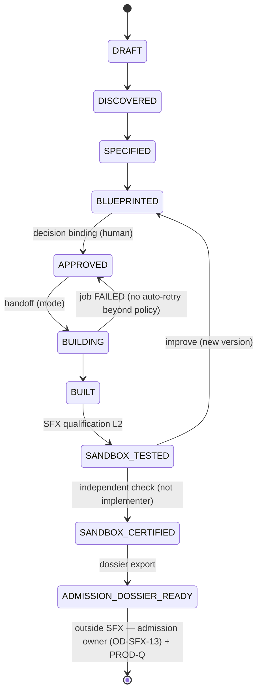
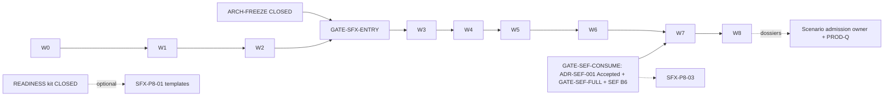

# SCENARIO-FACTORY-X (SFX) — Master Campaign Plan (SSOT)

**Stage:** `SCENARIO-FACTORY-X` — Enterprise Scenario Factory  
**Roadmap status:** `[ ] PLANNED / MANDATORY / POST-ARCH-FREEZE PRIORITY`  
**Revision:** **R1** (corrective review of R0), operator-approved **2026-11-12** in the planning session. R1 supersedes R0 wherever the two differ.  
**Approval scope:** **W0–W2 only** (SFX-P0..P4, with P4 limited to SFX-P4-A01/A02; classification in §15.1). Waves W3+ need `ARCH-FREEZE` = CLOSED, `GATE-SFX-ENTRY` and their own ticket approvals. **This plan is not an authorization for post-freeze implementation.**  
**Sequencing:** **OD-SFX-15** — the pre-freeze campaign SFX-P0..P4 runs now, in parallel with MCP-SERVER-X, PDC-X and ARCH-FREEZE; work **STOPs before SFX-P5**; the pre-freeze target is `PRE_IMPLEMENTATION_READY`.  
**Tickets:** [`T-IGX-037-A`](../T-IGX-037-A.md) (W0 / P0) · [`T-IGX-037-B`](../T-IGX-037-B.md) (W1 / P1) · [`T-IGX-037-C`](../T-IGX-037-C.md) (W1 / P2) · [`T-IGX-037-D`](../T-IGX-037-D.md) (W2 / P3) · [`T-IGX-037-E`](../T-IGX-037-E.md) (W2 / P4-A). W0 plan: [`PLAN_T-IGX-037-A.md`](PLAN_T-IGX-037-A.md).  
**Roadmap:** [`PLATFORM_ENTERPRISE_COMPLETION_ROADMAP.md`](../../../docs/project/maintainers/plans/PLATFORM_ENTERPRISE_COMPLETION_ROADMAP.md) §3 row `SCENARIO-FACTORY-X` and §3.0.7b.  
**Dossier:** [`scenario_factory_x/SFX_INDEX.md`](../../../docs/project/maintainers/qualification/scenario_factory_x/SFX_INDEX.md) (WBS, gap register, SHA ladder, requirements traceability, operator decisions).  
**Capability pair:** [`architecture/SCENARIO_FACTORY.md`](../../../docs/project/capabilities/architecture/SCENARIO_FACTORY.md) ↔ [`plan/SCENARIO_FACTORY.md`](../../../docs/project/capabilities/plan/SCENARIO_FACTORY.md).  
**Base revision:** `origin/development` = `eadb1c2116feb0a2090b234a36fd4182bd6ace8d`.  
**Language:** repository text is English; the operator chat is Polish. Operator quotes are labelled English renderings.

> **Publication note.** This file is the binding SSOT for the SFX campaign. It is the approved R1 plan, edited only for publication: the plan-mode header is replaced by this header; wherever R1 kept R0 text by reference ("as in R0", "R0 seed kept", "unchanged"), the R0 text is inlined with the R1 changes applied; repository links are relative to `governance/tickets/plans/`; local absolute paths are replaced by the worktree convention; the operator decisions recorded after R1 approval (OD-SFX-15, OD-SFX-16) are added; the R0 → R1 corrections are kept as the revision history at the end. Elision marks `…/` in WBS file columns are resolved in the legend of §10.

## Context

The goal is unchanged from R0. Intergrax should become an Enterprise Scenario Factory: a business problem goes in, and a discoverable, configurable, executable, testable and demonstrable scenario comes out. It must be built only from existing platform mechanisms. That rules out a second engine, a second governance authority, a second ToolRuntime, a second registry and a second audit mechanism.

**Operator decisions in force (English rendering of the Polish chat, 2026-11-12).** Records live under the dossier [`operator_decisions/`](../../../docs/project/maintainers/qualification/scenario_factory_x/operator_decisions/); each record carries its own signature status.

| ID | Decision |
|---|---|
| **OD-SFX-01 (placement)** | SFX is a new, standalone stage and the first product priority after ARCH-FREEZE. SFX is the product layer: Studio, Discovery, Specification, Blueprint, Capability Resolution, Profile Composition, Integration Setup, Registry, Evaluation, Reporting, ROI. SEF-X provides the engineering engine; SFX uses it and does not duplicate it. READINESS-X provides the Delivery Kit; SFX uses it and does not take it over. Intergrax Runtime remains the only execution environment. SFX implementation requires ARCH-FREEZE CLOSED. SFX does not block READINESS-X. OD-SEF-02 parallelism is preserved. SFX may progress in parallel with SEF-X, but SEF-dependent features need accepted SEF-X contracts. SFX does not replace SCENARIO-GATE or PROD-Q. |
| **OD-SFX-02 (stack)** | React + TypeScript + Vite SPA in the repo, under the Tier-3 host `applications/scenario_studio_application/web/`, with a FastAPI backend on `intergrax/fastapi_core`. |
| **OD-SFX-03 (IDE model)** | One factory core. agent-env skills, rules and agents use the CLI offline, with an optional MCP live mode (streamable HTTP). |
| **OD-SFX-04 (pre-freeze)** | Before ARCH-FREEZE CLOSED, only these are allowed: docs, the roadmap amendment, cited research, contract/UX design and mock-ups, and IDE toolkit v0 **in agent-env only**, with proposal-only outputs. |
| **OD-SFX-15 (pre-freeze sequencing)** ▼recorded after R1 approval | Start the SFX campaign immediately, in parallel with MCP-SERVER-X, PDC-X and ARCH-FREEZE. SFX-P0..P4 are authorized before ARCH-FREEZE (P4 = proposal-only IDE toolkit, no change to protected platform mechanisms). Batch-first, separate worktrees, independent reviews, canonical DevOS. **STOP before SFX-P5** and before any product implementation; SFX-P5..P13 start only after formal ARCH-FREEZE = CLOSED, acceptance of the required contracts and ADRs, and GATE-SFX-ENTRY. SEF-X and SCENARIO-READINESS-X stay independent parallel stages. Target: `PRE_IMPLEMENTATION_READY`. |
| **OD-SFX-16 (C-OD-01 resolution)** ▼recorded after R1 approval | The regenerated `.claude/` and `.cursor/` adapters may ship before ARCH-FREEZE together with their agent-env sources in SFX-P4 ("Yes, with agent-env"). `sync_agent_env.py` and `role_registry.yaml` stay untouched pre-freeze. Ticket approvals for T-IGX-037-A..E are delegated to a dedicated delegate session; generalization-set authoring and PR reviews run as linked sub-sessions reporting to the orchestrator board. |

**Delegation record:** [`DELEGATION-SFX-PRE-FREEZE.md`](../../../docs/project/maintainers/qualification/scenario_factory_x/operator_decisions/DELEGATION-SFX-PRE-FREEZE.md) — scope: `Approved:` lines of T-IGX-037-A..E only. Not delegated: OD signatures, ADR acceptance, IIAC activation, FRZ promotion, merges, GATE-SFX-ENTRY, any SFX-P5+ ticket.

R1 changes no OD. Where R0 conflicted with an OD, R1 brings the plan back to the OD (see §15.1, C-OD-01). OD-SFX-15 and OD-SFX-16 add sequencing and resolve C-OD-01; they do not change OD-SFX-01..04.

---

## 1. Current HEAD and predecessor readiness (unchanged facts, VERIFIED @ `origin/development` `eadb1c2116fe`)

| Programme | State |
|---|---|
| MCP-SERVER-X | P7 package @ `abbe15254`; P8 in progress; audit and closure SHAs unset |
| PDC-X | P0–P4 published; wave-1 tickets 036-J/K/L `plan_approved`; product merges wait for MCP P8 |
| ARCH-FREEZE | **OPEN**: 54 tasks (18 complete, 25 planned, 10 blocked-external, 1 superseded); `FREEZE_CERTIFICATION_SHA` TBD |
| SEF-X | docs only (P1 closed); 0 code for CAP-049..052 and the CON-N/CON-E contracts; ADR-SEF-001 **Proposed**; OD-SEF-04..08 PENDING |
| READINESS-X | PLANNED, not started; owns the Scenario Delivery Kit analysis |
| SCENARIO-GATE | BLOCKED; a **programme** Go/No-Go (see §14.2) |
| PROD-Q live slice | NOT QUALIFIED (DIM6/DIM17 OPEN) |
| FRZ | 225 / 26 families (recomputed) |
| IIAC | IN_FORCE; ACT-N11 product prefixes `intergrax/`, `agents/`, `applications/`; material governance paths are the 5 IIAC scripts plus the protocol .md |

These are facts at the base revision. Later movement of predecessor stages is tracked in the roadmap, not here.

Out-of-scope findings RA-F-01..06 are unchanged from R0. They are recorded and not fixed by SFX. RA-F-02 (ledger "Next" and the missing SEF-X row) is still fixed in the amendment.

**Main checkout** is in active use by another session (it changed branches during the planning session). SFX never writes there; see §15.3.

---

## 2. Roadmap amendment (A1–A10; R1 wording corrections marked ▲)

The positions, the structure and the "no predecessor change" rule are as in R0. Edits are anchored on text, not on line numbers. The authoritative wording is the published roadmap.

- **A1 ▲ (roadmap header, "Scenario gate" sentence):** "`SCENARIO-FACTORY-X` (§3.0.7b) is post-freeze **product tooling**. Scenarios it produces stay proposal-only or sandbox (LAB). Production use of any generated scenario requires the scenario programme opened by `SCENARIO-GATE`, a per-scenario production admission by its designated owner, and per-integration `PROD-Q` live qualification. **SFX stage closure admits no scenario to production.**"
- **A2 (§2.0.2 FRZ linkage, new row after SEF-X):**
  `| **SCENARIO-FACTORY-X** | CTR, OWN, BND, TYP, GOV, SEC, TEN, TRC, OBS, CFG, EVOL, DOC (incremental evidence on existing families — **no new `FRZ-SFX-*` IDs**; checklist **225** unchanged unless separately authorized) | TEN (tenant-scoped scenario artifacts, Studio and MCP surfaces) |`
- **A3 (§2.0.3 predecessors row):** `SCENARIO-FACTORY-X` depends on `ARCH-FREEZE` = CLOSED for implementation (SFX-P5+). It is **not** a predecessor of `SEF-X`, `SCENARIO-READINESS-X`, `SCENARIO-GATE` or `PROD-Q`; no existing predecessor changes.
- **A4 ▲ (§3 row between ARCH-FREEZE and SEF-X):** a `SCENARIO-FACTORY-X — Enterprise Scenario Factory` row, with:
  - "**two engineering modes:** `DETERMINISTIC_SCAFFOLD` (existing scaffold tools) and `AGENTIC_ENGINEERING` (SEF-X EEA). **SFX closure requires the agentic mode to be verified end-to-end on Accepted and certified SEF-X mechanisms.**"
  - "catalog (metadata sidecar; no new registry)" wherever R0 said "registry".
  - "SFX product certification ≠ admission of any generated scenario."
  - Status `[ ] PLANNED / MANDATORY / POST-ARCH-FREEZE PRIORITY`.
- **A5 (ARCH-FREEZE row, replaces the final sentence):** "**Next stages after closure:** **`SCENARIO-FACTORY-X`** (first product priority, §3.0.7b), and **`SEF-X`** ∥ **`SCENARIO-READINESS-X`** in parallel (Option 3 — OD-SEF-02; §3.0.7a). There is **no** default READINESS ← SEF-X and **no** READINESS ← SFX dependency."
- **A6 ▲ (new §3.0.7b subsection):** scope of SFX per this plan, plus:
  - the two-mode engineering rule (§3.1);
  - the dependency "SFX closure ← SEF-X GATE-SEF-FULL + SEF scoped B6 (T-P12-003) for consumed mechanisms". This is a documented one-way cross-track edge; SEF-X and READINESS do not depend on SFX;
  - the admission separation (§14).
- **A7 (chain blocks):** `ARCH-FREEZE → SCENARIO-FACTORY-X ∥ SEF-X ∥ SCENARIO-READINESS-X → SCENARIO-GATE`, plus the footnote "SFX is not a SCENARIO-GATE predecessor; SFX closure follows SEF-X engineering certification".
- **A8 (§5 ledger):**
  - Add the SFX row after ARCH-FREEZE: `| SCENARIO-FACTORY-X | — | PLANNED / MANDATORY / POST-ARCH-FREEZE PRIORITY — …; P0 registration; production delta = 0; Next: SFX-P1 research (pre-freeze), SFX-P5 after ARCH-FREEZE CLOSED. |`
  - Add the missing SEF-X row (RA-F-02).
  - Correct ARCH-FREEZE "Next" to "SFX; SEF-X ∥ SCENARIO-READINESS-X".
- **A9 (§7 programme goals bullet):** "post-freeze Enterprise Scenario Factory (SFX) turns business problems into certified-sandbox scenarios through Studio and IDE toolkit parity, without new platform authorities."
- **A10 (amendment record at the end of the roadmap),** using the existing template "Post-Step Enterprise Discovery & Roadmap Completeness Audit (roadmap amendment — SCENARIO-READINESS-X)":
  - Title: `### Post-Step Enterprise Discovery & Roadmap Completeness Audit (roadmap amendment — SCENARIO-FACTORY-X)`
  - New current-parent blockers: none.
  - New future mandatory stage: SFX.
  - FRZ gaps: none introduced (225 / 26 unchanged).
  - Ownership concerns: none; SFX consumes and does not own.
  - `**Classification:** NEW ROADMAP STAGE REQUIRED`
  - `**Cursor stage status (this amendment):** READY FOR AUDIT`.
- **Regression:** `tests/qualification/roadmap_replay_x` parses the §3 and §5 cell grammar. Compare against the red baseline at `eadb1c21`.

---

## 3. SFX ↔ SEF-X relationship (▲ corrected)

### 3.1 Two engineering modes behind one `EngineeringHandoffPort`

| | `DETERMINISTIC_SCAFFOLD` | `AGENTIC_ENGINEERING` |
|---|---|---|
| What | Template fill from an approved blueprint, using `python -m intergrax.scaffold new-application/new-agent/new-integration/new-skill` and `scripts/proof/init_scenario_implementation.py`. No LLM. Same blueprint digest gives the same tree digest. | Implementation of business logic, tests and evidence by the SEF-X Engineering Execution Authority (EEA). |
| Output | A conformant skeleton (structure, contracts, wiring, test stubs). Business logic is `NotImplemented`. | A complete scenario package plus a PR, `EngineeringEvidenceBundle` (CON-E-05) and `DeliveryManifest` (CON-N-04). |
| Authority | SFX handoff adapter writes only inside its job workspace (§13). | SEF-X: `WorkspaceLease` (CON-N-03), `CodingExecutionBackend` (CON-N-05), engineering FSM, DevOS ticket and PR, no auto-merge (T-P9-005). |
| Available | After GATE-SFX-ENTRY (W4). | Only after **GATE-SEF-CONSUME** (§3.3). |
| Certifies | Factory determinism and conformance. | **Required for SFX closure** (GATE-SFX-FULL): REF-1..3 plus the generalization set (§8). |
| Fallback | — | The deterministic scaffold may still be used. A scaffold-only result can never reach SANDBOX_CERTIFIED with business logic. |

### 3.2 Certifiable end-to-end engineering handoff (SFX → SEF-X → SFX)

```mermaid
sequenceDiagram
  participant U as Approver (human)
  participant SFX as SFX handoff (Tier-2)
  participant SEF as SEF-X EEA
  participant DevOS as DevOS ticket/PR
  participant Q as SFX qualification
  SFX->>SFX: blueprint vN APPROVED (decision binding, digest D_bp)
  SFX->>U: EngineeringIntent draft (CON-N-01 fields; text_untrusted ⊇ canonical blueprint, D_bp)
  U->>SEF: submit intent (operator_id = approver)  %% SEF rule: human submit only
  SEF->>DevOS: EngineeringSpecification (CON-E-01) → ticket + plan digest → awaitingPlanApproval
  DevOS-->>SEF: Approved (operator/delegate, not SFX)
  SEF->>SEF: WorkspaceLease → executing → verifying (VerificationRecord CON-E-04) → evidenceAssembling
  SEF-->>SFX: EngineeringExecutionRecord (CON-N-02) state + EngineeringEvidenceBundle (CON-E-05) + DeliveryManifest (CON-N-04)
  SFX->>Q: verify bundle digest, D_bp lineage, package conformance, SFX gates (§9, §13)
  Q-->>SFX: ScenarioQualificationRecord (sandbox) → SANDBOX_TESTED; independent check → SANDBOX_CERTIFIED
```

**Handoff certification criteria (HO-1..HO-7):**
- **HO-1** Lineage: the bundle references `D_bp`, and every artifact digest in `DeliveryManifest` is reproducible.
- **HO-2** Only a human submits an intent; SFX never auto-submits.
- **HO-3** The SFX job record links to the SEF `job_id` by reference only. SFX does not copy the SEF state machine.
- **HO-4** The generated package passes `scenario_architecture_conformance` and the SFX gates (§9).
- **HO-5** Failure states map one-to-one: SEF `failed` / `paused` become the SFX job's `FAILED` / `WAITING`, and there are no silent retries.
- **HO-6** Merge stays operator-only.
- **HO-7** The evidence is pinned to exact SHAs and enters the SFX SHA ladder.

### 3.3 GATE-SEF-CONSUME (precondition for `AGENTIC_ENGINEERING`)

All of the following must hold:
- ADR-SEF-001 is **Accepted**.
- OD-SEF-04 (FSM ↔ ticket binding) is resolved.
- CON-N-01/02/03/04/05 and CON-E-01/02/04/05 are implemented.
- SEF **GATE-SEF-FULL** has passed.
- SEF scoped B6 (T-P12-003) has passed on the consumed mechanisms.
- OD-SFX-10 (cross-track edge) is signed.
- SEF records SFX as a registered intake consumer (C-SEF-01).

SEF-X plan: [`ASF-SEF-MASTER-PLAN.md`](ASF-SEF-MASTER-PLAN.md).

### 3.4 Conflicts with SEF-X (reported, not resolved unilaterally)

- **C-SEF-01:** SEF names no external intake consumer, and its CON-N-01 is "human submit only". SFX conforms to this through HO-2. SEF must still acknowledge SFX as a consumer, under OD-SEF-07 or a new SEF OD.
- **C-SEF-02:** SEF T-P5-004 (network egress) is OPTIONAL and draft. SFX closure requires network restriction on agentic engineering (§13), so SFX asks SEF to make T-P5-004 mandatory for GATE-SEF-CONSUME. Otherwise GATE-SFX-FULL stays BLOCKED.
- **C-SEF-03:** CON-E-04 `VerificationRecord` has no SEF WBS task. SFX consumes it, so it is BLOCKED until SEF assigns one.
- **C-SEF-04:** GAP-HIGH-07 (SEF ↔ READINESS kit coupling) is OPEN. SFX scaffold templates stay on the existing scaffold tools until the READINESS kit is CLOSED; SFX never defines kit templates.

---

## 4. Competitive research — plan and evidence matrix (findings MISSING_EVIDENCE, scheduled for SFX-P1-01)

**Products:** n8n, Copilot Studio, Dify, Flowise, Langflow, Retool, Zapier, Make, plus AI-native builders (OpenAI Agent Builder/AgentKit, Google Vertex Agent Builder, AWS Bedrock Agents, Relevance AI, Vellum, Gumloop, StackAI). Each AI-native builder's inclusion is confirmed by a primary source.

**Interaction models:** conversational, wizard, canvas (node graph), hybrid (chat + canvas), schema-driven (YAML/JSON-first).

**Dimensions.** Score each dimension 0–3 and cite a source for every cell.

| ID | Dimension |
|---|---|
| D-01 | Business discovery |
| D-02 | Workflow generation from natural language |
| D-03 | Configuration model |
| D-04 | Integration catalogue and auth |
| D-05 | HITL |
| D-06 | Secrets handling |
| D-07 | Testing/evaluation |
| D-08 | Versioning/diff |
| D-09 | Deployment/environments |
| D-10 | Run results/observability |
| D-11 | ROI/business reporting |
| D-12 | Usability/TTFS |
| D-13 | Production readiness (RBAC, audit, tenancy, SLA) |
| D-14 | IDE/code-first parity |

**Rules:** only vendor primary documentation with URL and access date; anything unsupported is `UNKNOWN`. Output goes to `docs/project/capabilities/plan/satellites/scenario_factory/SFX_COMPETITIVE_EVIDENCE_MATRIX.md`.

**IDE/MCP facts (SFX-P1-02):** the Claude Code `.claude/agents` format; the Cursor rules/skills/agents format; streamable-HTTP MCP client support in both.

---

## 5. Closed-world capability inventory

Owner paths were VERIFIED at `eadb1c21`. Maturity follows PDC and is NOT_CERTIFIED unless stated. Every row is re-pinned at `FREEZE_CERTIFICATION_SHA` (SFX-P1-03 records the pre-freeze re-pin, GATE-SFX-ENTRY requires the freeze re-pin). Rows 08, 12 and 26 are R1 replacements (▲); rows 30–37 are R1 additions (▼new); all other rows are the R0 seed.

| CAP | Owner / path (VERIFIED) | SFX use | REUSE_CLASS |
|---|---|---|---|
| SFX-CAP-01 | Execution: `runtime/execution/runtime.py` ExecutionRuntime, `nexus/nexus_loop.py` NexusLoop | the only execution | REUSE_AS_IS |
| SFX-CAP-02 | `applications/_shared/scenario_runtime_baseline.py::execute_scenario_task`, `scenario_runtime_profiles.py` (LAB / PRODUCTION_ATTACHED) | sandbox and prod runs | REUSE_AS_IS (U1 PASS) |
| SFX-CAP-03 | `runtime/nexus/tools/tool_runtime.py` ToolRuntime | tool calls | REUSE_AS_IS (ToolRegistry dual-class: LIMITATION) |
| SFX-CAP-04 | `capability_catalog/federation.py` FederatedCapabilityCatalog | capability resolution | REUSE_WITH_CONFIGURATION |
| SFX-CAP-05 | UCA Governed Capability Fulfillment (`GOVERNED_CAPABILITY_FULFILLMENT.md`, R6 FROZEN) | gap → acquisition | REUSE_AS_IS |
| SFX-CAP-06 | `runtime/registry/agent_registry.py` AgentRegistry | agent binding | REUSE_AS_IS |
| SFX-CAP-07 | `runtime/policy/policy_engine.py`, `runtime/governance/service.py` | policy | REUSE_AS_IS |
| SFX-CAP-08 ▲ | Durable HITL: `intergrax/collaborative_work/repository.py:1414` `CollaborativeDecisionBindingRepository` (in-memory, SQLite, Postgres) and `intergrax/runtime/human/persistence_contract.py:16` `HumanDecisionPersistence` (SQLite) | approvals | REUSE_WITH_CONFIGURATION. `ApprovalStorePort` / `InMemoryApprovalStore` is **not used**: in-memory only, no tenant parameter. |
| SFX-CAP-09 | `integrations/contracts/secrets_store.py`, `credentials/broker.py` | secret refs | REUSE_AS_IS |
| SFX-CAP-10 | `runtime/integrations/registry_v2.py`, `integrations/contracts/integration_profile.py` | integration setup | REUSE_WITH_CONFIGURATION |
| SFX-CAP-11 | `applications/contracts/environment_profile/*` ApplicationEnvironmentProfile | profile composition | REUSE_WITH_CONFIGURATION |
| SFX-CAP-12 ▲ | `ApplicationManifest` (`manifest.py:319`, `extra="forbid"`, no metadata slot), `ApplicationPackage` (`application_package.py:56`) | referenced by digest only | REUSE_AS_IS. **No EXTEND.** |
| SFX-CAP-13 | `eval/eval_runner.py` EvalRunner, `_shared/evaluation_wiring.py` | scenario eval | REUSE_WITH_CONFIGURATION |
| SFX-CAP-14 | `runtime/observability/*`, `_shared/observability_wiring.py` | run telemetry | REUSE_AS_IS |
| SFX-CAP-15 | `runtime/nexus/artifacts/store_base.py`, `contracts/artifact_ref.py` | provenance refs only (business artifacts live in Collaborative Work, CAP-30) | REUSE_AS_IS (D8 no qual suite: REQUALIFICATION_REQUIRED) |
| SFX-CAP-16 | `contracts/execution_evidence/**`, `llm_adapters` usage tracking | run report, cost, ROI inputs | REUSE_AS_IS |
| SFX-CAP-17 | `runtime/architecture/tenant_security.py`, `tests/qualification/tenant_x` | tenant isolation | REUSE_AS_IS |
| SFX-CAP-18 | `intergrax/fastapi_core/app_factory.py` create_app | Studio backend host | REUSE_WITH_CONFIGURATION |
| SFX-CAP-19 | `_shared/mcp_developer_api.py` compose_application_mcp_server, McpExposurePolicy | IDE live mode | REUSE_WITH_CONFIGURATION (MCP stage not CLOSED: REQUALIFICATION_REQUIRED) |
| SFX-CAP-20 | `intergrax/scaffold/cli.py` (new-agent/application/integration/skill…) | deterministic build | REUSE_AS_IS |
| SFX-CAP-21 | `scripts/proof/{create_scenario_proof,init_scenario_implementation,scenario_lifecycle,scenario_architecture_conformance}.py` | lifecycle FSM, conformance | REUSE_AS_IS / EXTEND_CONTRACT (lifecycle mapping) |
| SFX-CAP-22 | `scripts/proof/intergrax_platform_proof_html_renderer.py` | demo reports | REUSE_WITH_CONFIGURATION |
| SFX-CAP-23 | `rag/*` + tenant isolation contract | REF-3 retrieval | REUSE_WITH_CONFIGURATION |
| SFX-CAP-24 | `runtime/long_running/scheduler.py`, `queueing/*` | scheduled scenarios | REUSE_AS_IS (D7 PDC open) |
| SFX-CAP-25 | `agent-env/` + `scripts/governance/sync_agent_env.py` | IDE toolkit | EXTEND_CONTRACT (agents not generated today) |
| SFX-CAP-26 ▲ | SEF CON-N-01..05, CON-E-01/02/04/05 | `AGENTIC_ENGINEERING` | BLOCKED until GATE-SEF-CONSUME |
| SFX-CAP-27 | READINESS Scenario Delivery Kit | templates | DEFERRED_WITH_RATIONALE (not built; consume when CLOSED) |
| SFX-CAP-28 | SCENARIO-GATE (programme gate; §14.2) | programme transition | BLOCKED (GATE-owned) |
| SFX-CAP-29 | Web frontend toolchain | Studio UI | NEW_SCENARIO_FACTORY_COMPONENT (none in repo) |
| SFX-CAP-30 ▼new | Collaborative Work artifacts: `WorkArtifactRepository` L1284, `WorkArtifactVersionRepository` L1311 (immutable, append-only), `ArtifactPublicationRepository` L1338 (CAS), `ArtifactContentStore` (`content_storage.py:105`, sha256, tenant+workspace) | specs, blueprints, reports, catalog sidecar, lifecycle records | REUSE_WITH_CONFIGURATION. ADR-PDC-08 business-artifact class. Qualification status MISSING_EVIDENCE, so REQUALIFICATION_REQUIRED. |
| SFX-CAP-31 ▼new | `WorkItemRepository` L893, `AssignmentRepository` L925, `WorkItemExecutionLinkRepository` L1014 | one WorkItem per scenario; engineering jobs | REUSE_WITH_CONFIGURATION |
| SFX-CAP-32 ▼new | `SessionManager` (`runtime/nexus/session/session_manager.py:44`) + `SessionStorage` (SQLite / DocumentStore); `ChatSession.metadata` | resumable sessions | REUSE_AS_IS. Retention via MemoryControlPlane (ADR-PDC-02). |
| SFX-CAP-33 ▼new | Long-running `TaskCheckpointPersistence` / `SchedulerLedger` (SQLite, Postgres); `DEAD_LETTERED` (ADR-PDC-07) | scaffold jobs, retries, DLQ | REUSE_AS_IS |
| SFX-CAP-34 ▼new | `EvidencePersistencePort` (`contracts/execution_evidence/persistence_port.py:23`) | run facts for reports | REUSE_AS_IS |
| SFX-CAP-35 ▼new | `AgentCatalogEntry` (`agent_distribution/catalog.py:99`, "catalog metadata only") | **pattern** for the scenario catalog sidecar | pattern reuse (no import of agent semantics) |
| SFX-CAP-36 ▼new | `intergrax/contracts/sandbox_network_egress.py` (typed allowlist); `runtime/sandbox/isolation_gate.py` (fail-closed presence check) | L2 network restriction | REUSE_WITH_CONFIGURATION. Enforcement strength depends on the provider (MISSING_EVIDENCE). |
| SFX-CAP-37 ▼new | Release-only SAST (`scripts/gates/check_harness_security_promote_gate.py`: trivy and semgrep, run in `harness-release.yml`) | generated-code scanning | EXTEND usage (tool adoption per OD-SFX-14) |

Paths without a tier prefix are relative to `intergrax/` (Tier-0/Tier-1) unless they start with `applications/`, `scripts/`, `tests/` or `agent-env/`.

---

## 6. Gap register (▲ revised)

| Gap | Status | Disposition / task |
|---|---|---|
| SFX-GAP-01 No web toolchain, browser auth or SPA serving | VERIFIED | §7.8. Tasks SFX-P10-04..07; OD-SFX-05 |
| SFX-GAP-02 No scenario catalog | VERIFIED | Tier-2 sidecar `sfx.scenario_catalog_entry.v1` (§7.6). No manifest change. SFX-P11-03 |
| SFX-GAP-03/04 Discovery agent and ROI component absent | VERIFIED | SFX-P6-01, SFX-P11-02 |
| SFX-GAP-05 SEF contracts PROPOSED_ONLY | VERIFIED | GATE-SEF-CONSUME (§3.3) |
| SFX-GAP-06 `sync_agent_env.py` generates no agents | VERIFIED | SFX-P4-B01 (post-freeze by default; §15.1) |
| SFX-GAP-07 MCP client compatibility | MISSING_EVIDENCE | SFX-P1-02, SFX-P10-02 |
| SFX-GAP-08 ▲ `ApprovalStorePort` is in-memory with no tenant | VERIFIED | Avoided by using decision bindings (CAP-08) |
| SFX-GAP-09 Dual `ToolRegistry` | MISSING_EVIDENCE | SFX-P2-01 ownership review |
| SFX-GAP-10 Business-scenario workspace location | VERIFIED | ADR-SFX-002 |
| SFX-GAP-11 Research facts | MISSING_EVIDENCE | SFX-P1 |
| SFX-GAP-12 No SFX qualification suite | VERIFIED | SFX-P9, SFX-P13 |
| SFX-GAP-13 ▼new No PR-level SAST or dependency audit; ruff has no `S` rules; no pip-audit or npm audit | VERIFIED | SFX-P9-03; OD-SFX-14 |
| SFX-GAP-14 ▼new No conformance rule forbids generated code from mutating environment profile, policy mode, governance or certification records, contract lifecycle, or exposure policy | VERIFIED | SFX-P9-02 |
| SFX-GAP-15 ▼new Platform self-promotion seams: `AgentContract.lifecycle_state` defaults to PRODUCTION (`agent_contract_meta.py:71`); environment profile not frozen (`root.py:85`); `PRODUCTION_ATTACHED` does not require STRICT+PRODUCT; `evaluate_agent_promotion` not wired; `apply_roster_agent_governance` self-certifies | VERIFIED | **Platform-owned** (Agent Runtime Governance / PDC-X D1/D6), not fixed by SFX. SFX compensates inside its own scope (§13), records the seams and hands them to the platform owner. They block **production admission**, not SFX closure. |
| SFX-GAP-16 ▼new No owner for per-scenario production admission | VERIFIED | OD-SFX-13 (§14.2) |
| SFX-GAP-17 ▼new MCP composition widens `allowed_binding_ids` (`mcp_application_server.py:83-91`) | VERIFIED | SFX MCP uses an explicit allowlist with a no-widening test (SFX-P10-02) |

The dossier [`SFX_GAP_REGISTER.md`](../../../docs/project/maintainers/qualification/scenario_factory_x/SFX_GAP_REGISTER.md) holds the per-gap rows (03 and 04 split) and the conflicts register.

---

## 7. Target architecture (Option B; ▲ refined)

### 7.1 Options

| Option | Shape | Verdict |
|---|---|---|
| A | SFX as a new core domain inside `intergrax/` (Tier-0/Tier-1) | **Rejected.** It would add platform semantics and a new authority into frozen scope after ARCH-FREEZE. |
| **B** | SFX as a product module: Tier-2 `agents/scenario_factory` (single semantic implementation) plus Tier-3 host `applications/scenario_studio_application` (doors), with an agent-env IDE toolkit | **Preferred.** Consumes the frozen platform only; respects `intergrax/ ↛ agents/ ↛ applications/`. |
| C | SFX as an external product outside the repository | **Rejected.** Loses contract-first parity with the platform and the in-repo qualification and IIAC path. |
| D | IDE-only toolkit | A **subset** of B (the agent-env front door); not sufficient alone for the business-user journey. |

### 7.2 Component view

```mermaid
flowchart TB
  subgraph FD[Front doors — adapters only]
    ST[Studio SPA React+TS]
    IDE[Claude Code / Cursor skills+agents]
  end
  subgraph T3[Tier-3 applications/scenario_studio_application]
    API[Studio API v1]
    CLI[sfx CLI]
    MCP[MCP surface explicit allowlist]
  end
  subgraph T2[Tier-2 agents/scenario_factory]
    SVC[Service layer = single semantic implementation]
    CON[Contracts + JSON Schemas + canonicalizer]
    AG[Discovery / Spec agents — STAGING, NexusLoop]
    RES[Resolver] --- BP[Blueprint/Profile composer] --- INT[Integration setup]
    HO[EngineeringHandoffPort<br/>DETERMINISTIC_SCAFFOLD · AGENTIC_ENGINEERING]
    QUAL[Scenario qualification + security gates]
    REP[Reporter / ROI] --- CATS[Catalog sidecar]
    PERS[Persistence adapters → existing owners]
  end
  subgraph P[Frozen platform — reuse only]
    EXE[execute_scenario_task → HostTaskExecutionPort → NexusLoop → PolicyEngine → ToolRuntime]
    CW[Collaborative Work: WorkItem · WorkArtifact(Version) · DecisionBinding · ContentStore]
    SES[SessionManager / SessionStorage]
    LR[Long-running checkpoints / SchedulerLedger / DLQ]
    EV[Evidence plane · usage · observability]
    CATP[FederatedCapabilityCatalog + UCA]
    SCAF[intergrax.scaffold + init_scenario_implementation]
  end
  SEF[SEF-X EEA — after GATE-SEF-CONSUME]
  ADM[Scenario programme admission owner (OD-SFX-13) + PROD-Q]
  ST-->API; IDE-->CLI; IDE-.->MCP
  API & CLI & MCP --> SVC
  SVC --> CON & AG & RES & BP & INT & HO & QUAL & REP & CATS
  PERS --> CW & SES & LR
  AG --> EXE
  RES --> CATP
  HO --> SCAF
  HO -.-> SEF
  REP --> EV
  QUAL -->|admission dossier only| ADM
```

### 7.3 Subsystem ownership and no-duplicate review

The twelve subsystems are those of REQ-SFX-001..012. SFX owns only product composition; every semantic authority stays with its existing platform owner (CAP references from §5). ▲ R1 changes: subsystem 8 has the two engineering modes; subsystem 12, the catalog, is a **sidecar document owned by Tier-2 SFX**, persisted as a `WorkArtifactVersion`, modelled on `AgentCatalogEntry` and "metadata only, never execution truth". It is not a registry and creates no semantic authority.

| # | Subsystem | SFX component (owner) | Platform mechanisms reused | Must not duplicate |
|---|---|---|---|---|
| 1 | Studio | Tier-3 `applications/scenario_studio_application` (API v1, `web/` SPA) | CAP-18 `create_app`; JWT provider in `fastapi_core` | API host, auth stack |
| 2 | Discovery | Tier-2 discovery agent (STAGING, LAB via NexusLoop) | CAP-01, CAP-02, CAP-32 | execution loop, session store |
| 3 | Specification | Tier-2 spec author + deterministic validator | CAP-30 (artifact versions) | artifact store |
| 4 | Capability Resolution | Tier-2 resolver (deterministic) | CAP-04, CAP-05, CAP-06 | capability catalog, UCA fulfilment, agent registry |
| 5 | Blueprint | Tier-2 blueprint composer + semantic diff | CAP-30 | artifact versioning |
| 6 | Profile Composition | Tier-2 profile composer (L2: LAB, fixture adapters, egress deny) | CAP-11, CAP-02, CAP-36 | environment profile model |
| 7 | Integration Setup | Tier-2 integration setup assistant (secret refs only) | CAP-09, CAP-10 | secrets store, integration registry |
| 8 ▲ | SEF-X orchestration (engineering handoff) | Tier-2 `EngineeringHandoffPort` with `DETERMINISTIC_SCAFFOLD` and `AGENTIC_ENGINEERING` | CAP-20, CAP-21, CAP-31, CAP-33; CAP-26 after GATE-SEF-CONSUME | scaffold tooling, SEF engineering FSM |
| 9 | Testing/Evaluation | Tier-2 test planner, runner adapter, scenario qualification + security gates | CAP-13, CAP-21, CAP-36, CAP-37 | EvalRunner, conformance tooling |
| 10 | Canonical execution | none — SFX owns no execution | CAP-01, CAP-02, CAP-03, CAP-07 | runtime, ToolRuntime, PolicyEngine |
| 11 | Reporting/ROI | Tier-2 run reporter + value model | CAP-14, CAP-16, CAP-34, CAP-22 | evidence plane, usage tracking |
| 12 ▲ | Catalog/lifecycle/reuse | Tier-2 catalog sidecar + lifecycle record | CAP-30, CAP-31, CAP-35; CAP-12 by digest only | registries, `ApplicationManifest` |

### 7.4 Typed interface inventory (all PROPOSED; `sfx.<name>.v1`)

**Contracts:**
- SFX-CON-01 `BusinessProblemStatement`
- 02 `DiscoveryRecord`
- 03 `BusinessScenarioSpecification`
- 04 `CapabilityResolutionReport`
- 05 `ScenarioBlueprint`
- 06 `IntegrationSetupPlan`
- 07 `ScenarioTestPlan`
- 08 `EngineeringHandoffRequest` (`mode ∈ {DETERMINISTIC_SCAFFOLD, AGENTIC_ENGINEERING}`; `blueprint_digest`; `sef_intent_draft?`)
- 09 `ScenarioRunReport`
- 10 `ScenarioValueReport`
- 11 `ScenarioCatalogEntry` (sidecar)
- 12 `SfxSessionState`
- 13 `ScenarioApprovalRef` (wraps the decision binding)
- ▼14 `ScenarioLifecycleRecord`
- ▼15 `EngineeringJobRecord` (an SFX view that holds the SEF `job_id` by reference)
- ▼16 `ScenarioQualificationRecord`
- ▼17 `ScenarioAdmissionDossier` (an export, not an admission)

**Ports (all PROPOSED; adapters bind to existing owners only):**
- `EngineeringHandoffPort` (§3.1; adapters `scaffold_adapter`, `sef_adapter`);
- ▼ `ScenarioPersistence` (adapters over Collaborative Work, Session and Long-running; §7.5);
- ▼ `ScenarioQualifier` (scenario qualification and security gates; §13);
- the evidence read port used by the run reporter (SFX-P11-01) over `EvidencePersistencePort`.

The final port list is fixed in ADR-SFX-002 (SFX-P2-01).

**Names avoided:** CON-X-01/02 and CON-R-06.

### 7.5 Durable, versioned lifecycle (▲ new — reuses existing owners only)

| Record | Owner (existing) | Versioning | Lifecycle / state | Tenant scope | Retention |
|---|---|---|---|---|---|
| Scenario container | `WorkItem` (one per scenario) | `revision` | `WorkItemState` OPEN→ACTIVE→COMPLETED/CANCELLED (coarse) | tenant + workspace | business class |
| Session | `SessionManager` + `SessionStorage`; `ChatSession.metadata` = {sfx_scenario_id, work_item_id} | — (conversation) | OPEN/CLOSED | tenant | MemoryControlPlane sweep (ADR-PDC-02) |
| Session resume state (`SfxSessionState`) | `WorkArtifact` "sfx-session-state" | append-only versions | current pointer (CAS) | tenant + workspace | business |
| Spec, blueprint, test plan, integration plan | `WorkArtifact` + `WorkArtifactVersion` + `ArtifactContentStore` | immutable versions, `publish_version` CAS, content digest = canonical digest (§7.7) | via lifecycle record | tenant + workspace | business, never deleted while referenced |
| SFX lifecycle (DRAFT…ADMISSION_DOSSIER_READY) | `WorkArtifact` "sfx-lifecycle". Each transition is a new `WorkArtifactVersion` with `ScenarioLifecycleRecord{from,to,actor,evidence_refs}`; the current state is the current pointer | append-only | FSM §7.9; gated transitions require a decision binding | tenant + workspace | audit-grade (no delete) |
| Approval | `CollaborativeDecisionBindingRepository` (binds a WorkArtifactVersion to a `DecisionProposalRef`); runtime pauses go through `HumanDecisionPersistence` | append-only | proposed→approved/rejected | tenant | audit evidence (ADR-PDC-08: never deleted) |
| Engineering job | `Assignment` + `WorkItemExecutionLink`; scaffold job execution through long-running `TaskCheckpoint`; agentic job state **remains in SEF** `EngineeringExecutionRecord` (referenced) | checkpoint `revision` | QUEUED/RUNNING/WAITING/SUCCEEDED/FAILED/DEAD_LETTERED (mapped onto LR states) | tenant | per LR policy |
| Run facts | Evidence plane (`EvidencePersistencePort`) | append-only | — | tenant | evidence class |
| Run / ROI report | `WorkArtifactVersion` with `execution` provenance → evidence refs | immutable | — | tenant + workspace | business |
| Catalog sidecar | `WorkArtifactVersion` keyed by `ApplicationPackage.package_id` + version + package checksum | immutable | listed / deprecated / retired (inside the sidecar) | tenant + workspace | business |

**Limits.** `WorkArtifact` has no lifecycle field, and `WorkItemState` is coarse; the lifecycle-artifact pattern above covers both. There is no new store and no new state engine. The CW qualification state is REQUALIFICATION_REQUIRED (SFX-P1-03).

### 7.6 Catalog without changing `ApplicationManifest` (▲)

- **Default:** use the sidecar `sfx.scenario_catalog_entry.v1`. It is owned by Tier-2 SFX, references the package by `package_id`, version and checksum, and is persisted as a versioned CW artifact. `ApplicationManifest`, `ApplicationPackage` and `ApplicationGraphSpec` stay unchanged. `EnvironmentExtensions` must not be used, because those are policy fragments.
- **Only if** a later requirement proves that a manifest field is unavoidable, follow this path:
  1. Record the justification in an ADR.
  2. Use the COMPAT-X additive policy, with family compatibility policy plus evidence.
  3. Run the EVOL-X change-impact selection.
  4. Apply ECAP D1–D6 class C and an Architecture Reopen Record.
  5. Requalify targets.
  6. Get a separate operator OD.
- No WBS task depends on this path.

### 7.7 Parity contract Studio ↔ CLI ↔ MCP (▲ corrected)

| ID | Rule | Test |
|---|---|---|
| PC-1 Schemas | One schema set, generated from the Tier-2 pydantic contracts (`agents/scenario_factory/schemas/*.schema.json`). The Studio client and the MCP tool schemas are generated from the same source. | Schema-drift test: generated output equals the committed schemas. |
| PC-2 Validation | All doors call the same Tier-2 service functions. Doors hold no validation logic beyond transport parsing. | Error-code parity: an identical invalid input gives an identical `sfx.error` code and pointer in all doors. |
| PC-3 Permissions | One authorization path (harness principal → tenant reconciliation → PolicyEngine). The offline CLI is limited to **L0/L1 on local files**; no shared-store writes or L2 runs. Shared writes and L2 runs go only through an authenticated door (API or MCP) with the same principal model. | Permission matrix test per authority level × door. |
| PC-4 Semantics | Identical artifact identity (`artifact_id`, version, `canonical_digest`), lifecycle transitions and side effects for the same operation. | Op-equivalence test over the service operation catalog. |
| PC-5 Canonicalization | The canonical form is RFC 8785 JSON Canonicalization of the model dump; `canonical_digest = sha256(canonical form)`. YAML and pretty JSON are presentations and are never hashed. The determinism scope is the deterministic stages (validate, resolve, compose, canonicalize, scaffold). LLM stages are compared by replaying recorded turns. | Byte-identity of the canonical form across doors; replay equivalence. |
| PC-6 Versioning | API v1 = MCP tool set v1 = CLI v1, with a 1:1 operation map and one version constant. | Operation-map completeness test. |

### 7.8 Studio stack verification (OD-SFX-02 kept; ▲ consequences and missing evidence)

**Consistent with existing patterns (VERIFIED):**
- Tier-3 hosts build FastAPI through `create_app(ApiConfig)` plus `mount_*_routes`, with optional MCP coupling (`couple_harness_host_fastapi_with_mcp`).
- DX-MAINT-04 places product UI in Tier-3 hosts.
- §8.6 "UI must not define the architecture" holds because the API is contract-first from the Tier-2 schemas (PC-1).
- Boundary scans read only `*.py`.
- App discovery reads `applications/<pkg>/package.json` at the app root only (`check_application_package.py:90`).

**Consequences and required work:**

| ID | Consequence | Task |
|---|---|---|
| S-1 | No Node in CI. Add a path-filtered workflow `scenario-studio-web.yml` (lint, typecheck, unit, build, e2e, npm audit). Workflow edits are governed paths. | SFX-P10-04; OD-SFX-05 |
| S-2 | No browser auth. JWT bearer exists in `fastapi_core/auth/providers/jwt` but is unwired; there are no cookies or OIDC. Studio v1 uses a JWT bearer with an explicit CORS origin list (no `*`) and no cookie session. | SFX-P10-01; ADR-SFX-003 |
| S-3 | No `StaticFiles` or SPA fallback. Use a dev proxy (Vite) and a production build mount inside the Tier-3 host (no `fastapi_core` change). | SFX-P10-07 |
| S-4 | OpenAPI is disabled in PROD. Export the schema at build time for client generation. | SFX-P10-01 |
| S-5 | `.gitignore` lacks `node_modules/`. `package-lock.json` is a tracked JSON that the IIAC G0 inventory will pick up. | SFX-P5-06; OD-SFX-05 |
| S-6 | Name confusion: the app-root `package.json` is an `ApplicationPackage`, while `web/package.json` is npm. Keep the npm manifest strictly under `web/`; add a test that `web/` is excluded from package discovery. | SFX-P5-06 |
| S-7 | A root `pyproject.toml` workspace member entry is needed for the new app. | SFX-P5-06 |

**Missing evidence:**
- **ME-1:** whether a new `applications/<x>` after freeze is Class A (likely, "new domain module attached via contracts"). Confirm in ADR-SFX-001 review.
- **ME-2:** whether adopting a JS toolchain needs its own ADR. ADR-SFX-003 covers it by default.
- **ME-3:** the Phase K definition referenced by DX-MAINT-04.
- **ME-4:** whether shipped-product manifest checks require a catalog entry for the new app.
- **ME-5:** Windows support of the Node toolchain and Playwright under the original-environment rule.

### 7.9 Lifecycle state machine (▲ corrected: SFX stops before production)



**Mapping to `scenario_lifecycle.py`:**
- DRAFT..BLUEPRINTED → DESIGN
- APPROVED → ACCEPTED_FOR_IMPLEMENTATION
- BUILT → IMPLEMENTATION_INITIALIZED
- SANDBOX_TESTED → EXECUTABLE
- SANDBOX_CERTIFIED → VERIFIED

SFX treats the markdown lifecycle value as **informational**. The authoritative state is the CW lifecycle record, because frontmatter is hand-editable (§14.2).

### 7.10 Authority levels

L0 read-only · L1 proposal-only · L2 sandbox-executable (LAB, fixture adapters, budgets, egress deny) · L3 production. **L3 is never granted by SFX.**

### 7.11 ADRs (P2, all Proposed)

| ADR | Topic |
|---|---|
| ADR-SFX-001 | Placement & ownership (Option B). Includes the ECAP §16 applicability question (C-ECAP-01). |
| ADR-SFX-002 | Contracts, canonicalization, workspace location (`applications/<slug>_scenario/`), persistence mapping §7.5 |
| ADR-SFX-003 | Studio stack, auth, hosting (§7.8) |
| ADR-SFX-004 | IDE toolkit + CLI + MCP parity (§7.7) |
| ADR-SFX-005 | Catalog sidecar (§7.6) |
| ADR-SFX-006 | Authority levels, engineering modes, admission separation (§3, §14) |

Acceptance of ADR-SFX-001..006 is OD-SFX-06 and a GATE-SFX-ENTRY condition; it is not delegated.

---

## 8. UX architecture and generalization test

**Lifecycle steps.** Describe → Discover → Understand → Design → Configure → Approve → Build → Test → Run → Present → Improve. Each step is one Studio screen and one IDE skill, and both are backed by the same contract.

**Business-user journey in the Studio:**
1. Enter the problem as free text, optionally with a document upload.
2. Adaptive interview. The next question is chosen from gaps in the spec, and only unresolved fields are asked (progressive disclosure).
3. "Understanding" summary, which the user can edit inline.
4. Visual blueprint: a read-only canvas generated from the spec. It is edited through forms, not through free wiring.
5. Configuration inspector for the profile and integrations. It shows secret placeholders only.
6. Approval request (HITL).
7. Build progress.
8. Sandbox test with the dataset.
9. Run results.
10. Business report and ROI.
11. Improve: opens a new blueprint version with a diff.

**Engineer journey in the IDE.** `/sfx-session` walks the same steps conversationally and writes files. The CLI commands `sfx validate|resolve|compose|handoff|test|report` make each step reproducible. MCP live mode reads the catalog and runs sandbox tests on the Studio backend (authenticated door; PC-3).

**Interaction patterns:**
- dynamic forms generated from JSON Schema;
- conversational refinement on any field ("why is this asked?");
- a form-edited visual canvas and a config inspector;
- version history with a semantic diff;
- interruption recovery from `SfxSessionState`, resumable from either front door;
- approval inbox;
- an authority badge (L0–L3) on every action.

**Usability tests.** Run on the P3 prototype and on the P12 pilots. Each round has 5 participants (business users and engineers) and uses think-aloud. There are 3 rounds, tied to REF-1..3.

**UX metrics.** All targets stay PROPOSED until OD-SFX-07.

| Metric | Proposed target |
|---|---|
| TTFS, business user: Describe → first sandbox run (REF-1) | ≤ 45 min |
| TTFS, engineer: IDE → validated blueprint | ≤ 20 min |
| Task success | ≥ 80% |
| SUS | ≥ 75 |
| Secret values in artifacts | 0 |
| Critical usability defects open at P12 exit | 0 |

**▲ Generalization test (factory, not scenario).** The factory must work on problems it was never tuned on.
- **GEN set:** at least five independent business problems from different domains, plus REF-1..3.
- The GEN set is authored by an **independent session** (not the implementer or architect). It is sealed by digest and committed as a hash only, before W3 starts. The content is revealed only at SFX-P12-04.
- **No tuning on GEN:** after reveal, any change to factory code requires re-running the full GEN set and REF-1..3 at the new SHA.

**Generalization metrics per scenario (definitions fixed in P2; targets per OD-SFX-07):**

| Metric | Definition |
|---|---|
| G-1 Reuse ratio | Share of blueprint capability bindings that are REUSE_AS_IS or REUSE_WITH_CONFIGURATION |
| G-2 Manual interventions | Count of human edits outside the designed approval and answer steps, logged by the lifecycle record actor |
| G-3 Generation success | First-pass rates of: spec valid, blueprint resolvable, build conformant, sandbox tests pass |
| G-4 Rework | Number of improve loops, plus the share of generated lines changed before SANDBOX_CERTIFIED (diff vs generated digest) |
| G-5 | Time and cost per stage |

Results are recorded per scenario and as the aggregate distribution. REF results and GEN results are reported **separately**.

---

## 9. Requirements traceability

R0 requirements (ranges; the individual rows REQ-SFX-001..040 are expanded in the dossier JSON):

| REQ range | Source | WBS | Evidence |
|---|---|---|---|
| REQ-SFX-001..012 — the 12 subsystems (Studio, Discovery, Specification, Capability Resolution, Blueprint, Profile Composition, Integration Setup, SEF-X orchestration, Testing/Evaluation, Canonical execution, Reporting/ROI, Registry/Catalog/lifecycle/reuse) | Mission §5 | P5–P11 | contract tests + qualification suite |
| REQ-SFX-013..023 — the 11 lifecycle steps (Describe … Improve) | UX | P3, P10 | usability reports + Studio e2e tests |
| REQ-SFX-024 — canonical docs first | Operator add-on 1 | P0 | roadmap diff + replay tests |
| REQ-SFX-025 — Studio front end + pilot refinement | Operator add-on 2 | P3, P10, P12 | prototype, MVP, 3 usability rounds |
| REQ-SFX-026 — IDE toolkit + parity | Operator add-on 3 | P4, P10 | sync check + parity test |
| REQ-SFX-027..035 — safety: 027 tenant, 028 policy, 029 prompt injection, 030 secrets, 031 bounded execution, 032 safe retries, 033 artifact provenance, 034 cost budgets, 035 generated ≠ certified | Safety | P9, P13 | adversarial suite + IIAC audit |
| REQ-SFX-036..038 — REF-1, REF-2, REF-3 | Reference scenarios | P12 | reference evidence bundles |
| REQ-SFX-039 — performance framework | Performance | P12 | metrics measured at SHA |
| REQ-SFX-040 — no duplicate mechanism | Mission | P2, P13 | ownership review + architecture conformance |

R1 requirements (▼new):

| REQ | Requirement | Tasks |
|---|---|---|
| REQ-SFX-041 | Two engineering modes | SFX-P8-01, P8-03 |
| REQ-SFX-042 | Certifiable handoff HO-1..7 | SFX-P8-03, P12-01..03 |
| REQ-SFX-043 | Durable versioned lifecycle §7.5 | SFX-P5-05, P6-03, P8-02 |
| REQ-SFX-044 | No frozen-manifest change | SFX-P11-03; gate in P13-02 |
| REQ-SFX-045 | Parity PC-1..6 | SFX-P5-04, P10-03 |
| REQ-SFX-046 | Generalization test | SFX-P3-02 (seal), P12-04 |
| REQ-SFX-047 | Generated-code SAST | SFX-P9-03 |
| REQ-SFX-048 | Dependency scanning and allowlist | SFX-P9-03, P10-04 |
| REQ-SFX-049 | Workspace isolation | SFX-P9-04 |
| REQ-SFX-050 | Network restriction | SFX-P9-04; C-SEF-02 |
| REQ-SFX-051 | Safe tools / no self-escalation | SFX-P9-02, P10-02 |
| REQ-SFX-052 | Product certification separated from scenario admission | SFX-P11-04, P13-03 |
| REQ-SFX-053 | Safe publication procedure | §15.3, every wave |
| REQ-SFX-054 | Semantic gate assessment | SFX-P2-01 (ADR-SFX-006), P11-04 |

The full per-requirement matrix, mapped to R1 unit IDs, is [`SFX_REQUIREMENTS_TRACEABILITY.json`](../../../docs/project/maintainers/qualification/scenario_factory_x/SFX_REQUIREMENTS_TRACEABILITY.json) (created in W0).

---

## 10. Master WBS (▲ split into auditable units)

**Columns:** ID | Description | Files | Deps | Tests | Evidence | Acceptance | Owner · Risk · Par.

**Per-unit rules:**
- One writer per file set.
- The evidence log goes to `.tmp/proof/sfx/<unit>/`.
- One `uv run pytest` per verification step.
- Every unit names its ticket at wave planning. The dossier [`SFX_WBS.md`](../../../docs/project/maintainers/qualification/scenario_factory_x/SFX_WBS.md) carries the ticket column.

**Path legend for `…/` in the Files column:**
- SFX-P0-01: `…/plans/` = `governance/tickets/plans/`; `…/scenario_factory_x/` = `docs/project/maintainers/qualification/scenario_factory_x/`.
- SFX-P0-03: `qualification/scenario_factory_x/` = `docs/project/maintainers/qualification/scenario_factory_x/`.
- SFX-P1-01: `…/` = `docs/project/capabilities/plan/`.
- SFX-P1-02, P1-03, P3-*: `…/` = `docs/project/capabilities/plan/satellites/scenario_factory/`.
- SFX-P2-02: `…/` = `docs/project/capabilities/plan/satellites/`; the schemas, `SFX_CANONICALIZATION.md` and `SFX_METRICS.md` all live in `docs/project/capabilities/plan/satellites/scenario_factory/design/` (per `PLAN_T-IGX-037-C.md`).
- SFX-P5-02..05, P6-*, P7-*, P8-*, P9-01, P9-02 (second path), P9-03 (first path), P11-*: `…/` = `agents/scenario_factory/`.
- SFX-P10-02, P10-04..07: `…/` = `applications/scenario_studio_application/`.
- SFX-P5-04 tests: `tests/…/` = `tests/unit/agents/scenario_factory/`.

### Pre-freeze (W0–W2; classification in §15.1)

| ID | Description | Files | Deps | Tests | Evidence | Acceptance | Owner·Risk·Par |
|---|---|---|---|---|---|---|---|
| SFX-P0-01 | Ticket T-IGX-037-A, plan, digest, OD-SFX-01..04 records | `governance/tickets/T-IGX-037-A.md`, `…/plans/PLAN_T-IGX-037-A.md`, `…/scenario_factory_x/operator_decisions/OD-SFX-0{1..4}.md` | — | `verify_plan_approval` | ticket | Approved line by operator/delegate | architect · L · — |
| SFX-P0-02 | Roadmap A1–A10 | roadmap | P0-01 | `roadmap_replay_x` | log | no new failures vs `eadb1c21` | architect · M · — |
| SFX-P0-03 | SSOT plan + capability pair + dossier skeleton | `governance/tickets/plans/SFX-MASTER-PLAN.md`; `docs/project/capabilities/{architecture,plan}/SCENARIO_FACTORY.md`; `capabilities/README.md`; `qualification/scenario_factory_x/{SFX_INDEX,SFX_WBS,SFX_GAP_REGISTER,SFX_SHA_LADDER}.md`, `SFX_REQUIREMENTS_TRACEABILITY.json` | P0-01 | `tests/unit/governance` | log | links valid | architect · L · ∥P0-02 |
| SFX-P1-01 | Competitive evidence matrix | `…/satellites/scenario_factory/SFX_COMPETITIVE_EVIDENCE_MATRIX.md` | W0 | citation check (each cell has URL+date or UNKNOWN) | matrix | 100% cited/UNKNOWN | research ×3 lanes · M |
| SFX-P1-02 | IDE + MCP client facts | `…/SFX_IDE_TOOLING_FACTS.md` | W0 | — | cited | resolves GAP-07/ME | research · L · ∥ |
| SFX-P1-03 | Inventory re-pin incl. CW qualification status | `…/SFX_CAPABILITY_INVENTORY.json` | W0 | JSON schema check | inventory | every CAP classified | architect · M · ∥ |
| SFX-P2-01 | ADR-SFX-001..006 + ownership review (ToolRegistry, ECAP §16) | `docs/project/technical/adr/entries/<date>/ADR-SFX-00{1..6}.md` | P1 | `check_harness_adr.py` | ADRs | independent review (reviewer session) | architect · M |
| SFX-P2-02 | Contract drafts as JSON Schema (docs) + canonicalization spec + metric definitions G-1..5 | `…/scenario_factory/design/schemas/*.schema.json`, `SFX_CANONICALIZATION.md`, `SFX_METRICS.md` | P2-01 | JSON schema lint | files | review | architect · M · ∥P3 |
| SFX-P3-01 | UX journeys, IA, static prototype (Artifact, outside the repo product paths), usability protocol, round 0 | `…/SFX_UX_DESIGN.md` | P2-01 | round 0 (5 users) | report | TTFS baseline | ux · M · ∥P2-02 |
| SFX-P3-02 | GEN set authored and sealed by an independent session | `…/SFX_GEN_SET_SEAL.md` (digest only) | P2-02 | digest verify | seal record | sealed before W3 | independent · L |
| SFX-P4-A01 | IDE v0 declarative: rule `intergrax-scenario-factory` (`loading: auto`), skills `sfx-session`, `sfx-discover`, `sfx-specify`, `sfx-resolve`, `sfx-blueprint`, `sfx-integration-setup`, `sfx-test-plan`, `sfx-present`; L1 output to `.tmp/sfx/<slug>/` against the P2-02 schemas | `agent-env/rules/intergrax-scenario-factory.md`, `agent-env/skills/sfx-*/SKILL.md` + regenerated adapters `.claude/skills/*`, `.cursor/{rules,skills}/*` (no `CLAUDE.md` block change because the rule is `auto`) | P2-02 | `test_agent_env_sync.py`, `check_cursor_token_setup.py` | logs | `--check` clean; operator walkthrough on REF-1 text | implementer · L |
| SFX-P4-A02 | Agent persona briefs (declarative, consumed by skills as subagent briefs; not synced) | `agent-env/agents/sfx-{discovery-analyst,scenario-architect,capability-resolver,integration-advisor,test-designer,critic}.md` | P4-A01 | `--check` unaffected (directory not globbed) | log | personas read-only except architect drafts | implementer · L · ∥ |

### Gate: GATE-SFX-ENTRY

All of the following must hold:
- ARCH-FREEZE is CLOSED.
- ADR-SFX-001..006 are Accepted (OD-SFX-06).
- OD-SFX-05/09/14 are signed. OD-SFX-13 is not an entry condition; it gates admission only.
- The inventory is re-pinned at `FREEZE_CERTIFICATION_SHA`.
- The GEN set is sealed.

### Post-freeze waves

Every wave ends with **REBIND-Wn**: ECAP A1–A8 delta audit, D1–D6 classification (default C), the IIAC ACT-N11 audited re-bind, and an independent reviewer session.

**W3 — foundations (P5)**

| ID | Description | Files | Deps | Tests | Evidence | Acceptance | Owner·Risk·Par |
|---|---|---|---|---|---|---|---|
| SFX-P4-B01 | Extend `sync_agent_env.py` to generate agent definitions (`.claude/agents/`, Cursor per P1-02) | `scripts/governance/sync_agent_env.py`, `tests/unit/governance/test_agent_env_sync.py` | GATE | sync tests | log | `--check` clean | implementer · L · ∥ |
| SFX-P4-B02 | role_registry `subagent_role_map` entries for sfx agents + pinned test update | `governance/agent-control-plane/role_registry.yaml`, `tests/unit/governance/test_agent_role_routing.py` | P4-B01 | role routing + DCP registry tests | log | 7 roles unchanged | implementer · L |
| SFX-P5-01 | Tier-2 package via `intergrax.scaffold new-agent` | `agents/scenario_factory/{__init__.py,pyproject.toml,README.md}` | GATE | `test_tier_dependency_boundaries` | log | boundaries green | implementer · L |
| SFX-P5-02 | Contracts CON-01..07 | `agents/scenario_factory/contracts/{problem,discovery,specification,resolution,blueprint,integration,testing}.py` | P5-01 | `tests/unit/agents/scenario_factory/contracts/` round-trip | log | 100% schema round-trip | implementer · M |
| SFX-P5-03 | Contracts CON-08..17 | `…/contracts/{handoff,reporting,catalog,session,lifecycle,approval,job,qualification,admission}.py` | P5-01 | same | log | same | implementer · M · ∥P5-02 |
| SFX-P5-04 | Canonicalizer (RFC 8785) + schema export + drift test | `…/canonical.py`, `…/schemas/*.schema.json`, `tests/…/test_schema_drift.py`, `test_canonical.py` | P5-02/03 | canonical vectors | log | deterministic digests | implementer · M |
| SFX-P5-05 | Persistence adapters over CW, Session and LR (§7.5) incl. lifecycle-record CAS | `…/persistence/{work_items,artifacts,lifecycle,decisions,jobs}.py` | P5-04 | in-memory + SQLite backends; tenant-crossover deny | log | append-only + CAS + tenant isolation | implementer · H |
| SFX-P5-06 | Tier-3 host via `new-application`; root workspace member; `.gitignore` `node_modules/`; `web/` excluded from package discovery | `applications/scenario_studio_application/{host/factory.py,serving/fastapi_router.py,manifest.py,package.json,pyproject.toml}`, root `pyproject.toml`, `.gitignore` | P5-01 | host build + `check_application_package` | log | host boots LAB | implementer · M · ∥P5-02 |
| SFX-P5-07 | Service layer + CLI v0 (validate/show/canonicalize; offline L0/L1) | `agents/scenario_factory/service/*.py`, `applications/scenario_studio_application/cli/__main__.py` | P5-04, P5-06 | CLI tests | log | PC-2 for CLI | implementer · M |

**W4 — discovery, design, engineering handoff (P6–P8)**

| ID | Description | Files | Deps | Tests | Evidence | Acceptance | Owner·Risk·Par |
|---|---|---|---|---|---|---|---|
| SFX-P6-01 | Discovery agent (AgentContract **lifecycle STAGING explicit**), LAB via NexusLoop | `agents/scenario_factory/discovery/{agent.py,steps/,prompts/}` | W3 | scripted-interview replay fixtures `tests/fixtures/scenario_factory/discovery/` | eval report | completeness ≥ OD-SFX-07 target | implementer · H · lane A |
| SFX-P6-02 | Spec author (LLM) + deterministic validator | `…/specification/` | P6-01 | validator unit + replay | log | invalid specs rejected with pointer | implementer · M · lane A |
| SFX-P6-03 | Session resume (SessionManager + `SfxSessionState` artifact) | `…/service/session.py` | P5-05 | interruption/resume tests | log | resume in either door | implementer · M · lane A |
| SFX-P7-01 | Capability resolver (catalog + UCA gap classes), deterministic | `…/resolution/` | W3 | golden tests | log | REF-1 golden | implementer · M · lane B |
| SFX-P7-02 | Blueprint + profile composer (L2 profile: LAB, fixture adapters, egress deny) | `…/blueprint/` | P7-01 | golden blueprints | log | deterministic digest | implementer · M · lane B |
| SFX-P7-03 | Integration setup assistant (secret refs only) | `…/integration/` | P7-02 | no-secret-value scan | log | 0 secret values | implementer · M · lane B |
| SFX-P7-04 | Blueprint versioning + semantic diff | `…/blueprint/diff.py` | P7-02 | diff tests | log | stable diff | implementer · L · lane B |
| SFX-P8-01 | `EngineeringHandoffPort` + `DETERMINISTIC_SCAFFOLD` adapter | `…/handoff/{port.py,scaffold_adapter.py}` | P7-02 | determinism (same blueprint → same tree digest) + `scenario_architecture_conformance` | log | conformant skeleton | implementer · M |
| SFX-P8-02 | Engineering job lifecycle (Assignment, ExecutionLink, LR checkpoint, DLQ) | `…/handoff/jobs.py` | P8-01, P5-05 | retry/DLQ/idempotency | log | no duplicate job effects | implementer · M |
| SFX-P8-03 | `AGENTIC_ENGINEERING` adapter: intent draft, human submit, SEF record tracking, bundle verification (HO-1..7); flag-gated | `…/handoff/sef_adapter.py` | P8-02 + **GATE-SEF-CONSUME** | contract tests vs SEF schemas; HO tests | log | HO-1..7 green on SEF fixtures | implementer · H |

**W5 — qualification and front doors (P9, P10)**

| ID | Description | Files | Deps | Tests | Evidence | Acceptance | Owner·Risk·Par |
|---|---|---|---|---|---|---|---|
| SFX-P9-01 | Test planner + runner adapter (EvalRunner, proof runner, conformance) | `…/testing/` | W4 | unit | log | REF-1 plan runs L2 | tester+impl · M · lane C |
| SFX-P9-02 | Generated-code no-self-escalation gates (AST; reuse `agent_lifecycle_bypass_ast.py`) | `tests/qualification/scenario_factory_x/generated_code/test_no_self_escalation.py`, `…/qualification/escalation_rules.py` | P8-01 | mutation tests (each forbidden pattern injected → rejected) | log | 100% patterns rejected | tester · H · lane C |
| SFX-P9-03 | SAST + dependency gates for generated packages and web (semgrep / ruff-S / pip-audit / npm audit per OD-SFX-14); dependency allowlist | `…/qualification/supply_chain.py`, `tests/qualification/scenario_factory_x/supply_chain/` | P8-01 | seeded-vuln fixtures | log | seeded findings detected; clean REF passes | tester · M · lane C |
| SFX-P9-04 | Workspace + network qualification: scaffold writes confined; L2 egress deny; agentic path asserts SEF lease/egress evidence | `tests/qualification/scenario_factory_x/isolation/` | P8-01/03 | path-escape, egress, lease-absent tests | log | all fail closed | tester · H · lane C |
| SFX-P9-05 | Adversarial suite (injection in discovery/uploads/RAG, tenant crossover, secret leakage, budget, retry) | `tests/qualification/scenario_factory_x/adversarial/` | P9-01 | suite | log | all fail closed | tester · H |
| SFX-P10-01 | Studio API v1 (JWT bearer, explicit CORS, OpenAPI export) | `applications/scenario_studio_application/serving/{api_v1.py,openapi_export.py}` | W4 | API + auth tests | log | PC-2/3 for API | implementer · M · lane D |
| SFX-P10-02 | MCP surface, explicit allowlist, no-widening test | `…/mcp/server.py` | P10-01 | MCP tests (streamable HTTP) | log | allowlist == SFX op set | implementer · M · lane D |
| SFX-P10-03 | Parity suite PC-1..6 | `tests/qualification/scenario_factory_x/parity/` | P10-01/02, P5-07 | parity | log | 100% PC tests | tester · M |
| SFX-P10-04 | Web foundation (Vite+React+TS, lint, typecheck, design system, generated client) + CI workflow | `…/web/{package.json,vite.config.ts,src/…}`, `.github/workflows/scenario-studio-web.yml` | P10-01, OD-SFX-05 | unit + build + npm audit | CI run | green, path-filtered | implementer(fe) · H · lane E |
| SFX-P10-05 | Screens Describe→Configure | `…/web/src/features/{describe,discover,understand,design,configure}/` | P10-04 | unit | log | flows on REF-1 | fe · M · lane E |
| SFX-P10-06 | Screens Approve→Improve + approval inbox + version history + e2e (Playwright) | `…/web/src/features/{approve,build,test,run,present,improve}/`, `…/web/e2e/` | P10-05 | e2e | log | full lifecycle walkable | fe · H · lane E |
| SFX-P10-07 | SPA hosting (dev proxy + build mount in Tier-3 host) | `…/host/spa_mount.py` | P10-04 | host tests | log | no `fastapi_core` change | implementer · L |
| SFX-P10-08 | IDE toolkit v1 (skills call CLI/MCP) | `agent-env/skills/sfx-*` + adapters | P10-02, P4-B01 | sync + parity | log | IDE ≡ Studio artifacts | implementer · M |

**W6 — reporting, catalog, admission dossier (P11)**

| ID | Description | Files | Deps | Tests | Evidence | Acceptance | Owner·Risk·Par |
|---|---|---|---|---|---|---|---|
| SFX-P11-01 | Run reporter (evidence read port) | `…/reporting/run_report.py` | W5 | golden reports | log | facts traceable to evidence | implementer · M · ∥ |
| SFX-P11-02 | ROI / value model (inputs declared, no fabricated baselines) | `…/reporting/value_model.py` | P11-01 | unit | log | every number has a source ref | implementer · M |
| SFX-P11-03 | Catalog sidecar + reuse/clone | `…/catalog/` | W5 | unit + "manifest unchanged" gate | log | no `ApplicationManifest` diff | implementer · M · ∥ |
| SFX-P11-04 | Admission dossier export (§14.3) | `…/qualification/admission_dossier.py` | P9-*, P11-01 | dossier completeness | log | dossier ≠ admission | implementer · M |

**W7 — pilots (P12)**

| ID | Description | Deps | Evidence | Acceptance |
|---|---|---|---|---|
| SFX-P12-01..03 | REF-1/2/3 end to end: deterministic baseline, then `AGENTIC_ENGINEERING` | W6 + GATE-SEF-CONSUME | evidence bundles @ SHA | §12 acceptance |
| SFX-P12-04 | GEN set reveal, run, metrics G-1..5 (independent evaluator) | P12-01 | GEN report | OD-SFX-07 targets |
| SFX-P12-05 | Usability rounds 1–3 + refinement backlog burn-down | P10-06 | reports | 0 critical defects |
| SFX-P12-06 | Performance measurement §13 | P12-01..03 | metrics @ SHA | recorded with artifacts |

**W8 — closure (P13)**

| ID | Description | Acceptance |
|---|---|---|
| SFX-P13-01 | Evidence publication + SHA ladder | complete ladder |
| SFX-P13-02 | ENT-AUDIT CHANGED-SINCE + "manifest unchanged" + no-new-authority checks | 0 new violations |
| SFX-P13-03 | IIAC independent **product** certification (separate session) | `SCENARIO-FACTORY-X — CLOSED — INDEPENDENTLY AUDITED (INTERNAL AGENT CERTIFICATION) — PUBLISHED` |
| SFX-P13-04 | Operator closure OD-SFX-11 + roadmap row update | signed |

**Separation of duties per unit:**
- investigation: architect;
- implementation: implementer;
- review: reviewer, in a separate session;
- per-scenario sandbox certification: an independent evaluator session;
- product certification: independent-quality-auditor;
- acceptance: operator.

---

## 11. DAG, critical path, waves, worktrees



- **Critical path:** ARCH-FREEZE → GATE-SFX-ENTRY → W3 → W4 → W5 → W6 → **max(W6, GATE-SEF-CONSUME)** → W7 → W8. SEF-X engineering certification therefore sits on the SFX closure path. SEF-X and READINESS do not depend on SFX.
- **Lanes:** A (discovery), B (design), C (qualification), D (API/MCP), E (web). Each lane has its own worktree, e.g. `_wt/intergrax/sfx-w4-disc`, `sfx-w4-bp`, `sfx-w5-qual`, `sfx-w5-api`, `sfx-w5-web`. Lanes integrate into the wave branch, and one PR per wave goes to `development`.
- **Agent limits:** at most 3 explore and 2 implementer agents per wave.
- **SHA ladder:** [`SFX_SHA_LADDER.md`](../../../docs/project/maintainers/qualification/scenario_factory_x/SFX_SHA_LADDER.md). Rungs: `BASE_SHA`; roadmap amendment and per-phase publication SHAs for P0–P4; `GEN_SEAL_SHA`; `PRE_IMPLEMENTATION_READY_SHA`; external pins `FREEZE_CERTIFICATION_SHA` and `GATE_SEF_CONSUME_REF`; `GATE_SFX_ENTRY_SHA`; per post-freeze wave the implementation, publication and REBIND-Wn audit-execution and activation SHAs; pilot evidence SHAs (REF-1..3, GEN, performance); and the closure rungs (test execution, audit, certification, evidence publication, formal closure, final remote head).

**Gate summary** (consolidated from §3.1, §3.3, §10 and §17):

| Gate | Opens | Conditions |
|---|---|---|
| GATE-SFX-ENTRY | W3+ (SFX-P4-B01, SFX-P5+) | §10: ARCH-FREEZE CLOSED; ADR-SFX-001..006 Accepted (OD-SFX-06); OD-SFX-05/09/14 signed; inventory re-pinned at `FREEZE_CERTIFICATION_SHA`; GEN set sealed |
| GATE-SEF-CONSUME | SFX-P8-03, agentic runs in W7 | §3.3 (incl. C-SEF-01..03 dispositions and OD-SFX-10) |
| GATE-SFX-FULL | SFX closure (W8) | REF-1..3 and the GEN set verified end to end in `AGENTIC_ENGINEERING` mode on Accepted and certified SEF-X mechanisms (GATE-SEF-CONSUME incl. GATE-SEF-FULL and SEF scoped B6); HO-1..7 green; network restriction on agentic engineering (C-SEF-02). Scaffold-only results do not count. |

---

## 12. Reference scenarios

No runtime results are claimed. All values are measured in P12. REF-2 and REF-3 are subject to audit (OD-SFX-08). ▲ R1 rules for every REF:
- Every REF runs **both** modes. Only the agentic run counts toward GATE-SFX-FULL.
- Every generated `AgentContract` must declare a non-PRODUCTION lifecycle (enforced by SFX-P9-02).
- All REFs stop at ADMISSION_DOSSIER_READY.
- REF-2 must not duplicate the READINESS settlement reference (C-RDY-01).

| Aspect | REF-1 Invoice automation | REF-2 API-to-API workflow | REF-3 RAG decision support + HITL |
|---|---|---|---|
| Objective | Extract and validate supplier invoices, match them to the PO, and route them. Exceptions go to a human. | Sync order events from system A to system B with schema mapping and drift handling. | Answer policy/decision questions over a document corpus with cited evidence. A human approves the decision. |
| Requirements | Typed invoice schema. Deterministic rules come first; the LLM extracts only unstructured fields. 3-way match. | Typed contracts, idempotent delivery, retry and DLQ, schema-drift detection. | Tenant-scoped retrieval, mandatory citations, a confidence threshold, approval before any effect. |
| Dataset | Synthetic invoices (PDF + JSON truth), including duplicates, wrong VAT and a missing PO. No real customer data. | Fixture APIs (local stub servers) with versioned schemas, including a drift case. | Synthetic policy corpus, a Q/A truth set, and documents with injected instructions. |
| Platform reuse | NexusLoop, ToolRuntime, EvalRunner, decision bindings, Collaborative Work artifacts, LAB profile. | IntegrationProfile, LongRunningScheduler/queueing, UCA, #24 `external_api_schema_drift` patterns. Must not duplicate the READINESS settlement reference. | RAG + tenant isolation contract, `indirect_prompt_injection` proof patterns, HITL. |
| Engineering modes ▲ | `DETERMINISTIC_SCAFFOLD` baseline, then `AGENTIC_ENGINEERING` (counts for GATE-SFX-FULL) | same | same |
| Config / integrations | Fixture mailbox/folder adapter. No live vendors. | Stub HTTP adapters only (C10/C15). | Local vector store per the existing profile. |
| Expected outputs | Approved/rejected invoice records, exception queue, run report, ROI estimate. | Delivered events, drift alert, reconciliation report. | Decision draft with citations, approval record, audit trail. |
| Security model | Tenant-scoped, secret refs only, L2 sandbox; generated `AgentContract` non-PRODUCTION. | Credential broker refs, idempotency keys; generated `AgentContract` non-PRODUCTION. | Injection controls, retrieval tenant filter, L2 + mandatory HITL; generated `AgentContract` non-PRODUCTION. |
| Acceptance | Extraction accuracy on the truth set at or above the OD-SFX-07 target; 100% of exceptions routed. | 0 duplicates under retry; drift detected; 100% reconciliation. | 100% of answers cited; 0 actions without approval. |
| Negative tests | Malformed PDF, duplicate invoice, injection in invoice text, budget overrun. | Timeout, 5xx storm, unknown outcome, tenant crossover. | Poisoned doc, cross-tenant query, approval-bypass attempt. |
| Evaluation | EvalRunner metrics on the truth set. | Contract conformance + chaos fixtures. | Groundedness / citation precision on the truth set. |
| Demonstration | Studio walkthrough + HTML report. | Studio + run timeline. | Studio approval inbox + report. |
| Cost / performance (measured) | Tokens per invoice, p50/p95 latency, cost per run. | Events/s at fixture load, p95. | Tokens per answer, p95. |
| End state / production obligations ▲ | Stops at ADMISSION_DOSSIER_READY. Admission outside SFX (OD-SFX-13 owner) + PROD-Q for any real mailbox/ERP. | Stops at ADMISSION_DOSSIER_READY. PROD-Q per real API. | Stops at ADMISSION_DOSSIER_READY. PROD-Q for a production corpus/provider. |

---

## 13. Performance and security qualification (▲ extended)

**Performance metric families** (plus G-1..G-5 from §8):

| ID | Family | Measures |
|---|---|---|
| M-1 | TTFS | business user; engineer |
| M-2 | Discovery efficiency | questions needed to reach a valid spec; % of fields inferred |
| M-3 | Reuse ratio | — |
| M-4 | Build time | handoff → conformant package |
| M-5 | Quality | eval scores per REF |
| M-6 | Runtime | p50/p95 latency, throughput |
| M-7 | Cost | tokens and currency per run, from usage tracking; budget-cap adherence |
| M-8 | Reliability | retry success; idempotency violations = 0 |
| M-9 | Usability | SUS, task success |

**Measurement rules:**
- Each metric records a definition, a data source, the measurement SHA and the environment (original Windows env, LAB profile).
- Baselines are taken at P3 and at P12.
- Targets stay PROPOSED until OD-SFX-07.
- No value is reported without a run artifact under `.tmp/proof/sfx/<run-id>/`.

**Generated-code and execution security (SFX qualification scope):**

| Control | Mechanism | Task |
|---|---|---|
| Generated-code SAST | semgrep + ruff `S` rules on generated packages and `web/` (tooling per OD-SFX-14; release gate `check_harness_security_promote_gate.py` reused as a pattern) | SFX-P9-03 |
| Dependency scanning | pip-audit / npm audit; a generated package may add only allowlisted dependencies; lockfile required for `web/` | SFX-P9-03, P10-04 |
| Workspace isolation | Scaffold writes are confined to the job workspace (path-escape tests). The agentic path requires SEF `WorkspaceLease` evidence in the bundle. | SFX-P9-04 |
| Network restriction | L2 profile = fixture adapters + egress deny (`sandbox_network_egress` allowlist empty). The agentic path requires SEF egress enforcement (C-SEF-02). Provider enforcement strength is MISSING_EVIDENCE and is recorded as a limitation. | SFX-P9-04 |
| Safe tools | ToolRuntime allowlist from the blueprint; MCP explicit allowlist with a no-widening test | SFX-P7-02, P10-02 |
| No self-escalation | Generated code must not construct or mutate `ApplicationEnvironmentProfile.execution_mode`/`profile`, `policy_enforcement_mode`, `AgentGovernanceProfile`, certification records (`apply_roster_agent_governance`), `AgentContract.lifecycle_state` = PRODUCTION, exposure policies, or registries. SFX itself never holds L3 credentials. | SFX-P9-02 |
| Tenant isolation (REQ-SFX-027) | Tenant + workspace scope on every SFX record (§7.5) over `tenant_security` (CAP-17); tenant-crossover deny tests | SFX-P5-05, P9-05 |
| Policy (REQ-SFX-028) | One authorization path through PolicyEngine (CAP-07; PC-3) | SFX-P10-03, P9-05 |
| Prompt injection (REQ-SFX-029) | Discovery, upload and RAG inputs treated as untrusted; injection fixtures fail closed | SFX-P9-05 |
| Secrets (REQ-SFX-030) | Secret references only (CAP-09); no-secret-value scan; 0 secret values in artifacts | SFX-P7-03, P9-05 |
| Bounded execution and budgets (REQ-SFX-031, -034) | L2 profile budgets; budget-overrun negative tests; cost from usage tracking (M-7) | SFX-P7-02, P9-05 |
| Safe retries (REQ-SFX-032) | Long-running checkpoints, idempotency and DLQ (CAP-33); no silent retries (HO-5) | SFX-P8-02, P9-05 |
| Artifact provenance (REQ-SFX-033) | Canonical digests (PC-5), immutable artifact versions, evidence refs | SFX-P5-04, P5-05, P11-01 |

**Invariant SFX-INV-01:** generated code is never a certified scenario. SFX states end at SANDBOX_CERTIFIED / ADMISSION_DOSSIER_READY.

---

## 14. Certification and admission separation (▲)

### 14.1 Product certification (SFX stage)

- IIAC per-stage activation (OD-SFX-09).
- Audit by a distinct session, with exact-SHA manifests.
- ECAP per wave.
- ENT-AUDIT CHANGED-SINCE at closure.
- Scope: the factory (doors, service, contracts, persistence, handoff, gates, parity, generalization).
- **It certifies no generated scenario for production.**

### 14.2 Semantic gate assessment (replaces R0's symbol search)

- **SCENARIO-GATE is a one-time programme Go/No-Go.** The roadmap names it the "Enterprise → Scenario transition gate", and it has no per-scenario function. A missing `ScenarioAdmission` symbol is therefore expected, not a gap of that gate.
- Mechanisms that actually exist today on real execution paths:
  - STRICT+PRODUCT roster certification and revision-bound contract authority (`agent_certification_wiring.py:100-155`, `roster_agent_contract_authority.py:55-100`);
  - plugin production admission (`decision_plugin_policy.py:44-66`);
  - STRICT-gated MSE authorization;
  - the per-integration PROD-Q live slice.
- Self-promotion seams (SFX-GAP-15): `PRODUCTION_ATTACHED` is a posture flag, not an authorization; `lifecycle_state` defaults to PRODUCTION; certification records can be self-generated; the spec `VERIFIED` frontmatter is hand-editable.
- **No owner exists for an operator-signed per-scenario admission record** (SFX-GAP-16). SFX must not create one, because that would be a new semantic authority. OD-SFX-13 assigns it. Candidates are the scenario programme opened by SCENARIO-GATE, or platform Agent Runtime Governance.

### 14.3 Admission dossier

For each SANDBOX_CERTIFIED scenario, SFX exports:
- canonical artifacts plus digests;
- engineering evidence bundle;
- qualification records;
- security gate results;
- the required-integrations list for PROD-Q;
- known limitations.

The dossier is input to the admission owner. **Admission happens outside SFX** and requires: SCENARIO-GATE CLOSED, an admission decision by the OD-SFX-13 owner, PROD-Q live qualification for each integration, and a STRICT+PRODUCT host with revision-bound authority.

---

## 15. Pre-freeze classification, W0 batch and publication (▲)

### 15.1 Classification of every pre-freeze change

The applicable policy is post-freeze evolution governance A/B/C, which is ACTIVE against the earlier core-freeze baseline (`INTEGRAX_POST_FREEZE_EVOLUTION_GOVERNANCE.md:15,44`). Other relevant rules: the IIAC material paths, ACT-N11 product prefixes, and ARCH-FREEZE B1 inventory roots (`scripts/` is inventoried as a supplementary root).

| Wave/unit | Paths | Ref trailer | IIAC material | ACT-N11 | ARCH-FREEZE inventoried | Class | OD-SFX-04 |
|---|---|---|---|---|---|---|---|
| W0 P0-01..03 | `governance/tickets/**`, `docs/**` | not required (added anyway) | no | no | no | A (docs) | ✅ allowed |
| W1 P1/P2 | `docs/**`, ADR entries | no | no | no | no | A | ✅ |
| W2 P3 | docs + Artifact prototype (not in product paths) | no | no | no | no | A | ✅ |
| W2 P3-02 | seal record (docs) | no | no | no | no | A | ✅ |
| W2 P4-A01/A02 | `agent-env/**` + **generated adapters** `.claude/skills/**`, `.cursor/**` | no | no | no | no | A (dev tooling, no frozen semantics) | ✅ under C-OD-01 (resolved by OD-SFX-16) |
| P4-B01 | `scripts/governance/sync_agent_env.py` + test | **yes** | no | no | **yes** | A | ❌ not agent-env, so moved to W3 |
| P4-B02 | `role_registry.yaml` + pinned test | no (tests yes) | no | no | no | A | ❌ governance + test, so moved to W3 |

- **C-OD-01 (interpretation):** OD-SFX-04 says "agent-env only". The SSOT mechanism requires committing the regenerated adapters in `.claude/` and `.cursor/` in the same change. R1 reads those adapters as part of an agent-env delivery. **Resolved by OD-SFX-16** ("Yes, with agent-env"): P4-A01 ships its adapters in W2; `sync_agent_env.py` and `role_registry.yaml` stay untouched.
- **R0 conflict removed:** R0 placed P4-01 (scripts) and the role_registry change pre-freeze, against OD-SFX-04. Both now default to W3.
- **OD-SFX-12 (optional):** the operator may pull P4-B01/B02 into a pre-freeze ticket as Class A tooling, but only **before** `T-B7-LOCK-FREEZE-SHA`, because `scripts/` is in the freeze inventory. This would amend OD-SFX-04 and needs an explicit signature.

### 15.2 W0 = T-IGX-037-A (first documentation batch)

Deliverables (R0 §15 updated to R1; canonical list in [`PLAN_T-IGX-037-A.md`](PLAN_T-IGX-037-A.md)):
1. Operator decision records OD-SFX-01..04, 15, 16 under the dossier `operator_decisions/` (status `PENDING SIGNATURE` until signed by the operator or a commissioned delegate; the implementer does not sign).
2. Roadmap amendment A1–A10 (§2).
3. This SSOT plan.
4. The capability doc pair and its hub row in `docs/project/capabilities/README.md`.
5. The dossier skeleton: `SFX_INDEX.md`, `SFX_WBS.md`, `SFX_GAP_REGISTER.md`, `SFX_SHA_LADDER.md`, `SFX_REQUIREMENTS_TRACEABILITY.json` (REQ-SFX-001..054).

State: T-IGX-037-A is `plan_approved` (delegate approval under DELEGATION-SFX-PRE-FREEZE; plan updated to R1 with REQ range 001..054 and digest recomputed before approval).

- **Order:**
  1. Update the plan and digest. ✔
  2. The operator or a delegate (separate session) writes `Approved:`. ✔
  3. Write the docs.
  4. Run the test contract: `uv run pytest tests/qualification/roadmap_replay_x tests/unit/governance -q`, `sync_agent_env.py --check`, `igx_gov ticket`.
  5. Commit, PR, review session, operator merge.
- **Not in W0:** product paths, `scripts/`, `agent-env/`, ADRs, research findings.

### 15.3 Publication procedure (verified)

- **Workspace:** the worktree `<parent-of-main-checkout>/_wt/intergrax/sfx-p0` (outside the repo, created from `origin/development` `eadb1c21`). The main checkout is another session's active worktree, so SFX runs no `cd`, checkout, stash, reset or write there. Read-only `git -C` queries are allowed. The plan-mode source file in the main checkout's `agent-env/plans/` is untracked and is only read; its content is copied into the worktree.
- **Tracking:** `sfx-p0-registration` has upstream `origin/development`, set automatically by `worktree add -b … origin/development` (verified via `@{u}`). This keeps the pre-push ticket-ref range at `merge-base..HEAD`.
- **Push:**
  1. `git ls-remote --heads origin sfx-p0-registration` must be empty, so no existing remote branch is overwritten.
  2. `git push origin sfx-p0-registration:sfx-p0-registration`, with an explicit refspec and **no `-u`**, so the upstream does not change.
  3. Afterwards, verify that `git rev-parse --abbrev-ref @{u}` still shows `origin/development`.
  4. Never use `INTERGRAX_SKIP_TICKET_REF_GATE`.
- **PR:** `gh pr create --base development --head sfx-p0-registration`. Before asking for a merge, check that the PR `headRefOid` equals the local HEAD and that its CI has finished. The operator merges.
- **Cleanup:** after the merge, `git worktree remove` your own worktree, then `git worktree prune`. Never touch other worktrees.
- **Every later wave** uses the same procedure with its own worktree, slug and branch (W1/W2 branches are stacked on `sfx-p0-registration`; see the ticket lease holders).

---

## 16. Blockers and operator decisions

| ID | Item | Impact | Authorization |
|---|---|---|---|
| B-SFX-01 | ARCH-FREEZE OPEN | blocks W3+ | ARCH-FREEZE closure |
| B-SFX-02 | MCP P8 / PDC-X open | transitive | their stages |
| B-SFX-03 | GATE-SEF-CONSUME not met (C-SEF-01..03) | blocks SFX-P8-03, W7 agentic, SFX closure | SEF-X track + OD-SFX-10 |
| B-SFX-04 | Research facts MISSING_EVIDENCE | scheduled in W1, not a plan defect | T-IGX-037-B |
| B-SFX-05 | OD-SFX-01..04, 15, 16 signatures | blocks W0 merge | operator/delegate |
| OD-SFX-05 | Node toolchain, lockfile, npm policy | W5 web | operator |
| OD-SFX-06 | ADR-SFX-001..006 Accept | GATE-SFX-ENTRY | operator |
| OD-SFX-07 | TTFS, usability, G-metric targets | P12 acceptance | operator, at P3 exit |
| OD-SFX-08 | REF-2/REF-3 inclusion | P12 scope | operator, at P2 exit |
| OD-SFX-09 | IIAC scope for SFX | W3 | operator |
| OD-SFX-10 | Cross-track edge SFX → SEF-X; SFX as SEF intake consumer | GATE-SEF-CONSUME | operator + SEF track |
| OD-SFX-11 | SFX closure | W8 | operator |
| OD-SFX-12 (optional) | Pull P4-B pre-freeze | amends OD-SFX-04 | operator |
| OD-SFX-13 | Owner of per-scenario production admission | admission only (not SFX closure) | operator |
| OD-SFX-14 | Adoption of SAST / dependency tools (semgrep, pip-audit, npm audit) in the PR pipeline | W5 | operator |
| OD-SFX-15 | Pre-freeze execution sequencing (SFX-P0..P4 now; STOP before SFX-P5) | W0–W2 | operator (recorded) |
| OD-SFX-16 | C-OD-01 resolution; delegated ticket approvals; sub-session independence | W2 (P4-A01) | operator (recorded) |

**Conflicts register** (reported; none resolved unilaterally):
- C-SEF-01..04 (§3.4).
- C-OD-01 (§15.1) — **resolved by OD-SFX-16**.
- **C-RDY-01:** SFX must not define Delivery Kit templates; REF-2 must not duplicate the READINESS reference.
- **C-AF-01:** `scripts/` changes interact with the ARCH-FREEZE inventory and SHA lock (§15.1).
- **C-IIAC-01:** every post-freeze product wave needs an ACT-N11 audited re-bind (REBIND-Wn).
- **C-ECAP-01:** ECAP §16 ("update ECAP when a new domain is added") applicability to a Tier-2 product module is decided in the ADR-SFX-001 review.

---

## 17. Revision history — R0 → R1 corrections

R0 was approved on 2026-11-12. R1 corrected it along 12 operator findings and was approved the same day. Unchanged from R0: Option B architecture, product scope, two front doors (Scenario Studio + IDE toolkit), roadmap position, and OD-SFX-01..04.

| # | FINDING | ORIGINAL_PLAN_SECTION | CORRECTION | AFFECTED_TASKS | ACCEPTANCE | REMAINING_BLOCKER |
|---|---|---|---|---|---|---|
| 1 | SFX↔SEF unclear; scaffold and agentic modes mixed; closure did not require agentic engineering | R0 §3, §7.3 row 8, P8-01 | Two modes; handoff HO-1..7 with sequence; GATE-SEF-CONSUME; closure requires agentic REF + GEN on certified SEF; C-SEF-01..04 | SFX-P8-01/02/03, P12-01..04, A4/A6 | HO tests green; REF agentic evidence; GATE-SFX-FULL includes SEF B6 | B-SFX-03, OD-SFX-10 |
| 2 | P4-01/P4-02 (scripts, role_registry) conflicted with OD-SFX-04 | R0 §10 P4, §15 | Split into P4-A (declarative agent-env + generated adapters) pre-freeze and P4-B (scripts, registry, pinned test) in W3; full classification table §15.1 | SFX-P4-A01/A02, P4-B01/B02 | each unit classified; `--check` clean | C-OD-01 confirmation (since resolved by OD-SFX-16); optional OD-SFX-12 |
| 3 | Stack not verified against Tier-3 patterns | R0 §7.7 ADR-003, P10-02 | §7.8: verified patterns, S-1..S-7 consequences, ME-1..ME-5 missing evidence; choice kept | SFX-P5-06, P10-01/04/07 | ADR-SFX-003 covers S/ME items | OD-SFX-05, ME-1..5 |
| 4 | No durable versioned lifecycle | R0 §7.4 | §7.5 mapping onto CW / Session / LR / Evidence / DecisionBinding; lifecycle-record artifact pattern; no new store | SFX-P5-05, P6-03, P8-02 | append-only + CAS + tenant tests | CW requalification (P1-03) |
| 5 | Default EXTEND of `ApplicationManifest` | R0 §5 CAP-12, §7.3 row 12, P11-01 | Sidecar catalog entry (AgentCatalogEntry pattern) as a CW artifact; COMPAT-X / EVOL-X / ECAP path documented only as an exception | SFX-P11-03, P13-02 | "manifest unchanged" gate | none |
| 6 | Parity defined as byte-identity of YAML | R0 §7.2 | PC-1..PC-6: shared schemas, validation, permissions, semantics, RFC 8785 canonical digest, version map; offline CLI limited to L0/L1 | SFX-P5-04/07, P10-03 | parity suite 100% | none |
| 7 | Batch rows too coarse | R0 §10 | ~45 auditable units with files, deps, tests, evidence, acceptance, lanes; REBIND per wave | all W3–W8 | each unit has evidence path | none |
| 8 | No generalization test | R0 §12/§13 | GEN set sealed by an independent session; metrics G-1..G-5; no tuning on GEN | SFX-P3-02, P12-04 | GEN report vs OD-SFX-07 | OD-SFX-07 |
| 9 | Security of generated code incomplete | R0 §14 | SAST, dependency scan and allowlist, workspace and network isolation, safe tools, no-self-escalation gates; platform seams recorded and handed to their owner | SFX-P9-02/03/04, P10-02 | mutation and seeded-vuln tests | OD-SFX-14; C-SEF-02; provider egress evidence |
| 10 | Gate status judged by symbol search | R0 §1, §6, §7.6 | §14.2 semantic assessment: SCENARIO-GATE is a programme gate; actual admission mechanisms traced; GAP-15/16 | SFX-P2-01, P11-04 | ADR-SFX-006 reviewed | OD-SFX-13 |
| 11 | Publication procedure unverified | R0 §15 | §15.3 verified tracking (`@{u}` = origin/development), explicit refspec without `-u`, ls-remote check, headRefOid check, no main-checkout writes | every wave | post-push `@{u}` unchanged; PR head = local HEAD | none |
| 12 | Product certification and scenario admission conflated (PRODUCTION_ADMITTED inside SFX FSM) | R0 §7.6, §12, §14 | FSM ends at ADMISSION_DOSSIER_READY; §14.1 vs §14.3; A1/A4 wording | SFX-P11-04, P13-03, A1/A4/A6 | SFX closure text states no admission | OD-SFX-13 |

Section numbers in the ORIGINAL_PLAN_SECTION column refer to R0.

---

## Plan verification (R1)

- **Evidence base:** every new claim cites a path and line at `eadb1c21`, read from the clean worktree `sfx-p0`. Main-checkout content was not used, except the untracked plan-mode file.
- **Consistency checks:**
  - No OD-SFX-01..04 change. One interpretation was flagged (C-OD-01, since resolved by OD-SFX-16) and one optional amendment (OD-SFX-12).
  - SFX is never a predecessor of READINESS or GATE. SFX closure follows SEF certification and is one-way.
  - No new registry, engine, store, FRZ ID or semantic authority. The catalog is a sidecar and admission stays external.
  - Every pre-freeze unit is classified as allowed. W0 is unchanged in nature (docs only).
  - Every new requirement REQ-SFX-041..054 is mapped to task IDs.

## Status

**Status:** pre-freeze campaign SFX-P0..P4 open (OD-SFX-15); target `PRE_IMPLEMENTATION_READY`; SFX-P5+ gated by `ARCH-FREEZE` CLOSED and `GATE-SFX-ENTRY`.

Open items in §16 are scheduled decisions, not internal inconsistencies. No SFX, ARCH-FREEZE or production-readiness CLOSED claim is made by this document.
